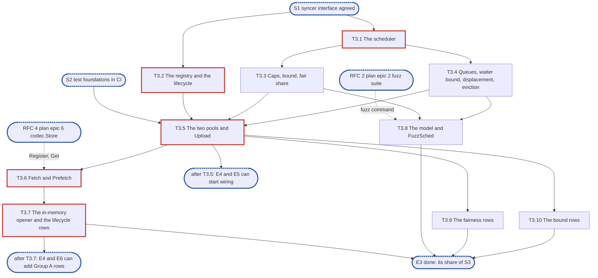

# Epic 3: syncer v2 registration, flows and the fair scheduler

**Sources:** [RFC 3](../docs/internals/rfcs/rfc-3-syncer.md) §1.2; §1.3's registration, flows,
`Flow.Close`, `Close` and `Unregister`, and its rule that `want` is read only to sum its lengths;
§1.4's virtual time, for the idle wait; §2.1; §2.3; §2.9; §2.10's quantum, caps, queue length,
waiter bound and class order; §2.12's pool series; §6's S1, S3, S13, S17, S18, S20 and S22;
§7.2's rows "§2.1 one limiter", "§2.3 backpressure", "§2.9 no starvation", "§2.9 fair by
worker-time", "§2.9 waiter share", "§2.9 bounded queue", "§2.9 store level", "§2.9 lone flow",
"§2.9 classes", "§2.9 eviction", "§2.9 waiter bound", "§1.3 lifecycle" and "§1.3 unregister"
(its flows and counters); §7.3's first rule; §8.1's "Scheduler model" and "Real backend" kinds
(the lifecycle checks); §8.2's "Scale of the scheduler" and two "Timing of a call" cases; §8.4's
five scheduler counts. Cited for what they hand over: §2.2 (the largest encoded block), §2.4 (the
throttle limit, the `Meter`), §2.8 (refusal at admission), §4.3 and §4.4 (joined callers,
re-homing, eviction). Cited, not owned: epic 1's D1 (what a refused call returns), epic 2's D1 to
D5 (the fault wrapper's `Hold` and `Link`, `syncertest`'s `Run`, `Env` and `Wait`). Every
citation is `develop`'s text. The code lands on `feat/storage-v2`, and the paths below are paths
there.
**Track:** A.
**Epic 3 estimate: 10 subtasks, 32.25 man-days.**
**Depends on:** **S1**, epic 1's `Syncer`, `Flow`, `pool.New`, `Config`, `Clock`, `Stats` and the
import test, for T3.1 and T3.2. **S2**, epic 2's test foundations: the fault wrapper's `Inject`,
`Hold` and `Link` over RFC 4's in-memory store and its record of calls in flight, and
`syncertest`'s frame, for T3.5 onward. **RFC 4 plan epic 6**, `codec.Store` with working bodies,
for T3.6 and T3.7 only: registering a store through `Register` and fetching need one, and RFC 4
plan epic 1's stub `codec.New` builds none. **RFC 2 plan epic 2**, which registers the nightly
`fuzz` suite, for T3.8's fuzz command. `internal/prof` and Go 1.26's `testing/synctest` are
already on `feat/storage-v2`.
**Blocks:** E4, which runs its attempt loop on T3.5's single-attempt path and adds the throttle
limit to T3.3's per-store bound; E5, which adds the health refusal to T3.5's admission; E6, which
completes T3.6's `Fetch` and `Prefetch`, re-homes T3.1's queue entries, adds joins to `sched` and
its model, and counts joined callers in T3.4's waiter bound; E4 and E6 also add their Group A rows
to T3.7's opener. Outside RFC 3's epics, RFC 8 offload plan epics 15 to 17 call `Upload`, `Fetch`
and `Prefetch`, and epic 16 opens and closes flows; RFC 8 offload plan epic 21's opener calls
`syncertest.Run`, whose signature D12 changes.

**Decided by the user, 2026-11-26:** D12, the idle wait; D7's RFC 3 §2.9 text; and D13's RFC 3
text for S17, S18, S22 and §7.2's "§2.9 no starvation" row, raised in review and landing with
T3.8's pull request. This pull request amends the plan's D2 and D3 and epic 2's D5 and T2.3 to
match D12.

---

## 1. Goal

Epic 3 makes the syncer accept work. Stores are registered, flows opened and closed, and each
half runs a pool of workers that a fair scheduler hands out: classes first, then deficit round
robin in worker-time over stores and flows, under caps, a fair-share rule, bounded queues and one
waiter bound per half. Every transfer is a single attempt here; epics 4 and 6 complete them.

**At the end of the epic:**

- `Register`, `Unregister`, `OpenFlow`, `Flow.Close` and `Close` work, and every call they make
  invalid fails with epic 1's D1 error.
- `Upload` waits in its flow's background queue, runs `attempt` once on a worker and returns its
  error as it is. `Fetch` and `Prefetch` wait in the demand, background or speculation queue and
  stream one `Store.Get`.
- A transfer is dispatched by `pkg/syncer/pool/internal/sched`, a pure package whose dispatch
  costs a fixed number of queue operations whatever the number of flows, checked after every
  step against a reference model, and fuzzed nightly.
- `Stats` reports the pool series of RFC 3 §2.12 that this epic counts.
- `syncertest.Run` runs over RFC 4's in-memory store through `codec.Store`, time moving only when
  every goroutine of the row is blocked, with the lifecycle rows green.

### 1.1 In scope

The scheduler and its model (T3.1, T3.3, T3.4, T3.8); the registry and lifecycle (T3.2); the two
pools, admission, the single-attempt `Upload`, the fixed values this epic uses and the pool
counters (T3.5); the single-attempt `Fetch` and `Prefetch` (T3.6); the in-memory opener and the
lifecycle rows (T3.7); the §7.2 pool rows (T3.9, T3.10).

### 1.2 Out of scope

- Retries, termination bounds, the throttle limit, the floor, the first-byte bound, the slow tail,
  unknown outcomes, `Upload`'s overlapping tries: E4. E3's per-store bound is the cap; E4 adds the
  throttle limit to it.
- Probes, health state, the refusal of an unhealthy direction, `Flow.Healthy` and `Flow.Health`:
  E5. "§1.3 unregister"'s probe half, and the health state it drops, are E5's.
- Fetch resume, the verification re-get, single flight, joining (in the pool, in `sched` and in
  the model), re-homing, detaching, the stream rules: E6. Joined callers enter T3.4's waiter count
  there.
- `syncer_inflight_bytes`, the consistent snapshot behind `Stats` and the memory bound: E7.
  `syncer_detached_buffers` and the joined callers in `syncer_waiters`: E6. `syncer_workers` is
  E1's.
- RFC 3 §2.10's values other than the quantum, the caps, the queue length, the waiter bound and the
  class order: each lands with the epic that consumes it (D9). The small-call bound and the
  small-body cap land with `Small`, the second row of the RFC 3 plan's §6.1 deferral ledger.
- Weighted flows, and a fixed value becoming a setting: rows of that ledger, unowned.
- The opener over the S3 store, behind a fault proxy, and its nightly run: RFC 8 offload plan
  epic 21, the ledger's sixth row.

### 1.3 Names used here

- **E1**, epic 1, interfaces: `pkg/syncer`'s contract, `pool.New` and its `Config` and `Clock`
  with stub bodies, `Stats`, the import test and the frozen-exports test.
- **E2**, epic 2, test foundations: the per-call faults on RFC 4's fault wrapper and the frame of
  the Group A suite, `syncertest`.
- **E3**, this epic.
- **E4**, epic 4, termination, retries and the uploader.
- **E5**, epic 5, store health.
- **E6**, epic 6, the fetcher.
- **E7**, epic 7, memory bound, `Stats` and the fault sweep.
- **E8**, epic 8, the syncer's own integration: its settings section and its collector.
- **E9**, epic 9, E2E green: the benchmarks B1 to B5.
- **S1**, the syncer interface agreed, at the end of E1 (the RFC 8 offload plan's S1b).
- **S2**, the test foundations in CI, at the end of E2.
- **S3**, the syncer complete over the in-memory store, after E5, E6 and E7.
- **R4-S2**, the RFC 4 plan's S2: its in-memory store, `remotetest` and fault wrapper landed.
- **RFC 3 S1, S3, S13, S17, S18, S20, S22**, invariants of RFC 3 §6, always written with
  "RFC 3" before them; they are not the synchronisation points S1 and S3 above.
- **The integration epic**, E8 here; outside RFC 3's epics, RFC 8 offload plan epic 21, which
  composes the syncer in the node.

## 2. How the general rules apply

The rules are those of
[the RFC 3 plan's §1.5](rfc-3-syncer-plan.md#15-general-rules-for-each-epic). They are cited by
number and title, not copied.

| Rule | Subtasks | How |
| --- | --- | --- |
| rule 1, independent unit tests ([`CLAUDE.md`, "Writing tests"](../CLAUDE.md#writing-tests)) | all | `internal/sched` is pure and is tested on its own values, with no clock and no store (T3.1, T3.3, T3.4, T3.8). The pool's unexported core is tested through `export_test.go` over RFC 4's in-memory store (kind 2) under E2's fault wrapper (kind 3), each test inside a `testing/synctest` bubble whose clock is the injected one (kind 1, D12): an upload's `attempt` and a half-level call are closures over the in-memory store's `Put` and `Get`, so T3.5, T3.9 and T3.10 need no codec. T3.6 and T3.7 reach the in-memory store through `codec.Store`. No test double is written |
| rule 2, fuzz tests where relevant ([`CLAUDE.md`, "Writing tests", "By kind"](../CLAUDE.md#writing-tests)) | T3.8 | `FuzzSched`: a byte string decoded into a sequence of arrivals, classes, charges, cancellations, ends and closes, run against the reference model, asserting the same dispatch and every invariant after each step. It joins the nightly `fuzz` suite RFC 2 plan epic 2 registers; its seeds run in `unit`. The scheduler reads no bytes off a wire or a disk, so it is the only target |
| rule 3, observability follows RFC 25, with RFC 3's own exception | T3.5 | `Stats` gains the counts of D11. No log line and no span: RFC 3 §2.8's two lines are E5's |
| rule 4, profiling | T3.1, T3.5, T3.10 | Every test runs under `internal/prof`'s leak check, which catches a caller left parked in a queue after its `ctx` ended or after `Close`. One dispatch asserts a flat count of queue operations at 1, 10, 100 and 1,000 waiting flows, fresh and in debt, from the operation counter `sched` keeps as its own output, read by its package's tests (T3.1, D3) |
| rule 5, public interface and internals ([`CLAUDE.md`, "Verifying a change"](../CLAUDE.md#verifying-a-change)) | T3.5, T3.6, T3.7, T3.9, T3.10 | Under `-race`. The pool limit, caps and shares are asserted at RFC 4's in-memory store's record of calls in flight and its peak, per store, where a call that outlives its worker still counts; per-flow worker-time and charges, which `Stats` does not report, at the half's `sched` through `export_test.go`; queue depth, waiters and refusals at `Stats`, where E8's collector reads them, and refusals also at the error the caller gets. The lifecycle rows run through `Syncer` and `Flow` (T3.7) |
| rule 6, known failures shrink | none | No suite this epic's tests run in keeps a `known.yaml`: every test lands green |
| rule 7, v2 ignores v1 | T3.1 | `internal/sched` joins E1's import test with an empty allowlist, the standard library only, and `pool`'s allowlist gains it (E1's D8). Nothing here reads v1 |
| rule 8, real dependencies for properties of those dependencies ([`CLAUDE.md`, "Writing tests"](../CLAUDE.md#writing-tests)) | T3.7 | The in-memory store, the codec and E2's wrapper are real. What they cannot fail like is RFC 8 offload plan epic 21's run of the lifecycle rows over the S3 store. Nothing needs a disk: the syncer persists nothing |
| rule 9, code comment conventions ([`CLAUDE.md`, "Code comments"](../CLAUDE.md#code-comments)) | T3.1, T3.2, T3.3, T3.4, T3.5 | RFC 3 §2.10's `decision:` note on its fixed values at the table T3.5 writes (D9). The `decision:` and `ponytail:` markers each decision in §4 names |
| rule 10, a test must be able to fail ([`CLAUDE.md`, "Writing tests"](../CLAUDE.md#writing-tests)) | all | Each §7.2 row names the wrong design it catches. Each is checked by building that design: a global arrival queue, a byte-charging scheduler, caps that bind for a lone flow or for a merely configured store, a shared waiter bound with no share, eviction off, no store level. The model is checked by planting one rule broken in `sched`, uncommitted, and watching the property test and the fuzz seeds fail |
| rule 11, a symbol is exported only if the RFC's interface uses it | all | No symbol is added to `pkg/syncer` or `pool`. `syncertest`'s frozen list in E1's surface test changes only by D12's `Run` parameter, in T3.7. `internal/sched` exports only what `pool` calls; its operation counter is unexported |
| rule 12, each subtask creates only what it declares | all | Each fixed value lands with the subtask that reads it (D9). The per-store bound has no setter here: in E3 it is the cap, and E4 adds the throttle limit and its caller. Joins land in `sched`, its model and the pool with E6, their first caller. The admission step E5 extends and the waiter count E6 adds to are shapes E3's own rules already read (D10) |

## 3. Requirements and invariants

Every obligation that RFC 3 places on this epic, numbered so that subtasks and tests can cite
them.

**Pools and backpressure**

| # | Requirement | Kind | Source | Subtasks |
| --- | --- | --- | --- | --- |
| R1 | Each half is a pool of its configured size, and the transfers in flight in a half never exceed it | MUST | §2.1; §6, RFC 3 S1; §8.4, "peak in flight" | T3.5, T3.8, T3.10 |
| R2 | Nothing but the pool size limits how many transfers are in flight. The caps are fixed fractions of the pool, and the queue lengths and the waiter bound limit how many wait, not how many run | MUST NOT | §2.1 | T3.3, T3.5, T3.10 |
| R3 | The two halves share no pool, no queue and no counter. Their sizes are configured apart, which E1's `Config` holds (its R17) | invariant | §1.2 | T3.5 |
| R4 | When a pool is full the caller waits or is refused; no queue is unbounded, and no buffer has a size that is neither configured nor one of RFC 3 §2.10's fixed values | MUST NOT | §2.3; §2.10, "per-flow queue length", "waiter bound"; §6, RFC 3 S3 | T3.4, T3.5, T3.8, T3.10 |
| R5 | A transfer waits in its flow's queue until a worker is free or its `ctx` ends, and leaves the queue when its `ctx` ends | invariant | §1.3; §2.9 | T3.1, T3.5, T3.10 |
| R6 | Both pool sizes are fixed for the life of the process: nothing in `pool` resizes a half after `New`, and E1's frozen exports hold that no method to do so exists | invariant | §2.10 | T3.5 |

**Registration, flows and lifecycle**

| # | Requirement | Kind | Source | Subtasks |
| --- | --- | --- | --- | --- |
| R7 | A flow is bound to one store and one queue per class in the scheduler: a transfer on a flow goes to that flow's store and waits in that flow's queue | invariant | §1.3; §2.9 | T3.2, T3.5 |
| R8 | A call on a closed flow fails, and so does a call after the syncer's `Close`, a second `Flow.Close` included | MUST | §1.3; §7.2, "§1.3 lifecycle" | T3.2, T3.5, T3.7 |
| R9 | `Flow.Close` takes the flow out of the scheduler, refuses its queued transfers with an error and lets its running ones finish | invariant | §1.3 | T3.5, T3.7 |
| R10 | The syncer's `Close` stops accepting work and returns once every transfer in flight has ended, a fetch whose stream its caller is still ranging over included | invariant | §1.3; §7.2, "§1.3 lifecycle" | T3.5, T3.6, T3.7 |
| R11 | `Unregister` on a store with an open flow fails. Once its flows are closed it drops the store, whose counters leave `Stats` (its probes and health state are E5's) | MUST | §1.3; §7.2, "§1.3 unregister" | T3.2, T3.7 |
| R12 | A refused call wraps an error of RFC 4's set: a full queue, the waiter bound, a displaced or an evicted entry `remote.ErrThrottled`; a call after `Flow.Close` or `Close`, a `StoreID` not registered and `Unregister` with a flow open `remote.ErrInvalid` | invariant | §1.3; E1's D1 | T3.2, T3.4, T3.5 |
| R13 | `Upload` returns `nil` only once a call of `attempt` returned `nil`, returns only once every call of `attempt` it made has returned, and never calls `attempt` after it returns. E3 makes one call; E4 owns the rest | MUST | §1.3; §7.2, "§1.3 lifecycle" | T3.5, T3.7 |
| R14 | The syncer passes `name` and `want` through and, in this epic, reads `want` only to sum its lengths for scheduling; E6 also reads it to resume and join a fetch, under the RFC 3 §1.3 text the user accepted on 2026-11-26, which lands with E6's T6.2 | MUST NOT | §1.3 | T3.6 |

**Classes and turns**

| # | Requirement | Kind | Source | Subtasks |
| --- | --- | --- | --- | --- |
| R15 | Every transfer has one class: demand (`Fetch` on a flow that is not background), background (every `Upload`, and `Fetch` on a background flow), speculation (`Prefetch`). A freed worker serves the highest class with work waiting, and the rounds, the caps, the per-store bound's peers and the fair share are reckoned only among that class's flows and stores: "work waiting" in R22, R26 and R28 means work waiting in the class being served (D3, D13) | invariant | §1.3; §2.9; §6, RFC 3 S13; §2.10, "class order" | T3.1, T3.5, T3.6, T3.8, T3.9 |
| R16 | One queue per flow and class, never a global one | invariant | §2.9 | T3.1 |
| R17 | Turns are in worker-time. A visited flow's deficit gains a quantum, and the head of its queue is dispatched while its charge fits the deficit, each charge subtracted. A transfer is charged at dispatch, never at enqueue, an estimate, its encoded size divided by its store's recent per-worker throughput in that direction, and at its end the difference between the worker-time it held and the estimate is subtracted from or returned to its flow's deficit. A flow whose queue empties has its deficit reset to zero, after its running transfers' corrections. The deficit, its debt and its parking are kept per flow and class, so a flow's speculation never delays its own demand (§4.4) | invariant | §2.9; §4.4; §6, RFC 3 S22 | T3.1, T3.5 |
| R18 | The size charged is an upload's `size`, the sum of a fetch's `want` lengths, and for a whole-block fetch the largest encoded block; no charge exceeds the largest encoded block's, so a `want` naming one range twice charges no more than the whole block | invariant | §2.9; §2.2 | T3.5, T3.6 |
| R19 | The quantum is at least the estimate of the largest encoded block on the slowest store with work waiting, so every flow with work waiting dispatches at least once per round; it is derived, never a setting | invariant | §2.9; §2.10, "DRR quantum" | T3.1, T3.5 |
| R20 | Each dispatch costs O(1): the queue operations of one dispatch are the same at 1, 10, 100 and 1,000 waiting flows | bound | §2.9; §8.4, "scheduler work per dispatch" | T3.1 |
| R21 | Two levels: the scheduler picks a store by round robin over stores with work waiting, then a flow on that store | invariant | §2.9 | T3.1, T3.9 |
| R22 | A transfer at the head of its flow's queue is dispatched within one round of its class, once no higher class has work waiting, unless its flow or store is at its cap or bound, or its flow is in debt from a correction (R17). A round is counted per level (D3): one turn per store with work waiting in the class, and on its store one turn per flow with work waiting there, so a flow waits at most one turn of each other store and of each other flow on its own store between its turns (D13, §9) | invariant | §2.9; §6, RFC 3 S18 | T3.1, T3.8, T3.9 |
| R23 | Over a round, counted per level as R22 does, stores of one class with work waiting hold workers for times within one quantum of each other, and so do the flows on one store; bytes dispatched per flow of one store stay within one quantum; a flow in debt is held to it once its debt is paid. The quantum is the one used, at most twice §2.10's figure (D4, D13, §9) | invariant | §6, RFC 3 S22; §8.4, "fairness" | T3.1, T3.8, T3.9 |
| R24 | All flows have equal weight: `sched` takes no weight, and two flows with equal charges get equal turns | invariant | §2.9 | T3.1 |

**Caps and shares**

| # | Requirement | Kind | Source | Subtasks |
| --- | --- | --- | --- | --- |
| R25 | The per-store and per-flow cap is three quarters of the pool, rounded down, at least one worker, and with a pool of more than one at most the pool less one | invariant | §2.10, "per-store and per-flow cap" | T3.5 |
| R26 | No dispatch gives a store more workers than its cap while another store has work waiting in the class being served, nor a flow more than its cap while another flow on its store has; a store or flow that only holds workers, with nothing queued, only has work in a lower class, or is only registered, binds nothing. A store already above its cap when another arrives is not preempted: it gets no further worker until it is below. A lone busy flow on a lone busy store uses the whole pool, and no worker idles while work of the class being served waits | invariant | §2.9; §6, RFC 3 S17 | T3.3, T3.8, T3.9 |
| R27 | A store's dispatch is also gated by its per-store bound, which is inert while it equals the cap and, once lowered below the cap, binds whatever else waits. In E3 it always equals the cap; E4 lowers it to the throttle limit, never above the cap | invariant | §2.1; §2.9; §6, RFC 3 S17 | T3.3 |
| R28 | No store gets a worker beyond its fair share, the pool divided by the stores holding or waiting for workers in the class being served, while another store with work waiting in that class holds none; a store holding no worker may always take its first, so a pool smaller than the waiting stores is served by the round robin (D13) | invariant | §2.9; §6, RFC 3 S17 | T3.3, T3.8, T3.9 |

**Queues and the waiter bound**

| # | Requirement | Kind | Source | Subtasks |
| --- | --- | --- | --- | --- |
| R29 | A flow's queue for a class holds at most four times the pool; a call finding it full is refused, except a demand that evicts speculation (R32, D8) | MUST | §2.9; §2.10, "per-flow queue length"; §7.2, "§2.9 bounded queue" | T3.4, T3.8, T3.10 |
| R30 | Waiters per half, queued transfers and joined callers together, never exceed the waiter bound, eight times the pool, whatever the number of flows | invariant | §2.9; §2.10, "waiter bound"; §6, RFC 3 S20; §8.4, "waiters" | T3.4, T3.8, T3.10 |
| R31 | A call that finds the half at its waiter bound is refused only if its own flow holds at least its fair share of the bound, the bound divided by the flows holding waiters, its own included. Otherwise the youngest queued transfer of the flow holding the most waiters, of the same class or a lower one, is refused in its place as displaced, and the call takes the slot. A victim is never the caller's flow and never a flow below its share (D7) | MUST | §2.9; §6, RFC 3 S20; §8.4, "waiters displaced" | T3.4, T3.8, T3.10 |
| R32 | Above both rules, a demand that would be refused evicts the youngest queued speculative entry of any flow, which is refused as evicted, and takes its place; a demand is refused only when no speculation is queued | invariant | §2.9; §4.4 | T3.4, T3.8, T3.10 |

**The model and the checks**

| # | Requirement | Kind | Source | Subtasks |
| --- | --- | --- | --- | --- |
| R33 | A scheduler model runs random flows, classes, sizes and arrival times on the virtual clock, checked after every dispatch against a reference: highest class first, deficit round robin within it, who runs next, no flow or store over its cap or fair share, waiters within the bound. A failing run is shrunk and kept. Joins are E6's, which adds them to `sched` and the model | test row | §8.1, "Scheduler model" | T3.8 |
| R34 | Time in a check is virtual: every deadline and wait of the pool runs on the injected clock, which moves only when every goroutine of the check is blocked | invariant | §1.4 | T3.5, T3.7 |
| R35 | A backend that returns instantly is not used for §2's checks: the pool rows run over E2's `Link` | MUST NOT | §7.3; E2's D1, D3 | T3.9, T3.10 |
| R36 | The checks reach the cases of §8.2's "Scale of the scheduler" (a pool of one; a thousand flows, one with work; a flow opened and closed without transferring; a demand at a full waiter bound with exactly one speculative entry queued, on another store) and two of its "Timing of a call" (`ctx` cancelled while queued; `Flow.Close` with transfers queued and running) | test row | §8.2 | T3.7, T3.10 |
| R37 | The lifecycle checks run in the Group A suite, over any remote store its caller opens | test row | §8.1, "Real backend"; E2's D2 and D7 | T3.7 |

**Observability**

| # | Requirement | Kind | Source | Subtasks |
| --- | --- | --- | --- | --- |
| R38 | `Stats` makes observable, by half and store, `syncer_workers_busy`; `syncer_queue_depth` and `syncer_waiters` by class, per flow and summed; `syncer_queue_wait_seconds` by class; and `syncer_refused_total` with `reason` `queue_full`, `waiters_full`, `displaced`, `evicted` and `closed`, and no class label (the user's decision, 2026-11-26). `syncer_workers` is E1's, `unhealthy` E5's, the joined callers in `syncer_waiters` E6's, `syncer_inflight_bytes` E7's | MUST | §2.12 | T3.5 |
| R39 | Reading the counters takes no lock a dispatch needs, and costs nothing per transfer in flight. E3's counters are kept so; the consistent snapshot across them is E7's | MUST NOT | §2.12 | T3.5 |

RFC 3 §1.3's other obligations belong to E4 (`Upload`'s tries, the error table), E5
(`Healthy`, `Health`, probe groups) and E6 (`Fetch`'s stream rules); §2.9's "a transfer to an
unhealthy direction never enters a queue" is E5's, at T3.5's admission. §2.9's "no other flow's
work is refused because of it" describes the refusal of the call itself, which R31 and R32
already state with their two exceptions.

## 4. Decisions this epic takes

- **D1, a worker is a slot, and a transfer runs on its caller's goroutine.** Dispatch grants the
  waiting caller a slot; the caller runs `attempt`, or pulls `Store.Get`'s stream, itself, and
  returns the slot when it ends. No worker goroutine is started, so `Upload` returns only once
  its one `attempt` call has (R13), and a transfer whose caller leaves releases its slot then.
  E4's slow-tail try outlives its slot, not its caller, since `Upload` waits for it; E6 changes this
  for fetches: a fetch runs on a flight goroutine of its own from the slot it holds, which its
  callers join, and D6 counts the flight. No marker: nothing is skipped.
  Prior art: Kubernetes API priority and fairness, where a request waits in its flow's queue for a
  seat and runs on its own goroutine (from memory). Not chosen: a pool of worker goroutines fed by
  a channel, which adds a hand-off per transfer.
- **D2, `internal/sched` is a value-only state machine.** It holds stores, flows, queues and
  deficits, and knows no clock, goroutine or store: `pool` calls it under one mutex per half and
  turns its answers into wake-ups. That keeps it pure (rule 1) and lets the reference model drive
  it step by step. No marker. Prior art: DRR as Shreedhar and Varghese state it, a set of queues
  and an active list.
- **D3, O(1) dispatch through active rings.**
  - Per class, a ring of stores with work waiting, and per store and class a ring of its flows
    with work waiting. A store or flow at its cap leaves its class's ring, and rejoins when one of
    its transfers ends or when the count it is capped against falls to zero, each an O(1) check
    at the event. That count is per class: other stores with work waiting in the same class,
    other flows on the store with work waiting in it. A lower class's queue never caps a higher
    class, and class order never stops a capped store's worker from going to the higher class's
    other work, so no worker idles while the class being served waits (R26). A store also leaves
    its rings while it holds its per-store bound, if E4 has lowered that below the cap (R27).
  - Deficits are per flow and class, so are debt and parking (R17). A flow whose deficit plus one
    quantum still does not cover its head's charge, after an overrun returned by `Done`, does not
    stay in the ring to be skipped: it is parked for the number of rounds that would cover it,
    computed once, in a wheel per store and class of 64 slots, one round each, with one bit per
    slot in a 64-bit occupancy mask. A flow is parked at most 63 rounds ahead; one needing more is
    parked at the cap and, still short when it rejoins, parks again, so a debt of *r* rounds costs
    ⌈*r* / 63⌉ O(1) steps over its life, whatever the number of flows. A correction that large
    comes from a slot held far past its charge, as under `Hold` or E4's floor of minutes against
    a quantum of about 200 ms. Each slot holds its flows in an intrusive list, each with the round
    it parked at. At a slot's round the list is spliced onto the store's ring in one step, and
    each flow is credited the rounds it skipped, at the quantum current then, only at its own
    turn, so *k* flows parked to one round cost one step at that round and one at each of their
    turns, never *k* in one `Next`. When a store's ring of a class is empty and its wheel is not,
    the wheel jumps to its next occupied slot, found in O(1) through the mask, so a lone flow in
    debt is served again at once rather than waiting for rounds nobody makes. If the quantum fell
    meanwhile and the credit leaves a flow short, it parks again for the rounds still needed, one
    more O(1) step. One dispatch therefore never walks past a flow in debt. A `decision:` marker
    names the wheel, its cap, the jump and the credit at a flow's turn. An overflow level, a
    hierarchical wheel, was not chosen: the cap costs one re-park per 63 rounds of debt and no
    second structure.
  - The fair-share rule tests only the store about to be served: if it holds *k* ≥ 1 workers and
    (*k* + 1) × *n* > the pool, *n* the stores holding or waiting in the class being served, and
    a store with work waiting in that class holds none, that store is served instead, from a list
    of such stores per class. A store holding no worker is never redirected (R28). Shares are
    compared exactly, never rounded.
  - A round is counted per level: the store ring gives one turn per store, and each store's turn
    gives one flow on it its turn (R22, R23, D13, §9).
  - Each operation on a queue, ring or wheel adds one to an unexported counter `sched` keeps as its
    own output, which its package's tests read (rule 4, RFC 3 §8.4).

  Prior art: DRR's active list; Linux `fq_codel`'s new and old flow lists; hierarchical timing
  wheels, Varghese and Lauck (from memory).
- **D4, the quantum is rounded up to a power of two of the estimate.** RFC 3 §2.10 makes it the
  estimate of the largest encoded block on the slowest store with work waiting, which changes as
  stores start and stop waiting. Keeping an exact maximum costs O(log s) per change. Instead each
  waiting store's estimate is bucketed by its highest set bit, a 64-bit mask holds the buckets in
  use beside a count of waiting stores per bucket, so a store leaving a shared bucket clears its
  bit only when the count falls to zero, and the quantum is the top bucket's upper bound: O(1), at least the RFC's figure, at most
  twice it. A `decision:` marker at the site names the rounding and that it keeps R19; R23 is
  judged against the quantum used (§9). Prior art: Linux's timer wheel buckets by magnitude (from
  memory).
- **D5, the estimate is a running mean per store and direction.** Each ended transfer that held
  its slot for a positive time and moved at least one byte, whatever its outcome, folds its bytes,
  from the `Meter` T3.5 passes in (E1's surface, RFC 3 §2.4), and its worker-time, from the
  injected clock, into two means with weight one eighth, one of bytes and one of worker-time,
  divided to give the rate; a mean of per-transfer rates would let small ranged fetches inflate
  the quantum; a transfer that ended in no time, as under
  `Hold` in a bubble, or moved no byte, as one failing before its first, is not folded. The rate
  is integer bytes per second, at least one; `sched` computes a transfer's charge at dispatch as
  its size, capped at the largest encoded block, over its store's rate, at least one nanosecond,
  so no estimate, quantum or round count divides by zero or overflows. `pool` gives each store
  the default rate when it is registered, before its first `Add`. Before a store's first folded
  transfer the rate is 20 MiB/s per worker, RFC 3 §2.10's figure for a 4 MiB block in about 200
  ms, behind a `decision:` marker: corrections at each end fix any error in it. `ponytail:` a mean with a fixed weight lags a store whose speed changes
  faster than about eight transfers; upgrade to a time window when B3's wait exceeds one round
  after a store slows. E4's floor reads its own aggregate, not this. Prior art: TCP's smoothed
  round-trip time, a mean with weight one eighth (RFC 6298, from memory).
- **D6, `Flow.Close` and `Close` refuse queued work as closed, and `Close` waits for every caller
  inside the syncer.** A queued transfer refused by either wraps `remote.ErrInvalid`, as E1's D1
  says of a call after either, and counts under `closed`; so does a second `Flow.Close` (R8).
  `Close` then waits until no caller is inside the syncer, on a channel closed when that count
  reaches zero, never by polling and never while holding a lock. The count is an atomic beside a
  closed flag, not state under the registry's lock: a caller adds one, then checks the flag and,
  if set, takes its one back and is refused; `Close` sets the flag, then waits; whoever brings the
  count to zero with the flag set closes the channel, once. So no transfer call takes the
  registry's lock (R39, D11). `Upload` is counted from entry to return. A `Fetch` or `Prefetch`
  returns its iterator at once and runs `Store.Get` later in its caller's range loop, so it is
  counted from the iterator's first pull to a deferred end when the loop stops; an iterator first
  ranged after `Close` yields one `remote.ErrInvalid` and ends. Counting callers rather than
  slots is what makes it wait for E4's slow-tail try, which outlives its slot, and for a stream
  its caller is still reading. A call racing `Close` either enters before it and is waited for,
  or is refused. A flow's closed flag is set by `Flow.Close` and read by `admit` under the half's
  lock, so a call racing `Flow.Close` is either queued first and then refused by it, or refused in
  `admit`; `sched`'s `Add` on an unknown or closed `FlowKey` refuses as `closed`. `Unregister`
  drops the store from the registry at once and does not wait for the transfers `Flow.Close` let
  finish: each one's `Done` returns its slot and folds nothing into the dropped store's rate, and
  the last calls `RemoveStore`. The store's owner, which closed the flows, waits for its own
  callers to return before it drops the `Store`. No marker. Prior art: `net/http.Server.Shutdown`, which refuses new work and waits for active
  connections (from memory).
- **D7, displacement scans, and takes the lowest class first.** RFC 3 §2.9 names the youngest
  queued transfer of the flow holding the most waiters, of the same class or a lower one than the
  call's, without saying which when several classes qualify, or what to do when the fullest flow
  holds nothing displaceable.
  - A flow holding *w* waiters is at its share when *w* × *m* ≥ the bound, *m* the flows holding
    waiters with the caller's counted, compared exactly.
  - Victims come only from flows other than the caller's that are at or above their share, so no
    flow below its share is ever refused for the bound (RFC 3 S20). The RFC's fullest flow is
    always one of them, since the caller is below its share and the bound is full. Among them the
    fullest one holding a displaceable entry is chosen, ties to the first `FlowKey` after the last
    victim's, wrapping, so no one flow is always displaced first; within it
    the lowest class first (speculation, then background, then demand), the youngest within that.
  - A call under its share for which no such flow holds a displaceable entry (each holds only
    waiters of a higher class or, from E6, joined callers) is refused as `waiters_full`. RFC 3
    S20 does not allow for that case; the model's S20 check exempts it by name. The user accepted
    the RFC 3 text for it (2026-11-26): §2.9 gains "If no other flow at or above its share holds
    a queued transfer of the call's class or a lower one, the call is refused.", and S20's second
    clause "unless no waiter can be displaced". It lands with T3.4's pull request.

  `ponytail:` the scan is O(flows holding waiters), at most eight times the pool, and runs only at
  a full bound, never on dispatch; upgrade to buckets by waiter count per class when a profile of
  an overloaded half shows it. `decision:` markers name the class order and the refusal. Prior
  art: none found for this case.
- **D8, eviction also overrides a full demand queue.** RFC 3 §2.9 applies eviction "above both
  rules", and §4.4 says a demand that finds its queue full evicts rather than being refused. So a
  demand whose own queue is full evicts the youngest queued speculation of any flow and takes its
  slot, letting its demand queue exceed four times the pool by the entries it evicted; the waiter
  bound still holds, since each eviction frees the slot it takes. A `decision:` marker says so.
  Only a demand evicts; a background call finding its queue full is refused. Eviction applies
  only to a demand that would otherwise be refused: a demand under its share at a full bound
  displaces as D7 says, and evicts only when D7 finds no victim, when its flow is at its share,
  or when its own queue is full. `Add` reports why: a refused call gets its reason (`queue_full`
  or `waiters_full`), and `sched` sets the reason on each entry it refuses in the call's place
  (`displaced` or `evicted`) or at `CloseFlow` (`closed`), so `pool` counts each under R38's
  `reason` and names it in the victim's error. One flow can reach D7's refused case on its own:
  in the fetch half, a flow at or above its share whose demand queue is full evicts speculation,
  its own included, until its demand fills the bound; every other flow's background call is then
  refused as `waiters_full`, since no flow at its share holds anything of background's class or
  lower. A demand under its share still finds a same-class victim, and uploads run in the other
  half, so what is refused is background fetches, relocation reads among them. The `decision:`
  marker names this. Limiting eviction past a full own queue to flows under their waiter share
  would close it, but narrows RFC 3 §4.4, and the user decided on 2026-11-26 to keep §4.4 as
  written for v1.1: one flow may fill the fetch half's waiter bound. The marker names the case and
  the trigger to revisit it, benchmarks showing other flows' background fetches starved. Prior
  art: none found.
- **D9, the fixed values live in one table, each landing with its consumer.** `pool/fixed.go`
  holds RFC 3 §2.10's table with the RFC's `decision:` note above it. E3 writes the values it
  reads: the cap, the queue multiple, the waiter multiple and the class order, and the quantum's
  derivation. E4, E5 and E6 add theirs to the same table under the same note. This narrows the RFC
  3 plan's epic 3 outline, which has E3 write the whole table, by rule 12. Prior art: none found.
- **D10, the admission step is one function E5 extends.** Every call passes `admit` before it
  queues: a closed flow or syncer, a full queue, the waiter bound with its displacement and
  eviction. E5 adds the unhealthy direction to it, after the closed check and before the rest, so
  a call refused for health never takes a waiter slot (RFC 3 §2.8, §2.9). E6's join counts a
  joined caller in the waiter bound through the same count `admit` reads. No marker. Prior art:
  none found.
- **D11, `Stats` is read without the half's lock.** Each of R38's counts is an atomic the half
  updates at the event, read by `Stats` walking the registry under the registry's lock (R39). No
  transfer call and no dispatch takes that lock: D6's count is an atomic, and only `Register`,
  `Unregister`, `OpenFlow` and `Flow.Close` take it, so a walk over a thousand flows delays only
  those. E7's D2 then replaces the walk with a list of stores and flows published through an
  `atomic.Pointer`, which `Stats` loads with no lock at all. A refusal of a call naming no
  registered store is not counted (E1's D3). No marker. Prior art:
  the journal's `Stats`, read by the node (`journalSeries`, `internal/node/stats.go`).
- **D12, the opener runs each row in a `testing/synctest` bubble. The user's decision,
  2026-11-26.**
  RFC 3 §1.4 lets virtual time advance only when every task is blocked, and E2's D5 leaves the
  in-memory opener to do it.
  - Each check of `pool`, and each row over the in-memory opener, runs inside
    `synctest.Test`. The `Clock` passed to `pool.New` and to E2's `Link` reads the standard
    library's time, which inside a bubble is fake and moves only once every goroutine in the
    bubble is durably blocked: on a channel or a `select` over channels made in the bubble, a
    timer, or the bubble's `sync.WaitGroup` or `sync.Cond`. A goroutine running, a store call
    running and a goroutine started but not yet inside the syncer all keep time still. A `Hold`
    inside an `attempt` closure is a channel wait the bubble sees.
  - What the bubble does not see, and the rules that follow. A goroutine waiting on a
    `sync.Mutex` is not durably blocked, so a deadlock through a mutex hangs until the test's
    `-timeout` rather than panicking: the pool never waits on a slot, a wake-up or `Close`'s
    channel while holding a lock (D6), and its mutexes guard only short critical sections. A
    channel made outside the bubble hangs the same way, so the opener, `pool.New`, the clock
    adapter, every channel and every cleanup are created inside it. A deadlock of channel waits
    panics only while no timer is pending; once E5's 5 s probe loop runs, a `done` that never
    closes lets fake time run on forever. And that panic ends the whole test binary unless
    caught, so the deadlock criterion is checked in a child process.
  - `Env.Wait(done)` over the in-memory opener waits on `done`, and fails the row once the
    bubble's clock passes one hour after the row started, a bound in fake time that costs no real
    time and catches the probe-loop case.
  - `syncertest.Run` gains one parameter, how to run a row: the in-memory caller passes
    `synctest.Test`, RFC 8 offload plan epic 21 a plain call over the S3 store, which a bubble
    cannot hold. That changes E2's frame, which merged with `Run(t, Opener)` (#5881): this pull
    request amends epic 2's D5 and T2.3 and the plan's D2 and D3, and T3.7 changes `Run` and
    `syncertest`'s frozen list.

  The test clock adapter lives in `export_test.go`; production keeps E1's real-clock ban. The plan's
  D3 chose `pkg/sim`'s `TestClock` and rejected `synctest` because "its bubble cannot share
  `pkg/sim`'s clock with the other components"; that holds for the composed node, not for a
  syncer row over the in-memory store, which composes nothing else. Prior art:
  `pkg/engine/close_bubble_test.go` on `feat/storage-v2`, which runs the engine's `Close` checks
  in a `synctest` bubble beside `pkg/sim`'s clock, and `internal/adapter/core`, whose tests use
  `synctest` too. Not chosen: the
  `TestClock` with an idle wait counting the pool's parked goroutines and a parked count on the
  wrapper, which had three holes to close (a wait woken by its context, a goroutine not yet
  inside the syncer, a goroutine blocked outside both counts) at about 2 man-days more. No
  marker.
- **D13, RFC 3's S17, S18, S22 and the "§2.9 no starvation" row read as this epic checks them.
  Accepted by the user, 2026-11-26; the text lands with T3.8's pull request.** Each literal text
  is false in a reachable state of the design §2.9 itself states (R15, R22, R23, R26, R28):
  - S17: "No dispatch gives a store more workers of a half than its cap while another store has
    work waiting in the class being served, nor more than its throttle limit; …; and no store
    holding a worker gets another beyond its fair share while another store with work waiting in
    that class holds none." Without the class, a store with only speculation waiting caps a store
    whose demand it cannot overtake, and workers idle (pool 8, cap 6: 2 idle). Without "holding a
    worker", a pool of 1 with two stores waiting breaks it on every dispatch. Checked at dispatch,
    since a lone store above its cap when another arrives is not preempted (§2.9: "the cap binds
    from then on").
  - S18 and §2.9's round: "A round gives one turn to each store with work waiting in the class,
    and each store's turn to one of its flows in turn." With eight flows on store A and one on B,
    a flow on A waits 15 turns, where a flat round allows 8. And "unless its flow is in debt",
    since a correction larger than a quantum (§2.9) keeps a flow from dispatching for more than
    one round.
  - S22: "over a round, stores of one class with work waiting, and the flows on one store, hold
    workers for times within one quantum of each other." Over a flat round, store B's lone flow
    holds about eight quanta against one for each of A's eight flows.
  - §7.2's "§2.9 no starvation" row crosses halves: it saturates flow A with uploads and issues a
    fetch on flow B, which runs in the fetch half and starts at once whatever the upload scheduler
    does, while A, alone in its half, holds the whole pool by §2.9's lone-flow rule rather than
    its cap. The row gains its one-half form, which T3.9 also runs: "Saturate flow A with uploads
    to a store whose puts take seconds; issue one upload on flow B; assert it starts within one
    round and that from then on flow A never holds more than its cap."

## 5. Target tree

```text
pkg/syncer/
  imports_test.go          T3.1  internal/sched's allowlist (standard library only); pool's gains it
  surface_test.go          T3.7  syncertest's frozen Run gains its row runner (D12)
  pool/
    internal/sched/              the scheduler, a pure package
      sched.go             T3.1  Sched, Config, StoreKey, FlowKey, Class, Reason, Entry; the active
                                 rings, the debt wheel, the quantum buckets, the operation counter
      caps.go              T3.3  caps, the per-store bound, the fair-share list
      waiters.go           T3.4  queue lengths, the waiter bound, displacement, eviction
      sched_test.go        T3.1  each rule; one dispatch's operations at 1 to 1,000 flows
      caps_test.go         T3.3
      waiters_test.go      T3.4
      model_test.go        T3.8  the reference model and its property test, package sched_test
      fuzz_test.go         T3.8  FuzzSched
      testdata/fuzz/FuzzSched/  T3.8  seeds
    fixed.go               T3.5  RFC 3 §2.10's table, the values E3 reads (D9)
    pool.go                T3.2  New, the registry, Register, Unregister, OpenFlow, Flow.Close
    half.go                T3.5  a half: its sched, slots, admit, wait, dispatch, Close; the estimate
    upload.go              T3.5  Upload, one attempt
    fetch.go               T3.6  Fetch and Prefetch, one Get
    stats.go               T3.5  the counters of D11 and Stats' walk
    export_test.go         T3.2  the registry and the halves for tests; the bubble's clock (T3.5)
    pool_test.go           T3.2
    half_test.go           T3.5  admission, dispatch, Close over the in-memory store
    fetch_test.go          T3.6
    opener_test.go         T3.7  the in-memory opener; syncertest.Run over it; unregister
    fair_test.go           T3.9  the §7.2 fairness rows
    bounds_test.go         T3.10 the §7.2 bound rows, §8.4's counts, §8.2's cases
  syncertest/
    suite.go               T3.7  Run's row runner parameter (D12)
    lifecycle.go           T3.7  the "§1.3 lifecycle" rows
test/suites.yaml           T3.8  FuzzSched in the fuzz suite's commands
```

## 6. Subtasks

### T3.1 The scheduler: classes, queues and two-level deficit round robin

**Subtask T3.1 estimate: 4 man-days.**

- **Track:** A. **Depends on:** S1, for the import test.
- **Covers:** R5, R15, R16, R17, R19, R20, R21, R22, R23, R24.
- **Deliverables:** `internal/sched` (D2, D3, D4):

  ```go
  type Class uint8  // Demand, Background, Speculation, in that order
  type Reason uint8 // None, QueueFull, WaitersFull, Displaced, Evicted, Closed
  type StoreKey, FlowKey uint64
  type Entry struct {
      Flow    FlowKey
      Class   Class
      Size    int64  // bytes; charged at dispatch, capped at Config.MaxBlock (R17, R18)
      Refused Reason // set by sched on an entry it refuses in another call's place or at CloseFlow
  }
  type Config struct {
      Pool, Cap, QueueLen, Waiters int // from pool's fixed table
      MaxBlock                     int64 // the largest encoded block, RFC 3 §2.2
  }
  type Sched struct{ /* unexported */ }
  func New(c Config) *Sched
  func (s *Sched) AddStore(st StoreKey, rate int64)      // bytes per second per worker, the default at first (D5)
  func (s *Sched) RemoveStore(st StoreKey)               // at Unregister, once the store has no flow
  func (s *Sched) SetRate(st StoreKey, rate int64)       // D5's mean, at least 1
  func (s *Sched) AddFlow(st StoreKey, f FlowKey)
  func (s *Sched) CloseFlow(f FlowKey) []*Entry          // its queued entries, Refused = Closed; parked or not
  func (s *Sched) Add(e *Entry) (victims []*Entry, err error) // T3.4 adds refusals and victims
  func (s *Sched) Remove(e *Entry) (queued bool)         // false if e was dispatched, refused or closed already
  func (s *Sched) Next() *Entry                          // nil when no slot may be given
  func (s *Sched) Done(e *Entry, held time.Duration)     // the correction of R17
  ```

  The quantum is D4's bucket over the largest encoded block's charge on each store with work
  waiting. `time.Duration` is the standard library's; `sched` reads no clock. `Remove` is defined
  for every entry `pool` holds: it unlinks a queued entry, from a parked flow too, and reports
  `true`; for an entry already returned by `Next` it changes nothing and reports `false`, and the
  caller, which lost the race between its `ctx` and the dispatch, calls `Done(e, 0)` to give the
  slot back; for one already refused it changes nothing and reports `false`. The charge `Next`
  computes is kept by `sched` with the dispatched entry, unexported, and `Done` corrects against
  that charge and that class, so a `SetRate` between dispatch and `Done` changes nothing, and E6's
  `Promote` moves it with the entry. Consumed by T3.3 and T3.4, which add caps and
  waiters; T3.5, whose halves call it; T3.8, whose model drives it; E4, which adds the throttle
  limit to the per-store bound; E6, which adds joins, re-homes and promotes entries.
- **Acceptance criteria:**
  - `Next` returns the head of the highest class with work waiting, by store round robin, then
    flow round robin, then deficit; the store level gives one flow turn per store visit (§9).
  - A visited flow gains one quantum; its head is dispatched while its charge fits; a flow whose
    queues empty has its deficit reset once its running entries are `Done`.
  - `Done` returns or subtracts the difference between `held` and the charge; a flow left in debt
    is parked in its class's wheel and rejoins on the round that covers it, or at once, through
    the wheel's jump, when no other flow of its store and class waits.
  - A flow's debt in one class never delays its entries of another: its demand waits no round
    for its own speculation's overrun.
  - A head's charge is computed at `Next` from the store's rate then, never at `Add`.
  - `Remove` takes a queued entry out in O(1), from a parked flow too, and reports `true`; after
    `Next` returned the entry, or after it was refused, it reports `false` and changes nothing. A
    flow or store left with nothing waiting leaves its ring; `RemoveStore` drops a store with no
    flow.
  - Operations per `Next` are the same with 1, 10, 100 and 1,000 flows waiting, with every flow
    fresh and with every flow in debt, and with 1, 10, 100 and 1,000 stores of one flow each.
  - Flows parked to one round rejoin in one step at that round, each credited at its own turn; a
    flow needing more than 63 rounds is parked at the cap and parks again until its debt is paid.
  - `sched` imports only the standard library; E1's import test holds it.
- **Tests:** at `Next`, which T3.5's dispatch consumes, as table tests of `Add`, `Next` and `Done`
  sequences (no double). A demand queued behind a thousand background entries comes first
  (catches a global arrival order, R15, R16). Two flows on one store, one of 4 MiB charges and one
  of 1 MiB: over many rounds their dispatched charge stays within one quantum (catches charging
  per request, R17, R23). Two flows with equal charges get equal turns (R24). One flow whose `Done`
  reports four times its charge: its share of turns falls to a quarter (catches charging the
  estimate alone, R17). One lone flow whose `Done` reports a large overrun: the next `Next`
  dispatches its head (catches a wheel that waits for rounds nobody makes). A flow's
  `Prefetch` overrunning, then its `Fetch`: the demand is dispatched on the next `Next` (catches
  one deficit per flow, R17). Entries queued while a store's rate is low, then `SetRate` raising
  it: each head's charge reads the new rate (catches charging at enqueue, R17). `Remove` after
  `Next` returns `false`, and a second `Remove` of a refused entry changes no count (catches a
  double unlink). Eight flows on store A and one on B: B is served every other turn (catches
  no store level, R21). The counter's operations for one `Next` at 1, 10, 100 and 1,000 waiting
  flows, fresh and in debt, and at 1, 10, 100 and 1,000 stores, equal (catches a scan or a skip
  past indebted flows, R20). Five hundred flows parked to one round: the operations of the `Next`
  at that round equal those with one parked flow (catches a rejoin that walks the slot, R20). One
  flow whose overrun needs 200 rounds beside a second flow with work: it parks at the cap, parks
  again, and is next dispatched at the round its debt is paid (catches a wheel indexed past its 64
  slots, R17). D4's
  buckets: the quantum is at least the largest estimate and at most twice it, for estimates across
  every bucket and at exact powers of two, and after a store leaves a bucket another still holds
  (catches a bit cleared too early, R19).

### T3.2 The registry and the lifecycle

**Subtask T3.2 estimate: 2.5 man-days.**

- **Track:** A. **Depends on:** S1.
- **Covers:** R7, R8, R11, R12.
- **Deliverables:** `pool.go`: `Register`, `Unregister`, `OpenFlow` and `Flow.Close` on E1's
  stubs, minting `StoreID` and `FlowID` from one, each flow bound to its store and holding a
  `sched.FlowKey` in each half (E1's D2); D6's count of callers inside the syncer. `New` builds
  the registry and calls T3.5's halves once they exist; until then a flow's transfer calls keep
  E1's not-built error. The registry makes no `Store` call. Consumed by T3.5 (flows' queues,
  `Close`), T3.7 and E5 (probe groups by `ProbeKey`).
- **Acceptance criteria:**
  - `OpenFlow` on an unknown `StoreID`, after `Close`, and `Unregister` with a flow open each wrap
    `remote.ErrInvalid` (R12); `Unregister` after the store's flows are closed succeeds, and the
    store's entry and counters are gone.
  - A call on a closed flow, a second `Flow.Close` among them, wraps `remote.ErrInvalid` (R8).
  - `StoreID` and `FlowID` are never zero and never reused within a process.
- **Tests:** at `Syncer`'s and `Flow`'s methods, through the unexported registry from
  `export_test.go`, since `Register` needs a `Store` value and none can be built before RFC 4 plan
  epic 6 (T3.7 repeats them through `Register`). A table of each invalid call and its error
  (catches a refusal that returns `nil`, R8, R11). A thousand flows opened and closed on one store
  under `-race`, then `Unregister` succeeding (catches an open count that drifts). No test double.

### T3.3 Caps, the per-store bound and the fair share

**Subtask T3.3 estimate: 3 man-days.**

- **Track:** A. **Depends on:** T3.1.
- **Covers:** R2, R26, R27, R28.
- **Deliverables:** `caps.go` (D3): the per-store cap binds only while another store has work
  waiting in the class being served, the per-flow cap only while another flow on the store has,
  each store or flow leaving its ring at its cap and rejoining at the event that lifts it; the
  per-store bound, held per store, inert while it equals the cap and binding whatever else waits
  once lowered below it (RFC 3 §2.1), always equal to the cap here; the fair-share list per class.
  Consumed by T3.5, T3.8 and E4, which lowers the bound.
- **Acceptance criteria:**
  - One flow on one store with a pool of 8 and a cap of 6 is given all 8.
  - With a second store holding one entry and nothing queued, the first store still gets every
    other slot; once the second store queues, the first gets none past 6; once the second's queue
    empties again, the first is given the next free slot at once.
  - With a store holding 6 of 8 and a second store waiting with none, the next free slot goes to
    the second.
  - Store A holds 5 of 8, above its share of 4 and below its cap of 6, store B waits with none, and
    A is next in the ring: the next free slot goes to B.
  - A pool of 1: the cap is 1, and a second flow waits for the one slot.
  - Pool 8, cap 6: store A holds 8 demand fetches with more demand queued, and store B queues
    only a `Prefetch`. Each slot A frees goes to A's demand; none idles, and B's speculation waits
    for the demand to drain (R15, R26).
  - A bound set below the cap by the package's own test, until E4 adds `Throttle`, binds a lone
    store with nothing else waiting; at the cap it binds nothing, and the lone store holds 8 of 8.
- **Tests:** at `Next`, as tables (no double). Each criterion above as a case, each with the wrong
  design it catches: a cap keyed on registered stores, or on stores holding a worker, which idles a
  quarter of the pool (R26); a capped store that rejoins only when its own transfer ends, which
  idles a slot after the other store drains (R26); a cap alone, which gives A its sixth slot in
  the 5-of-8 case (R28); caps and shares counted across classes, which idles
  2 of 8 workers in the case of a lower class waiting (R26). The bound read both ways: as a gate
  only while another store waits, which lets a throttled lone store run the whole pool, and as a
  gate always equal to the cap, which stops a lone store at 6 of 8 (R27).

### T3.4 Queue lengths, the waiter bound, displacement and eviction

**Subtask T3.4 estimate: 2.75 man-days.**

- **Track:** A. **Depends on:** T3.1.
- **Covers:** R4, R12, R29, R30, R31, R32.
- **Deliverables:** `waiters.go` (D7, D8): `Add` refuses a full queue, refuses or displaces at the
  waiter bound, and evicts the youngest queued speculation for a demand; one list of queued
  speculation by age; a waiter count per flow and per half that E6's join adds to. `Add`'s
  `err` names the call's own refusal reason, and each victim carries its own in `Refused` (D8);
  `pool` wraps `remote.ErrThrottled` with the reason in the message (R12). At most one victim per
  call, since a call takes one slot. Consumed by T3.5's `admit` and E6.
- **Acceptance criteria:**
  - A flow's queue of a class holds four times the pool, and the next call is refused, unless it
    is a demand and speculation is queued.
  - Waiters never pass eight times the pool, whatever the number of flows.
  - At the bound, a call from a flow under its share is accepted and an entry chosen as D7 says
    is returned displaced; that entry is never the caller's flow's nor a below-share flow's; a
    call from a flow at its share is refused; D7's refused case is refused as `waiters_full`.
  - A demand under its share at the bound displaces as D7 says, the same as any call. A demand
    that would be refused, at its share at the bound, with no D7 victim, or at its own full queue,
    evicts the youngest queued speculation of any flow; with none queued it is refused.
- **Tests:** at `Add`, as tables (no double). Two flows filling the bound, then a third flow's call:
  accepted, the fuller flow's youngest displaced (catches a shared bound with no share, R31). The
  fullest flow holding only demand, a second flow holding background, and a background call under
  its share: the second flow's entry is displaced (catches displacing only from the fullest flow).
  A thousand flows each adding until refused: waiters equal the bound (catches a bound per flow,
  R30). Speculation filling a flow's queue and the bound, then a demand on another store: accepted,
  the youngest speculation evicted; again with none queued: refused (R32, and §8.2's case of one
  speculative entry on another store). Pool 1, bound 8: F1 holding 4 demand, F2 2 demand, F3 1
  background and the caller 1 background, then the caller's background call: F1 and F2, the
  flows at their share, hold only demand, so the call is refused as `waiters_full` and F3 keeps
  its entry (catches a below-share victim, R31). An under-share demand displacing and an at-share
  demand evicting the same speculative entry: the victim's `Refused` is `Displaced` in one and
  `Evicted` in the other (catches one reason for both, R12, R38).

### T3.5 The two pools and the single-attempt `Upload`

**Subtask T3.5 estimate: 5 man-days.**

- **Track:** A. **Depends on:** T3.2, T3.3, T3.4, and S2.
- **Covers:** R1, R2, R3, R4, R5, R6, R7, R8, R9, R10, R12, R13, R15, R17, R18, R19, R25, R34,
  R38, R39.
- **Deliverables:**
  - `fixed.go`: the cap of R25, the queue and waiter multiples, the class order, with RFC 3
    §2.10's `decision:` note (D9).
  - `half.go`: a half per direction, each with its own `sched`, slot count and lock (R3); `admit`
    (D10); a queued caller waiting on its entry's wake-up or its `ctx`, removed when `ctx` ends,
    and giving its slot back through `Done(e, 0)` when `Remove` reports it already dispatched;
    dispatch on every arrival and every slot returned; `Flow.Close` and `Close` as D6 says; D5's
    estimate, and the largest encoded block as RFC 3 §2.2 defines it from `Config`'s `HeaderCap`,
    `BlockTarget`, `Max` and `MaxDecodeLen`, which the quantum and a whole-block fetch's charge
    read and E7's per-worker figure reuses.
  - `upload.go`: `Upload` in the background class, charged at `size`, running `attempt` once with
    a `remote.Meter` that counts moved bytes for D5, returning its error as it is (D1).
  - `stats.go`: D11's counters and `Stats`' walk.
  - `export_test.go`: the half for tests, and the bubble's clock over the standard library's time
    (D12).

  Consumed by T3.6, T3.7, T3.9, T3.10; E4, which wraps `attempt` in its loop; E5, which extends
  `admit`; E7, which reads the counters into its snapshot.
- **Acceptance criteria:**
  - With pool 8 and puts held, the in-memory store's in-flight peak is 8, and every further
    `Upload` waits or is refused.
  - An `Upload` whose `ctx` ends while queued returns `ctx.Err()`, leaves its queue and holds no
    waiter slot; `Stats` shows the queue empty.
  - A `ctx` ending just as its entry is dispatched loses no slot: when `Remove` reports the entry
    already dispatched, the caller gives the slot back through `Done(e, 0)`, and with a pool of 1
    the next caller is served.
  - `Flow.Close` with three queued and two running uploads: the three fail with `remote.ErrInvalid`
    and count under `closed`, the two finish; `Close` returns only after the last caller leaves.
  - `Flow.Close` with two uploads running, then `Unregister`: it succeeds, the two finish and
    return their slots, and the store leaves the half's `sched` after the last.
  - `Upload` returns `attempt`'s error unwrapped and calls it exactly once.
  - Every wait the half makes is on `Config.Clock`; E1's real-clock scan still passes.
  - `Stats` reports R38's counts, read without the half's lock: a `Stats` call returns while a
    test holds that lock, and an `Upload` is admitted and dispatched while a test holds the
    registry's lock as a walk does.
  - A transfer ending in no fake time, or moving no byte, leaves its store's rate unchanged; a
    store registered and not yet used has the default rate before its first `Add`.
- **Tests:** at the in-memory store's record of calls in flight and at `Stats`, through
  `export_test.go`, with `attempt` a closure over the in-memory store's `Put` under E2's `Hold`
  (kind 2 under kind 3), in a bubble (kind 1). Sixteen uploads on pool 8: peak 8 (catches a second
  limiter or none, R1, R2). Each criterion above. The two halves each saturated with the other
  idle: neither's busy count moves the other's (catches shared state, R3). A pool of 1 and of 2:
  the cap at 1 (R25's floor and its pool-less-one ceiling). In the bubble, a caller's `ctx` cancelled at the
  fake instant its entry is dispatched, over many seeds of which wake-up the `select` takes: the
  pool's busy count returns to zero every time (catches a `Remove` that drops a granted slot). An
  upload under `Hold` ending at the instant it started: the rate is unchanged and no charge is
  zero (catches D5's divide by zero). `Flow.Close` racing a thousand `Upload`s under `-race`: each
  is refused as `closed` or runs, and none is left queued (catches a closed flag read outside the
  half's lock). `Unregister` after `Flow.Close` with uploads running, then their `Done`: no slot
  is lost and `RemoveStore` runs after the last (catches a store removed with entries running).
  Under `internal/prof`'s leak check, no queued caller outlives `Close`.

### T3.6 The single-attempt `Fetch` and `Prefetch`

**Subtask T3.6 estimate: 2.5 man-days.**

- **Track:** A. **Depends on:** T3.5, and RFC 4 plan epic 6's `codec.Store`.
- **Covers:** R10, R14, R15, R18.
- **Deliverables:** `fetch.go`: `Fetch` in the demand class, or background on a background flow;
  `Prefetch` in speculation; each charged at the sum of `want`'s lengths, or the largest encoded
  block when `want` is empty; once dispatched, one `Store.Get` with the slot's `Meter`, its chunks
  yielded as they come, the slot returned when the stream ends or the caller leaves the loop; the
  call counted in D6's count from the iterator's first pull to the loop's end.
  Consumed by T3.7, T3.9's class row, and E6, which adds resume, re-get, joining and detaching.
- **Acceptance criteria:**
  - `want` reaches `Store.Get` as given, and nothing reads it but the sum of its lengths.
  - A `Fetch` on a background flow queues as background, a `Prefetch` as speculation.
  - Leaving the loop after one chunk returns the slot.
  - `Close` with a fetch whose `Get` is held mid-stream returns only after the caller's loop
    ends; an iterator first ranged after `Close` yields one `remote.ErrInvalid` (R10).
- **Tests:** through `Flow`, over `codec.Store` on the in-memory store (kind 2), in a bubble: a
  block put through the codec and fetched by two non-adjacent ranges and by an empty `want`, the
  in-memory store's record showing the ranges asked (catches `want` rewritten, R14). With the fetch
  pool held full, a background flow's `Fetch` and another flow's `Prefetch` queued, then a demand:
  the demand is dispatched first (R15). The `Entry.Size` handed to the half's `sched`, read
  through `export_test.go`, is the largest encoded block for an empty `want` and the ranges' sum
  otherwise, never more than the largest encoded block (R18). A `Fetch` ranged under `Hold`, then `Close` from another goroutine:
  `Close` has not returned while the `Get` is held, and returns once it is released and the loop
  ends (catches counting a fetch only while its method runs, R10).

### T3.7 The in-memory opener and the lifecycle rows

**Subtask T3.7 estimate: 3 man-days.**

- **Track:** A. **Depends on:** T3.6.
- **Covers:** R8, R9, R10, R11, R13, R34, R36, R37.
- **Deliverables:**
  - `opener_test.go`: a `syncertest.Opener` building `pool.New` over RFC 4's in-memory store under
    E2's wrapper, with `codec.Store` over it, filling every `Faults` field the wrapper can give,
    `Drop` left nil (E2's §9); `Wait` as D12 says; `syncertest.Run(t, opener, synctest.Test)` in
    `unit` (D12). "§1.3 unregister"'s flows and counters half through `Register`.
  - `syncertest/suite.go`: `Run`'s row-runner parameter (D12), a change to E2's frame, and its
    entry in `syncertest`'s frozen list in `surface_test.go`.
  - `syncertest/lifecycle.go`: the "§1.3 lifecycle" rows (a call on a closed flow and after `Close`
    fails; `Close` returns only once transfers have ended; `src` is never called after `Upload`
    returns), with `Flow.Close` while transfers are queued and running, so RFC 8 offload plan epic
    21's opener runs them too.

  Consumed by E4's and E6's rows, E5's and E7's checks that wait on the syncer's time, S3 and
  epic 21.
- **Acceptance criteria:**
  - `Run`'s read-back check passes over the opener (E2's R15).
  - A row whose call waits 10 s on the pool's clock completes in no real time; under `Link` on
    every call, an upload completes after exactly its link time on the clock, not before.
  - A row whose `done` can never close fails instead of hanging: as the bubble's deadlock when no
    timer is pending, and at `Wait`'s one-hour fake bound when one is. Both are checked by running
    the row in a child process of the test binary and reading its exit and output, since the
    deadlock panic ends the process.
  - The lifecycle rows pass over the opener, each needing only `Hold`, which the S3 store's proxy
    also gives; "`Close` returns only once transfers have ended" holds an upload and a fetch
    mid-stream.
  - `Unregister` with a flow open is refused; after closing it, the store leaves `Stats`.
- **Tests:** at `Syncer` and `Flow`, the consumer's surface, over `codec.Store` on the in-memory
  store. An upload under `Link` of 1 s per call: `Wait` returns with the clock at 1 s plus its
  per-byte time (catches time that never moves under a linked store, E2's D5, R34). `src` wrapped
  to record each call and pass it through (the recording wrapper `CLAUDE.md` allows): no call
  after `Upload` returns (R13). Each lifecycle row verified by breaking `Close` to return before
  its transfers end, and by letting a closed flow's call through. Under `-race` and the leak check.

### T3.8 The reference model, its property test and `FuzzSched`

**Subtask T3.8 estimate: 3.75 man-days.**

- **Track:** A. **Depends on:** T3.3, T3.4, and RFC 2 plan epic 2's `fuzz` suite for its command.
- **Covers:** R1, R4, R15, R22, R23, R26, R28, R29, R30, R31, R32, R33.
- **Deliverables:** `model_test.go`, package `sched_test`: a reference written from RFC 3 §2.9 as
  plain loops over slices, O(n) per step, importing only the standard library and `sched`; a
  property test over seeded sequences (kind 1) of arrivals, classes, charges, cancellations, ends
  with their held time, and flow closes. The model derives the quantum as D4 does and credits a
  parked flow as D3 does, its 63-round cap included; everything else is written from §2.9. After
  every step the two agree on the entry dispatched,
  and RFC 3 S1, S3, S13, S17, S18, S20 and S22 hold as this epic reads them: S17 but its throttle
  clause, checked at each dispatch rather than after an arrival, per class, with a store's first
  worker exempt from the fair share (R26, R28); S18 and S22 with a round counted per level, and a
  flow in debt exempt until its debt is paid (R22, R23); S20 with D7's refused case named. This
  pull request lands D13's accepted RFC text for S17, S18, S22 and the "§2.9 no starvation" row,
  and S20's (D7) lands with T3.4's. `fuzz_test.go`'s `FuzzSched` over the same steps, its seeds committed. Its command
  in the `fuzz` suite in `test/suites.yaml` and a line in RFC 3's suites paragraph. Consumed by
  every later change to `sched`, E4's bound and E6's joins among them.
- **Acceptance criteria:**
  - Ten thousand seeded sequences of up to a thousand steps agree with the model and hold every
    invariant.
  - A failing sequence is shrunk by `go test -fuzz`, and its input committed under
    `testdata/fuzz/FuzzSched/`.
  - The fuzz target runs in the nightly `fuzz` suite and its seeds in `unit`.
- **Tests:** at `sched`'s API, which `pool` consumes. Each of eight faults planted in `sched` for
  the check, one per rule (class order, store level, deficit reset, per-flow cap, fair share,
  displacement, the waiter bound, the pool limit), fails the property test within the seeded runs,
  and is reverted (rule 10). No
  double: the model is a second implementation the test compares against, never answering for
  `sched`.

### T3.9 The fairness rows

**Subtask T3.9 estimate: 3 man-days.**

- **Track:** A. **Depends on:** T3.5.
- **Covers:** R15, R21, R22, R23, R26, R28, R35.
- **Deliverables:** `fair_test.go`: RFC 3 §7.2's "§2.9 no starvation", "§2.9 fair by
  worker-time", "§2.9 store level", "§2.9 lone flow" and "§2.9 classes", through `export_test.go`'s
  half, each transfer a closure over the in-memory store's `Put` or `Get` under E2's `Link`, in a
  bubble; §8.4's "fairness" count. Consumed by S3.
- **Acceptance criteria:** each row's assertion on the clock:
  - "No starvation", in both forms. As RFC 3 states it, B's fetch starts at once, since it runs in
    the fetch half, which A's uploads do not touch (R3). Within one half, where the row has its
    force: A saturating the upload half alone holds the whole pool (R26); B's one upload then
    starts within one round, and from B's arrival no dispatch takes A past its cap (D13).
  - Worker-time per flow within one quantum when one flow's transfers take four times as long per
    byte, and bytes per flow within one quantum when they do not.
  - The healthy store's flow within one round and the slow store at its cap; with the slow store
    at its cap and the healthy one holding none, the next free worker to the healthy store.
  - "Lone flow", step by step as the row states it: one store, one flow saturating, the flow holds
    the whole pool; a second, idle flow opened, the first still holds it; the second given work,
    it starts on the next free worker and from then on neither flow holds more than its cap; a
    second store configured and idle, the busy store holds the whole pool until the second has
    work; the second store holding one long transfer with nothing queued, the busy store holds
    every other worker, and when the second store queues it gets the next free worker.
  - Demand first, background before speculation.
- **Tests:** at the in-memory store's record per store, and at the half's `sched` per flow through
  `export_test.go`. Each row is verified by building the design it names: a byte-charging
  scheduler (four times the workers to the slow flow), no store level, caps on configured stores, a
  global queue within the upload half, which delays B's upload past one round (rule 10). `Link`, never an instant store (R35).

### T3.10 The bound rows and the scheduler counts

**Subtask T3.10 estimate: 2.75 man-days.**

- **Track:** A. **Depends on:** T3.5.
- **Covers:** R1, R2, R4, R5, R29, R30, R31, R32, R35, R36.
- **Deliverables:** `bounds_test.go`: RFC 3 §7.2's "§2.1 one limiter", "§2.3 backpressure", "§2.9
  waiter share", "§2.9 bounded queue" (with no speculation queued, D8), "§2.9 eviction" and "§2.9
  waiter bound"; §8.4's "peak in flight", "waiters" and "waiters displaced"; §8.2's pool of one, a
  thousand flows one with work, a flow opened and closed without transferring, the demand at a
  full bound with one speculative entry on another store, and `ctx` cancelled while queued.
  Consumed by S3.
- **Acceptance criteria:** each row and count as RFC 3 states it, at the in-memory store's record
  of calls in flight (peak at the pool, never above), and at `Stats` (waiters at or below the bound,
  displaced counted, refusals by reason).
- **Tests:** through `export_test.go`'s half over the in-memory store under `Link` and `Hold`, in a
  bubble. Each row's wrong design built once to watch it fail: a second limiter at half the pool,
  an unbounded queue, a bound with no share, eviction off. Under `internal/prof`'s leak check.

## 7. Order of work



T3.1 to T3.4 and T3.8 need only S1: `sched` is pure. T3.5, T3.9 and T3.10 need S2. T3.6 and T3.7
also need RFC 4 plan epic 6; T3.8, T3.9 and T3.10 proceed while it is pending. Checkpoint after
T3.5: E4's attempt loop and E5's admission have their sites. Checkpoint after T3.7: the Group A
suite runs, and E4 and E6 add their rows to it.

## 8. Suggested pull requests

| PR | Subtasks | Man-days | After | Why together |
| --- | --- | --- | --- | --- |
| 1 | T3.1, T3.3, T3.4 | 9.75 | S1 | the pure scheduler, whole, with its table tests |
| 2 | T3.8 | 3.75 | PR 1, RFC 2 plan epic 2 | the model, the property test and the fuzz target; open beside PR 3 |
| 3 | T3.2, T3.5 | 7.5 | PR 1, S2 | the registry and the pools: the syncer accepts uploads |
| 4 | T3.9, T3.10 | 5.75 | PR 3 | the §7.2 pool rows and §8.4's counts; open beside PR 5 |
| 5 | T3.6, T3.7 | 5.5 | PR 3, RFC 4 plan epic 6 | everything that needs `codec.Store`: fetches, the opener, the lifecycle rows |

A suggestion only: one pull request per subtask works as well.

## 9. Open points

- **One flow can fill a fetch half's waiter bound with demand** (D8). Limiting eviction past a
  full own queue to flows under their waiter share would keep background fetches admitted, but
  narrows RFC 3 §4.4's "a demand that finds its queue full evicts". The user decided on
  2026-11-26 to keep §4.4 as written for v1.1, so D8 follows it and its marker names the case.
  Revisit when benchmarks show other flows' background fetches starved, counted as
  `waiters_full` refusals under R38's `reason`.
- **The quantum may be up to twice RFC 3 §2.10's figure** (D4), and R23's "within one quantum" is
  judged against the quantum used. §2.10 says nothing is gained above the figure, not that more is
  wrong; an exact maximum costs O(log s) per change of the waiting set.
- **E3's pool checks wait on RFC 4 plan epic 6 for `Register`.** The RFC 3 plan's §3.3 lets the
  scheduler's checks run on uploads before `codec.Store` lands, but `Register` takes a `Store` and
  RFC 4 plan epic 1's stub `codec.New` builds none. So T3.2, T3.5, T3.9 and T3.10 test the
  unexported registry and halves through `export_test.go`, and only T3.6 and T3.7 go through
  `Register`.
- **The plan's epic 3 outline moved in four places**, which is why this epic has 10 subtasks and
  32.25 man-days against the plan's 11 and 35. E3 writes only the fixed values it reads (D9); the
  hook for E4's throttle limit is the per-store bound's gate, whose setter E4 adds; joins in the
  model are E6's (R33); and "§1.3 unregister"'s health state is E5's with its probes (R11), where
  the plan's epic 3 "Done when" lists it here. The plan's D2 still says epic 2 lands the lifecycle rows, which
  E2's D7 moved to T3.7.
- **The least certain estimates** are T3.5 (the lock between dispatch, `ctx` ends and `Close`
  under `-race`) and T3.8 (a model whose agreement on "who runs next" needs `sched`'s tie-breaks
  written down, which T3.1 does as it goes).
- **The store level's round robin is one flow turn per store visit.** RFC 3 §2.9 says the store
  level uses "the same round robin" without a deficit of its own. Each visit gives one flow on the
  store its turn, so a store's share is one turn per round whatever its number of flows, which is
  what the "§2.9 store level" row asserts, and why a round is counted per level (R22, D13).
  T3.1 writes this at the site.
