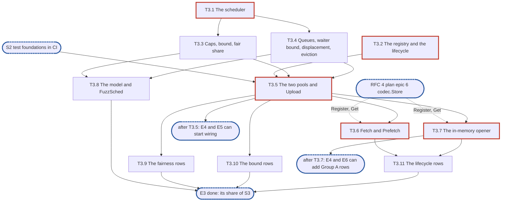

# Epic 3: syncer v2 registration, flows and the fair scheduler

**Sources:** [RFC 3](../docs/internals/rfcs/rfc-3-syncer.md) §1.2; §1.3's registration, flows,
`Flow.Close`, `Close` and `Unregister`, and its rule that `want` is read only to sum its lengths;
§1.4's virtual time, for the idle wait; §2.1; §2.3; §2.9; §2.10's quantum, caps, queue length,
waiter bound and class order; §2.12's pool series; §6's S1, S3, S13, S17, S18, S20 and S22;
§7.2's rows "§2.1 one limiter", "§2.3 backpressure", "§2.9 no starvation", "§2.9 fair by
worker-time", "§2.9 waiter share", "§2.9 bounded queue", "§2.9 store level", "§2.9 lone flow",
"§2.9 classes", "§2.9 eviction", "§2.9 waiter bound", "§1.3 lifecycle" and "§1.3 unregister"
(its flows and counters); §8.1's "Scheduler model" and "Real backend" kinds (the lifecycle
checks); §8.2's "Scale of the scheduler" and two "Timing of a call" cases; §8.4's five scheduler
counts. Cited for what they hand over: §2.2 (the largest encoded block), §2.4 (the throttle limit,
the `Meter`), §2.8 (refusal at admission), §4.3 and §4.4 (joined callers, re-homing, eviction).
Cited, not owned: epic 1's D1 (what a refused call returns), epic 2's D1 to D5 (the fault
wrapper's `Hold` and `Link`, `syncertest`'s `Env` and `Wait`). Every citation is `develop`'s
text, epic 2's that of its open pull request. The code lands on `feat/storage-v2`, and the
paths below are paths there.
**Track:** A.
**Epic 3 estimate: 11 subtasks, 34.5 man-days.**
**Depends on:** **S2**, epic 2's test foundations: the fault wrapper's `Inject`, `Hold` and
`Link` over RFC 4's in-memory store and its record of calls in flight, and `syncertest`'s frame.
Through S2, **S1**: epic 1's `Syncer`, `Flow`, `pool.New`, `Config`, `Clock`, `Stats` and the
import test. **RFC 4 plan epic 6**, `codec.Store` with working bodies, for T3.6, T3.7 and T3.11
only: registering a store through `Register` and fetching need one, and RFC 4 plan epic 1's stub
`codec.New` builds none. `pkg/sim`'s `TestClock` and `internal/prof` are already on
`feat/storage-v2`.
**Blocks:** E4, which runs its attempt loop on T3.5's single-attempt path and lowers T3.3's
per-store bound for the throttle limit; E5, which adds the health refusal to T3.5's admission;
E6, which completes T3.6's `Fetch` and `Prefetch`, re-homes T3.1's queue entries and counts
joined callers in T3.4's waiter bound; E4 and E6 also add their Group A rows to T3.7's opener.
Outside RFC 3's epics, RFC 8 offload plan epics 15 to 17 call `Upload`, `Fetch` and `Prefetch`,
and epic 16 opens and closes flows.

---

## 1. Goal

Epic 3 makes the syncer accept work. Stores are registered, flows opened and closed, and each
half runs a pool of workers that a fair scheduler hands out: classes first, then deficit round
robin in worker-time over stores and flows, under caps, a fair-share rule, bounded queues and one
waiter bound per half. Every transfer is a single attempt here; epics 4 and 6 complete them.

**At the end of the epic:**

- `Register`, `Unregister`, `OpenFlow`, `Flow.Close` and `Close` work, and every call they make
  invalid fails with epic 1's D1 error.
- `Upload` waits in its flow's background queue, runs `attempt` once on a worker and returns its
  error as it is. `Fetch` and `Prefetch` wait in the demand, background or speculation queue and
  stream one `Store.Get`.
- A transfer is dispatched by `pkg/syncer/pool/internal/sched`, a pure package whose dispatch
  costs a fixed number of queue operations whatever the number of flows, checked after every
  dispatch against a reference model, and fuzzed nightly.
- `Stats` reports the pool series of RFC 3 §2.12 that this epic counts.
- `syncertest.Run` runs over RFC 4's in-memory store through `codec.Store`, moving the test clock
  only when every task is blocked, with the lifecycle rows green.

### 1.1 In scope

The scheduler and its model (T3.1, T3.3, T3.4, T3.8); the registry and lifecycle (T3.2); the two
pools, admission, the single-attempt `Upload`, the fixed values this epic uses and the pool
counters (T3.5); the single-attempt `Fetch` and `Prefetch` (T3.6); the in-memory opener and its
idle wait (T3.7); the §7.2 rows above (T3.9, T3.10, T3.11).

### 1.2 Out of scope

- Retries, termination bounds, the throttle limit's rule, the floor, the first-byte bound, the
  slow tail, unknown outcomes, `Upload`'s overlapping tries: E4. E3's per-store bound is the cap;
  E4 lowers it.
- Probes, health state, the refusal of an unhealthy direction, `Flow.Healthy` and `Flow.Health`:
  E5. "§1.3 unregister"'s probe half is E5's.
- Fetch resume, the verification re-get, single flight, joining, re-homing, detaching, the stream
  rules: E6. Joined callers enter T3.4's waiter count there.
- `syncer_inflight_bytes`, the consistent snapshot behind `Stats` and the memory bound: E7.
  `syncer_detached_buffers` and the joined callers in `syncer_waiters`: E6.
- RFC 3 §2.10's values other than the quantum, the caps, the queue length, the waiter bound and the
  class order: each lands with the epic that consumes it (D9). The small-call bound and the
  small-body cap land with `Small`, the second row of the RFC 3 plan's §6.1 deferral ledger.
- Weighted flows, and a fixed value becoming a setting: rows of that ledger, unowned.
- The opener over the S3 store, behind a fault proxy, and its nightly run: RFC 8 offload plan
  epic 21, the ledger's sixth row.

### 1.3 Names used here

- **E1**, epic 1, interfaces: `pkg/syncer`'s contract, `pool.New` and its `Config` and `Clock`
  with stub bodies, `Stats`, the import test and the frozen-exports test.
- **E2**, epic 2, test foundations: the per-call faults on RFC 4's fault wrapper and the frame of
  the Group A suite, `syncertest`.
- **E3**, this epic.
- **E4**, epic 4, termination, retries and the uploader.
- **E5**, epic 5, store health.
- **E6**, epic 6, the fetcher.
- **E7**, epic 7, memory bound, `Stats` and the fault sweep.
- **E8**, epic 8, the syncer's own integration: its settings section and its collector.
- **E9**, epic 9, E2E green: the benchmarks B1 to B5.
- **S1**, the syncer interface agreed, at the end of E1 (the RFC 8 offload plan's S1b).
- **S2**, the test foundations in CI, at the end of E2.
- **S3**, the syncer complete over the in-memory store, after E5, E6 and E7.
- **R4-S2**, the RFC 4 plan's S2: its in-memory store, `remotetest` and fault wrapper landed.
- **RFC 3 S1, S3, S13, S17, S18, S20, S22**, invariants of RFC 3 §6, always written with
  "RFC 3" before them; they are not the synchronisation points S1 and S3 above.
- **The integration epic**, E8 here; outside RFC 3's epics, RFC 8 offload plan epic 21, which
  composes the syncer in the node.

## 2. How the general rules apply

The rules are those of
[the RFC 3 plan's §1.5](rfc-3-syncer-plan.md#15-general-rules-for-each-epic). They are cited by
number and title, not copied.

| Rule | Subtasks | How |
| --- | --- | --- |
| rule 1, independent unit tests ([`CLAUDE.md`, "Writing tests"](../CLAUDE.md#writing-tests)) | all | `internal/sched` is pure and is tested on its own values, with no clock and no store (T3.1, T3.3, T3.4, T3.8). The pool's unexported core is tested through `export_test.go`, on `pkg/sim`'s `TestClock` (kind 1) and RFC 4's in-memory store (kind 2) under E2's fault wrapper (kind 3): an upload's `attempt` and a half-level demand's call are closures over the in-memory store's `Put` and `Get`, so T3.5, T3.9 and T3.10 need no codec. T3.6, T3.7 and T3.11 reach the in-memory store through `codec.Store`. No test double is written |
| rule 2, fuzz tests where relevant ([`CLAUDE.md`, "Writing tests", "By kind"](../CLAUDE.md#writing-tests)) | T3.8 | `FuzzSched`: a byte string decoded into a sequence of arrivals, classes, sizes, joins, cancellations, completions and closes, run against the reference model, asserting the same dispatch and every invariant after each step. It joins the nightly `fuzz` suite RFC 2 plan epic 2 registers; its seeds run in `unit`. The scheduler reads no bytes off a wire or a disk, so it is the only target |
| rule 3, observability follows RFC 25, with RFC 3's own exception | T3.5 | `Stats` gains the counts of D11: workers busy, queue depth and waiters per flow and summed, queue wait, refusals by reason. No log line and no span: RFC 3 §2.8's two lines are E5's |
| rule 4, profiling | T3.1, T3.5, T3.8, T3.10 | Every test runs under `internal/prof`'s leak check, which catches a caller left parked in a queue after its `ctx` ended or after `Close`. One dispatch asserts a flat count of queue operations at 1, 10, 100 and 1,000 waiting flows (T3.1, T3.10), from the operation counter `internal/sched` keeps as its own output (D3) |
| rule 5, public interface and internals ([`CLAUDE.md`, "Verifying a change"](../CLAUDE.md#verifying-a-change)) | T3.5, T3.9, T3.10, T3.11 | Under `-race`. The pool limit is asserted at RFC 4's in-memory store's record of calls in flight and its peak, where a call that outlives its worker still counts; caps and shares at the same record per store and at `Stats`' busy workers per flow; queue depth, waiters and refusals at `Stats`, where E8's collector reads them; refusals also at the error the caller gets. The lifecycle rows run through `Syncer` and `Flow` (T3.11) |
| rule 6, known failures shrink | none | No suite this epic's tests run in keeps a `known.yaml`: every test lands green |
| rule 7, v2 ignores v1 | T3.1 | `internal/sched` joins E1's import test with an empty allowlist, the standard library only, and `pool`'s allowlist gains it (E1's D8). Nothing here reads v1 |
| rule 8, real dependencies for properties of those dependencies ([`CLAUDE.md`, "Writing tests"](../CLAUDE.md#writing-tests)) | T3.7, T3.11 | The in-memory store, the codec and E2's wrapper are real. What they cannot fail like is RFC 8 offload plan epic 21's run of the lifecycle rows over the S3 store. Nothing needs a disk: the syncer persists nothing |
| rule 9, code comment conventions ([`CLAUDE.md`, "Code comments"](../CLAUDE.md#code-comments)) | T3.1, T3.3, T3.4, T3.5 | RFC 3 §2.10's `decision:` note on its fixed values at the table T3.5 writes (D9). `decision:` markers at the quantum's rounding (D4), the displacement's choice of entry (D7), eviction past a full queue (D8) and the estimate before a store's first sample (D5); `ponytail:` at the estimate's mean (D5) |
| rule 10, a test must be able to fail ([`CLAUDE.md`, "Writing tests"](../CLAUDE.md#writing-tests)) | all | Each §7.2 row names the wrong design it catches. Each is checked by building that design: a global arrival queue, a byte-charging scheduler, caps that bind for a lone flow or for a merely configured store, a shared waiter bound with no share, eviction off, no store level. The model is checked by planting one rule broken in a copy of the scheduler and watching the property test and the fuzz seeds fail |
| rule 11, a symbol is exported only if the RFC's interface uses it | all | No symbol is added to `pkg/syncer` or `pool`: E1's frozen-exports test still passes. `internal/sched` exports only what `pool` calls, inside an internal package |
| rule 12, each subtask creates only what it declares | all | Each fixed value lands with the subtask that reads it (D9). The per-store bound E4 lowers, the admission step E5 extends and the waiter count E6 adds joined callers to are shapes the scheduler already needs, not hooks with no caller: E3 reads each through its own rules (D3, D10). `TestClock.Next` and the wrapper's `Parked` land with the opener, their first consumer (T3.7) |

## 3. Requirements and invariants

Every obligation that RFC 3 places on this epic, numbered so that subtasks and tests can cite
them.

**Pools and backpressure**

| # | Requirement | Kind | Source | Subtasks |
| --- | --- | --- | --- | --- |
| R1 | Each half is a pool of its configured size, and the transfers in flight in a half never exceed it | MUST | §2.1; §6, RFC 3 S1; §8.4, "peak in flight" | T3.5, T3.10 |
| R2 | Nothing but the pool size limits how many transfers are in flight. The caps are fixed fractions of the pool, and the queue lengths and the waiter bound limit how many wait, not how many run | MUST NOT | §2.1 | T3.3, T3.5, T3.10 |
| R3 | The two halves share no pool, no queue and no counter | invariant | §1.2 | T3.5 |
| R4 | When a pool is full the caller waits or is refused; no queue is unbounded, and no buffer has a size that is neither configured nor one of RFC 3 §2.10's fixed values | MUST NOT | §2.3; §6, RFC 3 S3 | T3.4, T3.5, T3.10 |
| R5 | A transfer waits in its flow's queue until a worker is free or its `ctx` ends, and leaves the queue when its `ctx` ends | invariant | §1.3; §2.9 | T3.1, T3.5, T3.10 |
| R6 | Both pool sizes are fixed for the life of the process | invariant | §2.10 | T3.5 |

**Registration, flows and lifecycle**

| # | Requirement | Kind | Source | Subtasks |
| --- | --- | --- | --- | --- |
| R7 | A flow is bound to one store and one queue per class in the scheduler: a transfer on a flow goes to that flow's store and waits in that flow's queue | invariant | §1.3 | T3.2, T3.5 |
| R8 | A call on a closed flow fails, and so does a call after the syncer's `Close` | MUST | §1.3; §7.2, "§1.3 lifecycle" | T3.2, T3.5, T3.11 |
| R9 | `Flow.Close` takes the flow out of the scheduler, refuses its queued transfers with an error and lets its running ones finish | invariant | §1.3 | T3.5, T3.11 |
| R10 | The syncer's `Close` stops accepting work and returns once every transfer in flight has ended | invariant | §1.3; §7.2, "§1.3 lifecycle" | T3.5, T3.11 |
| R11 | `Unregister` on a store with an open flow fails. Once its flows are closed it drops the store, whose counters leave `Stats` (its probes are E5's) | MUST | §1.3; §7.2, "§1.3 unregister" | T3.2, T3.11 |
| R12 | A refused call wraps an error of RFC 4's set: a full queue, the waiter bound, a displaced or an evicted entry `remote.ErrThrottled`; a call after `Flow.Close` or `Close`, a `StoreID` not registered and `Unregister` with a flow open `remote.ErrInvalid` | invariant | §1.3; E1's D1 | T3.2, T3.4, T3.5 |
| R13 | `Upload` returns `nil` only once a call of `attempt` returned `nil`, returns only once every call of `attempt` it made has returned, and never calls `attempt` after it returns. E3 makes one call; E4 owns the rest | MUST | §1.3; §7.2, "§1.3 lifecycle" | T3.5, T3.11 |
| R14 | The syncer passes `name` and `want` through and reads `want` only to sum its lengths for scheduling | MUST NOT | §1.3 | T3.6 |

**Classes and turns**

| # | Requirement | Kind | Source | Subtasks |
| --- | --- | --- | --- | --- |
| R15 | Every transfer has one class: demand (`Fetch` on a flow that is not background), background (every `Upload`, and `Fetch` on a background flow), speculation (`Prefetch`). A freed worker serves the highest class with work waiting, and the rounds run only among that class's flows | invariant | §1.3; §2.9; §6, RFC 3 S13; §2.10, "class order" | T3.1, T3.5, T3.6, T3.9 |
| R16 | One queue per flow and class, never a global one | invariant | §2.9 | T3.1 |
| R17 | Turns are in worker-time. A visited flow's deficit gains a quantum, and the head of its queue is dispatched while its charge fits the deficit, each charge subtracted. A transfer is charged at dispatch an estimate, its size divided by its store's recent per-worker throughput in that direction, and at its end the difference between the worker-time it held and the estimate is subtracted from or returned to its flow's deficit. A flow whose queue empties has its deficit reset to zero, after its running transfers' corrections | invariant | §2.9; §6, RFC 3 S22 | T3.1, T3.5 |
| R18 | The size charged is an upload's `size`, the sum of a fetch's `want` lengths, and for a whole-block fetch the largest encoded block | invariant | §2.9; §2.2 | T3.5, T3.6 |
| R19 | The quantum is at least the estimate of the largest encoded block on the slowest store with work waiting, so every flow with work waiting dispatches at least once per round; it is derived, never a setting | invariant | §2.9; §2.10, "DRR quantum" | T3.1, T3.5 |
| R20 | Each dispatch costs O(1): the queue operations of one dispatch are the same at 1, 10, 100 and 1,000 waiting flows | bound | §2.9; §8.4, "scheduler work per dispatch" | T3.1, T3.10 |
| R21 | Two levels: the scheduler picks a store by round robin over stores with work waiting, then a flow on that store | invariant | §2.9 | T3.1, T3.9 |
| R22 | A transfer at the head of its flow's queue is dispatched within one round of the other waiting flows of its class, once no higher class has work waiting, unless its flow or store is at its cap or bound | invariant | §2.9; §6, RFC 3 S18 | T3.1, T3.8, T3.9 |
| R23 | Over a round, flows of one class with work waiting hold workers for times within one quantum of each other, and bytes dispatched per flow of one store stay within one quantum | invariant | §6, RFC 3 S22; §8.4, "fairness" | T3.1, T3.9 |
| R24 | All flows have equal weight | invariant | §2.9 | T3.1 |

**Caps and shares**

| # | Requirement | Kind | Source | Subtasks |
| --- | --- | --- | --- | --- |
| R25 | The per-store and per-flow cap is three quarters of the pool, rounded down, at least one worker, and with a pool of more than one at most the pool less one | invariant | §2.10, "per-store and per-flow cap" | T3.5 |
| R26 | No store holds more workers than its cap while another store has work waiting in the half, and no flow more than its cap while another flow on its store has; a store or flow that only holds workers, with nothing queued, or is only registered, binds nothing. A lone busy flow on a lone busy store uses the whole pool, and no worker idles while work waits | invariant | §2.9; §6, RFC 3 S17 | T3.3, T3.9 |
| R27 | A store holds no more than its per-store bound, which is its cap until E4's throttle limit lowers it, and never above the cap | invariant | §2.9; §6, RFC 3 S17 | T3.3 |
| R28 | No store gets a worker beyond its fair share, the pool divided by the stores holding or waiting for workers, while another store with work waiting holds none | invariant | §2.9; §6, RFC 3 S17 | T3.3, T3.9 |

**Queues and the waiter bound**

| # | Requirement | Kind | Source | Subtasks |
| --- | --- | --- | --- | --- |
| R29 | A flow's queue for a class holds at most four times the pool; a call finding it full is refused | MUST | §2.9; §2.10, "per-flow queue length"; §7.2, "§2.9 bounded queue" | T3.4, T3.10 |
| R30 | Waiters per half, queued transfers and joined callers together, never exceed the waiter bound, eight times the pool, whatever the number of flows | invariant | §2.9; §2.10, "waiter bound"; §6, RFC 3 S20; §8.4, "waiters" | T3.4, T3.10 |
| R31 | A call that finds the half at its waiter bound is refused only if its own flow holds at least its fair share of the bound, the bound divided by the flows holding waiters, its own included. Otherwise the youngest queued transfer of the flow holding the most waiters, of the same class or a lower one, is refused in its place as displaced, and the call takes the slot | MUST | §2.9; §6, RFC 3 S20; §8.4, "waiters displaced" | T3.4, T3.10 |
| R32 | Above both rules, a demand that would be refused evicts the youngest queued speculative entry of any flow, which is refused as evicted, and takes its place; a demand is refused only when no speculation is queued | invariant | §2.9; §4.4 | T3.4, T3.10 |

**The model and the checks**

| # | Requirement | Kind | Source | Subtasks |
| --- | --- | --- | --- | --- |
| R33 | A scheduler model runs random flows, classes, sizes, joins and arrival times on the virtual clock, checked after every dispatch against a reference: highest class first, deficit round robin within it, who runs next, no flow or store over its cap or fair share, waiters within the bound. A failing run is shrunk and kept | test row | §8.1, "Scheduler model" | T3.8 |
| R34 | Time in a check is virtual: every deadline and wait of the pool runs on the injected clock, which a check moves only when every task is blocked | invariant | §1.4 | T3.5, T3.7 |
| R35 | A backend that returns instantly is not used for §2's checks: the pool rows run over E2's `Link` | MUST NOT | §7.3 | T3.9, T3.10 |
| R36 | The checks reach the cases of §8.2's "Scale of the scheduler" (a pool of one; a thousand flows, one with work; a flow opened and closed without transferring; a demand at a full waiter bound with exactly one speculative entry queued, on another store) and two of its "Timing of a call" (`ctx` cancelled while queued; `Flow.Close` with transfers queued and running) | test row | §8.2 | T3.10, T3.11 |
| R37 | The lifecycle checks run in the Group A suite, over any remote store its caller opens | test row | §8.1, "Real backend"; E2's D2 and D7 | T3.7, T3.11 |

**Observability**

| # | Requirement | Kind | Source | Subtasks |
| --- | --- | --- | --- | --- |
| R38 | `Stats` makes observable, by half and store, `syncer_workers_busy`; `syncer_queue_depth` and `syncer_waiters` by class, per flow and summed; `syncer_queue_wait_seconds` by class; and `syncer_refused_total` with `reason` `queue_full`, `waiters_full`, `displaced`, `evicted` and `closed`. `unhealthy` is E5's, the joined callers in `syncer_waiters` E6's, `syncer_inflight_bytes` E7's | MUST | §2.12 | T3.5 |
| R39 | Reading the counters takes no lock a dispatch needs, and costs nothing per transfer in flight. E3's counters are kept so; the consistent snapshot across them is E7's | MUST NOT | §2.12 | T3.5 |

RFC 3 §1.3's other obligations belong to E4 (`Upload`'s tries, the error table), E5
(`Healthy`, `Health`, probe groups) and E6 (`Fetch`'s stream rules); §2.9's "a transfer to an
unhealthy direction never enters a queue" is E5's, at T3.5's admission. §2.9's "no other flow's
work is refused because of it" describes the refusal of the call itself, which R31 and R32
already state with their two exceptions.

## 4. Decisions this epic takes

- **D1, a worker is a slot, and a transfer runs on its caller's goroutine.** Dispatch grants the
  waiting caller a slot; the caller runs `attempt`, or pulls `Store.Get`'s stream, itself, and
  returns the slot when it ends. No worker goroutine is started, so `Upload` returns only once
  its one `attempt` call has (R13), and a transfer whose caller leaves releases its slot then.
  E4's slow-tail try and E6's joined fetch, each of which outlives its caller, run on a goroutine
  of their own from the slot they hold; neither changes the slot. Prior art: Kubernetes API
  priority and fairness, where a request waits in its flow's queue for a seat and runs on its own
  goroutine (from memory). Not chosen: a pool of worker goroutines fed by a channel, which adds a
  hand-off per transfer and a goroutine count that E3's idle wait would have to watch.
- **D2, `internal/sched` is a value-only state machine.** It holds stores, flows, queues and
  deficits, and knows no clock, goroutine or store: `pool` calls it under one mutex per half and
  turns its answers into wake-ups. Its API is in T3.1, T3.3 and T3.4. That keeps it pure (rule 1)
  and lets the reference model drive it step by step. Prior art: the RFC 3 plan's rule 1; DRR as
  Shreedhar and Varghese state it, a set of queues and an active list.
- **D3, O(1) dispatch through active rings.** Per class, a ring of stores with work waiting, and
  per store a ring of its flows with work waiting; a store or flow at its cap or per-store bound
  leaves its ring and rejoins when one of its transfers ends, so no dispatch skips past it. The
  fair-share rule keeps a list of stores with work waiting that hold no worker, served first while
  any store is above its share. Shares are compared exactly, never rounded: a store holding *k*
  workers is above its share when (*k* + 1) × *n* > the pool, *n* the stores holding or waiting.
  Each operation on a queue or ring adds one to a counter `sched`
  keeps as its own output, which T3.1 and T3.10 read through the package's own tests (rule 4,
  RFC 3 §8.4). The per-store bound starts at the cap; E4 adds the call that lowers it, and the
  ring rules already read it. Prior art: DRR's active list; Linux `fq_codel`'s new and old flow
  lists (from memory).
- **D4, the quantum is rounded up to a power of two of the estimate.** RFC 3 §2.10 makes it the
  estimate of the largest encoded block on the slowest store with work waiting, which changes as
  stores start and stop waiting. Keeping an exact maximum costs O(log s) per change. Instead each
  waiting store's estimate is bucketed by its highest set bit, a 64-bit mask holds the buckets in
  use, and the quantum is the top bucket's upper bound: O(1), at least the RFC's figure, at most
  twice it. A `decision:` marker at the site names the rounding and that it keeps R19. Rounds are
  coarser by at most that factor, and R23 is judged against the quantum used. Prior art: Linux's
  timer wheel buckets by magnitude (from memory).
- **D5, the estimate is a running mean per store and direction.** Each ended transfer folds its
  bytes, from the `Meter` T3.5 passes in (E1's surface, RFC 3 §2.4), and its worker-time, from the
  injected clock, into a mean with weight one eighth; the estimate of a transfer is its size over
  that rate. Before a store's first ended transfer the rate is 20 MiB/s per worker, RFC 3 §2.10's
  figure for a 4 MiB block in about 200 ms, behind a `decision:` marker: corrections at each end
  fix any error in it. `ponytail:` a mean with a fixed weight lags a store whose speed changes
  faster than about eight transfers; upgrade to a time window when B3's wait exceeds one round
  after a store slows. E4's floor reads its own aggregate, not this. Prior art: TCP's smoothed
  round-trip time, a mean with weight one eighth (RFC 6298, from memory).
- **D6, `Flow.Close` and `Close` refuse queued work as closed.** A queued transfer refused by
  either wraps `remote.ErrInvalid`, as E1's D1 says of a call after either, and counts under
  `closed`. `Close` then waits for the slots in use to return, on a channel closed when the count
  reaches zero under the half's lock, never by polling it. A call racing `Close` either enters
  before it and is waited for, or is refused.
- **D7, the displaced entry is taken from the lowest class first.** RFC 3 §2.9 names the youngest
  queued transfer of the flow holding the most waiters, of the same class or a lower one than the
  call's, without
  saying which when several classes qualify. The lowest class goes first (speculation, then
  background, then demand), the youngest within it, so a demand is displaced only when that flow
  queues nothing lower. If that flow queues nothing of the call's class or lower, the call is
  refused as `waiters_full`. A flow holding *w* waiters is at its share when *w* × *m* ≥ the
  bound, *m* the flows holding waiters with the caller's counted, compared exactly; ties for the
  most waiters go to the flow that reached the count first. A joined caller (E6) counts toward its
  flow's waiters but is never displaced, since it has no queue entry. The flow holding the most waiters is found in O(1) from buckets of
  flows by waiter count, each count moving by one. A `decision:` marker names the choice. Prior
  art: LFU caches' O(1) frequency buckets (from memory).
- **D8, eviction also overrides a full demand queue.** RFC 3 §2.9 applies eviction "above both
  rules", and §4.4 says a demand that finds its queue full evicts rather than being refused. So a
  demand whose own queue is full evicts the youngest queued speculation of any flow and takes its
  slot, letting its demand queue exceed four times the pool by the entries it evicted; the waiter
  bound still holds, since each eviction frees the slot it takes. A `decision:` marker says so.
  Only a demand evicts; a background call finding its queue full is refused.
- **D9, the fixed values live in one table, each landing with its consumer.** `pool/fixed.go`
  holds RFC 3 §2.10's table with the RFC's `decision:` note above it. E3 writes the values it
  reads: the cap, the queue multiple, the waiter multiple and the class order, and the quantum's
  derivation. E4, E5 and E6 add theirs to the same table under the same note. This narrows the
  RFC 3 plan's epic 3 outline, which has E3 write the whole table, by rule 12 (§9).
- **D10, the admission step is one function E5 extends.** Every call passes `admit` before it
  queues: a closed flow or syncer, a full queue, the waiter bound with its displacement and
  eviction. E5 adds the unhealthy direction to it, first, so a call refused for health never
  takes a waiter slot (RFC 3 §2.8, §2.9). E6's join counts a joined caller in the waiter bound
  through the same count `admit` reads.
- **D11, what `Stats` reports from E3.** `WorkersBusy` per store; `QueueDepth` and `Waiters` per
  store summed over its flows and per flow, by class; `QueueWait` by class, the time from call to
  dispatch on the injected clock; `Refused.QueueFull`, `WaitersFull`, `Displaced`, `Evicted`,
  `Closed` (E1's `Stats` fields). Each is an atomic the half updates at the event and `Stats` reads
  walking the registry under the registry's lock, never the half's (R39). A refusal of a call
  naming no registered store is not counted (E1's D3).
- **D12, the opener moves the clock only when the syncer and the store are both parked.** RFC 3
  §1.4 lets virtual time advance only when every task is blocked, and E2's D5 leaves the in-memory
  opener to do it. Two counts decide it, each read under its owner's lock:
  - the pool's, through `export_test.go`: of the goroutines inside its methods, how many are
    running, and how many are inside a store call (`Store.Get`, `attempt`). A goroutine queued,
    or waiting on a channel from the pool's clock that is not yet closed, is parked; one whose
    channel is closed, or that dispatch has granted a slot, counts as running until it parks
    again, so a goroutine woken by `Advance` but not yet scheduled is never taken for idle;
  - the wrapper's: how many of its calls are waiting in a `Hold` or a `Link`, on a release
    channel or a clock channel not yet closed and a context not yet done. T3.7 adds this
    `Parked() int` to RFC 4's fault wrapper, its first consumer.

  The syncer is idle when nothing is running and every goroutine inside a store call is parked
  in the wrapper. `Env.Wait(done)` polls that condition, with `runtime.Gosched` between polls, and
  when it holds advances the `TestClock` to its next deadline, through a `Next` T3.7 adds to
  `pkg/sim`. A worker waiting on the clock inside a `Link` is therefore counted as blocked, as
  E2's D5 requires, and an in-memory call with no fault is waited for, never advanced over.
  Polling the real condition is waiting on it (`CLAUDE.md`, "Writing tests"). With nothing
  running, nothing pending on the clock and `done` still open, `Wait` fails the test as
  deadlocked rather than blocking. The pool parks only on channels, never on a `sync.Cond` or a
  bare mutex, since a wake-up the counts cannot see would let time move under a running
  goroutine; a `decision:` marker at the half's wait says so. Prior art: Go's
  `testing/synctest`, whose bubble advances time once every goroutine in it is durably blocked,
  not chosen by the RFC 3 plan's D3 because it cannot share `pkg/sim`'s clock. Not chosen:
  counting `TestClock.Pending`, which also counts every deadline that never fired and was never
  stopped, so it never returns to the number of goroutines waiting; and a registry of channels
  each goroutine blocks on, fed by the clock's `After`, which the independent architect proposed: a
  `Link` wait ended by its context leaves its clock channel registered while the goroutine runs
  on, so time would move under it. The wrapper's own count ends each wait however it ends.

## 5. Target tree

```text
pkg/syncer/
  imports_test.go          T3.1  internal/sched's allowlist (standard library only); pool's gains it
  pool/
    internal/sched/              the scheduler, a pure package
      sched.go             T3.1  Sched, Config, StoreKey, FlowKey, Class, Entry; Add, Remove,
                                 Next, Done, AddFlow, CloseFlow; the active rings; Ops
      quantum.go           T3.1  the power-of-two buckets of D4
      caps.go              T3.3  caps, the per-store bound, the fair-share list
      waiters.go           T3.4  queue lengths, the waiter bound, displacement, eviction
      sched_test.go        T3.1  table tests of each rule; one dispatch's Ops at 1 to 1,000 flows
      caps_test.go         T3.3
      waiters_test.go      T3.4
      model_test.go        T3.8  the reference model and its property test, package sched_test
      fuzz_test.go         T3.8  FuzzSched
      testdata/fuzz/FuzzSched/  T3.8  seeds
    fixed.go               T3.5  RFC 3 §2.10's table, the values E3 reads (D9)
    registry.go            T3.2  stores, flows, StoreID and FlowID minting, Unregister
    half.go                T3.5  a half: its sched, its slots, admit, wait, dispatch, Close
    estimate.go            T3.5  the per-store mean of D5, the largest encoded block
    upload.go              T3.5  Upload, one attempt
    fetch.go               T3.6  Fetch and Prefetch, one Get
    stats.go               T3.5  the counters of D11 and Stats' walk
    pool.go                T3.2  New builds the registry and the halves; Register, OpenFlow
    export_test.go         T3.5  the half and the registry for tests; the load counts of D12
    registry_test.go       T3.2
    half_test.go           T3.5  admission, dispatch, Close over the in-memory store
    fetch_test.go          T3.6
    opener_test.go         T3.7  the in-memory opener; syncertest.Run over it
    fair_test.go           T3.9  the §7.2 fairness rows
    bounds_test.go         T3.10 the §7.2 bound rows, §8.4's counts, §8.2's cases
    lifecycle_test.go      T3.11 unregister through Syncer
  syncertest/
    lifecycle.go           T3.11 the "§1.3 lifecycle" rows
pkg/remote/memory/
  timing.go                T3.7  Parked, on E2's wrapper
pkg/sim/
  clock.go                 T3.7  TestClock.Next
test/suites.yaml           T3.8  FuzzSched in the fuzz suite's commands
```

If RFC 4 plan epic 2 puts the wrapper elsewhere, `Parked` goes with it.

## 6. Subtasks

### T3.1 The scheduler: classes, queues and two-level deficit round robin

**Subtask T3.1 estimate: 4 man-days.**

- **Track:** A. **Depends on:** none.
- **Covers:** R5, R15, R16, R17, R19, R20, R21, R22, R23, R24.
- **Deliverables:** `internal/sched` (D2, D3, D4):

  ```go
  type Class uint8 // Demand, Background, Speculation, in that order
  type StoreKey, FlowKey uint64
  type Entry struct {
      Flow   FlowKey
      Class  Class
      Charge time.Duration // the estimate, worker-time
  }
  type Config struct{ Pool, Cap, QueueLen, Waiters int } // from pool's fixed table
  type Sched struct{ /* unexported */ }
  func New(c Config) *Sched
  func (s *Sched) AddFlow(st StoreKey, f FlowKey)
  func (s *Sched) CloseFlow(f FlowKey) []*Entry  // its queued entries, refused by the caller
  func (s *Sched) Add(e *Entry) (victims []*Entry, err error) // T3.4 adds refusals and victims
  func (s *Sched) Remove(e *Entry)                    // a queued entry whose ctx ended
  func (s *Sched) SetUnit(st StoreKey, d time.Duration) // the store's estimate of the largest encoded block
  func (s *Sched) Next() *Entry                       // nil when no slot may be given
  func (s *Sched) Done(e *Entry, held time.Duration)  // the correction of R17
  func (s *Sched) Ops() uint64                        // queue and ring operations so far
  ```

  The quantum is D4's bucket over the units of the stores with work waiting.

  `time.Duration` is the standard library's; `sched` reads no clock. Consumed by T3.3 and T3.4,
  which add caps and waiters to `Next` and `Add`; T3.5, whose halves call it; T3.8, whose model
  drives it; E4, which lowers the per-store bound; E6, which re-homes and promotes entries.
- **Acceptance criteria:**
  - `Next` returns the head of the highest class with work waiting, by store round robin, then
    flow round robin, then deficit.
  - A visited flow gains one quantum; its head is dispatched while its charge fits; a flow whose
    queues empty has its deficit reset once its running entries are `Done`.
  - `Done` returns or subtracts the difference between `held` and the charge.
  - `Remove` takes a queued entry out in O(1), and a flow or store left with nothing waiting
    leaves its ring.
  - `Ops` per `Next` is the same with 1, 10, 100 and 1,000 flows waiting.
  - `sched` imports only the standard library; E1's import test holds it.
- **Tests:** at `Next`, which T3.5's dispatch consumes, as table tests of `Add`, `Next` and `Done`
  sequences (no double). A demand queued behind a thousand background entries comes first
  (catches a global arrival order, R15, R16). Two flows on one store, one of 4 MiB charges and one
  of 1 MiB: over many rounds their dispatched charge stays within one quantum (catches charging
  per request, R17, R23). One flow whose `Done` reports four times its charge: its share of turns
  falls to a quarter (catches charging the estimate alone, R17). Eight flows on store A and one on
  B: B is served every other turn (catches no store level, R21). `Ops` of one `Next` at 1, 10, 100
  and 1,000 waiting flows equal (catches a scan, R20). D4's buckets: the quantum is at least the
  largest estimate and under twice it, for estimates across every bucket (R19).

### T3.2 The registry and the lifecycle

**Subtask T3.2 estimate: 2.5 man-days.**

- **Track:** A. **Depends on:** none.
- **Covers:** R7, R8, R11, R12.
- **Deliverables:** `registry.go` and `pool.go`: `Register`, `Unregister`, `OpenFlow` and
  `Flow.Close` on E1's stubs, minting `StoreID` and `FlowID` from one, each flow bound to its store
  and holding a `sched.FlowKey` in each half (E1's D2). `New` builds the registry and calls T3.5's
  halves once they exist; until then a flow's transfer calls keep E1's not-built error. The
  registry takes no `Store` method call. Consumed by T3.5 (flows' queues, `Close`), T3.11 and E5
  (probe groups by `ProbeKey`).
- **Acceptance criteria:**
  - `OpenFlow` on an unknown `StoreID`, after `Close`, and `Unregister` with a flow open each wrap
    `remote.ErrInvalid` (R12); `Unregister` after the store's flows are closed succeeds, and the
    store's entry and counters are gone.
  - A call on a closed flow wraps `remote.ErrInvalid`; `Flow.Close` twice returns `nil` the second
    time.
  - `StoreID` and `FlowID` are never zero and never reused within a process.
- **Tests:** at `Syncer`'s and `Flow`'s methods, through the unexported registry from
  `export_test.go`, since `Register` needs a `Store` value and none can be built before RFC 4 plan
  epic 6 (T3.11 repeats them through `Register`). A table of each invalid call and its error
  (catches a refusal that returns `nil`, R8, R11). A thousand flows opened and closed on one store
  under `-race`, then `Unregister` succeeding (catches an open count that drifts). No test double.

### T3.3 Caps, the per-store bound and the fair share

**Subtask T3.3 estimate: 3 man-days.**

- **Track:** A. **Depends on:** T3.1.
- **Covers:** R2, R26, R27, R28.
- **Deliverables:** `caps.go`: `Next` skips no one, since a store or flow at its cap leaves its ring
  (D3); the per-store cap binds only while another store has work waiting, the per-flow cap only
  while another flow on the store has; the per-store bound, set to the cap, read by the same rule;
  the list of stores waiting and holding none, served first while a store holds more than its
  fair share (D3). Consumed by T3.5, T3.8 and E4.
- **Acceptance criteria:**
  - One flow on one store with a pool of 8 and a cap of 6 is given all 8.
  - With a second store holding one entry and nothing queued, the first store still gets every
    other slot; once the second store queues, the first gets none past 6.
  - With a store holding 6 of 8 and a second store waiting with none, the next free slot goes to
    the second.
  - A pool of 1: the cap is 1, and a second flow waits for the one slot.
- **Tests:** at `Next`, as tables (no double). Each criterion above as a case, each with the wrong
  design it catches: a cap keyed on registered stores, or on stores holding a worker, which idles a
  quarter of the pool (R26); a cap alone, which lets the slow store keep three quarters while the
  other waits (R28). A store whose bound is set below its cap from the package's own test holds no
  more than the bound (R27; E4 adds the setter's caller).

### T3.4 Queue lengths, the waiter bound, displacement and eviction

**Subtask T3.4 estimate: 3 man-days.**

- **Track:** A. **Depends on:** T3.1.
- **Covers:** R4, R12, R29, R30, R31, R32.
- **Deliverables:** `waiters.go`: `Add` refuses a full queue (`ErrQueueFull`), refuses or displaces
  at the waiter bound (`ErrWaitersFull`, and the displaced entries it returns), and evicts the
  youngest queued speculation for a demand (D7, D8); the buckets of flows by waiter count; one
  list of queued speculation by age; a `Waiters` count that E6's join adds to. `sched`'s errors are
  its own unexported-to-`pool` reasons; `pool` wraps `remote.ErrThrottled` with the reason in the
  message (R12). Consumed by T3.5's `admit` and E6.
- **Acceptance criteria:**
  - A flow's queue of a class holds four times the pool, and the next call is refused.
  - Waiters never pass eight times the pool, whatever the number of flows.
  - At the bound, a call from a flow under its share is accepted and the youngest entry of the
    flow holding the most, lowest class first, is returned displaced; a call from a flow at its
    share is refused.
  - A demand at the bound, or at its own full queue, evicts the youngest queued speculation of any
    flow; with none queued it is refused.
- **Tests:** at `Add`, as tables (no double). Two flows filling the bound, then a third flow's call:
  accepted, the fuller flow's youngest displaced (catches a shared bound with no share, R31). A
  thousand flows each adding until refused: waiters equal the bound (catches a bound per flow,
  R30). Speculation filling a flow's queue and the bound, then a demand on another store: accepted,
  the youngest speculation evicted; again with none queued: refused (R32, and §8.2's case of one
  speculative entry on another store). Each refusal's reason (R12).

### T3.5 The two pools and the single-attempt `Upload`

**Subtask T3.5 estimate: 5 man-days.**

- **Track:** A. **Depends on:** T3.2, T3.3, T3.4.
- **Covers:** R1, R2, R3, R4, R5, R6, R7, R8, R9, R10, R12, R13, R15, R17, R18, R19, R25, R34,
  R38, R39.
- **Deliverables:**
  - `fixed.go`: the cap of R25, the queue and waiter multiples, the class order, with RFC 3
    §2.10's `decision:` note (D9).
  - `half.go`: a half per direction, each with its own `sched`, slot count and lock (R3); `admit`
    (D10); a queued caller waiting on its entry's wake-up or its `ctx`, removed when `ctx` ends;
    dispatch on every arrival and every slot returned; `Flow.Close` and `Close` as D6 says.
  - `estimate.go`: D5's mean, and the largest encoded block as RFC 3 §2.2 defines it from
    `Config`'s `HeaderCap`, `BlockTarget`, `Max` and `MaxDecodeLen`, which the quantum and a
    whole-block fetch's charge read and E7's per-worker figure reuses.
  - `upload.go`: `Upload` in the background class, charged at `size`, running `attempt` once with
    a `remote.Meter` that counts moved bytes for D5, returning its error as it is (D1).
  - `stats.go`: D11's counters and `Stats`' walk.
  - `export_test.go`: the half and registry for tests, and D12's load counts.

  Consumed by T3.6, T3.7, T3.9, T3.10, T3.11; E4, which wraps `attempt` in its loop; E5, which
  extends `admit`; E7, which reads the counters into its snapshot.
- **Acceptance criteria:**
  - With pool 8 and puts held, the in-memory store's in-flight peak is 8, and every further
    `Upload` waits or is refused.
  - An `Upload` whose `ctx` ends while queued returns `ctx.Err()`, leaves its queue and holds no
    waiter slot; `Stats` shows the queue empty.
  - `Flow.Close` with three queued and two running uploads: the three fail with `remote.ErrInvalid`
    and count under `closed`, the two finish; `Close` returns only after the last running one.
  - `Upload` returns `attempt`'s error unwrapped and calls it exactly once.
  - Every wait the half makes is on `Config.Clock`; E1's real-clock scan still passes.
  - `Stats` reports busy workers, queue depth and waiters per flow and summed, queue wait and each
    refusal reason, read without the half's lock (a `Stats` call returns while a test holds it).
- **Tests:** at the in-memory store's record of calls in flight and at `Stats`, through
  `export_test.go`, with `attempt` a closure over the in-memory store's `Put` under E2's `Hold`
  (kind 2 under kind 3), on `TestClock` (kind 1). Sixteen uploads on pool 8: peak 8 (catches a
  second limiter or none, R1, R2). Each criterion above. The two halves each saturated with the
  other idle: neither's busy count moves the other's (catches shared state, R3). A planted cap at
  zero refused by the table's test (R25's floor of one). Under `internal/prof`'s leak check, no
  queued caller outlives `Close`.

### T3.6 The single-attempt `Fetch` and `Prefetch`

**Subtask T3.6 estimate: 2.5 man-days.**

- **Track:** A. **Depends on:** T3.5, and RFC 4 plan epic 6's `codec.Store`.
- **Covers:** R14, R15, R18.
- **Deliverables:** `fetch.go`: `Fetch` in the demand class, or background on a background flow;
  `Prefetch` in speculation; each charged at the sum of `want`'s lengths, or the largest encoded
  block when `want` is empty; once dispatched, one `Store.Get` with the slot's `Meter`, its chunks
  yielded as they come, the slot returned when the stream ends or the caller leaves the loop.
  Consumed by T3.9's class rows through `Flow`, T3.11, and E6, which adds resume, re-get, joining
  and detaching.
- **Acceptance criteria:**
  - `want` reaches `Store.Get` as given, and nothing reads it but the sum of its lengths.
  - A `Fetch` on a background flow queues as background, a `Prefetch` as speculation.
  - Leaving the loop after one chunk returns the slot.
- **Tests:** through `Flow`, over `codec.Store` on the in-memory store (kind 2): a block put
  through the codec and fetched by two non-adjacent ranges and by an empty `want`, the in-memory
  store's record showing the ranges asked (catches `want` rewritten, R14). With the fetch pool
  held full, a background flow's `Fetch` and another flow's `Prefetch` queued, then a demand: the
  demand is dispatched first (R15). A `Stats` read shows the whole-block fetch's charge as the
  largest encoded block's estimate (R18).

### T3.7 The in-memory opener and the idle wait

**Subtask T3.7 estimate: 3 man-days.**

- **Track:** A. **Depends on:** T3.5, and RFC 4 plan epic 6's `codec.Store`.
- **Covers:** R34, R37.
- **Deliverables:** `opener_test.go`: a `syncertest.Opener` building `pool.New` on a `TestClock`
  over RFC 4's in-memory store under E2's wrapper, with `codec.Store` over it, and filling every
  `Faults` field the wrapper can give, `Drop` left nil (E2's §9); its `Wait` as D12 says.
  `TestClock.Next() (time.Duration, bool)` in `pkg/sim`, the time to the earliest pending
  deadline. `(*Wrapper).Parked() int` on E2's wrapper (D12). `syncertest.Run(t, opener)` in
  `unit`. Consumed by T3.11's rows, E4's and E6's rows, and E5's and E7's checks that wait on the
  syncer's time.
- **Acceptance criteria:**
  - `Run`'s read-back check passes over the opener (E2's R15).
  - A row whose call waits 10 s on the pool's clock completes once `Wait` advances, in no real
    time.
  - Under `Link` on every call, an upload completes after exactly its link time on the clock, not
    before: the opener never advances while a goroutine is running or a store call is not parked.
  - A goroutine woken by `Advance` and not yet scheduled is counted as running.
  - A row whose `done` can never close fails as deadlocked once nothing runs and nothing is
    pending, instead of hanging.
- **Tests:** at `Env.Wait`, which every row calls. An upload under `Link` of 1 s per call: `Wait`
  returns with the clock at 1 s plus its per-byte time (catches a hook that treats the linked
  worker as running and never moves time, E2's D5, R34). Without `Link`, a thousand uploads and
  the clock still at zero (catches advancing over a running in-memory call). `TestClock.Next`
  against a table of `After` calls, `Parked` against held and linked calls released one by one
  (each catches a count that misses a closed channel). Under `-race` and the leak check.

### T3.8 The reference model, its property test and `FuzzSched`

**Subtask T3.8 estimate: 4 man-days.**

- **Track:** A. **Depends on:** T3.3, T3.4.
- **Covers:** R20, R22, R33.
- **Deliverables:** `model_test.go`, package `sched_test`: a reference written from RFC 3 §2.9 as
  plain loops over slices, O(n) per step, importing only the standard library and `sched`; a
  property test over seeded sequences (kind 1) of arrivals, classes, charges, joins, cancellations,
  ends with their held time, and flow closes; after every `Next`, the two agree on the entry
  dispatched, and RFC 3 S13, S17 (but its throttle clause), S18, S20 and S22 hold. `fuzz_test.go`'s
  `FuzzSched` over the same steps, its seeds committed. Its command in the `fuzz` suite in
  `test/suites.yaml` and a line in RFC 3's suites paragraph. A join is a waiter added with no
  entry, as E6 makes it. Consumed by every later change to `sched`, E4's bound and E6's re-home
  among them.
- **Acceptance criteria:**
  - Ten thousand seeded sequences of up to a thousand steps agree with the model and hold every
    invariant.
  - A failing sequence is shrunk by `go test -fuzz`, and its input committed under
    `testdata/fuzz/FuzzSched/`.
  - The fuzz target runs in the nightly `fuzz` suite and its seeds in `unit`.
- **Tests:** at `sched`'s API, which `pool` consumes. Each of six planted faults in a copy of the
  scheduler, one per rule (class order, store level, deficit reset, per-flow cap, fair share,
  displacement), fails the property test within the seeded runs (rule 10). No double: the model is
  a second implementation the test compares against, never answering for `sched`.

### T3.9 The fairness rows

**Subtask T3.9 estimate: 3 man-days.**

- **Track:** A. **Depends on:** T3.5.
- **Covers:** R15, R21, R22, R23, R26, R28, R35.
- **Deliverables:** `fair_test.go`: RFC 3 §7.2's "§2.9 no starvation", "§2.9 fair by
  worker-time", "§2.9 store level", "§2.9 lone flow" and "§2.9 classes", through `export_test.go`'s
  half, each transfer a closure over the in-memory store's `Put` or `Get` under E2's `Link` on the
  `TestClock`; §8.4's "fairness" count. Consumed by S3.
- **Acceptance criteria:** each row's assertion as RFC 3 §7.2 states it, on the clock: B's fetch
  starts within one round and A never passes its cap; worker-time per flow within one quantum when
  one flow's transfers take four times as long per byte; the healthy store's flow within one round
  and the slow store at its cap; the lone flow holding the whole pool through each of the row's
  five steps; demand first, background before speculation.
- **Tests:** at the in-memory store's record per store and at `Stats` per flow. Each row is
  verified by building the design it names: a byte-charging scheduler (four times the workers to
  the slow flow), no store level, caps on configured stores, a global queue (rule 10). `Link`, never
  an instant store (R35).

### T3.10 The bound rows and the scheduler counts

**Subtask T3.10 estimate: 3 man-days.**

- **Track:** A. **Depends on:** T3.5.
- **Covers:** R1, R2, R4, R5, R20, R29, R30, R31, R32, R35, R36.
- **Deliverables:** `bounds_test.go`: RFC 3 §7.2's "§2.1 one limiter", "§2.3 backpressure", "§2.9
  waiter share", "§2.9 bounded queue", "§2.9 eviction" and "§2.9 waiter bound"; §8.4's "scheduler
  work per dispatch", "peak in flight", "waiters" and "waiters displaced"; §8.2's pool of one, a
  thousand flows one with work, a flow opened and closed without transferring, the demand at a
  full bound with one speculative entry on another store, and `ctx` cancelled while queued.
  Consumed by S3.
- **Acceptance criteria:** each row and count as RFC 3 states it, at the in-memory store's record
  of calls in flight (peak at the pool, never above), and at `Stats` (waiters at or below the bound,
  displaced counted, refusals by reason).
- **Tests:** through `export_test.go`'s half over the in-memory store under `Link` and `Hold`. Each
  row's wrong design built once to watch it fail: a second limiter at half the pool, an unbounded
  queue, a bound with no share, eviction off. `Ops` per dispatch read from `sched` at 1, 10, 100
  and 1,000 waiting flows (R20). Under `internal/prof`'s leak check.

### T3.11 The lifecycle rows and unregister

**Subtask T3.11 estimate: 1.5 man-days.**

- **Track:** A. **Depends on:** T3.6, T3.7.
- **Covers:** R8, R9, R10, R11, R13, R36, R37.
- **Deliverables:** `syncertest/lifecycle.go`: the "§1.3 lifecycle" rows (a call on a closed flow
  and after `Close` fails; `Close` returns only once transfers have ended; `src` is never called
  after `Upload` returns), with `Flow.Close` while transfers are queued and running; added to
  `Run`'s rows, so RFC 8 offload plan epic 21's opener runs them too. `lifecycle_test.go`: "§1.3
  unregister"'s flows and counters half through `Register`. Consumed by S3 and epic 21.
- **Acceptance criteria:**
  - The rows pass over T3.7's opener, each needing only `Hold`, which the S3 store's proxy also
    gives.
  - `Unregister` with a flow open is refused; after closing it, the store leaves `Stats`.
- **Tests:** at `Syncer` and `Flow`, the consumer's surface, over `codec.Store` on the in-memory
  store. `src` wrapped to record each call and pass it through (the recording wrapper `CLAUDE.md`
  allows): no call after `Upload` returns (R13). Each row verified by breaking `Close` to return
  before its transfers end, and by letting a closed flow's call through.

## 7. Order of work



T3.1 to T3.4 and T3.8 need nothing outside this epic: `sched` is pure. T3.2 needs only E1's
stubs. T3.5, T3.9 and T3.10 need S2. T3.6, T3.7 and T3.11 also need RFC 4 plan epic 6; T3.8, T3.9
and T3.10 can proceed while it is pending. Checkpoint after T3.5: E4's attempt loop and E5's
admission have their sites. Checkpoint after T3.7: the Group A suite runs, and E4 and E6 add their
rows to it.

## 8. Suggested pull requests

| PR | Subtasks | Man-days | After | Why together |
| --- | --- | --- | --- | --- |
| 1 | T3.1, T3.3, T3.4 | 10 | — | the pure scheduler, whole, with its table tests |
| 2 | T3.8 | 4 | PR 1 | the model, the property test and the fuzz target; open beside PR 3 |
| 3 | T3.2, T3.5 | 7.5 | PR 1 | the registry and the pools: the syncer accepts uploads |
| 4 | T3.9, T3.10 | 6 | PR 3 | the §7.2 pool rows and §8.4's counts; open beside PR 5 |
| 5 | T3.6, T3.7, T3.11 | 7 | PR 3, RFC 4 plan epic 6 | everything that needs `codec.Store`: fetches, the opener, the lifecycle rows |

A suggestion only: one pull request per subtask works as well.

## 9. Open points

- **E3's pool checks wait on RFC 4 plan epic 6 for `Register`.** The RFC 3 plan's §3.3 lets the
  scheduler's checks run on uploads before `codec.Store` lands, but `Register` takes a `Store` and
  RFC 4 plan epic 1's stub `codec.New` builds none. So T3.2, T3.5, T3.9 and T3.10 test the
  unexported registry and halves through `export_test.go`, and only T3.6, T3.7 and T3.11 go
  through `Register`. If RFC 4 plan epic 6 lands first, T3.9's and T3.10's rows can move to
  `Flow` at no cost.
- **E3 writes only part of RFC 3 §2.10's table** (D9). The RFC 3 plan's epic 3 outline has it write
  the whole table for the other epics to cite; rule 12 has each value land with its consumer. E4,
  E5 and E6 add theirs to `fixed.go`.
- **The S2 this epic starts from runs no row.** E2's D7 moved the lifecycle rows and the first
  opener here; T3.7 and T3.11 are them. The RFC 3 plan's S2 still says the suite runs its lifecycle
  rows at S2.
- **T3.7 changes two packages outside the syncer.** `TestClock.Next` in `pkg/sim`, and `Parked` on
  RFC 4's fault wrapper (D12), each with this epic as first consumer. If E2's review gives the
  wrapper a parked count first, T3.7 uses it.
- **The least certain estimates** are T3.5 (the lock between dispatch, `ctx` ends and `Close`
  under `-race`) and T3.8 (a model whose agreement on "who runs next" needs `sched`'s tie-breaks
  written down, which T3.1 does as it goes).
- **The store level's round robin is one flow turn per store visit.** RFC 3 §2.9 says the store
  level uses "the same round robin" without a deficit of its own. Each visit gives one flow on the
  store its turn, so a store's share is one quantum per round whatever its number of flows, which
  is what the "§2.9 store level" row asserts. T3.1 writes this at the site.
