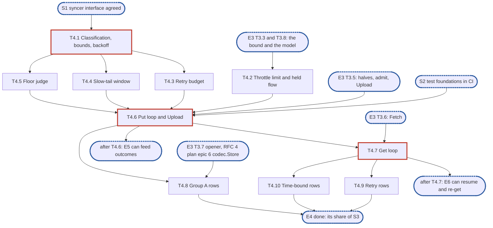

# Epic 4: syncer v2 termination, retries and the uploader

**Sources:** [RFC 3](../docs/internals/rfcs/rfc-3-syncer.md) §1.3's `Upload` and the "The
syncer" and "Counts toward health" columns of its error table; §2.4; §2.5; §2.6; §3, §3.1 to
§3.5; §2.10's throttle limit, throughput floor, first-byte bound, retry bound, retry budget,
slow-tail retry and retry backoff; §2.12's transfer series; §6's S4, S5, S6, S8 (`src`'s side),
S9, S17's throttle-limit clause, S19's error-set half, S21 and S23; §7.1's rows "§2.5 unknown is
failure", "§2.6 no inference", "§3.4 partial put", "§3.3, §3.5 stability" and "§3.4 measuring
pass"; §7.2's rows "§2.4 termination", "§2.4 throttling lowers concurrency", "§2.4 budget per
store and direction", "§2.4 slow tail is not charged", "§2.4 trickle fails", "§2.4 throughput
floor", "§2.4 throttling", "§2.4 retry budget", "§2.4 first byte, per direction", "§2.4 wire
bytes" (its put half), "§2.4 lone slow tail" and "§1.3 RFC 4's errors, as they are" (its table
half); §7.3's first rule; §8.2's "Retries" cases but the detached-buffer one, and its upload cases
of "Shape of a transfer"; §8.4's "retries" count. Cited for what they hand over: §2.8 (the
outcomes that count toward health, the cause), §2.9 (the per-store bound, the class of a
transfer), §4.3 (a fetch's resume and re-get, which epic 6 builds). Cited, not owned:
[RFC 4](../docs/internals/rfcs/rfc-4-remote-tier.md) §4.1 and §4.8 (the error set and `Meter`)
and §4.3 (`Put.Attempt`, overlapping tries); epic 1's D1 (what a refused call returns) and its
`Stats`; epic 2's D1 to D4 (the fault wrapper's effects, `syncertest`'s `Env` and `Faults`);
epic 3's D1, D3, D9, D10, D11 and D12 (the slot, the per-store bound, the fixed-values table,
`admit`, the counters, the `testing/synctest` bubble). Every citation is `develop`'s text,
epic 3's that of its open pull request (#5940). The code lands on `feat/storage-v2`, and the paths
below are paths there.
**Track:** B.
**Epic 4 estimate: 10 subtasks, 25.25 man-days.**
**Depends on:** **S1**, epic 1's surface, for T4.1. **S2**, epic 2's fault wrapper (`Inject`,
`Fail`, `Lose`, `Cut`, `Hold`, `Link`) and `syncertest`'s frame, for T4.6 onward. **Epic 3**:
T3.3's per-store bound and T3.8's model, for T4.2; T3.5's halves, `admit`, single-attempt
`Upload`, `fixed.go` and counters, for T4.6; T3.6's single-attempt `Fetch`, for T4.7; T3.7's
in-memory opener, for T4.8. **RFC 4 plan epic 6**, `codec.Store` with working bodies, for T4.8
only, through T3.7's opener.
**Blocks:** E5, which feeds T4.6's outcomes into its failure window and its `ErrDenied` re-trip
and reads T4.1's cause; E6, which runs its resume and re-get on T4.7's get loop; E7, whose sweep
needs both halves' loops and whose bound counts T4.6's overlapping tries. Outside RFC 3's epics,
RFC 8 offload plan epic 15 calls the complete `Upload`, and epic 21 runs T4.8's rows over the S3
store, giving `Faults.Drop`.

**Builds on epic 3's recommended answers.** Epic 3's pull request waits on two answers: its D12
(each check in a `testing/synctest` bubble, rather than `pkg/sim`'s `TestClock` with an idle wait)
and its §2.9 sentence on a waiter bound with nothing displaceable. This document assumes both are
answered as epic 3 recommends. A different D12 answer is known rework here: every test of T4.6 to
T4.10 would drive the `TestClock` through epic 3's fallback idle wait instead of a bubble, about
1 man-day across them. The §2.9 sentence changes nothing here.

**Pending the user's answer:** D3's jitter inputs, and the "§2.4 throughput floor" row's last
clause (§9, first two points).

---

## 1. Goal

Epic 4 makes every transfer end in bounded time with a report. Each try of either half is
classified by RFC 4's error set, retried within the four-attempt bound, the eight-throttled
bound and its store's budget, held back when the store throttles, cut at the throughput floor and
the first-byte bound, and retried once on a slow tail. `Upload` is then complete.

**At the end of the epic:**

- `Upload` calls `attempt` once per try, retries it within RFC 3 §2.4's bounds, lets a slow-tail
  try run on while its retry starts, and returns only once every try has returned, `nil` only on
  a try that returned `nil`.
- `Fetch` and `Prefetch` retry a get that failed before yielding a chunk, under the same bounds.
- A throttled store gets fewer workers: its throttle limit halves on each throttling reply and
  climbs back by one per transfer, and the throttled flow is held for its backoff.
- A transfer below the floor, stalled, trickling, or late to its first byte fails, and only a
  floor trip on a store whose aggregate is also below the floor is marked as counting toward
  health.
- Each ended try hands epic 5 an outcome saying whether it counts toward health and with what
  cause.
- `Stats` reports RFC 3 §2.12's transfer series.
- The Group A rows of §2.5, §3.4 and §3.3 with §3.5 pass over RFC 4's in-memory store through
  `codec.Store`; "§2.6 no inference" is skipped there by name and runs over RFC 8 offload plan
  epic 21's proxy.

### 1.1 In scope

The error classification and the attempt bounds (T4.1); the throttle limit and the held flow in
the scheduler (T4.2); the retry budget (T4.3); the slow-tail window (T4.4); the floor judge
(T4.5); the attempt loop for puts and the complete `Upload` (T4.6); the attempt loop for gets
(T4.7); the Group A rows (T4.8); the §7.2 retry rows (T4.9) and time-bound rows (T4.10).

### 1.2 Out of scope

- The fetch resume after a chunk was yielded, the verification re-get, `ErrMalformed`'s report at
  once, and the get half of "§2.4 wire bytes": E6, on T4.7's loop (D9). The re-get's exemption
  from the budget is written here, as a kind T4.3 takes no token for.
- Health: the failure window, the `ErrDenied` re-trip, the refusal of an unhealthy direction,
  `Flow.Health` and the probes: E5, from T4.6's outcomes (D10). RFC 4 plan epic 8's question,
  whether a store's re-admission probe serialised behind its `ProbeKey`'s shared probe was checked
  against the health epic, is E5's to answer: RFC 3 §2.8 states the rule, and E5's breakdown
  owns the probe loops it binds.
- The memory bound, which counts a slow-tail try's buffers as dropped once its `ctx` ends, and the
  fault sweep: E7.
- The codec's side of an attempt: the measuring passes, what a measurement keeps across tries,
  overlapping tries being safe, a cancelled try dropping its buffers (RFC 4 §4.3, RFC 4 §7.3's
  codec tests, the RFC 4 plan's epic 6).
- That the journal keeps offered bytes stable (RFC 3 §3.3, RFC 1's check), and that `src` reads
  only local bytes and recomputes each chunk's hash (RFC 3 §2.4, §3.5, RFC 8 §6.3, the engine's).
- Hedged cold reads and a bandwidth cap per direction: rows of the RFC 3 plan's §6.1 deferral
  ledger, unowned. §4.3's slow-tail `ponytail:` upgrade: its own row there.
- `Small`'s small-call bound and its retries: the ledger's second row.

### 1.3 Names used here

- **E1**, epic 1, interfaces: `pkg/syncer`'s contract, `pool.New` with `Config` and `Clock`,
  `Stats`, the import test and the frozen-exports test.
- **E2**, epic 2, test foundations: the per-call faults on RFC 4's fault wrapper and the frame of
  the Group A suite, `syncertest`.
- **E3**, epic 3, registration, flows and the fair scheduler: the halves, `admit`, the
  single-attempt `Upload` and `Fetch`, `internal/sched` and its model, the in-memory opener.
- **E4**, this epic.
- **E5**, epic 5, store health.
- **E6**, epic 6, the fetcher.
- **E7**, epic 7, memory bound, `Stats` and the fault sweep.
- **E8**, epic 8, the syncer's own integration: its settings section and its collector.
- **S1**, the syncer interface agreed, at the end of E1 (the RFC 8 offload plan's S1b).
- **S2**, the test foundations in CI, at the end of E2.
- **S3**, the syncer complete over the in-memory store, after E5, E6 and E7.
- **RFC 3 S4, S5, S6, S8, S9, S17, S19, S20, S21, S23**, invariants of RFC 3 §6, always written with
  "RFC 3" before them; they are not synchronisation points.
- **The S3 store**, RFC 4's production store, whose protocol is the storage service S3; not the
  synchronisation point S3.
- **The integration epic**, E8 here; outside RFC 3's epics, RFC 8 offload plan epic 21, which
  composes the syncer in the node and runs the Group A suite over the S3 store.

## 2. How the general rules apply

The rules are those of
[the RFC 3 plan's §1.5](rfc-3-syncer-plan.md#15-general-rules-for-each-epic), cited by number and
title and not copied.

| Rule | Subtasks | How |
| --- | --- | --- |
| rule 1, independent unit tests ([`CLAUDE.md`, "Writing tests"](../CLAUDE.md#writing-tests)) | all | T4.1, T4.3, T4.4 and T4.5 are pure functions and values tested by tables, with time passed in as a `time.Duration`. T4.2 extends `internal/sched`, pure, and its model. T4.6, T4.7, T4.9 and T4.10 test the pool's unexported loop through `export_test.go`, each `attempt` and half-level get a closure over RFC 4's in-memory store (kind 2) under E2's wrapper (kind 3), in E3's `testing/synctest` bubble (kind 1). T4.8 runs through `syncertest` over `codec.Store`. No test double is written |
| rule 2, fuzz tests where relevant ([`CLAUDE.md`, "Writing tests", "By kind"](../CLAUDE.md#writing-tests)) | T4.2 | E3's `FuzzSched` gains the throttle, hold and requeue steps, against the model. Nothing else here reads bytes |
| rule 3, observability follows RFC 25, with RFC 3's own exception | T4.6, T4.7 | `Stats` gains the transfer series of R38 in E1's fields, as atomics read without the half's lock (E3's D11). No log line and no span: RFC 3 §2.8's two lines are E5's |
| rule 4, profiling | T4.6, T4.9 | Every test runs under `internal/prof`'s leak check, which catches a slow-tail try or a floor watchdog left running after `Upload` or `Close` returns. No per-chunk allocation is added: the `Meter`'s funcs are bound once per try, and the floor's buckets live in the slot. E7's `unit/syncer-allocs` gate measures it |
| rule 5, public interface and internals ([`CLAUDE.md`, "Verifying a change"](../CLAUDE.md#verifying-a-change)) | T4.6 to T4.10 | Under `-race`. The throttle limit and calls in flight at RFC 4's in-memory store's record, where a slow-tail try outliving its slot is counted; the outcome handed to E5 at the per-instance hook E5 replaces (D10); every other count at `Stats`, and each failure at the error the caller gets |
| rule 6, known failures shrink | none | No suite this epic's tests run in keeps a `known.yaml`: every test lands green |
| rule 7, v2 ignores v1 | all | Nothing here imports beyond `pkg/syncer`, `pkg/remote`, `internal/sched` and the standard library, which E1's import test holds; nothing reads v1 |
| rule 8, real dependencies for properties of those dependencies ([`CLAUDE.md`, "Writing tests"](../CLAUDE.md#writing-tests)) | T4.8 | "§2.6 no inference" needs a service that closes the connection after the whole body: `Faults.Drop`, nil over the in-memory opener and given by RFC 8 offload plan epic 21's proxy over the S3 store against LocalStack. Nothing needs a disk: the syncer persists nothing |
| rule 9, code comment conventions ([`CLAUDE.md`, "Code comments"](../CLAUDE.md#code-comments)) | T4.1 to T4.7 | RFC 3 §2.4's `decision:` on slow-tail retries and re-gets at the budget's site (T4.3); the RFC 3 plan's §4.3 slow-tail `ponytail:` at the window (T4.4); the markers each §4 decision names |
| rule 10, a test must be able to fail ([`CLAUDE.md`, "Writing tests"](../CLAUDE.md#writing-tests)) | all | Each §7.2 row names the wrong design it catches, and is checked by building it: a hold without a limit, a charged throttled retry, a charged slow-tail retry, a floor judged per transfer, a per-transfer slow-tail cap alone, one bucket per process, jitter that ignores the transfer. Each classification row is checked by swapping two rows |
| rule 11, a symbol is exported only if the RFC's interface uses it | all | Nothing is added to `pkg/syncer` or `pool`'s exports: E1's frozen-exports test still passes. `internal/sched` gains only what `pool` calls (T4.2). `syncertest` gains rows, which are unexported |
| rule 12, each subtask creates only what it declares | all | Each fixed value lands with the subtask that reads it, in E3's `fixed.go`. The outcome hook lands with T4.6, its first caller, and E5 is its consumer. The get loop retries only before a chunk is yielded, and E6 adds the resume (D9) |

## 3. Requirements and invariants

Every MUST and MUST NOT that RFC 3 places on this epic, numbered so that subtasks and tests can
cite them. Sections are RFC 3's unless named.

**`Upload` and the put attempt**

| # | Requirement | Kind | Source | Subtasks |
| --- | --- | --- | --- | --- |
| R1 | `Upload` calls `attempt` once per try, up to §2.4's bounds, and returns `nil` only once a call of `attempt` returned `nil`, which is the store's acknowledgement; every other ending, an unknown one included, is an error | MUST | §1.3; §2.6; §6, RFC 3 S6 | T4.6 |
| R2 | `Upload` returns only once every call of `attempt` it made has returned, two tries overlapping after a slow-tail cancel included, and never calls `attempt` after it returns | MUST | §1.3; §7.1, "§3.4 measuring pass", "§2.5 unknown is failure" | T4.6, T4.8 |
| R3 | Every retry inside one `Upload` calls the same `attempt`, so it puts the same name with the same bytes; the syncer makes no put of its own | invariant | §1.3; §2.4; §2.5; §6, RFC 3 S5 | T4.6, T4.8 |
| R4 | A try the slow-tail rule cancels has its `ctx` ended, so the codec drops its chunk buffers, and it runs on without the transfer's slot while the retry runs | invariant | §1.3; §2.4 | T4.6 |
| R5 | An unknown outcome, a put sent whose response was lost, is resolved as not stored and reported as a failure | MUST | §2.5; §6, RFC 3 S5 | T4.6, T4.8 |
| R6 | A block is never reported stored because the call returned, no error was seen, every byte was sent, time passed, or a later read succeeded | MUST NOT | §2.6; §6, RFC 3 S6 | T4.6, T4.8 |
| R7 | A put that does not complete is never reported stored, and is never inferred stored from parts | MUST NOT | §3.4; §6, RFC 3 S9 | T4.6, T4.8 |
| R8 | The uploader makes no multipart upload: each try is one call of `attempt`, and the syncer has no put of its own to split. E1's `Store`, which has no put, holds it | MUST NOT | §3.4; E1's R9 | T4.6 |
| R9 | The uploader does not decide which blocks are assembled, when, or in what order: it runs the `Upload` calls it is given, in its flow's queue | MUST NOT | §3.1 | T4.6 |
| R10 | The uploader holds a reference, never a copy: a queued `Upload` holds its `attempt` and no byte of the block, and the syncer never reads one | MUST, MUST NOT | §3.2; §1.3 | T4.6 |
| R11 | An `attempt` failing because `src` failed, a chunk whose recomputed hash differs among them, fails the `Upload` unretried, returned as it is, and nothing is stored under the name | invariant | §3.5; §6, RFC 3 S8; §7.1, "§3.3, §3.5 stability" | T4.6, T4.8 |

**Classification**

| # | Requirement | Kind | Source | Subtasks |
| --- | --- | --- | --- | --- |
| R12 | Each error of RFC 4's set gets its row of §1.3's table: `ErrNotFound` and `ErrInvalid` fail the call unretried and uncounted; `ErrDenied` fails it unretried, counts toward health in the call's direction and keeps its `Cause`; `ErrThrottled` holds the flow and retries after backoff, uncounted; `ErrTransient` retries within its bound and counts; `ErrCorrupt` on a put retries within its bound and counts toward put health, and on a fetch fails the call uncounted until E6's re-get | MUST | §1.3; §2.4; §6, RFC 3 S19; §7.2, "§1.3 RFC 4's errors, as they are" | T4.1, T4.9 |
| R13 | Any other error, a local one or a transforms' material error, fails the call unretried and uncounted, and is returned as it is | invariant | §1.3; §6, RFC 3 S19 | T4.1, T4.9 |
| R14 | Errors are recognised with `errors.Is` and `errors.As` on `pkg/remote`'s values, and a denial's cause is read from `remote.DeniedError` | invariant | §1.3; RFC 4 §4.8 | T4.1 |

**Termination and the retry bound**

| # | Requirement | Kind | Source | Subtasks |
| --- | --- | --- | --- | --- |
| R15 | Every transfer completes in bounded time with a success or a failure reported to its caller; no transfer retries indefinitely | MUST | §2.4; §6, RFC 3 S4; §7.2, "§2.4 termination" | T4.1, T4.6, T4.7, T4.10 |
| R16 | Only `ErrTransient`, `ErrThrottled`, a put's `ErrCorrupt` and the syncer's own floor, stall, trickle and first-byte trips are retried here; a fetch's `ErrCorrupt` is retried once by E6 | invariant | §2.4 | T4.1 |
| R17 | At most four attempts per transfer, the first and three retries, not counting attempts ended by throttling; at most eight throttled attempts, the first seven retried after their backoff under the lowered limit and the eighth reported as `ErrThrottled` | bound | §2.4; §2.10, "retry bound"; §6, RFC 3 S21 | T4.1, T4.6, T4.9 |
| R18 | So an `Upload` calls `attempt` at most twelve times, four error attempts and eight throttled ones, and reads `src` at most twenty times through the codec | bound | §2.4; §7.1, "§3.4 measuring pass" | T4.6, T4.8 |
| R19 | A transfer whose attempts are exhausted is reported with its last error | invariant | §7.2, "§2.4 retry budget" | T4.6, T4.9 |
| R20 | Each retry waits a full-jitter backoff, uniform in [0, min(5 s, 100 ms × 2^attempt)], so transfers that failed together do not retry together; the draw is derived from the transfer, not from a random source (D3) | invariant | §2.4; §2.10, "retry backoff"; §1.4; §7.2, "§2.4 retry budget" | T4.1, T4.9 |
| R21 | The syncer is the only layer that retries a transfer, and a retry is the same attempt: the same name and the same bytes | invariant | §2.4 | T4.6 |

**The retry budget**

| # | Requirement | Kind | Source | Subtasks |
| --- | --- | --- | --- | --- |
| R22 | Every error retry, an attempt beyond the first after an `ErrTransient` that is not `ErrThrottled` or after a put's `ErrCorrupt`, takes a token from its store's bucket for that direction; every transfer in that direction that succeeds without an error retry returns 0.1; with the bucket empty the failed attempt is reported, not retried | invariant | §2.4; §2.10, "retry budget"; §6, RFC 3 S21 | T4.3, T4.6, T4.9 |
| R23 | Each bucket holds the half's pool size in tokens, a quarter of it a reserve that only demand retries spend: a `Fetch` on a flow that is not background in the get direction, an `Upload` on a flow that is not background in the put direction | invariant | §2.4; §2.10, "retry budget"; §6, RFC 3 S21 | T4.3, T4.9 |
| R24 | The budget is per store and direction: no store's failures, and no direction's, spend another's tokens | invariant | §2.4; §6, RFC 3 S21; §7.2, "§2.4 budget per store and direction" | T4.3, T4.9 |
| R25 | Throttled retries, slow-tail retries and verification re-gets take no token | invariant | §2.4; §2.10; §6, RFC 3 S21; §7.2, "§2.4 slow tail is not charged" | T4.3, T4.9 |

**Throttling**

| # | Requirement | Kind | Source | Subtasks |
| --- | --- | --- | --- | --- |
| R26 | On `ErrThrottled` the flow's queue is dispatched nothing new until that transfer's backoff has run, and the transfer then retries; other flows are dispatched meanwhile | invariant | §2.4; §7.2, "§2.4 throttling" | T4.2, T4.6, T4.9 |
| R27 | Each store and direction has a throttle limit, the most workers it may hold: it starts at the cap, halves to half of what the store holds, never below one, on each throttling reply, and rises by one per transfer completed without throttling, up to the cap. The store never holds more than it, and it is never above the cap | invariant | §2.4; §2.9; §2.10, "throttle limit"; §6, RFC 3 S17; §7.2, "§2.4 throttling lowers concurrency" | T4.2, T4.6, T4.9 |
| R28 | Throttling says nothing about health: no throttling reply counts toward it, and no transfer fails on throttling before its eighth throttled attempt | invariant | §1.3; §2.4; §6, RFC 3 S19 | T4.1, T4.9 |

**Time bounds**

| # | Requirement | Kind | Source | Subtasks |
| --- | --- | --- | --- | --- |
| R29 | The throughput floor is 64 KiB/s over 30 s, judged on the store's aggregate per direction: a transfer below it fails on it only when the store's aggregate in that direction, summed over every transfer to it, is also below it over the interval, and only such a failure counts toward health | MUST | §2.4; §2.10, "throughput floor"; §6, RFC 3 S19 | T4.5, T4.6, T4.10 |
| R30 | A transfer that moves no byte for the interval has stalled and fails, whatever the aggregate, and does not count toward health unless the aggregate is below the floor too | invariant | §2.4; §2.10 | T4.5, T4.10 |
| R31 | A transfer moving under a quarter of its store's mean per-transfer rate in that direction, the aggregate divided by the transfers in flight, over the interval, while the aggregate is above the floor, fails as trickling and does not count toward health | invariant | §2.4; §6, RFC 3 S23; §7.2, "§2.4 trickle fails" | T4.5, T4.10 |
| R32 | The first-byte bound is 10 s per direction: for a get from dispatch to the first body byte received; for a put from dispatch to the first body byte accepted, and again from the last body byte sent to the acknowledgement | invariant | §2.4; §2.10, "first-byte bound"; §7.2, "§2.4 first byte, per direction" | T4.6, T4.7, T4.10 |
| R33 | Every bound, and `syncer_bytes_total`, measures wire bytes: the syncer passes a `remote.Meter` into every call of `attempt` and every `Store.Get`, and reads only its `Moved` counts and its `Sent`; decoded bytes never count | invariant | §2.4; §2.12; RFC 4 §4.1 | T4.6, T4.7, T4.10 |
| R34 | Only the store's side counts: time a caller spends not reading a fetched stream never trips the floor or the stall rule | invariant | §2.4; §7.2, "§2.4 throughput floor" | T4.5, T4.7, T4.10 |
| R35 | The time a put spends inside `src`, its measuring passes included, counts toward the floor and the first-byte bound, since the syncer cannot tell it from the network's (§9) | invariant | §2.4 | T4.6, T4.10 |
| R36 | A transfer whose first byte is later than the 90th percentile of its store's first-byte times in that direction over the last 60 s is cancelled and retried, within the retry bound, at most once per transfer, without a budget token | SHOULD | §2.4; §2.10, "slow-tail retry" | T4.4, T4.6, T4.7, T4.9 |
| R37 | Slow-tail retries on a store and direction never exceed the larger of one and 5% of the transfers it dispatched over the same 60 s window; past that share a slow transfer is waited out under the floor and the first-byte bound | MUST NOT | §2.4; §2.10; §6, RFC 3 S21; §7.2, "§2.4 slow tail is not charged", "§2.4 lone slow tail" | T4.4, T4.9 |

**Observability**

| # | Requirement | Kind | Source | Subtasks |
| --- | --- | --- | --- | --- |
| R38 | `Stats` makes observable, by half and store, `syncer_transfers_total` by `outcome` (`ok`, `failed`, `unknown`), `syncer_bytes_total` from the `Meter`, `syncer_transfer_duration_seconds`, `syncer_first_byte_seconds`, `syncer_retries_total` by `reason` (`transient`, `throttled`, `slow_tail`, `floor`, `stalled`, `trickle`; `verify` is E6's), `syncer_retry_budget_exhausted_total`, `syncer_throttle_limit`, `syncer_throttled_seconds_total` and `syncer_store_throughput_bytes_per_second` | MUST | §2.12 | T4.6, T4.7 |
| R39 | Reading these counters takes no lock a dispatch needs, and costs nothing per transfer in flight; the consistent snapshot across them is E7's | MUST NOT | §2.12 | T4.6 |

**The checks**

| # | Requirement | Kind | Source | Subtasks |
| --- | --- | --- | --- | --- |
| R40 | The Group A rows of §2.5, §2.6, §3.4 and §3.3 with §3.5, and §3.4's measuring pass, run in the suite over any remote store its caller opens; a row whose fault the caller cannot give is skipped by name | test row | §7.1; §8.1, "Real backend"; E2's D4 | T4.8 |
| R41 | A backend that returns instantly is not used for §2's checks: the time-bound and retry rows run over E2's `Link` | MUST NOT | §7.3; E2's D1 | T4.9, T4.10 |
| R42 | The checks reach §8.2's "Retries" cases (a store's budget empty at the first failure after start and refilled by a single success on it; a throttle limit at one, throttled again) and its upload cases of "Shape of a transfer" (a block of one chunk and one at the largest block size; a `src` that fails before its first chunk and after its last; a chain declaring every length and one needing a measuring pass) | test row | §8.2 | T4.8, T4.9, T4.10 |
| R43 | In a scripted all-failing run, retries on a store never exceed its budget and no transfer makes more than four attempts | test row | §8.4, "retries"; §6, RFC 3 S21 | T4.9 |

RFC 3 §2.4's other sentences belong elsewhere: the fetch resume and the verification re-get are
E6's (on T4.7's loop); "a `src` MUST read only local bytes" binds the engine and GC, which write
`src`; what follows an `Upload`'s failure, a new put attempt under a new name, is the engine's
(RFC 8 §6.6). §3.3's obligation is RFC 1's, and §3.5's "an implementation that transfers from
anywhere else MUST supply it" binds GC's staging. §2.5's orphan collection is GC's. §2.6's last
sentence, no setting that keeps blocks less safely, is held by E1's `Config`, which has no such
field (E1's R18).

## 4. Decisions this epic takes

- **D1, classification is one pure function, matched in the order of RFC 4's wrapping.**
  `classify(err error, d remote.Direction) verdict` returns whether to retry and as what kind
  (none, error, throttled), whether the outcome counts toward health, and the cause E5 keeps.
  `ErrThrottled` is tested before `ErrTransient`, which it wraps, and `ErrMalformed` before
  `ErrCorrupt`; a `*remote.DeniedError` is read with `errors.As`. The syncer's own trips (D6,
  first byte) carry their verdict from the rule that raised them, not from the error a cancelled
  try returns. A caller's `ctx` ending is returned as `ctx.Err()`, unretried and uncounted. No
  marker: this is §1.3's table. Prior art: RFC 4's own C.3 table mapping S3 replies to the set;
  gRPC's retry policy keyed on status codes (from memory).
- **D2, a throttled try gives its slot back and its entry goes back to the head of its flow's
  queue; an error retry keeps its slot.**
  - On `ErrThrottled` the half lowers the store's limit, returns the slot, puts the entry back at
    the head of its flow's queue for its class, and holds the flow for the backoff. Returning
    the slot is what lets the store's in-flight count fall to the lowered limit, which "§2.4
    throttling lowers concurrency" asserts; a throttled transfer that kept its slot would retry at
    the same concurrency. The requeue counts as a waiter and is refused like `Add` at a full
    queue or a full waiter bound, never displacing; a refused requeue reports the transfer as
    `ErrThrottled`. A `decision:` marker says so: RFC 3 S20 holds exactly, at the cost of
    reporting a throttled transfer early only when the half is already full of waiters.
  - After `ErrTransient` or a put's `ErrCorrupt` the transfer keeps its slot through the
    backoff, at most 800 ms for the third error retry (100 ms × 2^3), and calls `attempt`
    again. Holding the flow instead would stall a busy share's offload on each transient error;
    giving the slot back would need a second requeue path. A `ponytail:` marker names the cost,
    one idle worker for up to 1.4 s per failing transfer, and the upgrade, the throttle path's
    requeue without the hold, if a profile shows workers idle in backoff while work waits.
  - Holds are counted per flow, so two throttled transfers of one flow hold it until the later
    backoff ends.

  Prior art: AWS SDKs' adaptive retry mode, which lowers a client-side send rate on throttling
  replies (from memory); Kubernetes API priority and fairness, whose seats go back on release
  (from memory).
- **D3, the backoff's draw is a hash of the store, the block and the attempt. Pending the user's
  answer.** The user decided the draw is deterministic, from a hash of the store ID and the
  attempt number, with no random source, so RFC 3 §1.4's four dependencies stay four. With those
  two inputs alone, every transfer of one store retrying its *k*th attempt waits the same time,
  so transfers that failed together retry together, which RFC 3 §2.4 forbids and "§2.4 retry
  budget" asserts against ("the backoffs of transfers that failed together are spread"). This
  document therefore adds the transfer's block name to the hash: FNV-1a 64 (`hash/fnv`) over the
  `StoreID`, the `remote.Name` and the attempt number, reduced to [0, ceiling] in nanoseconds.
  Still no random source, the same delays on every run, and spread across the transfers of a
  store. The attempt number is every attempt the transfer has made so far, throttled ones
  included, so the eighth throttled attempt waits at the 5 s ceiling. A `decision:` marker at the
  site names the inputs and that two fetches of one block on one store, which E6's single flight
  normally joins, share their delays. Prior art: AWS's "Exponential Backoff And Jitter" (Brooker,
  2015), whose full jitter is this distribution (from memory); none found for a hash-derived draw.
  Not chosen, the alternatives in §9.
- **D4, a put's try runs on a goroutine of its own; a get's tries run in turn on the caller's.**
  RFC 3 §7.1's measuring-pass row holds a slow-tail-cancelled `attempt` until its retry has
  started, so the retry cannot wait for the cancelled call: each put try is started on its own
  goroutine, and the caller supervises it (its result, the first-byte and slow-tail timers, the
  floor's verdict, its own `ctx`). A get try is cancelled through its `ctx` and its stream ends
  before the next try starts, because a get try that yielded nothing has nothing to overlap and
  the caller pulls its stream itself (E3's D1). A `decision:` marker at the get loop says it relies
  on `Store.Get` returning once its `ctx` ends, and that a get that ignored its `ctx` would hold
  the caller past the slow-tail rule. Prior art: `net/http`'s request cancellation through the
  request's context (from memory).
- **D5, the budget counts tenths of a token in an integer.** A bucket of pool × 10 tenths, an
  error retry taking 10, a clean success returning 1, the reserve a quarter of the capacity;
  updated under the half's lock at the try's end, mirrored to an atomic for `Stats`. Integer
  tenths keep the refill exact over a long run, where a `float64` would drift from the
  arithmetic "§2.4 slow tail is not charged" asserts. Buckets start full. No marker. Prior art:
  gRPC's retry throttling, a token bucket with a 0.1 refill (gRFC A6, from memory), from which
  RFC 3 §2.4's figures read.
- **D6, the floor is judged once a second by a watchdog per half.** While a half has transfers
  in flight, one goroutine waits on `Clock.After(1 s)`, folds each running transfer's `Moved`
  bytes of the last second into a 30-slot ring per transfer and per store, and judges each
  transfer that has run for 30 s: stalled, trickling, or below the floor with the aggregate below
  it too. The verdict cancels the try's `ctx` and names its reason. It stops when the half has
  nothing in flight, so an idle syncer runs no timer. `ponytail:` the window is judged in
  one-second steps, so a trip is seen up to a second late and a transfer's first second is never
  partial; upgrade to per-transfer timers if a floor or stall trip a second late shows up in B5.
  A transfer's window does not advance while a fetched chunk is with its caller (R34). Prior art:
  curl's `--speed-limit` and `--speed-time`, a floor judged over a window (from memory).
- **D7, the throttle limit at the cap binds as the cap does.** RFC 3 §2.10 starts the limit at
  the cap, and RFC 3 §2.9 lets a lone busy store hold the whole pool. So while a store's limit is
  at its cap it binds only while another store has work waiting, as the cap does, and below the
  cap it binds always. "Halves to half of what it holds" reads the store's held workers from
  `sched`; "completed without throttling" is a transfer that ended in success without a
  throttling reply. Both live in `sched` (T4.2), so the model checks RFC 3 S17's throttle clause.
  A `decision:` marker names both readings. Prior art: TCP's congestion window, halved on loss and
  grown by one per round trip (RFC 5681, from memory).
- **D8, `unknown` is a put whose last try failed after its first body byte moved.** RFC 3 §2.5's
  unknown outcome is a request sent whose response was lost, and §2.8 calls a put cancelled
  mid-flight unknown too. The syncer sees neither the response nor the connection, so it counts
  `unknown` when the `Upload`'s last try ended in an error after its `Meter` reported a moved
  byte, and `failed` otherwise. A get is never unknown. A `decision:` marker says so. Prior art:
  none found.
- **D9, a get is retried here only while it has yielded nothing.** Resuming after yielded chunks
  is E6's fetch resume. Until it lands, a get try that failed after yielding a chunk reports its
  error, so a reader never sees a chunk twice. E6 replaces the rule. No marker: it is the state E6
  starts from, named in its breakdown.
- **D10, each ended try hands E5 an outcome through one hook on the half.** `outcome{dir, ok,
  counts, cause}` is passed to `half.onOutcome`, set per instance from `export_test.go` in this
  epic's tests and by E5's `New` once health lands; a `Stats` counter is no substitute, since E5
  needs the order of outcomes within its window. No marker. Prior art: the journal's offload
  callback, which hands each result to its caller (RFC 1 §3.3).
- **D11, the syncer's own trips wrap `remote.ErrTransient`.** A floor, stall, trickle or
  first-byte trip on a transfer's last attempt is reported as an error that names the store and
  the rule and wraps `remote.ErrTransient`, so the engine's `errors.Is` reads it as RFC 4's
  transient class, as RFC 3 §1.3 does for `Small`'s bound. No new error value (E1's R16). No
  marker. Prior art: `context.DeadlineExceeded` reported by `net/http` as a timeout (from memory).
- **D12, the fixed values E4 reads join E3's table.** The throttle limit's rule, the floor, the
  first-byte bound, the retry bound, the retry budget, the slow-tail share and window, and the
  retry backoff go into `pool/fixed.go` under RFC 3 §2.10's `decision:` note, beside E3's.
  Whichever of T3.5 and T4.1 lands first creates the file with that note. No marker beyond the
  RFC's. Prior art: none found.

## 5. Target tree

```text
pkg/syncer/
  pool/
    classify.go            T4.1  classify, the verdict, the attempt bounds, the backoff draw (D1, D3)
    classify_test.go       T4.1
    fixed.go               T4.1  E4's values in RFC 3 §2.10's table (D12)
    budget.go              T4.3  the bucket per store and direction (D5)
    budget_test.go         T4.3
    slowtail.go            T4.4  the first-byte window and the slow-tail share
    slowtail_test.go       T4.4
    floor.go               T4.5  the floor judge (D6)
    floor_test.go          T4.5
    attempt.go             T4.6  the put loop, the Meter, the timers, the watchdog, the outcome hook
    upload.go              T4.6  Upload over the loop
    fetch.go               T4.7  the get loop under Fetch and Prefetch
    stats.go               T4.6  the transfer series (T4.7 adds the get side)
    export_test.go         T4.6  the outcome hook, the loop's inputs for tests
    attempt_test.go        T4.6
    fetch_retry_test.go    T4.7
    retry_rows_test.go     T4.9  the §7.2 retry rows, §8.4's retries count, §8.2's retry cases
    time_rows_test.go      T4.10 the §7.2 time-bound rows, §8.2's upload shape cases
    internal/sched/
      throttle.go          T4.2  Throttle, Recover, Hold, Release, Requeue
      throttle_test.go     T4.2
      model_test.go        T4.2  the model's throttle and hold steps
      fuzz_test.go         T4.2  FuzzSched's new steps; seeds
  syncertest/
    upload.go              T4.8  the §2.5, §2.6, §3.4, §3.3 with §3.5 and measuring-pass rows
```

## 6. Subtasks

### T4.1 Classification, the attempt bounds and the backoff draw

**Subtask T4.1 estimate: 2 man-days.**

- **Track:** B. **Depends on:** S1.
- **Covers:** R12, R13, R14, R15, R16, R17, R20, R28.
- **Deliverables:** `classify.go` (D1, D3) and E4's values in `fixed.go` (D12), unexported:

  ```go
  type retryKind uint8 // noRetry, errorRetry, throttledRetry
  type verdict struct {
      retry  retryKind
      counts bool  // toward the direction's health (RFC 3 §2.8)
      cause  error // the error class E5 keeps: a *remote.DeniedError, ErrTransient or ErrCorrupt
  }
  func classify(err error, d remote.Direction) verdict
  type tries struct{ errors, throttled int } // attempts made, by kind
  func (t tries) next(v verdict) (retry bool)  // within four error attempts and eight throttled ones
  func backoff(store syncer.StoreID, name remote.Name, attempt int) time.Duration
  ```

  Consumed by T4.6 and T4.7, whose loops call all three; by E5, which reads `verdict.counts` and
  `cause` through T4.6's outcome; by E6, whose re-get adds its kind.
- **Acceptance criteria:**
  - Each error of RFC 4's set, in each direction, gets §1.3's row; `ErrThrottled` never reads as
    `ErrTransient`, nor `ErrMalformed` as a plain `ErrCorrupt`; a `*remote.DeniedError` keeps its
    cause; an error wrapping none of the set, and `context.Canceled`, get no retry and no count.
  - `next` allows attempts 2 to 4 after error verdicts and 2 to 8 after throttled ones, counted
    apart, and refuses the fifth error attempt and the eighth throttled reply's retry.
  - `backoff` lies in [0, min(5 s, 100 ms × 2^attempt)], returns the same value for the same
    inputs, and over 1,000 names at one store and attempt spreads across the range.
- **Tests:** at `classify`, `next` and `backoff`, the functions T4.6's loop and E5 consume, as
  tables (no double). Every error of the set wrapped twice with `fmt.Errorf("%w")` in each
  direction against §1.3's table typed from the RFC (catches a row swapped, or a match on
  `ErrTransient` first that retries a throttle as an error, R12, R28). A material error and a
  plain `errors.New` (catches a local error retried or counted, R13). The bound sequences (catches
  throttled attempts counted toward the four, R17). 1,000 names at one store and attempt, the
  draws bucketed into ten equal ranges, none empty (catches a draw that ignores the block, which
  every name would put in one bucket, R20). Each fixed value against RFC 3 §2.10's figure.

### T4.2 The throttle limit and the held flow in the scheduler

**Subtask T4.2 estimate: 3 man-days.**

- **Track:** B. **Depends on:** T3.3, T3.8.
- **Covers:** R26, R27.
- **Deliverables:** `internal/sched/throttle.go` (D2, D7):

  ```go
  func (s *Sched) Throttle(st StoreKey) (limit int)  // the per-store bound to max(1, held/2)
  func (s *Sched) Recover(st StoreKey) (limit int)   // the bound plus one, up to the cap
  func (s *Sched) Hold(f FlowKey)                    // nothing of f dispatched until as many Releases
  func (s *Sched) Release(f FlowKey)
  func (s *Sched) Requeue(e *Entry) error            // back at its flow's head; refused like Add, never displacing
  ```

  A held flow leaves its ring and rejoins on its last `Release`, in O(1). The model of T3.8 gains
  the same five steps and checks RFC 3 S17's throttle clause after each; `FuzzSched` gains them,
  with seeds. Consumed by T4.6, which throttles, recovers, holds and requeues.
- **Acceptance criteria:**
  - A store holding 96 of a pool of 128 throttled once has a bound of 48, then 24, 12, 6, 3, 1,
    and at 1 stays at 1; `Recover` raises it one at a time back to the cap and no further.
  - At its cap the bound binds only while another store has work waiting (D7); below it, always.
  - A held flow gets no dispatch while held and its first queued entry is next once released;
    other flows on its store are served meanwhile, within the bound.
  - `Requeue` at a full queue or a full waiter bound returns the refusal and displaces nothing.
  - One dispatch's operation count stays flat at 1 to 1,000 waiting flows with held flows among
    them, from E3's counter.
- **Tests:** at `Next`, which T3.5's dispatch consumes, as tables (no double). Each criterion
  above, with the wrong design it catches: a bound that ignores what the store holds (halving the
  cap instead, which leaves 48 when 8 are held); a bound that always binds, which caps a lone
  store at three quarters (RFC 3 §7.2 "§2.9 lone flow", re-run); a hold that only skips the
  flow's turn once. The model's property test and the fuzz seeds over the new steps, each checked
  by planting a bound that `Next` ignores and watching them fail (rule 10).

### T4.3 The retry budget per store and direction

**Subtask T4.3 estimate: 1.25 man-days.**

- **Track:** B. **Depends on:** T4.1.
- **Covers:** R22, R23, R24, R25.
- **Deliverables:** `budget.go` (D5): a bucket per store in each half, built at `Register`, with
  RFC 3 §2.4's `decision:` note on slow-tail retries and re-gets at the site:

  ```go
  type bucket struct{ tenths, capacity int64 }
  func (b *bucket) take(demand bool) bool // an error retry; false when empty, or when only the reserve is left and demand is false
  func (b *bucket) refund()               // a transfer that succeeded without an error retry
  ```

  Consumed by T4.6 and T4.7, which call `take` before an error retry and `refund` at a clean
  success; by `Stats`' `RetryBudgetExhausted`.
- **Acceptance criteria:**
  - A bucket of a pool of 128 allows 128 takes from full, the last 32 only to demand.
  - Ten refunds restore one take; a refund never passes capacity.
  - With first attempts failing at 6% and the refund at 0.1, a bucket stays near full over
    100,000 transfers; charging 5% more takes empties it within about 8,000, as RFC 3 §2.4's
    arithmetic says.
- **Tests:** at `take` and `refund`, which the loops call, as tables (no double): the reserve
  refused to a background take and granted to a demand one (catches a reserve not held, R23); the
  6% sequence, deterministic, from a seeded source (kind 1) (catches a refund that drifts or a
  refill off by ten, R22, R25); two buckets of one store, one per half, draining one leaves the
  other full (catches one bucket per store, R24).

### T4.4 The slow-tail window and its share

**Subtask T4.4 estimate: 1.75 man-days.**

- **Track:** B. **Depends on:** T4.1.
- **Covers:** R36, R37.
- **Deliverables:** `slowtail.go`, with the RFC 3 plan's §4.3 `ponytail:` at the ring: a ring per
  store and direction of the first-byte times of the last 60 s, at most 300 times the half's
  pool; the 90th percentile by selection, recomputed at most once a second; per-second counts of
  transfers dispatched and slow-tail retries over 60 s.

  ```go
  type tail struct{ /* unexported */ }
  func (t *tail) sample(now, firstByte time.Duration)
  func (t *tail) dispatched(now time.Duration)
  func (t *tail) threshold(now time.Duration) (p90 time.Duration, ok bool) // ok false with no sample
  func (t *tail) allow(now time.Duration) bool // a slow-tail retry within max(1, 5% of dispatched); counts it
  ```

  Consumed by T4.6 and T4.7, which arm a timer at `threshold` and ask `allow` when it fires.
- **Acceptance criteria:**
  - `threshold` is the 90th percentile of the samples of the last 60 s, and forgets older ones.
  - `allow` grants one retry on a store with no traffic and at most 5% of the window's dispatches
    on a busy one, counted per second over 60 s.
  - A full ring drops its oldest sample, and its memory is fixed at construction.
- **Tests:** at `threshold` and `allow`, as tables over passed-in times (no double). Samples
  spanning 90 s (catches a window that never forgets). One dispatch on an idle store: one retry
  allowed (catches a bare 5% rounding to none, R37). 1,000 dispatches in a window, 60 retries
  asked: 50 allowed (catches a per-transfer cap alone, R37). The selection run twice in one second
  costs one recomputation, read from the window's own counter.

### T4.5 The floor judge

**Subtask T4.5 estimate: 2 man-days.**

- **Track:** B. **Depends on:** T4.1.
- **Covers:** R29, R30, R31, R34.
- **Deliverables:** `floor.go` (D6): per store and direction, a 30-slot ring of bytes per second
  and the count in flight; per transfer, the same ring and a paused flag.

  ```go
  type trip uint8 // none, floor, stalled, trickle
  func judge(own, aggregate, inFlight int64) (t trip, counts bool) // bytes over the last 30 s
  ```

  Consumed by T4.6's watchdog, which folds the seconds and cancels a tripped try, and by T4.7,
  which pauses a get's window while a chunk is with its caller.
- **Acceptance criteria:**
  - Below 64 KiB/s with the aggregate below too: `floor`, counting toward health.
  - Below it with the aggregate above: no trip, unless it moved no byte (`stalled`) or under a
    quarter of the aggregate over the transfers in flight (`trickle`), neither counting.
  - Thirty-two transfers sharing 1 MiB/s, 32 KiB/s each: no trip.
  - A paused second neither advances the window nor counts as a stalled one.
- **Tests:** at `judge` and the rings, as tables (no double). Each criterion, with the wrong design
  it catches: a floor judged per transfer, which fails all 32 (R29); a stall that waits for the
  aggregate (R30); a trickle measured against the floor rather than the mean (R31); a window that
  advances while the caller holds a chunk (R34).

### T4.6 The put attempt loop and the complete `Upload`

**Subtask T4.6 estimate: 5 man-days.**

- **Track:** B. **Depends on:** T4.2, T4.3, T4.4, T4.5, T3.5, and S2.
- **Covers:** R1, R2, R3, R4, R5, R6, R7, R8, R9, R10, R11, R15, R17, R18, R19, R21, R22, R26,
  R27, R29, R32, R33, R35, R36, R38, R39.
- **Deliverables:**
  - `attempt.go`: the loop on T3.5's slot (D2, D4). Each try on its own goroutine with a
    `remote.Meter` whose `Moved` adds to the try's atomic byte count and stamps its first byte,
    and whose `Sent` restarts the first-byte bound to the acknowledgement; the first-byte and
    slow-tail timers on `Config.Clock`; the half's floor watchdog (D6); after a try, `classify`,
    `tries.next`, the budget, `backoff` on the clock, or `Throttle`, `Requeue` and `Hold` with a
    `Release` once the backoff runs; `Recover` on a success; the outcome hook (D10); D11's trip
    errors.
  - `upload.go`: `Upload` over the loop, waiting for every try it started, `nil` if any returned
    `nil`, D8's outcome.
  - `stats.go`: R38's counts for the put half, as E3's D11 atomics.
  - `export_test.go`: `onOutcome` per instance, and the loop's inputs.

  Consumed by T4.7, which runs the same timers and watchdog under a get; T4.8 to T4.10; E5,
  which sets `onOutcome`; E7, whose bound counts the slow-tail try and whose sweep drives the
  loop; RFC 8 offload plan epic 15's offload.
- **Acceptance criteria:**
  - A `Lose` answered once: the retry puts the same name, the store holds one object, `Upload`
    returns `nil`; the outcome counts as one failure in the put direction, then a success.
  - A slow-tail try held inside `attempt` until its retry has started: `Upload` returns only
    after both calls return, and the store's in-flight record shows both.
  - Eight throttled replies: `ErrThrottled`, seven backoffs, the flow held through each, the slot
    returned during each; seven and then success: `nil`.
  - Four transient replies: the fourth reported as it came; with the bucket empty, the first.
  - A `src` failing mid-stream: the error as it is, one call of `attempt`.
  - No timer or goroutine of the loop outlives `Upload`, and the watchdog stops with the half
    idle.
- **Tests:** at `Upload` and at the in-memory store's record, through `export_test.go`'s half,
  each `attempt` a closure over the in-memory store's `Put` under E2's `Lose`, `Fail`, `Cut`,
  `Hold` and `Link` (kind 2 under kind 3), in E3's bubble (kind 1). Each criterion above, and:
  `attempt` wrapped to record each call and pass it through (the recording wrapper `CLAUDE.md`
  allows), no call after `Upload` returns (catches a slow-tail try started late, R2); a `Cut`
  put, the name absent from `List` and `Upload` failed (catches a partial put reported stored,
  R7); a put that sends every byte and is held at `End` past 10 s, failing at the bound (catches
  "all bytes sent" taken as stored, R6, R32); a put held inside `src` past 10 s, failing at the
  bound (R35). Under `-race` and the leak check.

### T4.7 The get attempt loop under `Fetch` and `Prefetch`

**Subtask T4.7 estimate: 2.25 man-days.**

- **Track:** B. **Depends on:** T4.6, T3.6.
- **Covers:** R15, R32, R33, R34, R36, R38.
- **Deliverables:** `fetch.go`: T3.6's one `Store.Get` becomes a try of T4.6's loop, retried
  while it has yielded nothing (D9); its `Meter`'s first `Moved` stops the first-byte bound; the
  watchdog pauses its window between a yield and its return; the slow-tail timer cancels a try and
  starts the next once its stream has ended (D4); the budget's reserve for a `Fetch` on a flow
  that is not background; R38's counts for the get half. Consumed by E6, which adds the resume and
  the re-get, and by T4.9 and T4.10.
- **Acceptance criteria:**
  - A get failing transiently before its first chunk is retried and yields every chunk once; one
    failing after a chunk reports the error once.
  - A get held before its first body byte fails at 10 s; a caller holding a chunk for 60 s trips
    nothing.
  - A get past its store's 90th percentile is cancelled and retried once.
- **Tests:** at `Fetch`, through `export_test.go`'s half, each get a closure over the in-memory
  store's `Get` under E2's `Fail`, `Hold` and `Link` (kind 2 under kind 3), in a bubble. Each
  criterion, and a get under `Cut` after one chunk (catches a retry that yields chunk one twice,
  D9). Under `-race` and the leak check.

### T4.8 The Group A rows

**Subtask T4.8 estimate: 2.5 man-days.**

- **Track:** B. **Depends on:** T4.6, T3.7, and RFC 4 plan epic 6's `codec.Store`.
- **Covers:** R2, R3, R5, R6, R7, R11, R18, R40, R42.
- **Deliverables:** `syncertest/upload.go`, rows over `Env` and `Faults` only:
  - "§2.5 unknown is failure" over `Faults.Lose`: the retry puts the same name with
    byte-identical content, the store holds one object, and `attempt` is never called after
    `Upload` returns;
  - "§2.6 no inference" over `Faults.Drop`: `Upload` returns an error. Skipped by name over the
    in-memory opener, whose `Drop` is nil (E2's §9);
  - "§3.4 partial put" over `Faults.Cut`: the name is not retrievable and not reported stored;
  - "§3.3, §3.5 stability": a `src` whose chunk changes mid-stream, recomputing its hash and
    failing as the engine's does: the put is refused and nothing is stored;
  - "§3.4 measuring pass" in `Mode{Checksum: MD5}`: seven throttled replies then success, `src`
    read at most 20 times (§9); a slow-tail-cancelled attempt held inside the closure until its
    retry starts, under `-race`, `Upload` returning only once both have;
  - §8.2's upload shape cases: a block of one chunk and one at the largest size, `src` failing
    before its first chunk and after its last, a chain declaring every length and one measuring.

  Consumed by S3 and by RFC 8 offload plan epic 21, which runs them over the S3 store.
- **Acceptance criteria:** each row as RFC 3 §7.1 states it, passing over T3.7's opener, and "§2.6
  no inference" reported skipped there, naming `Drop`.
- **Tests:** the rows are the tests, at `Syncer` and `Flow` over `codec.Store` on the in-memory
  store. Each verified by breaking the rule it guards: an `Upload` that returns on the first `nil`
  without waiting, one that returns `nil` after a `Lose`, a retry that rebuilds `attempt`. `src`
  counted through a wrapper that records and passes each call through.

### T4.9 The retry rows

**Subtask T4.9 estimate: 3 man-days.**

- **Track:** B. **Depends on:** T4.7.
- **Covers:** R12, R13, R17, R19, R20, R22, R23, R24, R25, R26, R27, R28, R36, R37, R41, R42,
  R43.
- **Deliverables:** `retry_rows_test.go`: RFC 3 §7.2's "§2.4 throttling lowers concurrency",
  "§2.4 budget per store and direction", "§2.4 slow tail is not charged", "§2.4 throttling",
  "§2.4 retry budget", "§2.4 lone slow tail" and the table half of "§1.3 RFC 4's errors, as they
  are"; §8.4's "retries" count; §8.2's empty budget refilled by one success, and a throttle limit
  at one throttled again. Consumed by S3.
- **Acceptance criteria:** each row as RFC 3 §7.2 states it, on the clock: the in-flight count
  falling to 8 or below within a few replies and climbing back, no transfer failed and the put
  budget full; store B and the other direction still retried; background reported at the
  reserve while demand and offload are retried; after 100,000 transfers the budget full and the
  next `500` retried, slow-tail retries within the larger of one and 5% in every window; each
  error of the set given its row at the outcome hook and the caller's error; the backoffs of
  transfers failed together spread.
- **Tests:** through `export_test.go`'s half over the in-memory store under `Link`, `Fail` with a
  `When` on its load record, and `Hold`, in a bubble; the throttle limit and in-flight at that
  record, the budget and retries at `Stats`. Each row verified by building its wrong design: a
  hold without a limit (back to 96), a charged throttled retry (96 tokens on the first burst), a
  charged slow-tail retry (empty after about 8,000), one bucket per process, a per-transfer
  slow-tail cap alone, jitter on the store and attempt only. Under the leak check.

### T4.10 The time-bound rows

**Subtask T4.10 estimate: 2.5 man-days.**

- **Track:** B. **Depends on:** T4.7.
- **Covers:** R15, R29, R30, R31, R32, R33, R34, R35, R41, R42.
- **Deliverables:** `time_rows_test.go`: RFC 3 §7.2's "§2.4 termination", "§2.4 trickle fails",
  "§2.4 throughput floor", "§2.4 first byte, per direction" and the put half of "§2.4 wire bytes"
  (`syncer_bytes_total` equal to the `Moved` sum of a compressible block's put, and a put whose
  wire bytes trickle below the floor failing on it). Consumed by S3.
- **Acceptance criteria:** each row as RFC 3 §7.2 states it, on the clock: every transfer to a
  permanently unavailable store returning within its bound; the trickling one of 32 failing as
  `trickle` within the interval, uncounted, the other 31 completing; puts below the floor failing
  and counted, a shared link just above the floor failing none, a stalled transfer failing
  uncounted, a stalled fetch reader failing nothing; a get held before its first byte and a put
  held after its last both failing at 10 s; the put-inside-`src` clause as §9 settles it.
- **Tests:** through `export_test.go`'s half over the in-memory store under `Link` and `Hold`, in
  a bubble, the trip reasons at `Stats` and the counted flag at the outcome hook E5 consumes (D10).
  Each row verified by building its wrong design: a floor per transfer, a fixed per-transfer
  deadline, a floor read from decoded bytes. Under the leak check.

## 7. Order of work



T4.1, T4.3, T4.4 and T4.5 are pure and start at S1, while track A builds E3; T4.2 waits on E3's
bound and model, and T4.6 on its halves. Checkpoint after T4.6: E5 can wire its failure window to
the outcome hook. Checkpoint after T4.7: E6 builds its resume and re-get on the get loop. T4.8 is
the only subtask that needs `codec.Store`.

## 8. Suggested pull requests

| PR | Subtasks | Man-days | After | Why together |
| --- | --- | --- | --- | --- |
| 1 | T4.1, T4.3, T4.4, T4.5 | 7 | S1 | the pure rules: classification, bounds, backoff, budget, slow tail, floor |
| 2 | T4.2 | 3 | E3's T3.3 and T3.8 | the throttle limit and the hold in `sched`, with its model; open beside PR 1 |
| 3 | T4.6, T4.7 | 7.25 | PR 1, PR 2, E3's T3.6 | both halves' loops: `Upload` complete, fetches retried |
| 4 | T4.9, T4.10 | 5.5 | PR 3 | the §7.2 rows and §8.4's count over the loops |
| 5 | T4.8 | 2.5 | PR 3, E3's T3.7, RFC 4 plan epic 6 | the Group A rows, once `codec.Store` lands; open beside PR 4 |

A suggestion only: one pull request per subtask works as well.

## 9. Open points

- **Decision needed: D3's jitter inputs, pending the user's answer.** The decision as given, a
  hash of the store ID and the attempt number, gives every transfer of a store the same delay at
  one attempt, which breaks RFC 3 §2.4's "transfers that failed together do not retry together"
  and §7.2 "§2.4 retry budget"'s spread assertion. This document writes the recommended option:
  - **A (written, recommended):** add the block name, `fnv64a(StoreID, Name, attempt)`; still no
    random source, the same on every run, spread across a store's transfers.
  - **B:** a sequence number the half mints per transfer instead of the name; spread as well,
    but its value depends on the order concurrent calls arrive, so a run is not repeatable.
  - **C:** the store ID and attempt only, as given, with RFC 3 §2.4 and the row amended to drop
    the spread; the burst of a failing store then retries in lockstep, the herd full jitter
    exists to break (Brooker, 2015, from memory).
- **Decision needed: the "§2.4 throughput floor" row's last clause.** RFC 3 §2.4 says the time a
  put spends inside `src` counts toward the floor and the first-byte bound, because the syncer
  cannot tell it from the network's, and that `src` must therefore read only local bytes; the
  row's last clause says "Hold a put inside `src`; assert neither the floor nor the first-byte
  bound trips". The syncer sees only the `Meter`, so it cannot meet the clause. This document
  follows §2.4 (R35, T4.6's test) and proposes the row read: "Hold a put inside `src` past the
  first-byte bound; assert it fails at the bound, as a stalled network would." Not chosen: a third
  `Meter` call from the codec marking `src`'s time, which changes RFC 4's contract for a case §2.4
  already assigns to the engine.
- **The "§3.4 measuring pass" row says eight throttled replies "and then success".** RFC 3 §2.4
  reports the eighth throttling reply as `ErrThrottled`, so no success follows it. T4.8 runs seven
  then success, and eight reported, and asserts `src` read at most 20 times in both; the row's
  "eight" should read "seven", a wording fix proposed with the pull request that settles the
  points above.
- **E5 owns the floor's health case at `Flow.Health`.** T4.10 asserts the counted flag at the
  outcome hook; E5's "§2.8 failure window" row should add a floor trip with the aggregate below
  the floor, read at `Flow.Health`, so the value is also checked where it is consumed.
- **E6 starts from D9.** A get that failed after yielding a chunk is reported, not resumed, until
  E6's fetch resume replaces the rule; E6's breakdown names it.
- **The least certain estimates** are T4.6 (the try goroutines, the timers, the watchdog and the
  requeue racing `ctx` ends and `Close` under `-race`) and T4.9 ("§2.4 slow tail is not charged"
  runs 100,000 transfers in a bubble, whose run time on `unit` is not yet measured).
- **The plan's epic 4 outline moved in two places.** Its seven subtasks are ten here, 25.25
  man-days against 23: the pure rules are split so they start at S1, and the get loop is its own
  subtask. The throttle limit is a setter on `sched` (T4.2) rather than a hook E3 declares, as
  E3's D9 and rule 12 leave it to this epic.
