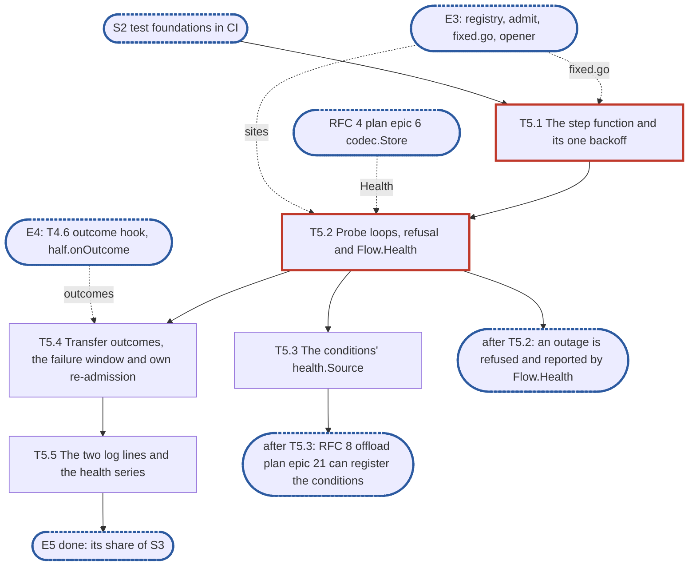

# Epic 5: syncer v2 store health

**Sources:** [RFC 3](../docs/internals/rfcs/rfc-3-syncer.md) §2.8 for v1.1, its logging table
included; §1.3's `Flow.Healthy`, `Flow.Health`, `Register`'s `probe` and `ProbeKey` (a zero key
shares with nothing), `Unregister`'s probes and health state, and the "Counts toward health" column
of its error table as consumed; §1.4's virtual time and the fault wrapper's probe faults; §2.7's
health not persisted; §2.10's rows "probe interval", "re-admission backoff" and "failure window",
and its `decision:` note; §2.12's health series and `syncer_refused_total`'s `unhealthy`; §6's
S14, S15, S16, S19 (its health half), S26, S27 and S28; §7.2's rows "§2.8 refusal contained",
"§2.8 recovery", "§2.8 one spurious failure", "§2.8 shared probe", "§2.8 logging", "§2.8
re-admission backoff", "§2.8 failure window", "§2.8 per direction", "§2.8 cause per direction"
(its four causes that are not drift), "§1.3 destroyed material" and "§1.3 unregister" (its probe
half); §7.3's second rule; §8.2's "Probes" cases and its "Timing of a call" case of a store that
turns unhealthy while transfers to it run; §8.5's two health latencies.
[RFC 4](../docs/internals/rfcs/rfc-4-remote-tier.md) §4.7, the probe call, and §4.10, the two
probe slots of the client limit. [RFC 25](../docs/internals/rfcs/rfc-25-observability.md) §3.9,
the conditions `store_put_unhealthy` and `store_get_unhealthy`, and §5.1 and §5.2, the levels and
the volume rule RFC 3 §2.8 sets apart. Cited, not owned: epic 1's D1 (a call in an unhealthy
direction returns that direction's `Flow.Health` error) and its `Stats`; epic 2's D1 and D2 (the
fault wrapper's `Inject`, `Fail` and `Hold`, a probe held before the store's call); epic 3's D9,
D10 and D12 (the fixed-values table, the admission step, the bubble), as its open pull request
#5940 gives them; epic 4's D10, D11 and D12 (the outcome hook `half.onOutcome`, the syncer's own
trips wrapping `remote.ErrTransient`, its values in `fixed.go`) and T4.1's `verdict`, as its open
pull request #5998 gives them; RFC 4 plan epic 8's D6 and its §9 point 3, which this document answers (D3).
Every citation is `develop`'s text. The code lands on `feat/storage-v2`, and the paths below are
paths there.
**Track:** C.
**Epic 5 estimate: 5 subtasks, 14.5 man-days.**
**Depends on:** **S2**, epic 2's `Inject` with `Op: "health"`, `Fail` and `Hold` over RFC 4's
in-memory store. **E3**: T3.2's registry (`Register`, `Unregister`, the group by `ProbeKey`),
T3.5's `admit`, `fixed.go` and the half's counters, T3.7's in-memory opener and its D12's
`testing/synctest` bubble, which the user chose on 2026-11-26. **E4**: T4.1's first-byte bound in
`fixed.go` (its D12), for T5.2's probe bound; for T5.4, T4.6's outcome hook (its D10),
`half.onOutcome`, handed `outcome{dir, ok, counts, cause}` once per ended try, `counts` and
`cause` being T4.1's `verdict.counts` and `verdict.cause`, and the retries the "§2.8 re-admission backoff" row runs
over.
**RFC 4 plan epic 6**, `codec.Store`, whose `Health` the probes call; for the "§1.3 destroyed
material" row also RFC 5's chain and its in-memory key provider reporting a material destroyed.
`pkg/health` is already on `feat/storage-v2`.
**Blocks:** E7, whose sweep asserts the refusal rules. S3. Outside RFC 3's epics, RFC 8 offload
plan epic 20, which reads `Flow.Healthy` and `Flow.Health` as the share's health, and epic 21,
which registers T5.3's `health.Source` in the node.

**Decided by the user, 2026-11-26:** epic 3's D12, so every test here runs in a `testing/synctest`
bubble; and the RFC 3 wordings §9 names for §2.8, §7.2's "§2.8 failure window" row and §8.5,
accepted as written. Each wording lands with the subtask pull request that needs it, not with this
document: §2.8's recovery evidence with T5.1, §2.8's refusal wrapping and §8.5 with T5.2, the
failure-window row with T5.4.

---

## 1. Goal

Epic 5 gives each registered store a put health and a get health, derived from probes and from
transfer outcomes, gated by one re-admission backoff, and refuses work in an unhealthy direction
before it queues.

**At the end of the epic:**

- Each `ProbeKey` and direction has one probe loop. It probes every 5 s whatever the traffic,
  sends the second probe of a pair at once, bounds each probe, and runs at most one probe at a
  time, a store's own re-admission probe included.
- A pure `next(state, event, now)` decides every transition: two failed probes, the failure
  window, the re-admission backoff and its count *n*, the `ErrDenied` re-trip, the cause.
- `Upload`, `Fetch` and `Prefetch` in an unhealthy direction fail at `admit`, right after its
  closed check, with that direction's `Flow.Health` error, taking no waiter slot and calling no
  backend.
- An outage writes two log lines per direction, and `Stats` reports the §2.12 health series.
- `internal/node/content` publishes `store_put_unhealthy` and `store_get_unhealthy` as a
  `health.Source` over `Flow.Health`.

### 1.1 In scope

The step function and the fixed values it reads (T5.1); the probe loops, the bound, the refusal,
`Flow.Health` and `Flow.Healthy`, and the probe half of `Unregister` (T5.2); the conditions'
`health.Source` (T5.3); transfer outcomes, the failure window, own re-admission probes and the
backoff under traffic (T5.4); the log lines and the health counters (T5.5).

### 1.2 Out of scope

- A registration with `PutProbe` or `GetProbe` false, an unprobed direction re-admitted by its
  backoff alone, RFC 3 §7.2's "§2.8 no put probe" row and RFC 3 S25: row 4 of the RFC 3 plan's
  §6.1 deferral ledger. `Register` keeps refusing a probe left off (E1's D5).
- `SetDrift`, `ErrDrift`, RFC 3 §7.2's "§2.8 drift condition" row and the drift case of "§2.8
  cause per direction": the ledger's third row.
- Skipping a direction's probe while its transfers succeed: the ledger's probe-cost row, behind
  the `ponytail:` T5.2 writes.
- RFC 25 §3.9's severity per cause: the ledger's severity row. The conditions carry the cause.
- The alert rules on the two conditions, and registering the `health.Source` in the node: RFC 8
  offload plan epic 21, the ledger's sixth row.
- Classifying an error as counting toward health, and the floor trip's aggregate rule: E4.
  Destroyed material reaching the syncer as itself: RFC 4 plan epic 6's codec.
- The collector that exports the health series: E8.

### 1.3 Names used here

- **E1**, epic 1, interfaces: `pkg/syncer`'s contract, `pool.New`, `Config`, `Clock`, `Stats`
  and the import and frozen-exports tests.
- **E2**, epic 2, test foundations: the per-call faults on RFC 4's fault wrapper, and
  `syncertest`'s frame.
- **E3**, epic 3, registration, flows and the fair scheduler: the registry, the halves, `admit`,
  `fixed.go`, the in-memory opener.
- **E4**, epic 4, termination, retries and the uploader: the attempt loop and the classification.
- **E5**, this epic.
- **E6**, epic 6, the fetcher.
- **E7**, epic 7, memory bound, `Stats` and the fault sweep.
- **E8**, epic 8, the syncer's own integration: its settings section and its collector.
- **S2**, the test foundations in CI, at the end of E2.
- **S3**, the syncer complete over the in-memory store, after E5, E6 and E7.
- **RFC 3 S14, S15, S16, S19, S25, S26, S27, S28**, invariants of RFC 3 §6, always written with
  "RFC 3" before them; they are not synchronisation points.
- **The integration epic**, E8 here; outside RFC 3's epics, RFC 8 offload plan epic 21, which
  composes the syncer in the node.

## 2. How the general rules apply

The rules are those of
[the RFC 3 plan's §1.5](rfc-3-syncer-plan.md#15-general-rules-for-each-epic). They are cited by
number and title, not copied.

| Rule | Subtasks | How |
| --- | --- | --- |
| rule 1, independent unit tests ([`CLAUDE.md`, "Writing tests"](../CLAUDE.md#writing-tests)) | all | `next` is a pure function tested by table (T5.1). The loops, refusal and outcomes are tested through `Syncer` and `Flow`, and through `export_test.go`, over `codec.Store` on RFC 4's in-memory store (kind 2) under E2's wrapper (kind 3), on E3's injected clock in its `testing/synctest` bubble (kind 1). The `health.Source` is tested over a real syncer. No test double is written |
| rule 2, fuzz tests where relevant ([`CLAUDE.md`, "Writing tests", "By kind"](../CLAUDE.md#writing-tests)) | none | Nothing here reads bytes, and the step function's table states every transition |
| rule 3, observability follows RFC 25, with RFC 3's own exception | T5.3, T5.5 | RFC 3 §2.8's two lines, and no summary line while the outage lasts, against RFC 25 §5.2 (D10). `Stats`' health fields (T5.5). The conditions as a `health.Source` in `internal/node/content` (T5.3). No span |
| rule 4, profiling | T5.2, T5.4 | Every test runs under `internal/prof`'s leak check, which catches a probe loop left running after `Unregister` or `Close`, or a probe goroutine left on a hung call. No hot path: a probe is one call per interval, and the refusal is one atomic load (D7) |
| rule 5, public interface and internals ([`CLAUDE.md`, "Verifying a change"](../CLAUDE.md#verifying-a-change)) | T5.2, T5.3, T5.4, T5.5 | Under `-race`. A cause at `Flow.Health`; a refusal at the error the caller gets and at the probe and call record that no backend call was made; the health series at `Stats`, where E8's collector reads them; a condition at the `health.Source`, where the node reads it. The transitions themselves at `next` |
| rule 6, known failures shrink | none | No suite this epic's tests run in keeps a `known.yaml`: every test lands green |
| rule 7, v2 ignores v1 | all | Nothing reads v1. E1's import test holds `pool`; `internal/node/content` is a composer and imports `pkg/syncer`'s contract and `pkg/health` |
| rule 8, real dependencies for properties of those dependencies ([`CLAUDE.md`, "Writing tests"](../CLAUDE.md#writing-tests)) | T5.2, T5.4 | Probes go through the real `codec.Store` over the in-memory store. What the in-memory store cannot fail like, a real service's probe latency, is RFC 8 offload plan epic 21's. Nothing needs a disk: health is never persisted |
| rule 9, code comment conventions ([`CLAUDE.md`, "Code comments"](../CLAUDE.md#code-comments)) | T5.1, T5.2, T5.4 | RFC 3 §2.8's `decision:` on the 15-minute cap at `next`; the probe-cost `ponytail:` at the loop; each marker §4 names |
| rule 10, a test must be able to fail ([`CLAUDE.md`, "Writing tests"](../CLAUDE.md#writing-tests)) | all | Each row is checked against the wrong design it names, built once: a latched flag, one state for both directions, a shared probe that clears a window trip, no backoff, a per-store probe, ticker-only probing, a line per refused call, a lifetime failure rate |
| rule 11, a symbol is exported only if the RFC's interface uses it | T5.3 | Nothing is added to `pkg/syncer` or `pool`: E1's frozen-exports test still passes. `internal/node/content` gains one function, `StoreHealth`, which RFC 8 offload plan epic 21 calls |
| rule 12, each subtask creates only what it declares | all | Each fixed value lands with the subtask that reads it, in E3's table. Nothing for an unprobed direction or for drift is written (§1.2) |

## 3. Requirements and invariants

Every obligation RFC 3, RFC 4 and RFC 25 place on this epic, numbered so that subtasks and tests
can cite them.

**Two directions**

| # | Requirement | Kind | Source | Subtasks |
| --- | --- | --- | --- | --- |
| R1 | A store has a put health and a get health, each healthy or unhealthy, derived apart. A put failure never makes it get-unhealthy, and a get failure never put-unhealthy | MUST NOT | RFC 3 §2.8; §6, RFC 3 S14 | T5.1, T5.2, T5.4 |
| R2 | Every rule below applies to each direction on its own: its probe, its window, its *n*, its backoff and its cause | invariant | RFC 3 §2.8; §2.10, "re-admission backoff" | T5.1 |

**Probes**

| # | Requirement | Kind | Source | Subtasks |
| --- | --- | --- | --- | --- |
| R3 | The syncer probes every registered store, in each direction, every 5 s, healthy or not and whatever its traffic, through `Store`'s `Health`, RFC 4's probe call | MUST | RFC 3 §2.8; §2.10, "probe interval"; §1.3; RFC 4 §4.7 | T5.2 |
| R4 | A transfer that fails with an error counting toward health has its direction probed at once (D6) | SHOULD | RFC 3 §2.8 | T5.4 |
| R5 | Stores registered under one `ProbeKey` share one probe per direction for detecting an outage; a store under the zero key shares with nothing | MUST | RFC 3 §2.8; §1.3 | T5.2 |
| R6 | At most one probe per `ProbeKey` and direction runs at a time, a store's own re-admission probe included, so the client the stores share carries at most two | invariant | RFC 3 §2.8; RFC 4 §4.10 | T5.2, T5.4 |
| R7 | Two consecutive failed probes make a direction unhealthy, and two consecutive passing ones make it healthy again, once its backoff has run and except as R14 restricts | invariant | RFC 3 §2.8; §6, RFC 3 S15 | T5.1, T5.2 |
| R8 | After a failed probe, and after a first success while unhealthy, the next probe is sent at once, not an interval later | invariant | RFC 3 §2.8; §2.10, "probe interval" | T5.2 |
| R9 | A probe is bounded in time, and one that does not return within its bound is a failed probe | MUST | RFC 3 §2.8; §8.2, "Probes" | T5.2 |
| R10 | An unhealthy direction keeps being probed | MUST | RFC 3 §2.8; §6, RFC 3 S15 | T5.2 |
| R11 | Every probe error but `ErrThrottled` is a failed probe, a get probe's `ErrNotFound` included: the health object it reads is one the store guarantees. `ErrThrottled` is neither a pass nor a failure | invariant | RFC 4 §4.7; RFC 3 §1.3, `ErrThrottled` "is backpressure, not failure" | T5.1, T5.2 |

**The failure window**

| # | Requirement | Kind | Source | Subtasks |
| --- | --- | --- | --- | --- |
| R12 | A direction also turns unhealthy when every transfer in it over the 30 s failure window failed with an error that counts toward health, although its probe passed | invariant | RFC 3 §2.8; §2.10, "failure window" | T5.1, T5.4 |
| R13 | Only what counts toward health moves health: `ErrTransient`, `ErrDenied`, a put's `ErrCorrupt`, a floor trip with the store's aggregate below the floor. `ErrNotFound`, `ErrThrottled`, a fetch's `ErrCorrupt`, a material error, a local error, a stall, a trickle and a floor trip with the aggregate above the floor do not. E4 classifies; E5 reads only E4's `counts` flag, never the error, since a stall wraps `ErrTransient` and does not count (E4's D11) | invariant | RFC 3 §1.3; §2.8; §6, RFC 3 S19, S27 | T5.4 |
| R14 | A direction made unhealthy by the failure window recovers only on evidence about that store in that direction, a successful transfer or a probe of its own namespace. The shared probe passing does not clear it. It is retried by its own probe once per re-admission backoff, and never latched | invariant | RFC 3 §2.8; §6, RFC 3 S15 | T5.1, T5.4 |

**The re-admission backoff**

| # | Requirement | Kind | Source | Subtasks |
| --- | --- | --- | --- | --- |
| R15 | A direction that turns unhealthy is re-admitted no sooner than its re-admission backoff after it turned: the probe interval × 2^(*n*−1), at most 15 minutes | invariant | RFC 3 §2.8; §2.10, "re-admission backoff"; §6, RFC 3 S28 | T5.1 |
| R16 | *n* starts at one, rises by one each time the direction turns unhealthy within 60 s of its last re-admission or with `ErrDenied` of any cause, and returns to one once a transfer in that direction succeeds. A probe never resets it | invariant | RFC 3 §2.8; §2.10; §6, RFC 3 S28 | T5.1, T5.4 |
| R17 | While *n* is above one, a re-admitted direction's first transfer that fails with `ErrDenied` turns it unhealthy at once, without waiting for the failure window | invariant | RFC 3 §2.8 | T5.1, T5.4 |
| R18 | A direction that keeps failing is retried at most every 15 minutes and never given up on: health is never a flag that stops attempts until something clears it | MUST NOT | RFC 3 §2.8, its `decision:` and "Health is probed, never stored as a flag" | T5.1, T5.4 |

**Cause and state**

| # | Requirement | Kind | Source | Subtasks |
| --- | --- | --- | --- | --- |
| R19 | An unhealthy direction keeps the error class that turned it: `ErrDenied` with its cause, quota, size or access, `ErrTransient` or `ErrCorrupt`. Where the outcomes that turned it differ, the latest one counted decides, so a quota refusal is told apart from an access refusal and from an outage | invariant | RFC 3 §2.8; §6, RFC 3 S26 | T5.1, T5.2, T5.4 |
| R20 | `Flow.Health(d)` is nil while `d` is healthy, and otherwise an error naming the store and wrapping that cause; `Flow.Healthy(d)` is `Flow.Health(d) == nil`. Both read memory and never call the backend | invariant | RFC 3 §1.3; §2.8 | T5.2 |
| R21 | Health is not persisted, and a lifetime count is never its source: it is the latest probes, or the window of failures since the last success | MUST NOT | RFC 3 §2.7; §2.8; §7.3 | T5.1 |
| R22 | `Unregister` ends the store's probes and its health state | invariant | RFC 3 §1.3; §7.2, "§1.3 unregister" | T5.2 |

**Refusal**

| # | Requirement | Kind | Source | Subtasks |
| --- | --- | --- | --- | --- |
| R23 | `Upload` to a put-unhealthy store, and `Fetch` or `Prefetch` from a get-unhealthy one, fail at once, before taking a worker or a waiter slot and without calling the backend; a transfer queued before its direction turned fails the same way when it is dispatched. A put-unhealthy store still serves fetches | MUST | RFC 3 §2.8; §2.9; §6, RFC 3 S14 | T5.2 |
| R24 | A refused call returns an error that names the store and wraps the cause: the direction's `Flow.Health` error. RFC 3 §2.8 says it wraps "the probe's error"; for a direction the failure window turned, the cause is a transfer's error, and E1's D1 settles on `Flow.Health`'s (§9) | invariant | RFC 3 §2.8; E1's D1 | T5.2 |
| R25 | A transfer already running when its store turns unhealthy is not cancelled for that reason | invariant | RFC 3 §2.8; §8.2, "Timing of a call" | T5.2 |
| R26 | Only the flows on that store are affected; every other flow carries on | invariant | RFC 3 §2.8; §7.2, "§2.8 refusal contained" | T5.2 |

**What health makes observable**

| # | Requirement | Kind | Source | Subtasks |
| --- | --- | --- | --- | --- |
| R27 | An outage logs one line when the direction turns unhealthy, at error, carrying the store's name, the direction, the probe's error, the last transfer error and the re-admission backoff, and one when it turns healthy, at info, carrying the store's name, the direction, how long it was unhealthy and how many calls were refused. Nothing else about it is logged at info or above | MUST | RFC 3 §2.8, "What an unhealthy store logs" | T5.5 |
| R28 | Logging an outage does not cost in proportion to the traffic it refuses: counts are counters, incremented without formatting, read only when a line is written | MUST NOT | RFC 3 §2.8; §6, RFC 3 S16 | T5.2, T5.5 |
| R29 | `Stats` makes observable, by half and store, `syncer_store_healthy`, `syncer_store_unhealthy_seconds_total`, `syncer_store_transitions_total`, `syncer_probe_duration_seconds` and `syncer_refused_total` with `reason` `unhealthy` | MUST | RFC 3 §2.12 | T5.2, T5.5 |
| R30 | `store_put_unhealthy` and `store_get_unhealthy` are raised on the store's scope while its direction is unhealthy, each with its cause | invariant | RFC 25 §3.9; RFC 3 §2.8 | T5.3 |

**Time and the checks**

| # | Requirement | Kind | Source | Subtasks |
| --- | --- | --- | --- | --- |
| R31 | The probe interval, the backoff, the window and the probe's bound run on the injected clock, never on one it cannot replace | MUST NOT | RFC 3 §1.4 | T5.1, T5.2 |
| R32 | A failed store is refused within one probe interval plus the probe's bound, and a recovered one accepts work within one probe interval once its backoff has run (D4 states how a hung probe reads) | bound | RFC 3 §8.5 | T5.2, T5.4 |
| R33 | The checks reach §8.2's "Probes" cases (a probe that never returns; a store healthy in one direction and unhealthy in the other, and one that flips direction mid-transfer) and "a store that turns unhealthy while transfers to it are running" | test row | RFC 3 §8.2 | T5.2 |
| R34 | RFC 3 §7.2's rows "§2.8 refusal contained", "§2.8 recovery", "§2.8 one spurious failure", "§2.8 per direction" and "§1.3 unregister" (its probe half) pass | test row | RFC 3 §7.2 | T5.2 |
| R35 | RFC 3 §7.2's rows "§2.8 shared probe", "§2.8 failure window", "§2.8 re-admission backoff", "§2.8 cause per direction" (all but drift) and "§1.3 destroyed material" pass | test row | RFC 3 §7.2 | T5.4 |
| R36 | RFC 3 §7.2's row "§2.8 logging" passes | test row | RFC 3 §7.2 | T5.5 |

RFC 3 §2.8's other obligations belong elsewhere: the unprobed direction and drift to the ledger
rows of §1.2; "the engine skips carving for a put-unhealthy store" to RFC 8 offload plan epic 15,
which reads R20; "a caller SHOULD log a refused call at debug at most" to the callers, RFC 8
offload plan epics 15 to 17. §2.12's "a snapshot takes no lock a dispatch needs" is E7's, over
the counters T5.5 keeps as E3's D11 does.

## 4. Decisions this epic takes

- **D1, the failure window is a streak since the last success, fed once per try.** E5's `New`
  sets E4's `half.onOutcome` (E4's D10), which each ended try calls with
  `outcome{dir, ok, counts, cause}`; a try the slow-tail rule cancelled calls nothing. `next`
  reads `ok` and `counts`, and keeps `cause` as the direction's cause, never the error itself.
  Per try rather than per transfer is what RFC 3 §2.8's "every transfer failed" needs for a
  transfer whose four attempts span the window, and it lets the `ErrDenied` re-trip fire on the
  first denied try. `next` keeps the time of the first counting failure since the last
  success, and trips the direction when a counting failure ends at least 30 s after it. A success
  clears it and sets *n* to one; an outcome that does not count neither extends nor clears it;
  turning unhealthy clears it. That is RFC 3 §2.8's "every transfer over the window failed" in
  O(1) state, with no ring of outcomes. The streak does not expire, so two counting failures 30 s
  or an hour apart with nothing between them trip it: a store that carried nothing in between
  has shown nothing else.
  A success that ends while its direction is unhealthy can only be a transfer dispatched before
  the turn, since every later one is refused. It changes nothing: it neither re-admits nor resets
  *n*, so a transfer in flight at a trip cannot cut a flapping store's backoff short. Re-admission
  is by probes, as RFC 3 §2.8's backoff rule says; its "recovers on a successful transfer" is
  therefore met only through own probes (§9). A `decision:` marker at `next` names the streak,
  its lack of expiry, and the ignored success. Prior art: Envoy's outlier detection, consecutive failures per
  host; Finagle's failure accrual (both from memory). Not chosen: a 30 s ring of outcomes, which
  costs memory per transfer and decides the same cases.
- **D2, the shared probe calls the group's oldest store, and evidence is the store it called.**
  A group is a `ProbeKey` and a direction; its members are kept in registration order, so the
  first is the oldest still registered. The shared probe calls that store's `Health`. Its result
  is evidence of that store's own namespace for the store itself, and shared evidence for the
  others. A window-tripped store ignores shared evidence (R14), and is re-admitted by its own
  probes (D3). A zero key makes a group of one, whose shared probe is therefore its own. When
  the oldest store is unregistered the next one takes over.
  Since every probe reads a store's own namespace (RFC 4 §4.7), a failed shared pair may be the
  representative's prefix alone. So before a failed pair counts as shared, the slot probes the
  next member, as a pair: a pass is followed by a second check probe at once. If both pass, the
  failed pair was the representative's own evidence: the representative alone turns unhealthy,
  as if tripped by its window, and the shared role moves to the next member. If either fails,
  the failure counts for the group. One spurious pass therefore cannot blame the representative
  during a key-wide outage, as two results are needed for any transition (R7). A check probe the
  slot cannot send, because it still waits on a hung call, fails as D4 says, so a backend that
  ignores `ctx` turns the group unhealthy rather than freezing it healthy. A whole key is
  therefore never turned, or held, unhealthy by one store's prefix, at the cost of one or two
  probes per suspected outage. A `decision:` marker says so. Prior art: none found.
- **D3, one slot per group, ordered: the shared probe first, own probes only after a pass. This
  answers RFC 4 plan epic 8's §9 point 3.** The group's loop is its slot: it is the only
  goroutine that calls `Health` for the group, so at most one probe runs at a time (R6). Each
  time the slot frees, it runs, in this order:
  1. the shared probe, when it is due: the interval has run, D5 sends a pair's second probe at
     once (R8), or a transfer failure asked for one (D6);
  2. the second own probe of a store whose first own probe just passed;
  3. own probes due, earliest due first: a window-tripped store's falls due when its backoff
     runs out, and again one backoff after each own probe that fails. They run only while the
     group's last shared result passed.

  What queues and what it costs:
  - An outage the shared probe sees trips every store of the key by probe, and re-admits them
    all with the shared probe's passes. Nothing queues.
  - Only stores the failure window tripped queue, *K* of them, two own probes each per
    re-admission: about 2·*K* round trips. At 50 ms that is 10 s for 100 stores, two intervals
    past the last one's backoff; past about 9,000 stores a fix is seen later than the
    15-minute cap.
  - While the service is slow enough that the shared probe fails, own probes do not run, so no
    store waits out a bound for a probe that would fail too. A service slow only under the
    tripped stores' prefixes, while the shared probe passes, costs up to the bound per own probe:
    2·*K* × 10 s.
  - The shared probe waits at most for one own probe in flight, so detecting an outage on the
    key is late by at most one own probe (D4).

  The pause cannot latch: a shared failure counts only when two members failed (D2), and the
  shared probe keeps running, so once the service answers it passes and own probes resume.

  `ponytail:` own re-admission probes share the group's one slot; *K* window-tripped stores on
  one key take about 2·*K* round trips to re-admit, so past about 9,000 such stores at 50 ms a
  fix is seen later than the 15-minute cap. Upgrade by giving own probes slots of their own,
  counted in RFC 4 §4.10's client limit, when a measured re-admission lags its backoff by more
  than one interval. A `decision:` marker at the slot names the order, and that pausing own
  probes after a failed shared result still keeps every unhealthy direction probed (R10), by the
  shared probe. Prior art: none found for sharing a probe across tenants.
- **D4, a probe's bound is the first-byte bound, 10 s.** RFC 3 §2.8 bounds a probe "like any
  call" and gives it no value of its own, and a probe is one request whose answer is its first
  byte. Both read one row of `fixed.go`, which T5.2 adds if E4 has not, so the two cannot drift.
  The probe's `ctx` is cancelled at the bound through `Clock.After`, and the probe counts as
  failed then, with an error wrapping `remote.ErrTransient`, the class RFC 3 §2.8 gives a stalled
  store. The slot waits for the cancelled call to return before the next probe, so the client
  never carries more than its two probes. While the slot waits on a cancelled call that has not
  returned, each probe that falls due, a pair's second, D2's check or the shared probe behind an
  own probe, is not sent and counts as failed one bound after it fell due. So a backend ignoring
  `ctx` turns the direction unhealthy rather than freezing it healthy, and the client still
  carries one probe per direction. A probe answered with `ErrThrottled` is neither a pass nor a
  failure (R11): it leaves the run of results as it was, is not a pair's first result for D5,
  and the next probe is sent an interval later. `ErrThrottled` wraps `ErrTransient` (RFC 4
  §4.8), so it is tested first. A `decision:` marker at the bound says all of this. It also
  says that `Unregister` and `Close` wait for a cancelled probe to return, relying on `Health`
  returning once its `ctx` ends, as `Close` already does for transfers (RFC 3 §1.3; its D14
  rejects waits that give up after a timeout); a backend that ignores `ctx` holds them as long
  as it holds the call. How R32 reads:
  after the interval, up to four probes run in turn before a shared key is refused: at most one
  own probe in flight (D3), the pair, and D2's check probe. Probes that fail at once take four
  round trips; probes that hang take a bound each, so one interval plus four bounds. A zero key
  has no check probe. Prior art: none found.
- **D5, the second probe of a pair is sent at once.** After a failed probe while healthy, and
  after a first pass while unhealthy, the next probe is sent at once; after anything else, an
  interval later. That is RFC 3 §2.8's "after a failed probe, and after a first success while
  unhealthy", read as completing a pair: a dead store is not probed back to back, and a probe
  alternating pass and fail is sent at most twice per interval. "While healthy" and "while
  unhealthy" are each member's state, not the group's: a result completes a pair for any member
  that takes it as evidence. So a store joining an unhealthy group (D8) gets its second failure at
  once, not an interval later, at the cost of one extra probe per join. A `decision:` marker says
  that a failed probe while already unhealthy waits an interval. Prior art: none found.
- **D6, the immediate probe after a counting failure is at most one per interval.** A transfer
  failure that counts asks its group for a shared probe at once. The request is a send on a
  channel of one, and the loop honours it only if no request was honoured within the last probe
  interval. A store failing every transfer therefore costs at
  most two probes per interval, not one per failure. A `decision:` marker says so. Prior art: none
  found.
- **D7, health is read through an atomic snapshot per store and direction.** `next` runs under a
  mutex per store and direction, taken by the loop and by the transfer's end; it publishes the
  direction's state and its `Flow.Health` error as one immutable value through an
  `atomic.Pointer`. `admit`, `Flow.Health`, `Flow.Healthy` and `Stats` load it, so the refusal
  takes no lock a dispatch needs and costs one load. Prior art: the read-copy-update pattern (from
  memory).
- **D8, a store starts healthy, with *n* at one.** Registration follows the store's open, which
  checked the service (RFC 4 §4.11). A new group's first probe runs one interval after its first
  store registers; a store joining an existing group starts healthy and takes the group's next
  result, even while the group is unhealthy, so a new store is refused only on a result taken
  after it joined. *n* stops
  rising once the backoff has reached 15 minutes, so no shift overflows. Prior art: none needed.
- **D9, the conditions are a `health.Source` over the flows the node names.** `content.StoreHealth`
  takes the node's stores as a sequence of a `health.Subject` and one open `syncer.Flow` on that
  store, and for each one appends `store_put_unhealthy` or `store_get_unhealthy` while the flow's
  `Health` in that direction is not nil, with that error as the cause. Any flow on a store reports
  that store's state, so which flow is the node's (RFC 8 offload plan epic 21). The detail is a
  constant message. No severity: `health.Condition` has no field for it (the ledger's severity
  row). It returns a pointer, since `health.Evaluator.Remove` finds a source by `==` and panics
  on a value holding a func. Prior art: `engineConditions` in `internal/node/stats.go` and
  `adapterConditions` in `internal/node/adapters.go`, the node's other sources.
- **D10, two lines per outage, and no summary while it lasts.** RFC 25 §5.2 logs a lasting fault
  with a line when it starts, a summary at a fixed interval and a line when it ends, and names RFC
  3 §2.8 as its model; RFC 3 §2.8, the owner, writes two lines per outage, and its "§2.8 logging"
  row asserts exactly two. The RFC 3 plan's rule 3 makes RFC 3's the exception, so no summary is
  written; `syncer_refused_total` and the health series show the outage meanwhile. The messages
  are constants, `store unhealthy` and `store healthy`, with keys `store`, `direction`,
  `probe_error`, `transfer_error`, `backoff`, `unhealthy_for` and `refused`. Prior art: none
  needed.

## 5. Target tree

```text
pkg/syncer/pool/
  fixed.go               T5.1  probe interval, backoff cap, re-trip window, failure window (E3's table)
                         T5.2  probe bound, one row with the first-byte bound, added here if E4 has not (D4)
  health.go              T5.1  dirState, event, next: every transition, the backoff and n
                         T5.2  the atomic snapshot (D7), Flow.Health, Flow.Healthy
                         T5.5  the two log lines
  health_test.go         T5.1  the table of transitions, through next only
  probe.go               T5.2  group per ProbeKey and direction, its loop and slot, the bound
                         T5.4  own re-admission probes and the trigger (D3, D6)
  probe_test.go          T5.2  the probe rows over codec.Store on the in-memory store
  outcome_test.go        T5.4  the failure window, re-trips, causes and the K-store wait
  log_test.go            T5.5  the logging row over slog.NewJSONHandler on a buffer
  pool.go                T5.2  Register and Unregister join and leave groups; Close stops loops (E3's)
                         T5.4  New sets each half's onOutcome to the health recorder (E4's D10)
  half.go                T5.2  admit's health refusal after closed, and the check at dispatch (E3's)
  stats.go               T5.2  Refused.Unhealthy, ProbeDuration (E3's)
                         T5.5  Healthy, Unhealthy, Transitions
internal/node/content/
  syncer_series.go       T5.3  StoreHealth; E8 adds the collector to the same file
  syncer_series_test.go  T5.3
```

## 6. Subtasks

### T5.1 The step function and its one backoff

**Subtask T5.1 estimate: 2.5 man-days.**

- **Track:** C. **Depends on:** S2, and E3's `fixed.go`.
- **Covers:** R1, R2, R7, R12, R14, R15, R16, R17, R18, R19, R21, R31.
- **Deliverables:** `health.go` (D1, D2, D8):

  ```go
  type dirState struct {
      unhealthy, byWindow bool
      cause               error         // the latest counted outcome that turned it (R19)
      n                   int           // starts at 1
      turned, readmitted  time.Duration // Clock.Elapsed at each; readmitted -1 before the first
      run                 int           // consecutive probe results: >0 passes, <0 failures
      streak              time.Duration // first counting failure since the last success; -1 none
      lastProbe, lastXfer error         // for the log line
      refusedAtTurn       uint64        // Refused.Unhealthy when it turned, for the healthy line
  }
  type eventKind uint8 // probeOwn, probeShared, probeThrottled, transferOK, transferFailed
  type event struct {
      kind   eventKind
      err    error // a probe's error, or E4's outcome.cause for a try
      counts bool  // E4's outcome.counts, for transferFailed
  }
  type effect struct {
      turnedUnhealthy, turnedHealthy bool
      ownProbeAt                     time.Duration // for a window-tripped store, when its own probe falls due; 0 none
  }
  func next(s dirState, e event, now time.Duration) (dirState, effect)
  ```

  `fixed.go` gains the probe interval (5 s), the backoff cap (15 min), the re-trip window (60 s)
  and the failure window (30 s), under E3's table and its `decision:` note; RFC 3 §2.8's
  `decision:` on the cap sits at `next`. Consumed by T5.2 and T5.4, which call `next`, and T5.5,
  which logs its effects.
- **Acceptance criteria:**
  - Two consecutive failed probes turn the state unhealthy with the second's error as the cause;
    two consecutive passes turn it healthy only once `now` is at least the backoff past `turned`.
  - Shared evidence never changes a `byWindow` state; own evidence does.
  - The backoff is 5 s × 2^(*n*−1), at most 15 min; *n* rises on a turn within 60 s of
    `readmitted` and on a turn with `ErrDenied`, by one when both hold, and stops once the
    backoff is at the cap.
  - A `transferOK` sets *n* to one and clears the streak; a counting failure 30 s after the
    streak began trips the window; a non-counting failure changes nothing; while *n* is above
    one, a healthy state's `ErrDenied` transfer trips at once.
  - The cause is the latest counted error before the turn, and stays until re-admission.
  - A success while unhealthy changes nothing (D1); a throttled probe leaves the run as it was;
    a get probe's `ErrNotFound` is a failure (R11).
- **Tests:** at `next`, as tables, no clock and no store (kind 1 only: `now` is an argument). One
  row per transition above. Each wrong design built once: shared evidence clearing a window trip
  (R14); *n* reset by a probe or by a success while unhealthy (R16); a throttled probe read as a
  failure because `ErrTransient` was tested first (R11); a lifetime failure rate as the window,
  which keeps a recovered store unhealthy (R21). A sequence of a thousand re-trips reaches the
  cap from *n* = 9 and ends with the backoff at 15 min, never more and never latched (R15, R18).
  Per-direction separation is held at `Flow` (T5.2), since a pure function shares nothing.
- **Rules:** its pull request amends RFC 3 §2.8's recovery evidence for a window-tripped
  direction to "a probe of that direction against the store's own namespace", dropping "a
  successful transfer, or" (D1), as the user accepted on 2026-11-26.

### T5.2 Probe loops, refusal and `Flow.Health`

**Subtask T5.2 estimate: 5.5 man-days.**

- **Track:** C. **Depends on:** T5.1, E3's T3.2, T3.5 and T3.7, and RFC 4 plan epic 6's
  `codec.Store`.
- **Covers:** R1, R3, R5, R6, R7, R8, R9, R10, R19, R20, R22, R23, R24, R25, R26, R28, R29, R31,
  R32, R33, R34, R11.
- **Deliverables:**
  - `probe.go` (D2, D3, D4, D5): a `group` per `ProbeKey` and direction, its members in
    registration order and its loop, the group's only caller of `Health`; the shared probe every
    interval or as D5 says; the second member's probe before a failed pair counts as shared,
    and the hand-over of the shared role (D2); the bound on `Clock.After`; the probe-cost
    `ponytail:` of RFC 3 §2.8 and the bound's `decision:`. `ProbeDuration` recorded on the store
    whose `Health` was called.
  - `pool.go`: `Register` joins its two groups, a zero key making new ones; `Unregister` leaves
    them, cancelling and waiting for its store's probe in flight, whose result is dropped, ending
    a loop with its last member and handing the shared probe to the next member;
    `Close` stops every loop and waits for it on a channel, holding no lock (E3's D12), beside
    E3's D6 wait for callers.
  - `health.go`: D7's snapshot, `Flow.Health` and `Flow.Healthy` over it.
  - `half.go`: `admit` refuses an unhealthy direction right after the closed check and before the
    queue and waiter checks, returning the snapshot's error and counting `Refused.Unhealthy` (E3's
    D10). The closed check stays first: after `Close` no probe runs, so the snapshot is frozen, and
    a call after `Close` or `Flow.Close` must still get E3's `remote.ErrInvalid` (its R12); a queued
    caller woken with a slot checks the snapshot again before its call, and if its direction has
    turned, returns the slot and fails the same way.

  Consumed by T5.3, which reads `Flow.Health`; T5.4, which adds own probes and outcomes; RFC 8
  offload plan epic 20, which reads `Flow.Healthy` and `Flow.Health`.
- **Acceptance criteria:**
  - Each group sends one probe per interval in each direction, whatever the traffic, and never
    two at once.
  - A probe held past 10 s fails at its bound with an error wrapping `remote.ErrTransient`, and
    the next probe starts only once the held call has returned.
  - Two failed probes, the second at once, make `Flow.Health(d)` an error naming the store and
    wrapping the probe's error, `Flow.Healthy(d)` false, and the other direction untouched.
  - A call refused for health returns `Flow.Health`'s error, holds no waiter slot, reaches no
    backend, and counts once under `Refused.Unhealthy`; a transfer queued before the turn fails
    the same way at dispatch; a running transfer finishes.
  - Denying only the oldest store's prefix, its health object included, turns that store alone
    unhealthy, and the next member's probe then serves the group.
  - After `Unregister`, no probe of the store's is sent, a probe of it in flight has returned and
    changed nothing, and with its group's last member gone, the loop has ended.
- **Tests:** through `Syncer` and `Flow` over `codec.Store` on the in-memory store, under E2's
  wrapper, in E3's bubble (kinds 2, 3 and 1). Probes are counted by a rule on `Op: "health"`,
  injected before every other rule so its `When` sees every call, which records each call's
  entry time and direction and returns false: the recording wrapper that passes every call
  through, never answering (`CLAUDE.md`, "Writing tests"). Backend calls of a refused transfer
  are counted the same way on `put` and `get`. One helper over that record asserts no two
  entries of a group and direction overlap, and every probe test calls it (R6).
  - RFC 3 §7.2's "§2.8 refusal contained" (catches a refusal that queues, or one that refuses the
    other store, R23, R26), "§2.8 recovery", "§2.8 one spurious failure" (catches a turn on one
    failure, R7, R8), "§2.8 per direction" for probes (catches one state, R1), and "§1.3
    unregister"'s probe half (catches a loop left running, R22, also under the leak check).
  - §8.2's hung probe: `Hold` on `Op: "health"` never released; it fails at 10 s, the next is
    sent once it returns, and on a shared key the pair and the check probe turn the direction
    unhealthy within one interval plus four bounds (catches an unbounded probe, R9, R32). A probe
    that ignores its `ctx`, held by a `Hold` whose release the test keeps, turns a zero-key store
    unhealthy at two bounds and a two-store key at three, the check probe unsent (catches a check
    probe waiting on the hung call, D2, D4). A
    direction flipping to unhealthy while an upload runs: the upload completes; one queued behind
    the pool fails at dispatch with no `put` entry (R23, R25).
  - Over 100 intervals one interval passes between entries while results do not change (R3); a
    probe alternating pass and fail never has two entries less than one interval apart except a
    pair's second (catches D5 read as "at once on any change", R8); a zero-key pair of stores
    gets one entry each per interval (R5); a get probe answered `ErrNotFound` twice turns get
    unhealthy, and one answered `ErrThrottled` changes nothing (R11).
  - The oldest store's prefix denied: only it turns unhealthy (catches a representative that
    turns, or latches, the whole key, R5). Every probe failing but the check probe's first, which
    passes once: the whole key turns unhealthy and the representative is not singled out
    (catches an unpaired check probe, D2).
  - A store joining a group while it is unhealthy, its probes failing at once: refused at the
    group's next probe plus one round trip (catches D5 decided on the group's state, D8).
  - A call after `Close` on a put-unhealthy store, and on a closed flow of one, wraps
    `remote.ErrInvalid` and counts under `closed` (catches health checked before closed).
  - §8.5 on the clock, inside "§2.8 one spurious failure" and "§2.8 recovery": a probe failing at
    once is refused within one interval plus a round trip; a recovered store accepts work within
    one interval once its backoff has run (R32).
  - `Unregister` while the store's probe is held: it returns once the probe has, and the probe's
    failure turns nothing (R22).
  - `Flow.Health` and `Flow.Healthy` return while a test holds the half's lock (R20, D7).
- **Rules:** its pull request amends RFC 3 §2.8 so that a refused call "wraps the direction's
  cause" (R24), as the user accepted on 2026-11-26, and RFC 3 §8.5 to "within one probe interval
  plus the probe's bound when probes fail at once, and plus four bounds when they hang" (D4), with
  §2.8's "a dead or recovered store is still seen within about one interval" reading "within
  §8.5's bounds", the user's decision of 2026-11-26. The user accepted "three bounds" on
  2026-11-26; four is pending their decision (§9).

### T5.3 The conditions' `health.Source`

**Subtask T5.3 estimate: 1 man-days.**

- **Track:** C. **Depends on:** T5.2.
- **Covers:** R30.
- **Deliverables:** `internal/node/content/syncer_series.go` (D9), created here if E8 has not:

  ```go
  // StoreHealth publishes RFC 25 §3.9's store_put_unhealthy and store_get_unhealthy for each
  // store stores yields, from its flow's Health in each direction.
  func StoreHealth(stores iter.Seq2[health.Subject, syncer.Flow]) health.Source
  ```

  Consumed by RFC 8 offload plan epic 21, which registers it with the node's `health.Evaluator`.
- **Acceptance criteria:**
  - A put-unhealthy store yields one `store_put_unhealthy` on its subject, its `Cause` the flow's
    `Health(DirPut)`, and no `store_get_unhealthy`; the reverse for get.
  - A healthy store yields nothing; a condition clears once its direction is re-admitted.
- **Tests:** at the `health.Source`, the surface the node's evaluator reads, over a real syncer on
  the in-memory store (kind 2) under E2's wrapper (kind 3), in E3's bubble (kind 1), turned
  put-unhealthy by `Fail` with a `*remote.DeniedError` of cause quota on the put probe, and
  get-unhealthy by `remote.ErrTransient` on the get probe: `errors.As` finds the quota cause in
  the condition's `Cause` (catches a cause flattened to a string); after the probes pass and the
  backoff runs, nothing is yielded. The source added to and removed from a `health.Evaluator`
  (catches a value source, which panics in `Remove`). No test double.

### T5.4 Transfer outcomes, the failure window and own re-admission

**Subtask T5.4 estimate: 4 man-days.**

- **Track:** C. **Depends on:** T5.2, and E4's T4.6, its outcome hook.
- **Covers:** R1, R4, R6, R12, R13, R14, R16, R17, R18, R19, R32, R35.
- **Deliverables:**
  - `pool.go`: `New` sets each half's `onOutcome` (E4's D10) to a recorder that feeds each try's
    `outcome` into `next` (D1). A counting failure also asks the group for a probe (D6).
  - `probe.go`: own re-admission probes, ordered behind the shared probe and paused after a failed
    shared result (D3), with D3's `ponytail:` and `decision:` at the slot.

  Consumed by E7's sweep, which asserts the refusal rules, and S3.
- **Acceptance criteria:**
  - Every put failing with `ErrTransient` for 30 s while the probe passes turns the store
    put-unhealthy and leaves it get-healthy; the shared probe passing leaves it so; its own put
    probe passing twice, once its backoff has run, re-admits it.
  - A failure counting toward health brings the group's next probe forward, at most once per
    interval.
  - While *n* is above one, the first denied transfer after re-admission turns the direction
    unhealthy at once.
  - With *K* = 200 window-tripped stores on one key and a 50 ms round trip on every probe, the
    last is re-admitted within its backoff plus 2·*K* round trips, and the shared probe still runs
    every interval meanwhile (D3, R6).
- **Tests:** through `Flow` over `codec.Store` on the in-memory store under E2's wrapper, in E3's
  bubble, with `Link` of 50 ms per call where a row needs a round trip.
  - RFC 3 §7.2's "§2.8 failure window", whole: the window run with `ErrTransient` and again with
    `ErrDenied`, each turning put-unhealthy and leaving get healthy; every put failing with
    `ErrCorrupt` for the window, put-unhealthy; the non-counting errors, `ErrNotFound`,
    `ErrThrottled`, a fetch's `ErrCorrupt`, a local error, and the transforms'
    `ErrMaterialUnavailable` and `ErrMaterialDestroyed`, leaving it healthy (catches the shared
    probe clearing a window trip, and a non-counting error counted, R13, R14). As E4's §9 asks,
    the row also trickles every put below the floor for the window: put-unhealthy at
    `Flow.Health`; and stalls one transfer while the aggregate is healthy: still healthy (catches
    health read from the wrapped `ErrTransient` instead of `counts`, R13). Its "puts are
    retried once per probe interval" is asserted as once per re-admission backoff, one interval
    at *n* = 1 and two after a denial (R16, §9).
  - "§2.8 shared probe" (catches a probe per store: one entry per interval for 100 stores; a
    denied prefix turns only its store unhealthy, R5, R12).
  - "§2.8 re-admission backoff": denials re-admitted after two intervals, then four, eight, up to
    15 minutes, each re-admission sending only the transfers dispatched before its first denial
    returned; the denial lifted, *n* back to one; a flapping probe with no traffic turning
    healthy only after two consecutive passes, each turn within 60 s of re-admission doubling the
    backoff, and its transitions per minute falling; a put reset mid-body by `Cut` while the probe passes backing off the same way, which
    also stands for the backup folder whose prefix is denied while its health object reads; the
    window tripped, then 96 puts in flight failing 3% transiently, the store staying healthy and
    the puts completing over E4's retries (catches no backoff, a probe resetting *n*, R16, R17,
    R18).
  - "§2.8 cause per direction" for quota, access, size and `ErrTransient`, each through
    `errors.Is` and `errors.As` on `Flow.Health(DirPut)` (catches a bare flag, R19).
  - "§1.3 destroyed material", through `codec.Store` over RFC 5's chain with its in-memory key
    provider reporting the material destroyed, for the window: every fetch fails with the
    transforms' destroyed error, unretried, and the store stays get-healthy (R13).
  - The *K*-store wait of the acceptance criteria, against the design that runs own probes ahead
    of the shared one (the shared probe late by *K* round trips) and the one that probes every
    due store at once (more than one entry in flight, R6).
- **Rules:** its pull request amends RFC 3 §7.2's "§2.8 failure window" row to say puts are
  retried "once per re-admission backoff, not continuously", as the user accepted on 2026-11-26.

### T5.5 The two log lines and the health series

**Subtask T5.5 estimate: 1.5 man-days.**

- **Track:** C. **Depends on:** T5.4.
- **Covers:** R27, R28, R29, R36.
- **Deliverables:** `health.go`: the two lines of D10, written from `next`'s effects, the
  refused count read from `Refused.Unhealthy` at each end of the outage. `stats.go`: `Healthy`,
  `Unhealthy` (the time spent unhealthy, the current outage included) and `Transitions` on each
  half's `StoreStats`. Consumed by E8's collector, which exports them, and E7's snapshot.
- **Acceptance criteria:**
  - Each turn writes one line at the level and with the keys of D10; nothing else about health is
    written at info or above.
  - `Stats` shows `Healthy` false and `Unhealthy` growing while the direction is unhealthy, and
    `Transitions` up by two over one outage.
- **Tests:** RFC 3 §7.2's "§2.8 logging", over `slog.NewJSONHandler` on a buffer (no recording
  handler is built): a store kept unhealthy for ten intervals under a thousand refused calls
  writes exactly one error line and one info line, each line's keys decoded and checked, and a
  refused call's error names the store (catches a line per refused call or per failed probe, R27,
  R28). The same outage at ten and at ten thousand refused calls writes the same bytes but the
  counts (RFC 3 S16). `Stats`' health fields at both ends of the outage, at `Stats`, where E8's
  collector reads them (R29).

## 7. Order of work



T5.1 needs only S2 and E3's table: it is pure. T5.2 needs E3's sites and `codec.Store`; T5.3, which
another epic waits for, follows it at once. T5.4 needs E4. Checkpoint after T5.2: a probed outage
is refused and reported. Checkpoint after T5.5: the epic's share of S3.

## 8. Suggested pull requests

| PR | Subtasks | Man-days | After | Why together |
| --- | --- | --- | --- | --- |
| 1 | T5.1, T5.2, T5.3 | 9 | E3, RFC 4 plan epic 6 | probed health end to end: the step function, the loops, the refusal and the conditions |
| 2 | T5.4, T5.5 | 5.5 | PR 1, E4 | transfer outcomes, own re-admission, and what an outage logs and counts |

A suggestion only: one pull request per subtask works as well.

## 9. Open points

The estimate is 14.5 man-days against the plan's 13, over the same five subtasks: the extra
1.5 days are D2's paired check probe, D4's probes counted failed behind a hung call, and T5.2's
wait for probes to end at shutdown and at `Unregister`.

- **The bubble is epic 3's D12, which the user chose on 2026-11-26.** The tests here run on
  E3's injected clock inside a `testing/synctest` bubble, under D12's rules: no wait while
  holding a lock, everything created inside the bubble, and `Env.Wait`'s one-hour bound in fake
  time, which is what ends a row whose `done` never closes once the 5 s probe loop keeps a timer
  pending.
- **E4's document is #5998.** This epic consumes its `half.onOutcome` and
  `outcome{dir, ok, counts, cause}` (its D10), its `fixed.go` first-byte bound (its D12), and
  reads `counts`, never the error (its D11). What it lacks for E5: nothing.
- **RFC 4 plan epic 8's §9 point 3 is answered by D3.** The wait is checked in T5.4 against 200
  stores on one key; its ceiling, about 9,000 window-tripped stores on one key at 50 ms, is D3's
  `ponytail:`. The customer scale target has 10⁴ namespaces, which could sit on one configuration;
  for all of them to be tripped by the failure window at once, a fault must deny every block
  prefix while the shared probe passes.
- **Four RFC 3 wordings, accepted by the user on 2026-11-26.** Each lands with its subtask's
  pull request (the subtask's **Rules:** line):
  - §7.2's "§2.8 failure window" row says puts are retried "once per probe interval"; under R16 a
    denial raises *n*, so after the `ErrDenied` run the retry comes once per backoff, two
    intervals. The row reads "once per re-admission backoff, not continuously" (T5.4).
  - A successful transfer never re-admits (D1). RFC 3 §2.8 lists one as recovery evidence for a
    window-tripped direction, but refusal leaves only transfers dispatched before the turn, whose
    success predates it. §2.8 reads "a probe of that direction against the store's own
    namespace", dropping "a successful transfer, or" (T5.1).
  - What a refused call wraps. RFC 3 §2.8 says the probe's error; a direction the window turned
    has a transfer's error as its cause. This epic returns `Flow.Health`'s error, as E1's D1
    settled, and §2.8 reads "wraps the direction's cause" (T5.2).
  - D4's reading of §8.5. A hung outage on a shared key takes one interval plus four bounds: one
    for an own probe in flight (D3), two for the pair, and one for D2's check probe, which hangs
    too. §8.5 reads "within one probe interval plus the probe's bound when probes fail at once,
    and plus four bounds when they hang" (T5.2). The user accepted "three bounds" on 2026-11-26,
    which missed the check probe; four needs their decision. §2.8's "a dead or recovered store is
    still seen within about one interval" reads "within §8.5's bounds" in the same amendment, so
    the two sections agree (T5.2, the user's decision of 2026-11-26).
- **RFC 25 §5.2 and RFC 3 §2.8 disagree on a summary line** (D10). This epic follows RFC 3, the
  owner; RFC 25 §5.2's sentence would name RFC 3 §2.8's two lines as the exception.
- **The plan's epic 5 outline names an unprobed direction re-admitted by its backoff.** That is row
  4 of the RFC 3 plan's deferral ledger, and E1 refuses such a registration, so nothing is built
  for it here (rule 12). When RFC 26's plan lands it, `next` gains one event, a backoff run out
  with no probe.
- **The least certain estimates** are T5.2 (the loop's shutdown, a cancelled probe's return and
  `Unregister`'s wait for it under `-race`, and the representative's hand-over) and T5.4 (the "§2.8 re-admission backoff" row, which needs E4's retries and runs
  many intervals).
