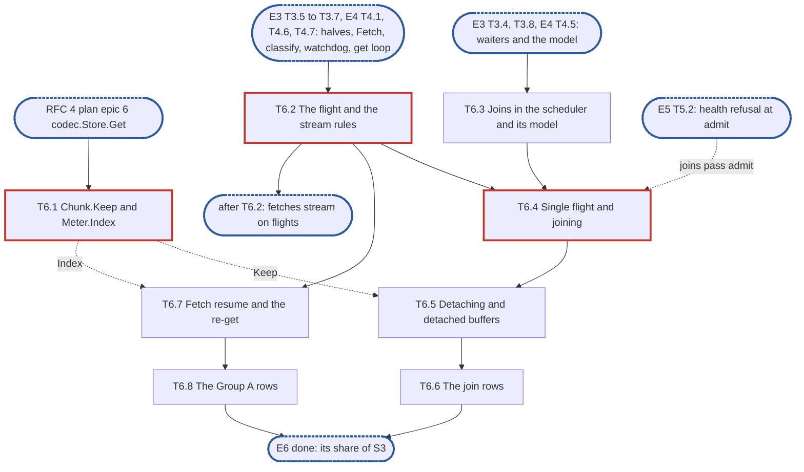

# Epic 6: syncer v2 the fetcher

**Sources:** [RFC 3](../docs/internals/rfcs/rfc-3-syncer.md) §1.3's `Fetch` and `Prefetch`, its
paragraph "A fetch is a set of whole-chunk ranges of one block", its stream rules and, of `Close`
and `Flow.Close`, the joined callers; §2.2's detached buffers; §2.4's paragraphs "A fetch retry
resumes" and "A chunk that fails verification is re-got once"; §2.9's joined callers in the
waiter bound; §2.10's detach bound, detached-buffer cap and verification re-get; §2.12's fetch
series, `syncer_detached_buffers`, the joined callers of `syncer_waiters` and the `verify` reason
of `syncer_retries_total`; §4, §4.1 to §4.5; §6's S10, S11 and S12; §7.1's rows "§4.1
verification", "§2.4 verification re-get" and "§4.2 yield at once"; §7.2's rows "§2.2
detached-buffer cap", "§4.3 single flight", "§4.4 priority", "§4.4 abandonable", "§4.3 joining",
"§1.3 stream rules", "§1.3 partial prefetch", "§2.4 fetch resume", "§2.4 wire bytes" and "§4.3
re-home and close"; §7.3's first rule, for §4.4; §8.2's fetch cases of "Shape of a transfer" and
"Timing of a call" and the detached-buffer case of "Retries"; §8.4's "single flight" count. Cited
for what they hand over: §2.4's bounds and `Meter` (epic 4), §2.8's refusal at admission (epic 5),
§2.9's classes, queues and eviction (epic 3). Cited, not owned:
[RFC 4](../docs/internals/rfcs/rfc-4-remote-tier.md) §4.1 (`remote.Chunk`, `ChunkRange`, `Meter`,
`ErrMalformed`), §3.4 and §4.3's `codec.Store.Get`; epic 1's D1 (what a refused call returns) and
`Stats`; epic 2's D1 to D5 (the fault wrapper's `Fail`, `Cut`, `Flip`, `Hold`, `Link`,
`syncertest`'s `Env` and `Faults`); epic 3's D1, D6, D7, D9, D10, D11 and D12 (the slot, `Close`,
displacement, the fixed-values table, `admit`, the counters, the `testing/synctest` bubble) and its
`internal/sched` and model; epic 4's D1, D2, D4 and D9 (classification, the throttled requeue, the
get loop, a get retried only while it has yielded nothing); epic 5's refusal at `admit`. Every
citation is `develop`'s text, epics 3, 4 and 5 that of their open pull requests (#5940, #5998,
#6001). The code lands on `feat/storage-v2`, and the paths below are paths there.
**Track:** A.
**Epic 6 estimate: 8 subtasks, 24.5 man-days.**
**Depends on:** **S2**, epic 2's fault wrapper and `syncertest`'s frame. **Epic 3**: T3.4's
waiter count and T3.8's model, for T6.3; T3.5's halves, `admit` and `fixed.go`, T3.6's
single-attempt `Fetch` and `Prefetch` and T3.7's in-memory opener, for T6.2 onward. **Epic 4**:
T4.1's `classify`, T4.5's requeue and T4.7's get loop, for T6.2 and T6.7; T4.6's floor watchdog, for
T6.5. **Epic 5**: T5.2's
health refusal at `admit`, which a join passes too (T6.4). **RFC 4 plan epic 6**, `codec.Store.Get`
with working bodies, for T6.1, whose `Chunk.Keep` and `Meter.Index` (D1) T6.5 and T6.7 read.
**Blocks:** E7, whose memory bound counts T6.5's detached buffers and whose sweep needs both halves
complete; S3; E9, whose B4 is T6.6's count. Outside RFC 3's epics, RFC 8
offload plan epic 17 calls the complete `Fetch` and `Prefetch`, and epic 21 runs T6.8's rows over
the S3 store.

**Builds on decisions the user took on 2026-11-26.** Epic 3's D12: each check runs in a
`testing/synctest` bubble, so T6.2 to T6.8 run in it under D12's rules. Epic 3's §2.9 sentence for
a bound with nothing displaceable, accepted. Epic 4's D3: the backoff is `fnv64a(store, block name,
retry kind, attempt)`, so two fetches of one block on one store share their backoff draws, which
single flight makes rare (T6.4); its RFC 3 S20 text for a requeued throttled transfer, beside the
bound; and its "§2.4 throughput floor" row. This epic's D1, `Chunk.Keep` and `Meter.Index` on RFC
4's value types, as written. The RFC 3 §1.3 wording §9 names, accepted, lands with T6.2's pull
request, and the "§2.2 detached-buffer cap" row's with T6.6's, not with this document.

---

## 1. Goal

Epic 6 completes `Fetch` and `Prefetch`. Every dispatched fetch runs as one flight, which any later
demand for one of its chunks joins rather than starting another get. A flight yields each chunk as
soon as the codec has verified it, to every caller attached; it detaches a
caller that holds the others back, resumes after a failure from the first chunk not yet delivered,
and gets a chunk that failed verification once more before it reports it corrupt.

**At the end of the epic:**

- `Fetch` and `Prefetch` stream verified chunks, each borrowed until the caller's next iteration,
  an error yielded once; leaving the loop or ending `ctx` detaches the caller, and the last one
  leaving stops the store's read.
- N concurrent demands for one cold chunk, at any offsets in it, cost one get; a late caller gets
  what is still to come; one caller leaving cancels nothing; a failure reaches every caller and is
  not kept.
- A demand joining a queued speculative or background fetch moves it to its own flow in the demand
  class; joining a running speculative one promotes it.
- A joined caller behind by the detach bound, or a guess holding back a reader, is detached and keeps
  its chunk; detached buffers never exceed the fetch pool; closing a flow detaches the callers of
  other flows joined to its fetches.
- A failed get resumes at the first undelivered chunk, a whole-block fetch too once its header was
  read; a chunk failing verification is got once more, outside the budget; `ErrMalformed` is
  reported at once.
- `Stats` reports RFC 3 §2.12's fetch series. The Group A rows of §4.1, the verification re-get and
  §4.2 pass over RFC 4's in-memory store through `codec.Store`.

### 1.1 In scope

`Chunk.Keep` and `Meter.Index` in the codec (T6.1); the flight and the stream rules (T6.2);
joins in `internal/sched` and its model (T6.3); single flight and joining in the pool (T6.4);
detaching and the detached-buffer cap (T6.5); the §7.2 join rows (T6.6); the fetch resume and the
verification re-get (T6.7); the Group A rows (T6.8).

### 1.2 Out of scope

- The get attempt loop itself (its bounds, budget, throttling, floor, first-byte bound and slow
  tail): E4's T4.7, which this epic moves onto the flight (D2) and extends with the resume and the
  re-get.
- The class order, the queues, eviction and displacement of queued entries: E3. This epic adds
  joined callers to E3's waiter count and its model.
- The refusal of an unhealthy direction: E5's, at E3's `admit`, which a join passes like a call.
- The memory bound, which counts this epic's buffers, and the fault sweep: E7.
- The codec's verification, its merging of adjacent ranges and its whole-block name check: RFC 4
  plan epic 6.
- `FetchVersion`, which reuses this epic's resume and re-get: the first row of the RFC 3 plan's
  §6.1 deferral ledger.
- Hedged cold reads: a row of that ledger, unowned.
- Re-fetching after a detach, or reading what a fill left: the engine's, RFC 8 offload plan epic 17
  (§9).

### 1.3 Names used here

- **E1**, epic 1, interfaces: `pkg/syncer`'s contract, `pool.New` with `Config` and `Clock`,
  `Stats`, the import test and the frozen-exports test.
- **E2**, epic 2, test foundations: the per-call faults on RFC 4's fault wrapper and the frame of the
  Group A suite, `syncertest`.
- **E3**, epic 3, registration, flows and the fair scheduler: the halves, `admit`, the
  single-attempt `Fetch` and `Prefetch`, `internal/sched` and its model, the in-memory opener.
- **E4**, epic 4, termination, retries and the uploader: `classify`, the get attempt loop, the
  throttled requeue.
- **E5**, epic 5, store health: the refusal at `admit`.
- **E6**, this epic.
- **E7**, epic 7, memory bound, `Stats` and the fault sweep.
- **E8**, epic 8, the syncer's own integration: its settings section and its collector.
- **E9**, epic 9, E2E green: the benchmarks B1 to B5.
- **S2**, the test foundations in CI, at the end of E2.
- **S3**, the syncer complete over the in-memory store, after E5, E6 and E7.
- **RFC 3 S2, S10, S11, S12, S13, S20, S21**, invariants of RFC 3 §6, always written with "RFC 3"
  before them; they are not the synchronisation points S2 and S3 above.
- **The S3 store**, RFC 4's production store, whose protocol is the storage service S3; not the
  synchronisation point S3.
- **The integration epic**, outside RFC 3's epics RFC 8 offload plan epic 21, which composes the
  syncer in the node and runs the Group A suite over the S3 store.

## 2. How the general rules apply

The rules are those of
[the RFC 3 plan's §1.5](rfc-3-syncer-plan.md#15-general-rules-for-each-epic), cited by number and
title and not copied.

| Rule | Subtasks | How |
| --- | --- | --- |
| rule 1, independent unit tests ([`CLAUDE.md`, "Writing tests"](../CLAUDE.md#writing-tests)) | all | T6.3 extends `internal/sched`, pure, and its reference model. T6.1 tests the codec in RFC 4's package over RFC 4's in-memory store. T6.2 and T6.4 to T6.7 test the pool's unexported flight through `export_test.go`, each get `codec.Store.Get` over the in-memory store (kind 2) under E2's wrapper (kind 3), in E3's `testing/synctest` bubble (kind 1). T6.8 runs through `syncertest` over the same. No test double is written |
| rule 2, fuzz tests where relevant ([`CLAUDE.md`, "Writing tests", "By kind"](../CLAUDE.md#writing-tests)) | T6.3 | E3's `FuzzSched` gains the join, leave and re-home steps, against the model, with seeds. Nothing else here reads bytes |
| rule 3, observability follows RFC 25, with RFC 3's own exception | T6.4, T6.5, T6.7 | `Stats` gains R33's counts in E1's fields, as atomics read without the half's lock (E3's D11). No log line and no span |
| rule 4, profiling | T6.2, T6.5, T6.6 | Every test runs under `internal/prof`'s leak check, which catches a flight left running after its last caller or `Close`. No allocation per chunk: the codec's buffer is reused unless a detach keeps it, and each caller's hand-off channel is made once per call; E7's `unit/syncer-allocs` gate measures it. One join adds a fixed number of queue operations whatever the number of flows, from E3's operation counter (T6.3) |
| rule 5, public interface and internals ([`CLAUDE.md`, "Verifying a change"](../CLAUDE.md#verifying-a-change)) | T6.2, T6.4 to T6.8 | Under `-race`. Gets and the ranges they asked, at RFC 4's in-memory store's record of calls, where single flight is counted; bytes a caller reads, at the caller's loop; detached buffers, joins, re-homes, detaches and re-gets at `Stats`, where E8's collector reads them; refusals at the error the caller gets |
| rule 6, known failures shrink | none | No suite this epic's tests run in keeps a `known.yaml`: every test lands green |
| rule 7, v2 ignores v1 | all | Nothing here imports beyond `pkg/syncer`, `pkg/remote`, `internal/sched` and the standard library, which E1's import test holds; T6.1's change lives in RFC 4's packages and follows that plan's import test. Nothing reads v1 |
| rule 8, real dependencies for properties of those dependencies ([`CLAUDE.md`, "Writing tests"](../CLAUDE.md#writing-tests)) | T6.1, T6.8 | The codec, the in-memory store and E2's wrapper are real. What they cannot fail like, a byte flipped on a real connection, is RFC 8 offload plan epic 21's run of T6.8's rows over the S3 store. Nothing needs a disk: the syncer persists nothing |
| rule 9, code comment conventions ([`CLAUDE.md`, "Code comments"](../CLAUDE.md#code-comments)) | T6.1 to T6.7 | RFC 3 §2.4's `decision:` on re-gets outside the budget is at E4's budget site already; this epic adds its three fixed values under RFC 3 §2.10's note in `fixed.go` (D10), and the `decision:` and `ponytail:` markers each §4 decision names |
| rule 10, a test must be able to fail ([`CLAUDE.md`, "Writing tests"](../CLAUDE.md#writing-tests)) | all | Each §7.2 row names the wrong design it catches and is checked by building it: one get per caller, a fetch cancelled with its first caller, a failure remembered, a reused buffer under a detached caller, a joiner left at speculative priority, a retry from the first chunk. The model is checked by planting a join that skips the waiter count |
| rule 11, a symbol is exported only if the RFC's interface uses it | all | Nothing is added to `pkg/syncer` or `pool`'s exports: E1's frozen-exports test still passes. `internal/sched` gains only what `pool` calls. `syncertest` gains rows, which are unexported. T6.1 adds a field to each of RFC 4's `remote.Chunk` and `remote.Meter`, as the user decided (D1) |
| rule 12, each subtask creates only what it declares | all | `Keep` and `Index` land with T6.1, consumed by T6.5 and T6.7. Each fixed value lands with the subtask that reads it, in E3's `fixed.go`. Joins enter `sched` with T6.3, whose consumer is T6.4 |

## 3. Requirements and invariants

Every MUST and MUST NOT that RFC 3 places on this epic, numbered so that subtasks and tests can
cite them. Sections are RFC 3's unless named.

**Streams**

| # | Requirement | Kind | Source | Subtasks |
| --- | --- | --- | --- | --- |
| R1 | `Fetch` is a demand and `Prefetch` speculation, and both take `want` the same way: an empty `want` fetches the whole block, and ranges fetch only those chunks | invariant | §1.3; §7.2, "§1.3 partial prefetch" | T6.2 |
| R2 | A fetch is a set of whole-chunk ranges of one block. An empty `want` is still delivered chunk by chunk, each yielded as soon as it passes, never buffered whole first | invariant | §1.3; §4.1 | T6.2 |
| R3 | Every chunk is verified before it is yielded: no byte of a chunk the codec did not yield without error reaches a caller | MUST | §1.3; §4.1; §6, RFC 3 S10; §7.1, "§4.1 verification" | T6.2, T6.8 |
| R4 | Every caller of a fetch reads the same bytes, which the syncer never modifies | MUST, MUST NOT | §4.1 | T6.2, T6.4 |
| R5 | A reader waiting on one chunk is answered when that chunk arrives, not when the whole range has: each chunk is yielded as soon as it is verified, before the next is read from the store | invariant | §4.1; §4.2; §6, RFC 3 S11; §7.1, "§4.2 yield at once" | T6.2, T6.8 |
| R6 | A chunk's `Bytes` is borrowed until its caller's next iteration, and stays unchanged until then | invariant | §1.3; §4.2; §6, RFC 3 S11 | T6.2, T6.5, T6.8 |
| R7 | An error is yielded once and ends the stream; chunks already yielded stay valid | invariant | §1.3; §7.2, "§1.3 stream rules" | T6.2 |
| R8 | Leaving the loop, or cancelling `ctx`, detaches the caller from its own fetch or only from a joined one, and there is no `Close` to forget; once no caller is left, the store's read stops | invariant | §1.3; §7.2, "§1.3 stream rules" | T6.2, T6.4 |

**Resume and the re-get**

| # | Requirement | Kind | Source | Subtasks |
| --- | --- | --- | --- | --- |
| R9 | A fetch retry resumes: it asks only for the chunks after the last one it delivered, as ranges, and a whole-block fetch whose header was read resumes the same way; no caller sees a chunk twice, and a fetch failing near its end does not transfer its start again | invariant | §2.4; §7.2, "§2.4 fetch resume" | T6.1, T6.7 |
| R10 | A chunk the codec reports `ErrCorrupt` is got again once, resuming as R9 says, before the fetch reports `ErrCorrupt`; a second failure is reported | MUST | §2.4; §2.10, "verification re-get"; §6, RFC 3 S10; §7.1, "§2.4 verification re-get" | T6.7, T6.8 |
| R11 | The re-get is at most one per fetch transfer, counts toward the four-attempt bound, takes no budget token, and counts nothing toward health | invariant | §1.3; §2.1; §2.4; §2.10; §6, RFC 3 S21 | T6.7 |
| R12 | A recorded range the store rejected as past the end, which the codec reports as `remote.ErrMalformed`, is reported at once, with no re-get | invariant | §1.3; §2.4; §6, RFC 3 S10; §7.1, "§2.4 verification re-get" | T6.7, T6.8 |

**Single flight**

| # | Requirement | Kind | Source | Subtasks |
| --- | --- | --- | --- | --- |
| R13 | A demand for a chunk that a fetch in flight will bring joins that fetch rather than start another: N demands for one cold chunk at once, at any offsets in it, cost one get | MUST | §4.3; §6, RFC 3 S12; §7.2, "§4.3 single flight"; §8.4, "single flight" | T6.4, T6.6 |
| R14 | A fetch is keyed by store, block and chunk. A whole-block fetch joins only another whole-block fetch of the same block; a chunk fetch may join a whole-block fetch that has not yet passed that chunk. A late caller receives the chunks not yet delivered when it joined, and starts a new fetch for one that has already gone past | invariant | §4.3; §7.2, "§4.3 joining" | T6.4, T6.6 |
| R15 | A dispatched fetch belongs to the flow that started it: a caller that joins takes no worker and no turn of its own, and the fetch counts against its starter's caps | invariant | §4.3 | T6.4 |
| R16 | A demand joining an undispatched fetch, a speculative one or a background read, re-homes it: it moves to the demanding caller's flow, in the demand class, keeping its callers | invariant | §4.3; §7.2, "§4.3 re-home and close" | T6.3, T6.4, T6.6 |
| R17 | One caller leaving does not cancel a joined fetch, which runs while any caller still waits on it; the first reader's timeout never fails the others | MUST NOT | §4.3; §7.2, "§4.3 joining" | T6.4, T6.6 |
| R18 | A failure reaches every caller attached and is not kept: the next demand after it starts a fresh fetch | invariant | §4.3; §7.2, "§4.3 joining" | T6.4, T6.6 |
| R19 | A demand joining a speculative fetch, queued or running, promotes it, and from then on it is a demand: a reader never waits at speculative priority because a guess got there first | MUST NOT | §4.3; §4.4; §7.2, "§4.3 joining" | T6.3, T6.4, T6.6 |
| R20 | Joined callers count toward the half's waiter bound together with queued transfers, per flow, so the bound holds whatever the joins; a joined caller is never displaced | invariant | §2.9; §2.10, "waiter bound"; §6, RFC 3 S20; E3's D7 | T6.3, T6.4 |

**Holding back and detaching**

| # | Requirement | Kind | Source | Subtasks |
| --- | --- | --- | --- | --- |
| R21 | A chunk is released once every attached caller has moved past it, and nothing is buffered for a caller that is behind | invariant | §4.3; §2.3 | T6.2, T6.5 |
| R22 | A joined caller that has not taken the next chunk within the detach bound, 5 s, is detached: its stream ends with an error saying so, and the transfer fails for no other caller | invariant | §2.4; §2.10, "detach bound"; §4.3; §7.2, "§4.3 joining" | T6.5, T6.6 |
| R23 | A speculative caller is detached as soon as it is the only one holding a demanded caller back | invariant | §4.3 | T6.5, T6.6 |
| R24 | Closing the flow that owns a fetch detaches the callers of other flows joined to it, each at the chunk it has reached, and fails none of them | invariant | §1.3; §4.3; §7.2, "§4.3 re-home and close" | T6.5, T6.6 |
| R25 | A detached caller keeps its chunk: its bytes stay valid until its next iteration while the fetch goes on in a fresh buffer, and no buffer is reused under a caller still reading it | invariant | §4.3; §7.2, "§4.3 re-home and close" | T6.1, T6.5, T6.6 |
| R26 | Detached buffers are at most one per detached caller, each at most the fetcher's per-worker figure, released at that caller's next iteration or when its `ctx` ends | invariant | §2.2 | T6.5 |
| R27 | Detached buffers never exceed the fetch pool's size: a fetch that would detach a caller while the half holds that many takes no fresh buffer, and waits for the oldest to be released | MUST NOT | §2.2; §2.10, "detached-buffer cap"; §6, RFC 3 S2 (its detached term); §7.2, "§2.2 detached-buffer cap" | T6.5, T6.6 |

**Speculation**

| # | Requirement | Kind | Source | Subtasks |
| --- | --- | --- | --- | --- |
| R28 | A speculative fetch never delays a demanded one: no flow's guess is dispatched while any flow's reader waits, which E3's class order and eviction hold, and a guess a demand joined runs as a demand (R16, R19) | MUST NOT | §4.4; §6, RFC 3 S13; §7.2, "§4.4 priority" | T6.4, T6.6 |
| R29 | A speculative fetch can be abandoned at any point without failing any read: cancelling a `Prefetch`, or leaving its loop, fails no caller joined to its fetch | MUST | §4.4; §4.5; §7.2, "§4.4 abandonable" | T6.4, T6.6 |
| R30 | The speculation surface is mechanism only, `Prefetch` and cancellation through its `ctx`: the fetcher takes no hint about what to fetch next and keeps no access history | invariant | §4.5 | T6.2 |

**Observability and wire bytes**

| # | Requirement | Kind | Source | Subtasks |
| --- | --- | --- | --- | --- |
| R31 | `Stats` makes observable, by half and store, `syncer_fetch_joined_total`, `syncer_fetch_detached_total` by `reason` (`behind`, `flow_closed`), `syncer_fetch_rehomed_total` and `syncer_speculation_preempted_total`; by half, `syncer_detached_buffers` (E1's D3); the joined callers in `syncer_waiters` per flow and class and summed, and `syncer_retries_total`'s `verify` reason | MUST | §2.12 | T6.4, T6.5, T6.7 |
| R32 | Reading these counters takes no lock a dispatch needs, and costs nothing per transfer in flight; the consistent snapshot across them is E7's | MUST NOT | §2.12 | T6.4 |
| R33 | A get's bounds and `syncer_bytes_total` count the encoded bytes the codec reports to the `Meter`, never decoded ones: a compressible block's bytes are what the store sent, and a get trickling encoded bytes below the floor fails on it while its chunks decode to more | invariant | §2.4; §7.2, "§2.4 wire bytes" | T6.7 |

**The checks**

| # | Requirement | Kind | Source | Subtasks |
| --- | --- | --- | --- | --- |
| R34 | The Group A rows of §4.1, the verification re-get and §4.2 run in the suite over any remote store its caller opens; a row whose fault or mode the caller cannot give is skipped by name | test row | §7.1; §8.1, "Real backend"; E2's D4 | T6.8 |
| R35 | The checks reach §8.2's fetch cases: `want` empty, one range, every range, adjacent ranges, ranges not adjacent, the same range twice and a range ending at the block's last byte; `ctx` cancelled while transferring and after the store answered but before the call returned; `Close` while a `Prefetch` is joined by a demand; a demand joining a queued fetch at the moment it is dispatched; a flow closed while another flow's caller is joined to its fetch; the detached-buffer cap reached with a demand waiting on a fresh buffer | test row | §8.2 | T6.2, T6.6 |
| R36 | A backend that returns instantly is not used for §4.4's checks: "§4.4 priority" and "§4.4 abandonable" run over E2's `Link` | MUST NOT | §7.3; E2's D1, D3 | T6.6 |

RFC 3 §4's other sentences belong elsewhere: §4.2's rule that the reply neither waits on the fill
nor fails with it is the engine's (RFC 8 §7.2), and so is §4.5's pre-warm capacity rule (RFC 8
§7.4); §4.1's "the syncer imports no journal and fills nothing" is E1's import test (its R1).
§1.3's "the store merges ranges adjacent in the block" and "a range is always a whole chunk" bind
the codec and the engine. §2.4's slow-tail, floor and first-byte rules for a get are E4's (its
T4.7), which this epic runs on the flight unchanged.

## 4. Decisions this epic takes

- **D1, a chunk can be kept, and a whole-block get reports its index.** The user decided this on
  2026-11-26, as written here. Two RFC 3 rules cannot be met over RFC 4's contract as it stands.
  "A detached caller keeps its chunk; the fetch takes a fresh buffer" (§4.3): `codec.Store.Get`
  yields each chunk in a buffer of its own, which it reuses for the next one, so a caller still
  reading chunk *k* when the
  flight moves on would see chunk *k*+1's bytes under the old hash, exactly what §4.3 forbids, and
  copying on detach cannot redirect the slice the caller already holds. "A whole-block fetch whose
  header was read resumes the same way", as ranges (§2.4): only the header names the later chunks'
  hashes and ranges, and only the codec reads it. So one field goes on each of two value types of
  RFC 4's contract:

  ```go
  type Chunk struct {
      Hash  [32]byte
      Bytes []byte
      // Keep, when set, may be called while the chunk is being yielded: Bytes then
      // belong to the caller, and the get decodes its next chunk into a fresh buffer.
      Keep func()
  }
  type Meter struct {
      Moved func(n int64)
      Sent  func()
      // Index, when set, is called once by a whole-block get, after the header's name
      // check and before its first chunk, with every chunk's hash and range in block
      // order; the slice is valid until the call returns.
      Index func(rs []remote.ChunkRange)
  }
  ```

  Neither changes a signature: `syncer.Store.Get` and `codec.Store.Get` already yield `Chunk` and
  take a `Meter`, and a caller that never calls `Keep` and leaves `Index` nil reads as today. The
  syncer clears `Keep` on the chunks it yields. T6.1 lands both in RFC 4's packages, as E2 landed its
  faults, unless the RFC 4 plan's epic 6 (#5942) takes them first, and its pull request adds them
  to RFC 4 §4.1's text for `Chunk` and `Meter`. A `decision:` marker at each says
  what the syncer relies on. Prior art: `bytes.Buffer`'s rule that a returned slice is valid only
  until the next call, which `Keep` lifts for one chunk (from memory); none found for an index
  reported mid-stream. Not chosen: no contract change, the flight copying every chunk into its own
  buffer and a whole-block fetch resuming by getting the whole block again, which raises RFC 3
  §2.2's per-worker figure for the fetcher and amends §2.4's whole-block sentence and its row;
  `Keep` alone with that resume; and a `Buffer` func on `Meter` through which the syncer hands the
  codec its own buffers, which costs the syncer a pool of twice the fetch pool for what `Keep` gets
  with one allocation per detach.
- **D2, every dispatched fetch runs as a flight on a goroutine of its own.** A joined fetch must
  outlive the caller that started it (R17), so once its entry is dispatched, a flight goroutine
  holds the slot, runs E4's get loop and hands each chunk to its callers, the starter included;
  each caller waits on its own channel inside its `Fetch` iterator and signals the flight when its
  loop body returns. The flight returns from the codec's yield, letting the codec decode the next
  chunk, only once every attached caller has moved past the chunk or been detached (R21). The
  flight's `ctx` is cut from the starter's with `context.WithoutCancel` and cancelled once no caller
  is left, so no caller's deadline ends it. E4's get tries still run in turn (its D4), now on the
  flight's goroutine. The goroutine that dispatches a flight, itself counted, adds one to E3's D6
  count of callers inside the syncer, an atomic, before its `go` statement, and the flight's
  goroutine takes it back when it ends. Counting inside the new goroutine would let the starter
  leave between `go` and its first instruction, the count reach zero and `Close` return before
  the get starts; counted before `go`, `Close` waits for a cancelled flight's get to return. This changes E3's D1 for fetches. `ponytail:` a lone caller
  pays one channel hand-off per chunk; upgrade to the caller driving the codec until a first join if B1
  shows the hand-off. Prior art: Go's `singleflight.Group`, which runs the shared call apart from
  its callers (from memory).
- **D3, a call's `want` is walked as segments, each joined or fetched.** Each half keeps a table of
  flights keyed by store and block, touched at a flight's start, end and joins, never per chunk;
  within one, a chunk is found by its hash. A call walks its `want` in order as maximal runs, each
  either joined to one flight that will still bring all of it (R14) or fetched fresh as one get, so
  adjacent ranges still merge; the runs are served one after the other, and a run whose flight has
  passed its chunk by then is fetched fresh. `ponytail:` a call spanning several flights pays one
  latency per run; upgrade to attaching every run at call time if a profile of mixed reads shows
  it. A flight tracks
  delivery per position of its `want`, or of the index once D1's `Index` reports it, matching a
  yielded chunk to its first undelivered position with that hash, so the same range asked twice is
  yielded twice. A whole-block flight before its index is known will bring every chunk, so a chunk
  call joins it; one that ends without a chunk a joiner wanted has that joiner fetch it on its own.
  This reads `want` for more than its lengths, against RFC 3 §1.3's "MUST NOT interpret them,
  except to sum the lengths of `want`" (E3's R14), because §2.4's resume and §4.3's joining need
  each chunk's hash and range; a `decision:` marker says so, and T6.2's pull request amends RFC 3
  §1.3 with the text §9 gives, which the user accepted on 2026-11-26.
  `ponytail:` a joining chunk is matched by a scan of the flight's positions, O(*n*) for *n* chunks
  of at most the format's cap; upgrade to a hash index per flight if a profile of a read storm on
  one block shows the scan. Prior art: none found for joining per chunk.
- **D4, joins enter `sched` as waiters, never as entries.** `Join(f, c, to)` counts a caller of
  flow `f` and class `c` joined to entry `to`, through the same admission E3's `Add` makes for the
  waiter bound, with displacement and eviction, never displacing or evicting `to` itself; like
  `Add` it returns at most one victim, its reason in `Entry.Refused` (`Displaced` or `Evicted`),
  taken only from flows other than the joiner's at or above their share (E3's D7), and its `err`
  names the join's own refusal. `Leave` drops it. Each attached caller is one waiter on its own flow
  and class, whatever entry it waits on; a queued entry's own waiter is its starter's caller. A
  joined caller is never displaced (E3's D7), and so neither is the entry it waits on: displacement
  passes over every entry with a caller joined to it, since refusing the entry would refuse its
  joined callers for the bound, from flows that may be below their share (RFC 3 S20). Eviction
  takes only queued speculation, whose callers are all speculative (below), as RFC 3 §2.9 lets it
  refuse. A starter that leaves a queued entry others still wait on drops its own waiter with
  `Leave` and the entry stays queued; `Remove` is for the last caller only. `Rehome(e, f)` moves
  a queued entry to flow `f`'s demand queue
  at its tail, where its charge falls on `f`'s demand deficit when it is dispatched, keeping a
  requeued entry's pass through a hold (E4's D2), and is never refused for the queue's length, which
  it may pass by the entries it moved in, as E3's D8 lets eviction. No waiter moves: the entry's
  stays on its starter's flow and the demanding caller's join on `f`, so `Rehome` changes no
  flow's count, where moving the entry's waiter with it would count `f` twice and the starter's
  caller, still attached, nowhere. A running entry sits in no queue
  but was charged to its flow's
  deficit for its class at dispatch, and deficits are per flow and class (E3's D3), so promoting one
  is `Promote(e)`, which sets its `Class` to demand and moves that charge to the flow's demand
  deficit, so `Done` corrects the class it now holds; E4's requeue and budget reserve read the new
  class.
  A demand joining a running background entry promotes it too: RFC 3 §4.3 names speculation, but
  left in its class the entry would be requeued as background by a throttle (E4's D2), the reader
  attached, which §4.3's re-home rule exists to prevent; a `decision:` marker says so.
  Only a demand re-homes or promotes. A background caller joins a running speculative fetch
  without promoting it, and never a queued speculative one, which eviction may refuse: it queues
  its own fetch. Both behind a `decision:` marker, since RFC 3 §4.3 names the demand alone and
  background is deferrable (§2.9). A queued entry already in the demand class is joined, never moved. Prior art:
  none found.
- **D5, the detach bound runs only where another caller waits.** A flight with one attached caller
  never detaches it: there is nobody to hold back, and §2.10 states the bound for "a joined caller".
  With two or more, E4's per-second floor watchdog (its D6) also scans the half's flights and
  detaches a caller that has held a chunk for the detach bound, 5 s, only while another caller of
  that flight has moved past the chunk and waits for the next, so no timer is made per chunk.
  Callers that are all slow hold nobody back: detaching every one would cancel the flight and have
  each fetch again; `ponytail:` a detach comes up to a second late, upgrade to a timer per flight if a stalled
  reader's extra second shows in a read's latency. A speculative caller is detached at once, at the
  join or release that leaves it the only one holding a waiting demand back (R23), counted under both
  `behind` and `syncer_speculation_preempted_total`. A flight whose callers are all detached has
  none left and is cancelled. A `decision:` marker names both rules. Prior art: Linux's
  `fq_codel`, which drops from the flow that holds the queue, not the one that arrived (from memory).
- **D6, a detach ends the stream with an error wrapping `remote.ErrTransient`.** The error names
  the store and the reason, behind or flow closed. E1's D1 lets the syncer return only RFC 4's
  errors, and a detached caller is told to fetch again, which is what `ErrTransient` means to it. A
  caller of a closing flow that is joined to another flow's fetch is refused as closed, wrapping
  `remote.ErrInvalid`, like that flow's queued work (E3's D6). No outcome reaches E5's hook: a
  detach says nothing about the store. A `decision:` marker says so. Prior art: none found.
- **D7, a detach keeps the chunk, under a semaphore of the fetch pool's size.** Before it detaches
  a caller, the flight takes a slot of a channel semaphore holding as many slots as the fetch pool
  has workers, waiting on it, under its own `ctx` and holding no lock (E3's D12), when every slot is
  taken (R27); it then calls the
  chunk's `Keep` (D1), so the detached caller owns the bytes and the codec decodes the next chunk
  afresh. Callers detached at one chunk share its slot and its buffer, and the slot counts them:
  each lets go at its next iteration or by `context.AfterFunc` on its `ctx`, and the last one
  returns the slot. Returned by the first, it would let a fresh buffer be taken while another
  detached caller still reads the old one, past the cap with the gauge under it. The bytes are
  then only the garbage collector's, so a caller still reading them after its `ctx` ended reads what it was
  given. `syncer_detached_buffers` is the slots taken. The one allocation once warm is the codec's
  fresh buffer after a `Keep`. No buffer is sized here by the header cap: the index copy of D8 is
  at most the format's chunk-count cap of `remote.ChunkRange` values, below the codec's header
  bound, `MaxHeaderLen(1)`, which E7's figure takes through `Config.HeaderCap`, not RFC 3 §2.2's
  index-only cap. A `decision:` marker at the semaphore. Prior art: `golang.org/x/sync/semaphore`'s
  weighted semaphore, not imported for one channel (from memory).
- **D8, resume replaces E4's D9.** After any retried try, the flight's next try asks for the
  positions not yet delivered, as ranges: of its `want`, or of the index once reported (D1), which
  the flight copies into a slice it keeps across tries. A
  whole-block flight that failed before its index was reported, which has yielded nothing, gets the
  whole block again. The resumed get skips the header, whose name check passed before any chunk was
  yielded (the RFC 4 plan's epic 6, its D3). A throttled requeue (E4's D2) and a slow-tail retry
  resume the same way. No marker: this is RFC 3 §2.4. Prior art: HTTP range requests resuming a
  download (from memory).
- **D9, the re-get is a retry kind of its own.** E4's `classify` gains, for a fetch, `ErrCorrupt`
  that is not `ErrMalformed` as `verifyRetry`, allowed once per transfer, counted toward the four
  attempts, taking no token, uncounted toward health and counted under `syncer_retries_total`'s
  `verify`; a second `ErrCorrupt` in the transfer is reported. The re-get asks for the failing
  chunk's range and the rest, as D8 says; with joined callers, the error of a second failure reaches
  every one (R18). `ErrMalformed` keeps E4's verdict, no retry. No marker beyond RFC 3 §2.4's at E4's
  budget. Prior art: none found.
- **D10, this epic's fixed values join E3's table.** The detach bound, the detached-buffer cap and
  the verification re-get's one per transfer go into `pool/fixed.go` under RFC 3 §2.10's `decision:`
  note. Prior art: none found.
- **D11, the counters.** `Joined` counts a call's attachment to a flight, once per flight;
  `Rehomed` counts a queued entry moved by a demand, within its own flow too; `Detached.Behind` and
  `Detached.FlowClosed` count detached callers; `SpeculationPreempted` counts D5's speculative
  detaches; `Retries.Verify` counts re-gets; joined callers enter `Waiters` by their own flow and
  class. Each is an atomic updated at the event, as E3's D11 reads them. No marker. Prior art: the
  journal's `Stats`.

## 5. Target tree

```text
pkg/remote/
  remote.go                T6.1  Chunk's Keep and Meter's Index (D1), in RFC 4's contract
  codec/
    get.go                 T6.1  Get honours Keep and calls Index (the RFC 4 plan's epic 6)
    get_test.go            T6.1
pkg/syncer/
  pool/
    fixed.go               T6.5  the detach bound, the detached-buffer cap (T6.7 the re-get count, D10)
    flight.go              T6.2  the flight: its goroutine, callers, hand-off, positions (D2, D3)
    fetch.go               T6.2  Fetch and Prefetch over flights; T6.4 adds joining
    join.go                T6.4  the flight table, the split of want, attach and re-home (D3, D4)
    detach.go              T6.5  the watchdog's detach scan, the semaphore, Flow.Close's detaches (D5, D6, D7)
    classify.go            T6.7  verifyRetry (D9), in E4's file
    attempt.go             T6.7  the get loop's resume and re-get (D8), in E4's file
    stats.go               T6.4  the fetch series (T6.5, T6.7 add theirs)
    export_test.go         T6.2  the flight for tests
    flight_test.go         T6.2
    join_test.go           T6.4
    detach_test.go         T6.5
    join_rows_test.go      T6.6  the §7.2 join rows, §8.4's count, §8.2's join cases
    resume_test.go         T6.7  the resume and re-get, "§2.4 fetch resume", "§2.4 wire bytes"
    internal/sched/
      join.go              T6.3  Join, Leave, Rehome, Promote
      join_test.go         T6.3
      model_test.go        T6.3  the model's join steps
      fuzz_test.go         T6.3  FuzzSched's join steps; seeds
  syncertest/
    fetch.go               T6.8  the Group A rows of §4.1, the re-get and §4.2
```

## 6. Subtasks

### T6.1 `Chunk.Keep` and `Meter.Index` in the codec

**Subtask T6.1 estimate: 1.5 man-days.**

- **Track:** A. **Depends on:** RFC 4 plan epic 6's `codec.Store.Get`.
- **Covers:** R9, R25.
- **Deliverables:** in RFC 4's packages (D1): `remote.Chunk`'s `Keep` and `remote.Meter`'s
  `Index` with their doc comments; `codec.Store.Get` setting `Keep` on each chunk it yields, a
  func bound once per `Get`, after which it decodes the next chunk into a fresh buffer and never
  writes the kept one again; on a whole-block read, calling `Index` once after the name check and
  before the first chunk; a `decision:` marker at each. Consumed by T6.5, whose detach calls `Keep`,
  and T6.7, whose resume reads `Index`.
- **Acceptance criteria:**
  - A chunk kept during its yield keeps its bytes, compared with a copy, after the stream has
    yielded every later chunk; a chunk not kept may be overwritten, as today.
  - `Index` is called once on a whole-block read, before any chunk, with ranges equal to what
    `Put.Stored` returned for the block, and never on a ranged read or a read whose name check
    fails.
  - A `Get` whose caller keeps nothing and sets no `Index` allocates as before.
- **Tests:** at `codec.Store.Get`, the consumer the syncer calls, over RFC 4's in-memory store
  holding blocks `Put` wrote (kind 2). Every chunk kept, each compared at the end with its copy
  (catches a kept buffer written again, R25). The index against `Put.Stored` (catches an index in
  another order or off by the header, R9). A whole-block read of a block stored under another name:
  `Index` never called (catches an index reported before the name is checked). RFC 4's codec
  allocation test rerun unchanged. No test double.
- **Rules:** rule 7, in RFC 4's packages and under that plan's import test; rule 11, both fields are
  RFC 4's contract, which the user decided on 2026-11-26 (D1), and this subtask's pull request adds
  them to RFC 4 §4.1's text.

### T6.2 The flight and the stream rules

**Subtask T6.2 estimate: 4 man-days.**

- **Track:** A. **Depends on:** E3's T3.5, T3.6 and T3.7, E4's T4.7.
- **Covers:** R1, R2, R3, R4, R5, R6, R7, R8, R21, R30, R35.
- **Deliverables:**
  - `flight.go` (D2, D3):

    ```go
    type flight struct {
        key     flightKey      // store, block
        entry   *sched.Entry
        want    []remote.ChunkRange // nil for a whole block until its index is known
        done    []uint64       // delivered positions, a bitset at the format's cap
        callers []*caller
        // unexported fields
    }
    type caller struct {
        flow   *flow
        class  sched.Class
        wants  []int           // positions of the flight this caller waits for; nil means all
        ch     chan delivery   // made once per call
        // unexported fields
    }
    func (h *half) startFlight(c *caller, want []remote.ChunkRange) (*flight, error) // ctx cut with WithoutCancel
    func (fl *flight) run(slot slot)       // the flight's goroutine: E4's get loop, the hand-off
    ```

  - `fetch.go`: E3's T3.6 `Fetch` and `Prefetch` over one flight per call, every chunk handed off and
    released once the caller's loop body returns; an error yielded once; `ctx` ending or the loop
    left removes the caller, and the last one leaving cancels the flight and returns its slot; a
    fetch whose last caller leaves while it is still queued is taken out with E3's `Remove`, and
    when `Remove` reports it already dispatched, its flight is cancelled and gives the slot back;
    the dispatching goroutine counts the flight before `go` (D2).
  - `export_test.go`: the flight for tests.

  Consumed by T6.4, which attaches more callers; T6.5, which detaches them; T6.7, which resumes the
  flight's loop.
- **Acceptance criteria:**
  - Every chunk a caller is yielded was yielded by `codec.Store.Get` without error, with `Keep`
    cleared, unchanged until the caller's next iteration.
  - Chunk 1 is yielded while the get is held at chunk 2's first body byte.
  - An error ends the stream after one yield; chunks yielded before it keep their bytes.
  - Leaving the loop after one chunk ends the store's read and returns the slot, under the leak
    check; cancelling `ctx` while transferring does too and yields `ctx.Err()` once; cancelling it
    after the last chunk's yield, before the iterator returns, yields no error.
  - `Prefetch` of two non-adjacent chunks asks the store for those ranges only, and with an empty
    `want` for the whole block.
  - A warm fetch of 64 chunks allocates no more than one of 4, from `testing.AllocsPerRun`, ahead
    of E7's `unit/syncer-allocs` gate.
  - With the flight's goroutine paused at its start by an `export_test.go` hook, the starter
    leaving and `Close` called: `Close` returns only after the flight's get has returned.
- **Tests:** through `export_test.go`'s half over `codec.Store` on the in-memory store under E2's
  `Hold`, `Cut` and `Link`, in a bubble. RFC 3 §7.2's "§1.3 stream rules" and "§1.3 partial
  prefetch" rows, the ranges asked read at the in-memory store's record (catches `want` rewritten,
  R1). §8.2's shape cases (`want` empty, one range, every range, adjacent, not adjacent, the same
  range twice yielded twice, a range ending at the block's last byte) and the two `ctx` timing
  cases (R35). A caller keeping each chunk's bytes and comparing them with a copy at its next
  iteration (catches a buffer reused under a reader, R6). Each row verified by building its wrong
  design: a flight that decodes the next chunk before the caller returns, a stream that yields two
  errors, a read that runs on after the loop is left.
- **Rules:** its pull request amends RFC 3 §1.3 to "…except to sum the lengths of `want` for
  scheduling ([§2.9]), to resume a fetch ([§2.4]) and to join one ([§4.3])", as the user accepted
  on 2026-11-26 (D3).

### T6.3 Joins in the scheduler and its model

**Subtask T6.3 estimate: 3.5 man-days.**

- **Track:** A. **Depends on:** E3's T3.4 and T3.8, E4's T4.5.
- **Covers:** R16, R19, R20.
- **Deliverables:** `internal/sched/join.go` (D4):

  ```go
  func (s *Sched) Join(f FlowKey, c Class, to *Entry) (victims []*Entry, err error) // a waiter, never displacing or evicting to
  func (s *Sched) Leave(f FlowKey, c Class)
  func (s *Sched) Rehome(e *Entry, f FlowKey) // a queued entry to f's demand queue, at its tail; never refused; no waiter moves
  func (s *Sched) Promote(e *Entry)           // a running speculative or background entry to demand, its charge moved to the flow's demand deficit
  ```

  The model of T3.8 gains the four steps, and checks RFC 3 S13 and S20 after each, joined callers
  counted, D7's refused case and E4's requeued entries named as E3 and E4 name them; `FuzzSched`
  gains them, with seeds. Consumed by T6.4.
- **Acceptance criteria:**
  - A join at a full waiter bound from a flow under its share displaces another flow's youngest
    queued entry as E3's D7 chooses, never `to` and never a joined caller; from a flow at its share
    it is refused.
  - A demand join evicts the youngest queued speculation, but never `to`; with none other queued
    it is refused.
  - After `Rehome`, the entry is dispatched as a demand of its new flow, before any queued
    background or speculation, and its old flow's queue holds one fewer; each flow's waiter count
    is unchanged, the entry's waiter still on its starter's flow.
  - At a full bound, a call under its share never displaces an entry another caller has joined;
    when only such entries qualify, it is refused as E3's D7 refuses a call with nothing
    displaceable.
  - A starter's `Leave` from a queued entry another caller joined drops one waiter of its flow and
    leaves the entry queued.
  - `Rehome` into a full demand queue succeeds.
  - A join that displaces returns one victim with `Refused` set to `Displaced`, and one that evicts
    one with `Evicted`, as E3's `Add` does.
  - After `Promote` of a running speculative entry, its `Done` with an overrun leaves the flow's
    speculation deficit as it was before dispatch and the demand deficit in debt; the same for a
    background entry and the background deficit.
  - One join's operations, from E3's counter, are the same at 1, 10, 100 and 1,000 waiting flows.
- **Tests:** at `Join`, `Rehome` and `Next`, as tables (no double). Each criterion, with the wrong
  design it catches: a join that skips the waiter count (a thousand joins pass the bound, R20), a
  re-home left in the speculation class (the demand waits behind a guess, R16, R19), a join that
  evicts its own target, a promotion whose `Done` corrects the speculation deficit it no longer
  holds, a re-home that moves the entry's waiter (the demanding flow counted twice, R20), a
  displacement that takes a joined entry (a joined caller refused for the bound, R20). The model's property test and the fuzz seeds over the new steps, checked by
  planting a `Join` that does not count and watching them fail (rule 10).

### T6.4 Single flight and joining

**Subtask T6.4 estimate: 4 man-days.**

- **Track:** A. **Depends on:** T6.2, T6.3, E5's T5.2.
- **Covers:** R4, R8, R13, R14, R15, R16, R17, R18, R19, R20, R28, R29, R31, R32.
- **Deliverables:** `join.go` (D3, D4): the half's flight table; a call split into joined and own
  positions; each join passing `admit`, E5's health refusal first, then `sched.Join`; a demand
  joining a queued speculative or background entry `Rehome`s it, one joining a running speculative
  or background flight promotes it (D4); a late caller's passed chunks in its own fetch; a flight
  removed from the table before its callers see its error, so the next demand starts afresh; the
  starter leaving a flight others wait on, queued or running, cancels nothing and removes no entry,
  only its own waiter (`Leave`); `Stats`' `Joined`, `Rehomed` and joined `Waiters` (D11).
  Consumed by T6.5, T6.6 and T6.7.
- **Acceptance criteria:**
  - Eight concurrent `Fetch` calls of one chunk at eight offsets within it make one get at the
    in-memory store's record, each yielded the chunk once.
  - A chunk call joins a whole-block flight that has not delivered it and is yielded it; one whose
    chunk the flight has delivered makes one get of its own for it.
  - The starter leaving after one chunk: the joiner still gets every chunk.
  - A flight failing transiently past its bound: every attached caller gets the error, and the next
    demand makes a new get.
  - A demand from flow B joining A's queued `Prefetch` moves it to B's demand queue, and it is
    dispatched before A's queued background work; a demand joining A's running `Prefetch` promotes
    it, and a throttled requeue of it waits in the demand queue, its callers attached; the same for
    A's running background fetch.
  - A's queued `Prefetch` re-homed by B's demand, then cancelled while still queued: the entry
    stays in B's demand queue, B is yielded its chunks, and A's waiters drop by one.
  - A join in an unhealthy get direction is refused before anything is attached.
- **Tests:** through `export_test.go`'s half over `codec.Store` on the in-memory store under E2's
  `Hold`, `Fail` and `Link`, in a bubble; gets at the in-memory store's record, joins and re-homes at
  `Stats`. Each criterion, with the wrong design it catches: one get per caller (R13), a fetch on
  its starter's `ctx` (R17), a starter's leave that removes a queued entry others joined (R17,
  R29), a failure kept for the next caller (R18), a whole-block flight joined after it passed the
  chunk, which never yields it (R14).

### T6.5 Detaching, detached buffers and a flow's close

**Subtask T6.5 estimate: 3.5 man-days.**

- **Track:** A. **Depends on:** T6.4, T6.1, E4's T4.6.
- **Covers:** R6, R21, R22, R23, R24, R25, R26, R27, R31.
- **Deliverables:** `detach.go` (D5, D6, D7): the detach scan on E4's per-second watchdog; the
  speculative caller detached at once; the semaphore of the fetch pool's size, taken before a
  detach and waited on at the cap, then the chunk's `Keep`; the slot shared by the callers
  detached at one chunk, returned at the last one's next iteration or by `context.AfterFunc` on
  its `ctx`; `Flow.Close` detaching other flows' callers from its flights and
  refusing its own callers joined elsewhere as closed; `fixed.go`'s detach bound (D10); `Stats`'
  `Detached`, `SpeculationPreempted` and `DetachedBuffers`. Consumed by T6.6 and E7.
- **Acceptance criteria:**
  - Of two callers, one not returning for 5 s on the clock is detached: its bytes are unchanged
    until it iterates, its stream then ends with an error wrapping `remote.ErrTransient`, and the
    other caller gets every chunk.
  - A lone caller holding a chunk for 60 s is never detached, nor are two callers both holding
    one chunk for 60 s.
  - A `Prefetch` caller holding a chunk a demand caller has moved past is detached at once, counted
    `behind` and preempted.
  - With a fetch pool of 2 and two detached buffers held, a third detach waits until one is
    released, by an iteration or a `ctx` ending, and `DetachedBuffers` never passes 2.
  - Two callers detached at one chunk: once the first iterates, `DetachedBuffers` is still 1, and
    a detach at a full cap still waits until the second iterates.
  - Closing the flow that owns a running flight: another flow's caller is detached as
    `flow_closed`, not failed; the closing flow's own caller of another flow's flight is refused as
    closed.
- **Tests:** through `export_test.go`'s half over `codec.Store` on the in-memory store under E2's
  `Link`, in a bubble, the clock moved by the bubble only. Each criterion, with the wrong design it
  catches: a buffer reused under a detached caller (its copy differs, R25), a detach that fails the
  transfer (R22), a detach of a lone caller or of callers holding nobody back, detached buffers
  counted per caller rather than capped, a shared slot returned by its first caller (R27), a close that fails the other flow's caller (R24). Under the leak check, no `AfterFunc` or
  scan outlives its flight.

### T6.6 The join rows

**Subtask T6.6 estimate: 3 man-days.**

- **Track:** A. **Depends on:** T6.5.
- **Covers:** R13, R14, R16, R17, R18, R19, R22, R23, R24, R25, R27, R28, R29, R35, R36.
- **Deliverables:** `join_rows_test.go`: RFC 3 §7.2's "§4.3 single flight", "§4.3 joining", "§4.3
  re-home and close", "§4.4 priority", "§4.4 abandonable" and "§2.2 detached-buffer cap"; §8.4's
  "single flight" count; §8.2's `Close` while a `Prefetch` is joined by a demand, a demand joining a
  queued fetch at the moment it is dispatched, a flow closed while another flow's caller is joined
  to its fetch, and the detached-buffer cap reached with a demand waiting. Consumed by S3 and E9's
  B4.
- **Acceptance criteria:** each row as RFC 3 states it, on the clock: one get for N readers at
  different offsets; the others completing when the first of three leaves, all seeing a failure and
  the next demand starting afresh, a speculative fetch promoted, a late join starting a new fetch, a
  stalled reader detached within the bound; a queued speculative fetch moved to the demanding flow
  in the demand class, another flow's callers detached when the owning flow closes, a detached
  caller's bytes unchanged until its next iteration; a demand dispatched ahead of a pool saturated
  with speculation; a cancelled `Prefetch` failing nothing; with a fetch pool of 4, detached buffers
  never past 4. The detached-buffer row runs one reading caller per fetch beside nine that stall,
  since a fetch whose every caller is behind has none left once they are detached (§9).
- **Tests:** through `export_test.go`'s half over `codec.Store` on the in-memory store under
  `Link` and `Hold`, in a bubble; gets at the in-memory store's record, the rest at `Stats` and the
  callers' loops. Each row verified by building its wrong design once (rule 10). `Link`, never an
  instant store (R36). Under the leak check.
- **Rules:** its pull request amends RFC 3 §7.2's "§2.2 detached-buffer cap" row to "stall all but
  one caller of each fetch", as the user accepted on 2026-11-26 (§9).

### T6.7 Fetch resume and the verification re-get

**Subtask T6.7 estimate: 3 man-days.**

- **Track:** A. **Depends on:** T6.2, T6.1, E4's T4.1.
- **Covers:** R9, R10, R11, R12, R31, R33.
- **Deliverables:** in E4's `attempt.go` and `fetch.go`, the get loop's next try asking for the
  flight's undelivered positions (D8), whole-block flights from their index; E4's D9 rule deleted;
  in E4's `classify.go`, `verifyRetry` (D9); `fixed.go`'s re-get count (D10); `Stats`'
  `Retries.Verify`. Consumed by T6.8, E7's sweep and RFC 8 offload plan epic 17.
- **Acceptance criteria:**
  - A ranged get of six chunks cut after three: the retry asks for the last three only, and no
    caller sees a chunk twice; a whole-block get cut after three does the same, from its index.
  - A whole-block get cut inside its header gets the whole block again.
  - One byte of chunk 2 flipped once: chunk 2 is got once more, yielded verified, `Retries.Verify`
    is 1 and the get budget unchanged; flipped on every get: `ErrCorrupt` after two gets of its
    range; the same on an encrypted body.
  - A past-the-end refusal: `remote.ErrMalformed`, one get.
  - RFC 3 §7.2's "§2.4 wire bytes": a block of compressible chunks fetched, `Stats`' bytes equal to
    the encoded bytes the in-memory store sent; a get whose encoded body trickles below the floor
    while its chunks decode to more fails on the floor.
- **Tests:** through `export_test.go`'s half over `codec.Store` on the in-memory store, its chain
  compressing for the wire-byte row, under E2's `Cut`, `Flip`, `Fail` and `Link`, in a bubble; the
  ranges asked at the in-memory store's record, the budget at E4's bucket through `export_test.go`,
  the rest at `Stats`. RFC 3 §7.2's "§2.4 fetch resume" row. Each criterion, with the wrong design it
  catches: a retry from the first chunk (R9), a re-get that takes a token or retries a second time
  (R11), a past-the-end refusal re-got (R12), bytes counted after decoding (R33).

### T6.8 The Group A rows

**Subtask T6.8 estimate: 2 man-days.**

- **Track:** A. **Depends on:** T6.7, E3's T3.7.
- **Covers:** R3, R5, R6, R10, R12, R34.
- **Deliverables:** `syncertest/fetch.go`, rows over `Env` and `Faults` only, each block put through
  `Env.NewPut` and its chunks aimed at through `Put.Stored`:
  - "§4.1 verification" over `Faults.Flip` on every get: no byte of the chunk yielded, the error
    `ErrCorrupt`;
  - "§2.4 verification re-get" over `Faults.Flip` once and on every get, and in
    `Mode{Encrypt: true}`, the gets counted by a `syncer.Store` the row wraps around `Env.Store`
    that records each call and passes it through; and, on a ranged fetch, a past-the-end refusal over
    `Faults.Fail(remote.DirGet, remote.ErrInvalid, 1)`, which the codec reports as `ErrMalformed`,
    with one get;
  - "§4.2 yield at once" over `Faults.Hold` at chunk 2's first body byte: chunk 1 yielded while
    the get is held, and its bytes unchanged until the caller's next iteration.

  Consumed by S3 and by RFC 8 offload plan epic 21, which runs them over the S3 store.
- **Acceptance criteria:** each row as RFC 3 §7.1 states it, passing over E3's in-memory opener; a
  row whose fault the opener cannot give is reported skipped, naming it.
- **Tests:** the rows are the tests, at `Syncer` and `Flow` over `codec.Store`. Each verified by
  breaking the rule it guards: a fetch yielding a chunk before the codec's check, one that never
  re-gets, one that re-gets a past-the-end range, one that reads chunk 2 before yielding chunk 1.

## 7. Order of work



T6.1 waits on the RFC 4 plan's codec; T6.3 is pure and needs only E3 and E4's scheduler
work, so it runs beside T6.1 and T6.2. T6.7 needs only T6.2, and can run beside T6.4 to T6.6 on a
second pair of hands. Checkpoint after T6.2: every fetch streams on a flight. Checkpoint after T6.6 and T6.8: every row of this epic is green, its share of S3.

## 8. Suggested pull requests

| PR | Subtasks | Man-days | After | Why together |
| --- | --- | --- | --- | --- |
| 1 | T6.1 | 1.5 | RFC 4 plan epic 6 | `Keep` and `Index` in RFC 4's packages; can fold into that epic's pull request |
| 2 | T6.3 | 3.5 | E3's T3.8, E4's T4.5 | joins in `sched` and its model; open beside PR 1 |
| 3 | T6.2 | 4 | E4's T4.7 | fetches on flights, with the stream rows; open beside PR 1 |
| 4 | T6.4, T6.5, T6.6 | 10.5 | PR 1, PR 2, PR 3 | single flight end to end: joining, detaching and the §7.2 join rows |
| 5 | T6.7, T6.8 | 5 | PR 1, PR 3 | resume, the re-get and the Group A rows; open beside PR 4 |

A suggestion only: one pull request per subtask works as well.

## 9. Open points

- **Decided by the user, 2026-11-26:** D1, `Chunk.Keep` and `Meter.Index` on RFC 4's value types
  as written, which keeps both RFC 3 rules as written and the fetcher's memory at RFC 3 §2.2's
  figure, at the cost of RFC 4 §4.1's text and T6.1's 1.5 man-days in the codec, which the RFC 4
  plan's epic 6 (#5942) could take. Two RFC 3 wordings, accepted, each landing with its subtask's
  pull request:
  - RFC 3 §1.3's "MUST NOT interpret them, except to sum the lengths of `want`" conflicts with
    §2.4's resume and §4.3's joining, which read each chunk's hash and range (D3). It reads
    "…except to sum the lengths of `want` for scheduling ([§2.9]), to resume a fetch ([§2.4]) and
    to join one ([§4.3])" (T6.2). E3's R14 should cite the amended text.
  - The detach bound applies only with another caller attached (D5), as RFC 3 §2.10 states it for
    "a joined caller". The "§2.2 detached-buffer cap" row says to stall all 40 callers; T6.6 keeps
    one reading caller per fetch, since a fetch whose callers are all detached ends and never asks
    for a fresh buffer. The row reads "stall all but one caller of each fetch" (T6.6).
- **E3's per-flow and per-class deficits add `Promote` to T6.3** (D4). A running entry was charged
  to its class's deficit at dispatch, so promoting it must move that charge, or `Done` would
  correct the demand deficit for a charge the speculation deficit took.
- **The engine must re-fetch after a detach.** D6 ends a detached stream with an error wrapping
  `remote.ErrTransient`; RFC 3 §4.3 says the caller "fetches again or reads what a fill left". RFC 8
  offload plan epic 17's draft (#6002) maps every transient error of a carved run to
  `vfserr.ErrUnavailable`, which would fail a read the syncer merely detached; its breakdown should
  re-fetch the detached part once.
- **E3's D1 and E4's D4 change for fetches** (D2): a dispatched fetch runs on a flight goroutine,
  not its caller's, and E4's get tries run in turn there. E3's D6 count includes each flight's
  goroutine; E4's requeue of a throttled get keeps the flight and its callers. Both breakdowns
  should note it.
- **E4's D9 is replaced** (D8) and its `classify` gains `verifyRetry` (D9), as its §1.2 expects.
- **Open, for the user: a fetch from inside a loop body can join its own flight.** A caller
  holding chunk 0 of block X that, before its loop body returns, fetches chunk 3 of X joins the
  flight it is itself holding back (D3). The flight cannot pass chunk 0 until the body returns
  (R21), and the body waits for chunk 3, so after the detach bound the outer caller is detached
  (D5): the inner call gets its chunk, the outer stream fails, 5 s late. Nothing can tell the two
  calls belong to one goroutine. Either RFC 3 §1.3 forbids it, "a loop body MUST NOT fetch from
  the block it is iterating", a contract change; or a call never joins a flight on which a caller
  of its own flow holds a chunk, and fetches on its own, which costs single flight between
  concurrent readers of one share. Until decided, T6.4 does neither.
- **E3's accepted §2.9 sentence should name displaceable entries.** D4 passes over an entry a
  caller has joined, so a flow at its share may hold a queued transfer of the call's class and
  still offer no victim. E3's D7 already counts joined callers as nothing displaceable, and S20's
  "unless no waiter can be displaced" covers it; the §2.9 sentence T3.4 lands, "holds a queued
  transfer of the call's class or a lower one", would read true only with "that no caller has
  joined" after it.
- **The least certain estimates** are T6.4 (the flight table, re-homes and promotions racing
  dispatch, leaves and `Close` under `-race`) and T6.5 (the detach timer, the buffer cap's wait and
  a `ctx` ending under a detached caller).
- **The RFC 3 plan's epic 6 outline moved in three places.** Its nine subtasks are eight here, 24.5
  man-days against 30: the codec seam is a subtask of its own (D1), joins in `sched` and its model
  are this epic's (E3's R33), and the counters land with the subtask that counts each rather than
  apart.
