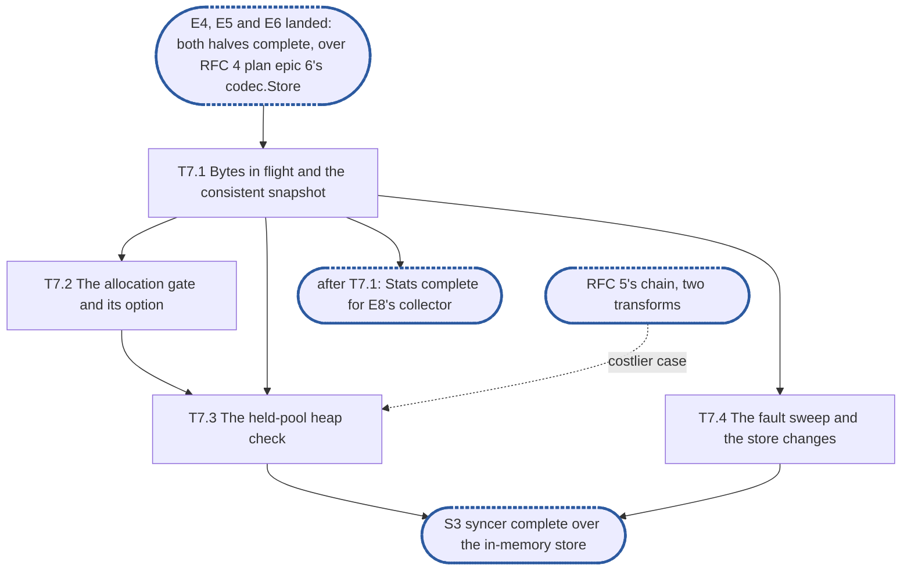

# Epic 7: syncer v2 memory bound, `Stats` and the fault sweep

**Sources:** [RFC 3](../docs/internals/rfcs/rfc-3-syncer.md) §1.4 ("Memory is checked by holding,
then measuring"); §2.2, the per-worker figure and the bound, but the staging budget; §2.7; §2.12's
snapshot rules and `syncer_inflight_bytes`; §6's S2, S4, S5, S6, S7, S10 and S14; §7.2's row "§2.2
memory bound" (the syncer's part); §7.3's first rule; §8.1's "Memory" kind; §8.3; §8.4's
"allocations"; §8.6's suites paragraph. Not built, and why: [RFC 24](../docs/internals/rfcs/rfc-24-resources.md)
§7.2's fit to the transfers pool, with RFC 3 §1.3's "What lands with its first caller" and §2.10
(D6). Cited, not owned: [RFC 4](../docs/internals/rfcs/rfc-4-remote-tier.md) §3.2 (the header
bound) and §7.3 (a cancelled try dropping its buffers, the codec's check); epic 1's D3 and D5
(`Stats`, `Config`); epic 2's D1 to D3 (`Inject`, `Rule`, `Fail`, `Lose`, `Cut`, `Flip`, `Hold`,
`Link`); epic 3's D1 (the slot), D2 (one lock per half), D11 (the counters `Stats` reads), D12
(the `testing/synctest` bubble), T3.5 (the two halves, their counters and `stats.go`) and T3.7
(the in-memory opener); epic 4's T4.3 and T4.6 (the slow-tail window, overlapping tries); the RFC
4 plan's epic 1 D11 (`codec.MaxHeaderLen`), its epic 2 (`memory.Wrap`, `SetReadOnly`, `Delete`)
and its epic 6 (the header's bound). Every citation is `develop`'s text, epics 3 to 5 and RFC 4's
epic 6 that of their open pull requests (#5940, #5998, #6001, #5942). The code lands on
`feat/storage-v2`, and the paths below are paths there.
**Track:** B.
**Epic 7 estimate: 4 subtasks, 10.5 man-days.**
**Depends on:** **E4, E5 and E6 landed**, both halves complete: E4's attempt loops, slow-tail
retry and complete `Upload`, E5's health and refusal, E6's `Fetch`, `Prefetch`, joins and
detached buffers. Through them **S2** (epic 2's fault wrapper), **E3** (its halves, counters,
`Stats` and in-memory opener) and **RFC 4 plan epic 6** (`codec.Store` with working bodies and
`MaxHeaderLen`), which every subtask's tests run over. **RFC 5's chain** with two registered
transforms of different cost, for T7.3's costlier-transform case.
**Blocks:** **S3**, the syncer complete over the in-memory store, and through it E9. E8's
collector exports T7.1's `InflightBytes`. Outside RFC 3's epics, RFC 8 offload plan epic 21
passes the per-worker inputs T7.1 reads and registers the collector that reads them.

**Builds on the user's rulings of 2026-11-26 on the open breakdowns,** each as its document
recommended: epic 3's D12 (every check in a `testing/synctest` bubble) and its §2.9 sentence on a
waiter bound with nothing displaceable; epic 4's D3 jitter inputs, its floor row's last clause and
S20's text for a requeued throttled transfer.

**Decided by the user, 2026-11-26:** D6 defers the fit to the transfers pool, and this pull
request amends the plan's D6 and its epic 7 to match; the three RFC 3 wordings of D1, D3 and D7
are accepted, each landing with the subtask pull request that needs it.

---

## 1. Goal

Epic 7 adds the checks that span both halves once both are built. It states the memory each
worker reserves and shows the heap stays under it, makes `Stats` a consistent snapshot that takes
no lock at all, gates allocations per chunk on pull requests, and sweeps a fault over every call
of a scripted run and every change RFC 3 §8.3 makes beneath the syncer.

**At the end of the epic:**

- `Stats` reports `syncer_inflight_bytes` per half and store, as the per-worker figure for every
  worker held. In every snapshot a store's queue gauges are the sum of its flows', and its bytes
  in flight are its busy workers times the figure.
- `Stats` returns while every lock of the syncer is held, and allocates no more with a thousand
  transfers in flight than with one.
- No upload or fetch allocates per chunk once warm beyond what the same raw calls on the in-memory
  store allocate, checked on pull requests in `unit/syncer-allocs`, the option of `unit` that runs
  without the race detector.
- With every call held and both pools full, the heap in use above the idle baseline stays within
  each half's pool size times the per-worker figure, plus a stated slack, per half and summed, and
  within twice it in the fetcher with every detached buffer held.
- A fault on the *n*th put or get of a scripted run, for every *n* and each failure kind of RFC 3
  §8.3, leaves every transfer ended with a report, nothing unconfirmed reported stored, and no
  unverified chunk yielded; RFC 3 §8.3's store changes each give the outcome its table names.

### 1.1 In scope

`syncer_inflight_bytes`, the consistent snapshot, and the slow-tail try's end (T7.1); the
allocation gate, the snapshot's cost check and the `unit/syncer-allocs` option (T7.2); the
held-pool heap check (T7.3); the fault sweep, the store changes and the no-persistence check
(T7.4).

### 1.2 Out of scope

- The fit of the two worker counts to the transfers pool (RFC 24 §7.2): not built until the node
  passes the pool's size (D6). Deferred by the RFC 3 plan's §6.1 row "RFC 24's transfers size
  passed to the syncer", unowned.
- The staging budget, its spill and RFC 3 §7.2's "§2.2 copy staging" row: the ledger's first row,
  owned by the RFC 26 plan, the RFC 9 plan for relocation and the RFC 27 plan for re-home.
- The codec's part of RFC 3 §7.2's "§2.2 memory bound" row, a header declaring more entries than
  the chunk-count cap refused before any allocation: the ledger's row for it, RFC 4 plan epic 6.
  So is a cancelled call of `attempt` dropping its chunk buffers once its `ctx` ends (RFC 4 §7.3);
  T7.1 checks the syncer's half, that the `ctx` ends.
- The detached-buffer cap itself, RFC 3 §7.2's "§2.2 detached-buffer cap" row: E6. T7.3 measures
  the heap with the cap reached.
- Computing the per-worker inputs, `Max` and `MaxDecodeLen(Max)` over every registered transform,
  and passing them to `pool.New`: RFC 8 offload plan epic 21, the ledger's sixth row.
- Documenting the memory each setting implies (RFC 3 §2.10): E8.
- Peak heap recorded in B1 and B3 against RFC 3 §8.5's target: E9.
- The soak, which watches `inflight_bytes` and queue depth return to idle over hours: RFC 8 offload
  plan epic 22, the ledger's soak row.
- Faults only a real backend shows, behind a fault proxy (RFC 3 §8.3's second paragraph): RFC 8
  offload plan epic 21, the ledger's sixth row.
- A fault on a probe at each position: E5, whose table tests drive every probe result and whose
  §8.2 case holds a probe that never returns (D5).

### 1.3 Names used here

- **E1**, epic 1, interfaces: `pkg/syncer`'s contract, `Stats`, `pool.New` with its `Config`, the
  import test and the frozen-exports test.
- **E2**, epic 2, test foundations: the per-call faults on RFC 4's fault wrapper and `syncertest`'s
  frame.
- **E3**, epic 3, registration, flows and the fair scheduler: the halves, their slots and lock,
  `admit`, the counters `Stats` reads, the bubble and the in-memory opener.
- **E4**, epic 4, termination, retries and the uploader.
- **E5**, epic 5, store health.
- **E6**, epic 6, the fetcher: joins, re-homing and detached buffers.
- **E7**, this epic.
- **E8**, epic 8, the syncer's own integration: its settings section and its collector.
- **E9**, epic 9, E2E green: the benchmarks B1 to B5.
- **S2**, the test foundations in CI, at the end of E2.
- **S3**, the syncer complete over the in-memory store, after E5, E6 and E7.
- **RFC 3 S1, S2, S4, S5, S6, S7, S10, S14, S20**, invariants of RFC 3 §6, always written with
  "RFC 3" before them; they are not the synchronisation points S2 and S3 above.
- **B1, B3**, benchmarks of RFC 3 §7.4.
- **The integration epic**, E8 here; outside RFC 3's epics, RFC 8 offload plan epic 21, which
  composes the syncer in the node.

## 2. How the general rules apply

The rules are those of
[the RFC 3 plan's §1.5](rfc-3-syncer-plan.md#15-general-rules-for-each-epic). They are cited by
number and title, not copied.

| Rule | Subtasks | How |
| --- | --- | --- |
| rule 1, independent unit tests ([`CLAUDE.md`, "Writing tests"](../CLAUDE.md#writing-tests)) | all | Every check runs over `codec.Store` on RFC 4's in-memory store (kind 2) under its fault wrapper (kind 3), in E3's bubble (kind 1), but T7.1's lock check, which runs outside it on `pkg/sim`'s `TestClock` (D2). Unexported state is read through `export_test.go` |
| rule 2, fuzz tests where relevant ([`CLAUDE.md`, "Writing tests"](../CLAUDE.md#writing-tests)) | none | Nothing here decodes bytes. The sweep is systematic, not random: every *n*, every kind (D5) |
| rule 3, observability follows RFC 25, with RFC 3's own exception | T7.1 | T7.1 fills `StoreStats.InflightBytes`, the last empty field of RFC 3 §2.12's pool series. No log line and no span |
| rule 4, profiling | T7.2, T7.3 | This epic owns RFC 3 §8.4's allocation gate and the `unit/syncer-allocs` option that runs it (T7.2). Every test runs under `internal/prof`'s leak check, which T7.4's held calls exercise. The heap check reads `prof.LiveHeap` (T7.3) |
| rule 5, public interface and internals ([`CLAUDE.md`, "Verifying a change"](../CLAUDE.md#verifying-a-change)) | all | `InflightBytes` and the snapshot's sums at `Stats`, where E8's collector reads them; the bound at the heap; RFC 3 S5 and S6 at what the in-memory store holds and its puts per name; RFC 3 S10 at the bytes a caller is yielded; RFC 3 S14 at the in-memory store's record of calls and `Stats`' busy workers. The concurrent snapshot check runs under `-race` |
| rule 6, known failures shrink | none | No suite this epic's tests run in keeps a `known.yaml`: every test lands green |
| rule 7, v2 ignores v1 | all | No import is added to production code; the tests import RFC 4's codec and in-memory store and RFC 5's chain, which amended RFC 0 §1.2 allows, and E1's import test still passes |
| rule 8, real dependencies for properties of those dependencies ([`CLAUDE.md`, "Writing tests"](../CLAUDE.md#writing-tests)) | T7.2, T7.3 | The heap check and the allocation gate run the real codec and chain, since the memory they bound is partly theirs. Nothing needs a disk: the syncer persists nothing (RFC 3 §2.7) |
| rule 9, code comment conventions ([`CLAUDE.md`, "Code comments"](../CLAUDE.md#code-comments)) | T7.1, T7.2, T7.3, T7.4 | `decision:` markers at `InflightBytes` (D1), at the snapshot's publication (D2), at the heap check's slack (D3), at the allocation gate's subtraction and the cost check's ceiling (D4), at the sweep's script (D5), and at `New` for the fit not applied (D6). Each names RFC sections only |
| rule 10, a test must be able to fail ([`CLAUDE.md`, "Writing tests"](../CLAUDE.md#writing-tests)) | all | Each test names the wrong design it catches and is verified against it: a stored store total, a `Stats` taking a lock, a slow-tail try left running, a fetch gathering a whole block, a buffer allocated per chunk, an `Upload` reported stored on a lost reply, a flipped chunk yielded, state kept in a package variable |
| rule 11, a symbol is exported only if the RFC's interface uses it | all | No symbol is exported but the four `_limit` fields of `syncer.Half`, which RFC 3 §2.12's series need; `Stats` only gains fields, as its doc allows. `InflightBytes` is a field of E1's `Stats` |
| rule 12, each subtask creates only what it declares | all | The option lands with its first tests (T7.2), and T7.3 adds its test to it. The store changes reuse the sweep's script. No helper package is added |

## 3. Requirements and invariants

Every obligation that RFC 3 places on this epic, numbered so that subtasks and tests can cite
them.

**The memory bound**

| # | Requirement | Kind | Source | Subtasks |
| --- | --- | --- | --- | --- |
| R1 | Each worker's figure is one, `Max + MaxDecodeLen(Max) + header cap`, the same in both directions and fixed when the process starts | invariant | RFC 3 §2.2; §6 S2 | T7.1, T7.3 |
| R2 | A half's peak memory is at most its pool size times the per-worker figure plus its detached buffers, at most pool-size of them, so at most twice the pool times the figure; the uploader's detached term is zero; the process's bound is the two halves' summed | bound | §2.2; §6 S2 | T7.3 |
| R3 | Both halves' encoded term is `MaxDecodeLen(Max)` over every registered transform, so a block written under a transform costlier than the current chain is fetched within the figure; computing the input is RFC 8 offload plan epic 21's, so only the heap half of this can fail here | invariant | §2.2; §6 S2; §7.2, "§2.2 memory bound" | T7.3 |
| R4 | Nothing on the path holds the whole block | invariant | §2.2 | T7.3 |
| R5 | A try cancelled by the slow-tail rule holds no chunk buffer once its `ctx` ends; the syncer's part is that the `ctx` ends, the codec's that the call then drops its buffers | invariant | §6 S2; §1.3 | T7.1 |
| R6 | With every call held and every pool full, the heap in use above the idle baseline stays within §2.2's bound plus a stated slack; the test chooses the chunk `Max` and the pool size large enough that the runtime's own noise stays under the slack | MUST | §1.4; §8.1, "Memory" | T7.3 |
| R7 | RFC 3 §7.2's row "§2.2 memory bound", the syncer's part: the backend stalled at full pools, peak bytes within pool size times the per-worker figure, per half and summed; a transform costlier than the current chain registered and a block written under it fetched, both halves' figure is the costlier one's. The header refusal is the codec's (this epic's §1.2) | test row | §7.2 | T7.3 |
| R8 | A check of §2 or §4.4 never runs over a backend that returns instantly | MUST NOT | §7.3 | T7.1, T7.3, T7.4 |
| R9 | `syncer_inflight_bytes` makes observable, by half and store, the bytes held by transfers in flight, against §2.2's bound (D1 reads it as the bytes reserved) | MUST | §2.12 | T7.1 |

**The snapshot**

| # | Requirement | Kind | Source | Subtasks |
| --- | --- | --- | --- | --- |
| R10 | `Stats` returns a consistent snapshot of the counters, and the syncer reports each queue gauge per flow and summed over all flows (D2 says what consistent covers) | invariant | §2.12 | T7.1 |
| R11 | Taking a snapshot never takes a lock a dispatch needs | MUST NOT | §2.12 | T7.1 |
| R12 | A snapshot's cost never grows with the number of transfers in flight | MUST NOT | §2.12 | T7.1, T7.2 |

**Persistence**

| # | Requirement | Kind | Source | Subtasks |
| --- | --- | --- | --- | --- |
| R13 | The syncer never persists what was stored, residency or health: it persists nothing. Checked here as a second syncer over the same store starting from nothing the first saw | MUST NOT | §2.7; §6 S7 | T7.4 |

**Faults and outside interference**

| # | Requirement | Kind | Source | Subtasks |
| --- | --- | --- | --- | --- |
| R14 | The fault wrapper fails the *n*th call of a scripted run, for every *n*, with each failure kind: transient, terminal, committed with the response lost, stopped part-way, corrupted, held | test row | §8.3 | T7.4 |
| R15 | After each fault, every transfer has ended with a success or a reported failure, in bounded time | invariant | §8.3; §6 S4 | T7.4 |
| R16 | After each fault, nothing unconfirmed was reported stored: a block is reported stored only on an acknowledgement that means stored, an unknown outcome is reported as not stored, and every retry within one `Upload` puts the same name with the same bytes | invariant | §8.3; §6 S5, S6 | T7.4 |
| R17 | After each fault, no chunk that failed verification was yielded | invariant | §8.3; §6 S10 | T7.4 |
| R18 | A call in a direction in which its store is unhealthy fails without taking a worker or calling the backend, and a put failure never refuses a get | invariant | §6 S14 | T7.4 |
| R19 | RFC 3 §8.3's table of store changes: a block deleted gives `ErrNotFound`; a block overwritten with other bytes gives `ErrCorrupt`; the bucket removed or credentials revoked give terminal failures, failing probes, and a store unhealthy in both directions; write permission revoked or a quota reached give put failures, a put-unhealthy store, and fetches that carry on; a store that throttles gives `ErrThrottled`, a held flow that retries, and health unchanged; a store slowed below the floor gives transfers that fail on the floor and are retried within the bound | test row | §8.3 | T7.4 |

**What CI gates**

| # | Requirement | Kind | Source | Subtasks |
| --- | --- | --- | --- | --- |
| R20 | No upload and no fetch allocates per chunk once warm, buffers being reused; the count, taken against the in-memory store, gives the same answer on any machine | bound | §8.4, "allocations"; §7.4, B1 | T7.2 |
| R21 | The allocation count the race detector skews runs in an option of `unit` of its own, the syncer's allocation gate, on pull requests; the memory and fault-sweep checks run in `unit`. The heap check, which the race detector also skews, runs in the allocation gate's option instead, and the user accepted the RFC 3 §8.6 text for it (D3) | invariant | §8.6 | T7.2, T7.3, T7.4 |

RFC 3's other obligations in these sections belong elsewhere. The header cap's refusal before
allocation, and a cancelled call dropping its buffers, are the codec's (RFC 4 plan epic 6). The
detached-buffer count never above the fetch pool's size, and the detached buffer handed to its
caller, are E6's. Staging counted against one budget per process is the deferral ledger's first
row. "Every size the syncer bounds, charges or budgets is an encoded size" binds the charges and
the quantum, E3's. The memory each setting implies, in its documentation, is E8's; every other
§2.12 series is E1's field and the counter of E3, E4, E5 or E6; the syncer depending on no
metrics library is E1's import test. RFC 3 S1's peak in flight is read at the in-memory store's
record, E3's, never from `Stats`' sums (D2). RFC 3 §8.5's peak memory within 10% is E9's
benchmark target, whose figure D3's slack borrows. RFC 24 §7.2's two rules apply only once the
node passes the pool's size (D6).

## 4. Decisions this epic takes

- **D1, `syncer_inflight_bytes` is the reservation, not a measurement.** The syncer never sees a
  chunk's bytes: the codec holds them inside `attempt` and `Store.Get` (RFC 3 §1.3). The `Meter`
  reports bytes moved, not bytes held, so a gauge summed from it would not compare with §2.2's
  bound. So `InflightBytes` is the store's busy workers in the half times the per-worker figure,
  `Max + MaxDecodeLen + HeaderCap` from E1's `Config`, computed once in `New`. A slow-tail try
  whose `ctx` has ended is not counted once its worker is returned (R5). A detached buffer is
  reported by E6's `DetachedBuffers`, not here: it belongs to a caller, not to a transfer. By
  construction the gauge never exceeds the bound, so it shows how much of the bound is in use, not
  a breach; T7.3's heap check is what ties the reservation to the heap. A `decision:` marker at
  the computation says both. RFC 3 §2.12's "bytes held" reads as a measurement, so its row
  reads, as the user accepted (2026-11-26), "bytes reserved by transfers in flight, the
  per-worker figure of §2.2 for each busy worker"; it lands with T7.1's pull request. Not chosen: each transfer charged `min(figure, its size)`, which shows a small
  block's real share but no bound states it; changing to it later changes one computation and no
  caller. Prior art: `golang.org/x/sync/semaphore`'s weighted reservation, from memory.
- **D2, the snapshot reads a published registry and takes no lock.** E3's D11 has `Stats` walk
  the registry under the registry's lock, which no transfer call takes (E3's D6 counts callers in
  an atomic) but `OpenFlow` and `Flow.Close` do, so a scrape over a thousand flows stalls every
  flow opened or closed meanwhile. Instead the registry publishes an
  immutable list of its stores and their flows through an `atomic.Pointer`, replaced under the
  registry's lock at `Register`, `Unregister`, `OpenFlow` and `Flow.Close`, which no dispatch
  makes. `Stats` loads the list and the atomics E3 to E6 keep, and takes no lock at all. What is
  consistent is made so by deriving it in that one pass, not by a seqlock:
  - each store's queue depth and waiters, per class, are summed from its flows' values in the same
    pass, so a store's total is always the sum of the flows reported beside it; any per-store copy
    of those gauges E3 keeps goes;
  - `InflightBytes` is computed from the same load of `WorkersBusy` (D1);
  - every counter is one atomic that only grows, so a counter never goes backward between two
    snapshots.

  Across stores, two loads can straddle a worker handed from one store to another, so busy workers
  summed over stores can exceed the pool by the hand-offs in progress. A `decision:` marker at the
  publication says so, and that a check of the pool size reads the store's own record. Withdraw it
  if a consumer compares that sum with the pool. Not chosen: a seqlock or a two-copy latch over
  every gauge, whose reader retries while dispatches publish, so its cost grows with the dispatch
  rate; and E3's walk under the registry's lock, which T7.1 replaces (§9). Prior art: the
  journal's `Stats`, a walk that takes no lock writes need (`TestStatsAfterOpenWalksNoLock`,
  `pkg/journal/conformance`); read-copy-update publication, from memory.
- **D3, the heap check's figures.**
  - Pools of 16 in each half; `Max` 1 MiB, the default whose per-worker figure the settings
    document; `MaxDecodeLen` from RFC 5's chain over the transforms the test registers;
    blocks of four 1 MiB chunks. `InflightBytes` counts the header at `codec.MaxHeaderLen(1)`'s
    `n` (D7), but the heap bound counts the header the test's blocks carry, read from their
    encoding: a four-chunk block's header is far below the cap's 1,036,381 bytes, and a bound
    with the cap's header in it leaves about 1 MiB a worker spare, enough to pass a design that
    double-buffers a chunk.
  - **Fetch half:** every block it reads is in the in-memory store before the baseline. Each get
    is held at the start of its last chunk's body, after three chunks were served, so a fetch that
    gathers a block before yielding holds three chunks and a correct one holds one. After the heap
    is read, each caller must have been yielded three chunks, which a hold placed before anything
    was decoded fails. No floor on the heap is asserted: whether a chunk is still live at the hold
    depends on whether the codec reuses its buffer or allocates one per chunk (D4), so a floor
    could fail a correct syncer.
  - **Upload half:** each put is held before its first body byte. The in-memory store keeps what a
    put has sent, so no floor is asserted here, and a put held later would measure the fixture. The
    upload half's bound catches what the syncer adds: a queued transfer holding bytes, a try beyond
    the pool. Its sources are one shared slice read through, allocated before the baseline.
  - Twice the pool is submitted in every case, so half queue, and the bound is the pool's.
  - The slack is 10% of the bound, RFC 3 §8.5's figure, stated in the test. If the runtime's noise
    exceeds it at these figures, the test raises the pool size, as RFC 3 §1.4 allows, not the
    slack.
  - It skips under the race detector, which changes how much heap the runtime keeps
    (`prof.RaceEnabled`), and runs in `unit/syncer-allocs` (R21). A `decision:` marker at the slack
    names each term. RFC 3 §8.6 then reads, as the user accepted (2026-11-26), "…and an
    allocation count and a heap check the race detector skews in an option of `unit` of its own,
    the syncer's allocation gate, on pull requests"; it lands with T7.3's pull request.

  Prior art: `internal/prof`'s own heap check, which skips under the race detector for the same
  reason.
- **D4, the allocation gate subtracts the raw calls; the cost check states its ceiling.** RFC 3
  §8.4 counts against the in-memory store, whose codec and store allocate per chunk of their own
  (an encoded body, a stored copy). So the gate counts, with `testing.AllocsPerRun`, the least of
  several samples, the syncer's `Upload` and `Fetch` of 64 chunks minus the same calls made raw,
  `codec.Store`'s put attempt and `Get` called directly, and the same for one chunk; the
  difference between the two differences must be zero, as B1 states its throughput against raw
  calls (RFC 3 §7.4). `Stats`' cost is counted the same way, at 1 and at 1,000 transfers held in
  flight on pools of 1,000. A `decision:` marker at each says what an allocation count cannot see:
  a walk that allocates nothing; D2 walks no transfer by construction. Prior art:
  `TestRFC1D_StatsCostIsFlat` (`pkg/journal/conformance`), which states the same ceiling.
- **D5, the sweep's script is sequential, on one store, and faults puts and gets.**
  - The script: two uploads on one flow, of a one-chunk and a three-chunk block, then a whole
    fetch of the second, a fetch of its first and third chunks, and a `Prefetch` of the first
    block, one call after another, so the *n*th put or get names one operation in every run and a
    failing *n* reproduces. Every call runs under `Link` with a per-call latency and a per-byte
    time on the bubble's clock (R8). Concurrency is E3's model and the §7.2 rows'.
  - A fault-free run first counts the puts *P* and gets *G* the in-memory store records. For each
    *n* up to *P*, then each *n* up to *G*, and each kind that fits, a fresh syncer and store run
    under `Inject(Rule{Op: "put", From: n, Count: 1}, effect)`, or `"get"`.
  - The kinds: transient, `Fail(remote.ErrTransient)`; terminal, `Fail` of a
    `*remote.DeniedError` of cause access, the one terminal error that also moves health, since the
    others' outcomes are E4's table; committed with the response lost, `Lose()`, puts only; stopped
    part-way, `Cut` at half the body; corrupted, `Flip` inside a chunk on a get and
    `Fail(remote.ErrCorrupt)` on a put, a failed in-transit check; held, `Hold` at half the body,
    never released, so the syncer's own bound ends it.
  - Probes are not swept: they run on their own loop on the clock, not as calls of the script, so
    their *n* would depend on time; E5 drives every probe result.

  A `decision:` marker at the script says so. Prior art: SQLite's fault-injection loop, which fails
  the *n*th allocation or I/O for every *n* (from memory).
- **D6, the fit to the transfers pool is not built. The user's decision, 2026-11-26.** The RFC 3 plan's
  D6 has this epic build RFC 24 §7.2's reduction and refusal behind a pool-size field of `Config`,
  zero reducing nothing. RFC 3 §2.10 and RFC 24 §7.2 apply both rules only once the node passes the
  syncer the pool's size, RFC 3 §1.3 lands what has no caller with its first one, "never before",
  and no caller passes it: `pkg/resources` has no `Split`. E1's `Config` declares no such field,
  and its frozen-exports test fails on one added. So this epic follows the RFC: the counts are
  neither reduced nor refused, and a `decision:` marker at `New` says so and that the fit applies
  once the node passes the transfers pool's size (RFC 24 §7.2). Not chosen: building it now, about
  1 man-day plus an amendment of E1's frozen `Config` and of RFC 3 §1.3's table. Prior art: none
  found.
- **D7, the header cap is the codec's bound, `codec.MaxHeaderLen(1)`.** RFC 4 §3.2 puts the
  census in the header, and RFC 4 plan epic 6's breakdown (#5942) puts the bound at 1,036,381 bytes,
  where RFC 3 §2.2's derivation from the chunk index alone gives about 41 KB. The per-worker figure,
  and so `InflightBytes`, uses the codec's figure, which is what a worker's codec can hold; a figure
  sized from the smaller one would fail on a header the codec accepts. T7.3's heap bound counts the
  header its own blocks carry (D3). The user accepted the RFC text (2026-11-26), which
  lands with T7.3's pull request: RFC 3 §2.2 reads "its header cap is `N` times one fixed-size
  index entry, plus the census at its bound, plus the fixed fields: a constant of the format
  version ([RFC 4 §3.2](rfc-4-remote-tier.md#3.2%20Layout))", and the per-worker figures in RFC 3
  §2.2, §2.10 and RFC 24 §7.2 are recomputed from it: 2 × 1 MiB + 1,036,381 bytes, about
  3.0 MiB per worker at the default `Max`; 128 workers in each half, the fetch half's detached
  buffers and the staging budget (98 blocks of about 6 MiB, the header now included) come to
  about 1.7 GiB, where RFC 24 §7.2's text, at 2 MiB per worker, says about 1.2 GiB. Prior art:
  none found.

## 5. Target tree

```text
pkg/syncer/pool/
  pool.go               T7.1  New: the per-worker figure, once; D6's decision: marker
  registry.go           T7.1  the published list of stores and flows (D2)
  stats.go              T7.1  Stats over the list: store totals summed from flows, InflightBytes
  stats_test.go         T7.1  sums under load; no lock taken; the slow-tail try's ctx
  allocs_test.go        T7.2  no allocation per chunk against raw calls; Stats' flat cost (D4)
  heap_test.go          T7.3  the held-pool heap check (D3), skipped under -race
  sweep_test.go         T7.4  the script, the sweep over every n and kind (D5), the store changes
test/suites.yaml        T7.2  unit's syncer-allocs option
docs/internals/testing.md T7.2  regenerated by dt docs
```

## 6. Subtasks

### T7.1 Bytes in flight and the consistent snapshot

**Subtask T7.1 estimate: 2.5 man-days.**

- **Track:** B. **Depends on:** none in this epic; E4, E5 and E6 landed.
- **Covers:** R1, R5, R8, R9, R10, R11, R12.
- **Deliverables:**
  - `pool.go`: the per-worker figure, `Max + MaxDecodeLen + HeaderCap`, computed once in `New`
    and held by both halves; D6's `decision:` marker at `New`.
  - `registry.go`: the immutable list of stores and flows behind an `atomic.Pointer`, replaced
    under the registry's lock at `Register`, `Unregister`, `OpenFlow` and `Flow.Close`, with D2's
    `decision:` marker.
  - `stats.go`: `Stats` over the list, with no lock; `StoreStats.InflightBytes` as `WorkersBusy`
    times the figure, from the same load (D1); each store's `QueueDepth` and `Waiters` summed from
    its flows in the pass (D2); D1's `decision:` marker. `syncer.Half` gains `WaitersLimit`,
    `DetachedBuffersLimit`, `ThrottleWindowLimit` and `InflightBytesLimit`, filled from the fixed
    table and the figure, the four `_limit` series of RFC 3 §2.12 (E8's D10).

  Consumed by E8's collector, which exports `InflightBytes` and the four limits; T7.2, which counts `Stats`' cost;
  T7.3, which reads `WorkersBusy`; T7.4, which asserts idle and busy workers at `Stats`.
- **Acceptance criteria:**
  - With a pool of 8 in each half and every call held, `InflightBytes` summed over stores is 8 ×
    the figure in each half, the same figure in both, equal to `InflightBytesLimit`, and zero once
    the calls are released and the transfers end. `WaitersLimit` is 64, `DetachedBuffersLimit` 8
    and `ThrottleWindowLimit` 6 in each half.
  - In every snapshot taken while transfers start and end on four flows of two stores, each
    store's `QueueDepth` and `Waiters` per class equal the sum of its flows' in that snapshot, its
    `InflightBytes` equals its `WorkersBusy` times the figure, and no counter (never a gauge) is
    lower than in the snapshot before. Every call runs under `Link` with a per-call latency on the
    bubble's clock (R8) and three times the pool is submitted on each store, so queues form; at
    least one snapshot shows a non-zero `QueueDepth` and `Waiters` on each store, or the sums
    were compared only at zero and the test fails.
  - `Stats` returns while a test holds the registry's lock and both halves' locks.
  - An upload whose first try is cancelled by the slow-tail rule: that try's `ctx` is done once
    its retry is dispatched, its call of `attempt` has returned `ctx.Err()` before `Upload`
    returns, and `InflightBytes` counts one worker for the upload, not two.
- **Tests:** at `Stats`, where E8's collector reads it, through `Flow` over `codec.Store` on the
  in-memory store under E2's `Hold` (kind 2 under kind 3), in E3's bubble. The held-pool count
  (catches bytes counted per try, R9). A reader calling `Stats` in a loop beside concurrent
  uploads and fetches under `Link` and `-race`, one snapshot per step of the bubble's clock,
  asserting the sums and the product in each snapshot (catches a stored store total updated apart
  from its flows', R10; verified by keeping a per-store copy).
  The lock check runs outside the bubble, where a goroutine blocked on a mutex would stop the
  bubble's clock: it holds every lock through `export_test.go` and waits for `Stats` on a channel
  with a generous real-time bound, the bound being the assertion since nothing here waits on a
  clock (catches a snapshot taking a lock, R11; verified by walking under the registry's lock).
  The slow-tail case seeds E4's T4.3 window through `export_test.go`, holds each first try at
  byte 0, before its first body byte is accepted, so its first byte is later than the seeded 90th
  percentile and the slow-tail retry fires, and wraps `attempt` in the recording pass-through
  wrapper `CLAUDE.md` allows (catches a cancelled try left running, R5).

### T7.2 The allocation gate and its option

**Subtask T7.2 estimate: 2 man-days.**

- **Track:** B. **Depends on:** T7.1.
- **Covers:** R12, R20, R21.
- **Deliverables:**
  - `allocs_test.go`: `TestUploadAllocatesNothingPerChunk`, `TestFetchAllocatesNothingPerChunk`
    and `TestStatsCostIsFlat`, each skipped under `prof.RaceEnabled` with a message naming the
    option, with D4's `decision:` markers.
  - `test/suites.yaml`: `unit`'s `syncer-allocs` option, running the three by name with `go test
    -timeout=5m -run=^(…)$ ./pkg/syncer/pool/`, without `-race`; `test/harness/bin/dt docs` run so
    `docs/internals/testing.md` matches.

  Consumed by S3; T7.3, which adds its test to the option; E9, whose B1 reports the same count.
- **Acceptance criteria:**
  - `Upload` of 64 chunks less the raw put attempt of 64 chunks allocates what the same
    difference at one chunk does, once warm.
  - `Fetch` and `Prefetch` of 64 chunks, whole and by two ranges, less the raw `Get` of the same,
    allocate what the same difference at one chunk does.
  - `Stats` allocates no more with 1,000 transfers held in flight on pools of 1,000 than with one
    on pools of one.
  - The option runs on pull requests, `tier: pr`, and the three skip under `-race` in `unit`.
- **Tests:** at the syncer's path against the in-memory store, the code B1 benchmarks (D4). Each
  catches a buffer or a closure the syncer allocates per chunk: a `Meter` func bound per chunk
  rather than per try, an iterator value per yielded chunk, E6's join copying each chunk for its
  callers (R20); verified by adding one `make` per chunk to the fetch path. The cost check catches
  a snapshot that allocates per transfer in flight (R12), with D4's ceiling stated.

### T7.3 The held-pool heap check

**Subtask T7.3 estimate: 2.5 man-days.**

- **Track:** B. **Depends on:** T7.1, T7.2, and RFC 5's chain with two transforms.
- **Covers:** R1, R2, R3, R4, R6, R7, R8, R21.
- **Deliverables:** `heap_test.go`, `TestHeldPoolHeap`, with D3's figures and its `decision:`
  marker at the slack; its name added to the `syncer-allocs` option. Consumed by S3, and by E9,
  whose B1 and B3 record the same peak against RFC 3 §8.5.
- **Acceptance criteria:** with D3's setup, the figure counting the blocks' own header (D3), heap
  above the baseline read by `prof.LiveHeap`:
  - the upload half alone held: at most 16 × the figure plus slack;
  - the fetch half alone held: at most 16 × the figure plus slack, and every caller yielded
    three chunks;
  - both held: at most the two summed plus their slacks (R2's process bound);
  - the fetch half held with every detached buffer held, 16 joined callers stalled past E6's
    detach bound on the clock: at most twice 16 × the figure plus slack;
  - a block written under the costlier of two registered transforms and fetched while the current
    chain is the cheaper: within the bound computed from the costlier `MaxDecodeLen` (R3, R7).
- **Tests:** at the heap, the memory the bound is about, over the real codec, chain and in-memory
  store (rule 8), every call held by E2's `Hold`, so no backend answers at once (R8). The fetch
  case catches a fetch that holds a whole block (R4; verified by making E6's fetch gather a
  block's chunks before yielding them). The yielded count catches a hold placed before anything
  was decoded, which passes any bound. Counting the blocks' own header rather than the cap catches
  a chunk double-buffered (verified by keeping a second copy of each chunk). The detached case
  catches a detached buffer not counted against the cap (R2). The upload case catches a queued upload holding bytes (verified by copying
  `src` into the queue entry).

### T7.4 The fault sweep and the store changes

**Subtask T7.4 estimate: 3.5 man-days.**

- **Track:** B. **Depends on:** T7.1.
- **Covers:** R8, R13, R14, R15, R16, R17, R18, R19, R21.
- **Deliverables:** `sweep_test.go`:
  - D5's script over E3's in-memory opener, the fault-free counts *P* and *G* from the in-memory
    store's record, and `TestFaultSweep`, a subtest per operation, *n* and kind, named so a
    failure reproduces alone; D5's `decision:` marker at the script.
  - `TestStoreChanges`, one subtest per change of RFC 3 §8.3's table that this epic runs, over the
    script, each change made beneath the codec: a block deleted with the in-memory store's
    `Delete`; a block overwritten by a put of another block's encoded bytes under its name; the
    bucket removed, as `Fail` of a `*remote.DeniedError` of cause access on every call and both
    probes; write permission revoked, as `SetReadOnly(true)`. The table's other three rows are
    E4's and E5's rows, named in the acceptance criteria.
  - `TestNothingPersisted`: a store driven put-unhealthy, the syncer closed, a second syncer built
    over the same in-memory store.

  Consumed by S3.
- **Acceptance criteria:**
  - After each sweep run, under `internal/prof`'s leak check: every call of the script has
    returned within the bound the test computes from RFC 3 §2.10's fixed values, four attempts and
    three retry backoffs per transfer (R15); every `Upload` that returned `nil` names a block the
    store holds once, whose bytes read back through `codec.Store` equal the script's, and under
    `Lose` its puts per name are two, the retry with the same bytes (R16); every chunk yielded
    equals the bytes uploaded under its hash, never a flipped one (R17); `Stats` shows each half
    idle.
  - Deleted: the fetch fails with `remote.ErrNotFound`. Overwritten: it fails with
    `remote.ErrCorrupt`, no byte of the chunk yielded.
  - Bucket removed: once the probes have run, `Flow.Healthy` is false in both directions, and each
    further call fails with no new call in the store's record and `WorkersBusy` zero (R18).
  - Write revoked: `Flow.Healthy(remote.DirPut)` false, and the script's fetches succeed (R18).
  - A quota reached, throttling and a store below the floor are E5's "§2.8 cause per direction" and
    "§2.8 failure window" rows (its T5.4) and E4's "§2.4 throttling" and "§2.4 throughput floor"
    rows (its T4.9 and T4.10), which run before S3; this test names them in its comment.
  - The second syncer: both directions healthy, every counter zero, and its first put sent at once
    (R13).
- **Tests:** at what the store holds and its record of calls, what a caller is yielded, the error
  it gets, `Flow.Health` and `Stats`, over `codec.Store` on the in-memory store under E2's
  `Inject` and `Link` (kind 2 under kind 3), in E3's bubble (kind 1). Every *n* of each operation
  and every kind that fits (catches a fault at one call position that wedges or misreports, R14
  to R17); verified against an `Upload` returning `nil` after a `Lose` without a retry (R16), a
  fetch yielding a chunk before its verification (R17), and a held put with no first-byte bound
  (R15). The bucket row catches a refused call that still takes a worker (R18). The second syncer
  catches state kept in a package variable of `pool`, which E1's import test does not (R13);
  verified by keeping the health state in one.

## 7. Order of work



T7.1 is the blocker: every later subtask reads `Stats`. T7.2 then lands the option T7.3 adds to,
and T7.4 can run beside them. Checkpoint after T7.1: every RFC 3 §2.12 series is filled, so E8's
collector reads a complete `Stats`. Checkpoint after T7.3 and T7.4: this epic's share of S3.

## 8. Suggested pull requests

| PR | Subtasks | Man-days | After | Why together |
| --- | --- | --- | --- | --- |
| 1 | T7.1, T7.2 | 4.5 | — | `Stats` complete, consistent and lock-free, with the option its cost check and the gate run in |
| 2 | T7.3 | 2.5 | PR 1 | the heap check, in the same option |
| 3 | T7.4 | 3.5 | PR 1 | the sweep and the store changes over one script; open alongside PR 2 |

A suggestion only: one pull request per subtask works as well.

## 9. Open points

- **E3's D11 changes under D2.** E3 walks the registry under its lock, which `OpenFlow` and
  `Flow.Close` also take; T7.1 replaces that walk with the published list, as E3's D11 says. If E3's breakdown
  adopts the list itself, T7.1 loses about 0.5 man-days.
- **E6 is not broken down yet.** T7.3's detached case assumes E6 holds a detached caller's chunk in
  a buffer the fetch half owns until the caller's next iteration, counted in `DetachedBuffers`,
  and that a joined caller stalled past the detach bound on the bubble's clock is detached. If
  E6's breakdown detaches differently, T7.3's detached case follows it.
- **The heap check's figures are the least certain estimate.** D3's slack is stated, not measured;
  neither half asserts a floor: the in-memory store's copy of a put's body, and a codec that may
  allocate per chunk, would each make one measure the fixture.
- **The sweep's size.** With *P* + *G* about 12 and seven effect forms, the sweep is about seventy
  runs in a bubble, each in virtual time. If it grows past `unit`'s budget, the script shrinks; the
  kinds and every *n* stay.
- **The RFC 3 plan's epic 7 outline is narrowed here.** Its "per-worker figure and the fit" keeps
  only the figure (D6). Its §3.3 says the sweep asserts the refusal rules: T7.4 asserts RFC 3 S14
  through the store changes, not on every swept call, where one fault rarely turns a store
  unhealthy.
