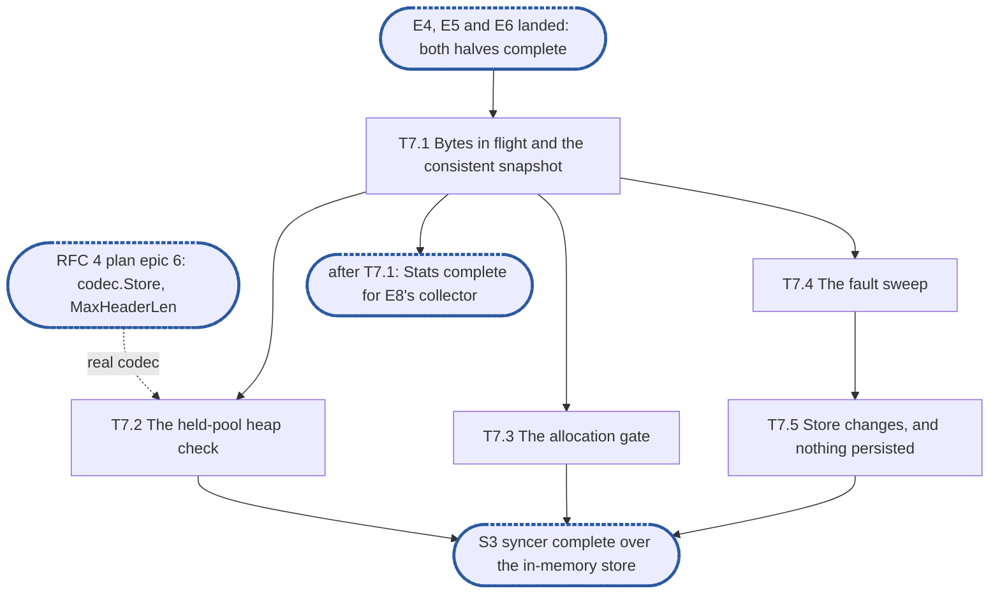

# Epic 7: syncer v2 memory bound, `Stats` and the fault sweep

**Sources:** [RFC 3](../docs/internals/rfcs/rfc-3-syncer.md) §1.4 ("Memory is checked by holding,
then measuring"); §2.2, the per-worker figure and the bound, but the staging budget; §2.7; §2.12's
snapshot rules and `syncer_inflight_bytes`; §6's S2, S4, S5, S6, S7, S10 and S14; §7.2's row "§2.2
memory bound" (the syncer's part); §7.3's first rule; §8.1's "Memory" kind; §8.3; §8.4's
"allocations"; §8.6's suites paragraph. Not built, and why: [RFC 24](../docs/internals/rfcs/rfc-24-resources.md)
§7.2's fit to the transfers pool, with RFC 3 §1.3's "What lands with its first caller" and §2.10
(D6). Cited, not owned: [RFC 4](../docs/internals/rfcs/rfc-4-remote-tier.md) §3.2 (the header
bound) and §7.3 (a cancelled try dropping its buffers, the codec's check); epic 1's D3 and D5
(`Stats`, `Config`); epic 2's D1 to D3 (`Inject`, `Fail`, `Lose`, `Cut`, `Flip`, `Hold`, `Link`);
epic 3's D1, D2, D11, D12, T3.5 and T3.7 (the slot, one lock per half, the counters `Stats`
reads, the `testing/synctest` bubble, the in-memory opener); the RFC 4 plan's epic 1 D11
(`codec.MaxHeaderLen`) and its epic 2 (`memory.Wrap`, `SetReadOnly`, `Delete`). Every citation is
`develop`'s text, epics 3 to 5 that of their open pull requests (#5940, #5998, #6001). The code
lands on `feat/storage-v2`, and the paths below are paths there.
**Track:** B.
**Epic 7 estimate: 5 subtasks, 11 man-days.**
**Depends on:** **E4, E5 and E6 landed**, both halves complete: E4's attempt loops and complete
`Upload`, E5's health and refusal, E6's `Fetch`, `Prefetch`, joins and detached buffers. Through
them **S2** (epic 2's fault wrapper) and **E3** (its halves, counters, `Stats` walk and in-memory
opener). **RFC 4 plan epic 6**, `codec.Store` with working bodies and `MaxHeaderLen`, for T7.2,
T7.4 and T7.5. **RFC 5's chain** with at least two transforms of different cost, for T7.2's
costlier-transform case.
**Blocks:** **S3**, the syncer complete over the in-memory store, and through it E9. E8's
collector exports T7.1's `InflightBytes`. Outside RFC 3's epics, RFC 8 offload plan epic 21
passes the per-worker inputs T7.1 reads and registers the collector that reads them.

**Builds on the recommended answers of the open breakdowns.** Epic 3 (#5940) waits on its D12
(every check in a `testing/synctest` bubble) and its §2.9 sentence on a waiter bound with nothing
displaceable; epic 4 (#5998) on its D3 jitter inputs, its floor row's last clause and S20's text
for a requeued throttled transfer; epic 5 (#6001) on its own pending points. This document
assumes each is answered as its document recommends. A different answer to epic 3's D12 is known
rework here: T7.2's detached case, T7.4 and T7.5 would drive `pkg/sim`'s `TestClock` through epic
3's fallback idle wait instead of a bubble, about 0.5 man-days across them. The other answers
change nothing here.

**Pending the user's answer:** D6, whether the fit to the transfers pool is built here (§9,
first point).

---

## 1. Goal

Epic 7 adds the checks that span both halves once both are built. It states the memory each
worker reserves and shows the heap stays under it, makes `Stats` a consistent snapshot taken
without the dispatch lock, gates allocations per chunk on pull requests, and sweeps a fault over
every call of a scripted run.

**At the end of the epic:**

- `Stats` reports `syncer_inflight_bytes` per half and store, as the per-worker figure for every
  worker held. In every snapshot a store's queue gauges are the sum of its flows', and its bytes
  in flight are its busy workers times the figure.
- `Stats` returns while a test holds a half's lock, and costs no more with a thousand transfers
  in flight than with one.
- With every call held and both pools full, the heap in use above the idle baseline stays within
  each half's pool size times the per-worker figure, plus a stated slack, per half and summed,
  and within twice it in the fetcher with every detached buffer held.
- No upload or fetch allocates per chunk once warm, checked on pull requests in
  `unit/syncer-allocs`, the option of `unit` that runs without the race detector.
- A fault on the *n*th call of a scripted run, for every *n* and each failure kind of RFC 3 §8.3,
  leaves every transfer ended with a report, nothing unconfirmed reported stored, and no
  unverified chunk yielded; RFC 3 §8.3's six store changes each give the outcome its table names.

### 1.1 In scope

`syncer_inflight_bytes`, the consistent snapshot and its cost check, and the `unit/syncer-allocs`
option (T7.1); the held-pool heap check (T7.2); the allocation gate (T7.3); the fault sweep
(T7.4); the store-change rows and the no-persistence check (T7.5).

### 1.2 Out of scope

- The fit of the two worker counts to the transfers pool (RFC 24 §7.2): not built until the node
  passes the pool's size (D6). Deferred by the RFC 3 plan's §6.1 row "RFC 24's transfers size
  passed to the syncer", unowned.
- The staging budget, its spill and RFC 3 §7.2's "§2.2 copy staging" row: the ledger's first row,
  with the raw transfers, owned by the RFC 26 plan.
- The codec's part of RFC 3 §7.2's "§2.2 memory bound" row, a header declaring more entries than
  the chunk-count cap refused before any allocation: the ledger's row for it, RFC 4 plan epic 6.
  So is a cancelled try's call of `attempt` dropping its chunk buffers once its `ctx` ends (RFC 4
  §7.3); E4 returns its worker, which T7.1 then stops counting.
- The detached-buffer cap itself, RFC 3 §7.2's "§2.2 detached-buffer cap" row: E6. T7.2 measures
  the heap with the cap reached.
- Computing the per-worker inputs, `Max` and `MaxDecodeLen(Max)` over every registered transform,
  and passing them to `pool.New`: RFC 8 offload plan epic 21, the ledger's sixth row.
- Documenting the memory each setting implies (RFC 3 §2.10): E8.
- Peak heap recorded in B1 and B3 against RFC 3 §8.5's target: E9.
- The soak, which watches `inflight_bytes` and queue depth return to idle over hours: RFC 8 offload
  plan epic 22, the ledger's soak row.
- Faults only a real backend shows, behind a fault proxy (RFC 3 §8.3's second paragraph): RFC 8
  offload plan epic 21, the ledger's sixth row.

### 1.3 Names used here

- **E1**, epic 1, interfaces: `pkg/syncer`'s contract, `Stats`, `pool.New` with its `Config`, the
  import test and the frozen-exports test.
- **E2**, epic 2, test foundations: the per-call faults on RFC 4's fault wrapper and `syncertest`'s
  frame.
- **E3**, epic 3, registration, flows and the fair scheduler: the halves, their slots and lock,
  `admit`, the counters `Stats` reads, the bubble and the in-memory opener.
- **E4**, epic 4, termination, retries and the uploader.
- **E5**, epic 5, store health.
- **E6**, epic 6, the fetcher: joins, re-homing and detached buffers.
- **E7**, this epic.
- **E8**, epic 8, the syncer's own integration: its settings section and its collector.
- **E9**, epic 9, E2E green: the benchmarks B1 to B5.
- **S2**, the test foundations in CI, at the end of E2.
- **S3**, the syncer complete over the in-memory store, after E5, E6 and E7.
- **RFC 3 S2, S4, S5, S6, S7, S10, S14, S20**, invariants of RFC 3 §6, always written with "RFC 3"
  before them; they are not the synchronisation points S2 and S3 above.
- **B1, B3**, benchmarks of RFC 3 §7.4.
- **The integration epic**, E8 here; outside RFC 3's epics, RFC 8 offload plan epic 21, which
  composes the syncer in the node.

## 2. How the general rules apply

The rules are those of
[the RFC 3 plan's §1.5](rfc-3-syncer-plan.md#15-general-rules-for-each-epic). They are cited by
number and title, not copied.

| Rule | Subtasks | How |
| --- | --- | --- |
| rule 1, independent unit tests ([`CLAUDE.md`, "Writing tests"](../CLAUDE.md#writing-tests)) | all | Every check runs over `codec.Store` on RFC 4's in-memory store (kind 2) under its fault wrapper (kind 3), in E3's bubble (kind 1), but T7.3, whose load answers at once (D4). Unexported state is read through `export_test.go` |
| rule 2, fuzz tests where relevant ([`CLAUDE.md`, "Writing tests"](../CLAUDE.md#writing-tests)) | none | Nothing here decodes bytes. The sweep is systematic, not random: every *n*, every kind (D5) |
| rule 3, observability follows RFC 25, with RFC 3's own exception | T7.1 | T7.1 fills `StoreStats.InflightBytes`, the last empty field of RFC 3 §2.12's pool series. No log line and no span |
| rule 4, profiling | T7.1, T7.2, T7.3 | This epic owns the allocation gate of RFC 3 §8.4 (T7.3) and the `unit/syncer-allocs` option that runs it (T7.1). Every test runs under `internal/prof`'s leak check, which T7.4's held calls exercise. The heap check reads `prof.LiveHeap` (T7.2) |
| rule 5, public interface and internals ([`CLAUDE.md`, "Verifying a change"](../CLAUDE.md#verifying-a-change)) | all | `InflightBytes` and the snapshot's sums at `Stats`, where E8's collector reads them; the bound at the heap; RFC 3 S5 and S6 at what the in-memory store holds; RFC 3 S10 at the bytes a caller is yielded; RFC 3 S14 at the in-memory store's record of calls. The concurrent snapshot check runs under `-race` |
| rule 6, known failures shrink | none | No suite this epic's tests run in keeps a `known.yaml`: every test lands green |
| rule 7, v2 ignores v1 | all | No import is added to production code; the tests import RFC 4's codec and in-memory store and RFC 5's chain, which amended RFC 0 §1.2 allows, and E1's import test still passes |
| rule 8, real dependencies for properties of those dependencies ([`CLAUDE.md`, "Writing tests"](../CLAUDE.md#writing-tests)) | T7.2 | The heap check runs the real codec and the real chain, since the memory it bounds is theirs. Nothing needs a disk: the syncer persists nothing (RFC 3 §2.7) |
| rule 9, code comment conventions ([`CLAUDE.md`, "Code comments"](../CLAUDE.md#code-comments)) | T7.1, T7.2, T7.3, T7.4 | `decision:` markers at `InflightBytes` (D1), at `Stats`' read (D2), at the heap check's slack (D3), at the allocation gate's load (D4), at the sweep's script (D5), and at `New` for the fit not applied (D6) |
| rule 10, a test must be able to fail ([`CLAUDE.md`, "Writing tests"](../CLAUDE.md#writing-tests)) | all | Each test names the wrong design it catches and is verified against it: a stored store total, a `Stats` taking the half's lock or walking transfers, a fetch buffering a whole block, a buffer allocated per chunk, a lost reply reported stored, a flipped chunk yielded |
| rule 11, a symbol is exported only if the RFC's interface uses it | all | No symbol is exported. `InflightBytes` is a field of E1's frozen `Stats`, and E1's frozen-exports test still passes |
| rule 12, each subtask creates only what it declares | all | The option lands with its first test (T7.1), and T7.2 and T7.3 add theirs to it. T7.5 reuses T7.4's script. No helper package is added |

## 3. Requirements and invariants

Every obligation that RFC 3 places on this epic, numbered so that subtasks and tests can cite
them.

**The memory bound**

| # | Requirement | Kind | Source | Subtasks |
| --- | --- | --- | --- | --- |
| R1 | Each worker's figure is one, `Max + MaxDecodeLen(Max) + header cap`, the same in both directions and fixed when the process starts; neither a chain changed to a cheaper one nor one changed to a costlier one moves it | invariant | RFC 3 §2.2; §6 S2 | T7.1, T7.2 |
| R2 | A half's peak memory is at most its pool size times the per-worker figure plus its detached buffers, at most pool-size of them, so at most twice the pool times the figure; the uploader's detached term is zero; the process's bound is the two halves' summed | bound | §2.2; §6 S2 | T7.2 |
| R3 | Both halves' encoded term is `MaxDecodeLen(Max)` over every registered transform, so a block written under a transform costlier than the current chain is fetched within the figure | invariant | §2.2; §6 S2; §7.2, "§2.2 memory bound" | T7.1, T7.2 |
| R4 | Nothing on the path holds the whole block | invariant | §2.2 | T7.2 |
| R5 | With every call held and every pool full, the heap in use above the idle baseline stays within §2.2's bound plus a stated slack; the test chooses the chunk `Max` and the pool size large enough that the runtime's own noise stays under the slack | MUST | §1.4; §8.1, "Memory" | T7.2 |
| R6 | RFC 3 §7.2's row "§2.2 memory bound", the syncer's part: the backend stalled at full pools, peak bytes within pool size times the per-worker figure, per half and summed; a transform costlier than the current chain registered and a block written under it fetched, both halves' figure is the costlier one's. The header refusal is the codec's (§1.2) | test row | §7.2 | T7.2 |
| R7 | A check of §2 never runs over a backend that returns instantly | MUST NOT | §7.3 | T7.2, T7.4 |
| R8 | `syncer_inflight_bytes` makes observable, by half and store, the bytes held by transfers in flight, against §2.2's bound | MUST | §2.12 | T7.1 |

**The snapshot**

| # | Requirement | Kind | Source | Subtasks |
| --- | --- | --- | --- | --- |
| R9 | `Stats` returns a consistent snapshot of the counters, and the syncer reports each queue gauge per flow and summed over all flows (D2 says what consistent covers) | invariant | §2.12 | T7.1 |
| R10 | Taking a snapshot never takes a lock a dispatch needs | MUST NOT | §2.12 | T7.1 |
| R11 | A snapshot's cost never grows with the number of transfers in flight | MUST NOT | §2.12 | T7.1 |

**Persistence**

| # | Requirement | Kind | Source | Subtasks |
| --- | --- | --- | --- | --- |
| R12 | The syncer never persists what was stored, residency or health: it persists nothing, and a syncer built after another closed starts from nothing the first saw | MUST NOT | §2.7; §6 S7 | T7.5 |

**Faults and outside interference**

| # | Requirement | Kind | Source | Subtasks |
| --- | --- | --- | --- | --- |
| R13 | The fault wrapper fails the *n*th call of a scripted run, for every *n*, with each failure kind: transient, terminal, committed with the response lost, stopped part-way, corrupted, held | test row | §8.3 | T7.4 |
| R14 | After each fault, every transfer has ended with a success or a reported failure, in bounded time | invariant | §8.3; §6 S4 | T7.4 |
| R15 | After each fault, nothing unconfirmed was reported stored: a block is reported stored only on an acknowledgement that means stored, an unknown outcome is reported as not stored, and every retry within one `Upload` puts the same name with the same bytes | invariant | §8.3; §6 S5, S6 | T7.4 |
| R16 | After each fault, no chunk that failed verification was yielded | invariant | §8.3; §6 S10 | T7.4 |
| R17 | After each fault, a call in a direction in which its store is unhealthy fails without calling the backend, and a put failure never refuses a get | invariant | §6 S14 | T7.4 |
| R18 | RFC 3 §8.3's table of store changes: a block deleted gives `ErrNotFound`; a block overwritten with other bytes gives `ErrCorrupt`; the bucket removed or credentials revoked give terminal failures, failing probes, and a store unhealthy in both directions; write permission revoked or a quota reached give put failures, a put-unhealthy store, and fetches that carry on; a store that throttles gives `ErrThrottled`, a held flow that retries, and health unchanged; a store slowed below the floor gives transfers that fail on the floor and are retried within the bound | test row | §8.3 | T7.5 |

**What CI gates**

| # | Requirement | Kind | Source | Subtasks |
| --- | --- | --- | --- | --- |
| R19 | No upload and no fetch allocates per chunk once warm, buffers being reused; the count gives the same answer on any machine | bound | §8.4, "allocations"; §7.4, B1 | T7.3 |
| R20 | The allocation count the race detector skews runs in an option of `unit` of its own, the syncer's allocation gate, on pull requests; the memory and fault-sweep checks run in `unit` | invariant | §8.6 | T7.1, T7.2, T7.3, T7.4 |

RFC 3's other obligations in these sections belong elsewhere. The header cap's refusal before
allocation is the codec's (RFC 4 plan epic 6). The detached-buffer count never above the fetch
pool's size, and the detached buffer handed to its caller, are E6's. Staging counted against one
budget per process is the deferral ledger's first row. "Every size the syncer bounds, charges or
budgets is an encoded size" binds the charges and the quantum, E3's. The memory each setting
implies, in its documentation, is E8's; every other §2.12 series is E1's field and the counter of
E3, E4, E5 or E6; the syncer depending on no metrics library is E1's import test. RFC 3 §8.5's
peak memory within 10% is E9's benchmark target, whose figure D3's slack borrows. RFC 24 §7.2's
two rules apply only once the node passes the pool's size (D6).

## 4. Decisions this epic takes

- **D1, `syncer_inflight_bytes` is the reservation, not a measurement.** The syncer never sees a
  chunk's bytes: the codec holds them inside `attempt` and `Store.Get` (RFC 3 §1.3). The `Meter`
  reports bytes moved, not bytes held, so a gauge summed from it would not compare with §2.2's
  bound. So `InflightBytes` is the store's busy workers in the half times the per-worker figure,
  `Max + MaxDecodeLen + HeaderCap` from E1's `Config`, computed once in `New`. A slow-tail try
  that outlives its worker is not counted once the worker is returned, since its call of `attempt`
  drops its buffers when its `ctx` ends (RFC 3 §1.3, RFC 4 §7.3). A detached buffer is reported by
  E6's `DetachedBuffers`, not here: it belongs to a caller, not to a transfer. T7.2's heap check is
  what ties the reservation to the heap. A `decision:` marker at the field's computation names the
  reservation and that the heap check is its measurement. Not chosen: each transfer charged
  `min(figure, its size)`, which shows a small block's real share but no bound states it; changing
  to it later changes one computation and no caller. Prior art: `golang.org/x/sync/semaphore`'s
  weighted reservation, from memory.
- **D2, consistent within a store, by construction, and no new lock.** `Stats` keeps E3's walk
  under the registry's lock (E3's D11) and takes no half's lock. What is consistent is made so by
  deriving it in that one walk, rather than by a seqlock:
  - each store's queue depth and waiters, per class, are summed from its flows' values in the
    same walk, so a store's total is always the sum of the flows reported beside it; E3 keeps only
    the per-flow atomics, and its per-store copies go;
  - `InflightBytes` is computed from the same load of `WorkersBusy` (D1);
  - every counter is one atomic, never decreasing, so two snapshots in turn never go backward.

  Across stores, two loads can straddle a worker handed from one store to another, so busy
  workers summed over stores can exceed the pool by the hand-offs in progress. A `decision:`
  marker at the walk says so; withdraw it if a consumer compares that sum with the pool, which E8's
  collector does not. Not chosen: a seqlock or a two-copy latch over every gauge, whose reader
  retries while dispatches publish, so its cost grows with the dispatch rate, and whose writer adds
  a publish to every dispatch. Prior art: the journal's `Stats`, a walk that takes no lock writes
  need (`TestStatsAfterOpenWalksNoLock`, `pkg/journal/conformance`); Linux's `seqcount_latch`, from
  memory, as the option not chosen.
- **D3, the heap check's figures.** Pools of 16 in each half, `Max` 1 MiB, the default whose
  per-worker figure the settings document, so the check measures the figure an operator reads;
  `MaxDecodeLen` from RFC 5's chain over the transforms the test registers; `HeaderCap` from
  `codec.MaxHeaderLen(1)` (D7). Blocks of four chunks of 1 MiB, so a design holding a whole block
  needs four times the figure's encoded term per worker. Each put is held at the end of its first
  chunk's body and each get after its first chunk, when the codec holds a chunk and the header;
  twice the pool is submitted, so half queue. The baseline is taken once the in-memory store holds
  every block the fetches read and the upload sources exist: the sources are one shared slice read
  through, so they are not counted per transfer. The slack is 10% of the bound, RFC 3 §8.5's figure,
  plus the in-memory store's own copy of each held put's received body, the header and one encoded
  chunk, stated in the test: that copy is the fixture's memory, not the syncer's. The check also
  asserts a floor, heap above baseline at least half the pool times `Max`, so a hold that left
  nothing encoded cannot pass it vacuously. It skips under the race detector, which changes how
  much heap the runtime keeps (`prof.RaceEnabled`), and runs in `unit/syncer-allocs`, an option of
  `unit` (R20). A `decision:` marker at the slack names each term. Prior art: `internal/prof`'s own
  heap check, which skips under the race detector for the same reason.
- **D4, the allocation gate counts the syncer's own allocations over a load.** RFC 4's codec and
  in-memory store allocate per chunk of their own (an encoded body, a stored copy), so a count over
  them would gate their allocations in the syncer's cell. The gate runs `Upload` with an `attempt`
  that reports each chunk to its `Meter` (`Moved`, then `Sent`) and returns, and `Fetch` and
  `Prefetch` over a `syncer.Store` whose `Get` yields chunks from one buffer allocated before the
  measure: a null implementation measuring the caller's cost, which `CLAUDE.md` calls a load, not a
  double, since nothing asserts on its answers. The count is `testing.AllocsPerRun` of a 64-chunk
  transfer minus a 1-chunk one, the least of several samples, as the journal's flat-cost check
  takes it; it must be zero. RFC 3 §7.3 forbids an instant backend for §2's checks, where the pool
  must bind; this is §8.4's count, which latency does not change. A `decision:` marker at the load
  says so. Prior art: `TestRFC1D_StatsCostIsFlat` (`pkg/journal/conformance`).
- **D5, the sweep's script is sequential, on one store, and faults transfer calls only.** The
  script: two uploads on a flow, of a one-chunk and a three-chunk block, then a whole fetch of the
  second, a fetch of its first and third chunks, and a `Prefetch` of the first block, one call
  after another. Sequential, so the *n*th call names one operation in every run and a failing *n*
  reproduces; concurrency is E3's model and the §7.2 rows'. A fault-free run first counts the puts
  and gets the in-memory store records, *C*; the sweep then runs, for each *n* from 1 to *C* and
  each kind that fits that call, a fresh syncer and store with `Inject(Rule{From: n, Count: 1},
  effect)` counting puts and gets. The kinds: transient, `Fail(remote.ErrTransient)`; terminal,
  `Fail` of `remote.ErrNotFound`, `remote.ErrInvalid` and a `*remote.DeniedError` of cause access;
  committed with the response lost, `Lose()`, puts only; stopped part-way, `Cut` at half the body;
  corrupted, `Flip` inside a chunk on a get and `Fail(remote.ErrCorrupt)` on a put, a failed
  in-transit check; held, `Hold` at half the body, never released, so the syncer's own bound ends
  it. Probes are not swept: a probe that never returns is E5's §8.2 case. A `decision:` marker at
  the script names it sequential and probe-free. Prior art: SQLite's fault-injection loop, which
  fails the *n*th allocation or I/O for every *n* (from memory).
- **D6, the fit to the transfers pool is not built. Pending the user's answer.** The RFC 3 plan's
  D6 has this epic build RFC 24 §7.2's reduction and refusal behind a pool-size field of `Config`,
  zero reducing nothing. RFC 3 §2.10 and RFC 24 §7.2 apply both rules only once the node passes the
  syncer the pool's size, RFC 3 §1.3 lands what has no caller with its first one, "never before",
  and no caller passes it: `pkg/resources` has no `Split`. E1's `Config` declares no such field,
  and its frozen-exports test fails on one added. So this epic follows the RFC: the counts are
  neither reduced nor refused, and a `decision:` marker at `New` says so, naming the RFC 3 plan's
  §6.1 row "RFC 24's transfers size passed to the syncer" as the work that applies them. Building
  it now would cost about 1 man-day: an unexported pure `fit` of the pool size, the counts set and
  the per-worker figure, with a table test, plus an amendment of E1's frozen `Config` and of RFC 3
  §1.3's table. Prior art: none found.
- **D7, the header cap is the codec's bound, `codec.MaxHeaderLen(1)`.** RFC 4 §3.2 puts the
  census in the header, and RFC 4 plan epic 6's breakdown (#5942) puts the bound at 935,005 bytes,
  where RFC 3 §2.2's derivation from the chunk index alone gives about 41 KB. T7.2 sizes its bound
  from the codec's figure, which is what a worker's codec can hold; a bound sized from the smaller
  one would fail on a header the codec accepts. The RFC text this leaves wrong is in §9. Prior art:
  none needed; the figure is the codec's own.

## 5. Target tree

```text
pkg/syncer/pool/
  pool.go               T7.1  New: the per-worker figure, once; D6's decision: marker
  stats.go              T7.1  Stats: store totals summed from its flows, InflightBytes (D1, D2)
  half.go               T7.1  E3's per-store queue copies dropped (D2)
  stats_test.go         T7.1  sums and bytes in flight under load; no half lock; flat cost
  heap_test.go          T7.2  the held-pool heap check (D3), skipped under -race
  allocs_test.go        T7.3  no allocation per chunk, upload and fetch, over a load (D4)
  sweep_test.go         T7.4  the script and the sweep over every n and kind (D5)
  store_change_test.go  T7.5  RFC 3 §8.3's six store changes; a second syncer starts from nothing
test/suites.yaml        T7.1  unit's syncer-allocs option; T7.2 and T7.3 add their tests to it
docs/internals/testing.md T7.1  regenerated by dt docs
```

## 6. Subtasks

### T7.1 Bytes in flight and the consistent snapshot

**Subtask T7.1 estimate: 2.5 man-days.**

- **Track:** B. **Depends on:** none in this epic; E3's T3.5, and E4, E5 and E6 landed.
- **Covers:** R1, R3, R8, R9, R10, R11, R20.
- **Deliverables:**
  - `pool.go`: the per-worker figure, `Max + MaxDecodeLen + HeaderCap`, computed once in `New`
    and held by both halves; D6's `decision:` marker at `New`.
  - `stats.go`: `StoreStats.InflightBytes` as `WorkersBusy` times the figure, from the same load
    (D1); each store's `QueueDepth` and `Waiters` summed from its flows in the walk (D2); D1's and
    D2's `decision:` markers. `half.go` drops E3's per-store copies of the two queue gauges.
  - `test/suites.yaml`: `unit`'s `syncer-allocs` option, `tier: pr`, running `go test
    -timeout=5m -run=^(TestStatsCostIsFlat)$ ./pkg/syncer/pool/` without `-race`; `test/harness/bin/dt
    docs` run so `docs/internals/testing.md` matches.

  Consumed by E8's collector, which exports `InflightBytes`; T7.2, which reads `WorkersBusy` and
  adds its test to the option; T7.3, which adds its test; T7.4, which asserts idle at `Stats`.
- **Acceptance criteria:**
  - With a pool of 8 in each half and every call held, `InflightBytes` summed over stores is 8 ×
    the figure in each half, and zero once the calls are released and the transfers end.
  - The figure is the same in both halves for a `Config` whose `MaxDecodeLen` is a costlier
    transform's, and no method of the syncer changes it after `New` (R1, R3).
  - In every snapshot taken while transfers start and end on four flows of two stores, each
    store's `QueueDepth` and `Waiters` per class equal the sum of its flows' in that snapshot, its
    `InflightBytes` equal its `WorkersBusy` times the figure, and no counter is lower than in the
    snapshot before.
  - `Stats` returns while a test holds both halves' locks through `export_test.go`.
  - `Stats` allocates no more with 1,000 transfers held in flight than with one, on the same
    stores and flows.
- **Tests:** at `Stats`, where E8's collector reads it, through `Flow` over `codec.Store` on the
  in-memory store under E2's `Hold` (kind 2 under kind 3), in E3's bubble. The held-pool count
  (catches bytes counted per try, so a slow-tail try's bytes outlive its worker, R8). A reader
  calling `Stats` in a loop beside concurrent uploads and fetches under `-race`, asserting the
  sums and the product in each snapshot (catches a stored store total updated apart from its
  flows', R9); verified by restoring E3's per-store copies. `Stats` called while the test holds
  each half's lock, with a generous wait as the backstop (catches a snapshot taking the dispatch
  lock, R10). `TestStatsCostIsFlat`: `testing.AllocsPerRun` at 1 and 1,000 held transfers, the
  least of several samples, skipped under `prof.RaceEnabled` (catches a walk over transfers in
  flight, R11).

### T7.2 The held-pool heap check

**Subtask T7.2 estimate: 2.5 man-days.**

- **Track:** B. **Depends on:** T7.1, and RFC 4 plan epic 6's `codec.Store` and `MaxHeaderLen`.
- **Covers:** R1, R2, R3, R4, R5, R6, R7, R20.
- **Deliverables:** `heap_test.go`, `TestHeldPoolHeap`, with D3's figures and `decision:` marker at
  its slack; its name added to the `syncer-allocs` option's `-run`.
- **Acceptance criteria:** with D3's setup, heap above the baseline read by `prof.LiveHeap`:
  - the upload half alone held: at most 16 × the figure plus slack, and at least half of 16 ×
    `Max`;
  - the fetch half alone held: the same;
  - both held: at most the two summed plus their slacks (R2's process bound);
  - the fetch half held with every detached buffer held, 16 joined callers stalled past E6's
    detach bound on the clock: at most twice 16 × the figure plus slack;
  - twice the pool submitted in each case: the heap is no higher than with the pool alone, since a
    queued transfer holds a reference, not bytes;
  - a block written under the costlier of two registered transforms and fetched while the current
    chain is the cheaper: within the bound computed from the costlier `MaxDecodeLen`, and
    `InflightBytes` per busy worker the same in both halves (R3, R6).
- **Tests:** at the heap, the memory the bound is about, over the real codec, chain and in-memory
  store (rule 8), every call held by E2's `Hold`, so no backend answers at once (R7). Blocks of four
  chunks (catches a fetch or a put path that holds the whole block, R4; verified by making E6's
  fetch gather a block's chunks before yielding them). The floor assertion (catches a hold placed
  before anything is encoded, which passes any bound). The detached case (catches a detached
  caller whose buffer is not counted against the cap, R2). Skipped under `prof.RaceEnabled` with a
  message naming the option that runs it.

### T7.3 The allocation gate

**Subtask T7.3 estimate: 1.5 man-days.**

- **Track:** B. **Depends on:** T7.1.
- **Covers:** R19, R20.
- **Deliverables:** `allocs_test.go`, `TestUploadAllocatesNothingPerChunk` and
  `TestFetchAllocatesNothingPerChunk`, over D4's load, with D4's `decision:` marker at the load;
  both names added to the `syncer-allocs` option's `-run`.
- **Acceptance criteria:**
  - `Upload` of 64 chunks allocates exactly what `Upload` of one chunk does, once warm.
  - `Fetch` and `Prefetch` of 64 chunks, whole and by two ranges, allocate exactly what one chunk
    does, once warm.
  - Both run in `syncer-allocs` on pull requests, and skip under `prof.RaceEnabled` in `unit`.
- **Tests:** at the syncer's path, the code B1 benchmarks, so the count is the syncer's own (D4).
  Each test catches a buffer or a closure allocated per chunk: a `Meter` func bound per chunk
  rather than per try, an iterator value per yielded chunk, E6's join copying each chunk for its
  callers (R19); verified by adding one `make` per chunk to the fetch path.

### T7.4 The fault sweep

**Subtask T7.4 estimate: 3 man-days.**

- **Track:** B. **Depends on:** T7.1.
- **Covers:** R7, R13, R14, R15, R16, R17, R20.
- **Deliverables:** `sweep_test.go`: D5's script over E3's in-memory opener, the fault-free count
  *C* from the in-memory store's record of calls, and `TestFaultSweep` with a subtest per *n* and
  kind, named so a failure reproduces alone; D5's `decision:` marker at the script. Consumed by
  T7.5, which runs the script under each store change.
- **Acceptance criteria:** after each run, under `internal/prof`'s leak check:
  - every call of the script has returned, within the bound the test computes from RFC 3 §2.10's
    fixed values, four attempts and three retry backoffs per transfer (R14);
  - every `Upload` that returned `nil` names a block the in-memory store holds, whose bytes read
    back through `codec.Store` equal the script's; no `Upload` hit by `Lose` on its last try
    returned `nil`; the store holds no name the script did not upload (R15);
  - every chunk yielded equals the bytes uploaded under its hash, and a run with `Flip` yields the
    flipped chunk's error or its re-got bytes, never the flipped bytes (R16);
  - no call refused as unhealthy reached the store, by its record of calls, and no get is refused
    because a put failed (R17);
  - `Stats` shows each half idle: no worker busy, nothing in flight, no queue, no waiter, no
    detached buffer.
- **Tests:** at what the store holds, what a caller is yielded and the store's record of calls,
  over `codec.Store` on the in-memory store under E2's `Inject` (kind 2 under kind 3), in E3's
  bubble (kind 1); a held call ends only at the syncer's bound, never at once (R7). Every *n* from 1
  to *C*, every kind that fits (catches a fault on one call position that wedges or misreports, R13
  to R17). Verified against three wrong designs: an `Upload` returning `nil` on a lost reply (R15),
  a fetch yielding a chunk before its verification (R16), a held put with no first-byte bound
  (R14).

### T7.5 Store changes, and nothing persisted

**Subtask T7.5 estimate: 1.5 man-days.**

- **Track:** B. **Depends on:** T7.4.
- **Covers:** R12, R18.
- **Deliverables:** `store_change_test.go`, one subtest per row of RFC 3 §8.3's table over T7.4's
  script, each change made beneath the codec:
  - a block deleted with the in-memory store's `Delete`;
  - a block overwritten by a put of another block's encoded bytes under its name;
  - the bucket removed, as `Fail` of a `*remote.DeniedError` of cause access on every call and
    both probes;
  - write permission revoked, as the RFC 4 plan's `SetReadOnly(true)`, and a quota reached, as
    `Fail` of a `*remote.DeniedError` of cause quota on every put and the put probe;
  - throttling, as `Fail(remote.ErrThrottled)` on the first three puts;
  - a store below the floor, as `Link` with a per-byte time under 64 KiB/s on every call;
  - and the no-persistence check: a store driven put-unhealthy, the syncer closed, a second
    syncer built over the same in-memory store.
- **Acceptance criteria:**
  - Deleted: the fetch fails with `remote.ErrNotFound` after one get. Overwritten: it fails with
    `remote.ErrCorrupt`, no byte of the chunk yielded.
  - Bucket removed: once the probes have run, `Flow.Healthy` is false in both directions, and
    calls fail without reaching the store.
  - Write revoked and quota: `Flow.Healthy(remote.DirPut)` false, `Flow.Health(remote.DirPut)`
    wrapping the denial's cause, and the script's fetches succeed.
  - Throttled: the uploads succeed, `Retries.Throttled` counts three, and both directions stay
    healthy.
  - Below the floor: each transfer fails on the floor, `Retries.Floor` counts its retries, and each
    `Upload` and fetch returns within its four-attempt bound.
  - The second syncer: both directions healthy, every counter zero, and its first put sent at once
    (R12).
- **Tests:** at the error the caller gets, `Flow.Health`, `Stats` and the store's record of calls,
  over the in-memory store under its wrapper (kinds 2 and 3), in E3's bubble. Each row catches the
  table's outcome getting lost on its way to the caller (R18). The second syncer catches state kept
  in a package variable of `pool`, which E1's import test, refusing `os`, `net` and `syscall`, does
  not (R12); verified by keeping the health state in one.

## 7. Order of work



T7.1 is the blocker: it lands the option T7.2 and T7.3 add to, and the idle state T7.4 asserts.
T7.2 and T7.3 are one path on the memory gates, T7.4 and T7.5 one path on the sweep, and the two
paths can run side by side. Checkpoint after T7.1: every RFC 3 §2.12 series is filled, so E8's
collector reads a complete `Stats`. Checkpoint after T7.5: this epic's share of S3.

## 8. Suggested pull requests

| PR | Subtasks | Man-days | After | Why together |
| --- | --- | --- | --- | --- |
| 1 | T7.1 | 2.5 | — | `Stats` complete and consistent, with the option the gates run in |
| 2 | T7.2, T7.3 | 4 | PR 1 | the two gates that run without the race detector |
| 3 | T7.4, T7.5 | 4.5 | PR 1 | the sweep and the store changes over one script; open alongside PR 2 |

A suggestion only: one pull request per subtask works as well.

## 9. Open points

- **D6 is pending the user's answer: build the fit now, or follow the RFC and defer it.** The RFC
  3 plan's D6 and its epic 7 **Done when** ("D6's reduction and refusal pass") ask for the fit;
  RFC 3 §1.3 and §2.10, RFC 24 §7.2 and E1's frozen `Config` defer it to its first caller.
  Recommended: defer (D6), as E1 already did. If the user keeps it, T7.1 gains about 1 man-day and
  this pull request amends E1's surface and RFC 3 §1.3's table.
- **RFC 3 §2.2, §2.10 and RFC 24 §7.2 understate the header cap, pending the user.** RFC 3 §2.2 and
  §2.10 derive the cap from the chunk index alone, about 41 KB, while RFC 4 §3.2 puts the census in
  the header and the codec's bound is 935,005 bytes (D7). RFC 3 §2.2's "about 2 MiB" at the default
  `Max`, and RFC 24 §7.2's "about 2 MiB" and "about 1.2 GiB" for 128 workers in each half with
  staging, then read about 2.9 MiB and nearer 1.6 GiB. Proposed text for RFC 3 §2.2: "its header cap
  is `N` times one fixed-size index entry, plus the census at its bound, plus the fixed fields: a
  constant of the format version ([RFC 4 §3.2](rfc-4-remote-tier.md#3.2%20Layout))", and the
  figures recomputed in both RFCs. This pull request does not amend either: the epic is written
  from the codec's figure.
- **E6 is not broken down yet.** T7.2's detached case assumes E6 holds a detached caller's chunk in
  a buffer the fetch half owns until the caller's next iteration, counted in `DetachedBuffers`, and
  that a joined caller stalled past the detach bound on the bubble's clock is detached. If E6's
  breakdown detaches differently, T7.2's detached case follows it. T7.1 assumes the per-flow queue
  gauges stay atomics E3's walk reads, which E6's joined callers in `Waiters` also update.
- **The heap check's figures are the least certain estimate.** D3's slack terms are stated, not
  measured. If the runtime's noise at pools of 16 and `Max` 1 MiB exceeds 10% of the bound, the
  test raises the pool size, which RFC 3 §1.4 allows, rather than the slack.
- **The sweep's size.** With *C* about 12 puts and gets and eight kinds, the sweep is about a hundred
  runs in a bubble, each in virtual time. If it grows past `unit`'s budget, the subtests stay and
  the script shrinks; the kinds and every *n* stay.
- **The RFC 3 plan's epic 7 outline is narrowed here.** Its "per-worker figure and the fit" keeps
  only the figure (D6), and its four subtasks become five, the store-change rows apart from the
  sweep. Its §1.2 places the memory checks in `unit` and the allocation count in
  `unit/syncer-allocs`; the heap check runs in the option too, since the race detector changes the
  heap (D3).
