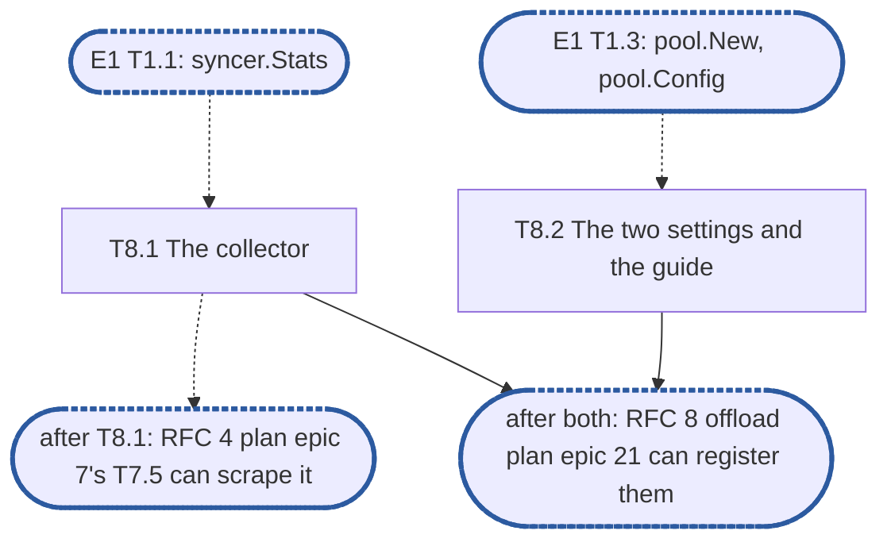

# Epic 8: syncer v2 integration, the syncer's own

**Sources:** [RFC 3](../docs/internals/rfcs/rfc-3-syncer.md) §2.10's two settings and the
documentation of the memory each implies, with §2.2's per-worker figure it states; §2.12's metrics,
exported, with the two sentences this pull request adds to it (the queue metrics, and the bounds
exported as `_limit` series); §1.3's "What lands with its first caller" table, its `SetDrift` row, for the guide's
warning. [RFC 13](../docs/internals/rfcs/rfc-13-configuration.md) Appendix B's `upload_workers`,
`fetch_workers` row, with §4.2, §5 and §6, which that row's cells mean.
[RFC 25](../docs/internals/rfcs/rfc-25-observability.md) §2.1 to §2.8, for the collector.
Cited, not owned: [RFC 4](../docs/internals/rfcs/rfc-4-remote-tier.md) §4.12, whose alert reads
`syncer_retries_total`. Every citation is `develop`'s text. The code lands on `develop`,
and the paths below are paths there.
**Track:** C.
**Epic 8 estimate: 2 subtasks, 4 man-days.**
**Depends on:** **S1**, the syncer's interface agreed. **E1's T1.1**, `syncer.Stats` with a field
for every RFC 3 §2.12 series (open as #5973 on `feat/storage-v2`), for T8.1. **E1's T1.3**,
`pool.New` and `pool.Config`, for T8.2's tests. Nothing waits on S2: no subtask runs a transfer.
**Blocks:** **RFC 8 offload plan epic 21**, which registers the collector, adds the two sections to
the node's table, and moves the two keys out of the guide's "not available yet" note. **RFC 4 plan
epic 7's T7.5**, whose test scrapes this collector beside the codec's recorder for one `store`
value, and whose alert subtracts `syncer_retries_total{reason="verify"}`. **E3 to E7**: a `Stats`
field any of them adds fails T8.1's field walk until the collector exports it.

---

## 1. Goal

Epic 8 builds what the node needs to configure the syncer and to export what it counts, both in the
node's content wiring, `internal/node/content`, where the composer may import the metrics and
settings packages that the syncer may not: each holds contract and implementation together, so
amended RFC 0 §1.2 lets only a composer import it.

**At the end of the epic:**

- `SyncerSeries` is a read-through collector that turns one `syncer.Stats` into every RFC 3 §2.12
  series under `dittofs_syncer_`, by `half`, `store`, `class`, `reason` and `outcome`, every
  counter at zero from the store's registration.
- `SyncerSections` declares `upload_workers` and `fetch_workers` as RFC 13 Appendix B writes them,
  and `SyncerWorkers` reads both counts from a settings snapshot for `pool.Config`.
- `docs/guide/configuration.md` states each setting's memory per worker at the default and the
  ceiling `Max`, and `docs/guide/faq.md` warns of the bucket-setting gap until `SetDrift` lands.

### 1.1 In scope

The collector, the two settings sections and their reader, the Appendix B check over the two
sections, and the two guide pages.

### 1.2 Out of scope

- Registering the collector and the sections in the node, the deadline and single flight around
  the `Stats` read, its `health_export_partial_total` count, and the per-flow queue gauges by share
  under RFC 25 §2.5's worst-n rule: RFC 8 offload plan epic 21, the RFC 3 plan's §6.1 sixth row.
- The alert rules, `store_put_unhealthy` and `store_get_unhealthy` included: RFC 8 offload plan
  epic 21 (RFC 25 §7).
- The two conditions' `health.Source`: E5, in the same file as the collector.
- Reducing unset counts, and refusing explicit ones, to fit the transfers pool: the §6.1 row
  "RFC 24's transfers size passed to the syncer", unowned.
- RFC 25 §2.4's cap of 64 values per entity label, `_other` and `metrics_label_capped`, and counting
  the node's series against RFC 25 §2.5's 50,000: the two §6.1 rows this pull request adds, both
  unowned (D6).
- Every counter behind `Stats`: E1 to E7. A `Stats` value is this epic's input.

### 1.3 Names used here

- **E1**, epic 1, interfaces: `syncer.Stats` (T1.1) and `pool.New`, `pool.Config` (T1.3).
- **E3**, epic 3, registration, flows and the fair scheduler.
- **E4**, epic 4, termination, retries and the uploader.
- **E5**, epic 5, store health, which writes `StoreHealth` into the collector's file.
- **E6**, epic 6, the fetcher.
- **E7**, epic 7, memory bound, `Stats` and the fault sweep.
- **E8**, this epic.
- **S1**, the syncer interface agreed, at the end of E1: the RFC 8 offload plan's S1b.
- **S2**, the test foundations in CI, at the end of E2 (epic 2, test foundations).

## 2. How the general rules apply

The rules are those of
[the RFC 3 plan's §1.5](rfc-3-syncer-plan.md#15-general-rules-for-each-epic). They are cited by
number and title, not copied.

| Rule | Subtasks | How |
| --- | --- | --- |
| rule 1, independent unit tests ([`CLAUDE.md`, "Writing tests"](../CLAUDE.md#writing-tests)) | all | No subtask runs a transfer, so none needs RFC 4's store or E2's harness. T8.1's input is a `syncer.Stats` value the test builds, which is data, not a double; T8.2 reads settings over a real in-memory control plane (`badgerkv` with no path, then `kvstore`), as `internal/node/appendixb_test.go` does |
| rule 2, fuzz tests where relevant ([`CLAUDE.md`, "Writing tests"](../CLAUDE.md#writing-tests)) | none | Nothing here decodes bytes: the collector reads a Go value, and `pkg/settings` owns the decoding of a setting's row |
| rule 3, observability follows RFC 25, with RFC 3's own exception | T8.1 | This epic is the bridge the rule names: the syncer keeps counters, and the composer exports them through one read-through collector under the `syncer_` prefix (RFC 25 §2.8) |
| rule 4, profiling | T8.1, T8.2 | The tests run under `internal/prof`'s leak check, as `content_test.go` already does. No hot path: a scrape reads one snapshot, and the settings are read once at start |
| rule 5, public interface and internals ([`CLAUDE.md`, "Verifying a change"](../CLAUDE.md#verifying-a-change)) | all | Under `-race`. Each series is read from a `prometheus.Registry`'s `Gather`, where a scrape reads it; each count from `SyncerWorkers` and from `pool.New`'s `Stats`, where the syncer takes it; each key's scope and class through the node's own Appendix B comparison |
| rule 6, known failures shrink | none | No suite this epic's tests run in keeps a `known.yaml`: every test lands green |
| rule 7, v2 ignores v1 | T8.1, T8.2 | The production files import the root `pkg/syncer` only; `pool` is imported by T8.2's test alone. `internal/node/content` is a composer, so it has no entry in E1's import test |
| rule 8, real dependencies for properties of those dependencies ([`CLAUDE.md`, "Writing tests"](../CLAUDE.md#writing-tests)) | all | The real Prometheus client registry, the real `pkg/settings` over a real control plane, RFC 13's text and the guide's as the branch holds them. No disk, store or service |
| rule 9, code comment conventions ([`CLAUDE.md`, "Code comments"](../CLAUDE.md#code-comments)) | T8.1, T8.2 | The `decision:` markers of D2, D3, D5, D6, D8, D10 and D11 at their code sites, and `SelfKey`'s own marker in `pkg/settings` rewritten (D7). RFC 3 §2.10's `decision:` on the fixed values sits at E3's table, not here |
| rule 10, a test must be able to fail ([`CLAUDE.md`, "Writing tests"](../CLAUDE.md#writing-tests)) | all | Each test names the break it is checked against: a series dropped or renamed, two fields swapped, the histogram left per bucket, a label value missing, a scope or class changed, a stored bad count read as the default, a key or figure missing from the guide |
| rule 11, a symbol is exported only if the RFC's interface uses it | T8.1, T8.2 | The rule binds the syncer's packages, and this epic adds nothing to them. In `internal/node/content` it exports only what RFC 8 offload plan epic 21 calls from `internal/node`: `SyncerSeries`, `SyncerSections` and `SyncerWorkers` |
| rule 12, each subtask creates only what it declares | all | `syncer_series.go` is created by whichever of T8.1 and E5's T5.3 lands first, and the other adds to it. No option, helper or file without a consumer named in its subtask |

## 3. Requirements and invariants

Every MUST and MUST NOT that RFC 3, RFC 13 and RFC 25 place on this epic, numbered so that subtasks
and tests can cite them.

**The collector: what it exports**

| # | Requirement | Kind | Source | Subtasks |
| --- | --- | --- | --- | --- |
| R1 | Every metric RFC 3 §2.12's four tables list is exported, with the name and type the tables give it, and no other series under the `syncer_` prefix: verification, requests and decode failures are counted by their owners, not here | MUST | RFC 3 §2.12; RFC 25 §2.7 | T8.1 |
| R2 | "Every metric is labelled with `half` (`upload` or `fetch`) and `store`", except the two pool-wide gauges, which have no store (D2); the queue metrics (`syncer_queue_depth`, `syncer_waiters`, `syncer_queue_wait_seconds`) also carry `class`, `demand`, `background` or `speculation`, and no counter is a queue metric, so `syncer_refused_total` carries `reason` alone; `reason` and `outcome` take exactly the values RFC 3 §2.12 lists for each metric | MUST | RFC 3 §2.12; RFC 25 §2.4 | T8.1 |
| R3 | The queue gauges are exported summed over every flow of the store. Queue histograms and counters are reported summed only, and no series carries a flow's id; the per-flow gauges, exported by share, are RFC 8 offload plan epic 21's | invariant | RFC 3 §2.12; RFC 25 §2.4, §2.5 | T8.1 |
| R4 | The `store` label takes the name the store was registered under, never an internal ID. Which name a store is given is RFC 8 offload plan epic 21's | invariant | RFC 25 §2.4 | T8.1 |
| R5 | Names carry the exporter's one prefix, `dittofs_`, before RFC 3's `syncer_`, and a name, once exported, does not change except with RFC 3's change and a note in the release | MUST NOT | RFC 25 §2.1 | T8.1 |
| R6 | Time is exported in seconds, sizes in bytes, the throughput in bytes per second, and the health state as a 0/1 gauge | invariant | RFC 25 §2.2, §2.3 | T8.1 |
| R7 | Each histogram is exported over RFC 25's `request` bucket set, cumulative per bucket as the exposition format reads it, with the overflow in its count | invariant | RFC 25 §2.6 | T8.1 |
| R8 | A counter an alert reads is exported from the start, at zero, for every value of its closed labels; RFC 4 §4.12's alert reads `syncer_retries_total` with `reason` = `verify` | MUST | RFC 25 §2.3; RFC 4 §4.12 | T8.1 |
| R9 | A store removed from the syncer leaves the export: none of its series is exported once it has left `Stats` | invariant | RFC 25 §2.4 | T8.1 |

**The collector: how it reads**

| # | Requirement | Kind | Source | Subtasks |
| --- | --- | --- | --- | --- |
| R10 | The export reads only the snapshot the syncer keeps anyway: it takes no lock a request path or a dispatch needs, and its cost does not grow with the transfers in flight | MUST NOT | RFC 25 §2.8; RFC 3 §2.12 | T8.1 |
| R11 | The syncer's `Stats` is exported under the syncer's prefix by the component that composes it, through one read-through collector | invariant | RFC 25 §2.8 | T8.1 |
| R12 | A snapshot that cannot be read within the export's deadline is omitted, never exported as zeros; the deadline and the count in `health_export_partial_total` are the reader's, RFC 8 offload plan epic 21's | MUST | RFC 25 §2.8 | T8.1 |
| R13 | At the reference profile, every entity label at its cap of 64 values, no syncer metric exports more than 10,000 series, histogram buckets included. The node's total of 50,000 is counted at RFC 25 §12's reference workload, the §6.1 row this pull request adds | bound | RFC 25 §2.5 | T8.1 |

**The two settings**

| # | Requirement | Kind | Source | Subtasks |
| --- | --- | --- | --- | --- |
| R14 | The syncer exposes exactly two settings, `upload_workers`, which sizes the uploader's pool, and `fetch_workers`, which sizes the fetcher's; every other value RFC 3 §2.10 lists is not a setting | MUST NOT | RFC 3 §2.10; RFC 13 §4.1 | T8.2 |
| R15 | Both keys are declared as RFC 13 Appendix B writes them: the bare key, scope node, class restart, so a change takes effect at the next start and each count is fixed for the life of the process | invariant | RFC 13 Appendix B, §5; RFC 3 §2.10 | T8.2 |
| R16 | Each has a stated default, Appendix B's proposed value (128 today), which follows neither the CPU count nor anything else of the host | invariant | RFC 3 §2.10; RFC 13 §4.2, Appendix B | T8.2 |
| R17 | A count out of range is refused with an error naming the key and the rule, never clamped or replaced by the default, at the write and again when the component is built, and "the control plane calls the component's validator, and has none of its own to drift" (D8 departs from the last clause) | MUST | RFC 13 §6 | T8.2 |
| R18 | Until the node passes the syncer its transfers pool's size, neither count is reduced nor refused to fit it: a count the rule accepts reaches the syncer as written | invariant | RFC 3 §2.10; RFC 13 Appendix B | T8.2 |

**The guide**

| # | Requirement | Kind | Source | Subtasks |
| --- | --- | --- | --- | --- |
| R19 | The documentation of each setting states the memory it implies per worker, `Max + MaxDecodeLen(Max) + header cap`, in both directions, at the default `Max`, 1 MiB, and at the ceiling `Max`, 16 MiB | MUST | RFC 3 §2.10, §2.2 | T8.2 |
| R20 | Until `SetDrift` lands, the guide says that a bucket setting changed after the store opened is seen only at its next open, and that a put into the drifted store may be expired or kept as a version nothing deletes | invariant | RFC 3 §1.3, "What lands with its first caller" | T8.2 |

## 4. Decisions this epic takes

- **D1, one read-through collector over a read function.**

  ```go
  // SyncerSeries exports the syncer's Stats as RFC 3 §2.12's series. read answers false when
  // the snapshot could not be read in time, and the collector then exports nothing.
  func SyncerSeries(read func() (syncer.Stats, bool)) prometheus.Collector
  ```

  The collector keeps no state and takes no lock: every `Collect` calls `read` once and emits
  constant metrics from the value (R10, R11). `Describe` sends every descriptor; the client library
  checks only that names and labels are well formed and consistent, so the unit word and the prefix
  of RFC 25 §2.1 and §2.2 are checked by T8.1's table, since `pkg/metrics` enforces neither yet. The
  `bool` is how RFC 8 offload plan epic 21's deadlined, single-flight fetch (`snapshot` in
  `internal/node/stats.go`, widened there to the syncer's `Stats`) reports a read past its deadline;
  the wrapper counts the omission in `health_export_partial_total`, as the journal's and the
  engine's collectors count theirs, and the collector exports nothing rather than zeros (R12).
  Changing the signature once epic 21 and RFC 4 plan epic 7's T7.5 build on it costs both a change.
  Prior art: `journalSeries` and `engineSeries` over the node's `snapshot` (`internal/node/stats.go`).
- **D2, the two pool-wide gauges are labelled `half` only.** `syncer_workers` and
  `syncer_detached_buffers` sit on `syncer.Half`, since no store owns a pool or the detached-buffer
  cap (E1's D3). RFC 3 §2.12 says every metric carries `half` and `store`, written for the store
  metrics; a pool-wide value given a store label would need a value no store has. Not chosen: an
  empty label value, as the journal's share totals use `share=""`, which Prometheus drops on ingest
  while the descriptor reads as if it had a store; an invented value such as `_pool`, which a query
  by store would take for one. A `decision:` marker at the two descriptors says so, and §9 asks
  whether RFC 3 §2.12's sentence should say it too. Prior art: the node's
  `health_export_partial_total`, labelled by component alone.
- **D3, both halves export every metric.** A fetch-only series (`syncer_detached_buffers`,
  `syncer_fetch_joined_total`, `syncer_fetch_detached_total`, `syncer_fetch_rehomed_total`,
  `syncer_speculation_preempted_total`) is exported under `half="upload"` at zero, as `Stats` holds
  it, so one code path serves both halves. It costs 321 series at 64 stores. Not chosen: the
  fetch-only series under `half="fetch"` alone, 321 series fewer for a branch per half that a test
  must pin both ways. A `decision:` marker at the half loop.
- **D4, every closed-label value of every counter is exported for each store, zero included.**
  RFC 25 §2.3 requires it of a counter an alert reads and lets the others appear on first use; the
  collector reads a value in which every field is present, so emitting all of them is the shorter
  code, and it holds for every alert RFC 8 offload plan epic 21 later writes, not only RFC 4
  §4.12's (R8). "From the start" is from the store's registration: before it, no `store` value
  exists to label. Prior art: `journalSeries` emits every counter of `journal.Counters` on every
  scrape.
- **D5, store names are unique by the composer, and the collector does not merge.** RFC 8 offload
  plan epic 21 registers one store per store configuration, under the same `store` value the codec's
  recorder carries (RFC 4 plan epic 7, its D9). Two stores registered under one name would emit the
  same series twice, which the registry's `Gather` reports as an error naming the series. Merging
  would need a rule per gauge (a sum for throughput, a minimum for health) for a case no caller
  has. A `decision:` marker at the store loop names the ceiling: withdraw it, and merge, if a
  composer ever registers a store configuration twice. §9 asks E3 whether `Register` should refuse
  a name already registered.
- **D6, RFC 25 §2.4's 64-value cap on `store` is not built here.** The cap, its `_other` series and
  the `metrics_label_capped` condition are one rule for every collector the node exports (the
  journal's `journal` label, the engine's `store`), and no component builds them on
  `feat/storage-v2`; a node with more than 64 remote stores is far past v1.1's profile. A
  `decision:` marker at the store loop names it, and this pull request adds the row "RFC 25 §2.4's
  cap on entity label values" to the RFC 3 plan's §6.1 ledger, unowned. Prior art: none found in
  the repository.
- **D7, two self-keyed sections at node scope, and a reader beside them.**

  ```go
  // SyncerSections declares upload_workers and fetch_workers (RFC 3 §2.10, RFC 13 Appendix B).
  func SyncerSections() []settings.Section
  // SyncerWorkers reads the two counts from snap, as node runs them.
  func SyncerWorkers(snap *settings.Snapshot, node entity.NodeID) (upload, fetch int, err error)
  ```

  Appendix B writes the keys bare, with no section prefix, so each is its own section declared
  with `settings.SelfKey()`: `settings.Of("upload_workers", settings.At(entity.ScopeNode),
  workers{Count: 128}, settings.SelfKey())`, one unexported `workers` struct with one `restart`
  field serving both. `SelfKey`'s `decision:` marker (`pkg/settings/section.go`) says
  `upload_workers` does not fit it because it shares a row with `fetch_workers`; two sections over
  one row do fit, since the node's Appendix B comparison reads both keys from that row, so T8.2
  rewrites the marker to name its second user. `SyncerWorkers` is `settings.Get` over the two, so
  epic 21 copies two integers into `pool.Config` and needs no `pkg/settings` call of its own. Not
  chosen: one `syncer` section, which would make the keys `syncer.upload_workers` and need RFC 13
  Appendix B amended. Prior art: `identity.Section` and `identity.SettingsOf`
  (`internal/identity/settings.go`).
- **D8, the rule is copied in the section's `Validate`, against RFC 13 §6, and held to the
  constructor by a test.** RFC 13 §6 has the control plane call the component's own validator. E1's
  frozen surface exports none from `pool`, only `New`, which refuses a count below one (E1's D5).
  The section's `Validate` states the same rule, and a table test runs each value through both, so
  a change to one fails until the other follows (R17). Not chosen: a `pool.Validate` export, which
  would amend E1's frozen surface for a one-line rule. A `decision:` marker at `Validate` names the
  departure and its ceiling: withdraw it, and export the validator, when a second rule on the counts
  lands (the transfers-pool fit, RFC 3 §2.10).
- **D9, the guide's figures come from the code where it holds them.** RFC 3 §2.2 gives the
  per-worker figure as about 2 MiB at the default `Max` and about 32 MiB at the ceiling. T8.2
  computes both, and the pool's total at 128 workers, from the constants the code holds when it
  lands: RFC 5's `MaxDecodeLen` over the transforms the release registers and RFC 2's header cap. A
  constant not yet in code is replaced by RFC 3 §2.2's figure, marked "about".
- **D10, each bound is a `_limit` series: decided by the user, 2026-11-26, reversing the
  earlier decision of the same day to export none.** RFC 25 §2.2 exports a value that bounds a
  measured metric under its name with `_limit`. RFC 3 §2.12 reads four gauges against such a
  bound and now exports each: `syncer_waiters_limit`, `syncer_detached_buffers_limit`,
  `syncer_throttle_window_limit` and `syncer_inflight_bytes_limit`, each labelled `half` alone.
  The last depends on `Max`, so no dashboard could derive it from `syncer_workers`. The throttle
  limit's gauge is renamed `syncer_throttle_window`, so its bound is not `…_limit_limit`. The
  syncer computes the four, and `syncer.Half` gains a field for each (E7's T7.1 fills them), so
  the collector repeats none of RFC 3 §2.10's rules. This pull request adds the sentence and the
  rows to RFC 3 §2.12. Not chosen: no `_limit` series and a dashboard deriving three of them,
  the earlier decision, which left the bytes-in-flight bound unexported and broke RFC 25 §2.2.
- **D11, `syncer_refused_total` carries no `class`: the user's decision, 2026-11-26.** Its reasons
  are mostly queue refusals, but RFC 3 §2.12's queue metrics are the two queue gauges and the wait
  histogram, which this pull request's sentence in §2.12 names, and E1's `Refused` counts by
  reason alone. So the series is `syncer_refused_total{half, store, reason}`, 768 series at 64
  stores. Not chosen: `class` on every reason, 2,304 series, with `StoreStats` gaining a
  `ByClass[Refused]`. A `decision:` marker at the descriptor names it.

## 5. Target tree

```text
internal/node/content/
  syncer_series.go          T8.1  SyncerSeries, the descriptors, the histogram conversion
                                  (E5's StoreHealth beside them, T5.3)
  syncer_series_test.go     T8.1  the series table, the field walk, histograms, the budget
  syncer_section.go         T8.2  SyncerSections, SyncerWorkers, the workers type
  syncer_section_test.go    T8.2  defaults, one rule with pool.New, the guide's text
internal/node/
  appendixb_test.go         T8.2  one test over the two sections, and a stored bad count
pkg/settings/
  section.go                T8.2  SelfKey's decision: marker names its second user
docs/guide/
  configuration.md          T8.2  the two settings and the memory they imply
  faq.md                    T8.2  the bucket-setting line
```

## 6. Subtasks

### T8.1 The collector

**Subtask T8.1 estimate: 2.25 man-days.**

- **Track:** C. **Depends on:** none (E1's T1.1).
- **Covers:** R1 to R13.
- **Deliverables:** `syncer_series.go` (D1 to D6, D10, D11): `SyncerSeries` as D1 gives it, one
  unexported collector type, its descriptors under `dittofs_syncer_` with the help text of RFC 3
  §2.12's "Answers" column, and one function turning a `syncer.Histogram` into a constant histogram
  over `Histogram.Bounds()`, which E1 gives so the bounds are read and never copied. Consumed by RFC
  8 offload plan epic 21, which registers it in `internal/node` over the node's deadlined snapshot,
  and by RFC 4 plan epic 7's T7.5, whose test scrapes it beside the codec's recorder.
- **Acceptance criteria:**
  - A scrape over a `Stats` holding two stores in each half yields exactly RFC 3 §2.12's 29 names,
    each with its type, and each store's series labelled by its `Name`.
  - Every leaf field of `syncer.StoreStats` but `Store` and `Name`, and every leaf of `syncer.Half`
    but `Stores` and `Flows`, set alone, moves the one metric and label set its comment names; a
    `Histogram` is one leaf.
  - A freshly registered store, every counter zero, has `syncer_retries_total{reason="verify"}` at
    0 in both halves, and every other closed-label value of every counter at 0.
  - A `read` answering false yields no series at all.
  - At 64 stores, every metric has at most 10,000 series; the largest, `syncer_queue_wait_seconds`,
    has 8,064.
- **Tests:** in `unit`, at a `prometheus.Registry`'s `Gather` with the collector registered, which
  is what a scrape reads (rule 5). The input is a `syncer.Stats` value the test builds, no double.
  - A table typed from RFC 3 §2.12, name, type and label names per row, compared with the gathered
    families both ways over a zero `Stats` with one store per half: every name present, every
    closed-label value present and at 0 (catches a series missing, renamed, of the wrong type, with
    a label dropped or extra, any series RFC 3 does not list, and a counter that appears only at 1,
    which no rate sees, R1, R2, R8). Each name is checked for the `dittofs_syncer_` prefix and the
    unit word its type implies (R5, R6).
  - A walk of `syncer.Stats` by reflection: each leaf set alone to a distinct value must move its
    metric to that value, in seconds for a `time.Duration` and 1 for `true` (catches two fields
    swapped, a field read into the wrong half or store, a unit left in nanoseconds, R4, R6), and a
    field E3 to E7 add fails it until the collector exports it. The leaves it skips are named with
    the reason: the store's ID (R4) and the per-flow gauges (R3).
  - A histogram with counts in its first, a middle and its overflow bucket: each `le` bucket is the
    running total, `+Inf` and the count include the overflow, the sum is in seconds (catches counts
    left per bucket, the overflow dropped, R7).
  - A `read` answering false (catches zeros exported over a wedge, R12).
  - A `Stats` with 64 stores per half, the series of each family counted, buckets, `_sum` and
    `_count` included (catches a label added past the budget, such as a `flow` label, R3, R13).
  - R9, R10 and R11 are held by construction: the collector keeps no state, and its only input is
    `read`'s value.

### T8.2 The two settings and the guide

**Subtask T8.2 estimate: 1.75 man-days.**

- **Track:** C. **Depends on:** none (E1's T1.3).
- **Covers:** R14 to R20.
- **Deliverables:**
  - `syncer_section.go` (D7, D8): `SyncerSections` and `SyncerWorkers` as D7 gives them; an
    unexported `workers` struct, one field `Count int` with `json:"count" class:"restart"`, its
    `Validate` refusing a count below one with D8's `decision:`; two sections over it,
    `upload_workers` and `fetch_workers`, `settings.At(entity.ScopeNode)`, `SelfKey()`, default 128.
    Consumed by RFC 8 offload plan epic 21, which adds the sections to `newTable`
    (`internal/node/settings.go`) and passes `SyncerWorkers`' two counts to `pool.New`.
  - `SelfKey`'s `decision:` marker in `pkg/settings/section.go` rewritten to name this second user
    (D7).
  - One test in `internal/node/appendixb_test.go` over a table of the two sections, which epic 21
    deletes when it adds them to `newTable`, since `TestAppendixBMatchesTheTable` then covers them.
  - In `docs/guide/configuration.md`, a short section on the two pools: each setting, its default,
    that it takes effect at the next start, and the memory per worker, `Max + MaxDecodeLen(Max) +
    header cap` in both directions, at the default `Max` (1 MiB) and the ceiling (16 MiB), with the
    pool's total at 128 workers and the fetcher's detached buffers, which can double it (D9); the two
    keys added to the "Not available yet on this version" note until epic 21 registers the
    sections. In `docs/guide/faq.md`, the line of R20: do not change versioning, object lock or
    lifecycle rules on a live bucket, since this version sees the change only at the store's next
    open.
- **Acceptance criteria:**
  - The node's `compareAppendixB` over a table of the two sections reports no failure, and finds
    both keys declared: bare, scope node, class restart, written by an operator.
  - Over a control plane holding no row, `SyncerWorkers` answers Appendix B's default for each;
    after `upload_workers` is written as 64, it answers 64 and the default.
  - A row of `upload_workers` = 0 stored beneath the check makes `SyncerWorkers` fail naming the
    key, never answer the default.
  - Each count of -1, 0, 1, 128 and 10,000 is accepted by both the section's check and `pool.New`,
    or refused by both; the section's refusal names `upload_workers` and the rule.
  - The guide names both keys, the formula and a per-worker figure at each `Max`; the FAQ names the
    three bucket settings.
- **Tests:** in `unit`, over a real in-memory control plane, `badgerkv` and `kvstore`, as the node's
  own Appendix B test opens one; `pool.New` with `pkg/sim`'s `TestClock`, kind 1. No double.
  - The Appendix B comparison, in `internal/node`, where the node's check lives and over RFC 13's
    text as the branch holds it (catches a key prefixed, a scope of installation, a class of live,
    an admin-only role, a third key declared, R14, R15). Its drift cases are already the node's
    `TestAppendixBDriftFails`.
  - The stored bad count, written with the node's `putBeneathCheck` and read through
    `SyncerWorkers` (catches a bad record replaced by the default when the component reads it,
    R17).
  - The defaults and the written count, read through `SyncerWorkers` (catches a default derived from
    the host, the two keys crossed, R16, R18).
  - The table of counts through the section's `Check` and through `pool.New`, the syncer's consumer
    of the value (catches the two rules drifting, a clamp to one, an upper bound or a fit added
    before the transfers pool is passed, R17, R18).
  - The guide's text read as the branch holds it: every key `SyncerSections` declares, the formula,
    each per-worker figure, and the FAQ's three settings present (catches a key renamed in code and
    not in the guide, a figure or the warning dropped, R19, R20).

## 7. Order of work



The two subtasks share nothing and can run in parallel. T8.1 is listed first because RFC 4 plan
epic 7 waits on it and it needs only E1's T1.1. Checkpoint after T8.1: the collector can be scraped.
Checkpoint after both: everything epic 21 registers exists.

## 8. Suggested pull requests

| PR | Subtasks | Man-days | After | Why together |
| --- | --- | --- | --- | --- |
| 1 | T8.1 | 2.25 | — | the collector, which RFC 4 plan epic 7 waits on |
| 2 | T8.2 | 1.75 | — | the settings and the guide that documents them, which name the same two keys; open beside PR 1 |

A suggestion only: one pull request for both works as well, once E1's T1.3 has landed.

## 9. Open points

- **`outcome` takes RFC 3's values, `ok`, `failed`, `unknown`**, while RFC 25 §2.4 calls `outcome`
  "the class of an answer (`ok`, `error`, `delay`)". The collector follows RFC 3, the owner of the
  metric (R2); RFC 25's list reads as examples, but it is the vocabulary rule, so one of the two
  RFCs may want a sentence.
- **RFC 3 §2.12 reads as if the pool-wide gauges had a `store`.** D2 labels them `half` only. A
  one-sentence amendment ("every store metric is labelled `store`") would make the RFC say what the
  collector does; it is not proposed here, since the epic does not need it.
- **For E3: should `Register` refuse a name already registered?** The name is the `store` label
  (E1's D2), and two stores under one name break D5's assumption. Refusing it is one check with a
  `remote.ErrInvalid` error, as E1's D1 refuses misuse; it is E3's to take or decline.
- **The syncer's share of the node's series budget.** At 64 stores the collector exports 20,876
  series, 42% of RFC 25 §2.5's 50,000 for the whole node. Counting
  the node's total is the second §6.1 row this pull request adds.
- **The least certain estimate is T8.2.** `settings.SelfKey` has one production user on
  `feat/storage-v2`, and the node's `tableKeys` probe has never read a node-scoped section; either
  may need a fix in `pkg/settings` or in the probe.
- **The RFC 3 plan's figure for this epic is 2 subtasks, 5 man-days**; this document finds 4 man-days.
