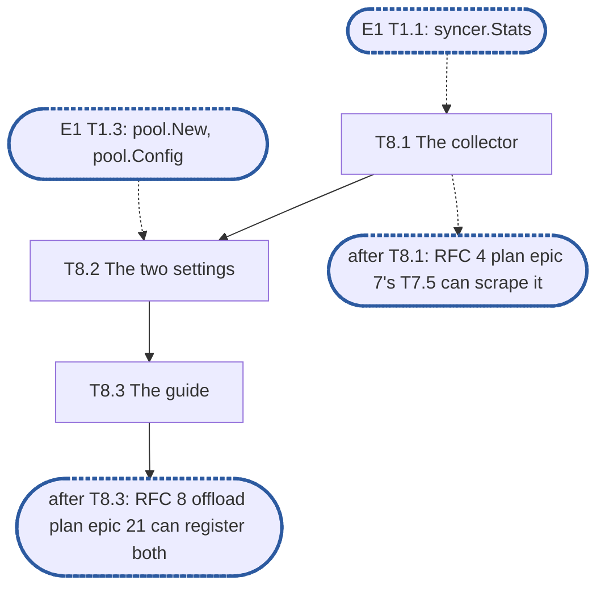

# Epic 8: syncer v2 integration, the syncer's own

**Sources:** [RFC 3](../docs/internals/rfcs/rfc-3-syncer.md) §2.10's two settings and the
documentation of the memory each implies, with §2.2's per-worker figure it states; §2.12's metrics,
exported; §1.3's "What lands with its first caller" table, its `SetDrift` row, for the guide's
warning. [RFC 13](../docs/internals/rfcs/rfc-13-configuration.md) Appendix B's `upload_workers`,
`fetch_workers` row, with §4.2, §5 and §6, which that row's cells mean.
[RFC 25](../docs/internals/rfcs/rfc-25-observability.md) §2.1 to §2.6 and §2.8, for the collector.
Cited, not owned: [RFC 4](../docs/internals/rfcs/rfc-4-remote-tier.md) §4.12, whose alert reads
`syncer_retries_total`. Every citation is `develop`'s text. The code lands on `feat/storage-v2`,
and the paths below are paths there.
**Track:** C.
**Epic 8 estimate: 3 subtasks, 4.5 man-days.**
**Depends on:** **E1's T1.1**, `syncer.Stats` with a field for every RFC 3 §2.12 series (open as
#5973 on `feat/storage-v2`), for T8.1. **E1's T1.3**, `pool.New` and `pool.Config`, for T8.2's
test. Nothing waits on S2: no subtask runs a transfer.
**Blocks:** **RFC 8 offload plan epic 21**, which registers the collector and adds the two sections
to the node's table, and then moves the two keys out of the guide's "not available yet" note
(T8.3). **RFC 4 plan epic 7's T7.5**, whose test scrapes this collector beside the codec's recorder
for one `store` value, and whose alert subtracts `syncer_retries_total{reason="verify"}`. **E3 to
E7**: a `Stats` field any of them adds fails T8.1's field walk until the collector exports it.

---

## 1. Goal

Epic 8 builds what the node needs to configure the syncer and to export what it counts, both in the
node's content wiring, `internal/node/content`, where the composer may import the metrics and
settings packages that the syncer may not: each holds contract and implementation together, so
amended RFC 0 §1.2 lets only a composer import it.

**At the end of the epic:**

- `SyncerSeries` is a read-through collector that turns one `syncer.Stats` into every RFC 3 §2.12
  series under `dittofs_syncer_`, by `half`, `store`, `class`, `reason` and `outcome`, every
  counter at zero from the store's registration.
- `SyncerSections` declares `upload_workers` and `fetch_workers` as RFC 13 Appendix B writes them,
  and `SyncerWorkers` reads both counts from a settings snapshot for `pool.Config`.
- `docs/guide/configuration.md` states each setting's memory per worker at the default and the
  ceiling `Max`, and `docs/guide/faq.md` warns of the bucket-setting gap until `SetDrift` lands.

### 1.1 In scope

The collector, the two settings sections and their reader, the Appendix B check over the two
sections, and the two guide pages.

### 1.2 Out of scope

- Registering the collector and the sections in the node, the deadline and single flight around
  the `Stats` read, its `health_export_partial_total` count, and the per-flow queue gauges by share
  under RFC 25 §2.5's worst-n rule: RFC 8 offload plan epic 21, the RFC 3 plan's §6.1 sixth row.
- The alert rules, `store_put_unhealthy` and `store_get_unhealthy` included: RFC 8 offload plan
  epic 21 (RFC 25 §7).
- The two conditions' `health.Source`: E5, in the same file as the collector.
- Reducing unset counts, and refusing explicit ones, to fit the transfers pool: the §6.1 row
  "RFC 24's transfers size passed to the syncer", unowned.
- RFC 25 §2.4's cap of 64 values per entity label, `_other` and `metrics_label_capped`: the §6.1
  row this pull request adds, unowned (D6).
- Every counter behind `Stats`: E1 to E7. A `Stats` value is this epic's input.

### 1.3 Names used here

- **E1**, epic 1, interfaces: `syncer.Stats` (T1.1) and `pool.New`, `pool.Config` (T1.3).
- **E3**, epic 3, registration, flows and the fair scheduler.
- **E4**, epic 4, termination, retries and the uploader.
- **E5**, epic 5, store health, which writes `StoreHealth` into the collector's file.
- **E6**, epic 6, the fetcher.
- **E7**, epic 7, memory bound, `Stats` and the fault sweep.
- **E8**, this epic.
- **S2**, the test foundations in CI, at the end of E2 (epic 2, test foundations).
- **The integration epic**, E8 here; outside this plan, RFC 8 offload plan epic 21, which composes
  the syncer in the node.

## 2. How the general rules apply

The rules are those of
[the RFC 3 plan's §1.5](rfc-3-syncer-plan.md#15-general-rules-for-each-epic). They are cited by
number and title, not copied.

| Rule | Subtasks | How |
| --- | --- | --- |
| rule 1, independent unit tests ([`CLAUDE.md`, "Writing tests"](../CLAUDE.md#writing-tests)) | all | No subtask runs a transfer, so none needs RFC 4's store or E2's harness. T8.1's input is a `syncer.Stats` value the test builds, which is data, not a double; T8.2 reads settings over a real in-memory control plane (`badgerkv` with no path, then `kvstore`), as `internal/node/appendixb_test.go` does |
| rule 2, fuzz tests where relevant ([`CLAUDE.md`, "Writing tests"](../CLAUDE.md#writing-tests)) | none | Nothing here decodes bytes: the collector reads a Go value, and `pkg/settings` owns the decoding of a setting's row |
| rule 3, observability follows RFC 25, with RFC 3's own exception | T8.1 | This epic is the bridge the rule names: the syncer keeps counters, and the composer exports them through one read-through collector under the `syncer_` prefix (RFC 25 §2.8) |
| rule 4, profiling | T8.1, T8.2 | The tests run under `internal/prof`'s leak check, as `content_test.go` already does. No hot path: a scrape reads one snapshot, and the settings are read once at start |
| rule 5, public interface and internals ([`CLAUDE.md`, "Verifying a change"](../CLAUDE.md#verifying-a-change)) | all | Under `-race`. Each series is read from a `prometheus.Registry`'s `Gather`, where a scrape reads it; each count is read back from `pool.New`'s `Stats`, where the syncer takes it; each key's scope and class through the node's own Appendix B comparison |
| rule 6, known failures shrink | none | No suite this epic's tests run in keeps a `known.yaml`: every test lands green |
| rule 7, v2 ignores v1 | T8.1, T8.2 | The production files import the root `pkg/syncer` only; `pool` is imported by T8.2's test alone. `internal/node/content` is a composer, so it has no entry in E1's import test |
| rule 8, real dependencies for properties of those dependencies ([`CLAUDE.md`, "Writing tests"](../CLAUDE.md#writing-tests)) | T8.1, T8.2, T8.3 | The real Prometheus client registry, the real `pkg/settings` over a real control plane, RFC 13's text as the branch holds it, and the guide's own text. No disk, store or service |
| rule 9, code comment conventions ([`CLAUDE.md`, "Code comments"](../CLAUDE.md#code-comments)) | T8.1, T8.2 | The `decision:` markers of D2, D3, D5, D6 and D8 at their code sites. RFC 3 §2.10's `decision:` on the fixed values sits at E3's table, not here |
| rule 10, a test must be able to fail ([`CLAUDE.md`, "Writing tests"](../CLAUDE.md#writing-tests)) | all | Each test names the break it is checked against: a series dropped or renamed, two fields swapped, the histogram left per-bucket, a label value missing, a scope or class changed, the default changed, a key renamed in the guide |
| rule 11, a symbol is exported only if the RFC's interface uses it | T8.1, T8.2 | The rule binds the syncer's packages, and this epic adds nothing to them. In `internal/node/content` it exports only what RFC 8 offload plan epic 21 calls from `internal/node`: `SyncerSeries`, `SyncerSections` and `SyncerWorkers` |
| rule 12, each subtask creates only what it declares | all | `syncer_series.go` is created by whichever of T8.1 and E5's T5.3 lands first, and the other adds to it. No option, helper or file without a consumer named in its subtask |

## 3. Requirements and invariants

Every MUST and MUST NOT that RFC 3, RFC 13 and RFC 25 place on this epic, numbered so that subtasks
and tests can cite them.

**The collector: what it exports**

| # | Requirement | Kind | Source | Subtasks |
| --- | --- | --- | --- | --- |
| R1 | Every metric RFC 3 §2.12's four tables list is exported, with the name and type the tables give it, and no other series under the `syncer_` prefix: verification, requests and decode failures are counted by their owners, not here | MUST | RFC 3 §2.12; RFC 25 §2.7 | T8.1 |
| R2 | Every metric is labelled `half`, `upload` or `fetch`; a store's metric is also labelled `store`; the queue metrics (`syncer_queue_depth`, `syncer_waiters`, `syncer_queue_wait_seconds`) are also labelled `class`, `demand`, `background` or `speculation`; `reason` and `outcome` take exactly the values RFC 3 §2.12 lists for each metric | MUST | RFC 3 §2.12; RFC 25 §2.4 | T8.1 |
| R3 | The queue gauges are exported summed over every flow of the store. Queue histograms and counters are reported summed only, and no series carries a flow's id; the per-flow gauges, exported by share, are RFC 8 offload plan epic 21's | invariant | RFC 3 §2.12; RFC 25 §2.4, §2.5 | T8.1 |
| R4 | The `store` label takes the name the store was registered under, never an internal ID. Which name a store is given is RFC 8 offload plan epic 21's | invariant | RFC 25 §2.4 | T8.1 |
| R5 | Names carry the exporter's one prefix, `dittofs_`, before RFC 3's `syncer_`, and a name, once exported, does not change | MUST NOT | RFC 25 §2.1 | T8.1 |
| R6 | Time is exported in seconds, sizes in bytes, the throughput in bytes per second, and the health state as a 0/1 gauge | invariant | RFC 25 §2.2, §2.3 | T8.1 |
| R7 | Each histogram is exported over RFC 25's `request` bucket set, cumulative per bucket as the exposition format reads it, with the overflow in its count | invariant | RFC 25 §2.6 | T8.1 |
| R8 | A counter an alert reads is exported from the start, at zero, for every value of its closed labels; RFC 4 §4.12's alert reads `syncer_retries_total` with `reason` = `verify` | MUST | RFC 25 §2.3; RFC 4 §4.12 | T8.1 |
| R9 | A store removed from the syncer leaves the export: none of its series is exported once it has left `Stats` | invariant | RFC 25 §2.4 | T8.1 |

**The collector: how it reads**

| # | Requirement | Kind | Source | Subtasks |
| --- | --- | --- | --- | --- |
| R10 | The export reads only the snapshot the syncer keeps anyway: it takes no lock a request path or a dispatch needs, and its cost does not grow with the transfers in flight | MUST NOT | RFC 25 §2.8; RFC 3 §2.12 | T8.1 |
| R11 | The syncer's `Stats` is exported under the syncer's prefix by the component that composes it, through one read-through collector | invariant | RFC 25 §2.8 | T8.1 |
| R12 | A snapshot that cannot be read within the export's deadline is omitted, never exported as zeros; the deadline and the count in `health_export_partial_total` are the reader's, RFC 8 offload plan epic 21's | MUST | RFC 25 §2.8 | T8.1 |
| R13 | At the reference profile, every entity label at its cap of 64 values, no syncer metric exports more than 10,000 series, histogram buckets included | bound | RFC 25 §2.5 | T8.1 |

**The two settings**

| # | Requirement | Kind | Source | Subtasks |
| --- | --- | --- | --- | --- |
| R14 | The syncer exposes exactly two settings, `upload_workers`, which sizes the uploader's pool, and `fetch_workers`, which sizes the fetcher's; every other value RFC 3 §2.10 lists is not a setting | MUST NOT | RFC 3 §2.10; RFC 13 §4.1 | T8.2 |
| R15 | Both keys are declared as RFC 13 Appendix B writes them: the bare key, scope node, class restart, so a change takes effect at the next start and each count is fixed for the life of the process | invariant | RFC 13 Appendix B, §5; RFC 3 §2.10 | T8.2 |
| R16 | Each defaults to 128, a stated value that follows neither the CPU count nor anything else of the host | invariant | RFC 3 §2.10; RFC 13 §4.2, Appendix B | T8.2 |
| R17 | A count below one is refused with an error naming the key and the rule, never clamped or replaced by the default, and the write check and the syncer's own constructor refuse by the same rule | MUST | RFC 13 §6 | T8.2 |
| R18 | Until the node passes the syncer its transfers pool's size, neither count is reduced nor refused to fit it: a count the rule accepts reaches the syncer as written | invariant | RFC 3 §2.10; RFC 13 Appendix B | T8.2 |

**The guide**

| # | Requirement | Kind | Source | Subtasks |
| --- | --- | --- | --- | --- |
| R19 | The documentation of each setting states the memory it implies per worker, `Max + MaxDecodeLen(Max) + header cap`, in both directions, at the default `Max`, 1 MiB, and at the ceiling `Max`, 16 MiB | MUST | RFC 3 §2.10, §2.2 | T8.3 |
| R20 | Until `SetDrift` lands, the guide says that a bucket setting changed after the store opened is seen only at its next open, and that a put into the drifted store may be expired or kept as a version nothing deletes | invariant | RFC 3 §1.3, "What lands with its first caller" | T8.3 |

## 4. Decisions this epic takes

- **D1, one read-through collector over a read function.**

  ```go
  // SyncerSeries exports the syncer's Stats as RFC 3 §2.12's series. read answers false when
  // the snapshot could not be read in time, and the collector then exports nothing.
  func SyncerSeries(read func() (syncer.Stats, bool)) prometheus.Collector
  ```

  The collector keeps no state and takes no lock: every `Collect` calls `read` once and emits
  constant metrics from the value (R10, R11). `Describe` sends every descriptor, so the registry
  checks names and labels at registration. The `bool` is how RFC 8 offload plan epic 21's
  deadlined, single-flight fetch (`snapshot` in `internal/node/stats.go`, widened there to the
  syncer's `Stats`) reports a read past its deadline; the wrapper counts the omission in
  `health_export_partial_total`, as the journal's and the engine's collectors count theirs, and the
  collector exports nothing rather than zeros (R12). Changing the signature after epic 21 and RFC 4
  plan epic 7's T7.5 build on it costs both a change. Prior art: `journalSeries` and
  `engineSeries` over the node's `snapshot` (`internal/node/stats.go`).
- **D2, the two pool-wide gauges are labelled `half` only.** `syncer_workers` and
  `syncer_detached_buffers` sit on `syncer.Half`, since no store owns a pool or the detached-buffer
  cap (E1's D3). RFC 3 §2.12 says every metric is labelled `half` and `store`, written for the store
  metrics; a pool-wide value given a store label would need a value no store has. Not chosen: an
  empty `store`, as the journal's share totals use, which Prometheus drops on ingest so the series
  is the same while the descriptor reads as if it had a store; an invented value such as `_pool`,
  which a query by store would take for one. A `decision:` marker at the two descriptors says so,
  and §9 asks whether RFC 3 §2.12's sentence should say it too. Prior art: the node's
  `health_export_partial_total`, labelled by component alone.
- **D3, both halves export every metric.** A fetch-only series (`syncer_detached_buffers`,
  `syncer_fetch_joined_total`, `syncer_fetch_detached_total`, `syncer_fetch_rehomed_total`,
  `syncer_speculation_preempted_total`) is exported under `half="upload"` at zero, as `Stats` holds
  it, so one code path serves both halves and every metric carries `half` as RFC 3 §2.12 says. It
  costs 321 series at 64 stores (R13's count). Not chosen: a branch per half, which a test must then
  pin both ways. A `decision:` marker at the half loop.
- **D4, every closed-label value of every counter is exported for each store, zero included.**
  RFC 25 §2.3 requires it of a counter an alert reads, and lets the others appear on first use; the
  collector reads a value in which every field is present, so emitting all of them is the shorter
  code, and it holds for every alert RFC 8 offload plan epic 21 later writes, not only RFC 4 §4.12's
  (R8). "From the start" is from the store's registration: before it, no `store` value exists to
  label. Prior art: `journalSeries` emits every counter of `journal.Counters` on every scrape.
- **D5, store names are unique by the composer, and the collector does not merge.** RFC 8 offload
  plan epic 21 registers one store per store configuration, under the same `store` value the codec's
  recorder carries (RFC 4 plan epic 7, its D9). Two stores registered under one name would emit the
  same series twice, which the registry's `Gather` reports as an error naming the series while it
  serves the rest. Merging them would need a rule per gauge (a sum for throughput, a minimum for
  health), for a case no caller has. A `decision:` marker at the store loop names the ceiling:
  withdraw it, and merge, if a composer ever registers a store configuration twice.
- **D6, RFC 25 §2.4's 64-value cap on `store` is not built here.** The cap, its `_other` series and
  the `metrics_label_capped` condition are one rule for every collector the node exports (the
  journal's `journal` label, the engine's `store`), and no component builds them on `feat/storage-v2`;
  a node with more than 64 remote stores is far past v1.1's profile. A `decision:` marker at the
  store loop names it, and this pull request adds the row "RFC 25 §2.4's cap on entity label values"
  to the RFC 3 plan's §6.1 ledger, unowned, triggered by a plan taking RFC 25's registry or a node
  registering more than 64 stores. Prior art: none found in the repository.
- **D7, two self-keyed sections at node scope, and a reader beside them.**

  ```go
  // SyncerSections declares upload_workers and fetch_workers (RFC 3 §2.10, RFC 13 Appendix B).
  func SyncerSections() []settings.Section
  // SyncerWorkers reads the two counts from snap, as node runs them.
  func SyncerWorkers(snap *settings.Snapshot, node entity.NodeID) (upload, fetch int, err error)
  ```

  Appendix B writes the keys bare, with no section prefix, so each is its own section declared
  with `settings.SelfKey()`, which `pkg/settings` has for exactly this (its doc names
  `connection_limit`): `settings.Of("upload_workers", settings.At(entity.ScopeNode), workers{Count:
  128}, settings.SelfKey())`, one unexported `workers` struct with one `restart` field serving both.
  `SyncerWorkers` is `settings.Get` over the two, so RFC 8 offload plan epic 21 copies the two
  integers into `pool.Config` and needs no `pkg/settings` call of its own. Not chosen: one
  `syncer` section, which would make the keys `syncer.upload_workers` and need RFC 13 Appendix B
  amended. Renaming a key after the node's table holds it is a settings migration. Prior art:
  `identity.Section` and `identity.SettingsOf` (`internal/identity/settings.go`).
- **D8, one rule, checked by the section and by the constructor, held together by a test.** RFC 13
  §6 has the control plane call the component's own validator. E1's frozen surface exports no
  validator from `pool`, only `New`, which refuses a count below one (E1's D5). The section's
  `Validate` states the same rule, and a table test runs each value through both, so a change to
  one fails until the other follows (R17). Not chosen: a `pool.Validate` export, which would amend
  E1's frozen surface for a one-line rule. A `decision:` marker at `Validate` names the copy and the
  test that holds it.
- **D9, the guide's figures come from the code.** RFC 3 §2.2 gives the per-worker figure as about
  2 MiB at the default `Max` and about 32 MiB at the ceiling. T8.3 computes both, and the pool's
  total at 128 workers, from the constants the code holds when it lands: RFC 5's `MaxDecodeLen` over
  the transforms the release registers and RFC 2's header cap at the chunk-count cap. A constant not
  yet in code is replaced by RFC 3 §2.2's figure, marked "about". The FAQ line of R20 lands with it,
  since both are the guide's.

## 5. Target tree

```text
internal/node/content/
  syncer_series.go          T8.1  SyncerSeries, the descriptors, the histogram conversion
                                  (E5's StoreHealth beside them, T5.3)
  syncer_series_test.go     T8.1  the series table, the field walk, histograms, zeros, budget
  syncer_section.go         T8.2  SyncerSections, SyncerWorkers, the workers type
  syncer_section_test.go    T8.2  defaults, a written count reaching pool's Stats, one rule
  syncer_guide_test.go      T8.3  the guide names each declared key and the per-worker figure
internal/node/
  appendixb_syncer_test.go  T8.2  the node's Appendix B comparison over the two sections
docs/guide/
  configuration.md          T8.3  the two settings and the memory they imply
  faq.md                    T8.3  the bucket-setting line
```

## 6. Subtasks

### T8.1 The collector

**Subtask T8.1 estimate: 2.5 man-days.**

- **Track:** C. **Depends on:** E1's T1.1.
- **Covers:** R1 to R13.
- **Deliverables:** `syncer_series.go` (D1 to D6):

  ```go
  func SyncerSeries(read func() (syncer.Stats, bool)) prometheus.Collector
  ```

  One unexported collector type, its descriptors under `dittofs_syncer_` with the help text of RFC
  3 §2.12's "Answers" column, and one function turning a `syncer.Histogram` into a constant
  histogram over `Histogram.Bounds()`, which E1 gives so the bounds are read and never copied.
  Consumed by RFC 8 offload plan epic 21, which registers it in `internal/node` over the node's
  deadlined snapshot, and by RFC 4 plan epic 7's T7.5, whose test scrapes it beside the codec's
  recorder.
- **Acceptance criteria:**
  - A scrape over a `Stats` holding two stores in each half yields exactly RFC 3 §2.12's 25 names,
    each with its type, and each store's series labelled by its `Name`.
  - Every leaf field of `syncer.StoreStats` but `Store` and `Name`, and every leaf of `syncer.Half`
    but `Stores` and `Flows`, moves exactly one series when set alone, the series its comment names.
  - A freshly registered store, every counter zero, has `syncer_retries_total{reason="verify"}` at
    0 in both halves, and every other closed-label value of every counter at 0.
  - A `read` answering false yields no series at all.
  - At 64 stores, every metric has at most 10,000 series; the largest, `syncer_queue_wait_seconds`,
    has 8,064.
- **Tests:** in `unit`, at a `prometheus.Registry`'s `Gather` with the collector registered, which
  is what a scrape reads (rule 5). The input is a `syncer.Stats` value the test builds, no double.
  - A table typed from RFC 3 §2.12, name, type and label names per row, compared with the gathered
    families both ways (catches a series missing, renamed, of the wrong type or with a label
    dropped or extra, and any series RFC 3 does not list, R1, R2, R5, R6). Each label value
    gathered is checked against the closed set its row names (R2).
  - A walk of `syncer.Stats` by reflection: each leaf set alone to a distinct value must move one
    series to that value, in seconds for a `time.Duration` and 1 for `true` (catches two fields
    swapped, a field read into the wrong half or store, a unit left in nanoseconds, R4, R6), and a
    field E3 to E7 add fails it until the collector exports it. The leaves it skips are named with
    the reason: the store's ID (R4) and the per-flow gauges (R3).
  - A histogram with counts in its first, a middle and its overflow bucket: each `le` bucket is the
    running total, `+Inf` and the count include the overflow, the sum is in seconds (catches counts
    left per bucket, the overflow dropped, R7).
  - The zero store above (catches a counter that appears only at 1, which no rate sees, R8); the
    same `Stats` with one store removed exports none of its series (R9).
  - A `read` answering false (catches zeros exported over a wedge, R12).
  - A `Stats` with 64 stores per half, the series of each family counted, buckets, `_sum` and
    `_count` included (catches a label added past the budget, such as a `flow` label, R3, R13).
  - One scrape over the `Stats` of a real `pool.New`: `syncer_workers` reads each half's count,
    the value E1's `Stats` reports (catches the collector reading a field the syncer does not fill).
  - R10 and R11 are held by construction: the collector's only input is `read`'s value, and every
    test above runs it with no syncer behind it.

### T8.2 The two settings

**Subtask T8.2 estimate: 1.25 man-days.**

- **Track:** C. **Depends on:** T8.1, E1's T1.3.
- **Covers:** R14 to R18.
- **Deliverables:** `syncer_section.go` (D7, D8):

  ```go
  func SyncerSections() []settings.Section
  func SyncerWorkers(snap *settings.Snapshot, node entity.NodeID) (upload, fetch int, err error)
  ```

  An unexported `workers` struct, one field `Count int` with `json:"count" class:"restart"`, its
  `Validate` refusing a count below one with the `decision:` of D8; two sections over it,
  `upload_workers` and `fetch_workers`, `settings.At(entity.ScopeNode)`, `SelfKey()`, default 128.
  `appendixb_syncer_test.go` in `internal/node`. Consumed by RFC 8 offload plan epic 21, which adds
  the sections to `newTable` (`internal/node/settings.go`) and passes `SyncerWorkers`' two counts to
  `pool.New`.
- **Acceptance criteria:**
  - The node's `compareAppendixB` over a table of the two sections reports no failure, and finds
    both keys declared: bare, scope node, class restart, written by an operator.
  - Over a control plane holding no row, `SyncerWorkers` answers 128 and 128.
  - `upload_workers` written as 64 at the probe node reaches `pool.New`'s `Stats` as 64 in
    `Upload.Workers` and 128 in `Fetch.Workers`; a count of 10,000 is accepted and passed as
    written.
  - A write of 0 is refused by the section's check with `upload_workers` and the rule named, and
    `pool.New` refuses the same count.
- **Tests:** in `unit`.
  - The Appendix B comparison, in `internal/node`, where the node's check lives and over RFC 13's
    text as the branch holds it (catches a key prefixed, a scope of installation, a class of live,
    an admin-only role, and a third key declared, R14, R15). Its own drift cases are already the
    node's `TestAppendixBDriftFails`.
  - The defaults, read through `SyncerWorkers` (catches a default other than 128, or one derived
    from the host, R16).
  - The written count, read through `SyncerWorkers` into `pool.Config` and back from `pool.New`'s
    `Stats`, the syncer's consumer of the value (catches the two keys crossed, a count reduced or
    capped, R18); 10,000 accepted (catches an upper bound or a fit added before the transfers pool
    is passed, R18).
  - A table of counts, -1, 0, 1 and 128, each through the section's `Check` and through `pool.New`:
    both accept or both refuse, and a refusal names the key and the rule (catches the two rules
    drifting, a clamp to one, a fall back to the default, R17).
  - Over a real in-memory control plane, `badgerkv` and `kvstore`, as the node's own Appendix B
    test opens one; `pool.New` with `pkg/sim`'s `TestClock`, kind 1. No double.

### T8.3 The guide

**Subtask T8.3 estimate: 0.75 man-days.**

- **Track:** C. **Depends on:** T8.2.
- **Covers:** R19, R20.
- **Deliverables:** in `docs/guide/configuration.md`, a short section on the two pools: each
  setting, its default, that it takes effect at the next start, and the memory per worker,
  `Max + MaxDecodeLen(Max) + header cap` in both directions, at the default `Max` (1 MiB) and the
  ceiling (16 MiB), with the pool's total at 128 workers and the fetcher's detached buffers, which
  can double it (D9); the two keys added to the "Not available yet on this version" note until RFC 8
  offload plan epic 21 registers the sections and moves them to the settings table. In
  `docs/guide/faq.md`, the line of R20: do not change versioning, object lock or lifecycle rules on
  a live bucket, since this version sees the change only at the store's next open. Consumed by the
  operator, and by RFC 8 offload plan epic 21, which edits the note.
- **Acceptance criteria:**
  - The guide names both keys, the formula, and a figure at each `Max`, in both directions.
  - The FAQ line names the three bucket settings and what a change risks until the next open.
- **Tests:** `syncer_guide_test.go` reads `docs/guide/configuration.md` as the branch holds it and
  checks that every key `SyncerSections` declares, and the formula, appear in it (catches a key
  renamed in code and not in the guide, or the figure dropped, R19). R20 is a sentence, held by
  review.

## 7. Order of work



T8.1 goes first: it needs only E1's T1.1, and RFC 4 plan epic 7 waits on it. T8.2 follows because
its round-trip test reads the count back through `Stats`, as T8.1's scrape does, and needs E1's
T1.3. Checkpoint after T8.1: the collector can be scraped. Checkpoint after T8.3: everything RFC 8
offload plan epic 21 registers exists.

## 8. Suggested pull requests

| PR | Subtasks | Man-days | After | Why together |
| --- | --- | --- | --- | --- |
| 1 | T8.1 | 2.5 | — | the collector, which RFC 4 plan epic 7 waits on, alone so it can land after E1's T1.1 |
| 2 | T8.2, T8.3 | 2 | PR 1 | the settings and the guide that documents them, which name the same two keys |

A suggestion only: one pull request per subtask works as well, or all three together once E1's T1.3
has landed.

## 9. Open points

- **Does `syncer_refused_total` carry a `class` label? Pending the user's answer, asked on #5973.**
  RFC 3 §2.12 says queue metrics carry `class`, and lists `syncer_refused_total`, whose reasons are
  mostly queue refusals, in the pool table; E1's D3 gives `Refused` no class, so T8.1 as written
  exports it without one. The options:
  - **No `class`** (as written): `syncer_refused_total{half, store, reason}`, 768 series at 64
    stores. Nothing changes upstream.
  - **`class` on every reason**: `syncer_refused_total{half, store, class, reason}`, 2,304 series,
    within R13. `StoreStats` gains a field such as `RefusedBy ByClass[Refused]` (E1's T1.1), which
    E3 and E5 fill by the refused call's class, and T8.1's table and field walk follow. `closed` and
    `unhealthy` refusals have a class too, since every call does.

  It must be settled before T8.1 lands: a label added after the series is exported changes what
  every dashboard and alert on it reads (RFC 25 §2.1).
- **RFC 3 §2.12 reads as if the pool-wide gauges had a `store`.** D2 labels them `half` only. An
  amendment of one sentence ("every store metric is labelled `store`") would make the RFC say what
  the collector does; it is not proposed here, since the epic does not need it.
- **The §6.1 row this pull request adds**, "RFC 25 §2.4's cap on entity label values" (D6),
  unowned. The same cap is missing from the journal's and the engine's collectors.
- **The syncer's share of the node's series budget.** At 64 stores the collector exports 20,868
  series, 42% of RFC 25 §2.5's 50,000 for the whole node, before any other component's; 22,404 with
  `class` on refusals. Each metric fits its own 10,000 (R13). The node's total is counted at RFC 25
  §12's reference workload, which no plan owns yet.
- **The least certain estimate is T8.2.** `settings.SelfKey` has no production user on
  `feat/storage-v2`, and the node's `tableKeys` probe has never read a node-scoped section; either
  may need a fix in `pkg/settings` or in the probe.
- **The guide documents keys the node refuses until RFC 8 offload plan epic 21.** T8.3 lists them in
  the guide's "not available yet" note, and epic 21 moves them to the settings table when it adds
  the sections to `newTable`.
