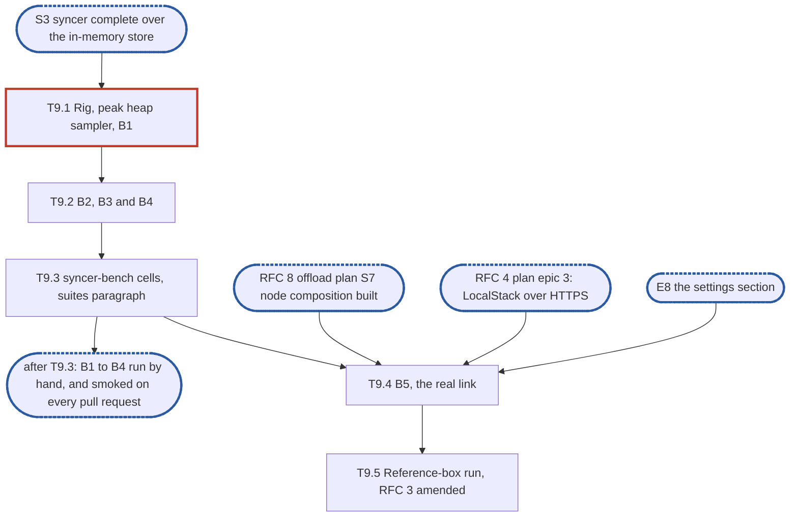

# Epic 9: syncer v2 E2E green

**Sources:** [RFC 3](../docs/internals/rfcs/rfc-3-syncer.md) §7.4, the benchmarks B1 to B5;
§7.3's first rule, for the simulated link; §8.1's "Benchmark" kind; §8.4's sentence that each
count stands behind one benchmark; §8.5, the performance targets; §8.6, the fields a result
records and the suites paragraph; §9's open question on the fixed values, and its settled point
on no joint cap for the two pools; §2.10's decision note on what would move the fixed values. The
[RFC index](../docs/internals/rfcs/rfc-index.md), "Test tiers": "What must not stand in", "A
check that did not run is a failure", "Recording results", "A proposed target is replaced once,
by measurement" and "The reference box". Cited for what they hand over, not owned: RFC 3 §2.2
(the per-worker figure), §2.9 (a round), §2.10 (the cap, the waiter bound), §2.12 (the `Stats`
read here); [RFC 29](../docs/internals/rfcs/rfc-29-test-harness.md) §4.3 and §4.10, the tiers
and how benchmarks are tracked. Every citation is `develop`'s text. The code lands on
`feat/storage-v2`, and the paths below are paths there.
**Track:** the team.
**Epic 9 estimate: 5 subtasks, 12 man-days.**
**Depends on:** **S3**, the syncer complete over the in-memory store: E1's `pool.New`, `Config`,
`Clock` and `Stats`; E2's fault wrapper with `Link` and `Hold` (`pkg/remote/memory`, its T2.2)
and the in-memory store's load record; E3's `internal/sched`, its in-memory opener (its T3.7) and
the clock its tests pass to `pool.New`; E4's attempt loop and `Upload`; E6's `Fetch`, `Prefetch`
and single flight; E7's `Stats` snapshot. For T9.4 only: **E8**'s settings section, for the
default worker counts; **RFC 8 offload plan S7**, the node composition built, whose epic 21
builds in `internal/node/content` the S3 opener with its transport hook (its T21.2), the chain
(its T21.3), and `NewCodecStore` and `NewSyncer` (its T21.4); **RFC 4 plan epic 3**,
`s3fault.LocalStack` at `LOCALSTACK_HTTPS_ENDPOINT`; and, for a real service, **RFC 4 plan epic
9**'s T9.1, `s3fault.Service` and its `DITTOFS_TEST_S3_*` variables. `internal/prof`
is already on `feat/storage-v2`.
**Blocks:** no epic of RFC 3's. Its measurements are the trigger of two rows of the RFC 3 plan's
§6.1 ledger (a fixed value becoming a setting; the fixed values no benchmark bears on), and they
replace RFC 3 §8.5's proposed targets.

---

## 1. Goal

Epic 9 measures what the syncer costs. The checks of E1 to E7 say the syncer is correct, on the
virtual clock; the benchmarks here run on the real clock and report throughput, allocations and
peak memory, each against raw calls on the same store at the same pool size, so a result holds on
any machine. The first run on the reference box replaces RFC 3 §8.5's proposed targets, and the
fixed values of RFC 3 §2.10 that a run bears on are confirmed or proposed anew.

**At the end of the epic:**

- B1, B3 and B4 run in `pkg/syncer/pool` over `codec.Store` on RFC 4's in-memory store under E2's
  `Link`, a per-call latency and a per-byte time on the wall clock; B2 runs in
  `pkg/syncer/pool/internal/sched` on the scheduler alone.
- B5 runs in `internal/node/content` over the `codec.Store` the content wiring builds on the S3
  store, against LocalStack, and against a real service when RFC 4's `DITTOFS_TEST_S3_*`
  variables name one, each half beside raw calls at the configured worker counts, with RFC 3
  §7.4's B3 shape (uploads saturating while fetches wait) run over the store's shared
  connections.
- `dt run syncer-bench` runs B1 to B4 by hand, and its `real-link` option B5; each fails when
  any expected result line is missing, never on a throughput or latency figure.
  `syncer-bench-smoke` runs B1 to B4 once on every pull request, without blocking it, under the
  same guard, so they cannot rot unseen.
- One run on the reference box is recorded with RFC 3 §8.6's fields and the RFC index's, and
  RFC 3 §8.5's proposed targets and §9's open question are amended from it.

### 1.1 In scope

The benchmarks B1 to B5 and what each reports; the peak heap sampler they share; the
`syncer-bench` and `syncer-bench-smoke` cells and the `syncer` group; RFC 3 §8.6's suites
paragraph; the reference-box run, its record, and the RFC 3 amendments it supports.

### 1.2 Out of scope

- **The counts CI gates on** (RFC 3 §8.4): allocations per chunk (E7, `unit/syncer-allocs`),
  queue operations per dispatch, fairness, peak in flight and the waiter counts (E3), retries
  (E4), single flight (E6). Each benchmark here stands on its count and asserts nothing.
- **RFC 3 §8.5's two health latencies:** E5's checks on the virtual clock.
- **The soak** (RFC 3 §8.1): the RFC 3 plan's §6.1 row owned by RFC 8 offload plan epic 22.
- **The real-backend checks** (RFC 3 §8.1's "Real backend" kind): the §6.1 row owned by RFC 8
  offload plan epic 21.
- **Building a `codec.Store` per store and the root's syncer:** the §6.1 row owned by RFC 8
  offload plan epic 21. B5 calls what that epic builds.
- **The pool sizing tool** (RFC 3 §2.11), whose put and get curve the reference box must record
  before a decision on numbers: the §6.1 row owned `unowned` (§9).
- **Making a fixed value a setting:** the §6.1 row owned `unowned`, which this epic's run can
  trigger but does not act on (D7).
- **Measuring the fixed values no benchmark here bears on,** the throttle limit's halving and the
  trickle rule's quarter among them: the §6.1 row this epic's pull request adds, owned
  `unowned` (D7).
- **Running B5 against a real service on a schedule:** the RFC 3 plan's §6.1 row this epic's pull
  request adds, owned `unowned`, triggered by the RFC 4 plan's row on the nightly service row,
  which waits on CI credentials; until then B5 against a service is run by hand.
- **Running the benchmarks in RFC 29 §4.10's after-merge step** (D5): the RFC 3 plan's §6.1 row
  this epic's pull request adds, owned `unowned`, triggered by T9.5's baseline.
- **Fixing a target a run misses:** a design finding against RFC 3 (the RFC index, "A proposed
  target is replaced once"), which T9.5 files as an issue against the epic that owns the code; not
  fixed in this estimate (§9).

### 1.3 Names used here

- **E1**, epic 1, interfaces: `pool.New`, `Config`, `Clock` and `Stats`.
- **E2**, epic 2, test foundations: RFC 4's fault wrapper with `Link` and `Hold`, and `syncertest`.
- **E3**, epic 3, registration, flows and the fair scheduler: `internal/sched`, the in-memory
  opener and the clock its tests pass.
- **E4**, epic 4, termination, retries and the uploader.
- **E5**, epic 5, store health.
- **E6**, epic 6, the fetcher.
- **E7**, epic 7, memory bound, `Stats` and the fault sweep.
- **E8**, epic 8, the syncer's own integration: the settings section with `upload_workers` and
  `fetch_workers`.
- **E9**, this epic.
- **S3**, the syncer complete over the in-memory store: every RFC 3 §7 row E1 and E3 to E7 name
  green in `unit`.
- **S7**, the RFC 8 offload plan's node composition built, at the end of its epic 21.
- **B1 to B5** are RFC 3 §7.4's benchmarks, not epics.
- **S3**, written alone after "the", "an" or "store", also names the storage service (the S3
  store, `pkg/remote/s3`); as a synchronisation point it is always written **S3**.
- **The integration epic**, E8 here; outside the RFC 3 plan, RFC 8 offload plan epic 21, which composes
  the syncer in the node.

## 2. How the general rules apply

The rules are those of
[the RFC 3 plan's §1.5](rfc-3-syncer-plan.md#15-general-rules-for-each-epic). They are cited by
number and title, not copied.

| Rule | Subtasks | How |
| --- | --- | --- |
| rule 1, independent unit tests ([`CLAUDE.md`, "Writing tests"](../CLAUDE.md#writing-tests)) | T9.1 | The only production code is T9.1's peak heap sampler in `internal/prof`, tested on its own. The benchmarks are not unit tests: each runs over the code E1 to E7 built and tested |
| rule 2, fuzz tests where relevant ([`CLAUDE.md`, "By kind"](../CLAUDE.md#by-kind)) | none | Nothing here decodes bytes; the scheduler's fuzz target is E3's |
| rule 3, observability follows RFC 25, with RFC 3's own exception | T9.2, T9.4 | No metric, log or span is added. B3 and B5 read `Stats`, the counters E8's collector exports, for busy workers, the first-byte tail and the floor and stall counts |
| rule 4, profiling ([`CLAUDE.md`, "By kind"](../CLAUDE.md#by-kind)) | all | Every benchmark calls `b.ReportAllocs()`, does its setup before `b.ResetTimer()` or between `b.StopTimer()` and `b.StartTimer()`, and runs under `internal/prof`'s leak check. The allocation and dispatch assertions are E7's and E3's counts, which B1 and B2 stand on (§1.2) |
| rule 5, public interface and internals ([`CLAUDE.md`, "Verifying a change"](../CLAUDE.md#verifying-a-change)) | T9.1, T9.2, T9.4 | B1, B3, B4 and B5 drive `Syncer` and `Flow` as the engine does, and time what a caller sees: an `Upload` returning, a `Fetch` yielding. B4 counts `Get`s at the in-memory store's own record of calls. B2 times `sched` directly, D2 says why |
| rule 6, known failures shrink | none | No suite this epic's benchmarks run in keeps a `known.yaml`; a benchmark that fails is a finding to fix |
| rule 7, v2 ignores v1 | all | Nothing reads `pkg/block`. The benchmarks are test files, which import RFC 4's codec, its stores and `s3fault` as amended RFC 0 §1.2 allows; T9.1's sampler adds `runtime/metrics` to `internal/prof` only |
| rule 8, real dependencies for properties of those dependencies ([`CLAUDE.md`, "Writing tests"](../CLAUDE.md#writing-tests)) | T9.4, T9.5 | B5 is the rule's last clause: the S3 store against LocalStack over HTTPS and against a real service, where credentials are. Nothing needs a disk |
| rule 9, code comment conventions ([`CLAUDE.md`, "Code comments"](../CLAUDE.md#code-comments)) | T9.1, T9.2, T9.3, T9.4 | `decision:` markers at B2's level (D2), at B3's round (D3), at the peak memory B1 reports (D4), at B3's dispatch count and its margin (D3), at B5's census lookup and its bandwidth record (D6) and on the `syncer-bench` entry (D5); a `ponytail:` at the sampler (D4) |
| rule 10, a test must be able to fail ([`CLAUDE.md`, "Writing tests"](../CLAUDE.md#writing-tests)) | T9.1, T9.3 | The sampler's test fails on a sampler that reads the heap only at `stop`, and on one whose finalizer still runs after `stop`. The cell's guard is seen to fail on a run missing one expected result line. A figure is never asserted, so no figure needs a planted failure |
| rule 11, a symbol is exported only if the RFC's interface uses it | T9.1 | One export, `prof.PeakLiveHeap`, which two packages' benchmarks call (B1, B3 and B4 in `pool`, B5 in `content`), and `internal/prof` exists to serve tests. No syncer symbol is added |
| rule 12, each subtask creates only what it declares | all | The sampler lands with B1, its first consumer; the cells with the benchmarks they run (T9.3), and B5's option with B5 |

## 3. Requirements and invariants

Every obligation RFC 3 and the RFC index place on this epic, numbered so that subtasks and tests
can cite them.

**How the benchmarks run**

| # | Requirement | Kind | Source | Subtasks |
| --- | --- | --- | --- | --- |
| R1 | The benchmarks run on the real clock, never the virtual one | invariant | RFC 3 §7.4; §8.1, "Benchmark" | T9.1, T9.2, T9.4 |
| R2 | B1, B3 and B4 run on the in-memory store with a simulated link, a per-call latency and a per-byte time, neither ever zero: a backend that returns instantly never binds the pool. B2 runs on the scheduler alone (D2), as T9.3's amendment of §8.1 says | MUST NOT | RFC 3 §7.3; §7.4; §8.1, "Benchmark" | T9.1, T9.2, T9.3 |
| R3 | B5 runs on a real store: a local emulator of the remote service, and a real service where credentials are | invariant | RFC 3 §7.4; §8.1, "Benchmark"; §8.6, "Suites" | T9.4, T9.5 |
| R4 | Each benchmark reports throughput, allocations and peak memory; B2, which holds no transfer, reports dispatches per second and allocations | invariant | RFC 3 §7.4 | T9.1, T9.2, T9.4 |
| R5 | A benchmark never gates a change; what gates one is the counts of RFC 3 §8.4, each standing behind one benchmark | invariant | RFC 3 §7.4; §8.1, "Benchmark"; §8.4; RFC index, "Test tiers" | T9.3 |
| R6 | A benchmark that did not run is a failure: a run missing any expected result line, or a B5 skipped because no store was reachable, fails its cell, its reason reported | invariant | RFC index, "A check that did not run is a failure" | T9.3, T9.4 |
| R7 | The benchmarks run in a manual suite of the syncer's own, B5 against a real service only where credentials are, and RFC 3 §8.6's suites paragraph names the suite | invariant | RFC 3 §8.6, "Suites" | T9.3, T9.4 |
| R8 | B5's store is built as production builds it, so the harness is not a second construction standing in for the node's | invariant | RFC index, "What must not stand in" | T9.4 |

**What each benchmark measures**

| # | Requirement | Kind | Source | Subtasks |
| --- | --- | --- | --- | --- |
| R9 | B1: the syncer's own overhead, at one pool size, once through the syncer and once as raw calls on the in-memory store; target throughput through the syncer at least 97% of raw, read on D1's `fast` link | bound | RFC 3 §7.4, B1; §8.5, B1 | T9.1 |
| R10 | B1: no allocation per chunk once warm, buffers being reused, reported beside the raw twin's allocations | bound | RFC 3 §7.4, B1; §8.4, "allocations" | T9.1 |
| R11 | B2: one transfer dispatched with 1, 10, 100 and 1,000 flows waiting; target at most 1 µs at 1,000, and flat from 1 | bound | RFC 3 §7.4, B2; §8.5, B2; §2.9 | T9.2 |
| R12 | B3: one flow saturating uploads on a slow store while a second uploading to it wants fewer workers than the first's cap leaves free, so only the cap holds the first back (D3); target the second flow's p99 queue wait within one round, and the first given no worker while it holds its cap and the second has work waiting, counted at
  each dispatch (`a-over-cap`, 0 on a correct syncer). A round in time is ceil(flows waiting / pool) transfers of the largest encoded block, retries excluded (D3), so one transfer for B3's two flows. The cross-half shape of RFC 3 §7.4 is B5's mixed shape (R23) | bound | RFC 3 §7.4, B3; §8.5, B3; §2.9 | T9.2 |
| R13 | B4: N readers on one cold chunk make one transfer, whatever N | bound | RFC 3 §7.4, B4; §8.5 ("B4 is a count") | T9.2 |
| R14 | B5: the syncer over the store, and raw calls on the same store at the same pool size: `codec.Store`'s put attempt and `Get`, encoding and checksum included, called directly at the configured `upload_workers` and `fetch_workers`; target at least 95% of raw, below 90% a regression | bound | RFC 3 §7.4, B5; §8.5, B5 | T9.4 |
| R15 | B5 reports its throughput as a fraction of the raw calls', with the pools' occupancy beside it | invariant | RFC 3 §7.4 | T9.4 |
| R16 | Peak memory per half: target at most the pool size times the per-transfer figure of RFC 3 §2.2, plus 10%, read on B5 alone (D4). No benchmark here has a detached caller, so §2.2's detached term is zero in every run | bound | RFC 3 §8.5; §2.2 | T9.4 |
| R23 | Whether uploads and fetches need a joint cap is measured: a cold read's latency under full upload load on a real service, beside its latency with no upload load and the most connections of the store's client in use against the client's limit; a miss with connections to spare overturns RFC 3 §9's settled point 1 | test row | RFC 3 §9, settled point 1; §8.5, B3 | T9.4, T9.5 |

**Recording results**

| # | Requirement | Kind | Source | Subtasks |
| --- | --- | --- | --- | --- |
| R17 | A result is recorded with the revision it measured, in absolute numbers, with the box (CPU and memory), the operating system and each row's concurrency | invariant | RFC 3 §7.4; §8.5; RFC index, "Recording results" | T9.1, T9.3, T9.5 |
| R18 | B5's result records the backend and its region, the round-trip time, the bandwidth, the block size, the pool sizes and the raw calls' throughput | MUST | RFC 3 §8.6 | T9.4 |
| R19 | B1, B3 and B4's results record the in-memory store's simulated latency and per-byte time; B2 has no link (D2) | MUST | RFC 3 §8.6 | T9.1, T9.2 |
| R20 | A target is stated against something measured on the same box: B1 against raw calls on the same in-memory store, B5 against raw calls on the same store at the same pool size | invariant | RFC 3 §8.5; RFC index, "Recording results" | T9.1, T9.4 |
| R21 | A proposed benchmark target is replaced once, by the first run on the reference box, with the measured value plus headroom stated beside the result; a target that run misses is a design finding against RFC 3, changed in the design or withdrawn with its reason, never relaxed; results from another box are compared only with themselves and replace no target | invariant | RFC index, "A proposed target is replaced once, by measurement", "Recording results" | T9.5 |
| R22 | RFC 3 §2.10's fixed values are proposals until §8.5's benchmarks measure them; each one a run bears on is confirmed or proposed anew through RFC 3, and none becomes a setting unless a measurement shows it wrong for a workload an operator can name | invariant | RFC 3 §9, open question 1; §2.10 and its decision note | T9.5 |
| R24 | Before any decision that depends on numbers, the reference box records its raw stage costs, remote put and get at rising concurrency among them, measured with RFC 3 §2.11's sizing tool; a decision T9.5 would take without them is not taken | MUST | RFC index, "The reference box" | T9.5 |

Not obligations of this epic: the RFC index's rule that a later regression of more than 10% needs
a recorded decision, which binds the runs after this epic's first baseline; its device and
filesystem fields, since nothing here touches a disk; its rule on hand-built records, since no
check of content runs here; its rule that the remote tier is under test against a real service on
a schedule, which is RFC 4's (§1.2).

## 4. Decisions this epic takes

- **D1, B1, B3 and B4 run over E3's in-memory construction, on the wall clock, one workload per
  iteration.**
  - E3's opener builds `pool.New` over RFC 4's in-memory store under E2's wrapper, with
    `codec.Store` over it, as production composes them (E3's T3.7). T9.1 moves that construction into a helper over `testing.TB`, the two worker counts and
    `syncertest.Mode`, since the mode's checksum and encryption are fixed when `codec.Store` is
    built inside it, which the opener and the
    benchmarks both call, since an `Opener` takes a `*testing.T`. E3's D12 is decided (the
    user's decision, 2026-11-26): E3's checks run inside a `testing/synctest` bubble, and the clock
    they pass reads the standard library's time, so the opener calls the helper inside the bubble,
    where everything it creates belongs to the bubble, and a benchmark calls it outside one, where
    that clock is the wall clock. The benchmarks need no clock of their own; E2's `Link` takes the
    same clock as its `Waiter` (E2's D3).
  - One iteration is a whole workload, run at `-benchtime=1x -count=10` as `engine-bench` runs:
    B1 moves 1,024 blocks from as many callers as the pool has workers; B3 issues 1,000 of the
    second flow's uploads. So the workers are kept busy, and B3's p99 is of a thousand samples,
    not of the handful `-benchtime=1s` would give at 200 ms a call.
  - No two fetches in flight at once name one chunk, so single flight (RFC 3 §4.3) joins none and the syncer makes as many `Get`s as its raw twin, slow-tail retries aside (below): each fetching caller owns one block of its
    own (B1), stored before the timer, and fetches it again only after its last fetch returned.
    B1's fetch half so stores one block per caller, 64 MiB at 16 workers and 512 MiB at 128, not
    the 4 GiB 1,024 distinct blocks would hold. B3 fetches nothing: both its flows upload, each
    block deleted once its `Upload` returns, as B1's upload half does.
  - B1 runs two configurations, each with name keys `half=upload|fetch` and `impl=syncer|raw`:
    `link=fast/workers=16`, 1 ms per call and a per-byte time of a tenth of the working link's,
    where the syncer's own CPU is not hidden behind the wait, and against which R9's 97% is read;
    and `link=working/workers=128`, 20 ms per call and the per-byte time that makes one 4 MiB
    block take about 200 ms (RFC 3 §2.10's working link), the defaults' shape.
  - The raw twin calls `Env.NewPut(…).Attempt` and `Env.Store.Get` from as many goroutines as
    the pool's size, ranging over the decoded, verified chunks `codec.Store.Get` yields, as the
    syncer does; `Link`'s per-byte waits come from the codec's own reads on both sides, so neither
    reads `Env.Remote`, which would skip decoding and checksums (R14). Its allocations per operation are reported beside the syncer's, since
    `Link`'s timers and the in-memory store's copies allocate in both: the difference is the
    syncer's (R10), and the gate is E7's.
  - RFC 3 §2.4's slow-tail rule runs in every benchmark, since `Link`'s first bytes are near
    constant and jitter alone puts a tenth of them past the 90th percentile: up to the larger of
    one and 5% of transfers are retried. That is production behaviour and part of the syncer's
    cost, so B1 keeps it and reports `slow-tail/op`, the rise of `Stats`' `Retries.SlowTail` per
    workload, beside its throughput; the raw twin has no such retry. B3 and B4 take it out of
    what they read (D3, T9.2).

  Prior art: RFC 4 plan epic 9's raw twins on the store's own transport (its T9.4);
  `engine-bench`'s one workload per iteration (`test/suites.yaml`, checked).
- **D2, B2 times the scheduler alone.** RFC 3 §7.4 calls B2 the scheduler's cost and §8.5 sets it
  at 1 µs. Through the pool, a dispatch also wakes the waiting caller's goroutine, which is the Go
  runtime's cost, not DRR's, and would sit above 1 µs at any number of flows. B2 therefore runs in
  `internal/sched`'s own benchmark file: per iteration one `Add`, `Next` and `Done`, while 1, 10,
  100 and 1,000 flows each hold two queued entries on one store, under
  `sched.Config{Pool: 256, Cap: 192, QueueLen: 2, Waiters: 2048}`, so the 2,000 entries at 1,000
  flows fit the waiter bound (eight times the pool, E3's T3.4) and no `Add` displaces one, every flow fresh or every flow in
  debt, as E3's count is taken (its T3.1). Each flow keeps a spare entry: the spare is added before the dispatched entry's `Done`, and the
  two swap, so no entry is added while dispatched, nothing allocates, and no flow's queue empties and RFC 3 §2.9's reset of an emptied flow's deficit never
  fires: with one entry a flow, `Next` would empty it and the `debt` rows would time fresh flows
  after one pass. Under `flows=debt`, each flow is
  put one quantum in debt before `b.ResetTimer()`, and `Done` reports a held time of the charge
  plus one quantum, so every pass leaves the flow about one quantum in debt and parks it in its
  wheel again, whatever `b.N`. Tying the overrun to the quantum, not to the charge, keeps
  every row in debt whatever the ratio of charge to quantum. It needs no store and no link. B1 measures the whole path, so the goroutine hand-off is still measured, where it
  belongs. A `decision:` marker at the benchmark says so; withdraw it if a profile of B1 shows
  dispatch, not transfer, dominating. Prior art: none found for a fair scheduler's own benchmark;
  E3's operation count (its D3) is the same split.
- **D3, B3 runs in the half where its flows compete, and a round in time is ceil(flows waiting /
  pool) transfers of the largest encoded block: accepted by the user, 2026-11-26, the round's
  wording decided by the user the same day.**
  - RFC 3 §7.4's setup puts flow A's uploads and flow B's fetches in different halves, which share
    no worker; on the in-memory store they share nothing at all, and on the S3 store only the
    connections (RFC 3 §9, settled point 1). B5 runs that shape over the S3 store (D6), where it
    answers R23. Here both of B3's flows upload, so they compete in one half
    and B3 tests the upload scheduler's cap: fetches would run in the other half and bear on it
    not at all. Flow A keeps the upload half's queue full on a slow store while flow B keeps P/8
    uploads outstanding on the same store, P the upload pool at the default `upload_workers` of
    128 (16 outstanding; B3 fails before the timer, naming P, if P/8 is below 1), below the P − cap that
    A's cap leaves free (at least P/4, RFC 3 §2.10's table). Turns are charged in worker-time
    (§2.9), so fair share alone would give A every worker B does not hold, more than its cap:
    only the cap stops A taking a freed worker while it holds its cap and B has work waiting. With B at P/2, fair share would settle both near P/2,
    under the cap, and the check would pass with no cap at all. The wait exercises the cap and
    the fair-share rule, which is what RFC 3 §2.10's decision note reads B3 for.
  - RFC 3 uses "one round" in time (§2.12, `syncer_queue_wait_seconds`) without stating it in
    time. A round is one visit per flow with work waiting, and each visit needs a freed worker,
    so k flows on a pool of P take ceil(k / P) transfers of the largest encoded block on the
    slowest store with work waiting, retries excluded. One transfer would not hold past a pool's worth of flows: 1,000 flows on a pool
    of 128 take 8, and `syncer_queue_wait_seconds` would flag a correct scheduler as starving.
    B3's two flows are the case k ≤ P, one transfer: B3 takes a round as the link's time for one
    largest encoded block on the slow store, `perCall + bytes × perByte`, within which every busy
    worker frees once, so each waiting flow is visited. B5's mixed shape has one fetching flow, the same case;
    its fetch waits beside upload load are the separate figure for the cross-half question
    (D6), never B3's. B3 reports `wait-p99/round` and `round-ns`, and prints the cap and the link as
    configuration lines once, from a parent benchmark with one sub-benchmark as B5 does: printed
    by a leaf benchmark, they land between its name and its figures on every count after the
    first, and `benchstat` drops those samples.
  - The wait is timed where a caller sees it: from B's `Upload` call to its
    return, less the link's time for that block's put, which the benchmark set. It therefore includes any of
    B's own entries queued ahead, which §2.9's bound of one round does not cover; a correct syncer keeps A above its cap, since §2.9 lets A take a worker whenever B has nothing
    queued and takes none back, but while A holds its cap or more and B has an upload queued,
    every worker that frees goes to B. B's P/8 outstanding uploads are fewer than the P − cap
    workers A's cap would leave, so each of B's queued uploads takes the next worker that frees,
    within one round, and the p99 is read against one round as it is. `Stats` counts busy workers per
    store, not per flow, so A's are counted by a `syncer.Store` the benchmark registers in place
    of `codec.Store`, passing every call through and keeping each put attempt's open and
    close, A's blocks and B's having names of their own (the pass-through recording wrapper
    `CLAUDE.md` allows). RFC 3 §2.9 binds the per-flow cap only while another flow on the store
    has work waiting, and takes no worker back, so A's most busy workers cannot tell a correct
    syncer from one with no cap: A starts each workload holding the whole pool, and B's closed
    loop often has nothing queued. What the cap forbids is a dispatch, so B3 counts those:
    `a-over-cap`, A's first put attempts per block (a retry is
    left out, since the cap is read at a transfer's dispatch, not its tries) opened while A already held at least its cap and one
    of B's uploads had been called more than 1 ms earlier and had not yet opened its put attempt.
    A correct syncer reads 0; one with no cap hands A about every other freed worker while B
    waits, which on P/8 waiting uploads per workload is far above 0. The 1 ms margin keeps a B
    upload called but not yet queued, or queued after A's dispatch but before A's attempt opens,
    out of the count; on a 200 ms link a dispatch reaches its attempt in microseconds. A
    `decision:` marker at the count says so; withdraw the margin if a correct run reads above 0.
  - B's uploads whose put the wrapper saw opened more than once were retried, a slow-tail
    retry or otherwise, and a round excludes retries, so they leave `wait-p99/round`'s samples and
    are reported as `b-retried`.

  A `decision:` marker at the benchmark names the round and why it differs from §7.4's setup.
  T9.5's pull request amends RFC 3 with the decided text: §2.9, "In time, a round is at most
  ceil(flows waiting / pool) transfers of the largest encoded block on the slowest store with
  work waiting, retries excluded: each visit needs a freed worker, and every busy worker frees
  within one such transfer"; §2.12's `syncer_queue_wait_seconds` row, "a flow whose wait exceeds
  one round, in time as §2.9 states it, is being starved", so the metric's threshold grows with
  the flows waiting; §7.4's B3 setup, "one flow saturating uploads on a slow store; a second
  flow uploading to it, wanting fewer workers than the first's cap leaves free, so only the cap holds the
  first back", and the cross-half shape moved
  under B5. Prior art: none found.
- **D4, peak memory is the most live heap seen at the end of a collection.** `prof.PeakLiveHeap`
  reads `runtime/metrics`' `/gc/heap/live:bytes`, the heap marked live at the last collection, in
  a finalizer re-armed on each collection, and `stop` forces one last collection and reads it
  too. `stop` also clears the re-arm, so no finalizer runs after it. It is the live heap without
  the garbage a sampled `HeapAlloc` counts, and reads without
  stopping the world as `runtime.ReadMemStats` does. A collection that ends before the finalizer
  is re-armed is missed, so the figure is a lower bound: `ponytail:` it misses collections closer
  together than a finalizer's turn; upgrade to counting collections through
  `/gc/cycles/total:gc-cycles` beside the finalizer's runs and reporting those missed, when a
  benchmark's peak moves between runs of one commit by more than its noise. A goroutine polling
  `/gc/heap/live:bytes` would also recover the end-of-collection values a late re-arm misses,
  at a CPU cost per sample inside the timed region. B1, B3, B4 and B5 report it, less
  the live heap read, after a `runtime.GC()` so the figure does not still count the previous
  count's bodies, before the syncer and the store are built, and at zero where the peak is
  below that, as `peak-heap-B`, beside `bound-B`, the pool size times
  `Max + MaxDecodeLen(Max) + header cap` (RFC 3 §2.2) at the run's figures. The baseline is read
  before the build, not before the timed region, so the pool's warmed buffers (RFC 3 §2.2's
  per-worker figure, reused once warm) are inside the peak: read after warm-up, they would sit in
  the baseline and the check against the bound could hardly fail. On the in-memory store
  the heap also holds every stored body and the load record's calls, so B1 reports the raw twin's
  peak beside the syncer's, the difference being what the syncer adds, and neither is read
  against `bound-B`; a `decision:` marker at B1 says so. B5's bodies live in the emulator's
  process or the service's, and every caller reads one shared, read-only source, so B5 is the run
  read against R16, its raw twin's peak beside it. Each half builds its own syncer and reads its
  own baseline, so the other half's warmed buffers never sit inside its peak. Prior art: Go's
  `runtime/metrics` documentation of `/gc/heap/live:bytes` (from memory); the re-armed finalizer
  pattern of GC notifiers (from memory). Not chosen: E7's held-pool heap check, a unit check that
  holds the pool and reads `LiveHeap` once, which RFC 3 §7.2's memory-bound row already is.
- **D5, `syncer-bench` is a manual `exit` cell that fails only when a result is missing or, for
  B5, a secret is found, and
  `syncer-bench-smoke` keeps the benchmarks running: accepted by the user, 2026-11-26.**
  - RFC 3 §8.6 puts the benchmarks in a manual suite of the syncer's own, while §7.4 says they run
    after a change merges; the suites paragraph is the one that registers, so the cell is `tier:
    manual`, and T9.3's pull request amends §7.4 with the accepted sentence: "Benchmarks never
    gate a change; they run by hand in the syncer's manual suite
    ([§8.6](#8.6%20Recording%20results)), and what gates a change instead is in
    [§8.4](#8.4%20What%20CI%20checks%20instead%20of%20timing)." RFC 29 §4.10's after-merge step,
    which gates nothing, could run them once T9.5's baseline exists; joining it is the RFC 3 plan's
    §6.1 row this epic adds (§1.2).
  - The cell follows `journal-bench-data`: `cmd: test/syncer/bench.sh {test} {out}`, `tests:
    [pool, sched]`, `format: exit`, `metrics: go-bench`. The registry refuses `go-bench` without
    `format: exit` and a tests list (`test/harness/registry/check.go`, checked), and `dt` reads a
    test's figures from `{out}/{test}.txt` (`test/harness/run/run.go`, checked), so each test
    writes its own file and `dt` keeps each figure's median in its history beside the commit, the
    host and the operating system it records with every run (`test/harness/run/gobench.go`,
    checked).
  - `pool` runs `go test -count=$n -benchtime=1x -run=^$ -bench='^Benchmark(B1|B3|B4)$'
    -timeout=110m ./pkg/syncer/pool/`, one workload per iteration (D1). `sched` runs B2 in its own
    `go test -count=$n -run=^$ -bench=^BenchmarkB2$ ./pkg/syncer/pool/internal/sched/` at Go's
    default `-benchtime`, since one of its iterations is one dispatch and a benchmark cannot
    override the command line's `-benchtime`: at `1x`, B2's figure would be one cold dispatch.
    `n` is 10 unless `SYNCER_BENCH_COUNT` says otherwise, as `ENGINE_BENCH_COUNT` does. The
    explicit `-timeout`, since `go test` stops a benchmark binary at ten minutes, sits under the
    cell's `timeout: { test: 120m, cell: 130m }`.
  - The script's guard counts result lines per sub-benchmark name, a result line being one that
    carries an iteration count and `ns/op`, as `dt`'s go-bench reader parses it, so a `--- FAIL`
    line under the name is not counted: each must print `n` lines,
    for 8 names under B1, 1 under B3 and 4 under B4 in `pool`, and 8 under B2 in `sched`, or the
    test exits 2 naming the benchmark short of it, so a skipped or dropped sub-benchmark fails
    too (R6). A total alone would pass a run that lost one name's lines to another's surplus. A
    name is matched whole, its `-GOMAXPROCS` suffix stripped, since `waiting=1` is a prefix of
    `waiting=10`. `SYNCER_BENCH_COUNT` is checked as `engine-bench` checks `ENGINE_BENCH_COUNT`: a
    number of 1 or more without a leading zero, or the test exits 2 naming it.
  - B5 is the cell's option `real-link`, `tests: [content]`, the same script and guard, `n` lines
    for each of its 5 names (`upload` and `fetch`, each through the syncer and raw, and `mixed`),
    and no `needs`: a need `dt` checks would skip the cell before `go test` starts, and would skip
    a run aimed at a real service whenever LocalStack is down. B5 itself skips naming the variable
    when no target is reachable, the content test runs `go test -v` so the skip and its reason
    are printed, and the guard fails on the missing lines and prints those skip lines (R6).
    It runs with the `DITTOFS_TEST_S3_*` secrets set, and T9.5 attaches `{out}`, so the `content`
    test greps `{out}` as RFC 4 plan epic 9's service cell does (its R8, from RFC 25 §5.4): an SDK
    error a `b.Fatal` prints would otherwise reach the attached record. The grep runs whatever
    the guard found, before the script exits, and the script exits with the worse of the two
    codes, since a `b.Fatal` that leaks a key also leaves its sub-benchmark short of lines. Its
    patterns are `Signature=` and `SignatureProvided` always, and the access key, the secret, the
    endpoint and the bucket only when set, so a LocalStack run with none set greps no empty
    pattern that matches every file; they go to `grep -rlF -f -` on stdin, never on the command
    line, and only file names are printed. `content`'s `go test` output goes to
    `{out}/content.txt` alone, not to stdout, since `dt` tees stdout to the cell's log outside
    `{out}`, where nothing scans it; the script prints the guard's verdict and, once the grep is
    clean, B5's skip lines.
  - The varying conditions are name keys (`half=upload/impl=syncer/workers=128`), so
    `benchstat -col /impl` reads B1's and B5's ratio from one run; the fixed ones are Go benchmark
    configuration lines, printed once by a parent benchmark as D3 says, in B1, B3, B4 and B5
    alike. A figure measured on each count is a metric, never a configuration line, since a line
    whose value changes between counts splits `benchstat`'s groups.
  - No build tag: a benchmark runs only under `-bench`, so `unit` never runs one, and untagged
    files stay under `go vet` and the linter. This drops the RFC 3 plan's `syncer_bench` tag and
    its line in `lint-go`. The `syncer` group holds `[syncer-bench, syncer-bench-smoke]`, as
    RFC 29 §4.9 names a `syncer` group for the component. A `decision:` comment on the entry says
    it is manual and gates nothing.
  - `go test` never runs a benchmark function, so a manual cell alone would let B1 to B4 rot while
    every check stays green. `syncer-bench-smoke` runs them once each through the same script,
    `tests: [pool, sched]` and `env: { SYNCER_BENCH_COUNT: "1" }`, so the guard holds at `n` = 1;
    `format: exit` (a `go-json` cell grades a passing benchmark as failed, `engine-bench`'s note
    says), no `metrics`, `tier: pr`, `blocking: { pr: false }`, as `settings-scan-smoke` is. It
    fails on a benchmark that panics, fails its setup, or skips or drops a sub-benchmark, never on
    a figure (R5), and blocks after a merge. On `feat/storage-v2` a `pr` suite runs only once
    `.github/workflows/tests.yml`'s select names it (its comment: "a new suite runs only once it
    is named there"), so T9.3 adds `or .suite == "syncer-bench-smoke"` beside
    `settings-scan-smoke`'s line.

  Prior art: `journal-bench-data`'s script, tests list and `go-bench` reading;
  `journal-bench`'s guard, a single `grep -q` for any result line, which this one tightens to a
  count per name; `settings-scan-smoke` and its `tests.yml` line (`test/suites.yaml` and
  `.github/workflows/tests.yml` on `feat/storage-v2`, checked); RFC 4 plan epic 9's `remote-bench` (its
  D6), which instead blocks after merge on counts, which here are E3 to E7's in `unit`.
- **D6, B5 runs on the target RFC 4's tests already choose, through the content wiring's own
  constructors.**
  - The target is `s3fault.Service(b)` (RFC 4 plan epic 9, its D2): LocalStack at
    `LOCALSTACK_HTTPS_ENDPOINT` unless `DITTOFS_TEST_S3_ENDPOINT` names a real service, so one body
    runs on both and a run by hand with a service's variables is B5 against it (R3). Until that
    epic lands, `s3fault.LocalStack(b)` (RFC 4 plan epic 3) gives LocalStack alone. Neither
    reachable, it skips naming the variable, as `CLAUDE.md` says of an absent backend, and the
    option's guard turns the missing lines into a failure (R6).
  - The store, its `codec.Store` and the syncer are built as `node.New` builds them, by RFC 8
    offload plan epic 21's exported constructors: the store opened through T21.2's
    `content.S3Opener` with the benchmark's transport on its hook, then T21.4's
    `content.NewCodecStore(store, chain, census, token)` with the chain T21.3 builds for the store
    configuration and the token as T21.4 builds it, and
    `content.NewSyncer(cfg, stores)` at the settings section's default `upload_workers` and
    `fetch_workers` (E8), so B5 measures what the node composes (R8). The census is the one input B5 supplies: the
    production lookup reads block records, which B5 commits none of, and answers `ErrNotFound`
    for every block it wrote (RFC 4 §4.3). B5 passes a lookup over the censuses each put's
    `Stored()` returned, as RFC 4 plan epic 6's tests do, so the store, chain, codec and syncer are
    production's and only what the metadata store would hold is the benchmark's. A `decision:`
    marker at the lookup says so. They are exported because
    `node.New` calls them from its own package, so B5 is an external test of `content`.
  - The raw twin calls the same `codec.Store`'s `NewPut(…).Attempt` and `Get` directly, from as
    many goroutines as each half's worker count, ranging over `Get`'s chunks as D1's twin does.
  - The upload half deletes each block once its upload returns, as B1 does, so the store holds
    no more than the pool's blocks rather than about 4 GiB per upload sub-benchmark. A cleanup registered with `b.Cleanup` before the first write stays as the backstop, deleting
    whatever a listing of B5's prefix still shows, so a `b.Fatal` mid-run leaves no block behind. The store's health object and key records are
    never deleted through `remote.Store` (RFC 4 §4.7), so B5 opens its store under the fresh namespace prefix of `_BUCKET` that `s3fault.Service`
    hands it, which RFC 4 plan epic 9's sweep (its D10) deletes, with whatever a killed run
    left, once older than the cell's timeout.
  - `half=mixed` is RFC 3 §7.4's cross-half B3 shape on this store, which D3 moves here: uploads
    saturate the upload half while one flow issues 1,000 cold fetches. RFC 3 §9's settled point 1
    is overturned by a cold read's *latency* under full upload load missing its target while the
    store's connection pool is not full, and the halves share no worker, so the contention shows
    in latency, not in the fetch half's queue wait. The mixed shape therefore reports:
    - `cold-p99-ns`, the p99 from `Fetch` to its first chunk under the upload load, and
      `idle-p99-ns`, 1,000 fetches of other blocks run first with no upload load; the two passes
      read disjoint sets, written before the timer, so no block either reads was served moments
      before by the other and a cache at the service favours neither;
    - `round-ns`, a round from measured figures, since no `Link` is set here: the largest encoded
      block over the per-worker get throughput of `mixed`'s own idle pass, which already holds
      the round trip, so no other sub-benchmark a `-bench` filter could drop feeds it;
    - `wait-p99/round`, `cold-p99-ns` less `idle-p99-ns` over `round-ns`, read against §8.5's B3
      target of one round, which D3's amendment moves under B5;
    - `conns-max`, the most connections of the store's client in use at once during the loaded
      fetches, beside the client's limit as a configuration line, `limit:`. The benchmark's
      transport counts a connection from `httptrace`'s `GotConn` until the response body closes or
      the call fails, so a request still waiting inside the client for a connection is not
      counted, the pass-through recording wrapper `CLAUDE.md` allows, so no counter of RFC 4's client is read and none is exported for it. Connections held equal requests in flight past that wait because RFC 4's client speaks
      HTTP/1.1 only (RFC 4 plan epic 4's R45);
      over HTTP/2 a connection would carry several. RFC 4 §4.10 sizes the pool at the two worker
      counts plus probe slots, so uploads alone should leave room; `conns-max` at `limit:` says
      the pool was full and the miss is not this question's.
    R23 is read from a real service's run alone: on LocalStack the emulator, not the client's
    connections, is the likely bottleneck, so the LocalStack run shows the shape runs and answers
    nothing.
  - §8.6's fields are configuration lines, printed once: `service:`, the target the
    benchmark's `s3fault` call resolved, its `DITTOFS_TEST_S3_SERVICE` name (`cubbit-ds3`) or
    `localstack`, printed from what it returned rather than read from the variables, since it targets LocalStack whenever `_ENDPOINT` is unset, whatever else is set; never an endpoint or a bucket, since
    T9.5 commits these lines to the RFC; `region:`, `block:`, `upload-workers:`,
    `fetch-workers:`, `limit:`; the raw throughput is the twin's own line. The round-trip time is
    measured on every count, so it is the metric `rtt-ns`, the median of 21 get probes
    (`Store.Health`) before the timed region. The link's bandwidth is not measured
    apart: §8.6's bandwidth is recorded as the raw twin's aggregate get throughput at the full
    pool, the most the link carried in the run, and a `decision:` marker says so.
  - Beside throughput and allocations, B5 reports per half `occupancy` (the mean of `Stats`'
    `WorkersBusy` over `Workers`, read at each block's end), `fb-p999-ns` (the bucket bound
    holding `FirstByte`'s 99.9th percentile) and the `Floor` and `Stalled` retry counts, which
    RFC 3 §2.10's decision note reads against the first-byte bound and the floor.

  Prior art: RFC 4 plan epic 9's D1, D2 and D5 (one service per run, named by variables; the
  configuration lines), which this follows so both plans' benchmarks read alike; its D10, the
  sweep.
- **D7, §9's open question is answered value by value, and only for what a run bears on.** RFC 3
  §2.10's decision note names what would move each fixed value. A run here bears on two groups:
  B5's first-byte tail and floor and stall counts on the first-byte bound and the throughput
  floor, and B3's wait on the cap and the queue and waiter multiples. T9.5 confirms or proposes
  each of those through a pull request to RFC 3, and records each replaced target with its
  measured value, headroom, commit and box in §8.5. The others are moved by the fault runs and
  scripted runs E4, E5 and E7 own on the virtual clock, or by nothing yet measured: the throttle
  limit's halving and the trickle rule's quarter, which RFC 3 §9 calls the least measured, need a
  store that throttles or trickles under load, which no §7.4 benchmark is. T9.5 rewrites RFC 3
  §9's open question to name, for each value still a proposal, the measurement that would settle
  it, and no value becomes a setting (RFC 3 §2.10). Those measurements are a row of the RFC 3
  plan's §6.1 ledger, which this epic's pull request adds: owner `unowned`, trigger a benchmark
  against a store that throttles or trickles under load, or a fault run that shows one of those
  values wrong. Prior art: none found.

## 5. Target tree

```text
internal/prof/
  peak.go                  T9.1  PeakLiveHeap: the most live heap seen at a collection's end (D4)
  peak_test.go             T9.1  a peak between collections is seen; stop ends the watch
  export_test.go           T9.1  the sampler's current most and its finalizer runs, for its test
pkg/syncer/pool/
  opener_test.go           T9.1  E3's in-memory construction moved into a helper over testing.TB, worker counts, Mode (D1)
  bench_test.go            T9.1  B1, the rig: links, the raw twin, the configuration lines
                           T9.2  B3 and B4
  internal/sched/
    bench_test.go          T9.2  B2 (D2)
internal/node/content/
  syncer_bench_test.go     T9.4  B5 and its mixed shape over the content wiring's store and syncer (D6)
test/syncer/
  bench.sh                 T9.3  runs one test (pool, sched) to {out}/{test}.txt, the guard (D5);
                           T9.4  the content test
test/suites.yaml           T9.3  syncer-bench, syncer-bench-smoke, the syncer group (D5);
                           T9.4  syncer-bench's real-link option
.github/workflows/tests.yml
                           T9.3  syncer-bench-smoke named in the select (D5)
docs/internals/rfcs/rfc-3-syncer.md
                           T9.3  §8.6's suites paragraph, §7.4's and §8.1's sentences on when and where the benchmarks run
                           T9.5  §8.5's targets, §9's open question
docs/internals/testing.md  T9.3  regenerated by dt docs
```

## 6. Subtasks

### T9.1 The rig, the peak heap sampler and B1

**Subtask T9.1 estimate: 2.75 man-days.**

- **Track:** the team. **Depends on:** S3.
- **Covers:** R1, R2, R4, R9, R10, R17, R19, R20.
- **Deliverables:**
  - `internal/prof/peak.go` (D4), with its `ponytail:`:

    ```go
    // PeakLiveHeap watches the live heap from now until stop is called, and stop
    // returns the most it saw at the end of any garbage collection in between,
    // including one stop forces. It is a lower bound: see the marker.
    func PeakLiveHeap() (stop func() uint64)
    ```

    Consumed by B1, B3 and B4 here and by B5 (T9.4).
  - `opener_test.go`: E3's in-memory construction as a helper over `testing.TB`, the two worker
    counts and `syncertest.Mode`, the opener calling it with the row's mode and the benchmarks with
    the zero mode (D1).
  - `bench_test.go`: `BenchmarkB1` in D1's two configurations, a block of the default 4 MiB
    target in chunks of 256 KiB, the upload half deleting each block once its `Upload` returns,
    in both variants, so the store holds no more than the pool's bodies. The configuration lines
    `link-per-call:` and `link-per-byte:` per link, `block:` and `chunk:`; the metrics
    `peak-heap-B` and `bound-B` (D4), with D4's `decision:` marker; the fetch half's set and the
    raw twin's 256 KiB reads of D1. Consumed by T9.2, which adds
    B3 and B4 to the file, and T9.3's cells.
- **Acceptance criteria:**
  - `go test -run=^$ -benchtime=1x -bench=B1 ./pkg/syncer/pool/` prints eight results, each with
    MB/s, allocations per operation, and the peak heap beside its bound.
  - Every link's per-call and per-byte times are non-zero and printed (R2, R19).
  - One upload under the working link takes at least the link's time, so the run is on the wall
    clock (R1).
  - Building the syncer, registering the store and warming the buffers run before
    `b.ResetTimer()`.
- **Tests:** `peak_test.go`, at the value the benchmarks report: a 64 MiB slice allocated and
  kept across a forced collection, the test waiting until the sampler's current most, read
  through `export_test.go`, reaches it, polled with a short pause, then the slice dropped before
  `stop`: `stop` must report at least 64 MiB (catches a sampler that reads once at `stop`, D4).
  After `stop`, the sampler's count of finalizer runs, read through `export_test.go`, stays the
  same across several `runtime.GC()` calls (catches a `stop` that never clears the re-arm, which
  `internal/prof`'s leak check cannot see: the finalizer goroutine is hidden from its goroutine
  dump, opens no descriptor and holds a few bytes). No test double: the store is kind 2, the
  wrapper kind 3.

### T9.2 B2, B3 and B4

**Subtask T9.2 estimate: 2.75 man-days.**

- **Track:** the team. **Depends on:** T9.1.
- **Covers:** R1, R2, R4, R11, R12, R13, R19.
- **Deliverables:**
  - `internal/sched/bench_test.go`: `BenchmarkB2` (D2), name keys `waiting=1|10|100|1000` and
    `flows=fresh|debt`, D2's `sched.Config`, two entries a flow queued before `b.ResetTimer()` and a spare per flow,
    the spare added before the dispatched entry's `Done` each iteration and the two swapped; under `debt`, each flow seeded one quantum in
    debt before the timer and `Done` reporting the charge plus one quantum;
    at Go's default `-benchtime`, since one iteration is one dispatch, which T9.3's `sched` test
    runs it at; the `decision:` marker of D2.
  - In `pool`'s `bench_test.go`:
    - `BenchmarkB3` (D3): the slow store under `Link` at 200 ms per call; per iteration 1,000 of
      flow B's uploads, P/8 of them outstanding at once, while flow A keeps the upload half's queue
      full, every block of either flow deleted once its `Upload` returns (D1); metrics `wait-p99/round` over B's unretried uploads, `round-ns`, `a-over-cap` and `b-retried` (D3); the cap and
      the link as configuration lines printed once by a parent benchmark; the peak heap as in B1;
      D3's `decision:` marker.
    - `BenchmarkB4`: N of 1, 10, 100 and 1,000 readers on one cold chunk of a stored block, each
      a `Fetch` on its own flow, at the default fetch pool of 128, whose waiter bound of 1,024
      holds the 1,000 joined readers (RFC 3 §2.10), on D1's working link (R2), whose per-call and
      per-byte times, `block:` and `chunk:` are configuration lines (R19). The bound is read from
      `fixed.go` at run time: a later default pool that puts it below 1,000 fails B4 before the
      timer, naming the bound, rather than refusing joins mid-run. Per iteration a fresh block is stored and the
      flows opened between `b.StopTimer()` and `b.StartTimer()`. The first `Get` is held after its first body byte, `Env.Faults.Hold(1, …)`, so its first byte
      arrives on time and the slow-tail rule does not retry it, until `Stats`' `Joined` for the
      store has risen by N−1, polled with a short pause under a 10 s backstop, below the throughput floor's 30 s without a
      byte (RFC 3 §2.10), that fails B4 naming `Joined`'s value, then released, so every reader has joined before the chunk passes:
      a reader arriving after it would rightly start a fetch of its own. The timer stays stopped while the N readers' goroutines start and
      join, and restarts at the release, so the MB/s times the chunk reaching N
      joined readers, not the deliberate hold; how many joined is `gets/op`'s to say. The `Get`s that
      reached the in-memory store, read from its load record, are reported as `gets/op`, beside
      the readers' throughput (`b.SetBytes` of N chunks, R4) and the peak heap as in B1, and `Stats`' `Retries.SlowTail` rise beside it, which reads 0
      on a correct run.
- **Acceptance criteria:**
  - B2 prints eight results in ns per dispatch, read against R11's 1 µs and against each other
    for flatness, with no allocation per dispatch once the flows exist; none asserted (R5).
  - B3 prints the second flow's p99 upload wait against the round, `b-retried` beside it, and
    `a-over-cap` with the upload pool's cap printed as a configuration line (R12). It issues no
    fetch.
  - B4 prints `gets/op`, MB/s and the peak heap at every N, with its link's lines.
- **Tests:** none of their own: B2's flatness is E3's operation count in `unit` (its T3.1), and
  B4's one `Get` is E6's single-flight count, which these benchmarks stand on (§1.2). Under the
  leak check.

### T9.3 The `syncer-bench` and `syncer-bench-smoke` cells, and the suites paragraph

**Subtask T9.3 estimate: 1.25 man-days.**

- **Track:** the team. **Depends on:** T9.2.
- **Covers:** R2, R5, R6, R7, R17.
- **Deliverables:**
  - `test/syncer/bench.sh {test} {out}`: one `go test` per test (`pool`, `sched`) as D5 gives
    them, written to `{out}/{test}.txt` and printed, then the per-name line guard, exiting 2 naming
    the benchmark short of its lines.
  - `test/suites.yaml`: `syncer-bench` and `syncer-bench-smoke` (D5), with the `decision:`
    comment, and the `syncer` group.
  - `.github/workflows/tests.yml`: `syncer-bench-smoke` named in the plan job's select on
    `feat/storage-v2`, beside `settings-scan-smoke`.
  - RFC 3, in this subtask's pull request: §8.6's suites paragraph naming both cells and the
    group, its last sentence rewritten to name only the suites still unregistered when this
    lands; §7.4's sentence on when the benchmarks run (D5); and §8.1's "Benchmark" row, "real
    time; B1, B3 and B4 on the in-memory store with a simulated link, B2 on the scheduler alone,
    B5 on a real store; by hand in the syncer's manual suite, and once per pull request in its smoke cell; never gated
    on a figure", which D2 and D5
    would otherwise contradict. The same pull request also amends: §7.4's intro, "B1, B3 and B4
    use the in-memory store with a simulated link, B2 the scheduler alone and B5 a real store",
    where it now binds every benchmark to the simulated link; after D5's accepted §7.4 sentence,
    left as decided, one more, "`syncer-bench-smoke` runs each once on every pull request without
    gating, so none rots unseen"; and §8.6's recording sentence, "for B1, B3 and B4, the in-memory
    store's simulated latency and per-byte time; B2 has no link".
  - `test/harness/bin/dt docs`, regenerating `docs/internals/testing.md`.

  Consumed by T9.4, which adds the `real-link` option and the script's `content` test, and
  T9.5's run.
- **Acceptance criteria:**
  - `dt run syncer-bench` runs B1, B3 and B4 at `-benchtime=1x` and B2 at the default
    `-benchtime`, and writes `{out}/pool.txt` and `{out}/sched.txt`, whose figures `dt`'s go-bench
    reader records for each test.
  - Run with one B1 sub-benchmark filtered out, the `pool` test exits 2 naming B1 (R6).
  - `dt run syncer-bench-smoke` runs every benchmark of the two packages once and passes; a
    planted panic in one fails it, and so does a dropped sub-benchmark.
  - The pull request's own workflow run shows the `syncer-bench-smoke` cell.
  - `dt docs --check` passes.
- **Tests:** the guard, checked by running the cell once with a filter that drops one expected
  name's lines, the failing run attached to the pull request (catches a guard that only checks a
  benchmark printed something, or that counts a total). `dt docs --check` catches a suite the
  paragraph names and the registry lacks, and the registry's own check an entry it refuses.

### T9.4 B5, the real link

**Subtask T9.4 estimate: 3.75 man-days.**

- **Track:** the team. **Depends on:** T9.3, and E8, RFC 8 offload plan S7 (its epic 21's T21.2,
  T21.3 and T21.4) and RFC 4 plan epic 3;
  for a real service, RFC 4 plan epic 9's `s3fault.Service`, until which B5 uses
  `s3fault.LocalStack` and runs against LocalStack only.
- **Covers:** R1, R3, R4, R6, R8, R14, R15, R16, R18, R20, R23.
- **Deliverables:**
  - `internal/node/content/syncer_bench_test.go` (D6): `BenchmarkB5` with name keys
    `half=upload|fetch|mixed` and `impl=syncer|raw` (raw for the two plain halves), on
    `s3fault.Service(b)`'s target, the store opened through `content.S3Opener` with the
    connection-counting transport on its hook, its `codec.Store` from `content.NewCodecStore` and
    the syncer from `content.NewSyncer` at the section's default worker counts (D6); one workload
    per iteration as in D1; the configuration lines and metrics of D6, the mixed shape's loaded
    and idle latencies, measured round and `conns-max` beside `limit:`, D6's `decision:` marker,
    and the peak heap per half beside its bound and the raw twin's, each half on its own syncer
    and baseline (D4). The upload half deletes each block once its upload returns; a delete of
    whatever is left is registered with `b.Cleanup` before the first write (D6).
  - `test/syncer/bench.sh`: the `content` test, `go test -v -count=$n -benchtime=1x -run=^$
    -bench=^BenchmarkB5$ -timeout=110m ./internal/node/content/`, the pool test's flags with
    `-v` (D5), written to `{out}/content.txt` and not printed, its guard `n` lines for each of 5
    names and the secret grep over `{out}`, both always run, the worse exit code kept (D5).
  - `test/suites.yaml`: `syncer-bench`'s `real-link` option, `tests: [content]` (D5).
- **Acceptance criteria:**
  - Against LocalStack, B5 prints both halves through the syncer and raw, with every field of
    RFC 3 §8.6 for B5 (R18), occupancy beside throughput (R15), and the peak heap per half beside
    its bound (R16); and the mixed shape's `cold-p99-ns`, `idle-p99-ns`, `round-ns`,
    `wait-p99/round` and `conns-max` beside `limit:` (R23).
  - Once RFC 4 plan epic 9's `s3fault.Service` has landed, with a service's `DITTOFS_TEST_S3_*`
    variables set by hand, the same run reports against that service, the configuration lines
    naming it.
  - With neither LocalStack nor a service reachable, B5 skips naming the variable it needs and
    `dt run syncer-bench/real-link` fails on the missing lines (R6).
  - With the access key planted in a file under `{out}` in a run that also drops one name's lines,
    the `content` test fails naming that file and printing no key, so the grep runs past the
    guard's failure; with no `DITTOFS_TEST_S3_*` variable set, a clean LocalStack run passes the
    grep (D5).
- **Tests:** B5 is checked by one run against LocalStack in the pull request, and by the
  option's guard (T9.3). The connection count is checked in that run: `conns-max` is at least 1
  and at most `limit:` (catches a transport that is not the client's, or that never decrements). The raw twin and the syncer share one `codec.Store`, so a twin that
  built its own store would be visible in review as a second construction (R8). Under the leak
  check.

### T9.5 The reference-box run and what it amends

**Subtask T9.5 estimate: 1.5 man-days.**

- **Track:** the team. **Depends on:** T9.4.
- **Covers:** R3, R17, R21, R22, R23, R24.
- **Deliverables:**
  - First, a check that the reference box holds the RFC index's three measurements; without
    them, the run below is recorded on whatever box it ran on and replaces no target, and the
    pull request says which are missing (R24, §9).
  - One `dt run syncer-bench` with its `real-link` option on the reference box at `-count=10`,
    recorded with the commit, the box's CPU and memory and the operating system, beside the RFC 3
    §8.6 fields of each benchmark; one B5 run by hand against a real service where credentials
    are, recorded the same way.
  - A pull request to RFC 3: §8.5's proposed targets replaced by the measured values with their
    headroom, each with the commit and the box (D7); a target the run misses left proposed and
    named as a design finding against RFC 3, with an issue against the epic that owns the code
    (R21); §2.9's round in time, §2.12's queue-wait row reading it, and §7.4's B3 setup (D3);
    §8.5's B3 row split in two, "B3 | an upload's queue wait while another flow on the store
    saturates uploads | p99 within one round, and no worker given to the saturating flow while it
    holds its cap and the other waits", replaced by B3's measured value, and a B5 row, "a cold
    fetch's p99 wait under full upload load, less its idle p99 | within one round", replaced by
    the real-service B5 run's `wait-p99/round` or left proposed with R23 unanswered (D6); §9's open
    question rewritten as D7 says; §9's settled point 1 confirmed, or reopened if the mixed
    shape's `wait-p99/round` was above one with `conns-max` below `limit:`, read from a real
    service's run alone (R23, D6). With no real-service run, the settled point stays as it is and
    the pull request says R23 is unanswered.
- **Acceptance criteria:**
  - Every §8.5 benchmark row carries a measured value and headroom from the reference box, or is
    named as a finding with its issue, or the pull request names the missing measurement that
    stopped it.
  - No fixed value of RFC 3 §2.10 becomes a setting.
  - No figure from another box replaces a target.
- **Tests:** the run itself; the RFC edit is checked in review against the attached
  `{out}/*.txt`, through `benchstat`.

## 7. Order of work



T9.1 is the blocker: B2 to B4 build on its rig, and B5 on its sampler. B5 waits on S7, which comes
late, so T9.1 to T9.3 can land well before it. Checkpoint after T9.3: B1 to B4 run by hand through
`dt`, and once on every pull request.

## 8. Suggested pull requests

| PR | Subtasks | Man-days | After | Why together |
| --- | --- | --- | --- | --- |
| 1 | T9.1, T9.2, T9.3 | 6.75 | — | B1 to B4 and the cells that run them, everything over the in-memory store |
| 2 | T9.4 | 3.75 | PR 1, E8, RFC 8 offload plan S7, RFC 4 plan epic 3 | B5 on the composed node's store, which waits on S7 |
| 3 | T9.5 | 1.5 | PR 2 | the reference-box run and the RFC 3 amendments it supports, on `develop` |

A suggestion only: one pull request per subtask works as well. PR 3 changes only the RFC, so it
goes to `develop` and is picked onto `feat/storage-v2`.

## 9. Open points

- **The RFC 3 plan's epic 9 outline differs from this document in three places, and in size.**
  It estimates 4 subtasks and 10 man-days; this document has 5 and 12, the difference being the
  smoke cell and its workflow line, the peak heap sampler, the cells' script, and B5's mixed shape
  with its loaded and idle latencies and its connection count. It has B1 to B3 "meet RFC 3 §8.5",
  where the RFC index makes a miss a design finding (R21); it reads B1 and B3's peak heap against
  the bound, which D4 reads on B5 only, since the in-memory store's bodies and call records share
  the heap; and it adds a `syncer_bench` tag and its `lint-go` line, which D5 drops, since a
  benchmark needs no tag to stay out of `unit` and a tag would hide the files from `go vet`.
- **B5 waits on RFC 8 offload plan epic 21's T21.2 to T21.4**: `content.S3Opener` and its
  transport hook, the chain per store configuration, and `content.NewCodecStore` and
  `content.NewSyncer`, which that epic's D6 writes for this benchmark. B5 counts the client's
  connections in use on its own transport (D6), so it needs no counter of RFC 4 plan epic 4's
  client, whose connection counters stay unexported.
- **The reference box may lack what a decision on numbers needs.** The RFC index requires three
  measurements there first, one of them taken with RFC 3 §2.11's sizing tool, whose §6.1 row is
  `unowned`. If they are missing when T9.5 runs, T9.5 records its run and replaces no target
  (R24); the targets stay proposed until someone owns the tool.
- **Misses are not in the estimate.** A §8.5 target the reference-box run misses is a design
  finding against RFC 3 (the RFC index); this document routes its fix to the epic of E3 to E7
  that owns the code, through its own issue.
