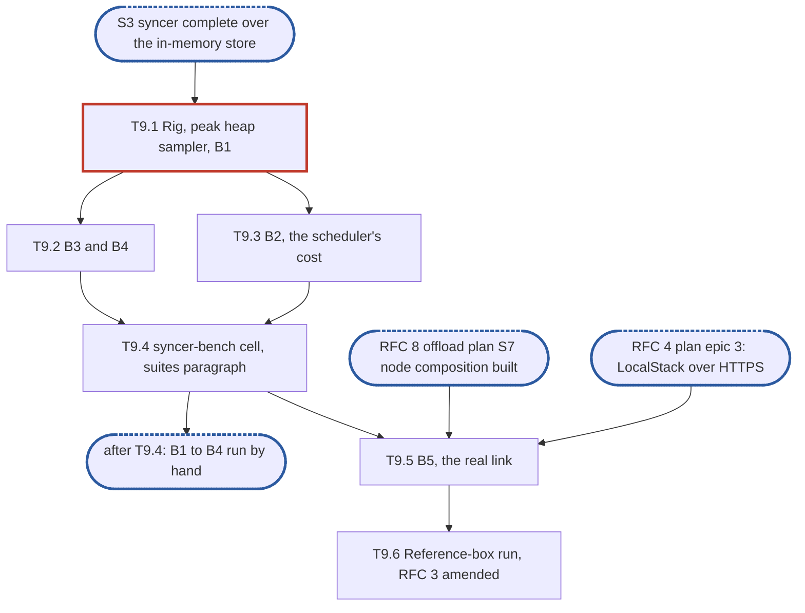

# Epic 9: syncer v2 E2E green

**Sources:** [RFC 3](../docs/internals/rfcs/rfc-3-syncer.md) §7.4, the benchmarks B1 to B5;
§7.3's first rule, for the simulated link; §8.1's "Benchmark" kind; §8.4's sentence that each
count stands behind one benchmark; §8.5, the performance targets; §8.6, the fields a result
records and the suites paragraph; §9's first open question, the fixed values; §2.10's decision
note on what would move them. The [RFC index](../docs/internals/rfcs/rfc-index.md), "Test
tiers": "What must not stand in", "A check that did not run is a failure", "Recording results"
and "A proposed target is replaced once, by measurement". Cited for what they hand over, not
owned: RFC 3 §2.2 (the per-worker figure), §2.9 (a round), §2.12 (the `Stats` this epic
reads); [RFC 29](../docs/internals/rfcs/rfc-29-test-harness.md) §4.3 and §4.10, the tiers and
how benchmarks are tracked. Every citation is `develop`'s text. The code lands on
`feat/storage-v2`, and the paths below are paths there.
**Track:** the team.
**Epic 9 estimate: 6 subtasks, 11.75 man-days.**
**Depends on:** **S3**, the syncer complete over the in-memory store: E1's `pool.New`, `Config`,
`Clock` and `Stats`; E2's fault wrapper with `Link` (`pkg/remote/memory`, its T2.2) and the
in-memory store's load record; E3's `internal/sched`, its in-memory opener (its T3.7) and the
clock its tests pass to `pool.New`; E4's attempt loop and `Upload`; E6's `Fetch`, `Prefetch` and
single flight; E7's `Stats` snapshot. For T9.5 only: **RFC 8 offload plan S7**, the node
composition built, whose epic 21 builds each store's `codec.Store` and the root's syncer in
`internal/node/content`; **RFC 4 plan epic 3**, `s3fault.LocalStack` at
`LOCALSTACK_HTTPS_ENDPOINT`; and, for a real service, **RFC 4 plan epic 9**'s T9.1,
`s3fault.Service` and its `DITTOFS_TEST_S3_*` variables. `internal/prof` is already on
`feat/storage-v2`.
**Blocks:** no epic of RFC 3's. Its measurements are the trigger of the RFC 3 plan's §6.1 row on a
fixed value becoming a setting, and they replace RFC 3 §8.5's proposed targets.

---

## 1. Goal

Epic 9 measures what the syncer costs. The checks of E1 to E7 say the syncer is correct, on the
virtual clock; the benchmarks here run on the real clock and report throughput, allocations and
peak memory, each against raw calls on the same store at the same pool size, so a result holds on
any machine. The first run on the reference box replaces RFC 3 §8.5's proposed targets, and the
fixed values of RFC 3 §2.10 that a run bears on are confirmed or proposed anew.

**At the end of the epic:**

- B1, B3 and B4 run in `pkg/syncer/pool` over `codec.Store` on RFC 4's in-memory store under E2's
  `Link`, a per-call latency and a per-byte time on the wall clock; B2 runs in
  `pkg/syncer/pool/internal/sched` on the scheduler alone.
- B5 runs in `internal/node/content` over the `codec.Store` the content wiring builds on the S3
  store, against LocalStack, and against a real service when RFC 4's `DITTOFS_TEST_S3_*`
  variables name one, each half beside raw calls at the configured worker counts.
- `dt run syncer-bench` runs all five, by hand, and fails when a benchmark did not run, never on
  a throughput or latency figure; `unit`'s `syncer-bench-smoke` option runs B1 to B4 once each
  on every pull request, without blocking it, so they cannot rot unseen.
- One run on the reference box is recorded with RFC 3 §8.6's fields and the RFC index's, and
  RFC 3 §8.5's proposed targets and §9's first open question are amended from it.

### 1.1 In scope

The benchmarks B1 to B5 and what each reports; the peak heap sampler they share; the
`syncer-bench` cell and the `syncer` group; RFC 3 §8.6's suites paragraph; the reference-box run,
its record, and the RFC 3 amendments it supports.

### 1.2 Out of scope

- **The counts CI gates on** (RFC 3 §8.4): allocations per chunk (E7, `unit/syncer-allocs`),
  queue operations per dispatch, fairness, peak in flight and the waiter counts (E3), retries
  (E4), single flight (E6). Each benchmark here stands on its count and does not assert it again,
  except B4's one `Get`, which costs one line (T9.2).
- **RFC 3 §8.5's two health latencies:** E5's checks on the virtual clock.
- **The soak** (RFC 3 §8.1): the RFC 3 plan's §6.1 row owned by RFC 8 offload plan epic 22.
- **The real-backend checks** (RFC 3 §8.1's "Real backend" kind): the §6.1 row owned by RFC 8
  offload plan epic 21.
- **Building a `codec.Store` per store and the root's syncer:** the §6.1 row owned by RFC 8
  offload plan epic 21. B5 calls what that epic builds.
- **The pool sizing tool** (RFC 3 §2.11): the §6.1 row owned `unowned`.
- **Making a fixed value a setting:** the §6.1 row owned `unowned`, which this epic's run can
  trigger but does not act on (D8).
- **Measuring the fixed values no benchmark here bears on,** the throttle limit's halving and the
  trickle rule's quarter among them: the §6.1 row this epic's pull request adds, owned
  `unowned` (D8).
- **Fixing a target a run misses:** a design finding against the epic that owns the code (the RFC
  index, "A proposed target is replaced once"), filed as an issue by T9.6, not fixed in this
  estimate (§9).

### 1.3 Names used here

- **E1**, epic 1, interfaces: `pool.New`, `Config`, `Clock` and `Stats`.
- **E2**, epic 2, test foundations: RFC 4's fault wrapper with `Link`, and `syncertest`.
- **E3**, epic 3, registration, flows and the fair scheduler: `internal/sched`, the in-memory
  opener and the clock its tests pass.
- **E4**, epic 4, termination, retries and the uploader.
- **E5**, epic 5, store health.
- **E6**, epic 6, the fetcher.
- **E7**, epic 7, memory bound, `Stats` and the fault sweep.
- **E8**, epic 8, the syncer's own integration: the settings section with `upload_workers` and
  `fetch_workers`.
- **E9**, this epic.
- **S3**, the syncer complete over the in-memory store: every RFC 3 §7 row E1 and E3 to E7 name
  green in `unit`.
- **S7**, the RFC 8 offload plan's node composition built, at the end of its epic 21.
- **B1 to B5** are RFC 3 §7.4's benchmarks, not epics.
- **The integration epic**, E8 here; outside this plan, RFC 8 offload plan epic 21, which composes
  the syncer in the node.

## 2. How the general rules apply

The rules are those of
[the RFC 3 plan's §1.5](rfc-3-syncer-plan.md#15-general-rules-for-each-epic). They are cited by
number and title, not copied.

| Rule | Subtasks | How |
| --- | --- | --- |
| rule 1, independent unit tests ([`CLAUDE.md`, "Writing tests"](../CLAUDE.md#writing-tests)) | T9.1 | The only production code is T9.1's peak heap sampler in `internal/prof`, tested on its own. The benchmarks are not unit tests: each runs over the code E1 to E7 built and tested |
| rule 2, fuzz tests where relevant ([`CLAUDE.md`, "By kind"](../CLAUDE.md#by-kind)) | none | Nothing here decodes bytes; the scheduler's fuzz target is E3's |
| rule 3, observability follows RFC 25, with RFC 3's own exception | T9.2, T9.5 | No metric, log or span is added. B3 and B5 read `Stats`, the counters E8's collector exports, for occupancy, the first-byte tail and the floor and stall counts |
| rule 4, profiling ([`CLAUDE.md`, "By kind"](../CLAUDE.md#by-kind)) | all | Every benchmark calls `b.ReportAllocs()`, does its setup before `b.ResetTimer()`, and runs under `internal/prof`'s leak check. The allocation and dispatch assertions are E7's and E3's counts, which B1 and B2 stand on (§1.2) |
| rule 5, public interface and internals ([`CLAUDE.md`, "Verifying a change"](../CLAUDE.md#verifying-a-change)) | T9.1, T9.2, T9.5 | B1, B3, B4 and B5 drive `Syncer` and `Flow` as the engine does, and time what a caller sees: an `Upload` returning, a `Fetch` yielding. B4 counts `Get`s at the in-memory store's own record of calls. B2 times `sched` directly, D2 says why |
| rule 6, known failures shrink | none | No suite this epic's benchmarks run in keeps a `known.yaml`; a benchmark that fails is a finding to fix |
| rule 7, v2 ignores v1 | all | Nothing reads `pkg/block`. The benchmarks are test files, which import RFC 4's codec, its stores and `s3fault` as amended RFC 0 §1.2 allows; T9.1's sampler adds `runtime/metrics` to `internal/prof` only |
| rule 8, real dependencies for properties of those dependencies ([`CLAUDE.md`, "Writing tests"](../CLAUDE.md#writing-tests)) | T9.5, T9.6 | B5 is the rule's last clause: the S3 store against LocalStack over HTTPS and against a real service, where credentials are. Nothing needs a disk |
| rule 9, code comment conventions ([`CLAUDE.md`, "Code comments"](../CLAUDE.md#code-comments)) | T9.2, T9.3, T9.4, T9.5 | `decision:` markers at B2's level (D2), at B3's round (D3), at the peak memory each benchmark reports (D4), at B5's bandwidth figure (D6) and on the `syncer-bench` entry (D5) |
| rule 10, a test must be able to fail ([`CLAUDE.md`, "Writing tests"](../CLAUDE.md#writing-tests)) | T9.1, T9.2, T9.4 | The sampler's test fails on a sampler that reads the heap once at the end. B4's count is seen to fire on a planted second `Get`. The cell is seen to fail on a run whose benchmarks all skipped. A figure is never asserted, so no figure needs a planted failure |
| rule 11, a symbol is exported only if the RFC's interface uses it | T9.1 | One export, `prof.PeakLiveHeap`, which two packages' benchmarks call (B1 to B4 in `pool`, B5 in `content`), and `internal/prof` exists to serve tests. No syncer symbol is added |
| rule 12, each subtask creates only what it declares | all | The sampler lands with B1, its first consumer; the cell with the benchmarks it runs (T9.4), and B5's command with B5 |

## 3. Requirements and invariants

Every obligation RFC 3 and the RFC index place on this epic, numbered so that subtasks and tests
can cite them.

**How the benchmarks run**

| # | Requirement | Kind | Source | Subtasks |
| --- | --- | --- | --- | --- |
| R1 | The benchmarks run on the real clock, never the virtual one | invariant | RFC 3 §7.4; §8.1, "Benchmark" | T9.1, T9.2, T9.3, T9.5 |
| R2 | B1 to B4 run on the in-memory store with a simulated link, a per-call latency and a per-byte time, neither ever zero: a backend that returns instantly never binds the pool | MUST NOT | RFC 3 §7.3; §7.4; §8.1, "Benchmark" | T9.1, T9.2 |
| R3 | B5 runs on a real store: a local emulator of the remote service, and a real service where credentials are | invariant | RFC 3 §7.4; §8.1, "Benchmark"; §8.6, "Suites"; RFC index, "What must not stand in" | T9.5, T9.6 |
| R4 | Each benchmark reports throughput, allocations and peak memory | invariant | RFC 3 §7.4 | T9.1, T9.2, T9.3, T9.5 |
| R5 | A benchmark never gates a change; what gates one is the counts of RFC 3 §8.4, each standing behind one benchmark | invariant | RFC 3 §7.4; §8.1, "Benchmark"; §8.4; RFC index, "Test tiers" | T9.4 |
| R6 | A benchmark that did not run is a failure: a run whose benchmarks all skipped, or a B5 skipped because no store was reachable, fails the cell, its reason reported | invariant | RFC index, "A check that did not run is a failure" | T9.4, T9.5 |
| R7 | The benchmarks run in a manual suite of the syncer's own, B5 against a real service only where credentials are, and RFC 3 §8.6's suites paragraph names the suite | invariant | RFC 3 §8.6, "Suites" | T9.4, T9.5 |
| R8 | B5's store is built as production builds it, so the harness is not a second construction standing in for the node's | invariant | RFC index, "What must not stand in" | T9.5 |

**What each benchmark measures**

| # | Requirement | Kind | Source | Subtasks |
| --- | --- | --- | --- | --- |
| R9 | B1: the syncer's own overhead, at one pool size, once through the syncer and once as raw calls on the in-memory store; target throughput through the syncer at least 97% of raw | bound | RFC 3 §7.4, B1; §8.5, B1 | T9.1 |
| R10 | B1: no allocation per chunk once warm, buffers being reused, reported | bound | RFC 3 §7.4, B1; §8.4, "allocations" | T9.1 |
| R11 | B2: one transfer dispatched with 1, 10, 100 and 1,000 flows waiting; target at most 1 µs at 1,000, and flat from 1 | bound | RFC 3 §7.4, B2; §8.5, B2; §2.9 | T9.3 |
| R12 | B3: one flow saturating uploads on a slow store while a second issues fetches; target the second flow's p99 queue wait within one round, and the first never above its cap | bound | RFC 3 §7.4, B3; §8.5, B3 | T9.2 |
| R13 | B4: N readers on one cold chunk make one transfer, whatever N | bound | RFC 3 §7.4, B4; §8.5 ("B4 is a count") | T9.2 |
| R14 | B5: the syncer over the store, and raw calls on the same store at the same pool size: `codec.Store`'s put attempt and `Get`, encoding and checksum included, called directly at the configured `upload_workers` and `fetch_workers`; target at least 95% of raw, below 90% a regression | bound | RFC 3 §7.4, B5; §8.5, B5 | T9.5 |
| R15 | B5 reports its throughput as a fraction of the raw calls', with the pools' occupancy beside it | invariant | RFC 3 §7.4 | T9.5 |
| R16 | Peak memory per half: target at most the pool size times the per-worker figure of RFC 3 §2.2, plus 10%. No benchmark here has a detached caller, so §2.2's detached term is zero in every run | bound | RFC 3 §8.5; §2.2 | T9.1, T9.5 |

**Recording results**

| # | Requirement | Kind | Source | Subtasks |
| --- | --- | --- | --- | --- |
| R17 | A result is recorded with the revision it measured, in absolute numbers, with the box (CPU and memory), the operating system and each row's concurrency | invariant | RFC 3 §7.4; §8.5; RFC index, "Recording results" | T9.1, T9.4, T9.6 |
| R18 | B5's result records the backend and its region, the round-trip time, the bandwidth, the block size, the pool sizes and the raw calls' throughput | MUST | RFC 3 §8.6 | T9.5 |
| R19 | B1 to B4's results record the in-memory store's simulated latency and per-byte time | MUST | RFC 3 §8.6 | T9.1, T9.2, T9.3 |
| R20 | A target is stated against something measured on the same box: B1 against raw calls on the same in-memory store, B5 against raw calls on the same store at the same pool size | invariant | RFC 3 §8.5; RFC index, "Recording results" | T9.1, T9.5 |
| R21 | A proposed benchmark target is replaced once, by the first run on the reference box, with the measured value plus headroom stated beside the result; a target that run misses is a design finding, changed in the design or withdrawn with its reason, never relaxed | invariant | RFC index, "A proposed target is replaced once, by measurement" | T9.6 |
| R22 | RFC 3 §2.10's fixed values are proposals until §8.5's benchmarks measure them; each one a run bears on is confirmed or proposed anew through RFC 3, and none becomes a setting unless a measurement shows it wrong for a workload an operator can name | invariant | RFC 3 §9, question 1; §2.10 and its decision note | T9.6 |

Not obligations of this epic: the RFC index's rule that a later regression of more than 10% needs
a recorded decision, which binds the runs after this epic's first baseline; its device and
filesystem fields, since nothing here touches a disk; its rule on hand-built records, since no
check of content runs here.

## 4. Decisions this epic takes

- **D1, B1, B3 and B4 run over E3's in-memory opener, on the wall clock.** E3's opener builds
  `pool.New` over RFC 4's in-memory store under E2's wrapper, with `codec.Store` over it, as
  production composes them (E3's T3.7). T9.1 moves that construction into a helper taking a
  `testing.TB` and the two worker counts, which the opener and the benchmarks both call, since an
  `Opener` takes a `*testing.T`. Outside a `testing/synctest` bubble the clock E3's tests pass
  reads the wall clock, so the benchmarks need no clock of their own; E2's `Link` takes the same
  clock as its `Waiter` (E2's D3). If E3's D12 is declined and its tests pass `pkg/sim`'s
  `TestClock`, the helper takes the clock as an argument and T9.1 adds a three-line wall clock in
  the benchmark file, as `cmd/dfs/commands/clock.go`'s `systemClock` is. The raw twin calls
  `Env.NewPut(…).Attempt` and `Env.Store.Get` from the same number of goroutines as the pool's
  size. B1 runs at two pool sizes and two links: at 128 workers on the working link the
  aggregate, about 2.5 GiB/s, may be bound by the box's encoding rather than the pool, which the
  16-worker run is not, and on a slow link the syncer's overhead hides behind the wait, which
  the fast link's does not. Prior art: RFC 4 plan epic 9's raw twins on the store's own transport (its T9.4); the
  journal's `BenchmarkRaw` beside its J benchmarks (`pkg/journal/conformance`, checked).
- **D2, B2 times the scheduler alone.** RFC 3 §7.4 calls B2 the scheduler's cost and §8.5 sets it
  at 1 µs. Through the pool, a dispatch also wakes the waiting caller's goroutine, which is the Go
  runtime's cost, not DRR's, and would sit above 1 µs at any number of flows. B2 therefore runs in
  `internal/sched`'s own benchmark file: `Add`, `Next` and `Done` of one entry while 1, 10, 100
  and 1,000 other flows each hold one queued entry on one store, every flow fresh and every flow
  in debt, as E3's count does (its T3.1). It needs no store and no link. B1 measures the whole
  path, so the goroutine hand-off is still measured, where it belongs. A `decision:` marker at the
  benchmark says so; withdraw it if a profile of B1 shows dispatch, not transfer, dominating.
  Prior art: none found for a fair scheduler's own benchmark; E3's operation count (its D3) is
  the same split.
- **D3, B3 has two variants, and a round is one transfer of the largest encoded block.**
  - RFC 3 §7.4's setup puts flow A's uploads and flow B's fetches in different halves, which share
    no worker, so on the in-memory store it measures only what the two halves share. That is the
    first variant, `a=upload`, kept as the RFC writes it.
  - The second, `a=fetch`, has flow A saturate demand fetches on the same slow store, so B's
    fetches wait in the same class of the same half: the wait exercises the cap and the waiter
    multiples, which is what RFC 3 §2.10's decision note reads B3 for ("B3's queue wait above one
    round").
  - RFC 3 uses "one round" in time (§2.12, `syncer_queue_wait_seconds`) without stating it in
    time. B3 takes a round as the link's time for one largest encoded block on the slow store,
    `perCall + bytes × perByte`: within it every busy worker frees once, so each waiting flow is
    visited. B3 reports the wait's p99 as `wait-p99-ns` and as `wait-p99/round`.
  - The wait is timed where a caller sees it: from the `Fetch` call to its first yielded chunk,
    less the link's time for that chunk, which the benchmark set. The first flow's busy workers
    are sampled from `Stats` at each yielded chunk and the most reported as `a-peak-workers`
    beside the cap.

  A `decision:` marker at the benchmark names the round and the variant. §9 proposes the RFC 3
  §2.9 sentence. Prior art: none found.
- **D4, peak memory is the most live heap seen at any collection, and it is read against the
  bound on B5 only.** `prof.PeakLiveHeap` reads `runtime/metrics`' `/gc/heap/live:bytes` at the
  end of every garbage collection, re-armed by a finalizer, and returns the most it saw: the
  live heap, without the garbage a sampled `HeapAlloc` counts, and without stopping the world as
  `runtime.ReadMemStats` does. Each benchmark reports it, less the live heap before its timed
  region, as `peak-heap-B`, beside `bound-B`, the pool size times `Max + MaxDecodeLen(Max) +
  header cap` (RFC 3 §2.2) at the run's figures. On the in-memory store the heap also holds every
  stored body and the load record's calls, so B1 and B3 report the raw twin's peak beside the
  syncer's, the difference being what the syncer adds, and are never read against `bound-B`. B5's
  bodies live in the emulator's process or the service's, so B5, run per half, is the run read
  against R16. A `decision:` marker at the sampler's call in B1 says so. Prior art: Go's
  `runtime/metrics` documentation of `/gc/heap/live:bytes` (from memory); the "GC notifier"
  pattern of a re-armed finalizer (from memory). Not chosen: E7's held-pool heap check, a unit
  check that holds the pool and reads `LiveHeap` once, which RFC 3 §7.2's memory-bound row already
  is.
- **D5, `syncer-bench` is a manual `exit` cell that fails only when nothing ran.** RFC 3 §8.6 puts
  the benchmarks in a manual suite of the syncer's own, while §7.4 says they run after a change
  merges; the suites paragraph is the one that registers, so the cell is `tier: manual` and §9
  proposes §7.4's sentence. One `sh` command, as `engine-bench` has: `go test -count=$n
  -run=^$ -bench=. -timeout=…` over `./pkg/syncer/pool/` and
  `./pkg/syncer/pool/internal/sched/`, and from T9.5 `./internal/node/content/` with
  `-bench=^BenchmarkB5`, written to `{out}/bench.txt` and printed; it exits 2 when no line starting
  `BenchmarkB` was written for any of the five, so a run where a package's benchmarks all skipped
  fails (R6). `n` is 10 unless `SYNCER_BENCH_COUNT` says otherwise, as `ENGINE_BENCH_COUNT` does.
  `metrics: go-bench`, so `dt` keeps each figure's median in its history. From T9.5 it `needs:
  [docker, "service:localstack"]`. No build tag: a benchmark runs only under `-bench`, so `unit`
  never runs one, and untagged files stay under `go vet` and the linter; this drops the RFC 3
  plan's `syncer_bench` tag and its line in `lint-go` (§9). The `syncer` group holds
  `[syncer-bench]`, as RFC 29 §4.9 names a `syncer` group for the component. A `decision:`
  comment on the entry says it is manual and gates nothing.
  - Since `go test` never runs a benchmark function, a manual cell alone would let B1 to B4 rot
    while every check stays green. An option of `unit`, `syncer-bench-smoke`, runs them once each
    (`-run=^$ -bench=. -benchtime=1x`) over the two packages, `blocking: { pr: false }` as
    `bench-smoke` is: it fails only when a benchmark panics or B4's count fires, never on a
    figure, so no figure gates a change (R5), and after a merge it blocks, so `develop` goes red.
    B5 is not in it, since it needs LocalStack. Prior art: `engine-bench` and `journal-bench`'s
  guard and `sh` form (`test/suites.yaml`, checked); RFC 4 plan epic 9's `remote-bench` (its D6),
  which instead blocks after merge on counts, which here are E3 to E7's in `unit`.
- **D6, B5 runs on the target RFC 4's tests already choose, through the content wiring's own
  builders.**
  - The target is `s3fault.Service(b)` (RFC 4 plan epic 9, its D1): LocalStack at
    `LOCALSTACK_HTTPS_ENDPOINT` unless `DITTOFS_TEST_S3_ENDPOINT` names a real service, so one body
    runs on both and a run by hand with a service's variables is B5 against it (R3). Until that
    epic lands, `s3fault.LocalStack(b)` (RFC 4 plan epic 3) gives LocalStack alone.
  - The store, its `codec.Store` and the syncer are built by the functions RFC 8 offload plan
    epic 21 writes in `internal/node/content` for one store configuration and for the root's
    syncer, at the settings section's `upload_workers` and `fetch_workers` (E8), so B5 measures
    what the node composes (R8). B5 is an internal test file of package `content`, so those
    builders need not be exported for it (rule 11).
  - The raw twin calls the same `codec.Store`'s `NewPut(…).Attempt` and `Get` directly, from as
    many goroutines as each half's worker count.
  - §8.6's fields are Go benchmark configuration lines, printed once: `service:`, `region:`,
    `rtt:` (the median of 21 get probes, `Store.Health`, before the timed region), `bandwidth:`,
    `block:`, `upload-workers:`, `fetch-workers:`; `raw` throughput is the twin's own line. The
    link's bandwidth is not measured apart: `bandwidth:` is the raw twin's aggregate get
    throughput at the full pool, the most the link carried in the run, and a `decision:` marker
    says so.
  - Beside throughput and allocations, B5 reports per half `occupancy` (the mean of `Stats`'
    `WorkersBusy` over `Workers`, read at each operation's end), `fb-p999-ns` (the bucket bound
    holding `FirstByte`'s 99.9th percentile) and the `Floor` and `Stalled` retry counts, which
    RFC 3 §2.10's decision note reads against the first-byte bound and the floor.

  Prior art: RFC 4 plan epic 9's D1, D2 and D5 (one service per run, named by variables; the
  configuration lines), which this follows so both plans' benchmarks read alike.
- **D7, results are recorded by `dt`, and the reference-box run is recorded in the RFC.** `dt`
  records the commit, the host and the operating system with every run, and keeps each figure's
  median (`test/harness/run/gobench.go`, checked); the benchmark adds the run's conditions as
  configuration lines (D6) and the varying ones as name keys
  (`half=upload/impl=syncer/workers=128`), so `benchstat -col /impl` reads B1's and B5's ratio
  from one run. The reference-box run (T9.6) goes into RFC 3 §8.5 as the targets the RFC index
  says replace the proposed ones, each with its measured value and headroom, and the commit and
  box beside it. Prior art: RFC 4 plan epic 9's D5; Go's benchmark data format (from memory).
- **D8, §9's first open question is answered value by value, and only for what a run bears on.**
  RFC 3 §2.10's decision note names what would move each fixed value. A run here bears on two
  groups: B5's first-byte tail and floor and stall counts on the first-byte bound and the
  throughput floor, and B3's `a=fetch` wait on the cap and the queue and waiter multiples. T9.6
  confirms or proposes each of those through a pull request to RFC 3. The others are moved by the
  fault runs and scripted runs E4, E5 and E7 own on the virtual clock, or by nothing yet measured:
  the throttle limit's halving and the trickle rule's quarter, which RFC 3 §9 calls the least
  measured, need a store that throttles or trickles under load, which no §7.4 benchmark is. T9.6
  rewrites RFC 3 §9's first question to name, for each value still a proposal, the measurement
  that would settle it, and no value becomes a setting (RFC 3 §2.10). Those measurements are a
  row of the RFC 3 plan's §6.1 ledger, which this epic's pull request adds: owner `unowned`,
  trigger a benchmark against a store that throttles or trickles under load, or a fault run that
  shows one of those values wrong. Prior art: none found.

## 5. Target tree

```text
internal/prof/
  peak.go                  T9.1  PeakLiveHeap: the most live heap seen at any collection (D4)
  peak_test.go             T9.1  a peak between two collections is seen; stop ends the watch
pkg/syncer/pool/
  opener_test.go           T9.1  E3's in-memory construction moved into a helper over testing.TB (D1)
  bench_test.go            T9.1  B1, the rig: the opener at the default pools, Link, the raw twin,
                                 the configuration lines (D7)
                           T9.2  B3 and B4
  internal/sched/
    bench_test.go          T9.3  B2 (D2)
internal/node/content/
  syncer_bench_test.go     T9.5  B5 over the content wiring's store and syncer (D6)
test/suites.yaml           T9.4  syncer-bench, the syncer group, unit/syncer-bench-smoke (D5);
                           T9.5  B5's command and needs
docs/internals/rfcs/rfc-3-syncer.md
                           T9.4  §8.6's suites paragraph
                           T9.6  §8.5's targets, §9's first question
docs/internals/testing.md  T9.4  regenerated by dt docs
```

## 6. Subtasks

### T9.1 The rig, the peak heap sampler and B1

**Subtask T9.1 estimate: 3 man-days.**

- **Track:** the team. **Depends on:** S3.
- **Covers:** R1, R2, R4, R9, R10, R16, R17, R19, R20.
- **Deliverables:**
  - `internal/prof/peak.go` (D4):

    ```go
    // PeakLiveHeap watches the live heap from now until stop is called, and stop
    // returns the most it saw at the end of any garbage collection in between.
    func PeakLiveHeap() (stop func() uint64)
    ```

    Consumed by B1, B3 and B4 here and by B5 (T9.5).
  - `opener_test.go`: E3's in-memory construction as a helper over `testing.TB` and the two
    worker counts, the opener calling it (D1).
  - `bench_test.go`: `BenchmarkB1` with name keys `half=upload|fetch`, `impl=syncer|raw`,
    `workers=16|128` and `link=working|fast`, a block of the default 4 MiB target in chunks of
    256 KiB. The `working` link is 20 ms per call and the per-byte time that makes one block take
    about 200 ms (RFC 3 §2.10's working link); the `fast` one 1 ms per call and a tenth of that
    per-byte time, so the syncer's own CPU is not hidden behind the wait (D1). The configuration
    lines `link-per-call:`, `link-per-byte:` (one pair per link), `block:` and `chunk:`. The
    metrics `allocs/chunk`, `peak-heap-B` and `bound-B` (D4). The upload half deletes each block once its `Upload` returns, in both
    variants, so the store holds no more than the pool's bodies. Consumed by T9.2, which adds
    B3 and B4 to the file, and T9.4's cell.
- **Acceptance criteria:**
  - `go test -run=^$ -bench=B1 ./pkg/syncer/pool/` prints sixteen results, each with MB/s,
    allocations per operation and per chunk, and the peak heap beside its bound.
  - The link's per-call and per-byte times are both non-zero and printed (R2, R19).
  - Every iteration runs on the wall clock: one upload under the link takes at least the link's
    time (R1).
  - The setup, building the syncer, registering the store and warming the buffers, runs before
    `b.ResetTimer()`.
- **Tests:** `peak_test.go`, at the value the benchmarks report: a 64 MiB slice allocated, kept
  across a forced collection, then dropped before `stop`, must be reported (catches a sampler
  that reads once at `stop`, R16), and after `stop` no finalizer is re-armed, under
  `internal/prof`'s own leak check (catches a watch that never ends). B1 itself is checked by
  running it once with the link set to zero, which must be refused by the rig (R2), and once with
  a planted allocation per chunk in a scratch branch, which `allocs/chunk` must show (R10). No
  test double: the store is kind 2, the wrapper kind 3.

### T9.2 B3 and B4

**Subtask T9.2 estimate: 2 man-days.**

- **Track:** the team. **Depends on:** T9.1.
- **Covers:** R1, R2, R4, R12, R13, R19.
- **Deliverables:** in `bench_test.go`:
  - `BenchmarkB3` (D3): `a=upload` and `a=fetch`, a slow store under `Link` at 200 ms per call,
    flow A keeping its half's queue full, flow B issuing one fetch per iteration; metrics
    `wait-p99-ns`, `round-ns`, `wait-p99/round`, `a-peak-workers` and `cap`; the peak heap as in
    B1; a `decision:` marker naming the round and the variants.
  - `BenchmarkB4`: N of 1, 10, 100 and 1,000 readers on one cold chunk of a stored block, each a
    `Fetch` on its own flow; each iteration a fresh block, so the chunk is cold. The first `Get`
    is held at its first body byte (`Env.Faults.Hold`) until `Stats`' `Joined` for the store has
    risen by N−1, polled with a short pause, and then released, so every reader has joined
    before the chunk passes: a reader arriving after it would rightly start a fetch of its own.
    The `Get`s that reached the in-memory store, read from its load record, are reported as
    `gets/op`, and more than one is a `b.Fatalf` (R13).
- **Acceptance criteria:**
  - B3 prints, for each variant, the second flow's p99 wait, the round it is read against and
    the first flow's most busy workers beside its cap (R12).
  - B4 prints one `Get` per operation at every N; a planted second `Get` fails it.
- **Tests:** B4's `b.Fatalf` is seen to fire once, in a scratch branch, on a fetch that bypasses
  single flight (catches a count that reads nothing, rule 10). B3's figures are reported, never
  asserted (R5). Under the leak check.

### T9.3 B2, the scheduler's cost

**Subtask T9.3 estimate: 0.75 man-days.**

- **Track:** the team. **Depends on:** T9.1.
- **Covers:** R1, R4, R11, R19.
- **Deliverables:** `internal/sched/bench_test.go` (D2): `BenchmarkB2` with name keys
  `waiting=1|10|100|1000` and `flows=fresh|debt`, timing one `Add`, `Next` and `Done` per
  iteration with the other flows' entries queued before `b.ResetTimer()`; `b.ReportAllocs()`;
  the peak heap reported as in B1; a configuration line saying the link does not apply (R19).
  The `decision:` marker of D2.
- **Acceptance criteria:**
  - Eight results, each in ns per dispatch, read against R11's 1 µs and against each other for
    flatness; none asserted (R5).
  - No allocation per dispatch is reported once the flows exist.
- **Tests:** none of its own: flatness is E3's operation count in `unit` (its T3.1), which this
  benchmark stands on (§1.2).

### T9.4 The `syncer-bench` cell and the suites paragraph

**Subtask T9.4 estimate: 1 man-days.**

- **Track:** the team. **Depends on:** T9.2, T9.3.
- **Covers:** R5, R6, R7, R17.
- **Deliverables:** `test/suites.yaml`: `syncer-bench` (D5), with its `decision:` comment, the
  `syncer` group, and `unit`'s `syncer-bench-smoke` option. RFC 3 §8.6's suites paragraph naming `syncer-bench` and the `syncer` group,
  and its last sentence rewritten to name only the suites still unregistered when this lands.
  `test/harness/bin/dt docs`, regenerating `docs/internals/testing.md`. Consumed by T9.5, which
  adds B5's command, and T9.6's run.
- **Acceptance criteria:**
  - `dt run syncer-bench` runs B1 to B4 and writes `{out}/bench.txt`, which `dt`'s go-bench
    reader parses.
  - Run with a `-bench` pattern that matches nothing, the cell exits 2 naming the benchmark that
    did not run (R6).
  - `dt run unit/syncer-bench-smoke` runs every benchmark of the two packages once and passes;
    a planted panic in one fails it.
  - `dt docs --check` passes.
- **Tests:** the guard, checked by running the cell once with a planted pattern that matches
  nothing, the failing run attached to the pull request (catches a guard that greps the wrong
  file). `dt docs --check` catches a suite the paragraph names and the registry lacks.

### T9.5 B5, the real link

**Subtask T9.5 estimate: 3 man-days.**

- **Track:** the team. **Depends on:** T9.4, and RFC 8 offload plan S7 and RFC 4 plan epic 3.
- **Covers:** R1, R3, R4, R6, R8, R14, R15, R16, R18, R20.
- **Deliverables:**
  - `internal/node/content/syncer_bench_test.go` (D6): `BenchmarkB5` with name keys
    `half=upload|fetch` and `impl=syncer|raw`, on `s3fault.Service(b)`'s target, the store, its
    `codec.Store` and the syncer built by the content wiring's builders at the section's default
    worker counts; the configuration lines and metrics of D6, and the peak heap against its bound
    per half (D4). Each block written is deleted after the run, through the store, so a run
    leaves nothing on a real service.
  - `test/suites.yaml`: B5's command in `syncer-bench` and its `needs` (D5).
- **Acceptance criteria:**
  - Against LocalStack, B5 prints both halves through the syncer and raw, with every field of
    RFC 3 §8.6 for B5 (R18), occupancy beside throughput (R15), and the peak heap per half beside
    its bound (R16).
  - With a service's `DITTOFS_TEST_S3_*` variables set by hand, the same run reports against that
    service, the configuration lines naming it.
  - With neither LocalStack nor a service reachable, B5 fails naming the variable it needs, never
    skips silently, and the cell fails (R6).
- **Tests:** B5 is checked by one run against LocalStack in the pull request, and by the cell's
  guard (T9.4). The raw twin and the syncer share one `codec.Store`, so a twin that built its own
  store would be visible in review as a second construction (R8). Under the leak check.

### T9.6 The reference-box run and what it amends

**Subtask T9.6 estimate: 2 man-days.**

- **Track:** the team. **Depends on:** T9.5.
- **Covers:** R3, R17, R21, R22.
- **Deliverables:**
  - One `dt run syncer-bench` on the reference box at `-count=10`, recorded with the commit, the
    box's CPU and memory and the operating system, beside the RFC 3 §8.6 fields of each
    benchmark (D7); one B5 run by hand against a real service where credentials are, recorded
    the same way.
  - A pull request to RFC 3: §8.5's proposed targets replaced by the measured values with their
    headroom, each with the commit and the box; a target the run misses left proposed and named
    as a design finding, with an issue against the epic that owns the code (R21); §9's first
    question rewritten as D8 says, each fixed value B3 and B5 bear on confirmed or proposed anew,
    and the rest each naming the measurement that would settle it (R22).
- **Acceptance criteria:**
  - Every §8.5 benchmark row carries a measured value and headroom from the reference box, or is
    named as a finding with its issue.
  - No fixed value of RFC 3 §2.10 becomes a setting.
  - No figure from another box replaces a target.
- **Tests:** the run itself; the RFC edit is checked in review against the attached
  `bench.txt`, through `benchstat`.

## 7. Order of work



T9.1 is the blocker: B3 and B4 build on its rig, and B5 on its sampler. T9.3 needs only the
sampler and could start beside T9.2. B5 waits on S7, which comes late, so T9.1 to T9.4 can land
well before it. Checkpoint after T9.4: B1 to B4 run by hand through `dt`.

## 8. Suggested pull requests

| PR | Subtasks | Man-days | After | Why together |
| --- | --- | --- | --- | --- |
| 1 | T9.1, T9.2, T9.3, T9.4 | 6.75 | — | B1 to B4 and the cell that runs them, everything over the in-memory store |
| 2 | T9.5 | 3 | PR 1, RFC 8 offload plan S7 | B5 on the composed node's store, which waits on S7 |
| 3 | T9.6 | 2 | PR 2 | the reference-box run and the RFC 3 amendments it supports, on `develop` |

A suggestion only: one pull request per subtask works as well. PR 3 changes only the RFC, so it
goes to `develop` and is picked onto `feat/storage-v2`.

## 9. Open points

- **RFC 3 §7.4 and §8.6 disagree on when the benchmarks run.** §7.4 says "after a change merges",
  §8.6 a manual suite. D5 follows §8.6, the paragraph that registers. Proposed §7.4 text, for
  RFC 3's author: "Benchmarks never gate a change; they run by hand in the syncer's manual suite
  ([§8.6](#8.6%20Recording%20results)), and what gates a change instead is in
  [§8.4](#8.4%20What%20CI%20checks%20instead%20of%20timing)."
- **RFC 3 does not state a round in time.** D3 takes it as the link's time for one largest
  encoded block on the slowest store with work waiting. Proposed RFC 3 §2.9 sentence: "In time, a
  round is at most one transfer of the largest encoded block on the slowest store with work
  waiting: every busy worker frees within it."
- **B3's first variant measures little on the in-memory store.** With uploads and fetches in
  different halves, `a=upload` sees only what the halves share, which on the in-memory store is
  nearly nothing; on the S3 store they share the connection pool (RFC 3 §9, settled point 1). D3
  keeps it as written and adds `a=fetch`, which is what §2.10's decision note reads.
- **The plan's `syncer_bench` tag is dropped** (D5), and with it its line in `lint-go`'s list: a
  benchmark needs no tag to stay out of `unit`, and a tag would hide the files from `go vet`.
- **The plan's epic 9 outline reads B1 and B3's peak heap against the bound.** D4 reads it on B5
  only, since the in-memory store's bodies and call records share the heap.
- **B5 waits on RFC 8 offload plan epic 21's builders**, which are not broken down yet. It needs
  the content wiring to build one store's `codec.Store` and the root's syncer in functions a test
  of package `content` can call with a store configuration and the two worker counts, not inline
  in `node.New`.
- **Whether the reference box exists when T9.6 runs.** The RFC index names a pair of machines set
  aside for the series; if none is available, T9.6 records the run on the dedicated benchmark host
  and replaces no target, since a figure from another box replaces none (R21).
- **Misses are not in the estimate.** A §8.5 target the reference-box run misses is a design
  finding against E3 to E7 (the RFC index); its fix is that epic's, through its own issue.
