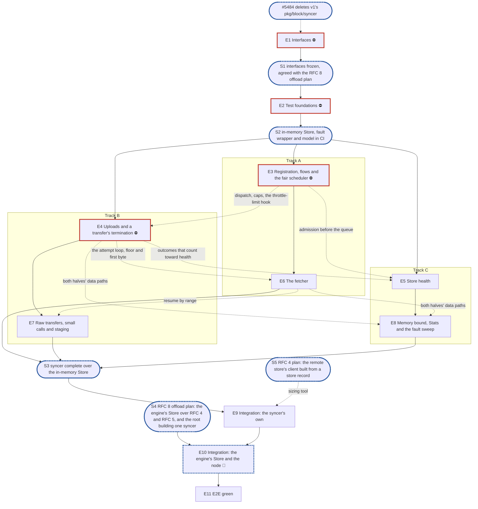

# RFC 3 — syncer v2: implementation plan

**Scope.** All of [RFC 3, the syncer](../docs/internals/rfcs/rfc-3-syncer.md): the interface, both
halves, the fair scheduler, termination and retries, store health, the fetcher's single flight,
raw and small transfers, the staging budget, the memory bound, `Stats`, the two settings and the
pool sizing tool. RFC 3's status is `draft`, not `deferred`, and the whole RFC is planned (Step 0
#11). Related RFCs, with how far each is in scope:

- **Constraints only** (each has, or will have, its own plan):
  - [RFC 2](../docs/internals/rfcs/rfc-2-carver.md), the carver; [RFC 4](../docs/internals/rfcs/rfc-4-remote-tier.md),
    the remote tier; [RFC 5](../docs/internals/rfcs/rfc-5-transforms.md), transforms. Their plans are written
    beside this one for the umbrella #5488. The syncer imports none of them (RFC 3 §1.3, RFC 0 §1.2);
    the seams are in §1.1 below.
  - [RFC 8](../docs/internals/rfcs/rfc-8-engine.md), the engine: its offload plan
    (`.planning/rfc-8-offload-engine-plan.md`, being written) composes the syncer into the engine and
    the node and builds the engine's `Store` over RFC 4 and RFC 5.
  - [RFC 0](../docs/internals/rfcs/rfc-0-data-lifecycle.md), [RFC 1](../docs/internals/rfcs/rfc-1-journal.md) and
    [RFC 28](../docs/internals/rfcs/rfc-28-journal-format.md), [RFC 6](../docs/internals/rfcs/rfc-6-block-metadata.md),
    [RFC 9](../docs/internals/rfcs/rfc-9-gc.md), [RFC 12](../docs/internals/rfcs/rfc-12-snapshots.md),
    [RFC 13](../docs/internals/rfcs/rfc-13-configuration.md), [RFC 26](../docs/internals/rfcs/rfc-26-catalog-backups.md)
    and [RFC 27](../docs/internals/rfcs/rfc-27-namespace-migration.md).
  - [RFC 24](../docs/internals/rfcs/rfc-24-resources.md) §6.2 and §7.2, which RFC 3 §2.1 and §2.10 cite.
    Step 0 #4 did not name it; this plan treats it as constraints only (§6, O5).
- **The rules every epic follows:** [RFC 25](../docs/internals/rfcs/rfc-25-observability.md) and
  [RFC 29](../docs/internals/rfcs/rfc-29-test-harness.md) (§1.5 rules 3 and 6).

**Tracks.** A, B and C, with no owner (§3.4).

**Programme.** The umbrella #5488, "offload: RFC 2–5 and the engine's offload part", release v1.1;
roadmap epic #3619. It builds on the journal-only engine, stage 3 of #3119
(`.planning/rfc-8-journal-only-engine-plan.md`), and takes over #4276 (syncer, remote clients and GC
composed in the node), whose composition half the RFC 8 offload plan owns. GC (RFC 9, roadmap
#3620) is planned later.

**Naming.** v1 is `pkg/block/syncer` as it stands (the upload controller and its dynamic semaphore)
with the rest of the v1 block tier. #3119's stage 4 deletes it (D8 of
`.planning/rfc-16-store-cutover-stage4-plan.md`, PR #5484). v2 is the syncer RFC 3 describes, built
here. v2 ignores v1 (rule 7), and no epic touches v1 code.

**Transition policy.** New installations only (#3119). v1 and v2 never run in one binary, so no
metric, log key or setting carries a version.

**Branches.** The plan lands on `develop`. The code lands on `feat/storage-v2`, where the
journal-only engine, `pkg/sim`, `pkg/health`, `pkg/metrics` and `pkg/settings` live.

**Defaults used from Step 0:** no dashboards (#9); output `.planning/rfc-3-syncer-plan.md` (#10).
Every other input was answered by the user.

**Pending the user's answer.** Four design questions are written in place with the recommended
option (§6, Q1 to Q4). The pull request stays a draft until they are answered.

---

## 1. Introduction

### 1.1 What we are building

RFC 3's "Start here" and "In short" describe the result: one syncer per process, two worker pools,
work served by class and fairly across stores and flows, health per store and direction, and a
fetcher that joins concurrent demand. RFC 3 §10 lists where today's code differs; this plan builds
v2 beside it and lets stage 4 delete v1.

| v1 | v2 | Fate |
| --- | --- | --- |
| `pkg/block/syncer` (`upload_controller.go`, `dynsem.go`: an adaptive upload window per store) | `pkg/block/syncer` (D1, Q4), RFC 3 §1.3's surface | v1 deleted by #5484; v2 written fresh |
| `pkg/block/remote/memory` (v1's in-memory remote store) | `pkg/block/syncer/syncertest`: the syncer's in-memory `Store`, its fault wrapper and its conformance suite (D2) | v1 deleted by #5484 |
| no setting | `upload_workers`, `fetch_workers` (RFC 13 Appendix B) in the syncer's settings section (epic 9) | new |
| no tool | the pool sizing tool, a `dfs` subcommand (D3, epic 9) | new |

**Seams with the other plans of #5488.** Assumed here; each is agreed at S1 (§3.2):

- **RFC 8 offload plan.** It builds the engine's `Store`, which composes RFC 4's codec and remote
  store and RFC 5's transforms behind RFC 3 §1.3's `Store`, mapping RFC 4 §4.8's and RFC 5 §2.7's
  errors onto the syncer's set, deriving each `ProbeKey`, and taking RFC 24 §6.2's CPU token per
  chunk's encode. It builds the root's syncer, opens a flow per share, exports `Stats` with flows
  replaced by shares (RFC 3 §2.12), and passes the per-worker memory inputs (D10). That adapter runs
  this plan's `Store` conformance suite (D2).
- **RFC 4 plan.** Its remote store's probe (RFC 4 §4.7), checksum modes (RFC 4 §4.3) and versioned
  objects (RFC 4 §4.14, §4.15) are what the engine's `Store` hands through; the syncer sees only
  RFC 3 §1.3's types. The sizing tool (epic 9) builds RFC 4's store directly, so it waits on that
  plan's store client (S5).
- **RFC 5 plan.** `MaxEncodedLen` and `MaxDecodeLen` (RFC 5 §3.1) reach the syncer as numbers in its
  configuration (D10), never as an import.
- **RFC 2 plan.** The format's chunk-count cap and the block target (RFC 2 §5) reach the syncer the
  same way. The syncer's `Chunk` is not the carver's (RFC 3 §1.3).

**Dependency limits.** The syncer's own packages import the standard library, `pkg/sim`'s nothing
(tests only) and nothing else: no metrics library, no RFC 2, 4 or 5 package (RFC 3 §1.4, §2.12;
rule 7's import test). The integration epic's collector and conditions live in `internal/node`.

### 1.2 How the plan is organised

- Epic 1 freezes the surface; epic 2 builds the in-memory `Store`, its fault wrapper and
  conformance suite, the scheduler's reference model and the measuring helpers.
- Six middle epics, two per track, cut along RFC 3's seams:
  - Track A: registration, flows and the fair scheduler (epic 3), then the fetcher (epic 6);
  - Track B: uploads and a transfer's termination (epic 4), then raw transfers, small calls and
    staging (epic 7);
  - Track C: store health (epic 5), then the memory bound, `Stats` and the fault sweep (epic 8).
- Epic 9 is the integration that is the syncer's own: its settings, its series and conditions over
  a `Stats` function, its alert rules and the sizing tool. Epic 10 is the integration that waits on
  the RFC 8 offload plan: the checks against the engine's `Store` on a real backend, and the series
  wired to the node's syncer. Epic 11 runs the benchmarks and the soak.

RFC 3 §8.6's suites paragraph puts every check in `unit` (an allocation count in `unit/nonrace`) and
the real-backend checks in `integration`. Neither keeps a `known.yaml`, so no test lands red: each
lands green with the epic that makes it pass (§1.4).

### 1.3 What epic 1 must deliver

The exported surface of `pkg/block/syncer`, frozen at S1, with stub bodies:

- every type, interface, error value and method of RFC 3 §1.3, `Store` included, and the
  `Syncer`'s own `Close` and `Stats`;
- `Stats`, with a field for every series of RFC 3 §2.12, per store, half, class and flow as that
  section labels them;
- the constructor and its configuration, which RFC 3 leaves open (D10): the two pool sizes (RFC 3
  §2.10), the per-worker memory inputs (RFC 3 §2.2), the transfers size (RFC 24 §7.2, D9), the clock
  (D4) and the logger (RFC 3 §1.4);
- `Clock`, declared as the subset of RFC 8 §2.1's clock the syncer reads (D4).

No internal interface is declared: the only two-consumer seam before any implementation is `Store`
itself (the in-memory store of epic 2 and the engine's adapter), which is RFC 3's own. Q1 and Q2
may change `Store.Put`'s signature and add a staging surface before S1.

### 1.4 What epic 2 must deliver

**The suite.** RFC 3 §8.6's paragraph names `unit`, `unit/nonrace` and `integration`, none of which
keeps a `known.yaml`, so this plan registers no suite of its own until epic 11 (the benchmarks and
the soak, which the paragraph says no suite runs yet). Each check of RFC 3 §7 lands green, in
`unit`, with the epic named in §7 below. No epic issue is needed before epic 2 lands.

**The scenario catalogue**, by source:

- RFC 3 §7.1 (Group A), every row, and §7.2 (Group B), every row: the epic that lands each is in
  §7's coverage table.
- RFC 3 §8.1's kinds: the scheduler model (epic 3), the memory and structure checks (epic 8), the
  real-backend checks (epic 10), the benchmarks and the soak (epic 11).
- RFC 3 §8.2's edge cases, each placed in the epic owning the section it exercises; RFC 3 §8.3's
  systematic fault sweep (epic 8) and its "store changes behind the syncer" table (epic 10).
- RFC 3 §8.4's counted checks (epics 3, 6 and 8).
- From RFC 0 §1.4's single-node profile: none here; RFC 8 §15 carries them on the composed node.
- From other sources: one row, from v1's history: RFC 3 §10's D6 and D9 (a fill error failing every
  joined caller; a shared fetch running on its first caller's context) are already rows of RFC 3
  §7.2 ("joining"), so nothing is added.

**The test components**, each one of `CLAUDE.md`'s allowed kinds:

- **The in-memory `Store`** (kind 2), RFC 3 §1.4: it verifies each chunk against its hash, returns
  ranges and the census passed to it, emulates the three checksum modes of RFC 3 §2.4's table,
  holds versions for an immutable store and opaque raw objects, and keeps the load record RFC 3
  §1.4 lists. It takes the hash function as an input, so it imports nothing (D2).
- **The `Store` conformance suite** that holds it to the real thing: exported, so the RFC 8 offload
  plan's adapter runs it too (D2). Its checks are the `Store`-level obligations of RFC 3 §1.3 and
  §1.4: the verified read, the merged adjacent ranges, the stream rules, the error set.
- **The fault wrapper** (kind 3) around it, with every behaviour RFC 3 §1.4 lists, driven by
  `pkg/sim`'s `Fault` and `TestClock`.
- **The scheduler's reference model** (RFC 3 §8.1, "Scheduler model"): a pure model of class
  order, two-level deficit round robin, caps, fair share and the waiter bound, which imports no
  syncer package; epic 3 checks the scheduler against it after every dispatch.
- **The measuring helpers:** a recording `slog` handler (RFC 3 §1.4's logging row); the held-pool
  heap measurement of RFC 3 §1.4, over `internal/prof`'s leak check.

### 1.5 General rules for each epic

> **Instruction for whoever expands an epic into its detailed description and subtasks,
> human or AI:**
>
> - **Creating an epic from this plan: use the `epic-breakdown` skill.** Whenever the user
>   asks to create an epic from this plan, or to expand, detail or break one down, run the
>   `epic-breakdown` skill (`.claude/skills/epic-breakdown/SKILL.md`) on this plan and that
>   epic, rather than writing the epic document freehand. It extracts the RFC's MUST and
>   MUST NOT into numbered requirements, estimates each subtask in man-days and suggests
>   the pull requests. A human doing it by hand follows the same skill.
> - **Epic and subtask, nothing else.** The units of work are the epic and its subtasks,
>   with subtask ids `<e>.<n>` (`subtask 4.3`, or `T4.3` for short), assigned by the epic
>   document. No other word names
>   them: not task, ticket, story, step or phase, in headings, tables, ids or prose.
> - **The epic stands alone for what to build.** Its requirements, subtasks and decisions
>   are in the epic document itself, which never refers to this plan for them or says "see
>   the plan": the RFC sections it implements, the interfaces it builds on, the
>   subtasks, and a short legend of the names it borrows from this plan (E1, E2, S1, the
>   integration epic, …). It cites the numbered rules below, without copying them, in a
>   table of how each applies: each row names its rule by number and bold title, which
>   says what the rule requires, and the table links this §1.5 with a full link (the
>   plan's path and the section's anchor) and the `CLAUDE.md` sections that hold a rule,
>   so the epic reads alone and its reader can still open each rule's text in one click.
> - **The epic document records decisions, not progress, like this plan.** It has no
>   status fields, no checkboxes to tick and no sections to keep up to date as the work
>   goes on. It is revised through a pull request only when a decision changes.
> - **Subtasks are not pull requests.** A subtask is ideally up to 5 man-days. The owner
>   ships subtasks as they see fit, one pull request each or several together; the epic
>   document only suggests a grouping, each suggested pull request ideally up to 15
>   man-days. Cut and group by logic, readability, dependencies and a deliverable that can
>   be named, not to hit a number.
> - **Every subtask states how it meets each rule that applies to it.** A rule that does
>   not apply is named, with the reason.
> - **In the issue tracker, once each document merges,** following `epic-breakdown`
>   Step 6, their one description. Issues point at the documents and copy nothing; once
>   created, their `Estimate` and blocked-by links are the current estimate and
>   dependencies, and the documents are not revised to follow them. The
>   epic issues exist before E2's pull request lands, because each red test's
>   `known.yaml` entry names one; subtask issues come once their epic document has
>   merged. The release an epic ships in is set by the RFC's roadmap epic that its epic
>   issue sits under, never in a document and never on the epic issue on its own: the epic
>   issue and its subtask issues copy that roadmap epic's milestone, and an epic changes
>   release only by moving under the roadmap epic of the other release.

1. **Independent unit tests.** Each epic carries its own unit tests, over epic 2's in-memory `Store`
   and fault wrapper, `pkg/sim`'s `TestClock`, and the implementation of an epic it depends on once
   that has landed. The scheduler (epic 3), the attempt rules (epic 4) and the health state machine
   (epic 5) are pure functions of their inputs and the clock, tested as such; the halves' goroutines
   are a thin layer over them. E1 declares no internal interface for a test to stand in for (rule 12).
2. **Fuzz tests where relevant** (`CLAUDE.md`, "Writing tests", "By kind"). The syncer parses no
   bytes: its codec is the engine's `Store`. What it fuzzes is sequences: random arrivals, classes,
   sizes, joins and cancellations against epic 2's reference model (epic 3), and random probe and
   transfer outcomes against a table model of RFC 3 §2.8 (epic 5). The raw-transfer checksum check
   of RFC 3 §1.3 (epic 7) fuzzes a flipped byte at every offset of a resumed range.
3. **Observability follows RFC 25, with RFC 3's own exception.** RFC 3 §2.12 and §1.4 forbid a
   metrics library: the syncer keeps counters, returns them in `Stats`, and logs only RFC 3 §2.8's
   lines through its logger. Each epic names the `Stats` fields it fills (§5). It opens no spans
   (D6). The bridge — the read-through collector under the `syncer_` prefix (RFC 25 §2.1, §2.8), the
   conditions `store_put_unhealthy` and `store_get_unhealthy` (RFC 25 §3.9) and their alert rules
   (RFC 25 §7) — is epic 9's.
4. **Profiling.** Tests and benchmarks run under `internal/prof`'s leak check, failing on a leaked
   goroutine, timer or buffer. Allocations-per-op assertions go on the upload and fetch paths per
   chunk once warm (RFC 3 §8.4, B1) and on one dispatch (B2's count), in `unit/nonrace` for the
   first.
5. **Public interface and internals.** Each epic tests its internal package and the behaviour it
   enables through `Syncer` and `Flow`, under `-race`. A value is tested where it is consumed
   (`CLAUDE.md`, "Verifying a change"): a health cause at `Flow.Health`, a throttle limit at the
   in-memory store's in-flight count, a counter at `Stats`.
6. **Known failures shrink.** No suite this plan uses keeps a `known.yaml` (§1.4), so no test lands
   red and this rule binds nothing, until a suite epic 11 registers keeps one (it keeps none, D11).
7. **v2 ignores v1.** No import of, copy from, or behavioural dependence on v1's `pkg/block/syncer`
   files, `pkg/block/remote` or `pkg/block/blockcodec`. Epic 8's import test checks each syncer
   package on its own and allows the standard library alone, plus `pkg/sim` for test packages; it
   is RFC 3 §7.2's "error values are the syncer's" row too. v1 is not touched: #5484 deletes it.
8. **Real dependencies for properties of those dependencies** (`CLAUDE.md`, "Writing tests"). What
   needs the real thing: RFC 3 §7.1's "no inference" row and §8.1's real-backend checks need a local
   emulator of the remote service behind a fault proxy (epic 10); B5 needs a real store (epic 11);
   the staging spill needs a real directory under `t.TempDir()` (epic 7). Nothing in the syncer
   needs a real disk for durability: it persists nothing (RFC 3 §2.7).
9. **Code comment conventions** (`CLAUDE.md`, "Code comments"). RFC 3's `decision:` notes (§2.4's
   slow-tail and re-get exemption, §2.8's 15-minute denial cap, §2.10's fixed values) go at the code
   sites that implement them, and §4.3's `ponytail:` markers at theirs.
10. **A test must be able to fail** (`CLAUDE.md`, "Writing tests"), and nothing else would catch the
    change it guards. Each RFC 3 §7 row names the wrong design it catches ("A design that…"); the
    test is verified by building that design, or breaking the rule, and watching it fail on its
    assertion.
11. **A symbol is exported only if the RFC's interface uses it.** The surface is RFC 3 §1.3's, plus
    the constructor and configuration (D10) and `syncertest` (D2). Everything else is in
    `internal/`.
12. **Each subtask creates only what it declares.** No empty package and no stub without a caller. A
    package, an option or a test helper lands with its first consumer.

## 2. Epics at a glance

| # | Epic | Content | Subtasks | Man-days | Track | Blocks |
| --- | --- | --- | --- | --- | --- | --- |
| 1 | **Interfaces** ⛔ | RFC 3 §1.3's surface, `Stats`, the configuration, `Clock`; agreed with the RFC 8 offload plan | 5 | 6.5 | team | **everything** |
| 2 | **Test foundations** ⛔ | the in-memory `Store`, its conformance suite and fault wrapper; the scheduler's reference model; the measuring helpers | 8 | 21 | team | **all testing** in 3 to 11 |
| 3 | **Registration, flows and the fair scheduler** ⛔ | registry, flows, lifecycle, the two pools, classes, two-level DRR, caps, queues, the waiter bound | 10 | 31 | A | 4, 5, 6 |
| 4 | **Uploads and a transfer's termination** ⛔ | `Upload`, attempts, the retry budget, throttling, the floor, the first-byte bound, slow tail, unknown outcomes | 9 | 28 | B | 5, 6, 7 |
| 5 | **Store health** | per-direction state, probes, the failure window, hold-down, denial backoff, drift, causes, the log lines | 8 | 24 | C | 8 |
| 6 | **The fetcher** | `Fetch`, `Prefetch`, resume, the verification re-get, single flight, join, re-home, detach | 9 | 29 | A | 7, 8 |
| 7 | **Raw transfers, small calls and staging** | `FetchRaw`, `UploadRaw`, `FetchVersion`, `Small`, the staging budget and its spill | 8 | 22 | B | 9 |
| 8 | **Memory bound, `Stats` and the fault sweep** | the per-worker bound, the consistent snapshot, the import test, the held-pool heap check, the systematic sweep | 5 | 12 | C | 9 |
| 9 | **Integration: the syncer's own** | the settings section, the series and conditions over `Stats`, alert rules, the sizing tool | 6 | 13 | team | 10 |
| 10 | **Integration: the engine's `Store` and the node** 🔀 | the real-backend checks over the engine's `Store`; the series wired to the node's syncer | | | team | 11 |
| 11 | **E2E green** | B1 to B5, the soak, §8.5's targets recorded | 5 | 14 | team | — |
| | **Total** | | **73** | **200.5** | | |

**Plan estimate: 73 subtasks, 200.5 man-days, not counting epic 10.**

RFC 3 is 2,203 lines, which gives N = 6. Its cohesive areas are six: the scheduler with its
registry, termination and retries with the uploader, health, the fetcher, raw and small transfers
with staging, and the bounds with their snapshot. N matches.

⛔ = blocker: other epics cannot finish until this one has delivered.
🔀 = synchronisation point: the epic waits on another plan's interface and is planned after it.

## 3. Synchronisation points, blockers and the split

### 3.1 Dependency graph



### 3.2 Synchronisation points

- **S1 — interfaces frozen, agreed with the RFC 8 offload plan.** Epic 1's surface is merged and the
  RFC 8 offload plan's epic 1 declares its `Deps.Syncer` and its `Store` adapter against it, with
  the same answers to Q1 and Q2. Unblocks epic 2 and the RFC 8 offload plan's adapter.
- **S2 — test foundations in CI.** The in-memory `Store` passes its conformance suite in `unit`; the
  fault wrapper and the reference model exist. Unblocks epics 3, 4 and 5.
- **S3 — the syncer complete over the in-memory `Store`.** Every RFC 3 §7 row except §7.1's "no
  inference" and the real-backend runs is green in `unit`. Unblocks epic 9.
- **S4 — RFC 8 offload plan: the engine's `Store` over RFC 4 and RFC 5, and the root building one
  syncer.** External. Unblocks epic 10, which is planned once it is reached.
- **S5 — RFC 4 plan: the remote store's client built from a store record, with put, ranged get and
  delete.** External. Unblocks the sizing tool in epic 9.
- **#5484 — the v1 block tier deleted** on `feat/storage-v2`. External, before epic 1 (D1, Q4).

### 3.3 Blockers

- **E1 ⛔ → everything.** The frozen surface.
- **E2 ⛔ → all testing.** Every check runs over the in-memory `Store` and its fault wrapper.
- **E3 ⛔ → E4, E5, E6.** An attempt is dispatched through the scheduler; the throttle limit is one
  of its caps (E4); a refusal by health happens at admission, before the queue (E5); a join and a
  re-home move queue entries (E6).
- **E4 ⛔ → E5, E6, E7.** Health counts the outcomes E4 classifies (E5); a fetch runs E4's attempt
  loop, floor and first-byte bound (E6); a raw transfer is an attempt like any other (E7).
- **E6 → E7, E8.** `FetchRaw` resumes by range as a fetch does (E7); the detached-buffer term is
  part of the memory bound (E8).
- **E8 → E9.** The collector reads the consistent snapshot.
- **External:** #5484 before E1; S4 before E10; S5 before E9's sizing tool.

### 3.4 Splitting the work

- **Track A:** epic 3 from S2, the largest middle epic, then epic 6. Busy from S2 to S3.
- **Track B:** epic 4 from S2. Its attempt rules are pure functions of outcomes and the clock and
  start at once; their wiring to dispatch waits on epic 3's scheduler (dotted edge). Then epic 7.
- **Track C:** epic 5 from S2, its state machine first, which needs nothing else; the probe loops
  and the refusal wait on epic 3's admission and epic 4's outcomes. Then epic 8, whose sweep and
  heap check run once epics 4 and 6 have landed: Track C's idle stretch, between epic 5 and those
  two, is filled by epic 9's settings section and its series and conditions over a `Stats`
  function, which need only epic 1's `Stats` type.
- **The team converges** at S1 (with the RFC 8 offload plan), at S3, and on epics 9 to 11.

## 4. Implementation decisions

### 4.1 Directory layout

```text
pkg/block/syncer/                 RFC 3 §1.3's surface; Syncer, Flow, the halves' workers   (E1, E3)
  store.go                        Store, Chunk, Range, ChunkRange, Descriptor, Stored, errors (E1)
  stats.go                        Stats; the consistent snapshot                             (E1, E8)
  upload.go                       Upload and the put attempts                                (E4)
  fetch.go                        Fetch, Prefetch                                            (E6)
  raw.go, small.go                FetchRaw, UploadRaw, FetchVersion, Small                   (E7)
  imports_test.go                 rule 7's import test                                       (E8)
  internal/sched/                 classes, two-level DRR, caps, queues, waiter bound        (E3)
  internal/attempt/               attempt bounds, retry budget, throttle limit, floor,
                                  first byte, slow tail                                      (E4)
  internal/health/                per-direction state machine, probe groups, log lines       (E5)
  internal/flight/                single flight per (store, block, chunk), join, detach      (E6)
  internal/staging/               the staging budget, its reservations and spill            (E7)
  internal/model/                 the scheduler's reference model                            (E2)
  syncertest/                     in-memory Store, fault wrapper, Store conformance suite    (E2)
  settings/                       upload_workers, fetch_workers                              (E9)
internal/node/syncerseries.go     read-through collector, conditions                         (E9, E10)
cmd/dfs/commands/sizepools.go     the pool sizing tool                                       (E9)
```

### 4.2 Decisions

**D1. v2 takes the path `pkg/block/syncer`, once #5484 has deleted v1's** (pending the user's
answer, Q4). Epic 1 starts after #5484 merges on `feat/storage-v2`; v1's directory holds four files
nothing imports. The alternative, `pkg/block/syncerv2` now and a rename later, cost the engine a
whole pull request (#3645). The engine's import test lists `pkg/block/syncer` as forbidden today
(`pkg/block/engine/imports_test.go`); the RFC 8 offload plan flips that entry when the engine first
imports v2.
- **Prior art.** #3543 and #3645 for the engine (`enginev2`, then renamed).
- **Applied by** epic 1.

**D2. The in-memory `Store`, its fault wrapper and its conformance suite live in
`pkg/block/syncer/syncertest`, exported.** RFC 3 §1.4 runs the Group A checks against the in-memory
store and the remote tier's adapter alike, so the suite is exported and the RFC 8 offload plan's
adapter runs it (kind 2 of `CLAUDE.md`'s "Writing tests"). The store takes the chunk hash function as
an input and imports only the standard library, so the syncer's import test holds for its tests
too. RFC 8's tests use the same store under its fault wrapper (the index's test harness, item 1).
- **Prior art.** `pkg/block/journal/journaltest` and the journal's conformance suite (in-repo);
  Go's `testing/fstest.TestFS`, which any `fs.FS` runs.
- **Applied by** epic 2.

**D3. The pool sizing tool is a `dfs` subcommand, `dfs size-pools <store>`.** It runs on the node's
host, builds RFC 4's store from the named store's record and secret as `dfs start` would, measures
put and ranged get at rising concurrency under a scratch prefix, deletes what it wrote, and prints
the two settings, the memory they imply and whether they fit this node's transfers pool (RFC 3
§2.11, RFC 24 §7.2). It never goes through the syncer (RFC 3 §2.11 measures pure transfer). Its
reference is regenerated into `docs/guide/cli.md` by `cmd/gendocs`.
- **Prior art (from memory).** `fio`-style ramps; rclone's `--transfers` is set by hand, with no
  tool; `s3-benchmark` (Wasabi) prints throughput per concurrency level.
- **Applied by** epic 9, after S5.

**D4. Time comes from a `Clock` the syncer declares: `Now`, `Elapsed`, `After`, RFC 8 §2.1's
subset.** Tests use `pkg/sim`'s `TestClock`, which moves only on `Advance`: a test synchronises on
the in-memory store's held calls and the syncer's own events, then advances. RFC 3 §1.4's "advances
only when every task is blocked" is met by the test, not by a quiescence detector in the clock.
- **Prior art.** `pkg/sim.TestClock` and the journal's and engine's use of it (in-repo); Go's
  `testing/synctest` bubbles, which advance only when every goroutine is blocked — considered and
  not chosen, since the syncer's goroutines block on channels the in-memory store holds, and a
  bubble cannot hold `pkg/sim`'s clock shared with other components.
- **Applied by** epics 1 and 2.

**D5. The syncer depends on no metrics library; `internal/node` exports its `Stats`.** RFC 3 §2.12
and RFC 25 §2.8. The collector follows the journal's (`internal/node/stats.go`): one deadlined,
single-flight `Stats` fetch per scrape, worst-n per flow under RFC 25 §2.5, flows replaced by shares
through a function the engine supplies.
- **Prior art.** `internal/node/stats.go` and `journalseries.go` (in-repo).
- **Applied by** epic 9 (over a `Stats` function), epic 10 (wired to the node's syncer).

**D6. The syncer opens no spans.** RFC 25 §6.1 gives the fetch span to the engine, a child of the
service call, and a joined fetch links to it; the syncer has no tracer in its configuration.
- **Prior art.** RFC 25 §6.1.
- **Applied by** epic 1.

**D7. Health is a pure state machine per store and direction.** `internal/health` takes events
(a probe result, a counted transfer outcome, a successful transfer, a drift change, a clock reading)
and returns the next state, cause and log line due; probe goroutines and the refusal are a thin
layer. RFC 3 §7.2's health rows then run as table tests in microseconds, and rule 2's fuzz compares
it with a table model.
- **Prior art (from memory).** Envoy's active health checking with unhealthy and healthy thresholds
  and its outlier detection's ejection time doubling per ejection; Finagle's failure accrual.
- **Applied by** epic 5.

**D8. The scheduler is a data structure with no goroutines.** `internal/sched` answers "who runs
next" and "admit or refuse" under the halves' lock; each half owns its workers. Every dispatch is
compared with epic 2's model in the property test, and B2's count of queue operations per dispatch
is read from the structure.
- **Prior art.** Deficit round robin (Shreedhar and Varghese, 1995) as RFC 3 §2.9 cites; Kubernetes
  API Priority and Fairness's queue sets and borrowing (from memory).
- **Applied by** epic 3.

**D9. The transfers size is a configuration field; zero reduces nothing.** RFC 24 §7.2 reduces the
pools to fit the node's transfers pool, which RFC 24's `Split` sizes; `pkg/resources` has no
`Split` yet. Until the root passes one, the syncer runs at the configured or default sizes, and the
check lives at the code site with a `decision:` marker naming its ceiling (§6.1 ledger).
- **Prior art.** None found.
- **Applied by** epics 1 and 8.

**D10. The constructor takes the per-worker memory inputs as numbers.** RFC 3 §2.2's figure needs the
largest chunk `Max`, the block target, the upload chain's `MaxEncodedLen`, `MaxDecodeLen` and the
header cap, which only RFC 2, 4 and 5 know. The engine passes them; the syncer computes the bound,
the largest encoded block (the quantum's size, RFC 3 §2.9) and the staging budget from them.
- **Prior art.** None found.
- **Applied by** epic 1.

**D11. Epic 11 registers two suites, `syncer-bench` (`manual`) and `syncer-soak` (`nightly`), with
no `known.yaml`.** A benchmark that cannot run and a soak that drifts are findings to fix, as the
journal's equivalents say. The pull request that registers them adds them to RFC 3 §8.6's suites
paragraph and runs `dt docs`.
- **Prior art.** `journal-bench`, `journal-soak` (in-repo).
- **Applied by** epic 11.

### 4.3 Knowingly simple implementations

- **The slow-tail percentile** (epic 4). `ponytail:` the 90th percentile over the last 60 s is
  computed by selection over a fixed ring of first-byte samples per store and direction, O(n) per
  check. Upgrade to a streaming quantile sketch when B1 or B2 shows the selection.
- **One probe goroutine per probe group** (epic 5). `ponytail:` a `ProbeKey` group runs its own
  ticker. Upgrade to one timer heap when the number of registered stores (backup folders) makes the
  goroutines show in a profile.
- **One spill file per reservation** (epic 7). `ponytail:` staging that spills writes one file under
  `backups.spill_path` per reservation, removed on release. Upgrade to a slab file when the file
  count shows in a copy's profile.
- **The aggregate throughput** (epic 4). `ponytail:` each floor tick scans the transfers in flight on
  the store, O(in flight). Upgrade to running sums when B2's dispatch count shows it.

## 5. The epics in detail

### Epic 1 — Interfaces ⛔

**Epic 1 estimate: 5 subtasks, 6.5 man-days.**

The frozen surface of `pkg/block/syncer`, with stub bodies, agreed with the RFC 8 offload plan's
epic 1.

**Owns:** RFC 3 §1.3's declarations; §1.1 as the surface's absences (no delete on `Store`, no name
derivation); §2.12's `Stats` fields.

**Done when:** the package builds with every symbol of RFC 3 §1.3 and §2.12; `go vet` passes; the
RFC 8 offload plan's epic 1 compiles its adapter's declaration against `Store` (S1).

**Expected content:**
- The value types and `Store` of RFC 3 §1.3, and its error values with `DeniedQuota` and
  `DeniedSize`; the answers to Q1 and Q2.
- `Syncer`: the constructor and configuration (D10, D9, D4), `Register`, `Unregister`, `SetDrift`,
  `OpenFlow`, `Close`, `Stats`.
- `Flow` and its methods.
- `Stats` with a field per RFC 3 §2.12 series and its labels.
- The package doc naming the dependency limit (RFC 3 §1.4).

### Epic 2 — Test foundations ⛔

**Epic 2 estimate: 8 subtasks, 21 man-days.**

The fixtures every check shares (§1.4), each in `syncertest` or `internal/model`.

**Owns:** RFC 3 §1.4; RFC 3 §8.1's "Scheduler model" as a model (its comparison is epic 3's).

**Done when:** the in-memory `Store` passes the `Store` conformance suite in `unit`; the fault
wrapper drives each behaviour of RFC 3 §1.4's list in a test of its own; the reference model passes
its own table of RFC 3 §2.9's rules, written from the RFC.

**Expected content:**
- The in-memory `Store`: verified chunks, merged adjacent ranges, the three checksum modes, ranges
  and census in `Stored`, versions at an immutable store, raw objects, probes per direction.
- Its load record (RFC 3 §1.4): calls in flight per store and per flow with their peak, call order,
  attempts per block, bytes held.
- The `Store` conformance suite, exported (D2).
- The fault wrapper, over `pkg/sim`'s `Fault` and `TestClock`, every behaviour of RFC 3 §1.4.
- The scheduler's reference model.
- The recording log handler and the held-pool heap measurement.
- The catalogue: each RFC 3 §7 row mapped to the epic that lands it, as §7 below, in the package
  doc of `syncertest`.

### Epic 3 — Registration, flows and the fair scheduler ⛔

**Epic 3 estimate: 10 subtasks, 31 man-days.**

The registry of stores, flows and their lifecycle, the two pools, and the scheduler that decides
which waiting transfer gets the next worker.

**Owns:** RFC 3 §1.2; RFC 3 §1.3's registration, flows, `Flow.Close`, `Close` and `Unregister`;
§2.1; §2.3; §2.9; §2.10's derived rows for the quantum, the caps, the queue length, the waiter bound
and the class order.

**Done when:** RFC 3 §7.2's rows "§2.1 one limiter", "§2.3 backpressure", "§2.9 no starvation",
"§2.9 fair by worker-time", "§2.9 waiter share", "§2.9 bounded queue", "§2.9 store level", "§2.9 lone
flow", "§2.9 classes", "§2.9 eviction", "§2.9 waiter bound", "§1.3 lifecycle" and "§1.3 unregister"
(its probe half once epic 5 lands) pass; RFC 3 S1, S3, S13, S17 (but the throttle limit, epic 4),
S18, S20 and S22 hold in the model comparison; RFC 3 §8.4's "scheduler work per dispatch", "peak in
flight", "fairness" and "waiters" counts pass; RFC 3 §8.2's "scale of the scheduler" cases are
reached.

**Expected content:**
- The registry: `Register` with its `ProbeKey` and `Probes`, `Unregister` refused with an open flow.
- Flows: `OpenFlow`, `Flow.Close` refusing queued transfers, a call on a closed flow refused;
  `Close` returning once every transfer has ended.
- The two pools and their workers.
- Per-flow, per-class queues of fixed length; a transfer leaving its queue when its `ctx` ends.
- Class order; two-level deficit round robin over stores, then flows, in worker-time with the
  correction at the end; the quantum.
- The per-store and per-flow caps, binding only while someone waits; the fair-share rule; the hook
  through which epic 4's throttle limit caps a store.
- The waiter bound shared by a half, with displacement and speculation's eviction.
- The model comparison after every dispatch, as a property test, shrunk and kept when it fails.
- The counters for RFC 3 §2.12's pool series.

### Epic 4 — Uploads and a transfer's termination ⛔

**Epic 4 estimate: 9 subtasks, 28 man-days.**

`Upload`, and the rules that end every transfer in bounded time with a report, which both halves run.

**Owns:** RFC 3 §1.3's `Upload` and the error table's "The syncer" column; §2.4 but the fetch resume
and the verification re-get (epic 6); §2.5; §2.6; §3.

**Done when:** RFC 3 §7.1's rows "§2.5 unknown is failure", "§3.4 partial put", "§3.3, §3.5
stability", "§3.4 measuring pass" and "§1.3 census", and RFC 3 §7.2's rows "§2.4 termination",
"§2.4 throttling lowers concurrency", "§2.4 budget per store and direction", "§2.4 slow tail is not
charged", "§2.4 trickle fails", "§2.4 throughput floor", "§2.4 throttling", "§2.4 retry budget",
"§2.4 first byte, per direction" (its put half) and "§2.4 lone slow tail", pass over the in-memory
`Store`; RFC 3 S4, S5, S6, S9, S21 and S23 hold; RFC 3 §8.4's "retries" count passes.

**Expected content:**
- `Upload`: charged at its declared size, `src` never called after it returns, the census passed
  through.
- The attempt loop: the four-attempt and eight-throttled bounds, full-jitter backoff on the clock,
  an unknown outcome as failure, success only on the store's acknowledgement.
- The retry budget per store and direction, with its reserve and refund.
- The throttle limit per store and direction, through epic 3's cap hook.
- The throughput floor on the store's aggregate, the stall and the trickle rules.
- The first-byte bound, per direction and per put phase.
- The slow-tail retry and its share (§4.3's `ponytail:`), with RFC 3 §2.4's `decision:` at its site.
- Which outcomes count toward health, handed to epic 5 (RFC 3 S19's first half).
- The counters for RFC 3 §2.12's transfer series.

### Epic 5 — Store health

**Epic 5 estimate: 8 subtasks, 24 man-days.**

Each registered store's put and get health, from probes and counted outcomes, refusing work in an
unhealthy direction before it takes a worker (D7).

**Owns:** RFC 3 §2.8, its logging table included; RFC 3 §1.3's `SetDrift`, `Flow.Healthy` and
`Flow.Health`; §2.10's probe interval, hold-down, failure window, denial backoff and log interval.

**Done when:** RFC 3 §7.2's rows "§2.8 refusal contained", "§2.8 recovery", "§2.8 one spurious
failure", "§2.8 traffic stands in", "§2.8 shared probe", "§2.8 logging", "§2.8 denial backoff",
"§2.8 flap hold-down", "§2.8 failure window", "§2.8 per direction", "§2.8 drift condition", "§2.8
window re-trip", "§2.8 no put probe", "§2.8 cause per direction" and "§1.3 destroyed material"
pass; RFC 3 S14, S15, S16, S19's health half, S25, S26, S27 and S28 hold; RFC 3 §8.2's "probes"
cases are reached.

**Expected content:**
- The per-direction state machine: two consecutive results with the immediate re-probe, the flap
  hold-down, the failure window and its own-evidence recovery, the denial count and backoff with
  RFC 3 §2.8's `decision:` at its site, the unprobed direction's expiry, drift, the cause.
- Probe groups by `ProbeKey`, the probe's bound, a successful transfer standing in for its
  direction's probe, an immediate probe after a counted failure.
- The refusal at admission (epic 3's hook) with an error naming the store.
- The three log lines per direction, from counters read only when a line is written.
- The counters for RFC 3 §2.12's health series.
- Rule 2's fuzz against a table model.

### Epic 6 — The fetcher

**Epic 6 estimate: 9 subtasks, 29 man-days.**

`Fetch` and `Prefetch` as streams of verified chunks, with concurrent demand for a chunk joined into
one fetch.

**Owns:** RFC 3 §1.3's `Fetch`, `Prefetch` and their stream rules; §2.4's fetch resume and
verification re-get; §2.2's detached-buffer term; §4.

**Done when:** RFC 3 §7.1's rows "§4.1 verification", "§2.4 verification re-get" and "§4.2 yield at
once", and RFC 3 §7.2's rows "§2.2 detached-buffer cap", "§4.3 single flight", "§4.4 priority",
"§4.4 abandonable", "§4.3 joining", "§1.3 stream rules", "§1.3 partial prefetch", "§2.4 first byte,
per direction" (its get half), "§2.4 fetch resume" and "§4.3 re-home and close", pass; RFC 3 S10,
S11 and S12 hold; RFC 3 §8.4's "single flight" count passes; RFC 3 §8.2's "shape of a transfer" and
"timing of a call" fetch cases are reached.

**Expected content:**
- `Fetch` and `Prefetch` over `iter.Seq2`: verified before yielded, borrowed bytes, an error once,
  leaving the loop detaching the caller.
- The fetch resume and the one verification re-get, outside the budget.
- Single flight keyed by store, block and chunk, with the whole-block and late-caller rules.
- Joining: no worker of the joiner's own, promotion of a speculative fetch, re-homing an undispatched
  one, one caller leaving not cancelling it, a failure reaching every caller and not kept.
- Detaching: the detach bound, a speculative caller detached first, the detached caller keeping its
  buffer, the detached-buffer cap; a flow's close detaching its joiners.
- The counters for RFC 3 §2.12's fetch series.

### Epic 7 — Raw transfers, small calls and staging

**Epic 7 estimate: 8 subtasks, 22 man-days.**

The transfers a copying backup, a restore, `Verify`, a `Recheck` pass and GC's relocation use, and
the one staging budget they share (pending the user's answers, Q2 and Q3).

**Owns:** RFC 3 §1.3's `FetchRaw`, `UploadRaw`, `FetchVersion` and `Small`, the small-call bound and
the small-body cap; §2.2's staging budget and spill.

**Done when:** RFC 3 §7.2's rows "§1.3 raw transfer", "§1.3 small-body cap" and "§2.2 copy staging"
pass over the in-memory `Store`; RFC 3 S24 holds.

**Expected content:**
- `FetchRaw`: exactly `size` bytes at their offsets, the resume by range, the restart at byte 0 on a
  response-checksum mismatch, the staged bytes checked against the source's stored checksum, the
  checksum returned of the destination's kind (CRC32C and MD5 from the standard library).
- `UploadRaw`: exactly `size` bytes under the passed checksum, the store's version returned.
- `FetchVersion`, verified as `Fetch`.
- `Small`: one call per attempt under the small-call bound, by direction, charged at a fixed size,
  retried, held on throttling and refused by an unhealthy direction like any transfer.
- The staging budget: one per process, in memory then spilled under `backups.spill_path` up to
  `backups.spill_max`, reservations in arrival order holding no worker, the spill cleared at start
  (§4.3's `ponytail:`).

### Epic 8 — Memory bound, `Stats` and the fault sweep

**Epic 8 estimate: 5 subtasks, 12 man-days.**

The checks that span both halves: memory, the snapshot, the dependency set and the systematic
fault sweep.

**Owns:** RFC 3 §2.2's per-worker bound; §2.7; §2.12's snapshot rules; §1.4's dependency set; §8.3's
systematic sweep; RFC 24 §7.2's reduction to fit the transfers size (D9).

**Done when:** RFC 3 §7.2's rows "§2.2 memory bound" and "§1.3 error values are the syncer's" pass;
RFC 3 S2 and S7 hold; RFC 3 §8.4's "allocations" count passes in `unit/nonrace`; the sweep of RFC 3
§8.3 runs every failure kind at every call of a scripted run and asserts RFC 3 S4, S5, S6 and S10
after each; `Stats` costs the same with 1 and 1,000 transfers in flight and takes no lock a dispatch
holds.

**Expected content:**
- The per-worker figure per direction, the half's peak, and the pool sizes reduced to fit the
  transfers size (D9's `decision:`).
- The consistent snapshot behind `Stats`, read without a dispatch lock.
- The import test (rule 7).
- The held-pool heap check at full pools, with the stated slack.
- The systematic fault sweep, and the allocation-per-chunk test added to `unit/nonrace`'s command.

### Epic 9 — Integration: the syncer's own

**Epic 9 estimate: 6 subtasks, 13 man-days.**

What the syncer brings to the node that needs no composed syncer: its settings, its series and
conditions over a `Stats` function, its alert rules and the sizing tool.

**Owns:** RFC 3 §2.10's two settings; §2.11; RFC 13 Appendix B's `upload_workers` and
`fetch_workers` row; RFC 25 §3.9's `store_put_unhealthy` and `store_get_unhealthy` rows and their
alert rules (RFC 25 §7).

**Done when:** the settings section is in the node's table and RFC 13's Appendix B check passes for
its row; the collector, over a `Stats` function a test supplies, emits every RFC 3 §2.12 series with
RFC 25 §2.1's names and §2.5's worst-n per flow, and omits them on a fetch past RFC 25 §2.8's
deadline; the two conditions follow RFC 25 §3.9's severity per cause; `dfs size-pools` against
Localstack prints two counts, their memory and whether they fit (D3).

**Expected content:**
- `pkg/block/syncer/settings`: the section, node scope, restart class, the memory each count implies
  in its documentation (RFC 3 §2.10).
- The read-through collector in `internal/node` over a `Stats` function and a flow-to-share function
  (D5).
- The conditions, as a `health` source over the same `Stats` function.
- The alert rules.
- The sizing tool (D3), after S5, and its regenerated CLI reference.
- The syncer's own error mapping: none beyond RFC 3 §1.3's table, which epics 4 and 5 build; mapping
  RFC 4's and RFC 5's errors onto it is the engine's `Store`, the RFC 8 offload plan's.

### Epic 10 — Integration: the engine's `Store` and the node 🔀

**Epic 10 estimate: planned after S4.**

What waits on the RFC 8 offload plan's composition: the checks against the engine's `Store` over a
real backend, and the series wired to the syncer the node builds.

**Owns:** RFC 3 §8.1's "Real backend" kind; §7.1's "§2.6 no inference"; §8.3's fault-proxy faults and
its "store changes behind the syncer" table; RFC 3 §7.3.

**Done when:** RFC 3 §7.1's rows, §7.2's "§1.3 lifecycle" row and §8.3's table pass in `integration`
against a local emulator behind a fault proxy, through the engine's `Store`; the collector and the
conditions of epic 9 read the node's syncer; the in-memory `Store` and the engine's `Store` pass
epic 2's conformance suite alike.

**Expected content** (planned at S4):
- The integration fixture: Localstack (`dt services up localstack`) with the fault transport of
  RFC 4 §7.2 or a proxy, the engine's `Store` over it.
- The Group A and lifecycle checks run against it; the "no inference" check.
- The node's registration of the collector and the conditions, and the flow-to-share function.

### Epic 11 — E2E green

**Epic 11 estimate: 5 subtasks, 14 man-days.**

The benchmarks and the soak, with their suites (D11), and RFC 3 §8.5's targets measured and recorded.

**Owns:** RFC 3 §7.4; §8.1's "Benchmark" and "Soak" kinds; §8.5; §8.6; RFC 3 §9's first open
question, answered by measurement.

**Done when:** B1 to B4 run in `syncer-bench` on the in-memory `Store` with a simulated link and
meet RFC 3 §8.5; B5 runs against Localstack and a real service at the sizing tool's sizes; the soak
runs nightly and returns to idle after each injected outage; results are recorded with RFC 3 §8.6's
fields; RFC 3 §8.6's suites paragraph names both suites.

**Expected content:**
- B1 to B4 with `b.ReportAllocs()` and a simulated link (RFC 3 §7.3).
- B5 over epic 10's fixture and a real store, with the sizing tool's raw figures.
- The soak over epic 10's fixture, with outages on a cycle.
- `syncer-bench` and `syncer-soak` registered, the paragraph amended, `dt docs` run.
- The recorded results, and the fixed values RFC 3 §9 calls proposals confirmed or a pull request to
  RFC 3 proposing new ones.

## 6. Risks and open points

**Questions pending the user's answer.** Each is written in place with the recommended option.

- **Q1. Where a put attempt's measured lengths and checksum live between attempts.** RFC 3 §2.4 keeps
  them across a throttled or error retry, but `Store.Put` measures inside one call and RFC 4 §4.9
  keeps no state across calls. Options: (a) **recommended:** amend RFC 3 §1.3 so `Put` takes a
  per-`Upload` scratch the syncer allocates, never reads and clears after `ErrCorrupt`, e.g.
  `Put(ctx, name, src, m *Measure) (Stored, error)` with `type Measure struct{ state any }`; (b) the
  engine's `Store` caches the measurement by name, with nothing telling it when `Upload` has
  returned; (c) drop the rule, and re-measure on every retry (up to 36 reads of `src` instead of 20).
  (a) keeps both RFC 4 §4.9 and RFC 3 §2.4; (b) leaks a cache entry per failed upload. Checked: RFC 3
  §2.4, §3.4, RFC 4 §4.3, §4.9. From memory: the AWS SDKs compute a body's checksum once per request
  object and reuse it across their retries. Pins epic 1.
- **Q2. The staging budget's surface.** RFC 3 §2.2 makes the syncer own one process-wide budget that
  a `FetchRaw` and a relocation read reserve from before they queue, but RFC 3 §1.3 declares no call
  to reserve or release, nor who writes the spill. Options: (a) **recommended:** amend RFC 3 §1.3 with
  `Syncer.Stage(ctx, size) (*Staged, error)`, a reservation that is an `io.WriterAt` and
  `io.ReaderAt` (memory, then a spill file) released by `Close`, which `FetchRaw` writes and
  `UploadRaw`'s `src` reads; (b) a bare `Reserve`/`Release` counter, each caller writing its own
  spill; (c) leave staging to RFC 26's and RFC 9's plans. (a) puts the spill under one cap and one
  path, as RFC 3 §2.2 and RFC 13's `backups.spill_*` rows require; (b) lets two copiers spill twice.
  Checked: RFC 3 §2.2, RFC 26 §2.4.6, RFC 13 Appendix B. Pins epic 1.
- **Q3. Whether epic 7 ships in v1.1.** Its callers — a copying backup, a restore, `Verify`,
  `Recheck`, GC's relocation (RFC 26, RFC 9) — are not in #5488. Options: (a) **recommended, as
  written:** keep epic 7 in v1.1, since roadmap #3619 puts the whole RFC in v1.1 and epic 1 freezes
  its methods anyway; (b) move epic 7 under the roadmap epic of the release RFC 26 or RFC 9 first
  ships in, leaving its methods as stubs that answer an error until then. (b) builds nothing without
  a caller (the design principle "build only what something uses"), at the cost of 22 man-days moved,
  not saved.
- **Q4. The package path.** Options: (a) **recommended, as written (D1):** `pkg/block/syncer`, epic 1
  starting after #5484; (b) `pkg/block/syncerv2` now and a rename after #5484. (a) costs a wait on a
  pull request already open; (b) costs a rename pull request across every importer.

**Open points.**

- **O1.** Q1 and Q2 propose amendments to RFC 3 §1.3. Until the user agrees, the plan follows the RFC
  as written; if agreed, RFC 3 is amended in this pull request.
- **O2.** RFC 3 §7.1's "verification re-get" row reports a past-the-end range as "`ErrCorrupt` of kind
  `malformed`", but RFC 3 §1.3's error set has no kinds. The syncer passes RFC 4's wrapped error
  through; epic 10 checks the adapter wraps it so. No amendment proposed.
- **O3.** CI starts no S3 endpoint for `integration` (`CLAUDE.md`), so epic 10's checks skip there
  until one is wired; they run locally under `dt services up localstack`. Ledger row.
- **O4.** `unit/nonrace` runs at the `nightly` tier, so RFC 3 §8.4's allocation count gates no pull
  request, though RFC 3 §8.4 says what gates a change is these counts. Epic 8 adds the test to the
  option's command; moving the option to `pr` is the harness's decision.
- **O5.** RFC 24 was not in Step 0 #4's list. RFC 3 §2.1 and §2.10 cite its §6.2 and §7.2, so this
  plan treats it as constraints only: the CPU token is the engine's `Store`'s, the reduction to fit is
  epic 8's (D9).
- **O6.** The epics whose man-days are least certain: epic 3 (the scheduler's rules interact, and the
  model comparison will find cases), epic 6 (join, re-home and detach under `-race`) and epic 5 (the
  failure window and denial count interact with epic 4's budget).
- **O7.** The code lands on `feat/storage-v2`, where the engine is; the plan lands on `develop`. An
  epic document cites code paths on `feat/storage-v2`.

### 6.1 Deferral ledger

What this plan knowingly does not build. Each row names the section that defers it.

| Deferred | Why | Owner | Trigger |
| --- | --- | --- | --- |
| The engine's `Store` over RFC 4's codec and remote store and RFC 5's transforms, its error mapping, `ProbeKey`, CPU token, the root's syncer and a flow per share (§1.1, epic 9) | composition into the engine and the node | RFC 8 offload plan | that plan's epics |
| The callers of raw transfers, `Small` and staging: the copier, restore, `Verify`, `Recheck`, re-home, GC's relocation and `SetDrift`'s caller (§1.1, epic 7, Q3) | RFC 26, RFC 27 and RFC 9 are not in #5488 | RFC 26, RFC 27 and RFC 9 plans | each plan is written |
| The transfers size from RFC 24's `Split` (D9) | `pkg/resources` has no `Split` | unowned | a plan takes RFC 24 §7, or the root sizes its pools |
| An S3 endpoint in `integration`'s CI cell (O3) | CI starts none | unowned | the harness wires Localstack into `integration` |
| Hedged cold reads (RFC 3 §9, "Deferred") | not measured | unowned | a cold-read latency measurement asks for it |
| A bandwidth cap per direction (RFC 3 §9, "Deferred") | not measured | unowned | a measurement shows the pool cannot bound the link |
| Spreading connections across the service's addresses (RFC 3 §9, "Deferred") | not measured | RFC 4 plan | a measurement asks for it |
| Weighted flows (RFC 3 §2.9) | no operator needs it | unowned | an operator names a workload that needs one flow weighted |
| A fixed value of RFC 3 §2.10 becoming a setting | RFC 3 §2.10 forbids it until measured | unowned | epic 11's measurement shows a value wrong for a named workload |
| §4.3's `ponytail:` upgrades: a quantile sketch, one probe timer heap, a spill slab, running throughput sums | simple is enough until profiled | unowned | each marker's own trigger |

## 7. RFC coverage

| RFC section | Epic(s) |
| --- | --- |
| RFC 3 Start here, In short | — (explanatory) |
| RFC 3 §1, §1.1 | E1 (the surface's absences); E8 (the import test) |
| RFC 3 §1.2 | E3 |
| RFC 3 §1.3 | E1 (declarations); E3 (registration, flows, `Close`, `Unregister`); E4 (`Upload`, the error table's retries); E5 (`SetDrift`, `Healthy`, `Health`, `ProbeKey`); E6 (`Fetch`, `Prefetch`, stream rules); E7 (raw transfers, `Small`, `FetchVersion`) |
| RFC 3 §1.4 | E2; E8 (dependency set, memory) |
| RFC 3 §2.1 | E3 |
| RFC 3 §2.2 | E8 (per-worker bound); E6 (detached term); E7 (staging) |
| RFC 3 §2.3 | E3 |
| RFC 3 §2.4 | E4; E6 (fetch resume, verification re-get) |
| RFC 3 §2.5, §2.6 | E4 |
| RFC 3 §2.7 | E8 |
| RFC 3 §2.8 | E5 |
| RFC 3 §2.9 | E3 |
| RFC 3 §2.10 | E3 (derived scheduler values); E4 (retry and floor values); E5 (health values); E6 (detach bound); E7 (small-call bound, small-body cap); E9 (the two settings) |
| RFC 3 §2.11 | E9 |
| RFC 3 §2.12 | E8 (snapshot); E3, E4, E5, E6 (their counters); E9 (export) |
| RFC 3 §3, §3.1 to §3.5 | E4 (§3.3 is RFC 1's; E4 checks `src`'s side) |
| RFC 3 §4, §4.1 to §4.5 | E6 (§4.5's policy is RFC 8's) |
| RFC 3 §5 | — (names other owners) |
| RFC 3 §6, S1 to S28 | as each epic's **Done when** names them |
| RFC 3 §7.1 | E4, E6; "§2.6 no inference" E10 |
| RFC 3 §7.2 | E3, E4, E5, E6, E7, E8 by row, as each epic's **Done when** names them |
| RFC 3 §7.3 | E2 (fault wrapper's latency); E10 |
| RFC 3 §7.4 | E11 |
| RFC 3 §8.1 | E2 and E3 (model); E8 (memory, structure); E10 (real backend); E11 (benchmark, soak) |
| RFC 3 §8.2 | each epic's **Done when** |
| RFC 3 §8.3 | E8 (sweep); E10 (fault proxy, store changes) |
| RFC 3 §8.4 | E3, E4, E6, E8 |
| RFC 3 §8.5, §8.6 | E11 |
| RFC 3 §9 | E11 (open question 1); §6.1 (deferred items) |
| RFC 3 §10 | — (v1's deviations; v2 ignores v1) |
| RFC 13 Appendix B, `upload_workers`, `fetch_workers`; `backups.spill_path`, `backups.spill_max` | E9; E7 |
| RFC 24 §6.2 | — (the engine's `Store`, RFC 8 offload plan) |
| RFC 24 §7.2 | E8 (reduction, D9); E9 (the tool's fit) |
| RFC 25 §2.1, §2.5, §2.8, §3.9, §7 | E9; E10 (wired to the node) |
| RFC 4 §4.7, §4.8, §4.14, §4.15; RFC 5 §2.7, §3.1 | — (through the engine's `Store`); E10 checks them through the adapter |
