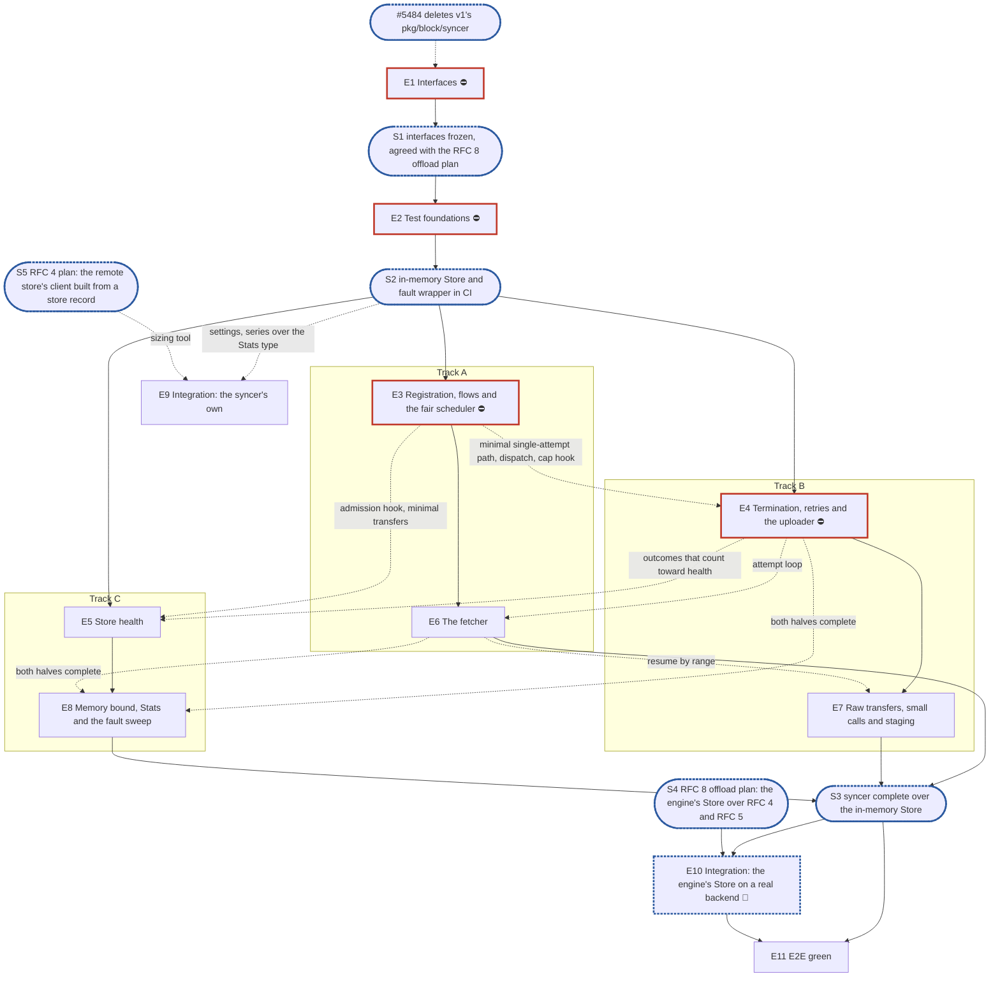

# RFC 3 — syncer v2: implementation plan

**Scope.** All of [RFC 3, the syncer](../docs/internals/rfcs/rfc-3-syncer.md): the interface, both
halves, the fair scheduler, termination and retries, store health, the fetcher's single flight,
raw and small transfers, the staging budget, the memory bound, `Stats`, the two settings and the
pool sizing tool. RFC 3's status is `draft`, not `deferred`, so the whole RFC is planned (Step 0
#11). Related RFCs, with how far each is in scope:

- **Constraints only.** Each has, or will have, its own plan.
  - [RFC 2](../docs/internals/rfcs/rfc-2-carver.md), the carver; [RFC 4](../docs/internals/rfcs/rfc-4-remote-tier.md),
    the remote tier; [RFC 5](../docs/internals/rfcs/rfc-5-transforms.md), transforms. Their plans are being
    written beside this one for the umbrella #5488. The syncer imports none of them (RFC 3 §1.3,
    RFC 0 §1.2). The seams are listed in §1.1.
  - [RFC 8](../docs/internals/rfcs/rfc-8-engine.md), the engine. Its offload plan
    (`.planning/rfc-8-offload-engine-plan.md`, being written) composes the syncer into the engine and
    the node, and builds the engine's `Store` over RFC 4 and RFC 5.
  - [RFC 0](../docs/internals/rfcs/rfc-0-data-lifecycle.md), [RFC 1](../docs/internals/rfcs/rfc-1-journal.md) and
    [RFC 28](../docs/internals/rfcs/rfc-28-journal-format.md), [RFC 6](../docs/internals/rfcs/rfc-6-block-metadata.md),
    [RFC 9](../docs/internals/rfcs/rfc-9-gc.md), [RFC 12](../docs/internals/rfcs/rfc-12-snapshots.md),
    [RFC 13](../docs/internals/rfcs/rfc-13-configuration.md), [RFC 26](../docs/internals/rfcs/rfc-26-catalog-backups.md)
    and [RFC 27](../docs/internals/rfcs/rfc-27-namespace-migration.md).
  - [RFC 24](../docs/internals/rfcs/rfc-24-resources.md) §6.2 and §7.2, which RFC 3 §2.1 and §2.10 cite.
    Step 0 #4 did not name RFC 24, so this plan treats it as constraints only (O5).
- **The rules every epic follows:** [RFC 25](../docs/internals/rfcs/rfc-25-observability.md) and
  [RFC 29](../docs/internals/rfcs/rfc-29-test-harness.md) (§1.5 rules 3 and 6).

**Tracks.** A, B and C, with no owner (§3.4).

**Programme.** The umbrella issue #5488, "offload: RFC 2–5 and the engine's offload part", release
v1.1. Roadmap epic: #3619. The work builds on the journal-only engine, which is stage 3 of #3119
(`.planning/rfc-8-journal-only-engine-plan.md`). It takes over #4276 (syncer, remote clients and GC
composed in the node); the composition half of #4276 belongs to the RFC 8 offload plan. GC (RFC 9,
roadmap #3620) is planned later.

**Naming.** v1 is `pkg/block/syncer` as it stands, together with the rest of the v1 block tier:
an upload controller and a dynamic semaphore. #3119's stage 4 deletes it (D8 of
`.planning/rfc-16-store-cutover-stage4-plan.md`, PR #5484). v2 is the syncer RFC 3 describes, built
here. v2 ignores v1 (rule 7), and no epic touches v1 code.

**Transition policy.** New installations only (#3119). v1 and v2 never run in one binary, so no
metric, log key or setting carries a version.

**Branches.** The plan lands on `develop`. The code lands on `feat/storage-v2`, where the
journal-only engine, `pkg/sim`, `pkg/health`, `pkg/metrics` and `pkg/settings` already live.

**Defaults used from Step 0:** no dashboards (#9); output path `.planning/rfc-3-syncer-plan.md`
(#10). The user answered every other input.

**Reviews.** An independent architect proposal was reconciled with this plan (§4.1 takes its
smaller package split). Three independent passes ran on the draft, adversarial, correctness and
simplification, and their findings are folded in. An independent review of all five #5488 plans
runs before the pull request opens.

**Pending the user's answer.** Four design questions are written in place, with the recommended
option (§6, Q1 to Q4).

---

## 1. Introduction

### 1.1 What we are building

RFC 3's "Start here" and "In short" describe the result. There is one syncer per process, with two
worker pools. Work is served by class, and fairly across stores and flows. Health is kept per store
and per direction. The fetcher joins concurrent demand for the same chunk.

| v1 | v2 | Fate |
| --- | --- | --- |
| `pkg/block/syncer` (`upload_controller.go`, `dynsem.go`) | `pkg/block/syncer` (D1, Q4), RFC 3 §1.3's surface | v1 deleted by #5484; v2 written fresh |
| `pkg/block/remote/memory`, v1's in-memory remote store | `pkg/block/syncer/syncertest` (D2) | v1 deleted by #5484 |
| no setting | `upload_workers` and `fetch_workers` (RFC 13 Appendix B), in the syncer's settings section | new, epic 9 |
| no tool | the pool sizing tool (D3) | new, epic 9 |

**Seams with the other plans of #5488.** This plan assumes the seams below. They are agreed at S1
(§3.2).

- **RFC 8 offload plan.** It builds the engine's `Store`. That type composes RFC 4's codec and
  remote store with RFC 5's transforms behind RFC 3 §1.3's `Store`. It also does four other things:
  - maps RFC 4 §4.8's and RFC 5 §2.7's errors onto the syncer's error set;
  - derives each `ProbeKey`;
  - takes RFC 24 §6.2's CPU token for each chunk it encodes;
  - runs this plan's `Store` conformance suite (D2).

  The offload plan also builds the root's single syncer. It passes the syncer the per-worker memory
  inputs (D8), opens one flow per share, and registers epic 9's collector and conditions with a
  function that maps each flow to its share.
- **RFC 4 plan.** The engine's `Store` hands through the remote store's probe (RFC 4 §4.7), its
  checksum modes (RFC 4 §4.3) and its versioned objects (RFC 4 §4.14, §4.15). The syncer sees only
  RFC 3 §1.3's types. The sizing tool builds RFC 4's store directly, so it waits on that plan's
  store client (S5).
- **RFC 5 plan.** `MaxEncodedLen` and `MaxDecodeLen` (RFC 5 §3.1) reach the syncer as numbers in its
  configuration (D8), never as an import.
- **RFC 2 plan.** The format's chunk-count cap and the block target (RFC 2 §5) also reach the syncer
  as numbers.

**Dependency limits.** The syncer's packages import only the standard library, plus `pkg/sim` in
tests. That means no metrics library and no package from RFC 2, 4 or 5 (RFC 3 §1.4 and §2.12; rule
7's import test). The collector and the conditions live in `internal/node`.

### 1.2 How the plan is organised

- Epic 1 freezes the surface. Epic 2 builds the in-memory `Store`, its conformance suite, its fault
  wrapper and the measuring helpers.
- Six middle epics, two per track, are cut along RFC 3's seams:
  - Track A: registration, flows and the fair scheduler (epic 3), then the fetcher (epic 6). Epic 3
    also builds a minimal single-attempt `Upload`, `Fetch` and `Prefetch`, so the scheduler's checks
    can run real transfers.
  - Track B: termination and retries for both halves, and the uploader (epic 4); then raw
    transfers, small calls and staging (epic 7).
  - Track C: store health (epic 5); then the memory bound, `Stats` and the fault sweep (epic 8).
- Epic 9 is the integration work that belongs to the syncer itself: its settings, its series and
  conditions, its alert rules and the sizing tool.
- Epic 10 runs the checks against the engine's `Store` on a real backend, once the RFC 8 offload
  plan has built that `Store`.
- Epic 11 runs the benchmarks and the soak.

RFC 3 §8.6's suites paragraph puts every check in `unit`, an allocation count in `unit/nonrace`,
and the real-backend checks in `integration`. None of those suites keeps a `known.yaml`, so no test
lands red. Each lands green, with the epic that makes it pass.

### 1.3 What epic 1 must deliver

Epic 1 delivers the exported surface of `pkg/block/syncer`, frozen at S1, with stub bodies:

- every type, interface, error value and method of RFC 3 §1.3, including `Store`, and the
  `Syncer`'s own `Close` and `Stats`;
- `Stats`, with a field for every series of RFC 3 §2.12;
- the constructor and its configuration (D8), and the `Clock` (D4);
- rule 7's import test, so the dependency rule holds from the first pull request.

It declares no internal interface. The only seam with two consumers before any implementation
exists is `Store` itself: epic 2's in-memory store is one consumer, the engine's adapter the other.
Q1 and Q2 may change `Store.Put`'s signature, or add a staging call, before S1. O8 lists the names
RFC 3 §1.3 leaves undefined, which epic 1 settles.

### 1.4 What epic 2 must deliver

**The suite.** RFC 3 §8.6's suites paragraph names `unit`, `unit/nonrace` and `integration`, and
none of them keeps a `known.yaml`. So this plan registers no red suite. Each check of RFC 3 §7 lands
green, in `unit`, with the epic §7 below names for it. The §1.5 instruction's clause that epic
issues must exist before E2 lands exists for `known.yaml` entries, so it binds nothing in this plan.
Epic 11 registers the benchmark suite and the soak suite, which the paragraph says nothing runs yet.

**The scenario catalogue**, by source:

- **RFC 3 §7.1 and §7.2, every row.** §7 below names the epic that lands each row.
- **RFC 3 §8.1's kinds.** The scheduler model belongs to epic 3; the memory and structure checks
  to epics 8 and 1; the real backend to epic 10; the benchmark and the soak to epic 11.
- **RFC 3 §8.2's edge cases, §8.3's sweep and §8.4's counts.** Each epic's **Done when** places
  them.
- **RFC 0 §1.4's single-node checks.** None land here: RFC 8 §15 carries them on the composed node
  (§6.1).
- **Other sources.** v1's two bugs in this area (RFC 3 §10, D6 and D9) are already covered by RFC 3
  §7.2's "§4.3 joining" row, so nothing is added.

**The test components**, each one of `CLAUDE.md`'s allowed kinds:

- **The in-memory `Store`** (kind 2), as RFC 3 §1.4 describes it, with its load record. It takes
  the chunk hash function as an input, so it imports only the standard library.
- **The `Store` conformance suite** that holds the in-memory store to the real thing (D2).
- **The fault wrapper** (kind 3) around the in-memory store, over `pkg/sim`'s `Fault` and
  `TestClock`.
- **A recording log handler, and the held-pool heap measurement**, the latter over
  `internal/prof`.

The scheduler's reference model is not here. It lands in epic 3 with its first consumer.

### 1.5 General rules for each epic

> **Instruction for whoever expands an epic into its detailed description and subtasks,
> human or AI:**
>
> - **Creating an epic from this plan: use the `epic-breakdown` skill.** Whenever the user
>   asks to create an epic from this plan, or to expand, detail or break one down, run the
>   `epic-breakdown` skill (`.claude/skills/epic-breakdown/SKILL.md`) on this plan and that
>   epic, rather than writing the epic document freehand. It extracts the RFC's MUST and
>   MUST NOT into numbered requirements, estimates each subtask in man-days and suggests
>   the pull requests. A human doing it by hand follows the same skill.
> - **Epic and subtask, nothing else.** The units of work are the epic and its subtasks,
>   with subtask ids `<e>.<n>` (`subtask 4.3`, or `T4.3` for short), assigned by the epic
>   document. No other word names
>   them: not task, ticket, story, step or phase, in headings, tables, ids or prose.
> - **The epic stands alone for what to build.** Its requirements, subtasks and decisions
>   are in the epic document itself, which never refers to this plan for them or says "see
>   the plan": the RFC sections it implements, the interfaces it builds on, the
>   subtasks, and a short legend of the names it borrows from this plan (E1, E2, S1, the
>   integration epic, …). It cites the numbered rules below, without copying them, in a
>   table of how each applies: each row names its rule by number and bold title, which
>   says what the rule requires, and the table links this §1.5 with a full link (the
>   plan's path and the section's anchor) and the `CLAUDE.md` sections that hold a rule,
>   so the epic reads alone and its reader can still open each rule's text in one click.
> - **The epic document records decisions, not progress, like this plan.** It has no
>   status fields, no checkboxes to tick and no sections to keep up to date as the work
>   goes on. It is revised through a pull request only when a decision changes.
> - **Subtasks are not pull requests.** A subtask is ideally up to 5 man-days. The owner
>   ships subtasks as they see fit, one pull request each or several together; the epic
>   document only suggests a grouping, each suggested pull request ideally up to 15
>   man-days. Cut and group by logic, readability, dependencies and a deliverable that can
>   be named, not to hit a number.
> - **Every subtask states how it meets each rule that applies to it.** A rule that does
>   not apply is named, with the reason.
> - **In the issue tracker, once each document merges,** following `epic-breakdown`
>   Step 6, their one description. Issues point at the documents and copy nothing; once
>   created, their `Estimate` and blocked-by links are the current estimate and
>   dependencies, and the documents are not revised to follow them. The
>   epic issues exist before E2's pull request lands, because each red test's
>   `known.yaml` entry names one; subtask issues come once their epic document has
>   merged. The release an epic ships in is set by the RFC's roadmap epic that its epic
>   issue sits under, never in a document and never on the epic issue on its own: the epic
>   issue and its subtask issues copy that roadmap epic's milestone, and an epic changes
>   release only by moving under the roadmap epic of the other release.

1. **Independent unit tests.** Each epic carries its own unit tests. They run over epic 2's
   in-memory `Store` and fault wrapper, `pkg/sim`'s `TestClock`, and the implementation of any epic
   it depends on once that epic has landed.
   - The scheduler (epic 3) and the health state machine (epic 5) are pure functions of their
     inputs and the clock, in their own internal packages, tested as such.
   - Every other rule is unexported code in `pkg/block/syncer`, tested through `export_test.go`.
   - E1 declares no internal interface for a test to stand in for (rule 12).
2. **Fuzz tests where relevant** (`CLAUDE.md`, "Writing tests", "By kind"). The syncer decodes no
   bytes; the engine's `Store` does. What it fuzzes is sequences:
   - arrivals, classes, sizes, joins and cancellations, against the scheduler's reference model
     (epic 3);
   - probe and transfer outcomes, against a table model of RFC 3 §2.8 (epic 5);
   - a byte flipped at every offset of a resumed raw range (epic 7).
3. **Observability follows RFC 25, with RFC 3's own exception.** RFC 3 §1.4 and §2.12 forbid the
   syncer a metrics library. So the syncer keeps counters, returns them in `Stats`, and logs only
   RFC 3 §2.8's lines. Each epic names the `Stats` fields it fills, and the syncer opens no spans
   (D6). The bridge to RFC 25 is epic 9's: the collector under the `syncer_` prefix (RFC 25 §2.1,
   §2.8), the two `store_*_unhealthy` conditions (RFC 25 §3.9), and their alert rules (RFC 25 §7).
4. **Profiling.** Tests and benchmarks run under `internal/prof`'s leak check. Two hot paths carry
   assertions:
   - upload and fetch, asserting no allocation per chunk once warm (RFC 3 §8.4, "allocations"), in
     `unit/nonrace`;
   - one dispatch, asserting a flat count of queue operations (RFC 3 §8.4, "scheduler work per
     dispatch").
5. **Public interface and internals.** Each epic tests its internal code, and the behaviour it
   enables through `Syncer` and `Flow`, under `-race`. A value is tested where it is consumed
   (`CLAUDE.md`, "Verifying a change"):
   - a health cause, at `Flow.Health`;
   - a throttle limit, at the in-memory store's count of calls in flight;
   - a counter, at `Stats`.
6. **Known failures shrink.** No suite this plan uses keeps a `known.yaml` (§1.4), so this rule
   binds no epic.
7. **v2 ignores v1.** No epic imports, copies from or depends on the behaviour of v1's
   `pkg/block/syncer`, `pkg/block/remote` or `pkg/block/blockcodec`.
   - Epic 1's import test checks each syncer package on its own. It allows the standard library,
     plus `pkg/sim` in test packages. It is also RFC 3 §7.2's "§1.3 error values are the syncer's"
     row.
   - No epic touches v1: #5484 deletes it.
8. **Real dependencies for properties of those dependencies** (`CLAUDE.md`, "Writing tests"). Three
   checks need the real thing:
   - RFC 3 §7.1's "§2.6 no inference" row, and §8.1's real-backend runs, need a local emulator of
     the remote service behind a fault proxy (epic 10);
   - B5 needs a real store (epic 11);
   - the staging spill needs a real directory under `t.TempDir()` (epic 7).

   Nothing needs a real disk for durability, since the syncer persists nothing (RFC 3 §2.7).
9. **Code comment conventions** (`CLAUDE.md`, "Code comments"). Each `decision:` note in RFC 3 goes
   at the code site that implements it: §2.4's on slow-tail retries and re-gets, §2.8's on the
   denial cap, §2.10's on the fixed values. §4.3's `ponytail:` markers go at their own sites.
10. **A test must be able to fail** (`CLAUDE.md`, "Writing tests"), and nothing else would catch the
    change it guards. Many RFC 3 §7 rows name the wrong design they catch ("A design that…"). Each
    such test is verified by building that wrong design and watching the test fail on its assertion.
11. **A symbol is exported only if the RFC's interface uses it.** The exported surface is RFC 3
    §1.3's, plus the constructor and its configuration (D8), plus `syncertest` (D2). Everything else
    is unexported, or sits in `internal/`.
12. **Each subtask creates only what it declares.** No empty package, and no stub without a caller.
    A package, an option or a test helper lands with its first consumer.

## 2. Epics at a glance

| # | Epic | Content | Subtasks | Man-days | Track | Blocks |
| --- | --- | --- | --- | --- | --- | --- |
| 1 | **Interfaces** ⛔ | RFC 3 §1.3's surface, `Stats`, the configuration, `Clock`, the import test; agreed with the RFC 8 offload plan | 6 | 7 | team | **everything** |
| 2 | **Test foundations** ⛔ | the in-memory `Store`, its conformance suite and fault wrapper, the measuring helpers | 6 | 18 | team | **all testing** in 3 to 11 |
| 3 | **Registration, flows and the fair scheduler** ⛔ | registry, flows, lifecycle, two pools, classes, two-level DRR, caps, queues, the waiter bound, the reference model; a minimal single-attempt `Upload`, `Fetch` and `Prefetch` | 11 | 35 | A | 4, 5, 6 |
| 4 | **Termination, retries and the uploader** ⛔ | both halves' attempt loop, the retry budget, throttling, the floor, the first-byte bound, slow tail, unknown outcomes; `Upload` complete | 8 | 24 | B | 5, 6, 7, 8 |
| 5 | **Store health** | per-direction state, probes, the failure window, hold-down, denial backoff, drift, causes, the log lines | 7 | 21 | C | 8 |
| 6 | **The fetcher** | fetch resume, the verification re-get, single flight, join, re-home, detach | 9 | 29 | A | 7, 8 |
| 7 | **Raw transfers, small calls and staging** | `FetchRaw`, `UploadRaw`, `FetchVersion`, `Small`, the staging budget and its spill | 8 | 22 | B | — |
| 8 | **Memory bound, `Stats` and the fault sweep** | the per-worker bound, the fit to the transfers size, the consistent snapshot, the held-pool heap check, the systematic sweep | 4 | 11 | C | — |
| 9 | **Integration: the syncer's own** | the settings section, the collector and conditions over `Stats`, alert rules, the sizing tool | 5 | 12 | team | — |
| 10 | **Integration: the engine's `Store` on a real backend** 🔀 | RFC 3 §8.1's real-backend runs and §8.3's faults, through the engine's `Store` | | | team | 11 |
| 11 | **E2E green** | B1 to B5, the soak, RFC 3 §8.5's targets recorded | 5 | 14 | team | — |
| | **Total** | | **69** | **193** | | |

**Plan estimate: 69 subtasks, 193 man-days, not counting epic 10.**

RFC 3 is 2,203 lines, which gives N = 6. Its cohesive areas are also six:
- the scheduler and its registry;
- termination and retries, with the uploader;
- health;
- the fetcher;
- raw and small transfers, with staging;
- the bounds, with their snapshot.

So N matches.

⛔ = blocker: other epics cannot finish until this one has delivered.
🔀 = synchronisation point: the epic waits on another plan's interface and is planned after it.

## 3. Synchronisation points, blockers and the split

### 3.1 Dependency graph



### 3.2 Synchronisation points

- **S1 — interfaces frozen, agreed with the RFC 8 offload plan.** Epic 1 is merged, and the RFC 8
  offload plan's epic 1 declares its `Deps.Syncer` and its `Store` adapter against it, with the
  same answers to Q1 and Q2. S1 unblocks epic 2 and that plan's adapter.
- **S2 — test foundations in CI.** The in-memory `Store` passes its conformance suite in `unit`,
  and the fault wrapper exists. S2 unblocks epics 3, 4 and 5, and the parts of epic 9 that need
  only the `Stats` type.
- **S3 — the syncer complete over the in-memory `Store`.** Every RFC 3 §7 row that epics 3 to 8
  name is green in `unit`. S3 unblocks epics 10 and 11.
- **S4 — RFC 8 offload plan: the engine's Store over RFC 4 and RFC 5.** External. S4 unblocks
  epic 10, which is planned once S4 is reached.
- **S5 — RFC 4 plan: the remote store's client built from a store record.** External. S5 unblocks
  the sizing tool in epic 9.
- **#5484 — the v1 block tier deleted** on `feat/storage-v2`. External, before epic 1 (D1, Q4).

### 3.3 Blockers

- **#5484 → E1.** v2 takes v1's path (D1).
- **E1 ⛔ → S1 → E2.** E2 needs the frozen surface.
- **E2 ⛔ → S2 → E3, E4, E5, E9.** Every check runs over the in-memory `Store` and the fault
  wrapper. E9 needs only the `Stats` type.
- **E3 ⛔ → E4.** Attempts are dispatched through E3's scheduler and run over its minimal
  single-attempt path, and the throttle limit is one of E3's caps.
- **E3 ⛔ → E5.** Refusal happens at E3's admission, and the health rows drive E3's minimal
  transfers.
- **E3 ⛔ → E6.** Joining and re-homing move E3's queue entries.
- **E4 ⛔ → E5.** Health counts the outcomes E4 classifies.
- **E4 ⛔ → E6.** A fetch runs E4's attempt loop.
- **E4 ⛔ → E7.** A raw or small transfer is an attempt like any other.
- **E4 ⛔ → E8.** The sweep and the heap check need both halves complete.
- **E5 → E8.** The sweep asserts the refusal rules too.
- **E6 → E7.** `FetchRaw` resumes by range, as a fetch does.
- **E6 → E8.** The detached-buffer term is part of the memory bound.
- **E6, E7, E8 → S3 → E10, E11.**
- **S5 → E9.** The sizing tool needs the remote store's client.
- **S4 → E10.** The engine's `Store` must exist.
- **E10 → E11.** B5 and the soak use E10's fixture.

### 3.4 Splitting the work

- **Track A:** epic 3 from S2, the largest middle epic, then epic 6. It is busy until S3.
- **Track B:** epic 4 from S2. The attempt rules are unexported functions of outcomes and the
  clock, so they start at once. Wiring them to dispatch waits on epic 3's minimal path. Then
  epic 7.
- **Track C:** epic 5 from S2, starting with its state machine, which needs nothing else. The probe
  loops and the refusal wait on epics 3 and 4. Epic 8 starts once epics 4 and 6 have landed. Track
  C fills the gap between epic 5 and epic 8 with the parts of epic 9 that need only the `Stats`
  type: the settings section, the collector and the conditions.
- **The team converges** at S1 (with the RFC 8 offload plan), at S3, and on epics 9 to 11.

## 4. Implementation decisions

### 4.1 Directory layout

```text
pkg/block/syncer/                 RFC 3 §1.3's surface; Syncer, Flow, Config, Clock          (E1)
  store.go                        Store, its value types, the error values                   (E1)
  stats.go                        Stats and the consistent snapshot                           (E1, E8)
  imports_test.go                 rule 7's import test                                        (E1)
  flow.go, pool.go                registry, flows, lifecycle, the halves' workers             (E3)
  attempt.go                      attempt loop, retry budget, throttle limit, floor,
                                  first byte, slow tail (unexported)                         (E4)
  upload.go                       Upload                                                      (E3, E4)
  fetch.go                        Fetch, Prefetch, single flight, join, detach                (E3, E6)
  raw.go, small.go, staging.go    FetchRaw, UploadRaw, FetchVersion, Small, staging budget    (E7)
  export_test.go                  unexported functions handed to the package's own tests      (E3+)
  internal/sched/                 classes, two-level DRR, caps, queues, waiter bound          (E3)
    model_test.go                 the reference model, package sched_test, importing nothing  (E3)
  internal/health/                per-direction state machine, probe groups, log lines        (E5)
  syncertest/                     in-memory Store, fault wrapper, Store conformance suite     (E2)
  settings/                       upload_workers, fetch_workers                               (E9)
internal/node/syncerseries.go     collector and conditions over a Stats function              (E9)
cmd/dfs/commands/sizepools.go     the pool sizing tool                                        (E9)
```

### 4.2 Decisions

**D1. v2 takes the path `pkg/block/syncer`, once #5484 has deleted v1's** (pending the user's
answer, Q4).
- v1's directory holds four files that nothing imports.
- The alternative was `pkg/block/syncerv2` now, renamed later. That rename cost the engine a whole
  pull request (#3645).
- The engine's import test lists `pkg/block/syncer` as forbidden today
  (`pkg/block/engine/imports_test.go` on `feat/storage-v2`). The RFC 8 offload plan flips that entry
  when the engine first imports v2.
- **Prior art.** #3543 and #3645 did the same for the engine (`enginev2`, then renamed).
- **Applied by** epic 1.

**D2. The in-memory `Store`, its fault wrapper and its `Store` conformance suite live in
`pkg/block/syncer/syncertest`, exported.**
- RFC 3 §1.4 runs the Group A checks against both the in-memory store and the remote tier's
  adapter, so the suite is exported and the RFC 8 offload plan's adapter runs it too. This is kind 2
  of `CLAUDE.md`'s "Writing tests".
- The suite covers `Store`'s own contract. The syncer's behaviour is tested over the store plus its
  fault wrapper.
- **Prior art.** `pkg/block/journal/journaltest` and the journal's conformance suite (in this
  repository); Go's `testing/fstest.TestFS`, which any `fs.FS` runs.
- **Applied by** epic 2.

**D3. The pool sizing tool is a `dfs` subcommand, `dfs size-pools <store>`.**
- It runs on the node's host, and builds RFC 4's store from the named store's record and secret,
  as `dfs start` would.
- It does what RFC 3 §2.11 and RFC 24 §7.2 ask, never through the syncer.
- Its reference in `docs/guide/cli.md` is regenerated by `cmd/gendocs`.
- **Prior art (from memory).** `s3-benchmark` (Wasabi) prints throughput per concurrency level;
  rclone's `--transfers` is set by hand, with no tool.
- **Applied by** epic 9, after S5.

**D4. Time comes from a `Clock` the syncer declares: RFC 8 §2.1's `Now`, `Elapsed` and `After`.**
- Tests use `pkg/sim`'s `TestClock`, which moves only on `Advance`.
- RFC 3 §1.4 says time "advances only when every task is blocked". To meet that, a test advances
  only after the syncer reports itself idle: every worker either waiting on the store or parked. It
  learns this through a per-instance hook set from `export_test.go` (`CLAUDE.md`, "Writing tests").
- **Prior art.** `pkg/sim.TestClock`, as the journal and the engine use it. Go's `testing/synctest`
  was considered: it advances when every goroutine in its bubble is blocked, but a bubble cannot
  share `pkg/sim`'s clock with the other components.
- **Applied by** epics 1, 2 and 3.

**D5. The collector reuses the node's deadlined Stats fetch.**
- `internal/node/stats.go`'s `snapshot` already runs one deadlined, single-flight `Stats` fetch per
  scrape, but it is typed to `engine.Stats`.
- Epic 9 makes it generic over the stats type, rather than copying it.
- **Prior art.** `internal/node/stats.go`, on `feat/storage-v2`.
- **Applied by** epic 9.

**D6. The syncer opens no spans, and its configuration holds no tracer.**
- RFC 25 §6.1 gives the fetch span to the engine. A pass the read joins links to the read's span,
  and the engine opens both.
- **Prior art.** None found beyond RFC 25 itself.
- **Applied by** epic 1.

**D7. The fit to the transfers pool takes the pool's size as a configuration field.**
- RFC 24 §7.2 asks for two things: reduce unset pool sizes to fit the node's transfers pool, and
  refuse explicit sizes that do not fit.
- Epic 8 builds both, against a size passed in the configuration, and tests both with a non-zero
  size.
- `pkg/resources` has no `Split` yet, so the root has no size to pass. A zero size reduces and
  refuses nothing. That is a gap against RFC 24 §7.2 until the root passes one (O9, §6.1), and the
  code site carries a `decision:` marker naming it.
- **Prior art.** None found.
- **Applied by** epic 8.

**D8. The constructor takes the per-worker memory inputs as numbers.**
- RFC 3 §2.2's per-worker figure needs values only RFC 2, 4 and 5 know: the largest chunk `Max`,
  the block target, the upload chain's `MaxEncodedLen`, `MaxDecodeLen` and the header cap.
- The engine passes them in. The syncer derives from them the bound, the largest encoded block (the
  quantum's size, RFC 3 §2.9) and the staging budget.
- **Prior art.** None found.
- **Applied by** epic 1.

### 4.3 Knowingly simple implementations

- **The slow-tail percentile** (epic 4). `ponytail:` selection over a fixed ring of first-byte
  samples per store and direction, O(n) per check. Upgrade to a streaming quantile sketch when B1
  or B2 shows the selection.
- **One spill file per reservation** (epic 7). `ponytail:` staging writes one file under
  `backups.spill_path` per reservation and removes it on release. Upgrade to a slab file when the
  file count shows in a copy's profile.

## 5. The epics in detail

### Epic 1 — Interfaces ⛔

**Epic 1 estimate: 6 subtasks, 7 man-days.**

Epic 1 delivers the frozen surface of `pkg/block/syncer`, with stub bodies, agreed with the RFC 8
offload plan's epic 1.

**Owns:** RFC 3 §1.3's declarations; §1.1's absences on the surface; §2.12's `Stats` fields; §1.4's
dependency set.

**Done when:**
- the package builds with every symbol of RFC 3 §1.3 and §2.12;
- RFC 3 §7.2's "§1.3 error values are the syncer's" row passes as the import test;
- the RFC 8 offload plan's epic 1 compiles its adapter declaration against `Store` (S1).

**Expected content:**
- `Store`, its value types and its error values, with the answers to Q1 and Q2 and O8's names.
- `Syncer`: the constructor and configuration (D8, D7, D4), and the registry and flow calls.
- `Flow` and its methods.
- `Stats`.
- The import test.
- The package doc, naming the dependency limit.

### Epic 2 — Test foundations ⛔

**Epic 2 estimate: 6 subtasks, 18 man-days.**

Epic 2 delivers the fixtures every check shares (§1.4), in `syncertest`.

**Owns:** RFC 3 §1.4.

**Done when:**
- the in-memory `Store` passes the `Store` conformance suite in `unit`;
- the fault wrapper drives each behaviour in RFC 3 §1.4's list, each in a test of its own.

**Expected content:**
- The in-memory `Store`, with RFC 3 §1.4's load record, the checksum modes of RFC 3 §2.4's table,
  and versions and raw objects (RFC 3 §1.3).
- The `Store` conformance suite (D2).
- The fault wrapper.
- The recording log handler and the held-pool heap measurement.

### Epic 3 — Registration, flows and the fair scheduler ⛔

**Epic 3 estimate: 11 subtasks, 35 man-days.**

Epic 3 delivers the registry of stores, flows and their lifecycle, and the two pools. It also
delivers the scheduler, which decides which waiting transfer gets the next worker. It carries the
scheduler's checks on a minimal single-attempt `Upload`, `Fetch` and `Prefetch`, which epics 4
and 6 complete.

**Owns:** RFC 3 §1.2; §1.3's registration, flows, `Flow.Close`, `Close` and `Unregister`; §2.1;
§2.3; §2.9; §2.10's quantum, caps, queue length, waiter bound and class order; §8.1's "Scheduler
model".

**Done when:**
- RFC 3 §7.2's rows "§2.1 one limiter", "§2.3 backpressure", "§2.9 no starvation", "§2.9 fair by
  worker-time", "§2.9 waiter share", "§2.9 bounded queue", "§2.9 store level", "§2.9 lone flow",
  "§2.9 classes", "§2.9 eviction", "§2.9 waiter bound" and "§1.3 lifecycle" pass;
- "§1.3 unregister" passes too, its probe half once epic 5 lands;
- RFC 3 S1, S3, S13, S17 (all but the throttle limit, which is epic 4's), S18, S20 and S22 hold in
  the model comparison after every dispatch;
- RFC 3 §8.4's "scheduler work per dispatch", "peak in flight", "fairness", "waiters" and "waiters
  displaced" counts pass;
- RFC 3 §8.2's "Scale of the scheduler" cases are reached, along with these "Timing of a call"
  cases: `ctx` cancelled while queued, and `Flow.Close` with transfers queued and running.

**Expected content:**
- The registry and flows, `Close`, and `Unregister`.
- The two pools and their workers; the minimal single-attempt path for each half.
- Queues per flow and class (RFC 3 §2.9).
- Class order and two-level deficit round robin in worker-time (RFC 3 §2.9).
- The caps and the fair-share rule, with a hook for epic 4's throttle limit (RFC 3 §2.9).
- The waiter bound, displacement and eviction (RFC 3 §2.9).
- The reference model, and the property test against it.
- The counters for RFC 3 §2.12's pool series.

### Epic 4 — Termination, retries and the uploader ⛔

**Epic 4 estimate: 8 subtasks, 24 man-days.**

Epic 4 delivers the rules that end every transfer of either half in bounded time with a report, and
completes `Upload`.

**Owns:** RFC 3 §1.3's `Upload`, and the "The syncer" column of its error table; §2.4, except the
fetch resume and the verification re-get (epic 6); §2.5; §2.6; §3; §2.10's retry, throttle, floor,
first-byte and slow-tail values.

**Done when:**
- RFC 3 §7.1's rows "§2.5 unknown is failure", "§3.4 partial put", "§3.3, §3.5 stability", "§3.4
  measuring pass" and "§1.3 census" pass over the in-memory `Store`;
- RFC 3 §7.2's rows "§2.4 termination", "§2.4 throttling lowers concurrency", "§2.4 budget per
  store and direction", "§2.4 slow tail is not charged", "§2.4 trickle fails", "§2.4 throughput
  floor", "§2.4 throttling", "§2.4 retry budget", "§2.4 first byte, per direction" and "§2.4 lone
  slow tail" pass;
- RFC 3 S4, S5, S6, S8 (`src`'s side, the hash recheck of §3.5), S9, S17's throttle-limit clause,
  S19's error-set half, S21 and S23 hold;
- RFC 3 §8.4's "retries" count passes;
- RFC 3 §8.2's "Retries" cases are reached, apart from the detached-buffer one, which is epic 6's;
- RFC 3 §8.2's upload cases of "Shape of a transfer" are reached.

**Expected content:**
- `Upload` on top of epic 3's path (RFC 3 §1.3, §3).
- The attempt loop for both halves (RFC 3 §2.4, §2.5, §2.6), with the jittered backoff on the
  clock.
- The retry budget, with RFC 3 §2.4's `decision:` at its site.
- The throttle limit, through epic 3's cap hook.
- The throughput floor, the stall and trickle rules, and the first-byte bound.
- The slow-tail retry (§4.3's `ponytail:`).
- The classification handed to epic 5.
- The counters for RFC 3 §2.12's transfer series.

### Epic 5 — Store health

**Epic 5 estimate: 7 subtasks, 21 man-days.**

Epic 5 delivers each registered store's put health and get health, from probes and counted
outcomes. An unhealthy direction refuses work at admission.

**Owns:** RFC 3 §2.8, including its logging table; §1.3's `SetDrift`, `Flow.Healthy` and
`Flow.Health`; §2.10's probe, hold-down, failure-window, denial-backoff and log-interval values.

**Done when:**
- RFC 3 §7.2's rows "§2.8 refusal contained", "§2.8 recovery", "§2.8 one spurious failure", "§2.8
  traffic stands in", "§2.8 shared probe", "§2.8 logging", "§2.8 denial backoff", "§2.8 flap
  hold-down", "§2.8 failure window", "§2.8 per direction", "§2.8 drift condition", "§2.8 window
  re-trip", "§2.8 no put probe", "§2.8 cause per direction" and "§1.3 destroyed material" pass;
- RFC 3 S14, S15, S16, S19's health half, S25, S26, S27 and S28 hold;
- RFC 3 §8.2's "Probes" cases are reached, along with "a store that turns unhealthy while transfers
  to it are running".

**Expected content:**
- The state machine in `internal/health`, with RFC 3 §2.8's `decision:` at its site.
- Probe groups and the probe loops.
- The refusal at epic 3's admission.
- The three log lines.
- The counters for RFC 3 §2.12's health series.
- Rule 2's fuzz against a table model.

### Epic 6 — The fetcher

**Epic 6 estimate: 9 subtasks, 29 man-days.**

Epic 6 completes `Fetch` and `Prefetch`, and joins concurrent demand for a chunk into one fetch.

**Owns:** RFC 3 §1.3's `Fetch`, `Prefetch` and stream rules; §2.4's fetch resume and verification
re-get; §2.2's detached-buffer term; §2.10's detach bound; §4.

**Done when:**
- RFC 3 §7.1's rows "§4.1 verification", "§2.4 verification re-get" and "§4.2 yield at once" pass;
- RFC 3 §7.2's rows "§2.2 detached-buffer cap", "§4.3 single flight", "§4.4 priority", "§4.4
  abandonable", "§4.3 joining", "§1.3 stream rules", "§1.3 partial prefetch", "§2.4 fetch resume"
  and "§4.3 re-home and close" pass;
- RFC 3 S10, S11 and S12 hold;
- RFC 3 §8.4's "single flight" count passes;
- RFC 3 §8.2's fetch cases of "Shape of a transfer" and "Timing of a call" are reached, as is the
  detached-buffer case of "Retries".

**Expected content:**
- The stream rules (RFC 3 §1.3).
- The fetch resume and the re-get (RFC 3 §2.4).
- Single flight, joining and re-homing (RFC 3 §4.3, §4.4).
- Detaching and the detached-buffer cap (RFC 3 §4.3, §2.2).
- The counters for RFC 3 §2.12's fetch series.

### Epic 7 — Raw transfers, small calls and staging

**Epic 7 estimate: 8 subtasks, 22 man-days.**

Epic 7 delivers the transfers that copies, restores, `Verify`, `Recheck` passes and GC's relocation
use, and the single staging budget they share (pending the user's answers, Q2 and Q3).

**Owns:** RFC 3 §1.3's `FetchRaw`, `UploadRaw`, `FetchVersion` and `Small`; §2.10's small-call
bound and small-body cap; §2.2's staging budget and spill; RFC 13 Appendix B's
`backups.spill_path` and `backups.spill_max` rows. As the first reader of `backups.spill_path`,
epic 7 also adds its key to RFC 13 Appendix C (RFC 13 §2.2's scratch paths).

**Done when:**
- the syncer-level checks of RFC 3 §7.2's rows "§1.3 raw transfer", "§1.3 small-body cap" and
  "§2.2 copy staging" pass over the in-memory `Store`, driven by a test caller;
- the parts of those rows that need a real copier, a `Recheck` pass or GC are run by those
  components' plans (§6.1);
- RFC 3 S24 holds.

**Expected content:**
- `FetchRaw` and `UploadRaw` (RFC 3 §1.3), using the standard library's CRC32C and MD5.
- `FetchVersion` (RFC 3 §1.3).
- `Small` (RFC 3 §1.3, §2.10).
- The staging budget and its spill (RFC 3 §2.2, §4.3's `ponytail:`).
- The Appendix C row.

### Epic 8 — Memory bound, `Stats` and the fault sweep

**Epic 8 estimate: 4 subtasks, 11 man-days.**

Epic 8 delivers the checks that span both halves.

**Owns:** RFC 3 §2.2's per-worker bound; §2.7; §2.12's snapshot rules; §8.3's systematic sweep;
RFC 24 §7.2's fit to the transfers pool (D7).

**Done when:**
- the syncer-level checks of RFC 3 §7.2's "§2.2 memory bound" row pass, the fetcher's bound taken
  from D8's `MaxDecodeLen` input (the codec's part is in §6.1);
- RFC 3 S2 and S7 hold;
- RFC 3 §8.4's "allocations" count passes in `unit/nonrace`;
- RFC 3 §8.3's sweep runs;
- RFC 3 §2.12's two snapshot rules pass;
- D7's reduction and refusal pass.

**Expected content:**
- The per-worker figure, and the fit (D7).
- The consistent snapshot behind `Stats`.
- The held-pool heap check.
- The sweep, and the allocation test added to `unit/nonrace`'s command.

### Epic 9 — Integration: the syncer's own

**Epic 9 estimate: 5 subtasks, 12 man-days.**

Epic 9 delivers what the syncer brings to the node that needs no composed syncer: its settings, its
series and conditions over a `Stats` function, its alert rules and the sizing tool. The RFC 8
offload plan registers the collector and the conditions with the node's syncer.

**Owns:** RFC 3 §2.10's two settings; §2.11; RFC 13 Appendix B's `upload_workers` and
`fetch_workers` row; RFC 25 §3.9's `store_put_unhealthy` and `store_get_unhealthy` rows and their
alert rules (RFC 25 §7).

**Done when:**
- the settings section is in the node's table, and RFC 13 plan's D3 check (Appendix B against the
  table) passes for its row;
- the collector, over a `Stats` function the test supplies, emits every RFC 3 §2.12 series as RFC
  25 §2.1, §2.5 and §2.8 require;
- the two conditions follow RFC 25 §3.9's severity for each cause;
- `dfs size-pools` against Localstack prints what RFC 3 §2.11 and RFC 24 §7.2 ask it to.

**Expected content:**
- `pkg/block/syncer/settings`.
- The collector, reusing the node's deadlined fetch (D5).
- The conditions and the alert rules.
- The sizing tool (D3), after S5, and its regenerated CLI reference.
- No error mapping of its own: RFC 3 §1.3's table is built by epics 4 and 5, and the mapping onto
  it is the engine's `Store`'s.

### Epic 10 — Integration: the engine's `Store` on a real backend 🔀

**Epic 10 estimate: planned after S4.**

Epic 10 delivers the runs that need the engine's `Store` over a real backend.

**Owns:** RFC 3 §8.1's "Real backend" kind; §7.1's "§2.6 no inference"; §8.3's fault-proxy faults
and its "store changes behind the syncer" table; §7.3.

**Done when:**
- RFC 3 §7.1's "§2.6 no inference" row passes in `integration`;
- the Group A and lifecycle checks, which epics 3, 4 and 6 landed, run again through the engine's
  `Store` against a local emulator behind a fault proxy (RFC 3 §8.1);
- RFC 3 §8.3's table passes.

**Expected content** (planned at S4):
- The fixture: Localstack (`dt services up localstack`) behind RFC 4 §7.2's fault transport.
- The re-runs, and the "no inference" check.

### Epic 11 — E2E green

**Epic 11 estimate: 5 subtasks, 14 man-days.**

Epic 11 delivers the benchmarks and the soak, with their suites, and records the measurements.

**Owns:** RFC 3 §7.4; §8.1's "Benchmark" and "Soak" kinds; §8.5; §8.6; RFC 3 §9's first open
question.

**Done when:**
- B1 to B3 run on the in-memory `Store` with a simulated link, and meet RFC 3 §8.5;
- B4's count is the one epic 6 checks;
- B5 runs against Localstack and a real service;
- the soak runs nightly;
- results are recorded with RFC 3 §8.6's fields;
- RFC 3 §8.6's suites paragraph names both suites.

**Expected content:**
- B1 to B4, with `b.ReportAllocs()`.
- B5 over epic 10's fixture.
- The soak over epic 10's fixture.
- `syncer-bench` (`manual`) and `syncer-soak` (`nightly`), registered without a `known.yaml`, as
  `journal-bench` and `journal-soak` are; the paragraph amended; `dt docs` run.
- Each fixed value RFC 3 §9 calls a proposal, either confirmed or with a pull request to RFC 3
  proposing a new one.

## 6. Risks and open points

**Questions pending the user's answer.** Each is written in place, with the recommended option.

**Q1. Where does a put attempt's measurement live between retries?** RFC 3 §2.4 keeps the measured
lengths and checksum across a throttled or error retry. But `Store.Put` measures inside one call,
and RFC 4 §4.9 keeps no state across calls. Pins epic 1.
- **(a), recommended:** amend RFC 3 §1.3 so `Put` takes a scratch value per `Upload` that the
  syncer allocates, never reads, and clears after `ErrCorrupt`:
  `Put(ctx, name, src, m *Measure) (Stored, error)`. This keeps both RFC 4 §4.9 and RFC 3 §2.4.
- **(b):** the engine's `Store` caches the measurement by name. Nothing tells it when `Upload` has
  returned, so it leaks one entry per failed upload.
- **(c):** drop the rule and re-measure on every attempt. RFC 3 §2.4's bound of 20 reads of `src`
  becomes 12 plus 3 per throttled attempt.
- **Checked:** RFC 3 §2.4 and §3.4; RFC 4 §4.3 and §4.9. The independent architect pass reached
  (a) separately.
- **From memory:** the AWS SDKs compute a body's checksum once per request and reuse it across
  their retries.

**Q2. What is the staging budget's surface?** RFC 3 §2.2 makes the syncer own one budget for the
whole process. A `FetchRaw`, or a relocation read, reserves from it before it queues. But RFC 3 §1.3
declares no call to reserve or release, nor who writes the spill. Pins epic 1.
- **(a), recommended:** amend RFC 3 §1.3 with `Syncer.Stage(ctx, size) (*Staged, error)`. A
  reservation is an `io.WriterAt` and an `io.ReaderAt`, in memory and then a spill file, released
  by `Close`. `FetchRaw` writes it, and `UploadRaw`'s `src` reads it. This keeps one cap and one
  path, as RFC 3 §2.2 and RFC 13's `backups.spill_*` rows require.
- **(b):** a bare `Reserve` and `Release` counter, with each caller writing its own spill. Two
  copiers then spill twice.
- **(c):** leave staging to RFC 26's and RFC 9's plans.
- **Checked:** RFC 3 §2.2, RFC 26 §2.4.6 and RFC 13 Appendix B.

**Q3. Which release does epic 7 ship in?** Its callers are a copying backup, a restore, `Verify`,
`Recheck` and GC's relocation (RFC 26, RFC 9), and none of them is in #5488.
- **(a), recommended:** put epic 7's issue under the roadmap epic of the first release that ships
  one of those callers. Epic 1 still declares the methods, and their stubs answer an error until
  then. This builds nothing without a consumer. It moves 22 man-days out of v1.1; it does not save
  them. The plan is unchanged, since a release is set by the roadmap epic, not by the plan.
- **(b):** keep epic 7 in v1.1, as #3619's "the whole RFC" says.
- Q2 becomes urgent only with epic 7, but it pins epic 1's surface, so it is asked now.

**Q4. What is the package path?**
- **(a), recommended, as written (D1):** `pkg/block/syncer`, with epic 1 starting after #5484. This
  costs a wait on a pull request that is already open.
- **(b):** `pkg/block/syncerv2` now, and a rename after #5484. This costs a rename pull request
  across every importer.

**Open points.**

- **O1. RFC 3 amendments.** Q1 and Q2 propose amendments to RFC 3 §1.3. Until the user agrees, the
  plan follows the RFC as written. If the user agrees, RFC 3 is amended in this pull request.
- **O2. An error kind the set does not have.** RFC 3 §7.1's "§2.4 verification re-get" row expects
  "`ErrCorrupt` of kind `malformed`", but RFC 3 §1.3's set has no kinds. The syncer passes the
  wrapped error through, and whether the adapter wraps it is the RFC 4 plan's (§6.1).
- **O3. No S3 endpoint in CI.** CI starts no S3 endpoint for `integration` (`CLAUDE.md`), so epic
  10's checks skip there until one is wired (§6.1). They run locally.
- **O4. The allocation count gates no pull request.** `unit/nonrace` runs at the `nightly` tier, so
  RFC 3 §8.4's allocation count gates no pull request, although RFC 3 §8.4 says these counts gate a
  change (§6.1).
- **O5. RFC 24 was not named in Step 0.** It was not in Step 0 #4's list, but RFC 3 §2.1 and §2.10
  cite it. It is treated as constraints only.
- **O6. The least certain estimates.**
  - Epic 3: the scheduler's rules interact, and the model comparison will find cases.
  - Epic 6: join, re-home and detach under `-race`.
  - Epic 5: the failure window and the denial count interact with epic 4's budget.
- **O7. Code paths cite a different branch.** The code lands on `feat/storage-v2` and the plan on
  `develop`, so epic documents cite code paths on `feat/storage-v2`.
- **O8. Names RFC 3 §1.3 leaves undefined.** It uses `BlockName`, `ProbeKey`, `StoreID`, `Hash` and
  `Stats` without defining them. It spells the directions both `Put`/`Get` and `DirPut`/`DirGet`.
  And it gives `Flow` no id, although RFC 3 §2.12 reports flows by id. Epic 1 settles each one: the
  names as RFC 3 §1.3 uses them, `Hash` as `[32]byte` (RFC 3 §1.3), `Put`/`Get`, and an `ID` on
  `Flow`. It proposes these to RFC 3's author as wording fixes.
- **O9. The fit to the transfers pool has no input yet.** D7 reduces and refuses nothing until the
  root passes RFC 24's transfers size (§6.1).

### 6.1 Deferral ledger

What this plan knowingly does not build. Each row names the section that defers it.

| Deferred | Why | Owner | Trigger |
| --- | --- | --- | --- |
| The engine's `Store`, its error mapping, `ProbeKey`, the CPU token, the root's syncer, a flow per share, and registering epic 9's collector and conditions (§1.1, epic 9) | composition into the engine and the node | RFC 8 offload plan | that plan's epics |
| The caller-level parts of RFC 3 §7.2's "§1.3 raw transfer", "§1.3 small-body cap" and "§2.2 copy staging" rows, and `SetDrift`'s caller (epics 5 and 7, Q3) | RFC 26, RFC 27 and RFC 9 are not in #5488 | RFC 26, RFC 27 and RFC 9 plans | each plan is written |
| The codec's part of RFC 3 §7.2's "§2.2 memory bound" row: a costlier transform registered, and an over-cap header refused (epic 8) | the codec and the transforms are behind the engine's `Store` | RFC 4 and RFC 5 plans | their epics |
| RFC 0 §1.4's single-node checks (§1.4) | they run on the composed node | RFC 8 offload plan | that plan's epics |
| The adapter wrapping a past-the-end range as RFC 3 §7.1 expects (O2) | the syncer passes the error through | RFC 4 plan | that plan's error mapping |
| RFC 24's transfers size passed to the syncer (D7, O9) | `pkg/resources` has no `Split` | unowned | a plan takes RFC 24 §7, or the root sizes its pools |
| An S3 endpoint in `integration`'s CI cell (O3) | CI starts none | unowned | the harness wires Localstack into `integration` |
| `unit/nonrace` gating pull requests (O4) | it runs nightly | unowned | the harness moves the option to `pr` |
| Hedged cold reads (RFC 3 §9, "Deferred") | not measured | unowned | a cold-read latency measurement asks for it |
| A bandwidth cap per direction (RFC 3 §9, "Deferred") | not measured | unowned | a measurement shows the pool cannot bound the link |
| Spreading connections across the service's addresses (RFC 3 §9, "Deferred") | not measured | RFC 4 plan | a measurement asks for it |
| Weighted flows (RFC 3 §2.9) | no operator needs it | unowned | an operator names a workload that needs one flow weighted |
| A fixed value of RFC 3 §2.10 becoming a setting | RFC 3 §2.10 forbids it until measured | unowned | epic 11's measurement shows a value wrong for a named workload |
| §4.3's `ponytail:` upgrades: a quantile sketch, a spill slab | simple is enough until profiled | unowned | each marker's own trigger |

## 7. RFC coverage

| RFC section | Epic(s) |
| --- | --- |
| RFC 3 Start here, In short | — (explanatory) |
| RFC 3 §1, §1.1 | E1 (the surface's absences, the import test) |
| RFC 3 §1.2 | E3 |
| RFC 3 §1.3 | E1 (declarations); E3 (registration, flows, `Close`, `Unregister`); E4 (`Upload`, the error table's retries); E5 (`SetDrift`, `Healthy`, `Health`, `ProbeKey`); E6 (`Fetch`, `Prefetch`, stream rules); E7 (raw transfers, `Small`, `FetchVersion`) |
| RFC 3 §1.4 | E2; E1 (dependency set); E8 (memory) |
| RFC 3 §2.1 | E3 |
| RFC 3 §2.2 | E8 (per-worker bound); E6 (detached term); E7 (staging) |
| RFC 3 §2.3 | E3 |
| RFC 3 §2.4 | E4; E6 (fetch resume, verification re-get) |
| RFC 3 §2.5, §2.6 | E4 |
| RFC 3 §2.7 | E8 |
| RFC 3 §2.8 | E5 |
| RFC 3 §2.9 | E3 |
| RFC 3 §2.10 | E3, E4, E5, E6, E7 (their fixed values); E9 (the two settings) |
| RFC 3 §2.11 | E9 |
| RFC 3 §2.12 | E1 (fields); E3, E4, E5, E6 (counters); E8 (snapshot); E9 (export) |
| RFC 3 §3, §3.1 to §3.5 | E4 (§3.3 is RFC 1's; E4 checks `src`'s side) |
| RFC 3 §4, §4.1 to §4.5 | E6 (§4.5's policy is RFC 8's) |
| RFC 3 §5 | — (names other owners) |
| RFC 3 §6, S1 to S28 | as each epic's **Done when** names them |
| RFC 3 §7.1 | E4, E6; "§2.6 no inference" E10 |
| RFC 3 §7.2 | E1, E3, E4, E5, E6, E7, E8, by row, as each epic's **Done when** names them |
| RFC 3 §7.3 | E2 (the fault wrapper's latency); E10 |
| RFC 3 §7.4 | E11 |
| RFC 3 §8.1 | E3 (model); E1 and E8 (structure, memory); E10 (real backend); E11 (benchmark, soak) |
| RFC 3 §8.2 | E3, E4, E5, E6, as each **Done when** names them |
| RFC 3 §8.3 | E8 (sweep); E10 (fault proxy, store changes) |
| RFC 3 §8.4 | E3, E4, E6, E8 |
| RFC 3 §8.5, §8.6 | E11 |
| RFC 3 §9 | E11 (open question 1); §6.1 (deferred items) |
| RFC 3 §10 | — (v1's deviations; v2 ignores v1) |
| RFC 8 §2.1, the clock | E1 (D4) |
| RFC 13 Appendix B, `upload_workers`, `fetch_workers` | E9 |
| RFC 13 Appendix B, `backups.spill_path`, `backups.spill_max`; §2.2 scratch paths | E7 |
| RFC 24 §6.2 | — (the engine's `Store`, RFC 8 offload plan) |
| RFC 24 §7.2 | E8 (D7); E9 (the tool's fit) |
| RFC 25 §2.1, §2.5, §2.8, §3.9, §7 | E9 |
| RFC 25 §6.1 | E1 (D6) |
| RFC 4 §4.7, §4.8, §4.14, §4.15; RFC 5 §2.7, §3.1 | — (through the engine's `Store`); E10 re-runs through the adapter |
