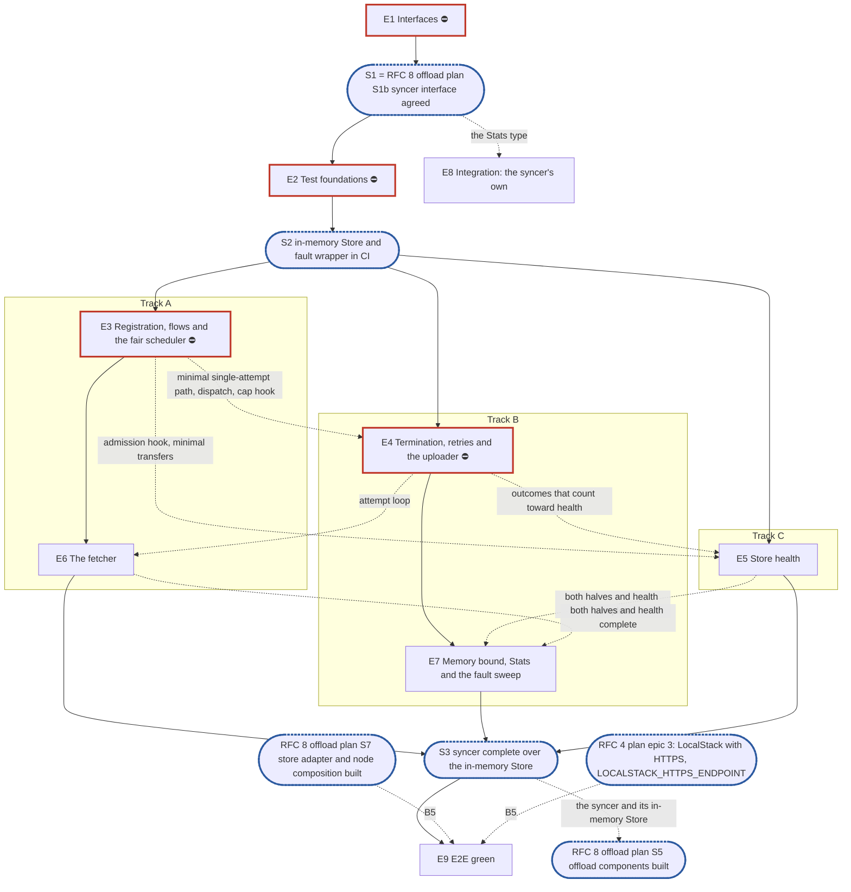

# RFC 3 — syncer v2: implementation plan

**Scope.** [RFC 3, the syncer](../docs/internals/rfcs/rfc-3-syncer.md), as v1.1 calls it:
- the interface;
- both halves;
- the fair scheduler;
- termination and retries;
- store health;
- the fetcher's single flight;
- the memory bound and `Stats`;
- the two settings.

RFC 3's status is `draft`, not `deferred`, so the whole RFC is planned (Step 0 #11). What has no
caller in v1.1 lands with its first caller, as the user decided for #5488's plans. RFC 3 §1.3 is
amended in this pull request to name those callers ("What lands with its first caller"), and §6.1
holds one row for each.

Related RFCs, with how far each is in scope:

- **Constraints only.** Each has, or will have, its own plan.
  - [RFC 2](../docs/internals/rfcs/rfc-2-carver.md), the carver; [RFC 4](../docs/internals/rfcs/rfc-4-remote-tier.md),
    the remote tier; [RFC 5](../docs/internals/rfcs/rfc-5-transforms.md), transforms; and the
    [RFC 8](../docs/internals/rfcs/rfc-8-engine.md) offload plan, which composes them all
    (`.planning/rfc-8-offload-engine-plan.md`). The seams are listed in §1.1.
  - [RFC 0](../docs/internals/rfcs/rfc-0-data-lifecycle.md) §1.2, as amended by the RFC 8 offload
    plan's pull request; [RFC 1](../docs/internals/rfcs/rfc-1-journal.md) and
    [RFC 28](../docs/internals/rfcs/rfc-28-journal-format.md); [RFC 6](../docs/internals/rfcs/rfc-6-block-metadata.md);
    [RFC 9](../docs/internals/rfcs/rfc-9-gc.md); [RFC 12](../docs/internals/rfcs/rfc-12-snapshots.md);
    [RFC 13](../docs/internals/rfcs/rfc-13-configuration.md); [RFC 26](../docs/internals/rfcs/rfc-26-catalog-backups.md);
    [RFC 27](../docs/internals/rfcs/rfc-27-namespace-migration.md).
  - [RFC 24](../docs/internals/rfcs/rfc-24-resources.md) §6.2 and §7.2, which RFC 3 §2.1 and §2.10 cite
    (O4).
- **The rules every epic follows:** [RFC 25](../docs/internals/rfcs/rfc-25-observability.md) and
  [RFC 29](../docs/internals/rfcs/rfc-29-test-harness.md) (§1.5, rules 3 and 6).

**Tracks.** A, B and C, with no owner (§3.4).

**Programme.** The umbrella issue #5488, "offload: RFC 2–5 and the engine's offload part", release
v1.1. Roadmap epic: #3619. The work builds on the journal-only engine
(`.planning/rfc-8-journal-only-engine-plan.md`). #4276's syncer half, composing the syncer in the
node, is RFC 8 offload plan epic 21's, which closes #4276's row; this plan builds what it composes. The
synchronisation points shared across #5488 are the RFC 8 offload plan's, and this plan cites them
by name. GC (RFC 9, roadmap #3620) is planned later.

**Naming.** v1 was `pkg/block/syncer` and the rest of the v1 block tier, which #3119's stage 4
deleted (PR #5484, merged 23 Nov; `pkg/block` is gone from `feat/storage-v2`). v2 is the syncer RFC 3 describes, built at the new path `pkg/syncer`. v2
ignores v1 (rule 7), and no epic touches v1 code or waits on #5484.

**Transition policy.** New installations only (#3119). No metric, log key or setting carries a
version.

**Branches.** The plan and the RFC 3 amendment land on `develop`. The code lands on
`feat/storage-v2`, where `pkg/sim`, `pkg/health`, `pkg/metrics` and `pkg/settings` live.

**Defaults used from Step 0:** no dashboards (#9); output path `.planning/rfc-3-syncer-plan.md`
(#10).

**Reviews.** An independent architect proposal was reconciled with this plan, and §4.1 takes its
smaller package split. Adversarial, correctness and simplification passes ran, followed by a
five-lens review of all five #5488 plans. Every finding is folded in.

**Pending the user's answer.** The alert rules' form (O7). The user settled the put measurement
(D8) and the CPU token (§1.1), so S1 waits on no answer.

---

## 1. Introduction

### 1.1 What we are building

RFC 3's "Start here" and "In short" describe the result. There is one syncer per process, with two
worker pools. Work is served by class, and fairly across stores and flows. Health is kept per store
and per direction. The fetcher joins concurrent demand for the same chunk.

| v1 | v2 | Fate |
| --- | --- | --- |
| `pkg/block/syncer` (`upload_controller.go`, `dynsem.go`) | `pkg/syncer` (D1), RFC 3 §1.3's surface | v1 deleted by #5484; v2 written fresh |
| `pkg/block/remote/memory`, v1's in-memory remote store | `pkg/syncer/syncertest` (D2) for RFC 3's `Store`; `pkg/remote/remotetest` (RFC 4 plan epic 2) for the remote store | v1 deleted by #5484 |
| no setting | `upload_workers` and `fetch_workers` (RFC 13 Appendix B), in `pkg/syncer/section` | new, epic 8 |

**Seams with the other plans of #5488.** RFC 3's `Store` has one production implementation. This
plan calls it **the store adapter**, so it is not confused with the engine's `*engine.Store`.

- **RFC 8 offload plan, epic 21.** It owns the store adapter:
  - the adapter over RFC 4's codec and remote store and RFC 5's transforms;
  - the error mapping, including wrapping a past-the-end range;
  - `ProbeKey`, and spreading connections across addresses;
  - RFC 24 §6.2's CPU token, which epic 21 builds in the node and RFC 4's codec takes as an input,
    per chunk's encode;
  - running `syncertest`'s conformance suite, and RFC 3 §8.1's real-backend checks (D2), against the
    adapter in `integration`.

  Epic 21 also builds the root's single syncer, registers each store, passes it the per-worker
  memory inputs (D7), and registers this plan's collector and conditions in `internal/node`.
- **The engine's calls on the syncer, by RFC 8 offload plan epic.** The engine calls none today:
  the engine's `Deps` has no `Syncer`, and the engine's import test (`TestImportRule`'s allowlist)
  names no `pkg/syncer` (D1).
  - Epic 15: `Upload`, the pipeline's Put step, between `kvstore`'s `Content.Intend` and
    `Content.Commit` (`pkg/metadata/kvstore/offload.go`), or `Blocks.Abandon`
    (`pkg/metadata/kvstore/blocks.go`). It holds RFC 5's chain pin from Mint to Commit or Abandon,
    so every attempt of one `Upload` encodes under one chain (D8), and it bounds a pass by
    `upload_workers` block targets, a key epic 8 declares.
  - Epic 16: a share's flow, opened at `Bind` and closed at `Drop` and `Close`.
  - Epic 17: `Fetch` per missing extent of a carved run, and `Prefetch` from the speculator's
    read-ahead.
  - Epic 20: `Flow.Healthy` and `Flow.Health`, read as the share's per-direction health.
- **The journal's offload half is not a seam of this plan.** `Offload`, `OffloadMany`,
  `MarkOffloaded`, `Unmark` and `Release` return `ErrNotImplemented` on `feat/storage-v2`
  (`pkg/journal/offload.go`) until the journal plan's epic 9b. That gates RFC 8 offload plan
  S6 and its first end-to-end pass, never an epic here: the syncer never calls the journal.
- **RFC 4 plan.** Epic 3 delivers LocalStack with HTTPS in `integration`, at
  `LOCALSTACK_HTTPS_ENDPOINT` (the shared `LOCALSTACK_ENDPOINT` stays plain HTTP), which B5 needs. The
  codec owns the codec part of RFC 3 §2.2's memory-bound row.
- **RFC 2 and RFC 5 plans.** The chunk-count cap, the block target, `MaxEncodedLen` and
  `MaxDecodeLen` reach the syncer as numbers in its configuration (D7), never as an import.

**Dependency limits.** `pkg/syncer` imports only the standard library, plus `pkg/sim` in tests
(RFC 3 §1.4 and §2.12; amended RFC 0 §1.2). Only its `series` subpackage imports the metrics and
health packages, and only its `section` subpackage the settings package (D4).

### 1.2 How the plan is organised

- Epic 1 freezes the surface. Epic 2 builds the in-memory `Store`, its conformance suite, its fault
  wrapper and the measuring helpers.
- Five middle epics are cut along RFC 3's seams:
  - Track A: registration, flows and the fair scheduler (epic 3), then the fetcher (epic 6). Epic 3
    also builds a minimal single-attempt `Upload`, `Fetch` and `Prefetch`, so the scheduler's checks
    run real transfers.
  - Track B: termination, retries and the uploader (epic 4), then the memory bound, `Stats` and the
    fault sweep (epic 7).
  - Track C: store health (epic 5).
- Epic 8 is the syncer's own integration: its settings, and its collector and conditions, which RFC
  8 offload plan epic 21 registers. The alert rules are epic 21's (O7).
- Epic 9 runs the benchmarks.

RFC 3 §8.6's suites paragraph, amended here, places the checks:
- every check in `unit`, and the allocation count in `unit/syncer-allocs` on pull requests;
- the conformance suite and §8.1's real-backend checks against the store adapter in `integration`,
  under RFC 8 offload plan epic 21;
- the fuzz targets in RFC 2's nightly `fuzz` suite;
- the benchmarks in `syncer-bench`;
- the soak in a nightly, hours-long cell against LocalStack with outages on a cycle (RFC 3 §8.1),
  under RFC 8 offload plan epic 22: `engine-soak` today is a `tier: pr` cell of 20 minutes with no
  emulator, which cannot hold it.

None of the suites this plan's own tests run in keeps a `known.yaml`, so each test lands green,
with the epic that makes it pass. `engine-soak` keeps one (`test/engine/soak-known.yaml`), but the
soak and its entries are epic 22's. The `fuzz` suite does not exist yet; RFC 2 plan epic 2
registers it.

### 1.3 What epic 1 must deliver

Epic 1 delivers the exported surface of `pkg/syncer`, with stub bodies, frozen at S1:

- RFC 3 §1.3's types, error values and methods, without those that land with their first caller
  (RFC 3 §1.3, as amended);
- `Stats`, with a field for every RFC 3 §2.12 series;
- the constructor and its configuration (D7), and the `Clock` (D3);
- rule 7's import test.

It declares no internal interface. `Store` is RFC 3's own seam, and it has two consumers before any
implementation: epic 2's in-memory store and the store adapter. O6 lists the names RFC 3 §1.3 leaves
undefined, which epic 1 settles.

### 1.4 What epic 2 must deliver

**The suite.** No suite this plan's own tests run in keeps a `known.yaml` (§1.2), so no test lands
red. The §1.5
instruction's clause that epic issues must exist before E2 lands is there for `known.yaml`
entries, so it binds nothing here.

**The scenario catalogue**, by source:

- **RFC 3 §7.1 and §7.2, every row.** §7 below names the epic that lands each row, or the §6.1 row
  that defers it.
- **RFC 3 §8.1's kinds:**
  - the scheduler model, epic 3;
  - structure, epic 1;
  - memory, epic 7;
  - real backend, the suite of D2 (epics 3, 4 and 6), run by RFC 8 offload plan epic 21;
  - benchmark, epic 9;
  - soak, RFC 8 offload plan epic 22.
- **RFC 3 §8.2, §8.3 and §8.4.** Each epic's **Done when** places them. §8.3's table of store
  changes is a set of rows in the conformance suite.
- **RFC 0 §1.4's single-node checks.** None land here; RFC 8 offload plan epic 21 builds and stops
  the syncer in the composition root's order.
- **Other sources.** v1's two bugs here (RFC 3 §10, D6 and D9) are covered by RFC 3 §7.2's "§4.3
  joining" row.

**The test components:**

- **The in-memory `Store`** (kind 2): RFC 3 §1.4's store and its load record, with no versions and
  no raw objects (§4.3).
- **The `Store` conformance suite** (D2). It includes RFC 3 §7.1's "§2.6 no inference" row and
  §8.3's store changes, which RFC 8 offload plan epic 21 runs against the store adapter.
- **The fault wrapper** (kind 3), over `pkg/sim`'s `Fault` and `TestClock`. It also keeps a
  pass-through record of the calls it forwarded.
- **A recording log handler, and the held-pool heap measurement**, over `internal/prof`.

### 1.5 General rules for each epic

> **Instruction for whoever expands an epic into its detailed description and subtasks,
> human or AI:**
>
> - **Creating an epic from this plan: use the `epic-breakdown` skill.** Whenever the user
>   asks to create an epic from this plan, or to expand, detail or break one down, run the
>   `epic-breakdown` skill (`.claude/skills/epic-breakdown/SKILL.md`) on this plan and that
>   epic, rather than writing the epic document freehand. It extracts the RFC's MUST and
>   MUST NOT into numbered requirements, estimates each subtask in man-days and suggests
>   the pull requests. A human doing it by hand follows the same skill.
> - **Epic and subtask, nothing else.** The units of work are the epic and its subtasks,
>   with subtask ids `<e>.<n>` (`subtask 4.3`, or `T4.3` for short), assigned by the epic
>   document. No other word names
>   them: not task, ticket, story, step or phase, in headings, tables, ids or prose.
> - **The epic stands alone for what to build.** Its requirements, subtasks and decisions
>   are in the epic document itself, which never refers to this plan for them or says "see
>   the plan": the RFC sections it implements, the interfaces it builds on, the
>   subtasks, and a short legend of the names it borrows from this plan (E1, E2, S1, the
>   integration epic, …). It cites the numbered rules below, without copying them, in a
>   table of how each applies: each row names its rule by number and bold title, which
>   says what the rule requires, and the table links this §1.5 with a full link (the
>   plan's path and the section's anchor) and the `CLAUDE.md` sections that hold a rule,
>   so the epic reads alone and its reader can still open each rule's text in one click.
> - **The epic document records decisions, not progress, like this plan.** It has no
>   status fields, no checkboxes to tick and no sections to keep up to date as the work
>   goes on. It is revised through a pull request only when a decision changes.
> - **Subtasks are not pull requests.** A subtask is ideally up to 5 man-days. The owner
>   ships subtasks as they see fit, one pull request each or several together; the epic
>   document only suggests a grouping, each suggested pull request ideally up to 15
>   man-days. Cut and group by logic, readability, dependencies and a deliverable that can
>   be named, not to hit a number.
> - **Every subtask states how it meets each rule that applies to it.** A rule that does
>   not apply is named, with the reason.
> - **In the issue tracker, once each document merges,** following `epic-breakdown`
>   Step 6, their one description. Issues point at the documents and copy nothing; once
>   created, their `Estimate` and blocked-by links are the current estimate and
>   dependencies, and the documents are not revised to follow them. The
>   epic issues exist before E2's pull request lands, because each red test's
>   `known.yaml` entry names one; subtask issues come once their epic document has
>   merged. The release an epic ships in is set by the RFC's roadmap epic that its epic
>   issue sits under, never in a document and never on the epic issue on its own: the epic
>   issue and its subtask issues copy that roadmap epic's milestone, and an epic changes
>   release only by moving under the roadmap epic of the other release.

1. **Independent unit tests.** Each epic carries its own unit tests. They run over epic 2's
   in-memory `Store` and fault wrapper, `pkg/sim`'s `TestClock`, and any epic it depends on once
   that epic has landed.
   - The scheduler (epic 3) and the health state machine (epic 5) are pure functions in their own
     internal packages.
   - Every other rule is unexported code, tested through `export_test.go`.
   - E1 declares no internal interface (rule 12).
2. **Fuzz tests where relevant** (`CLAUDE.md`, "Writing tests", "By kind"). The syncer decodes no
   bytes; the store adapter does. Two sequence targets join the nightly `fuzz` suite that RFC 2 plan
   epic 2 registers, and the suites paragraph names them:
   - arrivals, classes, sizes, joins and cancellations, against the scheduler's reference model
     (epic 3);
   - probe and transfer outcomes, against a table model of RFC 3 §2.8 (epic 5).
3. **Observability follows RFC 25, with RFC 3's own exception.** `pkg/syncer` keeps counters,
   returns them in `Stats`, and logs only RFC 3 §2.8's lines (RFC 3 §1.4, §2.12). Each epic names
   the `Stats` fields it fills, and the syncer opens no spans (D5). The bridge is epic 8's, in
   `pkg/syncer/series` (D4):
   - the collector under the `syncer_` prefix (RFC 25 §2.1, §2.8);
   - the conditions `store_put_unhealthy` and `store_get_unhealthy` (RFC 25 §3.9), as a
     `health.Source` over `health.ScopeStore` (`pkg/health/evaluator.go`).

   RFC 8 offload plan epic 21 registers them, and owns their alert rules (RFC 25 §7, O7).
4. **Profiling.** Tests and benchmarks run under `internal/prof`'s leak check. Two hot paths carry
   assertions:
   - upload and fetch, asserting no allocation per chunk once warm (RFC 3 §8.4, "allocations"), in
     `unit/syncer-allocs` (`tier: pr`);
   - one dispatch, asserting a flat count of queue operations (RFC 3 §8.4, "scheduler work per
     dispatch").
5. **Public interface and internals.** Each epic tests its internal code, and the behaviour it
   enables through `Syncer` and `Flow`, under `-race`. A value is tested where it is consumed
   (`CLAUDE.md`, "Verifying a change"):
   - a health cause, at `Flow.Health`;
   - a throttle limit and a count in flight, at the in-memory store's own record of calls in flight
     and their peak (RFC 3 §1.4, §8.4), so a store call that outlives its worker, such as attempt 1's
     `Put` still running when a slow-tail retry dispatches attempt 2, is counted; the real-backend
     suite, whose store adapter exports no such record, asserts them at `Stats`' busy workers;
   - every other counter, at `Stats`.
6. **Known failures shrink.** No suite this plan's own tests run in keeps a `known.yaml` (§1.2), so
   this rule binds no epic.
7. **v2 ignores v1.** No epic imports, copies from or depends on the behaviour of `pkg/block/syncer`,
   `pkg/block/remote` or `pkg/block/blockcodec`.
   - Epic 1's import test checks each syncer package on its own, under amended RFC 0 §1.2. It
     allows:
     - `pkg/syncer`: the standard library, plus `pkg/sim`, `pkg/syncer/syncertest` and
       `internal/prof` in its external test package (rules 1 and 4, `bench_test.go`), as
       `TestImportRule`'s allowlist does for the engine's;
     - `pkg/syncer/internal/sched` and `pkg/syncer/internal/health`: the standard library, plus
       `pkg/sim` and `internal/prof` in their tests;
     - `pkg/syncer/syncertest`: `pkg/syncer`, `pkg/sim` and `internal/prof`;
     - `pkg/syncer/series`: `pkg/syncer`, `pkg/metrics`, `pkg/health` and the metrics client
       library;
     - `pkg/syncer/section`: `pkg/syncer`, `pkg/settings` and `pkg/metadata/entity`.

     Every package also has the standard library, and a package missing from the list fails the
     test.
   - The import test is also RFC 3 §7.2's "§1.3 error values are the syncer's" row.
8. **Real dependencies for properties of those dependencies** (`CLAUDE.md`, "Writing tests"):
   - RFC 3 §7.1's "§2.6 no inference" row, and §8.1's real-backend runs, need the store adapter over
     LocalStack over HTTPS (`LOCALSTACK_HTTPS_ENDPOINT`, RFC 4 plan epic 3). RFC 8 offload plan epic
     21 runs them.
   - B5 needs a real store and credentials (epic 9, a `manual` suite).

   Nothing needs a real disk for durability, since the syncer persists nothing (RFC 3 §2.7).
9. **Code comment conventions** (`CLAUDE.md`, "Code comments"). Each `decision:` note in RFC 3 goes
   at the code site that implements it: §2.4's on slow-tail retries and re-gets, §2.8's on the
   denial cap, §2.10's on the fixed values. §4.3's `ponytail:` markers go at their own sites.
10. **A test must be able to fail** (`CLAUDE.md`, "Writing tests"). Many RFC 3 §7 rows name the wrong
    design they catch ("A design that…"). Each such test is verified by building that wrong design
    and watching the test fail on its assertion.
11. **A symbol is exported only if the RFC's interface uses it.** The exported surface is RFC 3
    §1.3's, plus the constructor and its configuration (D7), `syncertest` (D2), `series` and
    `section` (D4).
12. **Each subtask creates only what it declares.** No empty package, and no stub without a caller.
    A package, an option or a test helper lands with its first consumer.

## 2. Epics at a glance

| # | Epic | Content | Subtasks | Man-days | Track | Blocks |
| --- | --- | --- | --- | --- | --- | --- |
| 1 | **Interfaces** ⛔ | RFC 3 §1.3's surface for v1.1, `Stats`, the configuration, `Clock`, the import test | 5 | 6 | team | **everything** |
| 2 | **Test foundations** ⛔ | the in-memory `Store`, its conformance suite, the fault wrapper, the measuring helpers | 6 | 17 | team | **all testing** in 3 to 7 and 9 |
| 3 | **Registration, flows and the fair scheduler** ⛔ | registry, flows, lifecycle, two pools, classes, two-level DRR, caps, queues, the waiter bound, the reference model; a minimal single-attempt `Upload`, `Fetch` and `Prefetch` | 11 | 35 | A | 4, 5, 6 |
| 4 | **Termination, retries and the uploader** ⛔ | both halves' attempt loop, the retry budget, throttling, the floor, the first-byte bound, slow tail, unknown outcomes; `Upload` complete | 8 | 24 | B | 5, 6, 7 |
| 5 | **Store health** | per-direction state, probes, the failure window, hold-down, denial backoff, causes, the log lines | 7 | 19 | C | 7 |
| 6 | **The fetcher** | fetch resume, the verification re-get, single flight, join, re-home, detach | 9 | 29 | A | 7 |
| 7 | **Memory bound, `Stats` and the fault sweep** | the per-worker bound, the fit to the transfers pool, the consistent snapshot, the held-pool heap check, the systematic sweep, `unit/syncer-allocs` | 4 | 11 | B | 9 |
| 8 | **Integration: the syncer's own** | the two settings; the collector and conditions in `pkg/syncer/series` | 3 | 6 | team | RFC 8 offload plan epic 21 |
| 9 | **E2E green** | B1 to B5 in `syncer-bench`, RFC 3 §8.5's targets recorded | 4 | 10 | team | — |
| | **Total** | | **57** | **157** | | |

**Plan estimate: 57 subtasks, 157 man-days.**

RFC 3 is about 2,220 lines, which gives N = 6. Its cohesive areas are six:
- the scheduler and its registry;
- termination and retries, with the uploader;
- health;
- the fetcher;
- raw and small transfers, with staging;
- the bounds, with their snapshot.

The user deferred raw and small transfers, with staging, to their first caller (§6.1), so five
middle epics remain.

⛔ = blocker: other epics cannot finish until this one has delivered.

## 3. Synchronisation points, blockers and the split

### 3.1 Dependency graph



### 3.2 Synchronisation points

- **S1 — RFC 8 offload plan S1b, syncer interface agreed.** A joint review of epic 1's written
  signatures with the RFC 8 offload plan's authors, `Store.Put` as D8 settles it. The in-memory
  `Store` and its fault wrapper are not part of S1: they land at S2, as the RFC 8 offload plan's S1b
  also says. S1 unblocks epic 2, and epic 8, which needs only the `Stats` type.
- **S2 — test foundations in CI.** The in-memory `Store` passes its conformance suite in `unit`, and
  the fault wrapper exists. S2 unblocks epics 3, 4 and 5.
- **S3 — the syncer complete over the in-memory `Store`.** Every RFC 3 §7 row that epics 1 and 3 to
  7 name is green in `unit`. S3 unblocks epic 9. It is also the syncer's share of RFC 8 offload plan
  S5, which gates that plan's S3, the end of its epic 16.
- **RFC 8 offload plan S7, store adapter and node composition built.** External. It unblocks B5 in
  epic 9.
- **RFC 4 plan epic 3, LocalStack with HTTPS at `LOCALSTACK_HTTPS_ENDPOINT`.** External. It unblocks
  B5 against the emulator.

### 3.3 Blockers

- **E1 ⛔ → S1 → E2, E8.** E2 needs the agreed surface; E8 needs only the `Stats` type, and its
  tests supply their own `Stats` function.
- **E2 ⛔ → S2 → E3, E4, E5.** Every check runs over the in-memory `Store` and the fault wrapper.
- **E3 ⛔ → E4.** Attempts run over E3's minimal path and scheduler, and the throttle limit is one
  of E3's caps.
- **E3 ⛔ → E5.** Refusal happens at E3's admission.
- **E3 ⛔ → E6.** Joining and re-homing move E3's queue entries.
- **E4 ⛔ → E5.** Health counts the outcomes E4 classifies.
- **E4 ⛔ → E6.** A fetch runs E4's attempt loop.
- **E4 ⛔ → E7.** The sweep needs both halves, and E4 is the uploader.
- **E5 → E7.** The sweep asserts the refusal rules.
- **E6 → E7.** The detached-buffer term is part of the memory bound.
- **E5, E6, E7 → S3 → E9.**
- **RFC 8 offload plan S7 → E9.** B5 needs the store adapter.
- **RFC 4 plan epic 3 → E9.** B5 needs LocalStack at `LOCALSTACK_HTTPS_ENDPOINT`.

### 3.4 Splitting the work

- **Track A:** epic 3 from S2, the largest middle epic, then epic 6. It is busy until S3.
- **Track B:** epic 4 from S2. Its attempt rules are unexported functions that start at once; wiring
  them waits on epic 3's minimal path. Then epic 7, once epics 5 and 6 have landed.
- **Track C:** epic 8 from S1, which needs only the `Stats` type, while epic 2 is built; then epic 5
  from S2, starting with its state machine, and then helps Track A with epic 6's tests.
- **The team converges** at S1 (with the RFC 8 offload plan's authors), at S3, and on epic 9.

## 4. Implementation decisions

### 4.1 Directory layout

```text
pkg/syncer/                       RFC 3 §1.3's surface; Syncer, Flow, Config, Clock          (E1)
  store.go                        Store, its value types, the error values                   (E1)
  stats.go                        Stats and the consistent snapshot                           (E1, E7)
  imports_test.go                 rule 7's import test                                        (E1)
  flow.go, pool.go                registry, flows, lifecycle, the halves' workers             (E3)
  attempt.go                      attempt loop, retry budget, throttle limit, floor,
                                  first byte, slow tail (unexported)                         (E4)
  upload.go                       Upload                                                      (E3, E4)
  fetch.go                        Fetch, Prefetch, single flight, join, detach                (E3, E6)
  export_test.go                  unexported functions handed to the package's own tests      (E3+)
  internal/sched/                 classes, two-level DRR, caps, queues, waiter bound          (E3)
    model_test.go                 the reference model, package sched_test, importing nothing  (E3)
  internal/health/                per-direction state machine, probe groups, log lines        (E5)
  syncertest/                     in-memory Store, fault wrapper, Store conformance suite     (E2)
  series/                         collector, conditions                                       (E8)
  section/                        upload_workers, fetch_workers                               (E8)
  bench_test.go                   B1 to B4, behind syncer_bench                               (E9)
pkg/engine/enginewire/
  syncer_bench_test.go            B5 over the store adapter, behind syncer_bench; written by
                                  epic 9, beside the adapter rule 7 keeps out of pkg/syncer   (E9)
```

### 4.2 Decisions

**D1. v2 lives at `pkg/syncer`.**
- The user decided on new top-level paths for #5488's components, so no epic waits on #5484.
- The import-test entries the engine needs are the RFC 8 offload plan's: today the engine's import
  test (`TestImportRule`) allows no `pkg/syncer`, and RFC 8
  offload plan epic 16 adds `enginewire`'s edge to `pkg/syncer`, with its first consumer.
- **Prior art.** `pkg/openstate` and `pkg/vfs`, the same top-level layout (in this repository).
- **Applied by** epic 1.

**D2. The in-memory `Store`, its fault wrapper and its `Store` conformance suite live in
`pkg/syncer/syncertest`, exported.**
- The suite covers `Store`'s own contract. RFC 8 offload plan epic 21's **Done when** runs it
  against the store adapter (kind 2 of `CLAUDE.md`'s "Writing tests").
- `syncertest` also exports RFC 3 §8.1's real-backend checks, which are the Group A checks (RFC 3
  §7.1) and the lifecycle checks, as a suite over a `Store` the caller passes. This plan runs it over the
  in-memory `Store`; RFC 8 offload plan epic 21 runs it over the store adapter against LocalStack
  behind a fault proxy (RFC 3 §8.1, §8.6). It drives `Syncer` and `Flow` only, so it needs no
  unexported code. Beside the `Store`, the caller passes the faults it can inject and the checksum
  modes it can select: the fault wrapper here, the fault proxy in epic 21. A row needing a fault or
  mode the caller cannot give (a dropped response to a committed put, a byte flipped on the first
  get only, a past-the-end refusal) is skipped by name and reported, never passed. Epic 3 lands it with the lifecycle rows, and epics 4 and 6 add their §7.1 rows.
- **Prior art.** The journal's conformance suite; Go's `testing/fstest.TestFS`.
- **Applied by** epics 2, 3, 4 and 6.

**D3. Time comes from a `Clock` the syncer declares: RFC 8 §2.1's `Now`, `Elapsed` and `After`,
the same three methods as the engine's `Clock`, declared beside its `Deps`.**
- Tests use `pkg/sim`'s `TestClock`, which moves only on `Advance`.
- RFC 3 §1.4 says time "advances only when every task is blocked". To meet that, a test advances
  only after the syncer reports itself idle, through a per-instance hook set from `export_test.go`.
- **Prior art.** `pkg/sim.TestClock`, as the journal and the engine use it. Go's `testing/synctest`
  was considered and not chosen, because its bubble cannot share `pkg/sim`'s clock with the other
  components.
- **Applied by** epics 1, 2 and 3.

**D4. The collector and the conditions live in `pkg/syncer/series`.**
- The user decided that each component owns its collectors, and RFC 8 offload plan epic 21
  registers them. The alert rules are epic 21's (O7).
- RFC 3 §2.12 keeps `pkg/syncer` itself free of any metrics library, so they live in a subpackage.
- The settings section lives in `pkg/syncer/section` for the same reason. It is a
  `settings.Section` built with `settings.Of`, as `internal/identity/settings.go` is, and
  `pkg/settings` imports `pkg/metadata/entity`, which rule 7 refuses `pkg/syncer`.
- The collector exports each queue gauge summed over flows. The per-flow queue gauges are exported
  by share under RFC 25 §2.5's worst-n rule by the node, which already ranks per-share figures
  that way (`shareGaugeSpec`, `internal/node/stats.go`): `Stats` reports them by flow id, and RFC 8
  offload plan epic 21 maps each flow to the share that opened it (epic 16 opens one per share).
- The collector reads a `Stats` function. The node's deadlined, single-flight fetch (RFC 25 §2.8)
  wraps that function when epic 21 registers it. That fetch, `snapshot` in
  `internal/node/stats.go`, serves only `func() engine.Stats` today, so epic 21 widens it.
- **Prior art.** The journal's series, which the node itself builds from the journal's `Stats`
  (`journalSeries`, `internal/node/stats.go`); here the component owns its collector instead.
- **Applied by** epics 1 and 8.

**D5. The syncer opens no spans, and its configuration holds no tracer.**
- RFC 25 §6.1 gives the fetch span, and its links, to the engine.
- **Prior art.** None found.
- **Applied by** epic 1.

**D6. The fit to the transfers pool takes the pool's size as a configuration field.**
- Epic 7 builds RFC 24 §7.2's two rules, the reduction and the refusal, and tests both with a
  non-zero size.
- `pkg/resources` has no `Split` yet, so the root has no size to pass. A zero size reduces and
  refuses nothing. That is a gap against RFC 24 §7.2 (§6.1), and the code site carries a
  `decision:` marker naming it.
- **Prior art.** None found.
- **Applied by** epic 7.

**D7. The constructor takes the per-worker memory inputs as numbers.**
- RFC 3 §2.2's figure needs values only RFC 2, 4 and 5 know. RFC 8 offload plan epic 21 passes
  them.
- The syncer derives from them the bound and the largest encoded block, which is the quantum's
  size (RFC 3 §2.9).
- The bound is fixed at start: RFC 8 offload plan epic 21 computes it once, from the largest `Max`
  RFC 2 §3.7 admits and `MaxDecodeLen(Max)` over every registered transform, and both halves use it
  (amended RFC 3 §2.2). A chain changed on its next write, a chain pin held on an older chain, or a
  namespace added at runtime cannot exceed it, so nothing updates it.
- **Prior art.** None found.
- **Applied by** epic 1.

**D8. `Store.Put` takes the `Upload`'s `Measure`: `Put(ctx, name, src, m *Measure) (Stored, error)`.**
- RFC 3 §2.4 keeps an attempt's measured lengths and checksum across a throttled or error retry,
  but RFC 4 §4.9 keeps no state across calls. So the measurement lives in a value the syncer
  allocates per `Upload`, never reads, and clears after `ErrCorrupt`. The user decided it; RFC 3
  §1.3 and §2.4 are amended in this pull request.
- RFC 8 offload plan epic 15 holds RFC 5's chain pin from Mint to Commit or Abandon, so every
  attempt of one `Upload` encodes under one chain, which keeps a carried measurement valid.
- Not chosen: the store adapter caching the measurement by name, which leaks one entry per failed
  upload since nothing tells it when `Upload` has returned; and re-measuring on every attempt,
  which turns RFC 3 §2.4's bound of 20 reads of `src` into 12 plus 3 per throttled attempt.
- `Put` fills the `Measure` only once every measuring pass of the attempt has completed, so an
  attempt cancelled between MD5 mode's two passes leaves it empty and the retry measures again
  (amended RFC 3 §1.3, §2.4; its case is in §7.1's "§3.4 measuring pass" row, epic 4).
- **Prior art.** From memory: the AWS SDKs compute a body's checksum once per request and reuse
  it across their retries.
- **Applied by** epics 1 and 4.

**D9. A past-the-end refusal is an `ErrCorrupt` carrying `Malformed`.**
- RFC 3 §2.4 re-gets a chunk that failed verification once, and reports a range refused as past the
  end at once. Amended RFC 3 §1.3 declares `Malformed interface{ Malformed() bool }`, set on such an
  `ErrCorrupt`, as `DeniedQuota` and `DeniedSize` are on `ErrDenied`.
- Epic 1 declares it before S1; epic 2's in-memory `Store` and RFC 8 offload plan epic 21's error
  mapping set it; epic 6's fetch reads it.
- **Prior art.** `DeniedQuota` and `DeniedSize` in the same surface.
- **Applied by** epics 1, 2 and 6.

### 4.3 Knowingly simple implementations

- **The slow-tail percentile** (epic 4). `ponytail:` a ring per store and direction holds the
  first-byte samples of the last 60 s, at most 300 times the half's pool (38,400 at 128 workers):
  60 s at RFC 3's ~200 ms per 4 MiB transfer with every worker busy, so a full pool's rate
  stays inside 60 s. Past that the window is shorter than 60 s. The 90th percentile is recomputed
  by selection at most once a second, O(n) each time. Upgrade to per-second buckets over 60 s when
  a CPU profile of the nightly engine soak shows the selection, or a store's rate fills the ring in
  under 60 s.
- **The conformance suite has no rows for versions or raw objects** (epic 2). `ponytail:` the
  in-memory `Store` holds neither, because both land with their first caller (RFC 3 §1.3). The
  suite's rows for `GetVersion`, `PutRaw` and `GetRaw`, and the store's support for them, land
  together with that caller (§6.1).

## 5. The epics in detail

### Epic 1 — Interfaces ⛔

**Epic 1 estimate: 5 subtasks, 6 man-days.**

Epic 1 delivers the surface of `pkg/syncer` for v1.1, with stub bodies, agreed at S1.

**Owns:** RFC 3 §1.3's declarations for v1.1; §1.1's absences on the surface; §1.4's dependency
set.

**Done when:**
- the package builds with every v1.1 symbol of RFC 3 §1.3, and a field for each RFC 3 §2.12 series;
- RFC 3 §7.2's "§1.3 error values are the syncer's" row passes as the import test;
- the S1 review has agreed the signatures.

**Expected content:**
- `Store`, its value types (`Measure` among them, D8), its error values and `Malformed` (D9), with
  O6's names.
- `Syncer`'s constructor and configuration (D7, D6, D3), and the registry and flow calls. A
  registration with `PutProbe` or `GetProbe` false is refused, behind a `decision:` marker naming
  its first caller, so no direction can go unprobed before S25's expiry lands.
- `Flow` and its methods.
- `Stats`.
- The import test.

### Epic 2 — Test foundations ⛔

**Epic 2 estimate: 6 subtasks, 17 man-days.**

Epic 2 delivers the fixtures every check shares (§1.4), in `syncertest`.

**Owns:** RFC 3 §1.4; RFC 3 §7.3.

**Done when:**
- the in-memory `Store` passes the `Store` conformance suite in `unit`, including its "§2.6 no
  inference" row (a committed put with its response lost) and RFC 3 §8.3's store changes;
- the fault wrapper drives each behaviour in RFC 3 §1.4's list, each in a test of its own.

**Expected content:**
- The in-memory `Store`, with RFC 3 §1.4's load record and the put checksum modes of RFC 3 §2.4's
  table.
- The `Store` conformance suite (D2).
- The fault wrapper and its pass-through record.
- The recording log handler and the held-pool heap measurement.

### Epic 3 — Registration, flows and the fair scheduler ⛔

**Epic 3 estimate: 11 subtasks, 35 man-days.**

Epic 3 delivers the registry, flows, lifecycle and the two pools. It also delivers the scheduler
that hands out workers, checked over a minimal single-attempt `Upload`, `Fetch` and `Prefetch`,
which epics 4 and 6 complete.

**Owns:** RFC 3 §1.2; §1.3's registration, flows, `Flow.Close`, `Close` and `Unregister`; §2.1;
§2.3; §2.9; §2.10; §8.1's "Scheduler model".

**Done when:**
- RFC 3 §7.2's rows "§2.1 one limiter", "§2.3 backpressure", "§2.9 no starvation", "§2.9 fair by
  worker-time", "§2.9 waiter share", "§2.9 bounded queue", "§2.9 store level", "§2.9 lone flow",
  "§2.9 classes", "§2.9 eviction", "§2.9 waiter bound" and "§1.3 lifecycle" pass;
- "§1.3 unregister" passes for its flows, health state and counters (its probe half is epic 5's);
- RFC 3 S1, S3, S13, S17 (all but the throttle limit), S18, S20 and S22 hold in the model comparison
  after every dispatch;
- RFC 3 §8.4's "scheduler work per dispatch", "peak in flight", "fairness", "waiters" and "waiters
  displaced" counts pass;
- RFC 3 §8.2's "Scale of the scheduler" cases are reached, along with these "Timing of a call"
  cases: `ctx` cancelled while queued, and `Flow.Close` with transfers queued and running.

**Expected content:**
- The registry and flows, `Close`, and `Unregister`.
- The real-backend suite in `syncertest` (D2), with the lifecycle rows.
- The two pools; the minimal single-attempt path for each half.
- Queues per flow and class, class order, and two-level deficit round robin in worker-time (RFC 3
  §2.9).
- The caps and the fair-share rule, with a hook for epic 4's throttle limit.
- The waiter bound, displacement and eviction.
- RFC 3 §2.10's fixed values, in one table that the other epics cite, without the small-call bound
  and the small-body cap, which land with `Small` (§6.1).
- The reference model, its property test, and its fuzz target in `fuzz`.
- The counters for RFC 3 §2.12's pool series.

### Epic 4 — Termination, retries and the uploader ⛔

**Epic 4 estimate: 8 subtasks, 24 man-days.**

Epic 4 delivers the rules that end every transfer of either half in bounded time with a report, and
completes `Upload`.

**Owns:** RFC 3 §1.3's `Upload`, and the "The syncer" column of its error table; §2.4; §2.5; §2.6;
§3.

**Done when:**
- RFC 3 §7.1's rows "§2.5 unknown is failure", "§3.4 partial put", "§3.3, §3.5 stability", "§3.4
  measuring pass" and "§1.3 census" pass over the in-memory `Store`;
- RFC 3 §7.2's rows "§2.4 termination", "§2.4 throttling lowers concurrency", "§2.4 budget per
  store and direction", "§2.4 slow tail is not charged", "§2.4 trickle fails", "§2.4 throughput
  floor", "§2.4 throttling", "§2.4 retry budget", "§2.4 first byte, per direction" and "§2.4 lone
  slow tail" pass;
- RFC 3 S4, S5, S6, S8 (`src`'s side, §3.5's hash recheck), S9, S17's throttle-limit clause, S19's
  error-set half, S21 and S23 hold;
- RFC 3 §8.4's "retries" count passes;
- RFC 3 §8.2's "Retries" cases are reached, all but the detached-buffer one;
- RFC 3 §8.2's upload cases of "Shape of a transfer" are reached.

**Expected content:**
- `Upload` on epic 3's path (RFC 3 §1.3, §3), with the measurement held in one `Measure` per `Upload` (D8).
- The attempt loop for both halves (RFC 3 §2.4, §2.5, §2.6).
- The retry budget, with RFC 3 §2.4's `decision:` at its site.
- The throttle limit, through epic 3's cap hook.
- The floor, the stall and trickle rules, the first-byte bound, and the slow-tail retry (§4.3).
- The classification handed to epic 5.
- The counters for RFC 3 §2.12's transfer series.

### Epic 5 — Store health

**Epic 5 estimate: 7 subtasks, 19 man-days.**

Epic 5 delivers each store's put health and get health. An unhealthy direction refuses work at
admission.

**Owns:** RFC 3 §2.8 for v1.1, including its logging table (drift lands with its first caller);
§1.3's `Flow.Healthy` and `Flow.Health`.

**Done when:**
- RFC 3 §7.2's rows "§2.8 refusal contained", "§2.8 recovery", "§2.8 one spurious failure", "§2.8
  traffic stands in", "§2.8 shared probe", "§2.8 logging", "§2.8 denial backoff", "§2.8 flap
  hold-down", "§2.8 failure window", "§2.8 per direction", "§2.8 window re-trip" and "§1.3 destroyed
  material" pass;
- "§1.3 unregister"'s probe half passes: an unregistered store's probes stop;
- "§2.8 cause per direction" passes for its four causes that are not drift;
- RFC 3 S14, S15, S16, S19's health half, S26, S27 and S28 hold;
- RFC 3 §8.2's "Probes" cases are reached, along with "a store that turns unhealthy while transfers
  to it are running";
- RFC 3 §8.5's two health latencies hold on the test clock: a failed store refused within one probe
  interval plus the probe's bound, a recovered one accepting work within one probe interval.

**Expected content:**
- The state machine in `internal/health`, with RFC 3 §2.8's `decision:` at its site.
- Probe groups and the probe loops.
- The refusal at epic 3's admission.
- The three log lines.
- The counters for RFC 3 §2.12's health series.
- The fuzz target against a table model, in `fuzz`.

### Epic 6 — The fetcher

**Epic 6 estimate: 9 subtasks, 29 man-days.**

Epic 6 completes `Fetch` and `Prefetch`, and joins concurrent demand for a chunk into one fetch.

**Owns:** RFC 3 §1.3's `Fetch`, `Prefetch` and their stream rules; §4.

**Done when:**
- RFC 3 §7.1's rows "§4.1 verification", "§2.4 verification re-get" and "§4.2 yield at once" pass;
- RFC 3 §7.2's rows "§2.2 detached-buffer cap", "§4.3 single flight", "§4.4 priority", "§4.4
  abandonable", "§4.3 joining", "§1.3 stream rules", "§1.3 partial prefetch", "§2.4 fetch resume"
  and "§4.3 re-home and close" pass;
- RFC 3 S10, S11 and S12 hold;
- RFC 3 §8.4's "single flight" count passes;
- RFC 3 §8.2's fetch cases of "Shape of a transfer" and "Timing of a call" are reached, as is the
  detached-buffer case of "Retries".

**Expected content:**
- The stream rules (RFC 3 §1.3).
- The fetch resume and the re-get, citing epic 4's RFC 3 §2.4.
- Single flight, joining and re-homing (RFC 3 §4.3, §4.4).
- Detaching, and the detached-buffer term, citing epic 7's RFC 3 §2.2.
- The counters for RFC 3 §2.12's fetch series, citing epic 7.

### Epic 7 — Memory bound, `Stats` and the fault sweep

**Epic 7 estimate: 4 subtasks, 11 man-days.**

Epic 7 delivers the checks that span both halves.

**Owns:** RFC 3 §2.2; §2.7; §2.12; §8.3's systematic sweep; RFC 24 §7.2's fit to the transfers pool
(D6).

**Done when:**
- the syncer's part of RFC 3 §7.2's "§2.2 memory bound" row passes, with both halves' bound taken
  from D7's fixed `MaxDecodeLen(Max)` input (the codec's part is RFC 4's, §6.1);
- RFC 3 S2 and S7 hold;
- RFC 3 §8.4's "allocations" count passes in `unit/syncer-allocs`;
- RFC 3 §8.3's sweep runs;
- RFC 3 §2.12's two snapshot rules pass;
- D6's reduction and refusal pass.

**Expected content:**
- The per-worker figure and the fit (D6).
- The consistent snapshot behind `Stats`.
- The held-pool heap check.
- The sweep.
- The `unit/syncer-allocs` option (`tier: pr`) in `test/suites.yaml`.

### Epic 8 — Integration: the syncer's own

**Epic 8 estimate: 3 subtasks, 6 man-days.**

Epic 8 delivers the syncer's settings, and the bridge to RFC 25 in `pkg/syncer/series`. RFC 8
offload plan epic 21 registers both in the node.

**Owns:** RFC 3 §2.10's two settings and the documentation of the memory each implies; RFC 13
Appendix B's `upload_workers` and `fetch_workers` row; RFC 25 §3.9's `store_put_unhealthy` and
`store_get_unhealthy` rows. Their alert rules (RFC 25 §7) are RFC 8 offload plan epic 21's.

**Done when:**
- the settings section declares its row as RFC 13 Appendix B states it, so the RFC 13 plan's D3
  check (`internal/node/appendixb_test.go`) passes once epic 21 adds the section to the node's
  table (`newTable`, `internal/node/settings.go`);
- `docs/guide/configuration.md` states, for each setting, the memory it implies at the largest
  chunk `Max` of any namespace the process serves, under the costliest chain an open attempt may
  hold for uploads and the costliest registered chain for fetches (RFC 3 §2.10's MUST);
- the collector, over a `Stats` function the test supplies, emits every RFC 3 §2.12 series as RFC
  25 §2.1 requires, each queue gauge summed over flows; the per-flow queue gauges are the node's,
  by share (D4);
- the two conditions carry RFC 25 §3.9's cause for each direction. `health.Condition` has no
  severity field (the `ponytail:` on `Evaluator`, `pkg/health/evaluator.go`), so §3.9's severity
  per cause waits on §6.1's row.

**Expected content:**
- `pkg/syncer/section` (D4).
- The collector and the conditions (D4).
- A `docs/guide/faq.md` line: don't change versioning, object lock or lifecycle rules on a live
  bucket, since v1.1 sees such a change only at the store's next open (§6.1's drift row).
- No error mapping of its own: RFC 3 §1.3's table is built by epics 4 and 5, and the mapping onto it
  is the store adapter's (RFC 8 offload plan epic 21).

### Epic 9 — E2E green

**Epic 9 estimate: 4 subtasks, 10 man-days.**

Epic 9 delivers the benchmarks and records them.

**Owns:** RFC 3 §7.4; §8.1's "Benchmark" kind; §8.5; §8.6, the suites paragraph as amended here;
RFC 3 §9's first open question.

**Done when:**
- B1 to B3 run in `syncer-bench` on the in-memory `Store` with a simulated link, and meet RFC 3
  §8.5;
- B4's count is the one epic 6 checks;
- B5 runs against the store adapter over LocalStack at `LOCALSTACK_HTTPS_ENDPOINT`, after RFC 8 offload plan S7 and RFC 4 plan
  epic 3, and against a real service where credentials are;
- B1 and B3 record each half's peak heap against RFC 3 §8.5's bound of the pool times §2.2's
  per-transfer figure, plus 10%; §8.5's two health latencies are epic 5's checks;
- results are recorded with RFC 3 §8.6's fields.

**Expected content:**
- B1 to B4, with `b.ReportAllocs()`.
- B5, in `pkg/engine/enginewire`'s external tests behind `syncer_bench` (§4.1), which
  `syncer-bench` runs with B1 to B4.
- `syncer-bench` (`manual`, no `known.yaml`) and the `syncer` group registered in
  `test/suites.yaml`, its tag in `lint-go`'s list, and `dt docs` run.
- Each fixed value RFC 3 §9 calls a proposal, either confirmed or with a pull request to RFC 3
  proposing a new one.

## 6. Risks and open points

**Open points.**

- **O1. The past-the-end error kind. Settled as D9**: amended RFC 3 §1.3 declares `Malformed`.
- **O2. The least certain estimates.**
  - Epic 3: the scheduler's rules interact.
  - Epic 6: join, re-home and detach under `-race`.
  - Epic 5: the failure window and the denial count interact with epic 4's budget.
- **O3. Code paths cite a different branch.** The code lands on `feat/storage-v2` and the plan on
  `develop`, so epic documents cite code paths on `feat/storage-v2`.
- **O4. RFC 24 was not named in Step 0.** It was not in Step 0 #4's list. It is treated as
  constraints only, because RFC 3 §2.1 and §2.10 cite it.
- **O5. B5 needs credentials.** B5 against a real service runs in a `manual` suite, where
  credentials are.
- **O6. Names RFC 3 §1.3 leaves undefined.** It uses `BlockName`, `ProbeKey`, `StoreID`, `Hash` and
  `Stats` without defining them. It spells the directions both `Put`/`Get` and `DirPut`/`DirGet`.
  And it gives `Flow` no id, although RFC 3 §2.12 reports flows by id. Epic 1 settles each one: the
  names as RFC 3 §1.3 uses them, `Hash` as `[32]byte`, `Put`/`Get`, and an `ID` on `Flow`. It
  proposes these to RFC 3's author as wording fixes. `BlockName` is a `[32]byte` of its own,
  like `entity.BlockName` (`pkg/metadata/entity/content.go`), which the syncer cannot import.
- **O7. The repository has no alert rules.** None exist on `feat/storage-v2`, and no plan chooses
  their form: the RFC 1 plan's §6 row and the RFC 23 plan's §6.1 row hold theirs for an RFC 25 plan
  that is not written. RFC 8 offload plan epic 21 owns every component's alert rules, the syncer's
  `store_put_unhealthy` and `store_get_unhealthy` among them; epic 8 builds none. Their form is
  pending the user.

### 6.1 Deferral ledger

What this plan knowingly does not build. Each row names the section that defers it.

| Deferred | Why | Owner | Trigger |
| --- | --- | --- | --- |
| `FetchRaw`, `UploadRaw`, `FetchVersion`; `Store`'s `GetVersion`, `PutRaw`, `GetRaw`; the staging budget and its spill; RFC 3 §7.2's "§1.3 raw transfer" and "§2.2 copy staging" rows, and S24; the in-memory `Store`'s versions and raw objects; how a caller reaches the staging budget, this plan's former Q2 (header, §4.3) | no caller in v1.1; amended RFC 3 §1.3 | RFC 26 plan; RFC 9 plan for relocation; RFC 27 plan for re-home | that RFC's plan starts, or its first caller lands |
| `Small`, its two fixed values in RFC 3 §2.10 (the small-call bound and the small-body cap) and RFC 3 §7.2's "§1.3 small-body cap" row (header, epic 3) | no caller in v1.1 | RFC 26 plan; RFC 9 plan for `Recheck` | as above |
| `SetDrift`, `ErrDrift`, RFC 3 §7.2's "§2.8 drift condition" row and the drift case of "§2.8 cause per direction"; until then a bucket setting changed after the store opened is seen only at its next open (RFC 4 §4.11), and a put into the drifted store may be expired or kept as a version nothing deletes (RFC 3 §2.8); epic 8's FAQ line says so (epics 5, 8) | its one caller is GC's `Recheck` | RFC 9 plan | RFC 9's plan starts |
| A registration with `PutProbe` or `GetProbe` false, and RFC 3 §7.2's "§2.8 no put probe" row, S25 (epics 1, 5) | its caller is an immutable backup location | RFC 26 plan | RFC 26's plan starts |
| The pool sizing tool (RFC 3 §2.11) | no operator needs it in v1.1; the defaults of RFC 3 §2.10 hold, not reduced to the transfers pool while D6's row stands | unowned | an operator needs pool sizes past the defaults |
| The store adapter, its error mapping and setting `Malformed` on a past-the-end refusal (D9), computing D7's fixed bound, `ProbeKey`, spreading connections across addresses, the CPU token, the root's syncer, registering epic 8's series and settings, the per-flow queue gauges by share (D4), and the conformance suite and RFC 3 §8.1's real-backend checks run against the adapter behind a fault proxy (§1.1, D2) | composition | RFC 8 offload plan, epic 21 | RFC 8 offload plan epic 21 lands |
| The soak (RFC 3 §8.1): hours, nightly, against LocalStack with outages on a cycle | one soak for the composed node; `engine-soak` is a 20-minute `tier: pr` cell with no emulator | RFC 8 offload plan, epic 22 (a nightly cell or option of `engine-soak`) | RFC 8 offload plan epic 22 lands |
| The codec's part of RFC 3 §7.2's "§2.2 memory bound" row (epic 7) | the codec is behind the store adapter | RFC 4 plan, epic 6 (the block codec) | RFC 4 plan epic 6 lands |
| RFC 25 §3.9's severity per cause on `store_put_unhealthy` and `store_get_unhealthy` (epic 8) | `health.Condition` carries no severity; the `ponytail:` on `pkg/health`'s `Evaluator` names RFC 25's plan as its upgrade | unowned | a plan takes RFC 25's registry, or `pkg/health` gains severity |
| RFC 0 §1.4's single-node checks (§1.4): the composition root building and stopping the syncer in order | they run on the composed node | RFC 8 offload plan, epic 21 | RFC 8 offload plan epic 21 lands |
| RFC 24's transfers size passed to the syncer (D6) | `pkg/resources` has no `Split` | unowned | a plan takes RFC 24 §7, or the root sizes its pools |
| Hedged cold reads (RFC 3 §9, "Deferred") | not measured | unowned | a cold-read latency measurement asks for it |
| A bandwidth cap per direction (RFC 3 §9, "Deferred") | not measured | unowned | a measurement shows the pool cannot bound the link |
| Weighted flows (RFC 3 §2.9) | no operator needs it | unowned | an operator names a workload that needs one flow weighted |
| A fixed value of RFC 3 §2.10 becoming a setting | RFC 3 §2.10 forbids it until measured | unowned | epic 9's measurement shows a value wrong for a named workload |
| §4.3's slow-tail `ponytail:` upgrade | simple is enough until profiled | unowned | the marker's trigger |

## 7. RFC coverage

| RFC section | Epic(s) |
| --- | --- |
| RFC 3 Start here, In short | — (explanatory) |
| RFC 3 §1, §1.1 | E1 |
| RFC 3 §1.2 | E3 |
| RFC 3 §1.3 | E1 (declarations); E3 (registration, flows, `Close`, `Unregister`); E4 (`Upload`, the error table); E5 (`Healthy`, `Health`, probe groups by `ProbeKey`; the key's value is RFC 8 offload plan epic 21's); E6 (`Fetch`, `Prefetch`); "What lands with its first caller", §6.1 |
| RFC 3 §1.4 | E2; E1 cites it for the dependency set |
| RFC 3 §2.1 | E3 |
| RFC 3 §2.2 | E7; E6 cites it for the detached term; staging §6.1 |
| RFC 3 §2.3 | E3 |
| RFC 3 §2.4 | E4; E6 cites it for the fetch resume and the re-get |
| RFC 3 §2.5, §2.6 | E4 |
| RFC 3 §2.7 | E7 |
| RFC 3 §2.8 | E5; drift and unprobed directions §6.1 |
| RFC 3 §2.9 | E3 |
| RFC 3 §2.10 | E3; E4, E5, E6 and E8 cite it for their values and settings |
| RFC 3 §2.11 | §6.1 |
| RFC 3 §2.12 | E7; E3, E4, E5 and E6 cite it for their counters; E8 exports it |
| RFC 3 §3, §3.1 to §3.5 | E4 (§3.3 is RFC 1's; E4 checks `src`'s side) |
| RFC 3 §4, §4.1 to §4.5 | E6 (§4.5's policy is RFC 8's) |
| RFC 3 §5 | — (names other owners) |
| RFC 3 §6, S1 to S28 | as each epic's **Done when** names them; S24 and S25 §6.1, rows 1 and 4 |
| RFC 3 §7.1 | E4, E6; "§2.6 no inference" E2's suite, run against the store adapter by RFC 8 offload plan epic 21 |
| RFC 3 §7.2 | E1, E3, E4, E5, E6, E7, by row, as each epic's **Done when** names them; deferred rows §6.1 |
| RFC 3 §7.3 | E2 |
| RFC 3 §7.4, §8.5 | E9 |
| RFC 3 §8.1 | E3 (model); E1 (structure); E7 (memory); E9 (benchmark); real backend, D2's suite (E3, E4, E6), run by RFC 8 offload plan epic 21; soak, RFC 8 offload plan epic 22 |
| RFC 3 §8.2 | E3, E4, E5, E6, as each **Done when** names them |
| RFC 3 §8.3 | E7 (sweep); E2 (the store-change rows) |
| RFC 3 §8.4 | E3, E4, E6, E7 |
| RFC 3 §8.6 | E9; amended in this pull request |
| RFC 3 §9 | E9 (open question 1); §6.1 (deferred items) |
| RFC 3 §10 | — (v1's deviations; v2 ignores v1) |
| RFC 0 §1.2, as amended | E1 (the import test) |
| RFC 8 §2.1, the clock | E1 (D3) |
| RFC 13 Appendix B, `upload_workers`, `fetch_workers` | E8 |
| RFC 24 §6.2 | — (RFC 8 offload plan epic 21 builds the token; RFC 4's codec takes it) |
| RFC 24 §7.2 | E7 (D6) |
| RFC 25 §2.1, §2.5, §2.8, §3.9 | E8 |
| RFC 25 §7 | — (RFC 8 offload plan epic 21, O7) |
| RFC 25 §6.1 | E1 (D5) |
| RFC 4 §4.7, §4.8; RFC 5 §2.7, §3.1 | — (the store adapter, RFC 8 offload plan epic 21) |
