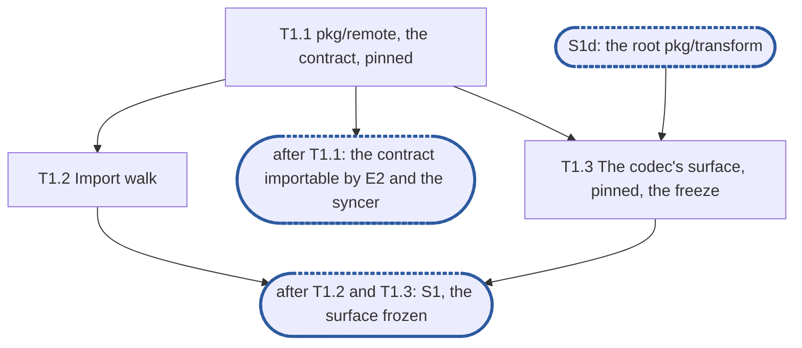

# Epic 1: remote tier v2 interfaces

**Sources:** [RFC 4](../docs/internals/rfcs/rfc-4-remote-tier.md) §1.2 (a contract, not a
component), §2 (the dividing line), §4.1's types, interface and errors for v1.1's callers, the
`codec.Store` block of §4.3 and the paragraph after it, §4.8's error set and causes, §4.12's
`codec_` rows for the recorder that carries them, and §4.13's closed set of roles.
[RFC 0](../docs/internals/rfcs/rfc-0-data-lifecycle.md) §1.2 (component autonomy: a contract and
its implementation, the transitive import test). Cited, not owned:
[RFC 3](../docs/internals/rfcs/rfc-3-syncer.md) §1.3 (the syncer's `Store` and `Flow`'s `Upload`, the
contract types it uses as they are); [RFC 5](../docs/internals/rfcs/rfc-5-transforms.md) §3.1 (the
root `transform` package: `Chain`, `Attempt`, `Encoded`, `Chain.Decode`'s census);
[RFC 2](../docs/internals/rfcs/rfc-2-carver.md) §4.1 and §4.2 (a chunk's ID, a block's name and
their inputs); [RFC 24](../docs/internals/rfcs/rfc-24-resources.md) §6.2 (the background CPU
token); [RFC 25](../docs/internals/rfcs/rfc-25-observability.md) §8.1 (what the root injects).
Every citation is `develop`'s text. The code lands on `feat/storage-v2`, and the paths below are
paths there.
**Track:** the team.
**Epic 1 estimate: 3 subtasks, 4 man-days.**
**Depends on:** nothing in this plan. T1.3 waits on the RFC 5 plan's epic 1, the root
`pkg/transform` (`Chain`, `Attempt`, `Encoded`) with the `entity.NamespaceID` its contract names,
which that epic declares at the RFC 8 offload plan's S1d.
**Blocks:** **everything** in this plan. E2 builds the conformance suite and the in-memory store on
T1.1's `Store`; E4 and E5 implement it in `pkg/remote/s3`; E6 fills T1.3's codec surface; E7's
keys half starts at S1. Outside RFC 4: the RFC 3 plan's syncer, which uses T1.1's types and
errors as they are and is implemented by T1.3's `codec.Store`; the RFC 8 offload plan's epics 11,
15 and 21, which agree the surface at S1c, run `NewPut`'s attempt through `Flow`'s `Upload` and
build one `codec.Store` per store; the RFC 5 plan's `keys/provider`, which imports T1.1's errors for
the `keys` object.

---

## 1. Goal

Epic 1 gives every consumer of the remote tier the one surface it imports, and the walk that keeps
it a contract. `pkg/remote` is RFC 4 §4.1's contract for the calls v1.1 has a caller for, and
nothing else; `pkg/remote/codec` declares `codec.Store` and its put as RFC 4 §4.3 gives them, with
stub bodies behind final signatures. Behaviour is the later epics': nothing here encodes, stores
or maps an error.

**At the end of the epic:**

- `pkg/remote` declares, and imports only the standard library for, every type, constant and
  error RFC 3 §1.3 lists as used from it, the `Store` interface with its nine v1.1 methods, and
  `Cause` with `DeniedError`; it holds no package-level state but its error values and no
  function but methods over its own types;
- `pkg/remote/codec` declares `Store`, its constructor, `Get`, `Health`, `NewPut`, `Put`,
  `Attempt`, `Stored` and the header bound, the `Config` and `Deps` the node's content wiring hands it, the
  `Recorder` its `codec_` series go through and the CPU token it takes; `*codec.Store` implements
  RFC 3 §1.3's `Store`, and `(*Put).Attempt` has the type `Flow`'s `Upload` runs;
- an import walk fails when any package under `pkg/remote` reaches, through its production code,
  a package its allowlist does not name, transitively, for every package of D7's table, so
  E2 to E7 add packages without touching it;
- both packages' exported sets are pinned, signatures included, and the surface is agreed with the RFC 3 and RFC 8
  offload plans' authors: S1, which is the RFC 8 offload plan's S1c.

### 1.1 In scope

`pkg/remote`'s v1.1 contract (D1 to D4), the codec's exported surface (D5, D6 and D11, and D9 and D10,
both pending the user's answer), the import walk (D7), the contract's purity check and both export
pins (D8), and the review that freezes them at S1. Epic 1's subtask ids are its own, cited
nowhere else yet.

### 1.2 Out of scope

- The calls RFC 4 §4.1 says land with their first caller: the backup location's calls with the
  `immutable` mode's admission (RFC 26), and `Settings`, `RecheckSetting`, `VersionsPage` and
  `DeleteVersions` (RFC 9), with the types only they carry (`ObjectKind`, `ObjectKey`,
  `ObjectMarker`, `ObjectInfo`, `Setting`, `VersionMarker`) and `codec.Store.GetVersion`: the
  plan's §6.1 deferral ledger, rows one and four. `RoleRepair`, whose one caller is the repair
  proof's acceptance in row four, goes with them (D2).
- Every behaviour behind the surface: the in-memory store and the conformance suite (E2), the
  fault transport (E3), the S3 store, its constructors `NewClient` and `Open` and its `Recorder`
  (E4, E5), the codec's format, encoder, decoder and the bodies of `codec.Store` (E6).
- The settings rows, metric definitions and alert rule as plain values, and the recorders the
  content wiring implements over the root's registry: E7.
- Building one `codec.Store` per store and the CPU token in the node: RFC 8 offload plan epic 21.
- The engine's own import walk, which must refuse `pkg/remote/codec` and every store outside the
  content wiring: the RFC 8 offload plan's.

### 1.3 Names used here

- **E1**, this epic, interfaces.
- **E2**, epic 2, conformance suite and test foundations: `remotetest`, the in-memory store with
  its load record, and its read-only wrapper.
- **E3**, epic 3, fault transport and LocalStack: `s3fault`.
- **E4**, epic 4, S3 data path, errors and client.
- **E5**, epic 5, capability check and health.
- **E6**, epic 6, block codec: the format, the encoder and decoder, `codec.Store`'s bodies.
- **E7**, epic 7, integration: keys and observability as plain values, and the content wiring's
  builders.
- **S1**, the plan's first synchronisation point, the end of this epic: the contract and the
  codec's surface reviewed by the team and by the RFC 3 and RFC 8 offload plans' authors. It is
  **S1c**, the RFC 8 offload plan's "remote store contract agreed".
- **S1d**, the RFC 8 offload plan's "transform pipeline agreed": the RFC 5 plan's epic 1, which
  declares the root `pkg/transform` T1.3 names.
- **S2** appears here only inside **R4-S2**, the suite and in-memory store in CI (end of E2).
- **S3** names the storage service (Amazon S3 and the services compatible with it) everywhere in
  this document, except inside **R4-S3**, store and codec complete (epics 3 to 6 done).
- **The content wiring**, `internal/node/content`: the part of the node that builds the content
  components and hands each its configuration (RFC 0 §1.2's composition root).

## 2. How the general rules apply

The rules are those of [the RFC 4 implementation plan's §1.5](rfc-4-remote-tier-plan.md#15-general-rules-for-each-epic),
cited by number and title and not copied.

| Rule | Subtasks | How |
| --- | --- | --- |
| rule 1, independent unit tests ([`CLAUDE.md`, "Writing tests"](../CLAUDE.md#writing-tests)) | all | each test is a pure function over values: the error chains over the sentinels, the walk's checker over a dependency graph, the pins over a package's parsed files. No test double: there is no collaborator to stand in for |
| rule 2, fuzz tests where relevant ([`CLAUDE.md`, "By kind"](../CLAUDE.md#by-kind)) | none | no parser: nothing here reads bytes; the codec's decoder and its fuzz target are E6's |
| rule 3, observability follows RFC 25 | T1.3 | the codec's `Deps` carry a `*slog.Logger` and the `Recorder` the codec declares (D5), never a `*metrics.Registry`, and no tracer, since RFC 4 §4.12 names no span for the codec; narrowing the logger with `With("component", "codec")` is E6's. The S3 store's are E4's |
| rule 4, profiling | none | no hot path and no goroutine: the only runtime code is `DeniedError`'s and `Cause`'s methods and stub bodies, `New`'s included |
| rule 5, public interface and internals ([`CLAUDE.md`, "Verifying a change"](../CLAUDE.md#verifying-a-change)) | T1.1, T1.3 | the error chains are asserted with `errors.Is` and `errors.As`, as every consumer reads them; the codec's seam is asserted against the shape its consumer, RFC 3 §1.3's `Store` and `Flow`'s `Upload`, declares |
| rule 6, known failures shrink | none | `unit` keeps no `known.yaml`, and no test here lands red |
| rule 7, v2 ignores v1, and imports only what RFC 0 §1.2 allows | T1.2 | nothing from `develop`'s `pkg/block`; T1.2's walk is the rule's enforcement for every package of D7's table, with `s3fault`'s list as E3 decided it (D7) |
| rule 8, real dependencies for properties of those dependencies ([`CLAUDE.md`, "Writing tests"](../CLAUDE.md#writing-tests)) | T1.2 | the walk runs the real `go list` over the real tree and over a planted tree in `testdata`; nothing else here has a dependency |
| rule 9, code comment conventions ([`CLAUDE.md`, "Code comments"](../CLAUDE.md#code-comments)) | T1.1, T1.3 | each `Store` method's doc and each codec method's names the RFC 4 section that states its obligations; RFC 4 §1.2's `decision:` (one document for codec and store) needs no code site. This epic's marker: D2's at the role constants |
| rule 10, a test must be able to fail ([`CLAUDE.md`, "Writing tests"](../CLAUDE.md#writing-tests)) | all | each test names the break it catches; the walk and the pins each run over a planted violation and fail on it |
| rule 11, a symbol is exported only if the RFC's interface uses it | T1.1, T1.3 | exported: §4.1's v1.1 symbols and §4.3's codec surface with its constructor's `Config`, `Deps`, `Recorder` and `CPU`, and `MaxHeaderLen` (D11); the encoder and decoder stay unexported (D6); each package's pin holds its set (D8) |
| rule 12, each subtask creates only what it declares | all | `pkg/remote` lands with its contract, `pkg/remote/codec` with its surface; no directory for E2 to E5's packages is created. The walk's allowlist names them as data (D7), which no package needs to exist for |

## 3. Requirements and invariants

Every obligation RFC 4, RFC 0 and RFC 3 place on this epic, numbered so that subtasks and tests can
cite them. Where an owned section's obligation is another epic's to carry out, the row says whose.

**The contract package**

| # | Requirement | Kind | Source | Subtasks |
| --- | --- | --- | --- | --- |
| R1 | Package `remote` holds the types, constants, interface and errors of §4.1 and nothing else: no state, and no behaviour beyond methods over its own values | MUST | §1.2, RFC 0 §1.2 | T1.1 |
| R2 | Package `remote` imports the standard library only | MUST | §1.2, RFC 0 §1.2 | T1.1, T1.2 |
| R3 | `remote` declares each type the syncer uses as it is, once: `Name`, `Range`, `Chunk`, `ChunkRange`, `Direction` (`DirPut`, `DirGet`), `Version`, `Checksum`, `StoredSum`, `Meter`, and the error set with its `Cause`; no consumer declares them again | MUST | §1.2, RFC 3 §1.3 | T1.1 |
| R4 | `Store` declares the calls v1.1 has a caller for with §4.1's signatures: `Checksum`, `Put`, `Get`, `Delete`, `List`, `Health`, `PutControl`, `GetControl` and `Close`. The backup location's calls and `Settings`, `RecheckSetting`, `VersionsPage` and `DeleteVersions` are not declared; each lands with its first caller, its signature as §4.1 writes it | MUST | §4.1 | T1.1 |
| R5 | Withdrawn before the document merged: the zero `Range` meaning the whole block binds the stores and their callers, not this epic's declaration, so E2's suite and E4 hold it | — | §4.1 | — |
| R6 | The zero `StoredSum` has kind None, the kind a get reports when the service reported no checksum; reporting it so is E4's | invariant | §4.1, §4.4 | T1.1 |
| R7 | `Meter` is two funcs, `Moved` and `Sent`, and carries no behaviour of its own; skipping a nil func, so the zero `Meter` meters nothing, is E6's | invariant | §4.1 | T1.1 |
| R8 | Control objects are reached by a role from a closed set in code: `PutControl` and `GetControl` take a `Role`, never a caller-chosen key, and a new role is a new constant | MUST | §4.13, §4.1 | T1.1 |
| R9 | `Mode` names `Mutable` and `Immutable`, since an open in `immutable` mode is refused by name until its caller lands (E5) | MUST | §4.1 | T1.1 |

**The error set**

| # | Requirement | Kind | Source | Subtasks |
| --- | --- | --- | --- | --- |
| R10 | The closed set is `ErrNotFound`, `ErrInvalid`, `ErrDenied`, `ErrTransient`, `ErrCorrupt`, `ErrThrottled` and `ErrMalformed`; no other sentinel is declared. Mapping every failure to exactly one of them is E4's for the S3 store and E6's for the codec | MUST | §4.1, §4.8, §6 R9 | T1.1 |
| R11 | `ErrThrottled` wraps `ErrTransient` and no other; `ErrMalformed` wraps `ErrCorrupt` and no other; the five others match none of the set but themselves | MUST | §4.1, §4.8 | T1.1 |
| R12 | Every `ErrDenied` carries its cause, `access`, `quota` or `size`: `DeniedError` holds a `Cause` and the service's code and unwraps to `ErrDenied`. Deriving the cause from a reply is E4's | MUST | §4.1, §4.8, §6 R21 | T1.1 |
| R13 | The codec declares no error of its own: `codec.Store` returns §4.8's set as it is, and the transforms' material errors unchanged, so nothing maps them. Returning them so is E6's | invariant | §4.3, §4.8 | T1.3 |

**The codec's surface**

| # | Requirement | Kind | Source | Subtasks |
| --- | --- | --- | --- | --- |
| R14 | `codec.Store` lives in the codec's package, holds a `remote.Store` through the contract, and is the syncer's `Store` as it is: `Get` and `Health` with RFC 3 §1.3's signatures, with nothing adapting it | MUST | §4.3, RFC 3 §1.3 | T1.3 |
| R15 | `NewPut` builds a `*Put` whose `Attempt` method value has the type of `Flow`'s `Upload`'s `attempt`, and whose `Stored` returns each chunk's range and the census once an `Attempt` returned nil | MUST | §4.3, RFC 3 §1.3 | T1.3 |
| R16 | `codec.Store`'s `GetVersion` is not declared in v1.1; it lands with `remote.Store`'s `GetVersion` and its first caller | MUST | §4.3, §4.1 | T1.3 |
| R17 | The codec is handed the chain and the name derivation by the content wiring; it imports the contract and the root `transform` package, never a transform's package, the carver or the engine | MUST | §1.2, §4.3, RFC 2 §4.2 | T1.2, T1.3 |
| R18 | The codec records its series (`codec_chunks_verified_total`, `codec_measuring_passes_total`, `codec_verify_failures_total` by `kind`, `codec_seconds` by direction) through a recorder interface it declares, and imports no settings, metrics or health package | MUST | §1.2, §4.12 | T1.2, T1.3 |
| R19 | The codec takes RFC 24 §6.2's background CPU token as an input: one per chunk encoded or hashed, returned before its next network wait. Taking and returning it is E6's | MUST | RFC 24 §6.2 | T1.3 |
| R25 | A block's header is bounded by a constant of its format version, which the content wiring reads before any `codec.Store` exists: `Flow`'s `Upload`'s `size` is the chain's `MaxEncodedLen` summed over the chunks plus the header, and the largest encoded block sizes the put side's memory | MUST | §3.2, RFC 3 §1.3, RFC 3 §2.2 | T1.3 |
| R20 | The codec's `Deps` carry the `Logger` the root injects, never a metrics registry; narrowing it with `With("component", prefix)` is E6's | MUST | RFC 25 §8.1, §1.2, §4.12 | T1.3 |

**Imports**

| # | Requirement | Kind | Source | Subtasks |
| --- | --- | --- | --- | --- |
| R21 | No package of the remote tier, contract, codec or store, reaches, through its production code, another component's implementation; the settings, metrics and health packages count as implementations | MUST NOT | RFC 0 §1.2, §1.2 | T1.2 |
| R22 | A store never parses a block: no store package imports the codec, and the codec imports no store implementation | MUST NOT | §1.2, §6 R4 | T1.2 |
| R23 | Neither the codec nor a store calls the syncer, GC or the engine: none imports them | invariant | §1.2 | T1.2 |
| R24 | The import test is per component, follows imports transitively, and binds production code only: tests may import other components' implementations | MUST | RFC 0 §1.2 | T1.2 |

## 4. Decisions this epic takes

- **D1. `Checksum` has three values, and None is its zero.** RFC 4 §4.1 declares the type with no
  constants. `ChecksumNone` (0), `ChecksumCRC32C` and `ChecksumMD5` are the kinds v1.1's profile
  chooses or reports: Appendix C.4 step 1 chooses `x-amz-checksum-crc32c`, then `Content-MD5`, else
  None with the ETag compared as an MD5, and E4's D9 reports a whole-block get's stored sum as
  CRC32C, the ETag's MD5 or None. None as the zero makes the zero `StoredSum` the "reported none"
  of R6. The other kinds S3 can return (CRC32, SHA-1, SHA-256, CRC64NVME) land with the raw
  transfers of RFC 26 that check a stored sum of any kind, a new constant each. Adding one later
  costs no migration, since no value is persisted. Prior art: aws-sdk-go-v2's
  `types.ChecksumAlgorithm`, an enumeration of the same kinds (from memory).
- **D2. `RoleRepair` is not declared in v1.1.** Its one caller is the acceptance of the
  versioning repair proof (RFC 4 §4.11), part of the `Recheck` pass deferred to RFC 9 (the plan's
  §6.1, row four), and Appendix C.2 gives it no key. The constants are `RoleClaim`, `RoleHealth`
  and `RoleKeys`. A role's number is never persisted or sent (C.2 keys a control object by the
  role's name), so adding `RoleRepair` later changes no stored value. A `decision:` marker at the
  constants names its caller and the trigger, a `Recheck` pass that accepts a repair proof. This
  settles E4's §9 point 5: `controlKey` places three roles. Prior art: none needed.
- **D3. `DeniedError` and `Cause` carry the two methods an error and a label need.**
  `func (e *DeniedError) Error() string` reads `remote: denied (<cause>): <code>`, and
  `func (c Cause) String() string` reads `access`, `quota` or `size`, RFC 4 §4.8's words. They are
  methods over the contract's own values, which RFC 0 §1.2 allows a contract. Neither the message
  nor the code carries the reply's message, a header or a credential: the code is the service's
  error code, which E4 sets. Consumers: E4's `result` label (RFC 4 §4.12) and RFC 3 §2.8's
  per-direction cause. Prior art: `fs.PathError`, a struct error that names its parts and unwraps
  (read the code).
- **D4. The contract's doc comments name the section that states each obligation.** Each `Store`
  method's comment is RFC 4 §4.1's, followed by the section it cites, so an implementer of E2 or E4
  reads the obligation from the method. Prior art: none needed.
- **D5. The codec's constructor takes the store, a `Config` and `Deps`.**

  ```go
  package codec // pkg/remote/codec

  // Config is what the node's content wiring hands one store's codec.
  type Config struct {
  	Namespace entity.NamespaceID // the namespace the store serves; Chain.Decode's ns (RFC 5 §3.1)
  	Chain     transform.Chain    // the configured chain, built by the content wiring
  	ChunkID   func(plain []byte) [32]byte                                       // RFC 2 §4.1, under the namespace's chunk-ID key
  	Name      func(nonce [16]byte, chain [32]byte, ids [][32]byte) remote.Name  // RFC 2 §4.2, the key scope bound in
  	Census    func(ctx context.Context, name remote.Name) ([]transform.Encoded, error) // D10, pending
  	MaxChunk  int   // RFC 2 §3.2's Max; a body is bounded by Chain.MaxDecodeLen(MaxChunk)
  	Version   uint8 // the block format version to write (RFC 4 §3.5), E7's setting
  }

  // Recorder is what the codec records through (RFC 4 §4.12); the content wiring
  // implements it over the root's registry, one per store, which supplies the label.
  type Recorder interface {
  	Verified(n int)                              // codec_chunks_verified_total
  	MeasuringPass()                              // codec_measuring_passes_total
  	VerifyFailed(kind string)                    // codec_verify_failures_total: hash, name, version, malformed
  	Took(d remote.Direction, took time.Duration) // codec_seconds, encode (DirPut) or decode (DirGet)
  }

  // CPU is RFC 24 §6.2's background CPU token.
  type CPU interface {
  	Acquire(ctx context.Context) (release func(), err error)
  }

  // Deps are what the root injects (RFC 25 §8.1).
  type Deps struct {
  	Logger   *slog.Logger
  	Recorder Recorder
  	CPU      CPU
  }

  // store is what the codec calls on a remote store; remote.Store satisfies it.
  type store interface {
  	Checksum() remote.Checksum
  	Put(ctx context.Context, name remote.Name, body io.Reader, size int64, sum []byte) error
  	Get(ctx context.Context, name remote.Name, r remote.Range) (io.ReadCloser, remote.StoredSum, error)
  	Health(ctx context.Context, d remote.Direction) error
  }

  func New(st store, cfg Config, d Deps) (*Store, error)
  ```

  `New` takes the four calls the codec makes, through an unexported interface that `remote.Store`
  satisfies, so the arrival of §4.1's deferred calls changes no value handed to it (§4.1, §1.2's
  "each consumer declares the methods it needs"). Its body is a stub like the others; E6 makes it
  refuse a nil store, chain, function, `Logger`, `Recorder` or `CPU`, or a `MaxChunk` below 1,
  rather than default it, as RFC 0 §1.2 refuses an invalid setting, and not an unknown `Version`,
  since RFC 4 §3.5 has such a codec refuse to write and still read. The name and the
  chunk ID are functions of plain types, so the codec imports neither the carver nor RFC 2's
  `entity` hash types, and the content wiring adapts the carver's functions with a closure; the
  RFC 2 plan's D9 hands them over this way. RFC 4 §1.2 and §4.3 name the chain and the name
  derivation as what the codec is handed; the chunk-ID function is the third, which §3.4's
  check of each chunk against its plaintext hash needs and the RFC 2 plan's D9 already hands
  over. `Stored`'s census entries carry a nil `Body`: the census records what was applied, not
  the bytes. The CPU token is taken on the encode path only:
  RFC 24 §6.2 exempts demand reads and read-aheads, and the background decode (GC's
  verification) has no caller in v1.1 (§9). Changing this after RFC 8 offload plan epic 21
  calls `New` means editing that call. Prior art: the RFC 5 plan's `NewChain`, which takes a
  logger and a recorder the chain declares (its D2); E4's `NewClient(ClientConfig, Deps)`.
- **D6. The encoder and the decoder are unexported.** The plan's outline lists them in this
  epic's surface, but nothing outside the codec calls them: RFC 4 §3.1 has the engine and GC
  encode and decode through `codec.Store`, and the RFC 3, RFC 8 offload and RFC 5 plans name no
  other codec symbol (`rg -o 'codec\.[A-Z]\w*'` over `.planning/` and the RFCs finds only
  `codec.Store`). E6 builds them as unexported code beneath `codec.Store`, and a recovery
  import that reads headers alone (RFC 26 §2.3) exports what it needs when it lands. Prior art:
  restic keeps its pack encoding internal to the repository package and exposes blobs only
  (from memory).
- **D7. The import walk runs `go list` and checks a table that covers the whole tree.**
  `pkg/remote/imports_test.go` runs `go list -deps -f` over `./...` from `pkg/remote`, production
  files only, and hands a pure checker each package's transitive dependencies and its direct
  imports. A package under `pkg/remote` with no row fails, as does a reached `dittofs` package its
  row does not allow, or a direct import of a library outside its row. Libraries are checked at
  the direct import only: a library cannot import a `dittofs` package, so the transitive check
  on `dittofs` packages is the one RFC 0 §1.2 asks for. The table:

  | Package | `dittofs` packages it may reach | Libraries it may import |
  | --- | --- | --- |
  | `pkg/remote` | none | none |
  | `pkg/remote/codec` | `pkg/remote`; `pkg/transform` and `pkg/transform/keys`; `pkg/metadata/entity` and its subpackages | none |
  | `pkg/remote/memory` and its subpackages | `pkg/remote`; `pkg/sim`; its own subtree | none |
  | `pkg/remote/remotetest` | `pkg/remote`; `internal/prof` | none |
  | `pkg/remote/s3` and every package beneath it but `s3fault` | `pkg/remote`; its own subtree but `s3fault` | the AWS SDK for Go v2 (`github.com/aws/aws-sdk-go-v2/…` with its runtime `github.com/aws/smithy-go/…`) |
  | `pkg/remote/s3/s3fault` | none | the AWS SDK for Go v2, as above |

  The walk is a function of a directory, so its test also runs it over a planted module under
  `testdata/walk/`, which catches a wrong `go list` template that the checker's own cases cannot.
  The whole table lands now, so E2 to E5 add their packages without touching it (E3's, E4's and
  E5's documents count on that), and a row is an upper bound: a package that imports less passes.
  `s3fault`'s row is E3's decision (its rule 7 row), not the plan's rule 7 list, which still names
  `pkg/remote` and `pkg/sim` there. Prior art: `pkg/journal`'s and `pkg/engine`'s
  `TestImportRule` (go/build, direct imports) and `internal/archtest` (`go list -export -deps`),
  on `feat/storage-v2`, read the code.
- **D8. Two arch tests pin the surface, one also the contract's purity.** `pkg/remote/arch_test.go`
  and `pkg/remote/codec/arch_test.go`, in the form of `pkg/settings/arch_test.go` on
  `feat/storage-v2`, load the package through `internal/archtest`'s `ExportImporter` and compare
  each exported object's printed type with a pinned list, so an extra or missing export, a struct
  field or a changed signature fails, and a file behind a build tag cannot hide one. In
  `pkg/remote` a parse of its non-test files also fails on a package-level `var` other than the seven errors, a `func`
  that is not a method of one of the package's own types, or an `init`: RFC 4 §1.2's "no state, no
  behaviour beyond methods over its own values", which the import walk cannot see. The pin's
  `exports` helper is copied as `pkg/settings` and `pkg/secrets` copy it. Prior art: those two
  `arch_test.go` files (read the code).
- **D9. `NewPut` takes the pinned chain and the nonce. Pending the user's answer.** RFC 4 §4.3
  writes `NewPut(name, src)`, but the header carries the nonce and the chain ID (RFC 4 §3.2), and
  the encoder must encode under the attempt the engine pinned before it minted the name (RFC 5
  §3.1's `Pin`, RFC 8 §6.6): neither can be recovered from the name, which is a hash of them. The
  recommended signature, written into T1.3:

  ```go
  func (s *Store) NewPut(name remote.Name, nonce [16]byte, pin transform.Attempt, src iter.Seq2[remote.Chunk, error]) *Put
  ```

  On the user's agreement, RFC 4 §4.3's block and RFC 3 §1.3's two mentions of `NewPut(name, src)`
  (`Upload`'s doc comment and the prose under the interface) are amended in the same pull request.
  A caller could pass a name that does not match the nonce, the pin and the chunks; E6's
  `Attempt` recomputes it through `Config.Name` on its first pass and returns `ErrInvalid` on a
  mismatch, before any byte is sent. The other options are §9's.
- **D10. `codec.Store` finds a block's census through a lookup it is handed. Pending the user's
  answer.** `Chain.Decode` takes the block record's census (RFC 4 §3.4, RFC 5 §3.1), and RFC 4
  §4.3's `Get(ctx, name, want, m)` carries none. The recommendation keeps every signature of
  RFC 3 §1.3 and RFC 4 §4.3 as written: `Config.Census`, a function the content wiring builds over
  the metadata store's block record (RFC 6 §2.3), which `Get` calls once per block read. Its cost
  is one block-record read per get, which the engine would otherwise make to pass the census in.
  The lookup's contract keeps `Get` inside §4.8: an absent block record is `remote.ErrNotFound`,
  so the engine re-resolves the chunk (RFC 8 §7.7), and any other failure is returned as itself,
  a local failure that counts against no store's health. A `ponytail:` marker at the lookup names
  the ceiling, one block-record read per get, and the upgrade, the census passed in with `Get`
  (§9 point 2's option b), if a read-path profile shows the lookup; a `decision:` marker names
  the read with no local record (RFC 26's recovery import, a read at a backup location) as the
  other trigger for that upgrade. The other options are
  §9's.
- **D11. The header bound is a function of the format version.** RFC 4 §3.2 bounds a header by a
  constant of its format version, and the content wiring needs it before any `codec.Store`
  exists: for the largest encoded block that sizes the put side (RFC 3 §2.2) and the S3 client's
  `MaxBlockSize` (RFC 4 §4.1), and for the bound it hands the engine, which sizes `Flow`'s
  `Upload`'s `size` (RFC 3 §1.3) and whose own walk refuses `pkg/remote/codec`.

  ```go
  // MaxHeaderLen is the largest header format version v allows, and false for a
  // version this codec does not know (RFC 4 §3.2, §3.5).
  func MaxHeaderLen(v uint8) (n int, ok bool)
  ```

  A pure function of a value, not a method, so it needs no store; E6 fills it from the layout of
  its format. A method of `Put` would cost a range over the chunks, and one of `Store` would make
  the client depend on a store built on it. Prior art: none found.

## 5. Target tree

```text
pkg/remote/
  remote.go           T1.1  Name, Range, Direction, Mode, Version, Checksum, StoredSum, Role,
                            Chunk, ChunkRange, Meter, Info (D1, D2, D4)
  store.go            T1.1  Store: the nine v1.1 calls, each doc naming its section (D4)
  errors.go           T1.1  the seven errors, Cause, DeniedError (D3)
  errors_test.go      T1.1  the chains, the causes' words, the zero StoredSum
  arch_test.go        T1.1  the export pin and the purity check (D8)
  testdata/arch/      T1.1  a planted extra export, a var and a free func
  imports_test.go     T1.2  the walk: go list, the checker, the table (D7)
  testdata/walk/      T1.2  a planted module: a production reach through an intermediate
                            package, and a test file's import
pkg/remote/codec/
  codec.go            T1.3  Store, New, Config, Deps, Recorder, CPU; Get, Health; MaxHeaderLen
                            (D5, D10, D11)
  put.go              T1.3  NewPut, Put, Attempt, Stored (D9)
  seam_test.go        T1.3  the shape RFC 3 §1.3 consumes
  arch_test.go        T1.3  the export pin (D8)
```

## 6. Subtasks

### T1.1 `pkg/remote`, the contract for v1.1, pinned

**Subtask T1.1 estimate: 1.25 man-days.**

- **Track:** the team. **Depends on:** none.
- **Covers:** R1–R4, R6–R12.
- **Deliverables:** `remote.go`, `store.go` and `errors.go`, with RFC 4 §4.1's signatures:
  - the types `Name [32]byte`, `Range struct{ Off, Len int64 }`, `Direction` (`DirPut`,
    `DirGet`), `Mode` (`Mutable`, `Immutable`), `Version string`, `Checksum` (`ChecksumNone`,
    `ChecksumCRC32C`, `ChecksumMD5`, D1), `StoredSum struct{ Kind Checksum; Sum []byte }`, `Role`
    (`RoleClaim`, `RoleHealth`, `RoleKeys`, D2), `Chunk struct{ Hash [32]byte; Bytes []byte }`,
    `ChunkRange struct{ Hash [32]byte; Range Range }`,
    `Meter struct{ Moved func(n int64); Sent func() }` and
    `Info struct{ Name Name; Size int64; ModTime time.Time }`;
  - `Store` with `Checksum() Checksum`,
    `Put(ctx, name Name, body io.Reader, size int64, sum []byte) error`,
    `Get(ctx, name Name, r Range) (io.ReadCloser, StoredSum, error)`,
    `Delete(ctx, names []Name) []error`,
    `List(ctx, after Name, n int) (page []Info, next Name, done bool, err error)`,
    `Health(ctx, d Direction) error`, `PutControl(ctx, role Role, body []byte) error`,
    `GetControl(ctx, role Role) (body []byte, v Version, err error)` and `Close() error`;
  - the seven errors, `Cause` (`CauseAccess`, `CauseQuota`, `CauseSize`) with `String`, and
    `DeniedError struct{ Cause Cause; Code string }` with `Error` and `Unwrap` (D3);
  - `arch_test.go`, D8's pin and purity check.

  Consumed by E2 (the suite and the in-memory store take `Store`), E4 and E5 (the S3 store
  implements it), T1.3 (`codec.Store` holds one), the RFC 3 plan's syncer (the types and errors
  as they are) and the RFC 5 plan's `keys/provider` (the errors).
- **Acceptance criteria:**
  - Every symbol RFC 3 §1.3 lists as used from `remote` is declared here, and nothing of the two
    groups RFC 4 §4.1 defers (R3, R4).
  - An extra export, a changed signature (one `Store` method's included), a missing symbol, a
    package-level `var` other than the seven errors, or a free `func` fails the pin (R1, R4, R7,
    R10).
- **Tests:** at the errors as consumers read them, with `errors.Is` and `errors.As`: a table of
  every sentinel against every other, `ErrThrottled` matching `ErrTransient` and `ErrMalformed`
  matching `ErrCorrupt` and nothing else matching (catches `ErrMalformed` declared with
  `errors.New`, which would let the syncer re-get a malformed range, and a sentinel wrapping the
  wrong one, R11); a `*DeniedError` of each cause matching `ErrDenied`, recovered by `errors.As`
  with its cause, and its message naming the cause's word and the code (catches a `DeniedError`
  that unwraps to nothing, or a cause that prints as a number, R12). The zero `StoredSum`'s kind
  is `ChecksumNone` (catches a reordered constant block, R6). The pin runs over `testdata/arch/`,
  with a planted extra export, a changed signature, a `var` and a free `func`, and fails on each
  (catches a pin that compares nothing). No test double.
- **Rules:** rule 9: D2's `decision:` at the role constants, D4's section names.

### T1.2 The import walk

**Subtask T1.2 estimate: 1.25 man-days.**

- **Track:** the team. **Depends on:** T1.1.
- **Covers:** R2, R17, R18, R21–R24.
- **Deliverables:** `imports_test.go`: a walk of a directory that runs
  `go list -deps -f '{{.ImportPath}} {{join .Deps " "}} | {{join .Imports " "}}' ./...` (no
  `-test`, so production files only), a pure checker over what it lists, and D7's table as data.
  Consumed by every package under `pkg/remote`: T1.3's `codec`, E2's `memory` and `remotetest`,
  E3's `s3fault`, E4's and E5's `s3`, each checked with no change here.
- **Acceptance criteria:**
  - `go test ./pkg/remote/` walks every package under `pkg/remote` that exists, and reports each
    violation as the package, the refused package it reached, and its row.
  - A package under `pkg/remote` with no row fails (R21).
- **Tests:** at the walk, over `testdata/walk/`, a module of its own whose production file reaches
  a refused package through an intermediate one and whose `_test.go` imports another refused
  package: exactly the production reach is reported (catches a template reading `.Imports` for
  `.Deps`, a direct-only walk, and one that binds tests, R24). At the checker, one case per branch:
  a reach its row refuses (`codec` reaching `pkg/transform/chain`, R17), a package with no row, a
  library imported by `remote` (R2), and an allowed reach that passes. The live walk over the real
  tree enforces the table for every package as it lands (R18, R21–R23).
- **Rules:** rule 7 and rule 8 are this subtask.

### T1.3 The codec's surface, pinned, and the freeze

**Subtask T1.3 estimate: 1.5 man-days.**

- **Track:** the team. **Depends on:** T1.1; S1d, for `transform.Chain`, `transform.Attempt`,
  `transform.Encoded` and `entity.NamespaceID`.
- **Covers:** R13–R20, R25.
- **Deliverables:**
  - `codec.go` and `put.go`: D5's `Config`, `Recorder`, `CPU`, `Deps` and `New`, and, with stub
    bodies behind final signatures,

    ```go
    func (s *Store) Get(ctx context.Context, name remote.Name, want []remote.ChunkRange, m remote.Meter) iter.Seq2[remote.Chunk, error]
    func (s *Store) Health(ctx context.Context, d remote.Direction) error
    func (s *Store) NewPut(name remote.Name, nonce [16]byte, pin transform.Attempt, src iter.Seq2[remote.Chunk, error]) *Put // D9, pending
    func (p *Put) Attempt(ctx context.Context, m remote.Meter) error
    func (p *Put) Stored() (ranges []remote.ChunkRange, census []transform.Encoded)
    func MaxHeaderLen(v uint8) (n int, ok bool) // D11
    ```

    each doc comment RFC 4 §4.3's, naming the section, with `Attempt`'s stating that two
    `Attempt`s of one `Put` may overlap and `Stored`'s that its census entries carry a nil
    `Body`. The stubs return an error and never panic; no test reads their answers.
  - `arch_test.go`, D8's pin.
  - The review that reaches S1: the surface, with D9 and D10 as the user settles them, put to the
    RFC 3 and RFC 8 offload plans' authors, and in the pull request's description each exported
    symbol of both packages with its first caller.

  Consumed by E6, which fills every body; the RFC 8 offload plan's epic 21, which calls `New`
  per store and `MaxHeaderLen` to size the put side and the bound it hands the engine, and its
  epic 15, which passes `put.Attempt` to `Flow`'s `Upload`; E7, whose content wiring implements
  `Recorder`.
- **Acceptance criteria:**
  - `*codec.Store` implements RFC 3 §1.3's `Store`, and `(*Put).Attempt` has the type of
    `Upload`'s `attempt` (R14, R15).
  - `GetVersion` is not declared (R16), and the package declares no error variable (R13); the pin
    fails on either.
- **Tests:** in `seam_test.go`, a local copy of RFC 3 §1.3's `Store` interface and
  `var _ syncerStore = (*Store)(nil)`, and `var _ func(context.Context, remote.Meter) error =
  (*Put)(nil).Attempt`: the compiler enforces the seam until the RFC 3 plan's package lands and
  the content wiring's composition takes the check over (catches a signature drifting from what
  the syncer calls, R14, R15). The pin runs over T1.1's planted package (catches a pin that
  compares nothing). No test double.
- **Rules:** rule 3: `Deps` as D5 gives it. Rule 11: the encoder and decoder are not declared
  (D6).

## 7. Order of work



T1.2 follows T1.1 on the same path, while T1.3 waits on S1d. Checkpoint after T1.1: E2 and the RFC 3
plan's syncer can build on a pinned `pkg/remote` (§9 point 5). S1 follows T1.2 and T1.3.

## 8. Suggested pull requests

| PR | Subtasks | Man-days | After | Why together |
| --- | --- | --- | --- | --- |
| 1 | T1.1, T1.2 | 2.5 | — | the contract, pinned, with the walk that keeps it one |
| 2 | T1.3 | 1.5 | PR 1, and S1d | the codec's surface and its pin, and the review that reaches S1 |

A suggestion only: one pull request per subtask works as well.

## 9. Open points

1. **D9, `NewPut`'s inputs: pending the user's answer.** Options:
   - (a), recommended: `NewPut(name, nonce, pin, src)`, as T1.3 writes it; RFC 4 §4.3 and RFC 3
     §1.3's two mentions are amended to it.
   - (b) a value, `NewPut(b codec.Block, src)` with `Block{Name remote.Name; Nonce [16]byte;
     Pin transform.Attempt}`: one parameter, the same amendment, and one more type to export.
   - (c) the codec mints: `NewPut(pin, src) (*Put, remote.Name)`, drawing the nonce and deriving
     the name itself. It moves minting from the engine (RFC 8 §6.6, the RFC 2 plan's D9) into the
     codec, ahead of the put intent the engine records, so it amends three RFCs.
2. **D10, the census on a read: pending the user's answer.** Options:
   - (a), recommended: `Config.Census`, a lookup by name the content wiring builds over the
     metadata store, with D10's error contract; no signature changes.
   - (b) `Get(ctx, name, want, census, m)`: the census travels from the engine through the
     syncer's `Fetch`, `Prefetch` and `Store.Get`, which amends RFC 3 §1.3 and makes the syncer
     carry `transform.Encoded`, a type RFC 3 says it does not import.
3. **The background decode's CPU token.** RFC 24 §6.2 puts GC's verification and relocation under
   the token, and `codec.Store.Get` carries no per-call input to say a read is background. No
   caller of v1.1 makes one; how a background read asks for the token is settled when RFC 9's plan
   builds it.
4. **The plan's outline differs in four places.** It lists the encoder and decoder in this epic's
   surface (D6 keeps them unexported); it gives the decoder an optional CPU token in this epic
   (point 3 leaves it to its caller); it gives `s3fault` `pkg/remote` and `pkg/sim` in rule 7 (D7
   follows E3); and its estimate is 4 subtasks and 6 man-days, against this document's 3 and 4,
   since the pins fold into the subtasks that create each package and the declaration work weighs
   at the scale's lower end. Its rule 7 list is corrected by the follow-up that also fixes the
   `keys` contract's import (`keys/provider`, not `keys`), not here.
5. **S1 now waits on S1d, and E2 need not.** T1.3 names `pkg/transform`'s types, so S1, the RFC 8
   offload plan's S1c, follows that plan's S1d rather than running beside it. E2 and the RFC 3
   plan's syncer use only T1.1's contract, so they can start at the checkpoint after T1.1 rather
   than at S1. The plan's §3.2 says S1 waits on nothing outside it; the follow-up that corrects
   rule 7 can record both.
