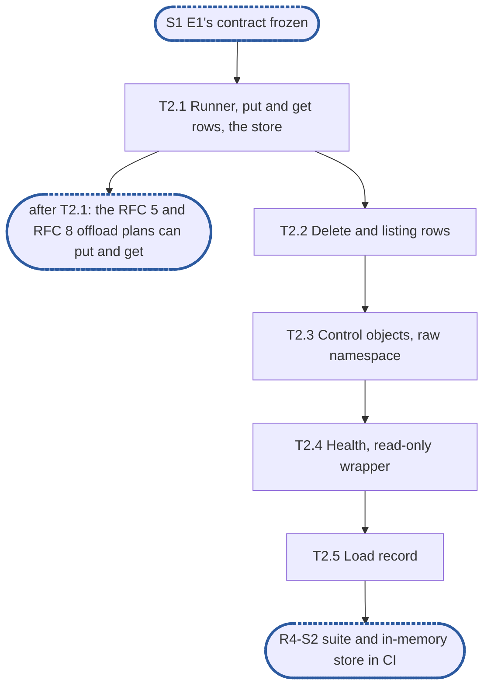

# Epic 2: remote tier v2 conformance suite and test foundations

**Sources:** [RFC 4](../docs/internals/rfcs/rfc-4-remote-tier.md) §7.1, the suite's form and the
rows not marked T that the in-memory store can show (§4.2's raw namespace, §4.3's put then get,
§4.4's ranges, §4.5's batches, §4.6's walk and foreign key, the read-only half of §4.7's probe row
and §4.13's roles); §7.4's in-memory row; §7.5's suites paragraph for where they run. Because the
in-memory store implements the contract, the obligations those rows test bind it too: §4.2, §4.3's
store half, §4.1's calls, §4.4, §4.5's `Delete`, §4.6, §4.7, §4.8, §4.9 and §4.13, §4.12 for what the
in-memory store records instead, and §6's R5 to R10 and R16.
[RFC 3](../docs/internals/rfcs/rfc-3-syncer.md) §1.4, for the in-memory store's load record and
the fault wrapper around it. [RFC 0](../docs/internals/rfcs/rfc-0-data-lifecycle.md) §1.2, for
where a verified in-memory implementation ships. The
[RFC index](../docs/internals/rfcs/rfc-index.md), "Test harness" item 1, for the clock the store
reads. Cited, not owned: [RFC 29](../docs/internals/rfcs/rfc-29-test-harness.md) §4.11 (test
doubles). Every citation is `develop`'s text. The code lands on `feat/storage-v2`, and the paths
below are paths there.
**Track:** the team.
**Epic 2 estimate: 5 subtasks, 8.5 man-days.**
**Depends on:** **S1**, E1's `pkg/remote` frozen: `Store` with the calls v1.1 has (`Checksum`,
`Put`, `Get`, `Delete`, `List`, `Health`, `PutControl`, `GetControl`, `Close`), `Name`, `Range`,
`Info`, `Role`, `Checksum` with its kinds, `StoredSum`, `Version`, `Direction`, the sentinels,
`Cause` and `DeniedError`. `pkg/sim`'s `TestClock` and `internal/prof`'s `Watch`, both already on
`feat/storage-v2`, drive the tests.
**Blocks:** **R4-S2**, which E3 and E4 start from: E4's T4.8 runs this suite against the S3 store,
and E5's T5.4 through the checked `Open`. **E6**, whose §7.3 `codec.Store` row runs on the
in-memory store in a mode that needs a measuring pass. Outside RFC 4: the RFC 3 plan's epic 2,
which extends T2.4's wrapper with per-call faults and reads T2.5's load record; the RFC 5 plan's
epic 8, whose `keys` object is tested against T2.3's control objects; the RFC 8 offload plan's
epics 15, 17 and 21, whose pipeline tests run the syncer over this store.

---

## 1. Goal

Epic 2 gives every store one conformance suite, and every consumer of the contract one in-memory
store that the suite holds to the real one.

- `remotetest.Run` runs the rows of RFC 4 §7.1 not marked T against whatever store an opener
  returns. The in-memory store runs it in `unit`; E4 runs it against the S3 store over LocalStack.
- `pkg/remote/memory` is the verified in-memory store (kind 2 of
  [`CLAUDE.md`, "Writing tests"](../CLAUDE.md#writing-tests)) that the syncer's, the transforms'
  and the engine's tests import, as amended RFC 0 §1.2 allows a test to.
- A fault wrapper around it (kind 3) turns its namespace read-only, and is the wrapper the RFC 3
  plan extends with per-call faults.
- The store keeps a load record, the output RFC 3 §1.4's checks assert on.

**At the end of the epic:**

- `go test ./pkg/remote/...` in `unit` runs every row below against the in-memory store, each row
  under `internal/prof`'s leak checks, and passes.
- The suite takes no store-specific argument but an opener: E4 runs it unchanged against the S3
  store, so the in-memory store is never the only store a row runs against.
- The in-memory store refuses what the contract refuses: a stream shorter or longer than its size,
  a checksum that does not match in a mode that has one, a range past the end, a control body over
  its bound, a role outside the set. Every failure wraps exactly one sentinel.
- `memory.Wrap(store).SetReadOnly(true)` refuses every write and the put probe with `ErrDenied` of
  cause `access`, and passes every read and the get probe.
- `(*memory.Store).Load()` reports calls in flight and their peak, the order calls reached the
  store, puts per name, the bytes of the blocks it holds and the keys a listing skipped.

### 1.1 In scope

- **`pkg/remote/remotetest`:** `Subject`, `Run` and the rows of §3.
- **`pkg/remote/memory`:** the in-memory store, its clock function, its fault wrapper with its
  read-only setting, and its load record.

### 1.2 Out of scope

- **E4:** the S3 store's opener, its raw hooks over the admin client, and the halves of the rows
  only a service shows: §4.6's one request per call and reply under the small-body cap, and the
  S3 store's count of a skipped foreign key, §4.12's `remote_list_foreign_total`. Also §7.1's §4.8
  throttling row.
- **E3, E4, E5 and E6:** every §7.1 row marked T, over the fault transport. This epic writes none
  of them; a store without the transport skips them (§7.1).
- **E5:** the capability check and the health object it writes at a real open; the §4.7 rows on
  a real service's probes.
- **E6:** §7.1's §3.2 census row and every §7.3 row, `codec.Store`'s among them. This epic only
  gives the in-memory store the checksum modes that row needs (D5).
- **E8:** §7.1's two §4.10 rows, which need a client.
- **E9:** the prefix-revoke half of §7.1's §4.7 row, which needs a service enforcing per-prefix
  rights.
- **The RFC 3 plan's epic 2:** the wrapper's per-call faults of RFC 3 §1.4 (latency and time per
  byte, a committed put whose reply is lost, a put cut short, a chunk corrupted on a get, a held
  call, a probe failed or passed per direction), the one fault interface they consult (RFC index,
  "Test harness" item 1), and their operation names. They land on T2.4's `Wrapper`, in this
  package, with that epic as their first consumer.
- **RFC 26:** versions in the in-memory store, and every call of a backup location. These are the
  RFC 4 plan's §6.1 ledger rows on versions in the in-memory store and on a backup location's
  calls.
- **The RFC 8 offload plan's epic 21:** the registry refusing the in-memory store outside tests
  (#4276), as the RFC 4 plan's §6.1 ledger row on the node's composition has it.

### 1.3 Names used here

- **E1**, epic 1, interfaces: `pkg/remote`'s contract for v1.1's callers, and the import walk over
  every package under `pkg/remote`.
- **E2**, epic 2, this epic.
- **E3**, epic 3, fault transport and LocalStack: `s3fault` and the `integration` cell.
- **E4**, epic 4, S3 data path, errors and client: the S3 store. Its T4.8 runs this suite.
- **E5**, epic 5, capability check and health. Its T5.4 runs this suite through the checked open.
- **E6**, epic 6, block codec, with `codec.Store`.
- **E8**, epic 8, integration: the client limit.
- **E9**, epic 9, E2E green: the real-bucket rows.
- **S1**, the plan's first synchronisation point, = RFC 8 offload plan S1c remote store contract
  agreed: E1's contract, reviewed by the RFC 3 and RFC 8 offload plans' authors. This epic starts
  there.
- **R4-S2**, suite and in-memory store in CI: this suite runs green against the in-memory store in
  `unit`. It is reached at the end of this epic. **S2** appears here only inside it; the `R4-`
  prefix keeps it apart from the RFC 8 offload plan's S2.
- **S3** is the storage service's protocol, never a synchronisation point.
- **The RFC 3 plan's epic 2** (PR #5881), test foundations: the per-call faults on this epic's
  wrapper, and the Group A suite over the in-memory store.

## 2. How the general rules apply

The rules are those of
[the RFC 4 plan's §1.5](rfc-4-remote-tier-plan.md#15-general-rules-for-each-epic). They are cited
by number and title, not copied.

| Rule | Subtasks | How |
| --- | --- | --- |
| rule 1, independent unit tests ([`CLAUDE.md`, "Writing tests"](../CLAUDE.md#writing-tests)) | all | the suite is the test of the in-memory store; the store's own tests cover what no generic row can (stream length, checksum modes, the skipped-key count). Doubles: `pkg/sim`'s `TestClock` (kind 1) and the wrapper (kind 3, T2.4). Nothing answers in a store's place |
| rule 2, fuzz tests where relevant ([`CLAUDE.md`, "Writing tests"](../CLAUDE.md#writing-tests)) | none | no parser of outside input: the store reads only the keys it wrote, and the bodies it stores are opaque to it |
| rule 3, observability follows RFC 25 | none | the in-memory store records no series and logs nothing (D7): its observable output is the load record, the skipped-key count among it |
| rule 4, profiling | T2.1 | `Run` calls `prof.Watch` before opening each row's subject, so a goroutine, descriptor or heap growth a row leaves behind fails that row. No allocation assertion: no hot path here |
| rule 5, public interface and internals ([`CLAUDE.md`, "Verifying a change"](../CLAUDE.md#verifying-a-change)) | all | every row runs at `remote.Store`, the surface every caller consumes; the load record is held by the suite's load row through `Subject.Load`, which the in-memory opener backs with `Load`, the call the RFC 3 plan's checks read; the read-only setting at the probe RFC 3's health derivation reads |
| rule 6, known failures shrink | all | no known-failure file: every test lands green with its subtask |
| rule 7, v2 ignores v1, and imports only what RFC 0 §1.2 allows | all | nothing from `develop`'s `pkg/block/remote/memory` or `pkg/block/blockstoretest`. `pkg/remote/memory` imports `pkg/remote` and the standard library only, its clock a function it is given (D4); `pkg/remote/remotetest` imports `pkg/remote` and `internal/prof`. Their tests import `pkg/sim`. E1's import walk covers both |
| rule 8, real dependencies for properties of those dependencies ([`CLAUDE.md`, "Writing tests"](../CLAUDE.md#writing-tests)) | T2.1 | the rows are written once for every store, and E4 runs them against LocalStack, so no row's guarantee rests on the in-memory store alone (RFC 4 §7.1's last paragraph) |
| rule 9, code comment conventions ([`CLAUDE.md`, "Code comments"](../CLAUDE.md#code-comments)) | T2.1, T2.2, T2.3 | the `ponytail:` and `decision:` markers named in §4, at the code sites that implement them |
| rule 10, a test must be able to fail ([`CLAUDE.md`, "Writing tests"](../CLAUDE.md#writing-tests)) | all | each test in §6 names the defect that fails it on its assertion |
| rule 11, a symbol is exported only if the RFC's interface uses it | all | `remotetest` exports `Subject`, `Run`, and `Load` with `CallRecord`, the load row's view of a record; `memory` exports `New`, the store's `remote.Store` methods, `Load` with `CallRecord`, and `Wrap` with `Wrapper` and `SetReadOnly`, each with a consumer named in §6. The raw hooks stay unexported in `memory`, since only its own test's opener reads them |
| rule 12, each subtask creates only what it declares | all | each hook of `Subject` lands with the row that first reads it; the wrapper lands with the §4.7 row, its first consumer; the load record with its first test |

## 3. Requirements and invariants

Every obligation RFC 4, RFC 3, RFC 0 and the RFC index place on this epic, numbered so that
subtasks and tests can cite them.

**The suite**

| # | Requirement | Kind | Source | Subtasks |
| --- | --- | --- | --- | --- |
| R1 | One suite runs against every store implementation; rows marked T need the fault transport and are skipped for a store without one, so this epic writes none of them | invariant | RFC 4 §7.1 | T2.1 |
| R2 | The in-memory store passes §7.1's rows not marked T that need no client, codec, service permission or throttling service, at every change, in `unit` | test row | §7.4, §7.5 "Suites" | T2.1, T2.2, T2.3, T2.4 |
| R3 | The verified in-memory implementation ships with RFC 4, beside its conformance suite, and is held to that suite; other components' tests import it | MUST | RFC 0 §1.2; RFC 3 §1.4; RFC 29 §4.11 | T2.1 |
| R4 | The in-memory store is never the only store these rows run against: the suite takes nothing but an opener, so E4's T4.8 runs it against the S3 store over LocalStack | MUST NOT | §7.1 | T2.1 |

**The rows** (RFC 4 §7.1, not marked T)

| # | Requirement | Kind | Source | Subtasks |
| --- | --- | --- | --- | --- |
| R5 | §4.3: put, then get whole: bytes equal | test row | §7.1 | T2.1 |
| R6 | §4.4: a get of each range inside the block returns exactly its bytes; a range starting past the end fails with `ErrInvalid` | test row | §7.1 | T2.1 |
| R7 | §4.5: a batch deleted twice, including a never-written name: every result is `nil`; a batch of 2,500: every block gone | test row | §7.1 | T2.2 |
| R8 | §4.6: 2,500 blocks listed in pages of 1,000, stopped after 1,200 and resumed from the last name: every block seen exactly once, in order, with size and time, and each call returns at most its `n`. The one request per call and the reply under the small-body cap are E4's | test row | §7.1 | T2.2 |
| R9 | §4.6: a key under the block namespace that is not a block name is skipped; a cancel mid-page ends the call with the context's error. The S3 store's count is E4's; the in-memory store's is R20's | test row | §7.1 | T2.2 |
| R10 | §4.2: after the suite's rows, the store's raw namespace holds nothing but blocks, control objects and check objects, and every block key is the prefix followed directly by the name | test row | §7.1 | T2.3 |
| R11 | §4.13: put and get each role: bytes equal, a second put replaces the first, an absent role is `ErrNotFound`, and a block listing yields none of them. The health role is never absent on an opened store, so its absence is not asserted (§4.7) | test row | §7.1, §4.7 | T2.3 |
| R12 | §4.7, its read-only half: the put probe fails while the namespace is read-only and succeeds on the next call once write access returns; the get probe succeeds throughout. The S3 store runs it in E5's T5.5; the prefix-revoke half is E9's | test row | §7.1 | T2.4 |

**The in-memory store's contract**

| # | Requirement | Kind | Source | Subtasks |
| --- | --- | --- | --- | --- |
| R13 | The store never invents a name, stores nothing under its namespace but blocks and control objects (it writes no versioned or check objects, which §4.2 also allows), and puts nothing between the block namespace and the name | MUST NOT | §4.2 | T2.1, T2.2, T2.3 |
| R14 | A put stores a whole block: a put that does not complete leaves no block readable under a new name. The in-memory store also leaves an object already under the name as it was (D5) | MUST NOT | §4.3, §6 R5 | T2.1 |
| R15 | The body is read once, as a stream of exactly the size declared before its first byte; a stream shorter or longer than its size fails the put with `ErrInvalid`, as E4's guard does | MUST | §4.3, §6 R5; [epic 4](rfc-4-remote-tier-epic4.md) D8 | T2.1 |
| R16 | A put is verified: where the store's `Checksum` is not None, a `sum` that does not match the body is `ErrCorrupt`, and nothing is stored, as on a service that checks the put (D5) | MUST | §4.1, §4.3, §4.8, §7.1 | T2.1 |
| R17 | `Put` returns `nil` only once the block is stored; a put under an existing name replaces it | MUST | §4.3, §6 R5 | T2.1 |
| R18 | A get returns exactly the bytes of its range, or of the whole block for the zero `Range`, or an error: a range that extends past the end is `ErrInvalid`, an absent block is `ErrNotFound`, and a get after a put of the name returned `nil` returns the block | MUST | §4.1, §4.4, §6 R6 | T2.1 |
| R19 | `Delete` returns one result per name, in order; an absent name's is `nil`; a batch of any size is accepted | MUST | §4.5, §6 R7 | T2.2 |
| R20 | A listing yields every block that exists for the whole walk exactly once, in ascending name order from `after`, with its size and the time it was stored, at most `n` per call, and skips a key under the block namespace that is not a block name and counts it, in the load record (D7) | MUST | §4.6, §6 R8 | T2.2, T2.5 |
| R21 | The store reads time only through a clock interface it declares in its own package, which the node's one clock and a test's virtual clock satisfy as they are; it defines no private clock | MUST | RFC index "Test harness" item 1; RFC 3 §1.4 | T2.1, T2.2 |
| R22 | Each role reaches one fixed location outside the block namespace; a control put replaces the whole object; an absent object is `ErrNotFound`; a body is bounded by a constant of the store and read into memory, a larger one `ErrInvalid`; the roles are a closed set | MUST | §4.13, §4.8, §6 R16 | T2.3 |
| R23 | The health object exists from the moment the store is returned; the put probe writes it, the get probe reads it, and a get probe that finds it absent fails with `ErrNotFound`; the store keeps no health status | MUST | §4.7 | T2.3, T2.4 |
| R24 | Every failure wraps exactly one sentinel of §4.1; a local failure, a context ended or a body reader failing, is returned as itself | MUST | §4.8, §6 R9 | T2.1 |
| R25 | The store carries no retry loop, circuit breaker, health status, concurrency limit or queue, and makes one attempt per call | MUST NOT | §4.9, §6 R10 | T2.5 |
| R26 | Concurrent calls are safe, two puts of one name overlapping included, since two `Attempt`s of one `codec.Store` put may overlap | MUST | §4.3 | T2.1 |

**The fault wrapper and the load record**

| # | Requirement | Kind | Source | Subtasks |
| --- | --- | --- | --- | --- |
| R27 | A fault wrapper around the in-memory store fails calls on cue; its read-only mode never answers a call in the store's place with a success, and its refusals are errors of §4.8's set. The probe passed on cue that RFC 3 §1.4 also allows is the RFC 3 plan's epic 2's | MUST NOT | RFC 3 §1.4; RFC 29 §4.11; §7.2 | T2.4 |
| R28 | A read-only namespace refuses every write and the put probe with `ErrDenied` carrying cause `access`, and passes every read and the get probe | MUST | §4.7, §4.8 | T2.4 |
| R29 | The store keeps its own record of its load: calls in flight and their peak, the order calls reached it, puts per name, and the bytes it holds | invariant | RFC 3 §1.4 | T2.5 |
| R30 | A check is writable as: build the caller over the in-memory store, call it, and assert on what the store holds, the load it recorded and what came back | MUST | RFC 3 §1.4 | T2.5 |

## 4. Decisions this epic takes

- **D1. The suite is a function of an opener, one fresh subject per row.**
  - `remotetest.Run(t, open)` runs each row as a subtest, one after another, calling `open` once
    per row. `open` returns a `Subject`: the store, and hooks for what a row reads or plants
    beneath the store. Each hook lands with its first row (rule 12).
  - A fresh subject per row keeps a row's blocks out of another's walk, so the §4.6 row counts its
    own 2,500 blocks. E4's opener gives each row a fresh prefix of one bucket.
  - The §4.2 raw-namespace row runs after every row, on that row's subject, rather than once after
    the whole suite: every object the suite wrote is still checked, and a misplaced key is blamed
    on the row that wrote it. `Run` records each key a row plants through `PutRaw`, and the check
    leaves those out: the contract has no call that deletes a key that is not a name.
  - Each row calls `prof.Watch` before `open`, so the subject's cleanups, which `open` registers,
    run before the leak check. `prof.Watch` forbids overlapping watches, so rows never run in
    parallel, and the test calling `Run` must not call `prof.Watch` itself.
  - So the opener's cleanup leaves nothing the row started running: on the S3 store, whose client
    outlives a row, it closes the client's idle connections, or each row opens a client of its
    own. E4's T4.8 opener owes this, or every row fails as a leak.
  - A hook a row needs that the subject leaves nil skips that row by name, so it is reported and
    never counted as a pass.
  - The suite computes each put's `sum` itself, in the kind the store's `Checksum()` names, with
    the standard library (`hash/crc32`'s Castagnoli table, `crypto/md5`): the raw digest, as
    `Hash.Sum(nil)` returns it, 4 bytes for CRC32C and 16 for MD5. E4's store encodes it into
    its header. No hook carries it, so the S3 opener supplies nothing for it, and the in-memory
    store's modes (D5) are exercised by the same rows.
  - Prior art: the Go CDK's `blob/drivertest.RunConformanceTests`, which takes a harness maker
    and runs every row against each driver, `memblob` among them (from memory); Go's
    `testing/fstest.TestFS` (from memory).
- **D2. The in-memory store lays its objects out as Appendix C.2 does, under an empty prefix.**
  - One map holds every object under its C.2 key relative to the prefix: `blocks/<name in
    lowercase hex>`, `control/<role>`. A listing walks `blocks/` only, and a key there that is not
    a name is skipped, so §4.6's foreign-key row and §4.2's raw-namespace row mean the same thing
    on both stores.
  - The suite's raw rows read keys relative to the prefix and judge them by C.2's layout, the
    only profile RFC 4 has.
- **D3. The in-memory store lives in `pkg/remote/memory`, beside `remotetest`.**
  - RFC 4 §1.2 names it `remote/memory`, and amended RFC 0 §1.2 ships a contract's in-memory
    implementation "beside the contract's conformance suite". The contract `pkg/remote` cannot
    hold it, since a contract holds no state.
  - Putting it inside `remotetest` would follow RFC 29 §4.11's "in that package or its `xxxtest`
    package" more literally, but `remotetest` imports `testing`, and the node's registry, which
    refuses the in-memory store outside tests (#4276), names it from production code.
  - Prior art: the Go CDK keeps `memblob` and `drivertest` in two packages (from memory).
- **D4. The store's clock is a function it is given, so it imports only `pkg/remote`.**
  - `New` takes `now func() time.Time`, the one call the store makes on a clock, for
    `Info.ModTime`. A test passes `pkg/sim`'s `TestClock.Now` and the node its own clock's `Now`
    (R21). The store never calls `time.Now`.
  - No clock type is declared, so none clashes with the `Clock` the RFC 3 plan's epic 2 declares
    in this package for its `Link` fault (`After(d)`).
  - The RFC 4 plan's rule 7 allows `pkg/remote/memory` `pkg/sim`'s clock. This epic imports none,
    which E1's walk passes either way; §9 notes it for the plan's pending import-list fix.
  - Prior art: epic 3's D1 declares its fault interface, and epic 5's D9 its clock, the same way,
    over `pkg/sim`'s signatures; here a function value is enough, since the store makes one call.
- **D5. The store checks the put's checksum in the mode it is built with.**
  - `New(now, sum)` takes the `Checksum` kind `Checksum()` then reports. With `remote.ChecksumCRC32C`
    or `remote.ChecksumMD5`, `Put`
    computes the kind over the body as it reads it and refuses a mismatch with `ErrCorrupt`,
    storing nothing (R16): it behaves as a service that checks the sum. With `remote.ChecksumNone`, nothing crosses
    a network, so nothing is compared.
  - E6's §7.3 `codec.Store` row needs a mode that forces a measuring pass, and gets it here.
  - A whole-block get reports no stored checksum: `StoredSum.Kind` is `remote.ChecksumNone`, as §4.1 allows when
    the service reports none. Marker: a `ponytail:` at `Get` names the ceiling, that a raw copy's
    test cannot read a stored checksum here; upgrade when RFC 26's raw copy needs one without
    LocalStack.
  - Prior art: none found.
- **D6. The load record is an output of the store, held by a suite row.**
  - `(*Store).Load()` returns a copy: `InFlight` and `Peak`, `Calls` in the order they reached the
    store, `Puts` per name, `Bytes`, the bytes of the blocks held (control objects excluded, so the
    health object written at construction does not count), and `Foreign`, the keys a listing
    skipped (D7).
  - `CallRecord.Op` takes §4.12's `op` values (`put`, `get`, `delete`, `list`, `health`, `put_control`,
    `get_control`), so the record and the S3 store's metrics speak one vocabulary. `CallRecord.Name` is
    the block's name for `put` and `get`, zero otherwise.
  - A call counts as in flight from entry to return, and a get until its reader is closed, so a
    put whose body reader blocks, or a get whose bytes are still being read, stays in flight: that
    is how RFC 3's checks see a pool bind.
  - The health object `New` puts is not recorded: the record starts empty.
  - Marker: a `ponytail:` at `Calls` says it grows by one entry per call; upgrade to recording
    that a test switches on if a benchmark over this store shows it in its heap.
  - The counts RFC 3 §1.4 names (calls in flight and their peak, the order calls reached the
    store, puts per name, the bytes held) are held by the suite's load row (T2.5), as RFC 29 §4.11
    asks of a count a test asserts on. The row reads an optional `Subject.Load` hook: the
    in-memory opener backs it with `Load`, and E4's opener with E3's pass-through request record
    (its D11), so the counts are held against a real store too. A subject without the hook skips
    the row by name.
  - `remotetest` cannot import `memory` (rule 7), so it declares the hook's `Load` and
    `CallRecord` with the same fields, and the in-memory opener copies one into the other.
  - `Foreign` stays with the store's own tests: the S3 store counts a skipped key through §4.12's
    series (E4's T4.7), not through a record.
  - The type is `CallRecord`, not `Call`, so it does not clash with the `Call` that the RFC 3
    plan's epic 2's rules match in this package.
  - Prior art: none found.
- **D7. The in-memory store counts a skipped key in its load record, and records no §4.12 series
  and no log line.**
  - §4.6 says a skipped key is counted, through §4.12's `remote_list_foreign_total`. The store
    counts it as `Load().Foreign`, which a test reads, so the count exists without a metric.
  - §4.12's series and its `Warn` lines exist for operators. The node refuses this store outside
    tests, so nothing reads them, and the store takes no logger and no recorder.
  - Marker: a `decision:` marker at the listing's skip says the store logs and exports nothing,
    and to withdraw that if the node ever serves the in-memory store outside tests.
  - The S3 store's series and log are E4's (its T4.7).
- **D8. The wrapper wraps the in-memory store, and its read-only mode is a setting.**
  - `memory.Wrap(s *Store) *Wrapper` implements `remote.Store` over `s`. `SetReadOnly(true)`
    makes `Put`, `PutControl`, every name of `Delete` and `Health(DirPut)` return
    `&remote.DeniedError{Cause: remote.CauseAccess, Code: "AccessDenied"}` without calling `s`;
    every other call passes through. `SetReadOnly(false)` restores it for the next call (R28).
  - `Wrapper` writes out every method of `remote.Store` rather than embedding it, so a call that
    lands later with RFC 9 or RFC 26 does not compile until the wrapper decides whether read-only
    refuses it. An embedded store would pass a new write through while read-only. A `decision:`
    marker at `Wrapper` says read-only refuses every write call it lists, and that each call
    landing later must be added to that list or the wrapper refuses to compile.
  - It takes `*Store`, not any `remote.Store`, because the RFC 3 plan's epic 2 reads the store's
    record behind it (its `Call.InFlight`). Its only callers are tests over the in-memory store;
    the S3 store's read-only row goes through E3's `403` (below).
  - Read-only is a state that holds across calls, so it is a seam setting, not a per-call fault
    decided through the one fault interface (RFC index, "Test harness" item 1). The RFC 3 plan's
    epic 2 adds the per-call faults, and their fault interface, as further settings and methods on
    `Wrapper`, so `Wrap`'s signature does not change when they land. A fault that makes a put or a
    get take time (latency, time per byte, a held call) acts through the body it reads or the
    reader it returns, inside the store's call, so the store's record counts the call as in
    flight while the fault holds it. A fault on a call with no body (a delete, a listing, a probe)
    acts before the store is reached and is not in its record. §9 names this for the RFC 3 plan.
  - On the in-memory store §7.1's §4.7 row reads the wrapper. The same row runs on the S3 store
    in E5's T5.5 (its R38), there through E3's `403` answer to the probe's put, so the row is not
    held by the in-memory store alone. E5's row refuses only the put; read-only here refuses every
    write, which is what a read-only namespace does.
  - Prior art: epic 3's D1, which keeps the fault interface's signature in standard-library types
    so the node's seeded fault satisfies it as it is.
- **D9. A control object is at most 256 KiB, as on the S3 store.** RFC 4 §4.13 leaves the bound to
  the profile; epic 4's D6 sets the S3 store's to 256 KiB, RFC 3 §2.10's small-body cap. The
  in-memory store uses the same constant, so a `keys` object the RFC 5 plan's tests write here is
  refused where the S3 store would refuse it. A larger body is `ErrInvalid` (§4.8). Prior art:
  epic 4's D6.

## 5. Target tree

```text
pkg/remote/remotetest/
  suite.go        T2.1  Subject, Run, the leak check per row; the put and get rows
                  T2.2  the delete and listing rows; Subject.PutRaw
                  T2.3  the control-object and raw-namespace rows; Subject.Raw
                  T2.4  the read-only probe row; Subject.ReadOnly
                  T2.5  the load row; Subject.Load, Load, CallRecord
pkg/remote/memory/
  store.go        T2.1  New, Store, Checksum, Put, Get, Close; the C.2 keys (D2)
  list.go         T2.2  Delete, List; putRaw
  control.go      T2.3  PutControl, GetControl, the 256 KiB bound; the health object New puts; rawKeys
  health.go       T2.4  Health
  wrap.go         T2.4  Wrap, Wrapper, SetReadOnly
  load.go         T2.5  Load, CallRecord, the record
  store_test.go   T2.1–T2.5  the store's own tests
  suite_test.go   T2.1  the opener over New and the hooks; remotetest.Run
```

## 6. Subtasks

### T2.1 The suite's runner and the put and get rows, over the in-memory store

**Subtask T2.1 estimate: 2.5 man-days.**

- **Track:** the team. **Depends on:** S1.
- **Covers:** R1–R6, R13–R18, R21, R24, R26.
- **Deliverables:**
  - `remotetest/suite.go`, D1's runner:

    ```go
    // Subject is one store under test, and what a row reads or plants beneath it.
    type Subject struct {
        Store remote.Store
    }
    // Run runs every row against a fresh subject from open, one row at a time.
    func Run(t *testing.T, open func(t *testing.T) Subject)
    ```

    with the rows of R5 and R6, and a get of a never-put name (R18). Consumed by the in-memory
    store's suite run here, E4's T4.8 and E5's T5.4.
  - `memory/store.go`:

    ```go
    // now is the node's clock's Now, read only for Info.ModTime.
    func New(now func() time.Time, sum remote.Checksum) *Store
    func (s *Store) Checksum() remote.Checksum
    func (s *Store) Put(ctx context.Context, name remote.Name, body io.Reader, size int64, sum []byte) error
    func (s *Store) Get(ctx context.Context, name remote.Name, r remote.Range) (io.ReadCloser, remote.StoredSum, error)
    func (s *Store) Close() error
    ```

    One map under one mutex holds every object by its C.2 key (D2). `Put` refuses a negative `size`
    with `ErrInvalid`, reads the body through `io.LimitReader(body, size+1)` into a buffer that
    grows as it reads (never allocated from `size` up front), checking the context between reads,
    so a stream longer than `size` shows as one byte too many, checks the sum in the store's mode (D5) and stores the buffer under the mutex only
    once all of that has passed. `Get` returns a reader over a copy, which ends the call's time in
    flight when it is closed (D6). D5's `ponytail:` at `Get`.
    Consumed by the RFC 3 plan's epic 2, the RFC 5 plan's epic 8, the RFC 8 offload plan's epics
    15, 17 and 21, and E6.
  - `memory/suite_test.go`: the opener over `New(sim.NewTestClock(…).Now, remote.ChecksumCRC32C)`. The None and MD5
    modes are covered by `store_test.go`, and E4 runs the rows against LocalStack's own mode.
- **Acceptance criteria:**
  - Every row of this subtask passes against the in-memory store, under `-race`, with no leak.
  - A put that fails for any reason leaves a get of its name as it was before the put.
  - Each failure path returns an error that `errors.Is` matches to exactly one sentinel, or the
    context's or the reader's own error.
- **Tests:**
  - The suite's rows, at `remote.Store`. A put-then-get with the get reading one byte short
    (catches a store returning fewer bytes, R5). A range straddling the end, and one starting past
    it (catches a store clamping instead of refusing, R6, R18). A get of a name never put (catches
    a missing block read as empty, R18).
  - `store_test.go`, at `Put` and `Get`:
    - A body one byte short of `size` and one byte longer: each `ErrInvalid`, and a following get
      `ErrNotFound` (catches a store trusting the declared size, or storing a truncated body, R14,
      R15).
    - In CRC32C and MD5 modes, a `sum` for other bytes: `ErrCorrupt`, nothing stored; a retry
      with the right sum stores it (catches the sum ignored, R16). A put over an existing name with
      a wrong sum leaves the first bytes readable (catches a replace before the check, R14).
    - A context cancelled while the body reader blocks: the put returns `context.Canceled` and
      stores nothing; a reader failing with its own error: that error, unwrapped (catches a local
      failure wrapped as `ErrTransient`, R24).
    - A table of every failure path, asserting `errors.Is` matches its sentinel and no other of the
      set, `ErrThrottled` counting as one with `ErrTransient` (catches a double wrap, R24).
    - A negative `size`: `ErrInvalid`, and no panic (catches a buffer sized from the caller).
    - Two goroutines putting one name with the same bytes, and gets running beside them, under
      `-race` (catches unsynchronised map access, R26).
  - Doubles: `pkg/sim`'s `TestClock` (kind 1). Leak checks through `Run` (rule 4); under `-race`
    `internal/prof` skips its heap check, so a heap leak shows only in the run without it.
- **Rules:** rule 9: D5's `ponytail:`. Rule 12: `remotetest` and `memory` both land here with
  their first consumer, each other.

### T2.2 The delete and listing rows

**Subtask T2.2 estimate: 2 man-days.**

- **Track:** the team. **Depends on:** T2.1.
- **Covers:** R2, R7–R9, R13, R19–R21.
- **Deliverables:**
  - `remotetest`: `Subject.PutRaw func(ctx context.Context, key string, body []byte) error`, which
    stores a body under a key relative to the prefix, beneath the store; the rows of R7, R8 and R9.
  - `memory/list.go`: `Delete` and `List` with the signatures of RFC 4 §4.1. `List` walks the
    sorted keys under `blocks/` after `after`, skips a key whose remainder is not a name with D7's
    `decision:` marker, and reports `ModTime` from the clock at the put (R21). The unexported
    `putRaw`, which the opener hands as `PutRaw`. Consumed by the rows, GC's tests (RFC 9) and the
    RFC 3 plan's checks.
- **Acceptance criteria:**
  - The walk of 2,500 blocks yields each once, in ascending order, resumable from any `next`.
  - A batch with a name repeated, a name never written and 2,500 names returns one `nil` per name,
    in order.
- **Tests:**
  - The suite's rows, at `remote.Store`: R7 (catches a delete of an absent name failing); R8, with
    a page asserting at most `n` and each `Info` checked against the size put and a non-zero time
    (catches a duplicated or dropped block at a page boundary, or a resume that restarts); R9 with
    a key `blocks/7f` planted through `PutRaw`, valid hex but too short for a name, so it sorts
    between a name beginning `00` and one beginning `ff`, both put; the walk lists both names and
    the R10 check leaves the key out (D1) (catches a foreign key yielded as a block, or the walk
    stopping at it), and a context cancelled before the call (catches a listing that
    ignores its context).
  - `store_test.go`, at `List`: the clock set to a fixed past instant before a put, `Info.ModTime`
    equal to it (catches `time.Now`, R21); `Delete` returning one result per name for a batch with
    duplicates (catches results collapsed by name, R19).
- **Rules:** rule 9: D7's `decision:`. Rule 12: `PutRaw` lands with R9's row.

### T2.3 Control objects and the raw namespace

**Subtask T2.3 estimate: 1.25 man-days.**

- **Track:** the team. **Depends on:** T2.2.
- **Covers:** R2, R10, R11, R13, R22, R23.
- **Deliverables:**
  - `remotetest`: `Subject.Raw func(ctx context.Context) ([]string, error)`, every key the
    service holds under the store's namespace, relative to its prefix; the R11 row; the R10 check
    after every row (D1), judging keys by C.2's layout, the keys the row planted left out.
  - `memory/control.go`: `PutControl` and `GetControl` (RFC 4 §4.1's signatures; the version
    returned is empty), each role E1 declares at `control/<role>`, as C.2 names it, bodies over 256 KiB refused with `ErrInvalid`
    (D9), a role outside E1's set `ErrInvalid`; `New` puts the health object before it returns
    (R23), so a store is never opened without it. The unexported `rawKeys`, which the opener hands as
    `Raw`. Consumed by the RFC 5 plan's epic 8 (the `keys` object), T2.4's health object and RFC
    27's claim.
- **Acceptance criteria:**
  - Each role's object round-trips, is replaced whole by a second put, and is absent from every
    block listing.
  - After every row, the raw namespace holds only `blocks/<name>` keys of names the row stored
    and did not delete, `control/<role>` keys, and keys under `check/`.
- **Tests:**
  - The suite's rows, at `remote.Store`: R11 for each role (catches a role mapped under
    `blocks/`, or a put that appends), its absence checked for every role but `health`, which
    the row instead reads before any put of it (catches a store opened without its health
    object); R10 after each row (catches a key with anything between
    `blocks/` and the name, or an object left by a failed put, R13).
  - `store_test.go`, at `PutControl`: a body of 256 KiB stored, one of 256 KiB + 1 `ErrInvalid`
    (catches the bound off by one, D9); `Role(0)` and the first value past the set `ErrInvalid`
    (catches a role cast from outside the set reaching a key, R22).
- **Rules:** rule 12: `Raw` lands with R10's row.

### T2.4 Health, and the read-only wrapper

**Subtask T2.4 estimate: 1.25 man-days.**

- **Track:** the team. **Depends on:** T2.3.
- **Covers:** R2, R12, R23, R27, R28.
- **Deliverables:**
  - `memory/health.go`: `Health(ctx, d)`. The put probe puts the health object again; the get
    probe reads it, absent `ErrNotFound` (R23).
  - `memory/wrap.go`, D8's wrapper:

    ```go
    func Wrap(s *Store) *Wrapper
    func (w *Wrapper) SetReadOnly(on bool)
    ```

    with `Wrapper` implementing `remote.Store`. Consumed by the R12 row, the RFC 3 plan's epic 2,
    which extends it, and the RFC 8 offload plan's pipeline tests.
  - `remotetest`: `Subject.ReadOnly func(ctx context.Context, on bool) error`; the R12 row, which
    a subject without it skips by name. The in-memory opener backs it with `Wrap` and
    `SetReadOnly`, and returns the wrapped store.
- **Acceptance criteria:**
  - On a fresh store, both probes pass.
  - While read-only: `Health(DirPut)`, `Put`, `PutControl` and every result of `Delete` are
    `ErrDenied`, `errors.As` finds a `*remote.DeniedError` with `CauseAccess`, and the store
    received none of them; `Get`, `GetControl`, `List` and `Health(DirGet)` behave as without the
    wrapper.
  - The first call after `SetReadOnly(false)` passes.
- **Tests:**
  - The suite's R12 row, at `Health`, the call the syncer's probe makes: the put probe during and
    after, the get probe throughout (catches a read-only mode that also refuses reads, or one that
    latches, R12, R28).
  - `store_test.go`: the health object deleted through the raw map, then the get probe
    `ErrNotFound` (catches a probe that reports healthy without reading, R23); a wrapped store's
    raw keys unchanged by a refused `Put` and `Delete` (catches a refusal that still reaches the
    store, R27).
  - Doubles: the wrapper (kind 3, around the kind 2 store).
- **Rules:** rule 12: `ReadOnly` and the wrapper land with R12's row. The S3 store runs the same
  row in E5's T5.5 (D8).

### T2.5 The load record

**Subtask T2.5 estimate: 1.5 man-days.**

- **Track:** the team. **Depends on:** T2.4.
- **Covers:** R20, R25, R29, R30. R30 is a property of RFC 3's checks, which this record makes
  possible; those checks enforce it.
- **Deliverables:**
  - `memory/load.go`, D6's record:

  ```go
  type CallRecord struct {
      Op   string      // §4.12's op: put, get, delete, list, health, put_control, get_control
      Name remote.Name // the block's, for put and get; zero otherwise
  }
  type Load struct {
      InFlight, Peak int
      Calls          []CallRecord
      Puts           map[remote.Name]int
      Bytes          int64 // of the blocks held
      Foreign        int   // keys a listing skipped (D7)
  }
  func (s *Store) Load() Load
  ```

  recorded at every call's entry and return (a get's when its reader is closed), under a mutex held only for the update, so a put
  whose body reader blocks holds no lock. Consumed by the RFC 3
  plan's epic 2 and its checks of a pool binding and of call order (RFC 3 §1.4). D6's `ponytail:`
  at `Calls`.
  - `remotetest`: `Subject.Load func() Load`, with `remotetest.Load` and `remotetest.CallRecord`
    declaring the same fields as `memory`'s, `Foreign` left out (D6); the load row, which a subject
    without the hook skips by name. The in-memory opener backs it by copying `(*Store).Load()`.
    Consumed by E4's T4.8 opener, over E3's request record.
- **Acceptance criteria:**
  - The load row passes against the in-memory store under `-race`.
  - With 64 puts held open by blocking body readers, `InFlight` and `Peak` are 64; once released
    `InFlight` is 0 and `Peak` stays 64.
  - `Calls` lists the calls in the order they reached the store; `Puts` counts a name put three
    times as 3; `Bytes` equals the sizes of the blocks still held after puts, replacements and
    deletes.
- **Tests:** the suite's load row, at `remote.Store`, reading the counts through `Subject.Load`,
  the record the RFC 3 plan's checks read:
  - 64 puts whose body readers each block after signalling their first `Read`: once all 64 have
    signalled, `InFlight` is 64; then half released with a reader error and half to their end,
    `InFlight` is 0 and `Peak` 64 (catches a
    concurrency limit or queue, which would hold a put back before its first read, R25, and
    `InFlight` not decremented, R29). The test waits on the signals, never on time;
  - a get whose reader is left open: `InFlight` is 1 until it is closed (catches a get counted
    only until it returns, R29);
  - a put whose body reader fails: one `put` in `Calls`, and the reader's error returned (catches
    a retry inside the store, R25);
  - a sequence of put, get, delete, list and control calls from one goroutine, compared with
    `Calls` (catches a call left out or recorded at return instead of entry, R29);
  - a replaced block and a deleted one, compared with `Bytes` (catches bytes counted per put
    instead of per block held, R29);
  - `store_test.go`: a listing over a planted foreign key, then `Load().Foreign` is 1 (catches a key skipped uncounted,
    R20).
- **Rules:** rule 5: tested at `remote.Store` and read at `Load`, which RFC 3's checks consume. Rule 9: D6's `ponytail:`. Rule 12: `Subject.Load` lands with the load row.

## 7. Order of work



**Checkpoints:**

- After T2.1, a consumer's test can put and get through the in-memory store.
- After T2.3, every row E4's T4.8 runs exists, and the RFC 5 plan's `keys` object can be tested.
- After T2.5, R4-S2: E3 and E4 start, and the RFC 3 plan's epic 2 has the wrapper and the record.

## 8. Suggested pull requests

| PR | Subtasks | Man-days | After | Why together |
| --- | --- | --- | --- | --- |
| 1 | T2.1, T2.2, T2.3 | 5.75 | — | the suite and the store it holds, every data and control row E4 runs |
| 2 | T2.4, T2.5 | 2.75 | PR 1 | the probes, the wrapper and the record, which the RFC 3 plan reads |

A suggestion only: one pull request per subtask works as well.

## 9. Open points

- **The plan's import list for `pkg/remote/memory`.** The RFC 4 plan's rule 7 allows it
  `pkg/sim`'s clock; D4 imports none, as the RFC index's "Test harness" item 1 asks. E1's walk
  passes either way. The follow-up that already corrects the same list's `s3fault` and `keys` rows
  can drop `pkg/sim` from this one.
- **What later documents owe this epic.**
  - E4's T4.8 opener supplies `PutRaw` and `Raw` over its admin client, or R9's foreign-key half
    and R10 skip on the S3 store by name; and its cleanup leaves no idle connection behind (D1).
    E4's T4.8 opener also backs `Subject.Load` with E3's
    request record (its D11), or the load row skips on the S3 store by name (D6). E4's document
    names none of these yet.
  - The RFC 3 plan's epic 2 adds its time-taking faults through the bodies, as D8 says, so the
    store's record sees the pool bind.
- **How `sum` is encoded.** RFC 4 §4.1 gives `Put` a `sum []byte` and does not say its form. D1
  takes the raw digest, which E4's store base64-encodes into its header; E1's doc comment on
  `Put` can state it, so the suite, E4 and E6's `codec.Store` agree on one form.
