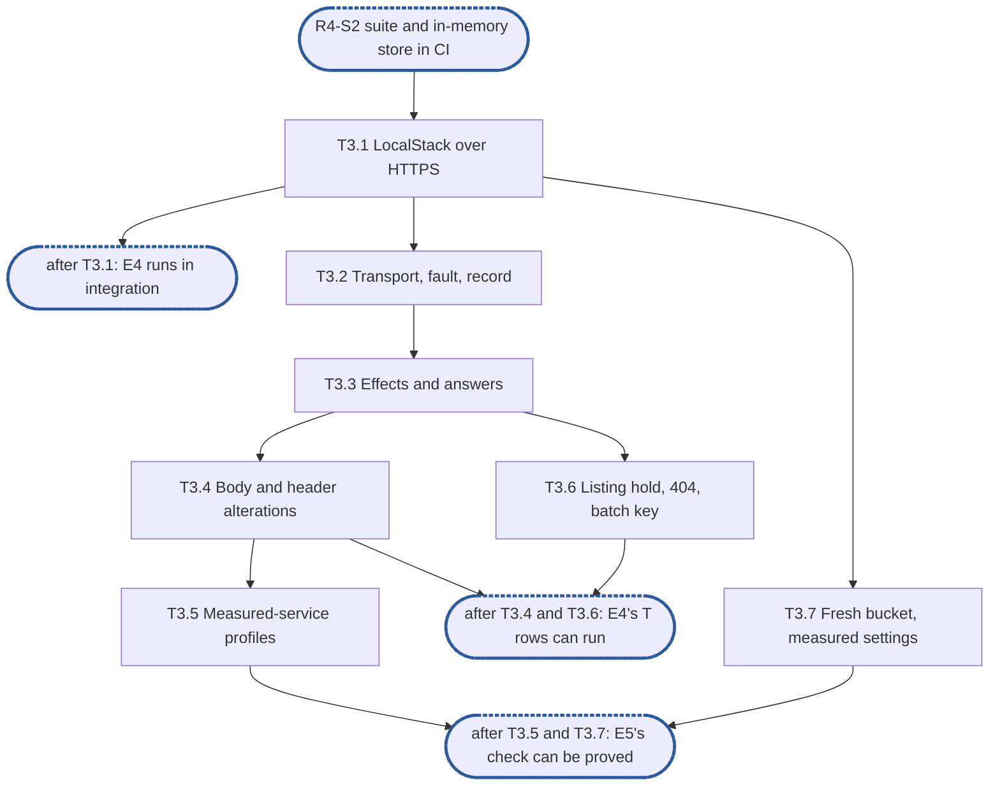

# Epic 3: remote store v2 fault transport and LocalStack

**Sources:** [RFC 4](../docs/internals/rfcs/rfc-4-remote-tier.md) §7.2 for a mutable store, the
fault transport §7.1's rows marked T run over, and Appendix B's measured service faults it
reproduces; §7.1's last paragraph, §7.4's emulator row and §7.5's suites paragraph for the
`integration` cell those rows run in; Appendix C.3's HTTPS-only and trust-root rows, which the cell
must meet. The [RFC index](../docs/internals/rfcs/rfc-index.md), "Test harness" item 1, and
[RFC 8](../docs/internals/rfcs/rfc-8-engine.md) §2's "One clock and one fault interface", for the
one fault interface the transport consults. Cited, not owned:
[RFC 29](../docs/internals/rfcs/rfc-29-test-harness.md) §4.11 (test doubles). Every citation is
`develop`'s text; the code lands on `feat/storage-v2`, and paths below are there.
**Track:** C.
**Epic 3 estimate: 7 subtasks, 12 man-days.**
**Depends on:** **R4-S2**, the conformance suite and the in-memory store in CI (E2); nothing of
`pkg/remote`'s surface is called here, since the transport sits under the client, below the store.
`pkg/sim`'s `Schedule` and `TestClock`, already on `feat/storage-v2`, drive its tests.
**Blocks:** E4, whose `integration` runs need T3.1's cell and whose rows marked T run over T3.2 to
T3.4 and T3.6; E5, whose capability check is proved against T3.5's profiles and T3.7's buckets.
Outside RFC 4: the RFC 3 plan's B5 and the RFC 8 offload plan's epic 21 read
`LOCALSTACK_HTTPS_ENDPOINT` (T3.1) and run behind this transport.

---

## 1. Goal

Epic 3 gives the S3 store's tests a real service that fails on cue. It brings LocalStack into the
`integration` cell over HTTPS, with the certificate it serves as the client's only trusted root;
it builds the transport that wraps the client's real `http.RoundTripper` and fails, delays, tears
or alters one request at a time, without ever answering in the service's place with a success;
it reproduces the service faults Appendix B measured on Cubbit DS3 and Scaleway; and it creates a
fresh LocalStack bucket per row with the settings the row needs applied for real, after measuring
which settings LocalStack 4.13.1 holds at all.

**At the end of the epic:**

- `test/harness/bin/dt run integration` starts LocalStack in CI and hands every cell
  `LOCALSTACK_HTTPS_ENDPOINT` beside the plain `LOCALSTACK_ENDPOINT`; a client trusting only the
  certificate LocalStack serves completes a request over it, and one trusting another root is
  refused;
- `s3fault.New(next, fault)` consults a `Fault` that `*sim.Schedule` satisfies as it is, and on
  LocalStack each of its faults is shown taking effect on the request it alters: a request
  dropped, delayed on the test clock, cut part-way, answered with a chosen error, a reply lost
  after the service applied it, truncated, a byte flipped either way, a range clamped, a header
  stripped above a size threshold, new keys held out of listings, the first get after a put
  answered `404`, one key of a batch delete failed;
- three profiles reproduce Appendix B's rows on LocalStack: a service ignoring every put checksum
  and the conditional header, one enforcing only CRC32C and refusing with `400 InvalidRequest`,
  one clamping an overlong range;
- `s3fault.FreshBucket` creates a bucket per row, and its tests pin which of versioning, an
  expiring lifecycle rule, default encryption (SSE-S3 and SSE-KMS), an archive tiering rule and an
  archive storage class LocalStack 4.13.1 holds, recorded in Appendix B's LocalStack column;
- `CLAUDE.md` no longer says CI starts no S3 endpoint.

### 1.1 In scope

`pkg/remote/s3/s3fault`: the transport, its fault interface, its own effects, its record of the
requests that reached it, the LocalStack endpoint and trusted roots, and the fresh bucket.
`pkg/remote/s3/internal/svcprofile`: the three measured-service profiles. The harness: the
`localstack` needs entry, `env.sh`, `integration`'s `needs`, `dt docs`. `CLAUDE.md`'s
"Integration" paragraph. RFC 4 Appendix B's LocalStack 4.13.1 column, for the settings measured.

### 1.2 Out of scope

- The §7.1 rows marked T themselves, and the store's judgement of each fault: E4 (data path,
  error table, client, HTTP/1.1, the `s3-allocs` option) and E5 (the capability check, both
  probes), and E6's ranged-flip row. This epic only shows each fault taking effect on the service.
- The S3 store's client, its trusted-roots setting and its HTTPS refusal: E4. The
  `remote.trust_roots` key: E7.
- Rows on a setting LocalStack cannot hold, run against a real bucket: E9, by hand until CI holds
  service credentials (the plan's deferral ledger, the T-rows-on-unheld-settings row).
- Object lock, retention, a backup location's buckets and the faults only their rows use (a
  refused versionless delete, the over-cap provocations): deferred with §4.14 and §4.15 to RFC 26
  (the plan's deferral ledger, first row).
- The nightly soak with LocalStack outages on a cycle (RFC 3 §8.1): the RFC 8 offload plan's
  epic 22, which may drive this transport from a seeded `sim.Schedule`.
- Re-signing a request after a header is stripped, for a service that validates signatures: E9,
  its first consumer (§9).

### 1.3 Names used here

- **E1**, epic 1, interfaces: `pkg/remote`'s contract and the import walk over every package
  under `pkg/remote`.
- **E2**, epic 2, conformance suite and test foundations: `remotetest` and the in-memory store.
- **E4**, epic 4, S3 data path, errors and client: the S3 store, its client and constructor.
- **E5**, epic 5, capability check and health: Appendix C.4 at open.
- **E6**, epic 6, block codec; its last subtask runs §7.1's ranged-flip row over this transport.
- **E7**, epic 7, integration: keys and observability, which declares `remote.trust_roots`.
- **E9**, epic 9, E2E green: the real-bucket rows and the nightly service row.
- **R4-S2**, the synchronisation point "suite and in-memory store in CI", reached at the end of
  E2. The `R4-` prefix keeps it apart from the RFC 8 offload plan's S2, which is not used here.
- **S3** is the storage service's protocol, never a synchronisation point; **SSE-S3** is its
  server-side encryption with service-managed keys.
- **The RFC 3 plan's B5**: that plan's benchmark over the S3 store against LocalStack.
- **The RFC 8 offload plan's epic 21**: the epic composing the codec and the S3 store into the
  node, whose tests run behind a fault proxy, this transport.

## 2. How the general rules apply

The rules are those of
[the RFC 4 plan's §1.5](rfc-4-remote-tier-plan.md#15-general-rules-for-each-epic), cited by number
and title and not copied.

| Rule | Subtasks | How |
| --- | --- | --- |
| rule 1, independent unit tests ([`CLAUDE.md`, "Writing tests"](../CLAUDE.md#writing-tests)) | all | pure parts are functions tested in `unit`: the op derived from a request, an answer's reply, the listing and batch-delete reply rewrites. What a fault does to the service runs against LocalStack in `integration`, through a raw `aws-sdk-go-v2` client set as Appendix C.3 says, since E4's client does not exist yet |
| rule 2, fuzz tests where relevant | none | the rewrites parse replies LocalStack gives a test, in test-support code; nothing of production reads them. The fuzz targets are the codec's (E6) and the `Content-Range` reader's (E4) |
| rule 3, observability follows RFC 25 | none | test support: no metric, log or span |
| rule 4, profiling | T3.2, T3.6 | the transport's tests run under `internal/prof`'s goroutine and descriptor checks, which catch a lost or truncated reply whose real body is never closed. T3.2 asserts bytes allocated per request through an idle transport do not grow with the body, so E4's `s3-allocs` rows may run over it |
| rule 5, public interface and internals ([`CLAUDE.md`, "Verifying a change"](../CLAUDE.md#verifying-a-change)) | all | each fault is asserted where it takes effect: what LocalStack stored or answered, read back through a client that bypasses the transport, never the transport's own state |
| rule 6, known failures shrink | all | no known-failure file: every test lands green with its subtask |
| rule 7, v2 ignores v1, and imports only what RFC 0 §1.2 allows | all | `s3fault` imports the standard library and `aws-sdk-go-v2` only, neither `pkg/sim` nor `pkg/remote`; `svcprofile` imports `s3fault`. Both are test support, which amended RFC 0 §1.2 lets import implementations; E1's import walk covers them |
| rule 8, real dependencies for properties of those dependencies | all | LocalStack 4.13.1, the image CI and `env.sh` already pin; bucket settings applied for real (T3.7) |
| rule 9, code comment conventions ([`CLAUDE.md`, "Code comments"](../CLAUDE.md#code-comments)) | T3.1–T3.4, T3.6 | the `decision:` and `ponytail:` markers §4 names, at the code sites that implement them |
| rule 10, a test must be able to fail | all | each test reads the service's state through a second client; with the effect removed it fails on its assertion |
| rule 11, a symbol is exported only if the RFC's interface uses it | all | `s3fault` exports what E4's and E5's rows and the RFC 3 and RFC 8 offload plans' tests call; the profiles are presets, in `pkg/remote/s3/internal/svcprofile` |
| rule 12, each subtask creates only what it declares | all | `s3fault` lands with T3.1's first consumer; each effect lands with the test that shows it on LocalStack and names the E4 or E5 row that consumes it |

## 3. Requirements and invariants

Every MUST and MUST NOT that RFC 4, the RFC index and RFC 8 place on this epic, numbered so that
subtasks and tests can cite them.

**Where it sits and what it consults**

| # | Requirement | Kind | Source | Subtasks |
| --- | --- | --- | --- | --- |
| R1 | The fault transport sits under a real store's client, at the request level, and acts per request | invariant | RFC 4 §7.2 | T3.2 |
| R2 | It consults one fault interface before each request, declared in its own package in standard-library types only, so the node's seeded fault satisfies it as it is; it defines no private clock | MUST | RFC index "Test harness" item 1; RFC 8 §2 | T3.2 |
| R3 | A fault is decided at the call and acts on that one call | invariant | RFC index "Test harness" item 1 | T3.2 |
| R4 | A delay is read from the one clock, never slept | MUST | RFC index "Test harness" item 1 | T3.2 |

**The faults it produces**

| # | Requirement | Kind | Source | Subtasks |
| --- | --- | --- | --- | --- |
| R5 | It drops a request, and drops a reply after the service applied the request (a batch whose response is dropped) | MUST | RFC 4 §7.2; §7.1's §4.5 row | T3.2 |
| R6 | It cuts a put's request stream part-way, so the service stores nothing | MUST | §7.1's first T row of §4.3 | T3.2 |
| R7 | It truncates a response body under a `Content-Range` that matches the request | MUST | §7.2; §7.1's §4.4 rows | T3.2 |
| R8 | It fails a request with a chosen status and error code: every status from 100 to 599 but the 2xx successes, known and unknown codes, and a body that does not parse | MUST | §7.2; §7.1's §4.8 rows | T3.3 |
| R9 | It flips one byte, of a request body or of a reply body | MUST | §7.2; §7.1's §4.3, §4.13 and §4.4 rows | T3.4 |
| R10 | It clamps a range ending past the end, so fewer bytes than asked come back | MUST | §7.2; §7.1's §4.4 row | T3.4 |
| R11 | It ignores a checksum header, at all sizes or only above a size threshold below the maximum block size | MUST | §7.2; §7.1's §4.11 threshold row | T3.4 |
| R12 | It holds new keys out of listings for the first few pages | MUST | §7.2; §7.1's §4.11 listing row | T3.6 |
| R13 | It answers the first get after a successful put of the name with `404` | MUST | §7.2; §7.1's first-get-`404` row | T3.6 |
| R14 | It refuses a delete with the service's refusal: one key inside a batch fails, the others do not | MUST | §7.2; §7.1's §4.5 row | T3.6 |

**What it never pretends**

| # | Requirement | Kind | Source | Subtasks |
| --- | --- | --- | --- | --- |
| R15 | It never answers a request in the service's place with a success | MUST NOT | §7.2 | T3.2, T3.3 |
| R16 | It never reports a setting or a storage class the service does not hold | MUST NOT | §7.2 | T3.6, T3.7 |
| R17 | A bucket setting a row needs (versioning, lifecycle and tiering rules, default encryption) is applied for real to a fresh bucket created for that row, at open or switched later; object lock and retention go with §4.14 to RFC 26 | MUST | §7.2 | T3.7 |
| R18 | A row whose setting the local emulator cannot hold runs against a real bucket instead: which settings LocalStack 4.13.1 holds is measured and recorded in Appendix B; the rows are E9's | MUST | §7.2, §7.4; Appendix B | T3.7 |

**The measured services**

| # | Requirement | Kind | Source | Subtasks |
| --- | --- | --- | --- | --- |
| R19 | It emulates the service faults Appendix B measured: a service ignoring every put checksum (the header stripped), one enforcing only CRC32C and refusing a wrong one with `400 InvalidRequest`, one clamping an overlong range. That the first makes a mutable store's check choose the ETag is E5's to show | MUST | §7.2; Appendix B | T3.5 |
| R20 | A bucket default encryption breaking the ETag proof, and versioning or an expiring lifecycle rule, are set for real on the fresh bucket, so a mutable store's check can refuse it; the check and its refusal are E5's | MUST | §7.2 | T3.7 |

**Where it runs**

| # | Requirement | Kind | Source | Subtasks |
| --- | --- | --- | --- | --- |
| R21 | Every §7.1 row whose setting the local emulator holds runs against it under the fault transport in `integration`, at every change, against the emulator's current version; so the in-memory store is never the only store a row runs against. The rows are E4's, E5's and E6's | MUST | §7.4; §7.5 "Suites"; §7.1's last paragraph | T3.1 |
| R22 | The endpoint is HTTPS, and the service's certificate is verified against the configuration's trust roots in place of the system's; nothing skips verification | MUST | Appendix C.3 | T3.1 |

## 4. Decisions this epic takes

- **D1. One fault interface, the one `pkg/sim` already satisfies.** `s3fault` declares
  `Fault` with `At(op string, key []byte) (delay time.Duration, tearAfter int, err error)`, the
  signature of `pkg/sim`'s `Fault`, so `*sim.Schedule` passes as it is and `s3fault` imports no
  `pkg/sim` (R2). It declares no clock: `Schedule.At` waits a delay out on its own clock and
  returns it only to say so, and the transport applies it as already elapsed (R4). Per request it
  maps the three results: `err` drops the request unsent and is returned to the client; `tearAfter
  > 0` cuts the request body after that many bytes when the request has one, and otherwise
  truncates the reply body there; `sim.Lose` sends the request, discards the reply after closing
  its body, and returns an error, so the service applied what the client saw fail (R5). Its other
  faults are its own settings, as the RFC index allows (D2). A `decision:` marker at the mapping
  names what `Lose` means here, the opposite side of the call from a journal's lost write. Prior
  art: `pkg/identity/identitytest`'s `FaultyDomainController`, which takes `sim.Fault` and
  rewrites replies as a setting (checked on `feat/storage-v2`).
- **D2. The other faults are effects injected by rule.** `Inject(Rule, Effect)` selects
  requests by op, key prefix, count and a minimum body size, the last for §7.1's threshold row;
  `remove` undoes it. Selection by `Schedule`'s `Rule` was weighed and refused: it would carry
  non-failing actions (a strip, a clamp) as an `Err`, which `pkg/sim` defines as failing the
  operation. Prior art: toxiproxy's toxics, added to and removed from a proxy by name, at the TCP
  level below the request (from memory).
- **D3. An answer is never a success.** `Answer` panics on a 2xx status, so a test cannot make
  the transport answer in the service's place with one (R15); a 1xx is answered as given, and
  what the SDK makes of it is E4's to judge. `RecodeError` rewrites only a reply the service gave
  as an error. A `decision:` marker at `Answer` names R15.
- **D4. A clamp is the service's own.** `ClampRange` rewrites the request's `Range: bytes=a-b` to
  `bytes=a-`, so the service answers the bytes to its end with its own `Content-Range`, fewer than
  asked whenever `b` was past the end (R10). Nothing in the reply is written by the transport.
- **D5. A truncated reply ends cleanly.** A truncation returns `io.EOF` after its bytes, not
  `io.ErrUnexpectedEOF`, so only the store's comparison of the body with `Content-Range` can
  catch it (§7.1's §4.4 row); a `decision:` marker says so.
- **D6. A failed batch key is written into the reply.** `FailBatchKey(key, code)` moves the key
  from the `DeleteObjects` reply's `Deleted` list to its `Error` list with the code given; the
  service did delete it. Dropping the key from the request instead, as the architect pass
  proposed, rewrites a signed `Content-MD5` and tests the store's reading of a key a reply omits,
  which no service sends, rather than of a per-key refusal, which they do. A delete reported
  failed for a deleted key is safe: deletes are idempotent (§4.5). A `decision:` marker says so.
- **D7. Stripping a header relies on the emulator not checking signatures.** `StripHeaders`
  acts after SigV4 signing, and every header the SDK sends is signed, so a service that validates
  the signature refuses the request. LocalStack 4.13.1 checks no header signature (from memory;
  T3.4 pins it with a test, which fails loudly if an upgrade starts checking). A body flip is safe:
  the payload is `UNSIGNED-PAYLOAD` (Appendix C.3). A `decision:` marker at `StripHeaders` names
  the ceiling; re-signing is E9's, if its real-bucket rows ever need a stripped header (§9).
- **D8. The trusted root is the certificate LocalStack serves, read once from it.**
  `LocalStack(tb)` reads the served chain with one handshake that records and does not verify,
  then returns a pool holding only that certificate; every later connection verifies against it
  (R22). Trusting on first use is sound for a container the harness started on the loopback
  interface. If the certificate does not cover `127.0.0.1`, `LOCALSTACK_HTTPS_ENDPOINT` names a
  host it does cover that resolves to the container (T3.1 measures it). A `decision:` marker at the
  read says why it does not verify there. Prior art: `ssh`'s first-use host key (from memory).
- **D9. The measured-service profiles are presets, kept internal.** Rule 11 keeps presets out of
  `s3fault`'s exports, and E5's tests in `pkg/remote/s3` are their consumer, so they live in
  `pkg/remote/s3/internal/svcprofile`, one place for what Appendix B measured, rather than
  composed again in each test. Prior art: none found.
- **D10. The listing hold edits the XML in place.** `HoldNewKeys` removes the `Contents`
  elements of keys put through this transport from a `ListObjectsV2` reply, for each key's first
  `n` listings, and leaves `KeyCount` as the service wrote it, which the store does not read
  (Appendix C.3 maps nothing to it). A `ponytail:` marker names the ceiling: a consumer reading
  `KeyCount` would see a count the body no longer holds; re-encode through `encoding/xml` then.
- **D11. One record of what reached the service, kept and passed through.** `Requests` returns
  each request as the client built it, before any effect, with the status and protocol of its
  reply, for the rows asserting what was sent (one request per failing call, the pinned
  payload-signing value, no conditional header, every reply over HTTP/1.1), the pass-through record
  RFC 29 §4.11 allows. It keeps headers, never bodies; `Reset` empties it.

## 5. Target tree

```text
pkg/remote/s3/s3fault/
  localstack.go     T3.1  LocalStack, the served certificate as the only trusted root
  transport.go      T3.2  Fault, New, Transport, RoundTrip, Request, Requests, Reset
  op.go             T3.2  the op and key of a path-style request (unexported)
  effect.go         T3.3  Rule, Effect, Inject, Answer, RecodeError
                    T3.4  FlipRequestByte, FlipReplyByte, ClampRange, StripHeaders
                    T3.6  HoldNewKeys, NotFoundAfterPut, FailBatchKey
  bucket.go         T3.7  Bucket, FreshBucket
  *_test.go         T3.1–T3.7: unit tests untagged; each fault against LocalStack under `integration`
pkg/remote/s3/internal/svcprofile/
  svcprofile.go     T3.5  IgnoresChecksums, EnforcesOnlyCRC32C, ClampsRanges
test/harness/needs/needs.go   T3.1  localstack: prefix LOCALSTACK_, LOCALSTACK_HTTPS_ENDPOINT
test/harness/env.sh           T3.1  LOCALSTACK_HTTPS_ENDPOINT for `dt services up localstack`
test/suites.yaml              T3.1  "service:localstack" in integration's needs
CLAUDE.md                     T3.1  the "CI starts no S3 endpoint yet" sentence corrected
docs/internals/rfcs/rfc-4-remote-tier.md   T3.7  Appendix B's LocalStack 4.13.1 rows
```

## 6. Subtasks

### T3.1 LocalStack over HTTPS in `integration`

**Subtask T3.1 estimate: 2 man-days.**

- **Track:** C. **Depends on:** R4-S2.
- **Covers:** R21, R22.
- **Deliverables:**
  - First, the measurement E4 starts from: which names the certificate LocalStack 4.13.1 serves
    on port 4566 covers, whether it is self-signed, and so which host
    `LOCALSTACK_HTTPS_ENDPOINT` names (D8). Shared on the subtask's issue before the pull
    request, as E4's early input.
  - `test/harness/needs/needs.go`: the `localstack` entry's `prefix` widened from
    `LOCALSTACK_ENDPOINT` to `LOCALSTACK_`, so `serviceVars` forwards the second variable when a
    developer's own address is set, and its `local` value gaining
    `LOCALSTACK_HTTPS_ENDPOINT`; `env.sh` likewise. The plain `LOCALSTACK_ENDPOINT` is unchanged,
    since `test/harness/fixture/s3.go` and `test/e2e/framework/containers.go` read it as HTTP.
  - `test/suites.yaml`: `"service:localstack"` in `integration`'s `needs`; CI's `localstack`
    service then starts for it as it does for `e2e`. `dt docs` rerun.
  - `CLAUDE.md`, "Integration": CI starts LocalStack for `integration`, over HTTPS at
    `LOCALSTACK_HTTPS_ENDPOINT`.
  - `pkg/remote/s3/s3fault`, landing with its first function:
    `func LocalStack(tb testing.TB) (endpoint string, roots *x509.CertPool)`, which skips naming
    `LOCALSTACK_HTTPS_ENDPOINT` when it is unset, and otherwise returns it with a pool holding only
    the served certificate (D8). Consumed by T3.2 to T3.7, E4's and E5's tests, the RFC 3 plan's
    B5 and the RFC 8 offload plan's epic 21.
- **Acceptance criteria:**
  - In CI, `integration` cells receive both variables, and an `s3fault` test reaches LocalStack
    over HTTPS rather than skipping.
  - A developer's own LocalStack, set through `LOCALSTACK_ENDPOINT`, forwards
    `LOCALSTACK_HTTPS_ENDPOINT` too.
  - No code of this epic sets `InsecureSkipVerify` but the one read D8 describes.
- **Tests:**
  - `needs_test.go`, at `ServiceEnv`, which `dt` hands a cell: with `LOCALSTACK_ENDPOINT` set,
    `LOCALSTACK_HTTPS_ENDPOINT` is forwarded (catches the prefix left narrow, which drops it).
  - `integration`, at the client a row builds: an `aws-sdk-go-v2` client trusting only
    `LocalStack`'s pool completes `ListBuckets` over HTTPS (catches a wrong host or an unread
    certificate); the same client trusting only an `httptest.NewTLSServer` certificate is refused
    with a verification error (catches a client that does not verify, R22).
  - `dt docs --check` passes (catches the suite table left stale).
- **Rules:** rule 12: `s3fault` lands here with `LocalStack`, its first exported function.

### T3.2 The transport, its fault interface and its record

**Subtask T3.2 estimate: 2.5 man-days.**

- **Track:** C. **Depends on:** T3.1.
- **Covers:** R1–R7, R15.
- **Deliverables:**
  - `transport.go`:

    ```go
    // Fault decides each request's fault; *sim.Schedule satisfies it as it is.
    type Fault interface {
        At(op string, key []byte) (delay time.Duration, tearAfter int, err error)
    }
    func New(next http.RoundTripper, fault Fault) *Transport // fault nil: no scheduled fault
    func (t *Transport) RoundTrip(req *http.Request) (*http.Response, error)
    type Request struct {
        Op, Key    string
        Header     http.Header // as the client built it, before any effect
        Status     int         // 0 when no reply reached the client
        ProtoMajor int         // of the service's reply; 0 when none came
    }
    func (t *Transport) Requests() []Request
    func (t *Transport) Reset()
    ```

    with D1's mapping of the three results and D11's record. Consumed by T3.3 to T3.6, and by
    E4's rows for §4.3's cut put, §4.4's truncated body, §4.5's dropped reply, §4.9's one request
    per failing call and Appendix C.3's payload-signing value, and E4's case requiring every reply
    over HTTP/1.1.
  - `op.go`: the op of a path-style request, under the SDK's operation names (`PutObject`,
    `GetObject`, `DeleteObject`, `DeleteObjects`, `ListObjectsV2`, the bucket-setting reads and
    writes as `GetBucketVersioning` and its kin), and its key, the path less the bucket. Any other
    request is `Other`. Consumed by `RoundTrip` and by T3.3's `Rule`.
- **Acceptance criteria:**
  - With no fault and no effect, every request and reply passes unchanged, and bytes allocated
    per request do not grow with the body.
  - A dropped request never reaches the service; a lost reply's request did.
  - The transport is safe for concurrent use.
- **Tests:**
  - `unit`, at the op function `RoundTrip` uses: a table of requests and their ops and keys,
    including a key with percent-encoded bytes (catches a key decoded twice, or a listing read as
    a get).
  - `integration`, each fault on LocalStack through a `*sim.Schedule` (kind 3) on a
    `sim.TestClock` (kind 1), read back through a second client that bypasses the transport: a
    dropped put leaves no object; a lost put's object exists although the client got an error; a
    put cut after 10 bytes leaves no object; a get truncated at 10 bytes of 100 yields 10 bytes
    and `io.EOF` under the full `Content-Range`; a delay holds the request until the test
    advances the clock, the test waiting on the clock's `Armed` channel, not on time (catches a
    fault mapped to the wrong result, or one acting on the call after it, R3).
  - `Requests` after a put records the client's `x-amz-content-sha256` header and reply
    `ProtoMajor` (catches headers recorded after an effect altered them).
  - Bytes allocated per `PutObject` through an idle transport at 1 MiB and 16 MiB, from
    `runtime.MemStats`, differ by less than one body (catches a transport that buffers the body,
    which E4's `s3-allocs` rows would charge to the store).
  - Every `integration` test of the package runs under `internal/prof`'s goroutine and
    descriptor checks (catches a lost or truncated reply whose body is left open).
- **Rules:** rule 9: D1's `decision:` marker at the mapping, D5's at the truncation.

### T3.3 Injected effects and error answers

**Subtask T3.3 estimate: 1 man-days.**

- **Track:** C. **Depends on:** T3.2.
- **Covers:** R8, R15.
- **Deliverables:** `effect.go`:

  ```go
  // Rule selects the requests an effect applies to; a zero field matches every request.
  type Rule struct {
      Op        string // an op as op.go names it
      KeyPrefix string
      Times     int   // how many matching requests, from the next; 0 means every one
      MinBody   int64 // only requests whose Content-Length is at least this
  }
  type Effect interface{ effect() } // sealed: built by this package's constructors
  func (t *Transport) Inject(r Rule, e Effect) (remove func())
  func Answer(status int, code string, body []byte) Effect // a 2xx panics; nil body: an S3 error document
  func RecodeError(from string, status int, code string) Effect
  ```

  Consumed by T3.4 to T3.6; `Answer` by E4's §4.8 rows (every status and code, the throttling
  reply, the quota, `507`, `403`, `413` and `EntityTooLarge` replies); `RecodeError` by T3.5.
- **Acceptance criteria:**
  - An answered request never reaches the service, and the SDK reads the status and code given.
  - `RecodeError` touches only a reply the service gave as an error with code `from`.
- **Tests:**
  - `unit`, at the reply the SDK parses: `Answer` for 100, 404 and 599 with a known code, an
    unknown code and an unparseable body produces that status and body (catches an answer the SDK
    cannot read as the error given); `Answer(200, …)` panics (catches R15 broken).
  - `integration`: a put answered `503 SlowDown` leaves no object (catches an answer sent after
    forwarding); a put with a wrong `x-amz-checksum-crc32c` under `RecodeError("BadDigest", 400,
    "InvalidRequest")` reaches the client as `400 InvalidRequest`, and nothing is stored.
  - `Times: 1` affects the first matching request only, and `remove` stops the effect.
- **Rules:** rule 9: D3's `decision:` marker at `Answer`.

### T3.4 Body and header alterations

**Subtask T3.4 estimate: 2 man-days.**

- **Track:** C. **Depends on:** T3.3.
- **Covers:** R9, R10, R11.
- **Deliverables:** in `effect.go`:

  ```go
  func FlipRequestByte(at int64) Effect
  func FlipReplyByte(at int64) Effect
  func ClampRange() Effect                 // D4
  func StripHeaders(names ...string) Effect // D7; with Rule.MinBody, only above a threshold
  ```

  Consumed by T3.5, by E4's §4.3 and §4.13 flip rows, §4.4's clamp row and its whole-block flip,
  E5's §4.11 threshold row, and E6's ranged-flip row.
- **Acceptance criteria:**
  - A flip changes exactly one byte and no length; a clamp's reply comes from the service.
  - A strip with `MinBody` leaves requests below the threshold whole.
- **Tests:** `integration`, read back through a second client:
  - a put carrying its CRC32C with the request flipped at byte 5 is refused `400 BadDigest` and
    nothing is stored; without a checksum header the stored body differs from the sent one in
    that byte only (catches a flip on the wrong side or of a length);
  - a get with the reply flipped at byte 5 differs from the stored body in that byte only;
  - `bytes=8-15` of a 10-byte object under `ClampRange` comes back `206` with 2 bytes and a
    `Content-Range` other than the request's (catches a clamp written by the transport, D4);
  - a put of 2 MiB with a wrong `x-amz-checksum-crc32c` under `StripHeaders` with `MinBody` 1 MiB
    is stored, and the same put of 1 KiB is refused (catches a threshold ignored, R11);
  - LocalStack accepts a put whose signed `x-amz-checksum-crc32c` header was stripped (pins D7's
    dependency: it fails, naming D7, if an upgrade starts checking header signatures).
- **Rules:** rule 9: D7's `decision:` marker at `StripHeaders`.

### T3.5 The measured-service profiles

**Subtask T3.5 estimate: 1 man-days.**

- **Track:** C. **Depends on:** T3.4.
- **Covers:** R19.
- **Deliverables:** `pkg/remote/s3/internal/svcprofile`:

  ```go
  func IgnoresChecksums(t *s3fault.Transport)   // Cubbit DS3: checksum headers, Content-MD5 and If-None-Match stripped
  func EnforcesOnlyCRC32C(t *s3fault.Transport) // Scaleway: Content-MD5 stripped, a CRC32C refusal recoded 400 InvalidRequest
  func ClampsRanges(t *s3fault.Transport)       // both: an overlong range clamped
  ```

  each injecting T3.3's and T3.4's effects on every matching request. Consumed by E5's capability
  check rows (step 1 choosing the ETag, CRC32C and its recorded rejection; step 2's ranges; step
  4's conditional put recorded refused or not; §4.11's row against each fault profile).
- **Acceptance criteria:** on LocalStack, each profile reproduces its Appendix B rows.
- **Tests:** `integration`, through a second client:
  - under `IgnoresChecksums`, a put with a wrong CRC32C and one with a wrong `Content-MD5` are both
    stored, the second's ETag the MD5 of the bytes stored, and a put with `If-None-Match: *` on an
    existing key overwrites it (catches a header left in place);
  - under `EnforcesOnlyCRC32C`, a wrong CRC32C is refused `400 InvalidRequest` with nothing
    stored, and a wrong `Content-MD5` is stored;
  - under `ClampsRanges`, `bytes=8-15` of a 10-byte object yields 2 bytes.
- **Rules:** rule 11: presets in an `internal/` package of `s3` (D9).

### T3.6 Listing hold, first-get `404` and a failed batch key

**Subtask T3.6 estimate: 2 man-days.**

- **Track:** C. **Depends on:** T3.3.
- **Covers:** R12, R13, R14, R16.
- **Deliverables:** in `effect.go`:

  ```go
  func HoldNewKeys(listings int) Effect        // D10
  func NotFoundAfterPut() Effect               // the first get after a successful put answered 404 NoSuchKey
  func FailBatchKey(key, code string) Effect   // D6
  ```

  Consumed by E5's §4.11 listing row (step 4's re-list), E4's §4.4 first-get row and E5's
  refusal ending it, and E4's §4.5 batch row.
- **Acceptance criteria:**
  - A held key is absent from its first `listings` listings and present from the next, with every
    other key in place and in order.
  - Only the first get of a name after its put is answered `404`; the second reaches the service.
  - The failed key comes back in the reply's `Error` list with the code given, every other key in
    `Deleted`.
- **Tests:**
  - `unit`, at the rewrite `RoundTrip` applies: a `ListObjectsV2` reply and a `DeleteObjects`
    reply, as LocalStack wrote them and kept under `testdata/`, rewritten (catches an element
    removed with its neighbour, or a reply left unparseable).
  - `integration`: three keys put, `HoldNewKeys(2)`: the first two listings lack them, the third
    holds all three (catches a hold counted per listing rather than per key); a put then two gets
    under `NotFoundAfterPut`: `404`, then the bytes; a batch of three under `FailBatchKey`: one
    error, two deleted.
- **Rules:** rule 9: D6's `decision:` marker at `FailBatchKey`, D10's `ponytail:` at the listing
  rewrite.

### T3.7 A fresh bucket with real settings, and what LocalStack holds

**Subtask T3.7 estimate: 1.5 man-days.**

- **Track:** C. **Depends on:** T3.1.
- **Covers:** R16, R17, R18, R20.
- **Deliverables:**
  - `bucket.go`:

    ```go
    // Bucket is a fresh LocalStack bucket for one row; Admin reaches it without the transport.
    type Bucket struct {
        Name  string
        Admin *s3.Client
    }
    func FreshBucket(tb testing.TB) *Bucket // deletes every object, then the bucket, at cleanup
    ```

    A row applies its settings through `Admin`, at open or later. Consumed by E5's rows on
    versioning, lifecycle, tiering, storage class and encryption.
  - The measurement of what LocalStack 4.13.1 holds: whether it keeps and reports
    versioning, an expiring lifecycle rule, SSE-S3 and SSE-KMS default encryption (with the ETag
    then the content MD5 or not), an intelligent-tiering rule with an archive tier, and an object
    put in an archive storage class; recorded as rows of Appendix B's LocalStack 4.13.1 column.
- **Acceptance criteria:**
  - Each setting LocalStack holds reads back as applied; each it does not hold is recorded so,
    and its §7.1 rows are E9's.
- **Tests:** `integration`, one per setting, at the read the capability check makes (`Admin`'s
  get of the setting, or a get's storage class): a setting LocalStack holds reads back; one it
  does not is asserted not held, so an upgrade that starts holding it fails the test and the row
  moves back from E9 (catches Appendix B left stale, R16, R18). Two `FreshBucket` calls give two
  buckets, and neither exists after cleanup.
- **Rules:** rule 8: every setting applied for real; rule 12: `Bucket` lands with the measurement,
  its first consumer.

## 7. Order of work



Checkpoint after T3.1: E4 runs its `integration` tests in CI. After T3.4 and T3.6, every fault
E4's rows marked T use exists; after T3.5 and T3.7, E5's.

## 8. Suggested pull requests

| PR | Subtasks | Man-days | After | Why together |
| --- | --- | --- | --- | --- |
| 1 | T3.1 | 2 | — | LocalStack over HTTPS in `integration`, which E4 waits for first |
| 2 | T3.2, T3.3, T3.4 | 5.5 | PR 1 | the transport with every fault E4's data-path rows use but the listing and batch ones |
| 3 | T3.5, T3.6, T3.7 | 4.5 | PR 2 | the profiles, the stateful effects and the buckets E5's check is proved against |

A suggestion only: one pull request per subtask works as well. T3.7 depends on T3.1 alone and may
open beside PR 2.

## 9. Open points

- **LocalStack's certificate is unmeasured.** Which names it covers decides the host of
  `LOCALSTACK_HTTPS_ENDPOINT` (D8). If it is a public certificate for a name such as
  `localhost.localstack.cloud`, resolving that name needs DNS, which an offline host lacks; T3.1
  then records it and the skip names the variable. T3.1's measurement settles it.
- **Synthesised 1xx replies.** Whether `net/http` and the SDK hand a 1xx answer to the caller as
  a reply is unmeasured; T3.3's unit test shows it, and E4 judges the result.
- **Re-signing for real services.** D7's stripped headers break a validated signature. If E9's
  real-bucket rows or §7.4's nightly run against a production service need a stripped header,
  E9 adds re-signing with the credentials it holds; against LocalStack none is needed (D7).
