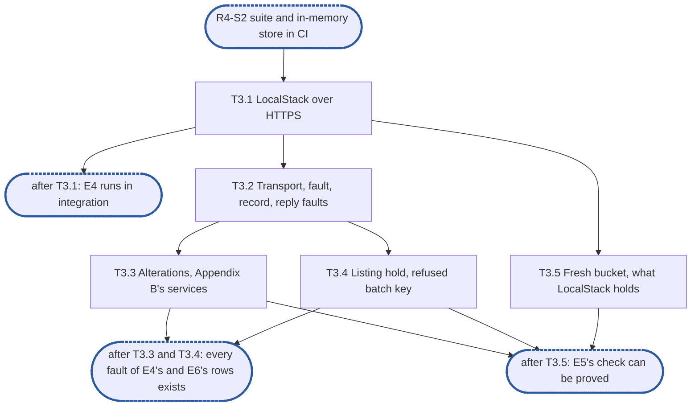

# Epic 3: remote store v2 fault transport and LocalStack

**Sources:** [RFC 4](../docs/internals/rfcs/rfc-4-remote-tier.md) §7.2 for a mutable store: the
fault transport that §7.1's rows marked T run over, and Appendix B's measured service faults it
reproduces. Also §7.1's rows that name a fault, its last paragraph, §7.4's emulator row and
§7.5's suites paragraph, for the `integration` cell those rows run in. Appendix C.3's HTTPS and
trust-roots row, which the cell must meet. The
[RFC index](../docs/internals/rfcs/rfc-index.md), "Test harness" item 1, and
[RFC 8](../docs/internals/rfcs/rfc-8-engine.md) §2's "One clock and one fault interface", for the
one fault interface the transport consults. Cited, not owned:
[RFC 29](../docs/internals/rfcs/rfc-29-test-harness.md) §4.11 (test doubles). Every citation is
`develop`'s text. The code lands on `develop`, and the paths below are paths there.
**Track:** C.
**Epic 3 estimate: 5 subtasks, 10 man-days.**
**Depends on:** **R4-S2**, the conformance suite and the in-memory store in CI (E2). Nothing of
`pkg/remote`'s surface is called here, because the transport sits under the client, below the
store. `pkg/sim`'s `Schedule` and `TestClock`, already on `feat/storage-v2`, drive its tests.
**Blocks:** E4, whose `integration` runs need T3.1's cell and whose rows marked T run over T3.2 to
T3.4. E5, whose capability check is proved against T3.3's measured-service faults and T3.5's
buckets. E6's ranged-flip row. Outside RFC 4, the RFC 3 plan's B5 and the RFC 8 offload plan's
epic 21 read `LOCALSTACK_HTTPS_ENDPOINT` (T3.1) and run behind this transport.

---

## 1. Goal

Epic 3 gives the S3 store's tests a real service that fails on cue. It has four parts:

- It brings LocalStack into the `integration` cell over HTTPS, with the certificate LocalStack
  serves as the client's only trusted root.
- It builds the transport. The transport wraps the client's real `http.RoundTripper` and fails,
  delays, cuts or alters one request at a time. It never answers in the service's place with a
  success.
- It reproduces the service faults Appendix B measured on Cubbit DS3 and Scaleway.
- It creates a fresh LocalStack bucket per row and applies the settings the row needs for real,
  after measuring which settings LocalStack 4.13.1 holds at all.

**At the end of the epic:**

- `test/harness/bin/dt run integration` starts LocalStack in CI. It hands every cell
  `LOCALSTACK_HTTPS_ENDPOINT` beside the plain `LOCALSTACK_ENDPOINT`. A client trusting only the
  certificate LocalStack serves completes a request over that endpoint.
- `s3fault.New(next, fault)` consults a `Fault` that `*sim.Schedule` satisfies as it is.
  LocalStack shows each fault taking effect on the request it alters:
  - a request dropped, or delayed on the test clock and cancelled while it waits;
  - a put cut part-way;
  - an error answer with a chosen status and code;
  - a reply lost after the service applied the request, or truncated;
  - a byte flipped either way, or a range clamped;
  - a checksum header stripped above a size threshold;
  - new keys held out of listings;
  - one key of a batch delete refused.
- LocalStack reproduces Appendix B's rows for two kinds of service. One ignores every put
  checksum and the conditional header. The other enforces only CRC32C and refuses a wrong one
  with `400 InvalidRequest`.
- `s3fault.FreshBucket` creates a bucket per row. Its tests pin which settings LocalStack 4.13.1
  holds, and the results are recorded in Appendix B's LocalStack column. The settings are:
  - versioning, an expiring lifecycle rule and an archive tiering rule;
  - SSE-S3 and SSE-KMS default encryption;
  - an object stored in an archive class;
  - a stored checksum returned on a get.
- `CLAUDE.md` no longer says CI starts no S3 endpoint.

### 1.1 In scope

- **`pkg/remote/s3/s3fault`:** the transport, its fault interface, its own effects and its
  record of the requests that reached it. It also holds the LocalStack endpoint and trusted
  roots, and the fresh bucket.
- **The harness:** the `localstack` needs entry and its check, `integration`'s `needs`, and
  `dt docs`.
- **`CLAUDE.md`:** the "Integration" paragraph.
- **RFC 4 Appendix B:** the LocalStack 4.13.1 rows for the behaviour this epic measures.

### 1.2 Out of scope

- **E4, E5 and E6:** the §7.1 rows marked T themselves, and the store's judgement of each fault.
  This epic only shows each fault taking effect on the service.
  - E4 owns the data path, the error table, the client, HTTP/1.1 and the `s3-allocs` option.
  - E5 owns the capability check and both probes.
  - E6 owns the ranged-flip row.
- **E4, E5 and E7:** E4 owns the S3 store's client, its trusted-roots setting and its HTTPS
  refusal. E5 owns the case that refuses an open without the trusted root. E7 owns the
  `remote.trust_roots` key.
- **E9:** rows on a setting LocalStack cannot hold, run against a real bucket by hand until CI
  holds service credentials. This is the RFC 4 plan's §6.1 ledger row on §7.1's T rows on a
  bucket setting LocalStack cannot hold.
- **RFC 26:** object lock, retention, a backup location's buckets and the faults only their rows
  use, such as a refused versionless delete and the over-cap provocations. These are deferred
  with §4.14 and §4.15, the first row of the RFC 4 plan's §6.1 ledger.
- **The RFC 8 offload plan's epic 22:** the nightly soak with LocalStack outages on a cycle (RFC
  3 §8.1). That epic may drive this transport from a seeded `sim.Schedule`.
- **E9:** re-signing a request after a header is stripped, for a service that validates
  signatures. E9 is its first consumer (§9).

### 1.3 Names used here

- **E1**, epic 1, interfaces: `pkg/remote`'s contract, and the import walk over every package
  under `pkg/remote`.
- **E2**, epic 2, conformance suite and test foundations: `remotetest` and the in-memory store.
- **E4**, epic 4, S3 data path, errors and client: the S3 store, its client and its constructor.
- **E5**, epic 5, capability check and health: Appendix C.4 at open.
- **E6**, epic 6, block codec. Its last subtask runs §7.1's ranged-flip row over this transport.
- **E7**, epic 7, integration: keys and observability. It declares `remote.trust_roots`.
- **E9**, epic 9, E2E green: the real-bucket rows and the nightly service row.
- **R4-S2**, the synchronisation point "suite and in-memory store in CI", reached at the end of
  E2. The `R4-` prefix keeps it apart from the RFC 8 offload plan's S2, which is not used here.
- **S3** is the storage service's protocol, never a synchronisation point. **SSE-S3** is its
  server-side encryption with service-managed keys.
- **The RFC 3 plan's B5** (PR #5530) is that plan's benchmark over the S3 store against
  LocalStack.
- **The RFC 8 offload plan's epics 21 and 22** (PR #5528): epic 21 composes the codec and the S3
  store into the node, and its tests run behind this transport; epic 22 runs the soak.

## 2. How the general rules apply

The rules are those of
[the RFC 4 plan's §1.5](rfc-4-remote-tier-plan.md#15-general-rules-for-each-epic). They are cited
by number and title, not copied.

| Rule | Subtasks | How |
| --- | --- | --- |
| rule 1, independent unit tests ([`CLAUDE.md`, "Writing tests"](../CLAUDE.md#writing-tests)) | all | The pure parts are functions tested in `unit`: an answer's reply, and the listing and batch-delete rewrites. What a fault does to the service runs against LocalStack in `integration`, through a raw `aws-sdk-go-v2` client set up as Appendix C.3 says: retries off, `WhenRequired` checksums, `UNSIGNED-PAYLOAD`, HTTP/1.1, path-style. E4's client does not exist yet |
| rule 2, fuzz tests where relevant ([`CLAUDE.md`, "Writing tests"](../CLAUDE.md#writing-tests)) | none | The rewrites parse replies that LocalStack gives a test, in test-support code, and nothing in production reads them. The fuzz targets are the codec's (E6) and the `Content-Range` reader's (E4) |
| rule 3, observability follows RFC 25 | none | Test support: no metric, log or span |
| rule 4, profiling | T3.2, T3.4 | The transport's tests run under `internal/prof`'s goroutine and descriptor checks, which catch a lost or truncated reply whose real body is never closed. T3.2 also asserts that the transport adds no per-byte allocation, so E4's `s3-allocs` rows may run over it |
| rule 5, public interface and internals ([`CLAUDE.md`, "Verifying a change"](../CLAUDE.md#verifying-a-change)) | all | Each fault is asserted where it takes effect: what LocalStack stored or answered, read back through a second client that bypasses the transport. The transport's own state is never what is asserted |
| rule 6, known failures shrink | all | No known-failure file: every test lands green with its subtask |
| rule 7, v2 ignores v1, and imports only what RFC 0 §1.2 allows | all | `s3fault` imports the standard library and `aws-sdk-go-v2` (`Bucket.Admin`, the operation name of D12), never `pkg/sim` or `pkg/remote`. It is test support, which amended RFC 0 §1.2 allows to import implementations. E1's import walk covers it, with `s3fault`'s allowlist naming `aws-sdk-go-v2` alone |
| rule 8, real dependencies for properties of those dependencies ([`CLAUDE.md`, "Writing tests"](../CLAUDE.md#writing-tests)) | all | LocalStack 4.13.1, the image CI and `env.sh` already pin. Bucket settings are applied for real (T3.5) |
| rule 9, code comment conventions ([`CLAUDE.md`, "Code comments"](../CLAUDE.md#code-comments)) | all | The `decision:` and `ponytail:` markers named in §4, at the code sites that implement them |
| rule 10, a test must be able to fail ([`CLAUDE.md`, "Writing tests"](../CLAUDE.md#writing-tests)) | all | Each test reads the service's state through a second client. With the effect removed it fails on its assertion. Where LocalStack shows a behaviour natively (D4), the test pins LocalStack instead, and it fails when an upgrade changes that behaviour |
| rule 11, a symbol is exported only if the RFC's interface uses it | all | `s3fault` exports what E4's and E5's rows and the RFC 3 and RFC 8 offload plans' tests call. The measured-service faults are presets, so they are not exported (D9) |
| rule 12, each subtask creates only what it declares | all | `s3fault` lands with T3.1's first consumer. Each effect lands with the test that shows it on LocalStack, and names the E4 or E5 row that consumes it |

## 3. Requirements and invariants

This section lists every MUST and MUST NOT that RFC 4, the RFC index and RFC 8 place on this
epic. Each is numbered so that subtasks and tests can cite it.

**Where it sits and what it consults**

| # | Requirement | Kind | Source | Subtasks |
| --- | --- | --- | --- | --- |
| R1 | The fault transport sits under a real store's client, at the request level, and acts per request | invariant | RFC 4 §7.2 | T3.2 |
| R2 | It consults one fault interface before each request. That interface is declared in its own package in standard-library types only, so the node's seeded fault satisfies it as it is. The transport defines no private clock | MUST | RFC index "Test harness" item 1; RFC 8 §2 | T3.2 |
| R3 | A fault is decided at the call and acts on that one call | invariant | RFC index "Test harness" item 1 | T3.2 |
| R4 | A delay is waited out before the rest of the fault is applied. A request whose context ends during the delay returns the context's error at once | MUST | RFC 8 §2; §7.1's §4.8 row on a cancelled context | T3.2 |
| R5 | A tear of anything but a write, or a loss, is a mistake in the test, and the seam refuses it | MUST | RFC 8 §2 | T3.2 |

**The faults it produces**

| # | Requirement | Kind | Source | Subtasks |
| --- | --- | --- | --- | --- |
| R6 | It drops a request, and it delays one | MUST | RFC 4 §7.2 | T3.2 |
| R7 | It drops a reply after the service applied the request. This is a seam's own setting, not a result of the fault interface | MUST | §7.1's §4.5 row; RFC index "Test harness" item 1 | T3.2 |
| R8 | It cuts a put's request stream part-way | MUST | §7.1's first T row of §4.3 | T3.2 |
| R9 | It truncates a response body, under a `Content-Range` that matches the request | MUST | §7.2; §7.1's §4.4 row | T3.2 |
| R10 | It fails a request with a chosen status and error code. This covers every status from 100 to 599 except the 2xx successes, known and unknown codes, and a body that does not parse | MUST | §7.2; §7.1's §4.8 row | T3.2 |
| R11 | It flips one byte, of a request body or of a reply body | MUST | §7.2; §7.1's §4.3, §4.13 and §4.4 rows | T3.3 |
| R12 | It clamps a range that ends past the end, so fewer bytes than asked come back | MUST | §7.2; §7.1's §4.4 row | T3.3 |
| R13 | It ignores a checksum header, at all sizes or only above a size threshold. It also corrupts a put only above a threshold. The open's refusal when the threshold is below the maximum block size is E5's | MUST | §7.2; §7.1's §4.11 threshold row | T3.3 |
| R14 | It holds new keys out of listings for the first few pages | MUST | §7.2; §7.1's §4.11 listing row | T3.4 |
| R15 | It answers the first get after a successful put of the name with `404` | MUST | §7.2; §7.1's §4.4 first-get-`404` row | T3.2 |
| R16 | It refuses a delete with the service's refusal: one key inside a batch fails, and the others do not | MUST | §7.2; §7.1's §4.5 row | T3.4 |

**What it never pretends**

| # | Requirement | Kind | Source | Subtasks |
| --- | --- | --- | --- | --- |
| R17 | It never answers a request in the service's place with a success | MUST NOT | §7.2 | T3.2 |
| R18 | It never reports a setting or a storage class the service does not hold | MUST NOT | §7.2 | T3.5 |
| R19 | A bucket setting a row needs (versioning, lifecycle and tiering rules, default encryption) is applied for real to a fresh bucket created for that row, either at open or switched on later. Object lock and its mode and retention are needed only by §4.14's rows, which are deferred to their caller | MUST | §7.2; §4.1 | T3.5 |
| R20 | A row whose setting the local emulator cannot hold runs against a real bucket of a production service instead. It runs by hand until the nightly run holds credentials. The rows are E9's | MUST | §7.2, §7.4 | T3.5 |

**The measured services**

| # | Requirement | Kind | Source | Subtasks |
| --- | --- | --- | --- | --- |
| R21 | A service that ignores every put checksum, emulated by stripping the checksum header, makes a mutable store's capability check choose the ETag. The strip is this epic's. The check and its choice are E5's | MUST | §7.2 | T3.3 |
| R22 | It emulates the other service faults Appendix B measured: a service that enforces only CRC32C and refuses a wrong one with `400 InvalidRequest`, and one that clamps an overlong range | MUST | §7.2; Appendix B | T3.3 |
| R23 | A bucket default encryption that breaks the ETag proof, versioning, and an expiring lifecycle rule are each set for real on a fresh bucket, so that a mutable store's check can refuse it. The check and its refusal are E5's | MUST | §7.2 | T3.5 |

**Where it runs**

| # | Requirement | Kind | Source | Subtasks |
| --- | --- | --- | --- | --- |
| R24 | Every §7.1 row whose setting the local emulator holds runs against it under the fault transport in `integration`, at every change, against the emulator's current version. The in-memory store is therefore never the only store a row runs against. The rows are E4's, E5's and E6's | MUST | §7.4; §7.5 "Suites"; §7.1's last paragraph | T3.1 |
| R25 | The endpoint is HTTPS, and the service's certificate is verified against the system's roots, or against configured trust roots in their place. No setting skips verification | MUST | Appendix C.3 | T3.1 |

## 4. Decisions this epic takes

- **D1. One fault interface, the one `pkg/sim` already satisfies.**
  - `s3fault` declares `Fault` with `At(op string, key []byte) (delay time.Duration, tearAfter
    int, err error)`. This is the signature of `pkg/sim`'s `Fault`, so `*sim.Schedule` passes as
    it is and `s3fault` imports no `pkg/sim` (R2).
  - It declares no clock. `Schedule.At` waits a delay out on its own clock and returns the delay
    only to report it. The transport calls `At` from a goroutine and selects on that goroutine
    and on the request's context, so a cancelled request returns `ctx.Err()` at once (R4). The
    abandoned `At` returns when the test moves the clock.
  - The transport honours what RFC 8 §2 lets a request seam honour without answering a success:
    - `err` alone drops the request unsent and returns the error to the client;
    - `tearAfter > 0` with `err` set, on `PutObject`, cuts the body after that many bytes and
      fails the put.
  - The transport refuses every other tear, a tear with `err` nil and a loss, with a panic that
    names the op (R5). Honouring any of them would report a put whole, or done, that the service
    never stored (R17).
  - A reply lost after the service applied the request, and a truncated reply, are the
    transport's own effects (D2), as the RFC index allows.
  - Markers: a `decision:` marker at the refusal names R17, and one at the cancelled wait names
    the abandoned `At`.
  - Prior art: `pkg/identity/identitytest`'s `FaultyDomainController` on `feat/storage-v2` (checked).
    It takes `sim.Fault`, panics on a tear or a loss, and rewrites replies as a setting.
- **D2. The other faults are effects injected by rule.**
  - `Inject(Rule, Effect)` selects requests by op, key prefix, count and a minimum body size. The
    minimum body size is for §7.1's threshold row. `remove` undoes the injection.
  - A zero `Rule` matches every request, including requests on the bucket itself.
  - Using `Schedule`'s own `Rule` for this was weighed and refused. It would carry non-failing
    actions, such as a strip or a clamp, as an `Err`, and `pkg/sim` defines an `Err` as failing
    the operation.
  - Prior art: toxiproxy's toxics, which are added to and removed from a proxy by name, at the TCP
    level below the request (from memory).
- **D3. An answer is never a success.**
  - `Answer` panics on a 2xx status (R17). A 1xx is answered as given, and what the SDK makes of
    it is for E4 to judge.
  - The first get after a put is `Answer(404, "NoSuchKey", nil)` on `Rule{Op: "GetObject",
    KeyPrefix: …, Times: 1}`, installed after the put (R15). The transport tracks no per-name
    state.
  - Marker: a `decision:` marker at `Answer` names R17.
- **D4. A clamp is the service's own.**
  - Appendix B records LocalStack 3.0, Scaleway and Cubbit DS3 all clamping `bytes=8-15` of a
    10-byte object to 2 bytes. LocalStack 4.13.1 has not been measured.
  - T3.3 measures 4.13.1 first and pins the result in a test.
  - **If it clamps natively:** no clamp effect is built. E4's row runs against LocalStack as it is,
    and Appendix B records that LocalStack clamps.
  - **If it does not clamp:** `ClampRange` rewrites the selected get's `Range: bytes=a-b` to
    `bytes=a-`. The service then answers up to its end, with its own `Content-Range`. The rule
    selects only the row's one overlong get, because an in-range get rewritten this way would
    return more bytes than it asked for.
- **D5. A truncated reply ends cleanly.**
  - A truncation returns `io.EOF` after its bytes, not `io.ErrUnexpectedEOF`. Only the store's
    comparison of the body with `Content-Range` can then catch it (§7.1's §4.4 row).
  - Marker: a `decision:` marker says so.
- **D6. A refused batch key is refused for real.**
  - `FailBatchKey(key, code)` removes the key from the `DeleteObjects` request and recomputes its
    `Content-MD5` (D7). It then adds an `Error` entry for the key to the reply, with the code
    given.
  - The service never deletes the key, so a row reading it afterwards finds it present, as it
    would after a real refusal.
  - Two alternatives were weighed:
    - Rewriting only the reply would report a refusal for a key the service deleted.
    - Dropping the key without a reply entry would test the store's reading of a key the reply
      omits, which no service sends with `Quiet` false.
  - Marker: a `decision:` marker says so.
- **D7. Header rewrites rely on the emulator not checking signatures.**
  - `StripHeaders` and `FailBatchKey` act after SigV4 signing, and every header the SDK sends is
    signed. A service that validates the signature therefore refuses the request.
  - LocalStack 4.13.1 checks no header signature (from memory). T3.3 pins this with a test that
    fails, naming D7, if an upgrade starts checking.
  - A body flip is safe, because the payload is `UNSIGNED-PAYLOAD` (Appendix C.3).
  - The measured-service strips are scoped to `PutObject`, since `DeleteObjects` needs its
    `Content-MD5` (Appendix C.1).
  - Marker: a `decision:` marker at `StripHeaders` names the ceiling.
  - Re-signing is E9's, if its real-bucket rows ever need a stripped header (§9).
- **D8. The trusted root is the certificate LocalStack serves, read once from it.**
  - `LocalStack(tb)` reads the served chain with one handshake that records the chain and does not
    verify it. It then returns a pool holding only that certificate, and every later connection
    verifies against it (R25). This read is not a setting of any client.
  - Trusting on first use is sound for a container that the harness started on the loopback
    interface.
  - If the certificate does not cover `127.0.0.1`, `LOCALSTACK_HTTPS_ENDPOINT` names a host that
    it does cover and that resolves to the container. T3.1 measures which.
  - Marker: a `decision:` marker at the read says why it does not verify there.
  - Prior art: `ssh`'s host key on first use (from memory). The alternative is in §9.
- **D9. The measured-service faults are compositions, not a package.**
  - Each fault is two or three `Inject` calls of T3.3's effects.
  - Rule 11 keeps presets out of `s3fault`'s exports. A package of their own would hold six lines
    for one consumer.
  - T3.3's tests compose them to show Appendix B's rows. E5's tests in `pkg/remote/s3` compose the
    same effects for its check rows.
  - Prior art: none found.
- **D10. The listing hold edits the XML in place.**
  - `HoldNewKeys` removes from a `ListObjectsV2` reply the `Contents` elements of keys put through
    this transport, for each key's first `n` listings.
  - It leaves `KeyCount` as the service wrote it. The store does not read `KeyCount`; Appendix C.3
    maps nothing to it.
  - Marker: a `ponytail:` marker names the ceiling. A consumer that reads `KeyCount` would see a
    count the body no longer holds; re-encode through `encoding/xml` then.
- **D11. One record of what reached the service, kept and passed through.**
  - `Requests` returns each request as the client built it, before any effect, with the protocol
    version of the service's reply.
  - Consumers are the rows that assert what was sent: one request per failing call, the pinned
    payload-signing value, no conditional header, and every reply over HTTP/1.1. This is the
    pass-through record that RFC 29 §4.11 allows.
  - It keeps headers, never bodies.
  - `next` is the client's own configured transport, so the recorded protocol is what that
    transport negotiated.
- **D12. The op is the SDK's operation name.**
  - The op comes from `awsmiddleware.GetOperationName` on the request's context, as in `PutObject`
    or `ListObjectsV2`. The key is the path less the bucket, under the path-style addressing that
    E4's client and this epic's raw client use.
  - A request that carries no operation name is `Other`. This avoids a hand-kept table that maps a
    method and query to an operation.
- **D13. A missing LocalStack is visible.**
  - The `localstack` need is met only when `LOCALSTACK_HTTPS_ENDPOINT` is set too.
  - `LocalStack(tb)` skips, naming the variable, only outside CI. When `CI` is set it fails, so a
    cell that lost its LocalStack cannot stay green with every row marked T skipped (R24).
  - Marker: a `decision:` marker says so.
- **D14. The emulator's current version is the pin.**
  - "Current version" (§7.4) is the image that `env.sh` and `tests.yml` pin, now 4.13.1. An
    upgrade is a change to both.
  - T3.5's tests, which pin what LocalStack holds, then show what moved.

## 5. Target tree

```text
pkg/remote/s3/s3fault/
  localstack.go     T3.1  LocalStack: the served certificate as the only trusted root
  transport.go      T3.2  Fault, New, Transport, RoundTrip, Request, Requests; the op (D12)
  effect.go         T3.2  Rule, Effect, Inject, Answer, LoseReply, TruncateReply
                    T3.3  FlipByte, StripHeaders, RecodeError; ClampRange only if D4 needs it
                    T3.4  HoldNewKeys, FailBatchKey
  bucket.go         T3.5  Bucket, FreshBucket
  *_test.go         T3.1–T3.5: unit tests untagged; each fault against LocalStack under `integration`
  testdata/         T3.4  a ListObjectsV2 and a DeleteObjects reply as LocalStack wrote them
test/harness/needs/needs.go, needs_test.go   T3.1  localstack: prefix LOCALSTACK_, the HTTPS variable
test/suites.yaml              T3.1  "service:localstack" in integration's needs
.github/workflows/tests.yml, test/harness/env.sh   T3.5  kms in the container's SERVICES=s3, only if SSE-KMS needs it
CLAUDE.md                     T3.1  the "CI starts no S3 endpoint yet" sentence corrected
docs/internals/rfcs/rfc-4-remote-tier.md   T3.3, T3.5  Appendix B's LocalStack 4.13.1 rows
```

## 6. Subtasks

### T3.1 LocalStack over HTTPS in `integration`

**Subtask T3.1 estimate: 1.5 man-days.**

- **Track:** C. **Depends on:** R4-S2.
- **Covers:** R24, R25.
- **Deliverables:**
  - **The measurement, first.** E4 starts from this. It establishes which names the certificate
    LocalStack 4.13.1 serves on port 4566 covers, and whether that certificate is self-signed.
    That settles which host `LOCALSTACK_HTTPS_ENDPOINT` names (D8). The result is shared on the
    subtask's issue before the pull request, as E4's early input.
  - **`test/harness/needs/needs.go`:**
    - The `localstack` entry's `prefix` widens from `LOCALSTACK_ENDPOINT` to `LOCALSTACK_`, so that
      `serviceVars` also forwards the second variable when a developer's own address is set.
    - Its `local` value gains `LOCALSTACK_HTTPS_ENDPOINT`.
    - Its check requires the variable (D13).
    - `needs_test.go`'s expectation of the local value follows.
    - The plain `LOCALSTACK_ENDPOINT` is unchanged, because `test/harness/fixture/s3.go` and
      `test/e2e/framework/containers.go` read it as HTTP.
  - **`test/suites.yaml`:** `"service:localstack"` is added to `integration`'s `needs`. CI's
    `localstack` service then starts for it, as it already does for `e2e`. `dt docs` is rerun.
  - **`CLAUDE.md`, "Integration":** CI starts LocalStack for `integration`, over HTTPS, at
    `LOCALSTACK_HTTPS_ENDPOINT`.
  - **`pkg/remote/s3/s3fault`**, landing with its first function:
    - `func LocalStack(tb testing.TB) (endpoint string, roots *x509.CertPool)` returns the endpoint
      and a pool holding only the served certificate (D8). It skips or fails as D13 says.
    - Consumers: T3.2 to T3.5, E4's and E5's tests, the RFC 3 plan's B5 and the RFC 8 offload
      plan's epic 21.
- **Acceptance criteria:**
  - In CI, `integration` cells receive both variables, and an `s3fault` test reaches LocalStack
    over HTTPS without skipping.
  - A developer's own LocalStack, set through `LOCALSTACK_ENDPOINT` alone, leaves the need unmet,
    and the message names `LOCALSTACK_HTTPS_ENDPOINT`.
- **Tests:**
  - `needs_test.go`, at `ServiceEnv`, which `dt` hands to a cell:
    - With both variables set, both are forwarded. This catches the prefix left narrow, which
      drops the second variable.
    - With only the plain variable set, the need is reported unmet.
  - `integration`, at the client a row builds: an `aws-sdk-go-v2` client that trusts only
    `LocalStack`'s pool completes `ListBuckets` over HTTPS. This catches a wrong host or an unread
    certificate. The case that refuses an open without the trusted root is E5's, at the open.
  - `LocalStack` with the variable unset and `CI` set fails, and with `CI` unset it skips (D13).
  - `dt docs --check` passes. This catches the suite table left stale.
- **Rules:** rule 9: D8's and D13's `decision:` markers. Rule 12: `s3fault` lands here with
  `LocalStack`.

### T3.2 The transport, its fault interface, its record and its reply faults

**Subtask T3.2 estimate: 3 man-days.**

- **Track:** C. **Depends on:** T3.1.
- **Covers:** R1–R10, R15, R17.
- **Deliverables:**
  - `transport.go`, with D1's handling of the three results, D11's record and D12's op:

    ```go
    // Fault decides each request's fault; *sim.Schedule satisfies it as it is.
    type Fault interface {
        At(op string, key []byte) (delay time.Duration, tearAfter int, err error)
    }
    func New(next http.RoundTripper, fault Fault) *Transport // fault nil: no scheduled fault
    func (t *Transport) RoundTrip(req *http.Request) (*http.Response, error)
    type Request struct {
        Op, Key    string
        Header     http.Header // as the client built it, before any effect
        ProtoMajor int         // of the service's reply; 0 when none came
    }
    func (t *Transport) Requests() []Request
    ```

  - `effect.go`:

    ```go
    // Rule selects the requests an effect applies to; the zero Rule matches every request.
    type Rule struct {
        Op        string // an operation name (D12)
        KeyPrefix string
        Times     int   // how many matching requests, from the next; 0 means every one
        MinBody   int64 // only requests whose Content-Length is at least this
    }
    type Effect interface{ effect() } // sealed: built by this package's constructors
    func (t *Transport) Inject(r Rule, e Effect) (remove func())
    func Answer(status int, code string, body []byte) Effect // 2xx panics; nil body: an S3 error document
    func LoseReply() Effect           // sent, applied, the reply discarded and an error returned
    func TruncateReply(n int64) Effect // the reply body ends with io.EOF after n bytes (D5)
    ```

  - Consumers:
    - E4's rows: §4.3's cut put; §4.4's truncated body and first-get `404`; §4.5's dropped batch
      reply; §4.8's statuses and codes, its cancelled context, the throttling reply, and the quota,
      `507`, `403`, `413` and `EntityTooLarge` replies; §4.9's one request per failing call;
      Appendix C.3's payload-signing value; and E4's case requiring every reply over HTTP/1.1.
    - E5's refusal of a service that answers `404` to the first get.
    - T3.3 and T3.4.
- **Acceptance criteria:**
  - With no fault and no effect, every request and reply passes through unchanged.
  - A dropped or answered request never reaches the service. A lost reply's request did reach it.
  - The transport is safe for concurrent use.
- **Tests:**
  - **`unit`:**
    - Each panic of D1: a tear on a get, a tear with `err` nil, and a loss. This catches R5 and
      R17 broken.
    - `Answer` for 100, 404 and 599, each with a known code, an unknown code and an unparseable
      body, reaches the SDK as that status and body. This catches an answer the SDK cannot read as
      the error given. `Answer(200, …)` panics.
  - **`integration`, on LocalStack.** Faults come from a `*sim.Schedule` on a `sim.TestClock`, both
    inputs (kind 1); the transport is the fault wrapper (kind 3). Results are read back through a
    second client that bypasses the transport:
    - A dropped put leaves no object.
    - A put cut after 10 bytes leaves no object.
    - A `LoseReply` put leaves the object, although the client got an error.
    - A get under `TruncateReply(10)` of 100 bytes yields 10 bytes and `io.EOF` under the full
      `Content-Range`.
    - A put answered `503 SlowDown` leaves no object.
    - Together these catch a fault acting on the wrong side of the call, or on the call after it
      (R3).
  - **A delayed request.** It waits until the test advances the clock, and the test waits on the
    clock's `Armed` channel, not on time. Cancelled while armed, it returns `context.Canceled`
    without the clock moving. This catches R4.
  - **The op.** Each operation the raw client sends, a put, a get, a list and a batch delete,
    reaches `Requests` under its SDK name with its key. This catches D12's name missing from the
    context.
  - **The record.** `Requests` keeps the client's `x-amz-content-sha256` and reply `ProtoMajor` 1.
    This catches headers recorded after an effect altered them.
  - **Concurrency.** Thirty-two concurrent puts under `-race` with `Answer` on `Rule{Times: 1}`:
    exactly one is refused, and 31 objects exist.
  - **Allocation.** Bytes allocated per put at 1 MiB and 16 MiB, with and without the transport,
    over several runs. The difference does not grow with the body. This catches a transport that
    buffers, which E4's `s3-allocs` rows would charge to the store.
  - **Leak checks.** Every `integration` test of the package runs under `internal/prof`'s goroutine
    and descriptor checks. They catch a lost or truncated reply whose body is left open, and an
    abandoned `At` left parked.
- **Rules:** rule 9: D1's two `decision:` markers, D3's and D5's.

### T3.3 Body and header alterations, and Appendix B's services

**Subtask T3.3 estimate: 2.25 man-days.**

- **Track:** C. **Depends on:** T3.2.
- **Covers:** R11, R12, R13, R21, R22.
- **Deliverables:**
  - In `effect.go`:

    ```go
    func FlipByte(at int64) Effect             // the request body when there is one, else the reply's
    func StripHeaders(names ...string) Effect  // D7; with Rule.MinBody, only above a threshold
    func RecodeError(from string, status int, code string) Effect // rewrites a service's error reply
    ```

    and `ClampRange() Effect` only if D4's measurement needs it.
  - The measurements, recorded in Appendix B's LocalStack 4.13.1 column: whether it clamps an
    overlong range (D4), and whether it checks header signatures (D7). The pull request carrying
    the Appendix B rows asks for an RFC review.
  - Consumers:
    - E4's §4.3 and §4.13 flip rows, §4.4's clamp row and its whole-block flip, E4's T4.4,
      which strips `Range` from a ranged get, and E6's ranged-flip row.
    - E5's §4.11 threshold row and its row against each fault profile.
    - E5's check step 1 (the ETag, CRC32C and the recorded rejection), step 2 (the overlong range)
      and step 4 (the conditional put, refused or not).
- **Acceptance criteria:**
  - A flip changes exactly one byte and no length.
  - A strip under `MinBody` leaves requests below the threshold whole.
  - `RecodeError` touches only a reply the service gave as an error with code `from`.
  - The two compositions of D9 reproduce Appendix B's rows for Cubbit DS3 and Scaleway on
    LocalStack.
- **Tests:** all in `integration`, read back through a second client.
  - **Flips:**
    - A put carrying its CRC32C, with the request flipped at byte 5, is refused `400 BadDigest`
      and nothing is stored.
    - Without a checksum header, the stored body differs from the sent one in that byte only.
    - A get flipped at byte 5 differs from the stored body in that byte only.
    - These catch a flip on the wrong side, or one that changes a length.
  - **The threshold.** A 2 MiB put with a wrong `x-amz-checksum-crc32c` under `StripHeaders` with
    `MinBody` 1 MiB is stored. The same put at 1 KiB is refused. This catches an ignored
    threshold (R13). The stored 2 MiB put also pins D7's dependency: if an upgrade starts checking
    the signed header, this test fails, and its message names D7.
  - **The range.** `bytes=8-15` of a 10-byte object comes back `206` with 2 bytes. The test pins
    LocalStack's native clamp, or `ClampRange`'s, per D4. If D4 needs `ClampRange`, an in-range
    `bytes=2-5` outside its rule comes back unchanged.
  - **A stripped header on a get.** A `bytes=2-5` get of a 10-byte object under
    `StripHeaders("Range")` comes back `200` with all 10 bytes. This shows a strip acting on a get
    as well as a put, and pins D7 for a signed header on a get (E4's T4.4).
  - **Cubbit DS3's composition** strips the checksum headers, `Content-MD5` and `If-None-Match` on
    `PutObject`. Under it:
    - A put with a wrong CRC32C and one with a wrong `Content-MD5` are both stored, and the
      second's ETag is the MD5 of the bytes stored.
    - A put with `If-None-Match: *` on an existing key overwrites it.
    - A batch delete still succeeds.
    - These catch a header left in place, or a strip that reaches `DeleteObjects`.
  - **Scaleway's composition** strips `Content-MD5` on `PutObject` and applies
    `RecodeError("BadDigest", 400, "InvalidRequest")`. Under it, a wrong CRC32C is refused with
    `400 InvalidRequest` and nothing is stored, and a wrong `Content-MD5` is stored.
- **Rules:** rule 9: D7's `decision:` marker at `StripHeaders`. Rule 11: the compositions stay in
  tests (D9).

### T3.4 Listing hold and a refused batch key

**Subtask T3.4 estimate: 1.5 man-days.**

- **Track:** C. **Depends on:** T3.2.
- **Covers:** R14, R16.
- **Deliverables:**
  - In `effect.go`:

    ```go
    func HoldNewKeys(listings int) Effect      // D10
    func FailBatchKey(key, code string) Effect // D6
    ```

  - Consumers:
    - `HoldNewKeys`: E5's §4.11 listing row. Step 4 lists once and then re-lists up to five
      times, so a hold of up to 5 listings lets the open succeed, and a hold of 6 refuses it. The 30-second half runs on E5's clock.
    - `FailBatchKey`: E4's §4.5 batch row.
- **Acceptance criteria:**
  - A held key is absent from its own first `listings` listings and present from the next. Every
    other key stays in place and in order.
  - The refused key is still stored. It comes back in the reply's `Error` list with the code
    given, and every other key is in `Deleted`.
- **Tests:**
  - **`unit`, at the rewrites `RoundTrip` applies.** A `ListObjectsV2` reply and a `DeleteObjects`
    request and reply, as LocalStack wrote them and kept under `testdata/`, are rewritten. This
    catches an element removed together with its neighbour, a reply left unparseable, and a
    `Content-MD5` not recomputed.
  - **`integration`, the listing hold.** Put A, list, put B, then list three times under
    `HoldNewKeys(2)`. A appears in the third listing and B in the fourth. This catches a hold
    counted per listing rather than per key.
  - **`integration`, the batch.** A batch of three under `FailBatchKey`: one error, two deleted,
    and the refused key still readable. This catches D6 broken.
  - Under `internal/prof`'s checks, like T3.2's.
- **Rules:** rule 9: D6's `decision:` marker at `FailBatchKey`, and D10's `ponytail:` at the
  listing rewrite.

### T3.5 A fresh bucket with real settings, and what LocalStack holds

**Subtask T3.5 estimate: 1.75 man-days.**

- **Track:** C. **Depends on:** T3.1.
- **Covers:** R18, R19, R20, R23.
- **Deliverables:**
  - `bucket.go`. Its client and cleanup copy `test/e2e/framework/containers.go`'s
    `LocalstackHelper` pattern over T3.1's HTTPS endpoint; they cannot be imported, since that
    helper is plain HTTP and lives under `test/e2e`:

    ```go
    // Bucket is a fresh LocalStack bucket for one row; Admin reaches it without the transport.
    type Bucket struct {
        Name  string
        Admin *s3.Client
    }
    func FreshBucket(tb testing.TB) *Bucket // deletes every object, then the bucket, at cleanup
    ```

    A row applies its settings through `Admin`, either at open or later. Consumers: E5's rows on
    versioning, lifecycle, tiering, storage class and encryption, and E4's whole-block flip row
    for the returned checksum.
  - **What LocalStack 4.13.1 holds**, recorded in Appendix B's LocalStack column:
    - versioning;
    - an expiring lifecycle rule;
    - SSE-S3 and SSE-KMS default encryption, and whether the ETag is then the content MD5;
    - an intelligent-tiering rule with an archive tier;
    - an object put in an archive storage class;
    - a stored checksum returned on a get sent with `x-amz-checksum-mode: ENABLED`.

    `kms` joins the LocalStack container's own `SERVICES=s3` variable (its `-e SERVICES=s3` in
    `env.sh`, and the `localstack` service's `env` in `tests.yml`), not `env.sh`'s `SERVICES` array
    of `dt` services, only if SSE-KMS needs it. A setting it does
    not hold sends its §7.1 rows to E9 (R20).
- **Acceptance criteria:**
  - Each setting LocalStack holds behaves as applied.
  - Each setting it does not hold is recorded as such.
- **Tests:** in `integration`, one per setting. Each asserts the behaviour wherever the setting
  changes what a request returns, not LocalStack's echo of the configuration:
  - versioning: two puts give two versions;
  - encryption: the ETag compared with the MD5;
  - storage class: as a get reports it;
  - stored checksum: as the get returns it;
  - lifecycle and tiering rules: read back, since the check reads only the configuration
    (Appendix C.1).

  A setting it does not hold is asserted not held. An upgrade that starts holding it then fails
  the test, and its rows move back from E9. This catches Appendix B left stale (R18, R20). Two
  `FreshBucket` calls give two buckets, and neither exists after cleanup.
- **Rules:** rule 8: every setting is applied for real. Rule 12: `Bucket` lands with the
  measurement, its first consumer.

## 7. Order of work



**Checkpoints:**

- After T3.1, E4 runs its `integration` tests in CI.
- After T3.2, E4's cut, truncated, dropped and answered rows can run.
- After T3.3 and T3.4, every fault that E4's and E6's rows use exists.
- After T3.5, E5's do too.

## 8. Suggested pull requests

| PR | Subtasks | Man-days | After | Why together |
| --- | --- | --- | --- | --- |
| 1 | T3.1 | 1.5 | — | LocalStack over HTTPS in `integration`, which E4 waits for first |
| 2 | T3.2, T3.3 | 5.25 | PR 1 | the transport, with every fault of E4's data-path rows except the listing and batch faults |
| 3 | T3.4, T3.5 | 3.25 | PR 2 | the stateful rewrites, and the buckets and settings that E5's check is proved against |

This is a suggestion only: one pull request per subtask works as well. T3.5 depends on T3.1
alone and may open beside PR 2.

## 9. Open points

- **LocalStack's certificate has not been measured.** Which names it covers decides the host of
  `LOCALSTACK_HTTPS_ENDPOINT` (D8).
  - From memory, LocalStack 4.x serves a public certificate for `localhost.localstack.cloud`, and
    falls back to a self-signed one when the download fails. The served root can therefore differ
    between containers, though not within one, and resolving that name needs DNS.
  - If T3.1 measures either problem, the alternative is to start LocalStack with a certificate the
    harness generates (`CUSTOM_SSL_CERT_PATH`, from memory). That means `env.sh` mounts it and CI
    restarts its service container after copying it in, since a service starts before the
    checkout.
  - T3.1 decides on its measurement. Nothing outside this epic depends on which way it goes.
- **Synthesised 1xx replies.** Whether `net/http` and the SDK hand a 1xx answer to the caller as
  a reply has not been measured. T3.2's unit test shows it, and E4 judges the result.
- **The operation name in the request context.** D12 assumes the SDK's middleware stack puts the
  operation name in the context of the request it hands the transport (from memory). T3.2's op
  test shows it. If the name is absent, the op comes from the method and query instead, with a
  table test.
- **Re-signing for real services.** D7's rewritten headers break a validated signature. If E9's
  real-bucket rows, or §7.4's nightly run against a production service, need a stripped header or
  a refused batch key, E9 adds re-signing with the credentials it holds. Against LocalStack none
  is needed (D7).
