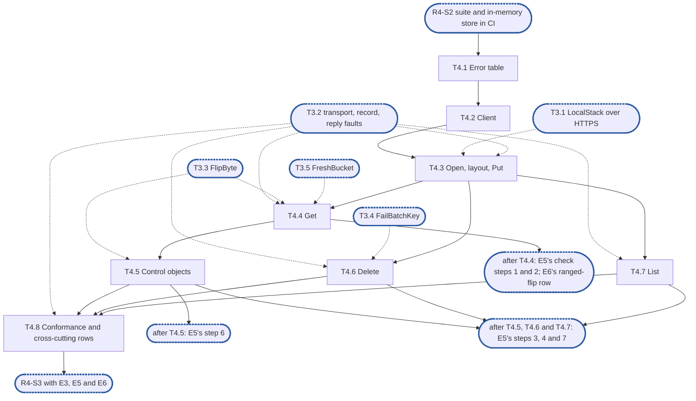

# Epic 4: remote tier v2 S3 data path, errors and client

**Sources:** [RFC 4](../docs/internals/rfcs/rfc-4-remote-tier.md) §4.2 (names and locations),
§4.3's store half (the put), §4.4 (the get), §4.5's `Delete`, §4.6 (the listing), §4.8 (errors),
§4.9 (no state across calls), §4.10's client caps, §4.11's storage-class clause for the put side,
§4.12's `remote_` rows, §4.13 (control objects), §6's R5 to R10, R13's store half, R16 and R21,
the §7.1 rows named in §3 below and §7.4's emulator row for them, and Appendix C.1's data-path
rows, C.2's namespace keys and C.3 whole.
Cited, not owned: [RFC 12](../docs/internals/rfcs/rfc-12-snapshots.md) §2.1 (a namespace is a
prefix); [RFC 8](../docs/internals/rfcs/rfc-8-engine.md) §10.2 (what the engine does with a cause);
[RFC 3](../docs/internals/rfcs/rfc-3-syncer.md) §2.2 (the memory bound) and §2.10 (the
small-body cap); [RFC 25](../docs/internals/rfcs/rfc-25-observability.md) §2 (names, units,
labels, buckets) and §8.1 (what the root injects); the RFC 4 follow-up (#5795), which makes
the root `pkg/remote` a pure contract and has `pkg/remote/s3` record through a recorder it
declares; [RFC 0](../docs/internals/rfcs/rfc-0-data-lifecycle.md)
§1.2 (allowed imports, as amended to "a component imports another's contract only").
**Track:** B.
**Epic 4 estimate: 8 subtasks, 18 man-days.**
**Depends on:** **R4-S2**, the suite and the in-memory store in CI: E1's `pkg/remote` (`Store`,
`Name`, `Range`, `Info`, `Role`, `Mode`, `Checksum`, `StoredSum`, the sentinels, `Cause` and
`DeniedError`) and E2's `remotetest` suite with its opener; **E3**, the fault transport and
LocalStack: T3.1's `integration` cell over HTTPS (`LOCALSTACK_HTTPS_ENDPOINT` and the
container's certificate), T3.2's transport with its record, `Answer`, `LoseReply` and
`TruncateReply`, T3.3's `FlipByte` (and `ClampRange` if LocalStack does not clamp natively),
T3.4's `FailBatchKey`, and T3.5's `FreshBucket`, each named by the subtask that takes it. Until
T3.1 lands, this epic builds against a local `dt services up localstack` through its HTTPS
listener, and its rows marked T wait for the E3 subtask that builds their fault.
**Blocks:** **E5**, whose capability check runs on this epic's client, error table, put, get,
control objects, batch delete and listing (C.4 steps 1 to 4, 6 and 7), and which inserts the check
into this epic's `Open`; **E6**'s last subtask, the §4.4 ranged-flip row, which needs T4.4's
ranged get under the fault transport; **E7**, whose content wiring implements T4.2's recorder over
the root's registry; **E9**, whose steady-load row reads T4.2's connection
counts; **R4-S3**, with E5, and through it the RFC 3 and RFC 8 offload plans' suites over the
S3 store and RFC 8 offload plan epic 21, which holds one client per store
configuration and composes the store.

---

## 1. Goal

Epic 4 builds `pkg/remote/s3`: the S3-compatible client and every call of a namespace's store that
moves or removes a block or a control object, with the total error table that turns every S3 reply
into one error of RFC 4's closed set. It makes one attempt per call and keeps nothing across calls.

**At the end of the epic:**

- `s3.NewClient` builds one client per store configuration: HTTPS only, against the system's roots
  or the configuration's trust roots, HTTP/1.1 only, SDK retries off, checksum modes pinned to
  `WhenRequired`, every request signed `UNSIGNED-PAYLOAD`, path-style addressing, and its
  connection caps set from the limit it is handed;
- `s3.Open` returns a store over one namespace's prefix that implements `remote.Store`'s v1.1
  calls but `Health`: `Put` streams a block of known size in one `PutObject`, verified by the
  checksum header the integrity mode names or by the ETag; `Get` returns exactly the bytes asked
  for or an error; `Delete` reports every name from the reply; `List` walks `<prefix>blocks/` one
  request per page; `PutControl` and `GetControl` reach the control objects by role;
- every reply, every status from 100 to 599, every network and parse failure maps to exactly one
  sentinel, a refusal carrying its cause, and no SDK error is reachable by unwrapping;
- E2's conformance suite and RFC 4 §7.1's rows this epic owns pass against LocalStack 4.13.1
  under E3's fault transport in `integration`, and the `Put`, `Get` and `List` allocation bounds in
  `integration`'s `s3-allocs` option;
- the `remote_` series of §4.12 are recorded through the `Recorder` `pkg/remote/s3` declares,
  which E7's content wiring implements over the root's registry, with `ErrCorrupt` and a skipped
  foreign key logged at `Warn`; no package of `pkg/remote` imports `pkg/metrics`, `pkg/settings` or
  `pkg/health`.

### 1.1 In scope

The client and its constructor; the store's unexported open path and the exported `Open` it sits
under (D1, D2); the layout of C.2 for blocks and control objects; `Checksum`, `Put`, `Get`, `Delete`,
`List`, `PutControl`, `GetControl` and `Close`; the error table and its SDK adapter; the
`Recorder` and the `remote_` series recorded through it but `remote_capability`; the `Content-Range` reader and its fuzz target; the
`integration` option `s3-allocs`; the S3 store's run of E2's suite and of the §7.1 rows in §3.

### 1.2 Out of scope

- The capability check (Appendix C.4), the setting judgements (C.1), `Health` in both directions,
  `remote_capability`, the refused open's log, `immutable` refused with its `decision:` naming the missing caller,
  and the §7.1 rows on them, the conditional-put row and the check's refusal that ends the
  first-get-`404` row: E5. This epic's `Open` takes the integrity mode, the batch-delete choice
  and the recorded corrupt code as unexported inputs that E5's check sets (D2), and the open's refusal against a listener whose
  certificate is not trusted, which needs the check's first request, is E5's too (#5806, its T5.4
  test of an `httptest.NewTLSServer` listener whose root the client does not trust).
- The codec, the ranged-flip half of §7.1's §4.4 row, and the `malformed` kind a recorded range
  the store rejects becomes (`ErrMalformed` once the follow-up RFC 4 change names it): E6. The store
  returns `ErrInvalid` for a range past the end and never produces the malformed case.
- Deriving the client's limit from its callers (§4.10's two rows, R11, R19's limit half): E8.
  Holding one client per store configuration, ref-counted, and the in-memory store refused outside
  tests: RFC 8 offload plan epic 21, as the plan's §6.1 deferral ledger rows have them.
- The metric definitions as plain values, the `Recorder`'s implementation over the registry in the
  node's content wiring (`internal/node/content`), the `remote.*` settings rows (an optional
  `remote.region` among them, §9 point 2) and the alert rule: E7.
- E5's additions to this surface (#5806, its D2 and D10): `ClientConfig.MaxBlockSize`, `Open`'s
  second result `Claim`, and the `Recorder`'s `Capability(prefix, feature, present)`, each landing
  with the check that uses it.
- The backup location's calls, `immutable` mode and the `PutObject` clauses of §7.1's §4.8 size
  row; `Settings`, `RecheckSetting`, `VersionsPage` and `DeleteVersions`: the plan's §6.1 deferral
  ledger, rows one and four (RFC 26 and RFC 9).
- The prefix-revoke half of §7.1's §4.7 row, the nightly service row, §7.5's benchmarks and the
  `Content-Range` target's nightly run in the `fuzz` suite: E9.
- The syncer's single re-get of a corrupt ranged chunk: the plan's §6.1 ledger (RFC 3 plan epic 6).

### 1.3 Names used here

- **E1**, epic 1, interfaces: `pkg/remote`'s contract for v1.1's callers, frozen at S1.
- **E2**, epic 2, conformance suite and test foundations: `remotetest`, the in-memory store and its
  read-only wrapper.
- **E3**, epic 3, fault transport and LocalStack: `s3fault` around the client's
  `http.RoundTripper`, real bucket settings on fresh buckets, and LocalStack over HTTPS in
  `integration`.
- **E5**, epic 5, capability check and health.
- **E6**, epic 6, block codec.
- **E7**, epic 7, integration: keys and observability.
- **E8**, epic 8, integration: the client limit derived from its callers.
- **E9**, epic 9, E2E green: the nightly service row, the real-bucket rows, the benchmarks.
- **S1**, the plan's first synchronisation point, = RFC 8 offload plan S1c remote store contract
  agreed: E1's contract and the codec's surface, reviewed by the RFC 3 and RFC 8 offload plans'
  authors.
- **S2** appears here only inside **R4-S2**, suite and in-memory store in CI: E2's suite runs
  green against the in-memory store in `unit`. This epic starts there.
- **S3** names the storage service (Amazon S3 and the services compatible with it) everywhere in
  this document, except inside **R4-S3**, store and codec complete: epics 3 to 6 done, every §7.1
  and §7.3 row they own green.

## 2. How the general rules apply

The rules are those of [the RFC 4 implementation plan's §1.5](rfc-4-remote-tier-plan.md#15-general-rules-for-each-epic),
cited by number and title and not copied.

| Rule | Subtasks | How |
| --- | --- | --- |
| rule 1, independent unit tests ([`CLAUDE.md`, "Writing tests"](../CLAUDE.md#writing-tests)) | all | the error table, the `Content-Range` reader, the layout and the stream-length guard are pure functions with table tests and no service; the client against `httptest.NewTLSServer` listeners on `127.0.0.1:0`; the store against LocalStack 4.13.1 in `integration`, under E3's fault transport (T3.2 to T3.4, kind 3) for every row marked T; E2's suite run with an opener over a fresh prefix. No double answers in the service's place |
| rule 2, fuzz tests where relevant ([`CLAUDE.md`, "By kind"](../CLAUDE.md#by-kind)) | T4.4 | `FuzzContentRange`: no panic, every parsed field inside the header, and a parsed range re-formats to the same range (an independent formatter, not the parser's inverse); crashers in `testdata/fuzz/FuzzContentRange/`. The SDK parses XML replies; the table over its types is table-tested, not fuzzed. E9 joins the target to the nightly `fuzz` suite |
| rule 3, observability follows RFC 25 | T4.2, T4.3, T4.7 | `Deps` carry the `*slog.Logger`, narrowed with `With("component", "remote")`, and the `Recorder` `pkg/remote/s3` declares (D3), never a `*metrics.Registry`; E7's implementation resolves each series once (RFC 25 §2.9), so recording is an atomic add or an observe; `ErrCorrupt` and a skipped foreign key at `Warn` with the block name, nothing else per call; no span and no health condition. An error carries the operation, the status and the code, never the reply's message, a header, the access key, the secret or a signature; E5's wrong-secret test greps its open's log and error for all three |
| rule 4, profiling | T4.3, T4.4, T4.7, T4.8 | every test runs under `internal/prof`'s goroutine and descriptor checks; `integration`'s `s3-allocs` option (registered by T4.3, `needs: [docker, "service:localstack"]`, `tier: pr`, no `-race`) asserts bytes allocated per op for `Put` and `Get` at 1 MiB and 8 MiB blocks, required not to grow with the block, and for one `List` page |
| rule 5, public interface and internals ([`CLAUDE.md`, "Verifying a change"](../CLAUDE.md#verifying-a-change)) | all | the internal functions tested directly; behaviour through `remote.Store`, under `-race`; a header the store sends asserted where it is consumed: by LocalStack refusing or storing, by the `httptest` server's handler, or by the fault transport seeing the request, never where the store builds it |
| rule 6, known failures shrink | none | `unit` and `integration` keep no `known.yaml`; every test lands green in the subtask that makes it pass, and a T row waits for the E3 subtask (T3.2 to T3.5) that builds its fault |
| rule 7, v2 ignores v1, and imports only what RFC 0 §1.2 allows | all | nothing from `develop`'s `pkg/block/remote/s3`; `pkg/remote/s3` imports `pkg/remote` (its own component's contract) and `aws-sdk-go-v2` only: no codec, transform, syncer or engine package, and none of `pkg/metrics`, `pkg/settings` and `pkg/health`, which amended RFC 0 §1.2 counts as implementations; its tests may import `s3fault`, `remotetest` and `internal/prof`, as amended RFC 0 §1.2 allows tests to. E1's import walk covers the new package without change |
| rule 8, real dependencies for properties of those dependencies ([`CLAUDE.md`, "Writing tests"](../CLAUDE.md#writing-tests)) | T4.3 to T4.8 | LocalStack 4.13.1 for what the service stores, refuses and reports; `httptest` TLS listeners for what the client itself does (TLS, HTTP/1.1, caps), since no service is needed to show it; E2's suite runs against the S3 store as well as the in-memory one |
| rule 9, code comment conventions ([`CLAUDE.md`, "Code comments"](../CLAUDE.md#code-comments)) | T4.1, T4.3, T4.5 | RFC 4's `decision:` notes at their code sites: the digest-only delayed duplicate at the ETag comparison (§4.3, T4.3) and a block put's size refusal as cause `size` at the table's size row (§4.8, T4.1); this epic's own markers of §4: D6 (T4.5) and D8 (T4.3) |
| rule 10, a test must be able to fail ([`CLAUDE.md`, "Writing tests"](../CLAUDE.md#writing-tests)) | all | each test names the break it catches; none asserts a fault's own answer, only the store's mapping of it |
| rule 11, a symbol is exported only if the RFC's interface uses it | T4.2, T4.3 | exported: `NewClient`, `ClientConfig`, `Deps`, `Client` and `Close`, and `Open`, which returns `remote.Store` (RFC 4 §4.1's constructor, with the client it shares), and the `Recorder` interface, which E7's content wiring implements. Unexported: the error table, the layout, the integrity mode, the batch-delete choice, the `Content-Range` reader, the connection counters |
| rule 12, each subtask creates only what it declares | all | `pkg/remote/s3` lands with the error table, its first file; the `Recorder` with the client that records through it; `s3-allocs` with `Put`'s allocation test; the `Content-MD5` middleware with `Delete`; no file before its first caller |

## 3. Requirements and invariants

Every obligation RFC 4 places on this epic, numbered so subtasks and tests can cite them. Where a
row's work is shared, the other part's owner is named.

**Names and layout**

| # | Requirement | Kind | Source | Subtasks |
| --- | --- | --- | --- | --- |
| R1 | The store maps a name to its key deterministically, a block at `<prefix>blocks/<name in lowercase hex>`; the key is computed from the name and the configuration and never recorded or returned above the store | invariant | §4.2, C.2 | T4.3 |
| R2 | Past the prefix nothing is put ahead of the name: no date, share or counter between `blocks/` and the name | MUST NOT | §4.2, C.2 | T4.3, T4.8 |
| R3 | The store writes under its prefix nothing but blocks, its control objects and its capability-check objects (E5 writes the last) | MUST NOT | §4.2 | T4.3, T4.5, T4.8 |
| R4 | A store serves exactly one namespace: it is opened over one prefix, that namespace's folder, which its caller passes; stores share a bucket only under different prefixes | invariant | §4.2, C.2, RFC 12 §2.1 | T4.3 |
| R5 | The store never invents a name: `List` yields only names read from block keys | MUST NOT | §4.2, §4.6 | T4.7 |
| R6 | Every store opened from one store configuration shares that configuration's client and its pool; a store is a prefix over it. Holding one client per configuration is RFC 8 offload plan epic 21's | invariant | §4.2, §4.10 | T4.3 |

**Put**

| # | Requirement | Kind | Source | Subtasks |
| --- | --- | --- | --- | --- |
| R7 | A put stores a whole block in one single-part `PutObject`: no partial, appending or multipart put, and a put that does not complete leaves nothing readable under the name | MUST NOT | §4.3, C.1, §6 R5 | T4.3, T4.4 |
| R8 | The body is read once, as a stream of exactly the size declared before its first byte; neither the store nor its client holds the whole block | MUST | §4.3, §6 R5, RFC 3 §2.2 | T4.3 |
| R9 | A put is verified in transit: when `Checksum` is not None the store sends `sum` in the one integrity header the check chose; when it is None the store computes the MD5 while streaming and compares the returned ETag. A mismatch either way is `ErrCorrupt` | MUST | §4.1, §4.3, C.3 | T4.3, T4.4 |
| R10 | `Put` returns nil only once the service acknowledged the whole body and, when `Checksum` is None, the ETag matched | MUST | §4.1, §4.3, C.3, §6 R5 | T4.3 |
| R11 | A put under an existing name replaces the object: the store never checks for, skips or refuses an existing name | invariant | §4.3, §6 R13 | T4.3 |
| R12 | The store never issues a conditional put: no request it sends carries `If-None-Match` or any other conditional header (E5's check sends the one it provokes) | MUST NOT | §4.3, §4.13, C.1 | T4.3, T4.8 |
| R13 | Every object the store puts carries `x-amz-storage-class` with the class configured, `STANDARD` by default, never the service's default; reading the class back is E5's | MUST | §4.11, C.1, RFC 13 Appendix B | T4.3, T4.5 |

**Get**

| # | Requirement | Kind | Source | Subtasks |
| --- | --- | --- | --- | --- |
| R14 | `Get` of the zero `Range` returns the whole block, of any other range exactly its bytes; the reader yields exactly that many bytes or fails | MUST | §4.1, §4.4, §6 R6 | T4.4 |
| R15 | A range starting past the end (`416`) and a `Content-Range` that differs from the request (a clamp) fail with `ErrInvalid`, never with fewer bytes | MUST | §4.4, C.3 | T4.4 |
| R16 | A body shorter than a `Content-Range` that matches the request fails with `ErrTransient` (D10 applies the same to a whole-block get) | MUST | §4.4, C.3 | T4.4 |
| R17 | An absent block (`404 NoSuchKey`) fails with `ErrNotFound` | MUST | §4.4, C.3 | T4.1, T4.4 |
| R18 | A get issued after a put of the name returned nil returns the block, never `ErrNotFound`; a service whose reads lag its writes is refused at open by E5 | MUST | §4.4, C.1, §6 R6 | T4.4 |
| R19 | A whole-block get sends `x-amz-checksum-mode: ENABLED` and checks a returned whole-object checksum once the last byte is read; a mismatch is `ErrTransient` at the reader's end, which voids the whole response. A ranged get asks for none | SHOULD (adopted) | §4.4, C.3 | T4.4 |
| R20 | A whole-block get reports the checksum the service stored as `StoredSum`, with its kind, or kind None when the service reported none; never one computed over the bytes received | MUST | §4.1, §4.4 | T4.4 |

**Delete**

| # | Requirement | Kind | Source | Subtasks |
| --- | --- | --- | --- | --- |
| R21 | `Delete` returns one result per name, in order, each name succeeding or failing on its own; nil means the reply stated that name deleted | MUST | §4.1, §4.5, §6 R7 | T4.6 |
| R22 | Every requested name appears in the reply exactly once, deleted or with an error; a name missing from the reply or reported twice is `ErrTransient`; quiet mode is never used (`Quiet` false) | MUST, MUST NOT | §4.5, C.1 | T4.6 |
| R23 | Deleting an absent name succeeds | MUST | §4.5, §6 R7 | T4.6 |
| R24 | A batch whose outcome is unknown fails every name in it with `ErrTransient` | MUST | §4.5 | T4.6 |
| R25 | The store splits a batch into `DeleteObjects` requests of at most 1,000 keys, sent one after another within the call; on a service whose batch E5's check found missing, it sends one `DeleteObject` per name, one after another | MUST | §4.5, §4.9, C.1, C.4 | T4.6 |
| R26 | `DeleteObjects` carries `Content-MD5` and no other checksum header | MUST | C.1, C.3 | T4.6 |

**Listing**

| # | Requirement | Kind | Source | Subtasks |
| --- | --- | --- | --- | --- |
| R27 | A walk of `List` calls yields exactly once every block that exists for the whole walk, in ascending name order, each call starting after the `Cursor` `after`; `next` is the cursor the following call starts after, `after` itself on a page that listed no key, and `done` is true when the service reports no more keys under the block namespace | MUST | §4.1, §4.6, §6 R8 | T4.7 |
| R28 | Each `List` call sends exactly one `ListObjectsV2` request with `prefix`, `max-keys` and `start-after`, and returns at most `n` blocks, each with its size and the time the service stored it | MUST | §4.6, C.1 | T4.7 |
| R29 | A listing walks `<prefix>blocks/` only; a key there that is not a block name is skipped and counted in `remote_list_foreign_total`, never guessed at | MUST | §4.6, §4.12, C.2 | T4.7 |

**Control objects**

| # | Requirement | Kind | Source | Subtasks |
| --- | --- | --- | --- | --- |
| R30 | Each role maps to one fixed key under `<prefix>control/`, as C.2 lists, outside `blocks/`, so no listing yields a control object as a block | MUST | §4.13, C.2, §6 R16 | T4.5 |
| R31 | Roles are a closed set in code: a control call names a role, never a caller-chosen key | MUST | §4.13, §6 R16 | T4.5 |
| R32 | A control put replaces the whole object and is verified in transit like a block put; a control get returns the whole object; an absent one is `ErrNotFound` | MUST | §4.13 | T4.5 |
| R33 | A control object is small, bounded by a constant of the profile, and read into memory, not streamed | bound | §4.13 | T4.5 |

**Errors**

| # | Requirement | Kind | Source | Subtasks |
| --- | --- | --- | --- | --- |
| R34 | Every failure wraps exactly one sentinel of §4.1, `ErrThrottled` counting as one though it also matches `ErrTransient`, and no native service or SDK error is reachable by unwrapping it | MUST | §4.8, §6 R9 | T4.1, T4.8 |
| R35 | The table is total: every status in 100 to 599, every code (listed or not), a status outside that range, a body that does not parse and a network failure each map to exactly one row of C.3; any other `4xx` is `ErrInvalid`, any other `5xx` and anything else `ErrTransient` | MUST | C.3 | T4.1 |
| R36 | A quota reply is matched first and a size refusal next, before the class rows: `507` with any code, and every code in the profile's quota list (`XMinioAdminBucketQuotaExceeded`), are `ErrDenied` of cause `quota` | MUST | §4.8, C.3, Appendix B | T4.1 |
| R37 | To a block put (`Put`), `413` with any code and `EntityTooLarge` with any status are `ErrDenied` of cause `size`, never `ErrInvalid`; the same replies to a control put are `ErrInvalid` | MUST, MUST NOT | §4.8, C.3, §6 R21 | T4.1 |
| R38 | Every `ErrDenied` carries a `DeniedError` with its cause and the reply's code; `401`, `403`, `404 NoSuchBucket`, `400 InvalidToken` and any `3xx` are cause `access` | MUST | §4.1, §4.8, C.3, §6 R21 | T4.1 |
| R39 | `429` and `503 SlowDown` are `ErrThrottled` | MUST | §4.8, C.3 | T4.1 |
| R40 | `400 BadDigest`, `400 InvalidDigest`, `400 XAmzContentSHA256Mismatch`, and the status and code the check recorded for its chosen checksum on a put that carried it, are `ErrCorrupt`; a mismatching response checksum on a get is `ErrTransient` | MUST | §4.8, C.3 | T4.1, T4.4 |
| R41 | `400 ExpiredToken`, `400 RequestTimeout`, `408`, `409 OperationAborted`, `500`, `502`, `503` but `SlowDown` and `504` are `ErrTransient`; `416`, `501` and the `400` codes listed nowhere else are `ErrInvalid` | MUST | C.3 | T4.1 |
| R42 | A local failure, the context ending or the body's reader failing, is returned as itself, wrapped in no sentinel | MUST | §4.8 | T4.1, T4.3 |

**One attempt, the client**

| # | Requirement | Kind | Source | Subtasks |
| --- | --- | --- | --- | --- |
| R43 | Neither the store nor its client carries a retry loop, a circuit breaker, a health status, a concurrency limit of its own or a queue: SDK retries are off, and each request is one attempt | MUST NOT | §4.9, C.3, §6 R10 | T4.2, T4.8 |
| R44 | The client's per-host connection cap, idle connections per host and total idle connections all equal the limit it is handed, so no client-wide cap lowers the per-host one, and a released connection is reused | MUST, SHOULD (adopted) | §4.10, C.3 | T4.2 |
| R45 | The client speaks HTTP/1.1 only, since its caps bind no HTTP/2 stream | MUST | C.3 | T4.2 |
| R46 | The request and response checksum modes are set explicitly to `WhenRequired`; the store sends exactly the integrity header its profile chose and nothing else | MUST | §4.11, C.3 | T4.2, T4.3, T4.6 |
| R47 | Every request is signed with `x-amz-content-sha256: UNSIGNED-PAYLOAD` | MUST | C.3 | T4.2, T4.8 |
| R48 | HTTPS only: an endpoint that is not HTTPS refuses the open; the service's certificate is verified against the system's roots, or the configuration's trust roots in their place, and no setting skips verification | MUST | C.3 | T4.2 |

**Observability**

| # | Requirement | Kind | Source | Subtasks |
| --- | --- | --- | --- | --- |
| R49 | The store exports §4.12's metrics, the same for every backend, labelled by store: `remote_requests_total` by `op` and `result`, `remote_request_seconds` with `op` folded to the five data calls and `other`, `remote_bytes_total` by `op`, `remote_connections_opened_total`, `remote_list_foreign_total`; each event counted once, here, through the `Recorder` (D3) | MUST | §4.12, RFC 25 §2 | T4.2, T4.3, T4.7 |
| R50 | An `ErrDenied` result is labelled with its cause | MUST | §4.12 | T4.3 |
| R51 | `ErrCorrupt` and a skipped foreign entry log at `Warn` with the block name; every other per-call outcome is a metric, not a log line. The codec's verification failures, the clause's third case, are E6's | MUST | §4.12 | T4.3, T4.7 |

**Conformance rows** (RFC 4 §7.1 and §7.4, the rows and halves this epic owns)

| # | Requirement | Kind | Source | Subtasks |
| --- | --- | --- | --- | --- |
| R52 | §4.3: put, then get whole: bytes equal | test row | §7.1 | T4.4 |
| R53 | §4.3: a put cut off part-way: a get afterwards is `ErrNotFound`; a stream shorter or longer than its declared size fails the put (T) | test row | §7.1 | T4.4 |
| R54 | §4.3: a put of a new name through a byte flip is `ErrCorrupt`; with a service-checked put a get then is `ErrNotFound`; with the digest compared, the corrupt object exists until a retry without the fault restores the original bytes (T) | test row | §7.1 | T4.4 |
| R55 | §4.4: each range inside the block returns exactly its bytes; a range starting past the end is `ErrInvalid` | test row | §7.1 | T4.4 |
| R56 | §4.4: a clamped range ending past the end is `ErrInvalid`, never fewer bytes (T) | test row | §7.1 | T4.4 |
| R57 | §4.4: a body truncated under a matching `Content-Range` is `ErrTransient` (T) | test row | §7.1 | T4.4 |
| R58 | §4.4: a `404` to the first get after a successful put: the get fails with `ErrNotFound`, and the next get returns the block (T); the check's refusal of such a service is E5's | test row | §7.1 | T4.4 |
| R59 | §4.4: a byte flipped in a whole-block get on a service returning a response checksum: the get yields the body, then fails `ErrTransient` at its end, and reports the checksum the service stored (T); the ranged half is E6's | test row | §7.1 | T4.4 |
| R60 | §4.13: put and get each role: bytes equal, a second put replaces the first, an absent role is `ErrNotFound`, a block listing yields none | test row | §7.1 | T4.5 |
| R61 | §4.13: a control put through a byte flip is `ErrCorrupt` (T) | test row | §7.1 | T4.5 |
| R62 | §4.5: a batch deleted twice, with a never-written name, all nil; a batch of 2,500, every block gone | test row | §7.1 | T4.6 |
| R63 | §4.5: one key failed inside a batch: exactly that name's result is an error; a batch whose response is dropped: every result `ErrTransient` (T) | test row | §7.1 | T4.6 |
| R64 | §4.6: 2,500 blocks listed in pages of 1,000, stopped after the second page and resumed, in a new walk, from the cursor it returned: each once, in order, with size and time; one request per call and at most `n`; with `n` 500 no page's reply exceeds the small-body cap | test row | §7.1, RFC 3 §2.10 | T4.7 |
| R65 | §4.6: a key that is not a block name under the block namespace is skipped and counted; a cancel mid-page ends the call with the context's error | test row | §7.1 | T4.7 |
| R66 | §4.2: after the whole suite the store's raw namespace holds only blocks, control objects and check objects, and every block key is the prefix followed directly by the name | test row | §7.1 | T4.8 |
| R67 | §4.8: every failure the fault transport can produce wraps exactly one sentinel and reaches no native error; a cancelled context comes back as `context.Canceled` (T) | test row | §7.1 | T4.8 |
| R68 | §4.9: one failing call makes exactly one request (T) | test row | §7.1 | T4.8 |
| R69 | §4.8: every request answered with the throttling reply: each call `ErrThrottled`, which also matches `ErrTransient` | test row | §7.1 | T4.8 |
| R70 | §4.8: every status from 100 to 599 but the 2xx, with known and unknown codes and an unparseable body: each call wraps exactly one sentinel; a response checksum mismatch on a get is `ErrTransient`, never `ErrCorrupt` (T) | test row | §7.1 | T4.1, T4.8 |
| R71 | §4.8: each quota reply of the profile's list and `507` is cause `quota`; `403` cause `access`; `413` with and without a code and `400 EntityTooLarge` to a block put cause `size`, to a `PutControl` `ErrInvalid` (T). The `PutObject` clauses wait for RFC 26 (the plan's §6.1 ledger) | test row | §7.1 | T4.8 |
| R72 | C.3: every request of the suite carries the pinned payload-signing value, and an endpoint that is not HTTPS refuses the open (T); the encryption clause is E5's and E9's | test row | §7.1 | T4.2, T4.8 |
| R73 | §7.1's rows not marked T run against the S3 store too, never against the in-memory store alone; LocalStack under the fault transport passes every row above whose setting it holds | MUST NOT, test row | §7.1, §7.4 | T4.8 |

## 4. Decisions this epic takes

- **D1. The constructors' surface.** RFC 4 §4.1 says a backend's constructor takes its settings, its
  mode, the client it shares and a context; each constructor lands with its first consumer, and
  this epic is the first for both. E5 inserts the check into `Open` (D2) and, as #5806's D2 and D10
  have it, adds `ClientConfig.MaxBlockSize`, `Open`'s second result `Claim` and the `Recorder`'s
  `Capability` method. Nothing outside this package calls `Open` before R4-S3, which includes E5,
  so that change edits only this package's tests. Agreed by the user (§9 point 1):

  ```go
  package s3 // pkg/remote/s3

  // ClientConfig is one store configuration's client (RFC 4 §4.2, §4.10, Appendix C.3).
  type ClientConfig struct {
  	Endpoint        string         // https:// only
  	Region          string         // the signing region; "" is us-east-1 (§9 point 2)
  	Bucket          string
  	StorageClass    string         // RFC 13 Appendix B's storage class; "" is STANDARD
  	AccessKeyID     string
  	SecretAccessKey string
  	TrustRoots      *x509.CertPool // nil: the system's roots; never a way to skip verification
  	Limit           int            // RFC 4 §4.10's derived limit; at least 1
  }

  // Recorder is what the store records through (RFC 4 §4.12); the node's content
  // wiring implements it over the root's registry, one per store configuration,
  // which supplies the `store` label. op, result and cause take the closed sets of D3.
  type Recorder interface {
  	Call(op, result, cause string, took time.Duration, bytes int64)
  	ConnOpened()
  	ForeignKey()
  }

  // Deps are what the root injects (RFC 25 §8.1).
  type Deps struct {
  	Logger   *slog.Logger
  	Recorder Recorder
  	// Transport wraps the client's real transport; nil in production. The fault
  	// transport is passed here by every test that runs a T row (RFC 4 §7.2).
  	Transport func(http.RoundTripper) http.RoundTripper
  }

  func NewClient(cfg ClientConfig, d Deps) (*Client, error)
  func (c *Client) Close() error // closes idle connections; its holder calls it once

  // Open opens the store of one namespace, under prefix, on a client it shares.
  func Open(ctx context.Context, c *Client, prefix string, mode remote.Mode) (remote.Store, error)
  ```

  Bucket and storage class sit on the client because RFC 4 §4.2 and RFC 13 Appendix B make them
  the configuration's, shared by every namespace on it; the prefix is the one per-namespace input
  (RFC 12 §2.1). A prefix must be non-empty and end in `/`, or `Open` refuses it with
  `ErrInvalid`. `Open` returns `remote.Store`, so the concrete store stays unexported. The store's
  `Close` releases nothing of the client's: the holder that built the client counts its stores (RFC
  8 offload plan epic 21). `Deps.Transport` stays exported because tests outside this package pass
  the fault transport through it: the RFC 3 and RFC 8 offload plans' suites run over this store
  behind it. They open it through `Open`, whose puts refuse until E5's check proves a mechanism
  (D2), so those suites wait for E5, through R4-S3, not for this epic alone. Changing any of this after RFC 8 offload plan epic 21 and E5 call it means editing
  both. Prior art: aws-sdk-go-v2 takes its HTTP client as an option (`s3.Options.HTTPClient`, read
  the code), which the `Transport` hook narrows to the one thing tests replace; rclone's S3 backend
  builds one HTTP client per remote configuration (from memory).
- **D2. What E5's check proves is the open's unexported state, and a store opened without it puts
  nothing.** `Open` builds the store through an unexported `open(client, prefix, choice)`. `choice`
  holds what E5's check proves: an explicit `proved` flag, the checksum the store sends (CRC32C,
  `Content-MD5` or the ETag), the status and code of its rejection, and whether the service has a
  batch delete. Until E5 inserts the check, `Open` passes a `choice` with `proved` false. Under it
  `Put` and `PutControl` refuse with `ErrInvalid` before any request, because no integrity
  mechanism has been proved and RFC 4 §4.3 refuses a service offering none. `Get`, `GetControl`,
  `List` and `Delete` need no proof and run, `Delete` in batches. The refusal stays true once E5
  lands: the check either proves a mechanism or refuses the open. Tests set `choice` through
  `export_test.go` (CLAUDE.md "Writing tests": a hook set per instance from `export_test.go`). An
  `Open` in any mode but `remote.Mutable` is refused with `ErrInvalid`; E5 gives that refusal its
  wording and its marker naming the missing caller. Prior art: none found.
- **D3. The `remote_` series go through a `Recorder` `pkg/remote/s3` declares.** The root
  `pkg/remote` is a pure contract and no package of the component imports `pkg/metrics` (#5795; the
  plan's D12 as #5795 amends it), so the client takes the three-method `Recorder` of D1 in its
  `Deps` and calls it once per call, per connection opened and per foreign key skipped. E7's content
  wiring (`internal/node/content`) builds the definitions over the root's registry and hands each
  client a `Recorder` bound to its store configuration's name, the `store` label (RFC 25 §2.4's
  entity label names a configured object), so every namespace on one configuration shares the
  client's series. The values are closed sets, so E7's implementation resolves every combination
  once (RFC 25 §2.9). Labels as E7 declares them: `remote_requests_total{store, op, result,
  cause}`, `remote_request_seconds{store, op}` on the `Request` buckets,
  `remote_bytes_total{store, op}`, `remote_connections_opened_total{store}` and
  `remote_list_foreign_total{store}`. `op` takes `put`, `get`, `delete`, `list`, `put_control` and
  `get_control` here (`health` with E5), and the histogram folds the last two into `other`.
  `result` takes `ok`, the sentinel's name (`not_found`, `invalid`, `denied`, `transient`,
  `throttled` or `corrupt`), or `local` for a call that ended in a local failure, its context
  ended or its body's reader failed, as RFC 4 §4.12 now labels it (#5795) and the user
  agreed (§9 point 3). `cause` is `access`, `quota` or `size` on `denied` and empty otherwise. Tests
  pass a recorder that keeps what it was given, an output sink (CLAUDE.md "Writing tests":
  outputs are not interactions). Prior art: the RFC 5 plan's D2 (#5532), the same recorder shape.
- **D4. A certificate the client cannot verify follows C.3, as a network failure.** It is
  `ErrTransient`: the request is refused and the service never reached, which is all C.3 requires
  of verification. The architect pass proposed `ErrDenied` of cause `access`; it was not taken,
  because `ErrDenied` turns waiting writes into out-of-space (RFC 8 §10.2), also for a certificate
  only expired by clock skew, and the RFC states no such row. Prior art: curl reports a
  verification failure as its own error class (60, `CURLE_PEER_FAILED_VERIFICATION`), apart from
  connection failures (from memory); RFC 4 keeps one class for both.
- **D5. `List`'s `next` is an opaque cursor holding the last key the page listed, the user's
  decision.** A `Name` cannot stand for a page that ends on a foreign key: resuming after the
  smallest name sorting past that key skips a block of exactly that name, and resuming after the
  largest name sorting at or before it lists the same foreign keys again, forever when a page holds
  nothing else. RFC 4 §4.1 and §4.6 now declare `List(ctx, after Cursor, n int) (page []Info,
  next Cursor, done bool, err error)`, where `Cursor` holds the service key, so `start-after` is the
  cursor's key itself and a page of only foreign keys advances. A foreign key that sorts after every
  name (`blocks/zz`) ends a page like any other key, and `done` follows `IsTruncated`. A page marked
  truncated that holds no key cannot advance and is `ErrTransient`, never `done` false with `next`
  equal to `after`. No `decision:` marker is needed at the computation: the cursor is the key.
  Prior art: S3's own `ListObjectsV2` resumes from an opaque token or a key, never from a value of
  the caller's namespace (read the API reference).
- **D6. A control object is at most 256 KiB.** RFC 4 §4.13 leaves the constant to the profile.
  256 KiB is RFC 3 §2.10's small-body cap, so a control call always fits one `Small` call. The
  largest control object is `keys`, which holds every key record of the namespace, retired and
  destroyed ones included, and grows with each rotation (RFC 5 Appendix B.2): a record of its kind,
  ID, fingerprint, master key ID, wrapped bytes and state is about 200 bytes, about 450 with a
  master key ID of 255 bytes, so the cap holds about 1,300 records, or 580 at the longest IDs. Past
  it `PutControl` is `ErrInvalid` and rotation stops, so a `ponytail:` marker at the constant names
  that ceiling and its upgrade: raise the constant, which migrates nothing, once a namespace's key
  records approach it, and move the `keys` object's put from `Small` to a raw transfer when it
  passes RFC 3's small-body cap. A
  `PutControl` body over it is `ErrInvalid` with no request; a `GetControl` reads at most one byte
  past it and answers `ErrInvalid` when the object is longer. Prior art: none found.
- **D7. A per-key error inside a `DeleteObjects` reply is mapped by the status S3 documents for its
  code.** The reply's status is `200` and each failed key carries only a code. `AccessDenied` is
  read as `403`, `InternalError` as `500`, `SlowDown` as `503`, and so on through the S3 error
  reference, and then goes through C.3's table; `NoSuchKey` is a deleted name (R23). A code the
  reference does not list is `ErrTransient`: a delete is idempotent and the retry is safe, while
  `ErrInvalid` would leave GC's record and the object both in place with no retry. On the
  one-name path, a `404 NoSuchKey` answer to `DeleteObject` is nil for the same reason, as on a
  service such as Google Cloud Storage's XML API that answers an absent key that way. Prior art:
  the S3 error reference's code-to-status table (read the API reference).
- **D8. A stream that is shorter or longer than its declared size fails before the service stores
  it.** The store reads the body through a guard that ends the request with `ErrInvalid` on an
  early end of stream. It holds back the final byte of `size` until one more read of the source
  returns its end, and fails the request if that read returns a byte, so the service never
  receives a complete body. `net/http` would send all of `ContentLength` before noticing a longer
  body, which is why the guard does not rely on it. The guard records the reader's own error and
  its own refusal; the request's failure comes back through `net/http` as a transport error, so
  `fromSDK` checks the guard's record first and returns the reader's error as itself (R42) or the
  guard's `ErrInvalid`. A `ponytail:` marker at the guard names its ceiling: the held-back byte
  costs one extra read per put, and the guard moves into the codec's encoder if a profile ever
  shows it. Prior art: `net/http` refuses a body whose length differs from `ContentLength` ("http:
  ContentLength=%d with Body length %d", read the code), but only after sending it.
- **D9. The stored checksum a whole-block get reports, and who verifies it.** The
  `x-amz-checksum-crc32c` header when the service returns one; otherwise, on a store whose integrity
  mode is the ETag (proved to be the MD5 of the stored bytes), the ETag as an MD5; otherwise kind
  None. With `ChecksumMode` `ENABLED` the SDK validates a returned `x-amz-checksum-*` itself at the
  body's end; the store keeps that validator and maps its error, like any other error reading a
  reply body, to `ErrTransient` (R19, R34). The store verifies the ETag's MD5 itself. Prior art:
  rclone checks the MD5 of a downloaded object against its ETag where the ETag is known to be one
  (from memory).
- **D10. A whole-block get is checked against the length the service declared.** A whole-block get
  has no `Content-Range`, so the reader counts its bytes against `Content-Length`, and a body that
  ends short of it is `ErrTransient`, as §4.4 makes a short ranged body. A ranged get answered
  `200` without a `Content-Range`, which a server ignoring `Range` would send, is `ErrInvalid`
  before any byte is yielded, since its bytes are not the range asked for. A non-zero `Range` of
  length 0 is `ErrInvalid` with no request. Prior art: none found.
- **D11. An error reply is classified by its status first.** For a non-2xx reply the SDK reports
  the reply's own code when its body parses, a plain error when it does not, and, for a body with
  no code, a code it makes from the status text (`RequestEntityTooLarge`). `fromSDK` treats a code
  made from the status text as no code, and a body that does not parse on a non-2xx reply as a
  reply with that status and no code, so a proxy's HTML `413` stays cause `size` (§4.8 names the
  proxy in front of the service). Only an unparseable 2xx body is `ErrTransient`, as C.3 says
  since the RFC 4 follow-up (#5795) classifies an unparseable body by its status. Prior art: none
  found; the SDK's behaviour was read in `service/internal/s3shared` on `feat/storage-v2`'s pinned
  version.

## 5. Target tree

```text
pkg/remote/s3/
  errors.go             T4.1  the total table classify, the code-to-status table (D7), fromSDK (D11)
  client.go             T4.2  ClientConfig, Deps, NewClient, Close; HTTP/1.1, caps, TLS roots,
                              the counting dialer and the Warn log
  record.go             T4.2  the Recorder (D1, D3); E5 adds Capability
  store.go              T4.3  Open, open, choice, the store, Checksum, Close; the keys of C.2
  put.go                T4.3  Put, the stream guard (D8), the ETag comparison
  get.go                T4.4  Get, whole and ranged, StoredSum (D9, D10), parseContentRange
  control.go            T4.5  PutControl, GetControl (D6)
  delete.go             T4.6  Delete, the batch split, the reply check, the one-name path,
                              Content-MD5 on DeleteObjects
  list.go               T4.7  List, foreign keys, the cursor (D5)
  export_test.go        T4.3  sets choice; T4.2 reads the connection counters
  *_test.go             T4.1-T4.8  table tests, httptest TLS tests, FuzzContentRange
  *_integration_test.go T4.3-T4.8  LocalStack rows, under s3fault for T rows
  testdata/fuzz/FuzzContentRange/  T4.4
test/suites.yaml        T4.3  integration's s3-allocs option
```

## 6. Subtasks

### T4.1 The error table

**Subtask T4.1 estimate: 2.5 man-days.**

- **Track:** B. **Depends on:** R4-S2.
- **Covers:** R17, R34–R42, R70.
- **Deliverables:** `errors.go`: `classify(op opKind, status int, code string, rec recorded) error`,
  one total function of the operation (block put, control put, get, delete, list, a key inside a
  delete reply), the status (`0` for a key inside a `200` reply, D7) and the code, and the recorded
  rejection of E5's check; the quota list (`XMinioAdminBucketQuotaExceeded`); the size row with
  RFC 4 §4.8's `decision:` note; the code-to-status table of D7. In the same file,
  `fromSDK(op, err) error`, which reads `smithyhttp.ResponseError`'s status and `smithy.APIError`'s
  code under D11's rules (a code made from the status text is no code, an unparseable non-2xx body
  is its status alone), maps an unparseable 2xx body, a network error, a certificate the client
  cannot verify (D4) and any error reading a reply body, the SDK's own checksum validation error
  among them (D9), to `ErrTransient`, and returns `context.Canceled`, `context.DeadlineExceeded`
  and what a put's stream guard recorded (D8) as themselves. The
  error it returns names the operation, the status and the code, wraps the sentinel (or a
  `*remote.DeniedError`), and never wraps the SDK's error. Consumed by T4.2 to T4.8 and by E5's
  check.
- **Acceptance criteria:**
  - Every (operation, status in 0 and 100 to 599, code in C.3's list plus an unknown one) maps to
    exactly one sentinel; `errors.Is` matches it and no other but `ErrTransient` under
    `ErrThrottled`.
  - Quota is matched before size, and size before the class rows; a size refusal to a control put
    is `ErrInvalid`.
  - `errors.As` finds no `smithy` or `net` type in any returned error.
- **Tests:** at `classify` and `fromSDK`, which every call returns through. A table over every
  operation × every status 100 to 599 × every listed code and one unknown code, asserting exactly
  one sentinel (catches a row that falls through or matches two, R35, R70); named cases for each
  C.3 row (catch a misplaced row: `404 NoSuchBucket` read as `ErrNotFound`, `413` on a block put
  read as `ErrInvalid`, `503 SlowDown` read as plain transient); `400 InvalidRequest` recorded by
  the check is `ErrCorrupt` on a put that carried the checksum and `ErrInvalid` on one that did not
  (catches a recorded code applied to every put); `fromSDK` over real SDK error values built by
  the SDK's own deserializer from recorded reply bodies, among them an HTML `413` page and an XML
  body with no code, asserting `errors.As` finds no SDK type (catches a `%w` of the native error,
  R34) and that the `413` stays cause `size` on a block put (catches a code made from the status
  text read as a real one, D11); per-key codes `AccessDenied`, `InternalError` and `NoSuchKey` of a
  delete reply (catch a denial read as transient, or an absent key as an error, D7); a cancelled
  context and a guard's record come back unchanged (R42). No test double: the inputs are values.
- **Rules:** rule 9: the size `decision:` at its row.

### T4.2 The client

**Subtask T4.2 estimate: 2.5 man-days.**

- **Track:** B. **Depends on:** T4.1.
- **Covers:** R43–R49, R72's HTTPS clause.
- **Deliverables:** `client.go`: `ClientConfig`, `Deps`, `NewClient`, `Client.Close` (D1).
  `NewClient` refuses a non-HTTPS endpoint, a limit below 1, and an empty name or bucket
  with `ErrInvalid` and no request; builds an `http.Transport` with `MaxConnsPerHost`,
  `MaxIdleConnsPerHost` and `MaxIdleConns` at the limit, `ForceAttemptHTTP2` false and an empty
  `TLSNextProto`, `RootCAs` from `TrustRoots` when set; an `http.Client` that never follows a
  redirect (`CheckRedirect` returns `http.ErrUseLastResponse`), so a `3xx` reaches the table as
  cause `access` and the credentials never reach another host; an `s3.Client` with `UsePathStyle`, retries
  off (`aws.NopRetryer`), `RequestChecksumCalculation` and `ResponseChecksumValidation` at
  `WhenRequired`, static credentials, and `v4.SwapComputePayloadSHA256ForUnsignedPayloadMiddleware`
  on every operation; `Deps.Transport` wraps the transport when set. A dialer that
  counts each connection it opens through `Recorder.ConnOpened`, and on the connections it wraps
  counts the closes the service started (a read ending in EOF or a reset before the client closed
  it), never one the client starts. `record.go`: the `Recorder` (D1, D3), refused as nil by
  `NewClient`. Consumed by T4.3 to T4.8, E5,
  E9's steady-load row (the counters, through `export_test.go`) and RFC 8 offload plan epic 21.
- **Acceptance criteria:**
  - `http://` and a limit of 0 are refused before any dial.
  - Against an `httptest` TLS server with HTTP/2 enabled, every request arrives as HTTP/1.1.
  - With limit `L`, `2L` concurrent requests to a server that holds each reply open never have more
    than `L` connections open, and a second burst opens no new one.
  - A server whose certificate is not in `TrustRoots` refuses the first request with `ErrTransient`
    (D4) and the server's handler is never reached.
- **Tests:** at the `httptest.NewUnstartedServer` handler, which consumes what the client sends,
  on `127.0.0.1:0`: `EnableHTTP2` true and the handler records `r.ProtoMajor` (catches HTTP/2
  negotiated, R45); the handler counts concurrent requests and `remote_connections_opened_total`
  is read from the connections a sink `Recorder` was told of (catch a cap below or above the limit, or an idle pool
  that reopens, R44); every request's `x-amz-content-sha256` is `UNSIGNED-PAYLOAD` and carries no
  `x-amz-checksum-*` the store did not ask for (catch the SDK's defaults, R46, R47); a dotted bucket
  name reaches `/bucket.with.dots/` on the path (catches virtual-hosted addressing); a `301`
  pointing at a second listener is `ErrDenied` of cause `access` and the second listener sees no
  request (catches a followed redirect carrying the signature); one failing
  request reaches the handler once (catches a retry, R43); a client trusting another root is
  refused (R48). The service-started close counter: the handler hijacks and closes
  a connection, then the client closes one itself; the counter reads one (catches a client-started
  close counted). No double: real TLS listeners; the test `Recorder` only keeps what it was given
  (an output sink).
- **Rules:** rule 3: series resolved once here; rule 11: the only exported symbols are D1's.

### T4.3 Open, the layout and `Put`

**Subtask T4.3 estimate: 3 man-days.**

- **Track:** B. **Depends on:** T4.2; T3.1 (LocalStack over HTTPS) and T3.2 (the transport's
  record and `Answer`).
- **Covers:** R1–R4, R6–R13, R42, R46, R49–R51.
- **Deliverables:** `store.go`: `Open`, the unexported `open` and `choice` (D2), the store,
  `Checksum`, `Close`, and the keys of C.2: `blockKey(name)`, `controlKey(role)`, `nameFromKey(key)
  (remote.Name, bool)`, pure. `put.go`: `Put` sending one `PutObject` with `ContentLength` set to
  `size`, `x-amz-storage-class`, and the one integrity header `choice` names (`sum` as
  `x-amz-checksum-crc32c` or `Content-MD5`), or with the ETag mode an MD5 taken while streaming and
  compared with the returned ETag, behind RFC 4 §4.3's `decision:` note on the digest-only delayed
  duplicate; the stream guard (D8). The call's series recorded and `ErrCorrupt` logged at `Warn`
  with the name. `export_test.go`: `setChoice`. `test/suites.yaml`: `integration`'s `s3-allocs`
  option. Consumed by T4.4 to T4.8, E5 (the check's puts and its insertion into `Open`) and RFC 8
  offload plan epic 21.
- **Acceptance criteria:**
  - `nameFromKey(blockKey(n))` returns `n` for every name, and rejects a key with a wrong length,
    upper case or any byte between `blocks/` and the name.
  - `Open` refuses an empty prefix and one not ending in `/`.
  - Under each mode, a correct put stores the bytes and returns nil; with `proved` false, `Put` is
    `ErrInvalid` and LocalStack receives nothing.
  - A stream one byte short and one byte long each fail with `ErrInvalid`, and LocalStack holds
    nothing under the name.
  - A put over an existing name replaces it.
- **Tests:** `layout` as a table and a property over random names (catches a lossy key mapping,
  R1, R2); `Open` over each refused prefix (catches two namespaces sharing keys through a prefix
  missing its `/`, R4). The ETag comparison as a table: quoted and unquoted, upper and lower case, a multipart
  ETag with a `-` suffix refused (catches a correct put read as `ErrCorrupt`, or a mismatch
  missed, R9). Against LocalStack, read back through the SDK's own `GetObject` and `HeadObject` in the
  package, the service being the consumer: each mode's put stores the bytes; a client configured
  with `STANDARD_IA` stores an object LocalStack reports in that class, and the recorder sees
  `x-amz-storage-class: STANDARD` on every put of a default client (catch the header left out, which
  a read-back of `STANDARD` cannot show since a `HEAD` omits it, R13); a wrong
  `sum` under CRC32C and under `Content-MD5` is refused by LocalStack and returns `ErrCorrupt`
  (catches a header the service never saw, R9); a short and a long stream, LocalStack holding
  nothing after either (R8, D8); a reader failing part-way returns its own error, not `ErrTransient`
  (catches the guard's record lost in `net/http`'s transport error, R42); a second put
  replaces the first (R11). The fault transport records every request it passes through: no
  conditional header, exactly one integrity header (R12, R46). The sink `Recorder`, after a put and
  a refused put, holds `op="put"`, `result="ok"` and `result="corrupt"`,
  and a denied put its `cause`, and a `PutControl` once T4.5 lands is recorded as `put_control`
  (R49, R50); a test `slog` handler holds one `Warn` naming the block
  on `ErrCorrupt` and nothing on success (R51). `s3-allocs`: bytes allocated per `Put` at 1 MiB
  and 8 MiB equal within a fixed slack (catches the block buffered, R8). Doubles: E3's transport as
  a pass-through recorder (kind 3, which CLAUDE.md allows when the request reaching the service is
  the requirement).
- **Rules:** rule 9: the §4.3 `decision:` at the ETag comparison and D8's `ponytail:` at the guard.

### T4.4 `Get`, whole and ranged

**Subtask T4.4 estimate: 2.75 man-days.**

- **Track:** B. **Depends on:** T4.3; T3.2 (`TruncateReply`, `LoseReply`, `Answer` for the first get after a put), T3.3 (`FlipByte`, and
  `ClampRange` if LocalStack does not clamp), T3.5 (`FreshBucket`, for the whole-block flip row's
  returned checksum).
- **Covers:** R7, R9, R14–R20, R40, R52–R59.
- **Deliverables:** `get.go`: `parseContentRange(h string) (off, n, total int64, ok bool)`, pure,
  with `FuzzContentRange` and its seeds; `Get` sending `Range: bytes=off-end` for a range and
  nothing for the zero range; comparing `Content-Range` with the request and then counting the body
  against it, and a whole-block body against `Content-Length` (D10); a `200` to a ranged get and a
  zero-length range refused (D10); for a whole-block get, `x-amz-checksum-mode: ENABLED`, the
  `StoredSum` of D9, and the reader whose end reports the SDK's validation or the ETag's MD5
  mismatch as `ErrTransient`. Consumed by T4.5, T4.8, E5's check step 2, E6's last subtask and RFC 8 offload plan
  epic 21.
- **Acceptance criteria:**
  - A reader never yields more or fewer bytes than asked without failing, also when the service
    ignores `Range`.
  - A clamped `Content-Range` is `ErrInvalid` before any byte is yielded; a short body
    `ErrTransient` at the point it ends.
  - A whole-block get with a flipped byte yields every byte, then `ErrTransient`, and the reported
    `StoredSum` equals the checksum LocalStack stored.
- **Tests:** `parseContentRange` table and fuzz target (catches an off-by-one between inclusive
  end and length, rule 2). Over LocalStack and those faults, at `Get`'s reader, the layer RFC 8's
  fetch consumes: §7.1's rows R52 to R59, each asserting the sentinel and the bytes; R54 in both
  integrity modes through `setChoice`, with the retry without the fault restoring the original
  bytes in the ETag mode; a put cut off part-way followed by `ErrNotFound` (R53, R7). Each range of
  a block of 100 bytes at every offset and length (catches a range header off by one, R14). T3.3's
  `StripHeaders("Range")` on a ranged get, so LocalStack itself answers `200` with the whole
  object: `ErrInvalid` before any byte is yielded (catches a reader yielding the wrong bytes, D10). A byte flipped in a whole-block get, asserting `errors.As` finds
  no SDK type at the reader's end (catches the SDK's validation error leaking, R34). A
  sink `Recorder` holds the bytes read for `op` `get`. `s3-allocs`: bytes allocated
  per whole `Get` at 1 MiB and 8 MiB equal within the slack (catches the body buffered).
- **Rules:** rule 2: `FuzzContentRange`.

### T4.5 Control objects

**Subtask T4.5 estimate: 1 man-days.**

- **Track:** B. **Depends on:** T4.4; T3.3 (`FlipByte`).
- **Covers:** R3, R13, R30–R33, R60, R61.
- **Deliverables:** `control.go`: `PutControl` and `GetControl` over `controlKey(role)`, at
  `<prefix>control/claim`, `<prefix>control/health` and `<prefix>control/keys` for the roles E1
  declares that C.2 places (§9 point 5 for `repair`), reusing `Put`'s integrity path on a body held
  in memory and `Get`'s whole-object path, bounded by D6; a role outside the set is `ErrInvalid`
  with no request (`Role` is a closed set, so this guards only a value cast from outside it).
  `GetControl` returns an empty `Version` on a mutable store. Consumed by E5
  (claim read, health object put) and by the RFC 5 plan's `keys` object through its own consumer
  interface.
- **Acceptance criteria:**
  - Each role's bytes round-trip, a second put replaces the first, an absent role is
    `ErrNotFound`, and a `List` of the store yields none of them.
  - A body of 256 KiB + 1 is refused with no request; a stored object longer than the cap reads
    `ErrInvalid`.
- **Tests:** over LocalStack, at `GetControl`, the claim's and the keys object's reader: R60 and
  R61 under T3.3's `FlipByte`; the cap from both sides (catches an unbounded read, R33); a control key
  set beside 10 blocks and a `List` of the store (catches a control key under `blocks/`, R30),
  which runs with T4.7's `List` once it lands and with a raw `ListObjectsV2` of `blocks/` until
  then.

### T4.6 `Delete`

**Subtask T4.6 estimate: 2.25 man-days.**

- **Track:** B. **Depends on:** T4.3; T3.2 (`LoseReply`) and T3.4 (`FailBatchKey`).
- **Covers:** R21–R26, R46, R62, R63.
- **Deliverables:** `delete.go`: `Delete` splitting the names into requests of at most 1,000 keys,
  `Quiet` false, sent one after another; reading every key of each reply into its name's slot,
  `ErrTransient` for a name missing or seen twice, per-key codes through `classify` (D7), every
  name of a request whose outcome is unknown `ErrTransient`, a batch-level refusal applied to every
  name of that request; the one-name-per-`DeleteObject` path when `choice` says the service has no
  batch delete, on which a `404 NoSuchKey` answer is nil (D7). In the same file, a finalize
  middleware setting `Content-MD5` on `DeleteObjects` and removing the SDK's
  `AWSChecksum:ComputeInputPayloadChecksum` middleware by its ID, since the SDK adds a CRC32 for an
  operation whose checksum is required unless an `x-amz-checksum-*` header is already set. Consumed by E5's check
  step 3, T4.8 and, later, GC (RFC 9).
- **Acceptance criteria:**
  - A batch of 2,500 sends three requests, in sequence, and every block is gone.
  - Deleting twice, with a never-written name, returns nil for every name.
  - A reply missing one requested key, or naming one twice, gives exactly that name `ErrTransient`.
- **Tests:** a pure test of the reply accounting over reply values (catch a name inferred from a
  quiet or short reply, R22). Over LocalStack, at `Delete`'s results, which GC consumes: R62 and
  R63 under `FailBatchKey` and `LoseReply`; the recorder sees `Content-MD5` and no `x-amz-checksum-*` on each
  `DeleteObjects`, and LocalStack accepting it (catches the SDK's CRC32, R26); the one-key path
  through `setChoice`, one request per name in order, with a never-written name among them
  answered nil (R25, R23). No other double.

### T4.7 `List`

**Subtask T4.7 estimate: 1.5 man-days.**

- **Track:** B. **Depends on:** T4.3; T3.2 (the transport's record).
- **Covers:** R5, R27–R29, R49, R51, R64, R65.
- **Deliverables:** `list.go`: `List` sending one `ListObjectsV2` with `prefix` `<prefix>blocks/`,
  `max-keys` `n` and `start-after` the key `after` holds (none for the zero cursor), yielding each block
  key's name with `Size` and `LastModified`, skipping and counting a foreign key with a `Warn`
  naming it, `next` the cursor of the page's last key, `after` when it has none (D5), and `done`
  from `IsTruncated`. Consumed by
  E5's check step 4, T4.8, E2's raw-namespace row and GC (RFC 9).
- **Acceptance criteria:**
  - Every call sends one request; a walk of pages yields each block once in order.
  - A page of only foreign keys advances the walk.
- **Tests:** over LocalStack, at the walk GC runs: R64 and R65, the request count from T3.2's
  record and the reply's bytes from the reply it saw; 1,001 foreign keys followed by
  one block, listed with `n` 1,000 (catches a walk that never advances, D5); a pure table of the
  page reading over reply values: an empty page marked truncated (`ErrTransient`, D5), an empty
  page not marked truncated (`done`, `next` equal to `after`), a page ending on `blocks/zz` not
  marked truncated (`done`) and marked truncated (not `done`, `next` holding that key), D5, and a
  prefix holding non-ASCII and percent-encoded bytes, whose keys are matched byte for byte
  (catches a prefix stripped after a decoding the request never asked for); `remote_list_foreign_total`
  read from the sink `Recorder`'s foreign keys. `s3-allocs`: bytes allocated by one page of 1,000 at most a fixed bound.

### T4.8 The store against the conformance suite and the cross-cutting rows

**Subtask T4.8 estimate: 2.5 man-days.**

- **Track:** B. **Depends on:** T4.5, T4.6, T4.7; T3.2 (`Answer` with a status and code or a body
  that does not parse, `LoseReply`, a scheduled delay past the context).
- **Covers:** R2, R3, R12, R34, R43, R47, R66–R73.
- **Deliverables:** an `integration` test in `pkg/remote/s3` running E2's `remotetest` with an
  opener over a fresh random prefix of one LocalStack bucket, created once through the client under
  test (`CreateBucket`, `BucketAlreadyOwnedByYou` accepted), and the integrity mode LocalStack 4.13.1 enforces
  (CRC32C); a table running every call of `remote.Store` this epic built under each fault E3
  provides and every status from 100 to 599; the raw-namespace listing after the suite. Consumed by
  R4-S3.
- **Acceptance criteria:**
  - E2's suite rows not marked T, for RFC 4 §7.1's §4.2, §4.3, §4.4, §4.5, §4.6 and §4.13 rows
    (R52, R55, R60, R62, R64, R65, R66), pass against the S3 store.
  - For each call, each injected status and code, and an unparseable body, the error wraps exactly
    one sentinel and reaches no SDK type; a cancelled context returns `context.Canceled`.
  - One failing call is one request; a throttling reply on every request is `ErrThrottled`.
  - Every request of the run carried `UNSIGNED-PAYLOAD` and no conditional header.
- **Tests:** the suite itself (R73), at `remote.Store`, the layer every caller consumes; R67 to
  R71 under T3.2's faults, the request counts and headers from its record; R66 by a
  raw `ListObjectsV2` of the prefix after the run (catches a check or control key misplaced, or a
  block key with anything between `blocks/` and the name). Doubles: E3's fault transport (kind 3).

## 7. Order of work



Checkpoints: after T4.4, E5 can run its check's integrity and get steps and E6 its ranged-flip row;
after T4.5, the check's claim read; after T4.5, T4.6 and T4.7, its batch delete, its listing, and
its health object put with the cleanup of everything else it wrote. T4.1 and T4.2 need no service, so they proceed while T3.1 is built; from T4.3 on,
work runs against a local LocalStack and a row marked T lands once the E3 subtask it names has.

## 8. Suggested pull requests

| PR | Subtasks | Man-days | After | Why together |
| --- | --- | --- | --- | --- |
| 1 | T4.1, T4.2 | 5 | — | the error table and the client that returns through it: everything that needs no service |
| 2 | T4.3, T4.4, T4.5 | 6.75 | PR 1 | the store's open and its object paths, put and get of blocks and control objects, which E5 starts on |
| 3 | T4.6, T4.7, T4.8 | 6.25 | PR 2 | delete and listing, then the whole store against the suite and the cross-cutting rows |

A suggestion only: one pull request per subtask works as well. T4.6 and T4.7 do not depend on each
other and can be open at once after PR 2.

## 9. Open points

Points 1 to 4 were asked as questions and are resolved: the user agreed each recommendation.

1. **The constructors' surface (D1), resolved.** `NewClient(ClientConfig, Deps)` and
   `Open(ctx, *Client, prefix, remote.Mode)`, with `Deps.Transport` as the exported hook the fault
   transport is passed through and `Deps.Recorder` in place of a registry (#5795). E5 adds
   `MaxBlockSize`, the `Claim` result and `Capability` (#5806).
2. **The signing region, resolved.** `ClientConfig.Region`, empty meaning `us-east-1`, which
   LocalStack and most S3-compatible services accept; E7 adds an optional `remote.region` settings
   row for a service that needs another (Scaleway's `fr-par`). AWS answers a wrong region with a
   `301`, cause `access`, or `400 AuthorizationHeaderMalformed`, `ErrInvalid`, so the open fails
   either way.
3. **`result` for a local failure, resolved (D3).** `local`, so a cancelled call is still counted.
4. **`List`'s `next` past a foreign key, resolved (D5).** An opaque `Cursor` holding the page's
   last key, the user's decision; RFC 4 §4.1 and §4.6 declare it.
5. **The `repair` role has no key in C.2.** RFC 4 §4.1 declares `RoleRepair`, and C.2 lists keys
   for `claim`, `health` and `keys` only. If E1 declares it for v1.1 (its caller, GC's `Recheck`, is
   deferred to RFC 9), `controlKey` places it at `<prefix>control/repair` by analogy and an RFC 4
   C.2 row follows; if E1 leaves it out, nothing here changes.
6. **The SDK may buffer a body this epic expects it to stream.** The `s3-allocs` rows are what would
   show it; if `PutObject` with an unseekable body and an unsigned payload buffers in the SDK's
   middleware, T4.3 grows by the work to bypass it. Estimates least certain: T4.3, T4.4 and T4.8.
7. **SDK behaviour was read at `feat/storage-v2`'s pinned versions** (aws-sdk-go-v2 v1.47.3,
   service/s3 v1.114.3, service/internal/checksum v1.11.7); `develop` pins newer ones. A bump before
   this epic starts is re-read for D9's validator, D11's error components and the checksum
   middleware's ID.
8. **C.3's unparseable body (D11), resolved.** RFC 4 C.3 classifies a response body that does not
   parse by its status, as a reply with no code, and only a 2xx one is `ErrTransient` (#5795).
