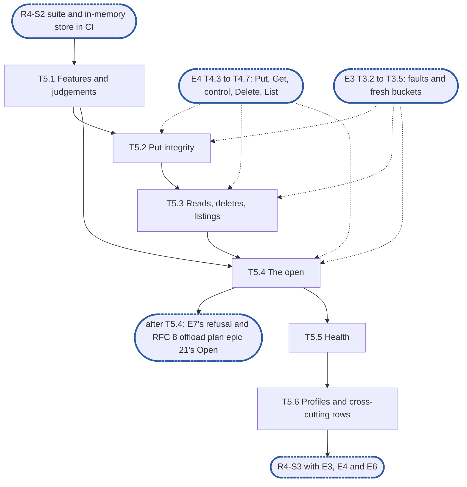

# Epic 5: remote tier v2 capability check and health

**Sources:** [RFC 4](../docs/internals/rfcs/rfc-4-remote-tier.md) §4.7 for a namespace's store
(both probes and the health object), §4.11's open (the requirements on a backend's check, the
claim read and handed back, the bounded re-list, the pinned storage class and the archive rule),
§4.12's `remote_capability` and the refused open's log, §5, §4.3's conditional put (measured,
never used), §4.15's `decision:` note on the open calling the service outside the syncer, §6's
R12 (its mutable half), §8 items 2 to 4 and 7, Appendix C.1's mutable rows, C.2's check and
health keys, and C.4 steps 1 to 7 with its `decision:` note; the §7.1 rows named in §3 below,
§7.2's measured-service profiles as the check must judge them, and §7.4's emulator row for the
check. Cited, not owned: [RFC 3](../docs/internals/rfcs/rfc-3-syncer.md) §2.8 (the syncer derives
health from the probes' outcomes); [RFC 27](../docs/internals/rfcs/rfc-27-namespace-migration.md)
§2.1 (what is done with the claim); [RFC 0](../docs/internals/rfcs/rfc-0-data-lifecycle.md) §1.2
(allowed imports, as amended to "a component imports another's contract only"). The RFC 4
follow-up under review (#5795) is applied where this epic touches it: `pkg/remote/s3` records
through a recorder it declares and imports neither `pkg/metrics` nor `pkg/health`. Every citation
is `develop`'s text; the code lands on `feat/storage-v2`, and the paths below are paths there.
**Track:** C.
**Epic 5 estimate: 6 subtasks, 13 man-days.**
**Depends on:** **E3**, the fault transport and LocalStack: `integration`'s LocalStack cell over
HTTPS (T3.1), `s3fault`'s `Inject`, `Answer` and `Requests` (T3.2), `FlipByte`, `StripHeaders` with
`Rule.MinBody` and `RecodeError` (T3.3), `HoldNewKeys` (T3.4), and `FreshBucket` with its record
of which bucket settings LocalStack 4.13.1 holds (T3.5). **E4**, the S3 data path: the client
(T4.2), `Open` with its unexported `open` and `choice` (T4.3), `Put`, `Get`, `PutControl`,
`GetControl`, `Delete` and `List` (T4.3 to T4.7), the error table (T4.1) and the recorder
`pkg/remote/s3` declares. Until E4's calls land, T5.1 needs only the SDK's types.
**Blocks:** **E7**, which reports a refused open as a field error and declares
`remote_capability`'s definition; **R4-S3**, and through it RFC 8 offload plan epic 21, which
opens a namespace's store in the node and hands the claim on, and whose `codec.Store.Health`
passes this epic's `Health` straight through (RFC 4 §4.3 as #5795 amends it); **E9**, whose
real-bucket rows run this check against the settings LocalStack cannot hold.

---

## 1. Goal

Epic 5 makes the S3 store prove its service before it opens, and gives it the two probes the
syncer's health rests on. `Open` runs Appendix C.4's seven steps in a fresh check namespace with
the production client, refuses naming every missing feature, reads the namespace claim and hands
it back, writes the health object and cleans up the rest. `Health` then probes each direction
against that object with one request.

**At the end of the epic:**

- `s3.Open` refuses to open, with one error and one `Error` log line naming every missing
  feature, a service that enforces no put integrity at the largest encoded block size, lags a
  read after a write, stores in another or an archive class, answers a range or an absent key
  wrongly, misreports a batch delete, lists out of order or lags past the bound, or whose bucket
  holds versioning, an expiring or transitioning lifecycle rule, an archive tiering rule, or, with
  the ETag chosen, a default encryption that breaks it;
- on a service that passes, it returns the store with the integrity mechanism, its recorded
  rejection and the batch-delete choice set, the claim it read, the health object written and
  nothing else of the check left behind;
- `Open` in `immutable` mode is refused without a request, naming the caller it waits for;
- `Health(DirPut)` and `Health(DirGet)` each make one request against `<prefix>control/health`
  and keep nothing;
- `remote_capability` reports each feature of the last check, `conditional_put` among them,
  through the recorder `pkg/remote/s3` declares;
- LocalStack 4.13.1 passes the check, E2's conformance suite runs through the checked `Open`, and
  each of RFC 4 §7.2's fault profiles makes it refuse.

### 1.1 In scope

Appendix C.1's judgements for a mutable store, as pure functions over the SDK's replies; C.4
steps 1 to 7 and their insertion into E4's `Open`; the claim returned to the opener; the
`immutable` refusal; `Health` in both directions; `remote_capability` and the refused open's
log; the `decision:` markers RFC 4 places on the check; the §7.1 rows in §3 over LocalStack and
E3's faults.

### 1.2 Out of scope

- **E4:** the client, the error table, `Put`, `Get`, `PutControl`, `GetControl`, `Delete`,
  `List`, the `remote_` series but `remote_capability`, and the conditional header kept off every
  request the store itself sends. This epic calls them and adds to E4's surface only what §4
  names (D2).
- **E7:** the `remote.*` settings rows (the storage class and block target among them, which
  this epic reads from the client's configuration), `remote_capability`'s metric definition and
  the content wiring's recorder behind it, and the refused open reported to the API as a field
  error. A credential set through the API running this check is the RFC 4 plan's §6.1 deferral
  ledger row for RFC 23.
- **E9:** §7.1's §4.7 prefix-revoke half, and the rows on a bucket setting LocalStack 4.13.1
  cannot hold (as E3's T3.5 measures them: an archive class read back, an archive tiering rule, a
  KMS default encryption), run against a real bucket by hand until CI holds credentials, as the
  plan's §6.1 ledger row on §7.1's T rows on such settings has it.
- **RFC 9**, the plan's §6.1 ledger row on `Settings` and the `Recheck` pass: `Settings`,
  `RecheckSetting`, `VersionsPage`, `DeleteVersions`, every `Recheck` row and the `Recheck` half
  of §7.1's archive-class row and of the C.3 row's encryption clause, the drifted setting's gauge
  at 0, the repair proof, and recording the default encryption for a later comparison.
- **RFC 26**, the plan's §6.1 ledger row on a backup location's calls: the `immutable` mode and
  its admission, the location health object, an immutable store's `Health(DirPut)` refusal, and
  every §7.1 row on them.
- **RFC 27**, the plan's §6.1 ledger row on the claim: what is done with the claim the open
  returns.
- **RFC 3**: the probe interval, the `ProbeKey`, the per-direction health derived from the
  outcomes, and a successful transfer standing in for a probe (§8 item 6).

### 1.3 Names used here

- **E1**, epic 1, interfaces: `pkg/remote`'s contract (`Store`, `Mode`, `Role`, `Direction`,
  the sentinels, `DeniedError`), frozen at S1.
- **E2**, epic 2, conformance suite and test foundations: `remotetest` and the in-memory store.
- **E3**, epic 3, fault transport and LocalStack: `s3fault` and LocalStack over HTTPS in
  `integration`.
- **E4**, epic 4, S3 data path, errors and client: the S3 store, its client and `Open`.
- **E6**, epic 6, block codec: the largest encoded block size it reports.
- **E7**, epic 7, integration: keys and observability.
- **E9**, epic 9, E2E green: the real-bucket rows and the nightly service row.
- **S1**, the plan's first synchronisation point, the remote store contract agreed with the
  RFC 3 and RFC 8 offload plans' authors.
- **R4-S2**, suite and in-memory store in CI; **R4-S3**, store and codec complete: epics 3 to 6
  done, every §7.1 and §7.3 row they own green. **S2** appears here only inside R4-S2.
- **S3** names the storage service (Amazon S3 and the services compatible with it) everywhere
  in this document, except inside **R4-S3**.
- **RFC 8 offload plan epic 21**: the epic of the RFC 8 offload plan that composes the codec and
  the store in the node's content wiring.

## 2. How the general rules apply

The rules are those of [the RFC 4 implementation plan's §1.5](rfc-4-remote-tier-plan.md#15-general-rules-for-each-epic),
cited by number and title and not copied, as #5795 amends rules 3 and 7.

| Rule | Subtasks | How |
| --- | --- | --- |
| rule 1, independent unit tests ([`CLAUDE.md`, "Writing tests"](../CLAUDE.md#writing-tests)) | all | C.1's judgements are pure functions over SDK reply values, table-tested with no service (T5.1); the check's steps and `Health` run against LocalStack 4.13.1 in `integration`, under E3's fault transport (kind 3) for every row marked T; the re-list wait on `pkg/sim`'s `TestClock` (kind 1). No double answers in the service's place |
| rule 2, fuzz tests where relevant ([`CLAUDE.md`, "By kind"](../CLAUDE.md#by-kind)) | none | the check reads no bytes off the wire itself: the SDK parses every reply, and the judgements over its types are table-tested, as the rule says |
| rule 3, observability follows RFC 25 | T5.4, T5.5, T5.6 | `remote_capability` and the `health` op recorded through the recorder `pkg/remote/s3` declares (D10), never `pkg/metrics`; the logger narrowed with `With("component", "remote")`; a refused open logs at `Error` once, a failed cleanup at `Warn`, nothing per probe; no span and no health condition. T5.6 greps a wrong-secret open's log and error for the access key, the secret and the signature |
| rule 4, profiling | T5.2 to T5.6 | every test under `internal/prof`'s goroutine and descriptor checks: an abandoned re-list wait or a probe's body left open shows there. The largest-block put streams from a generator (D6), asserted by the check's own allocation bound in T5.2; nothing here joins `s3-allocs` |
| rule 5, public interface and internals ([`CLAUDE.md`, "Verifying a change"](../CLAUDE.md#verifying-a-change)) | all | the judgements and steps tested directly; the refusals, the claim and the probes through `Open` and `remote.Store`, the layers the node and the syncer consume, under `-race`; what the check sends asserted where LocalStack refuses or stores it, or where E3's transport records it |
| rule 6, known failures shrink | none | `unit` and `integration` keep no `known.yaml`; each test lands green with the subtask that makes it pass |
| rule 7, v2 ignores v1, and imports only what RFC 0 §1.2 allows | all | nothing from `develop`'s `pkg/block/remote/s3`; `pkg/remote/s3` imports `pkg/remote` and `aws-sdk-go-v2` only, declaring its clock (D2) and recorder (D10) itself; its tests import `s3fault`, `remotetest`, `pkg/sim` and `internal/prof`. E1's import walk covers the files without change |
| rule 8, real dependencies for properties of those dependencies ([`CLAUDE.md`, "Writing tests"](../CLAUDE.md#writing-tests)) | T5.2 to T5.6 | LocalStack 4.13.1 for what the service enforces, stores and reports; every bucket setting applied for real on a `FreshBucket`; a measured service's behaviour by E3's compositions; a setting LocalStack cannot hold goes to E9, never pretended |
| rule 9, code comment conventions ([`CLAUDE.md`, "Code comments"](../CLAUDE.md#code-comments)) | T5.1, T5.3, T5.4 | RFC 4's `decision:` notes at their code sites: versioning refused on every namespace store (§8 item 4) at the versioning judgement (T5.1); conditional put measured and never sent (§4.3) and the fixed re-list bound (C.4) at step 4 (T5.3); the open calling the service outside the syncer (§4.15) at the check's entry (T5.4). The plan's own: `immutable` refused naming its caller, at `Open` (T5.4). This epic's markers of §4 |
| rule 10, a test must be able to fail ([`CLAUDE.md`, "Writing tests"](../CLAUDE.md#writing-tests)) | all | each test names the break it catches; no test asserts a fault's own answer, only the check's verdict on it |
| rule 11, a symbol is exported only if the RFC's interface uses it | T5.4 | the only exported additions are D2's: `Claim` and `Open`'s second result, `Clock` and its field in `Deps`, and `MaxBlockSize` in `ClientConfig`. Features, judgements, steps and the refusal stay unexported |
| rule 12, each subtask creates only what it declares | all | each file lands with its first caller, named in its subtask; the recorder gains `Capability` with the open that calls it |

## 3. Requirements and invariants

Every obligation RFC 4 places on this epic, numbered so subtasks and tests can cite them. Where a
row's work is shared, the other part's owner is named.

**The check**

| # | Requirement | Kind | Source | Subtasks |
| --- | --- | --- | --- | --- |
| R1 | The S3 profile declares the service features it needs and how each is verified: Appendix C.1's mutable rows, each verified by its C.4 step; a feature with no step (single-part atomic replace) is taken from the service's documentation | MUST | §4.11, §5, C.1 | T5.1 |
| R2 | The constructor verifies the features against the real service before it returns, and refuses to open, naming every missing feature, if any is absent | MUST | §4.1, §4.11 | T5.4 |
| R3 | A feature is verified by provoking what it exists to do and seeing it happen; a service accepting a request is not evidence that it honoured it | MUST | §4.11 | T5.2, T5.3 |
| R4 | The check runs whenever a store is opened | invariant | §4.11 | T5.4 |
| R5 | The check runs in a fresh `<prefix>check/<random>/` namespace, with the production client configuration of C.3, through steps 1 to 7 in order | MUST | C.2, C.3, C.4 | T5.2, T5.4 |
| R6 | The check cleans up everything it wrote except the health object; a failed cleanup is logged, not fatal | MUST | §4.11, C.4 step 7 | T5.4 |
| R7 | The open calls the service directly, outside the syncer: each call is one attempt, and a failure fails the open, which its caller retries | invariant | §4.15, §4.9 | T5.4 |

**Put integrity** (C.4 step 1)

| # | Requirement | Kind | Source | Subtasks |
| --- | --- | --- | --- | --- |
| R8 | For `x-amz-checksum-crc32c`, then `Content-MD5`: a put with the correct value succeeds and one with a wrong value is rejected with nothing stored; the first to pass both is the one the store sends, and the status and code of its rejection are recorded for `ErrCorrupt` | MUST | C.1, C.4 step 1, C.3 | T5.2 |
| R9 | If neither is enforced, a known body put with a wrong `Content-MD5` must answer `200` with an ETag equal to the MD5 of the body sent, and then the store verifies the ETag (`Checksum` is None); if that fails too, the open is refused | MUST | §4.3, C.1, C.3, C.4 step 1 | T5.2 |
| R10 | The chosen mechanism is proved again with an object of the largest encoded block size the store will be asked to put: a correct put, and one with a wrong checksum or a known body whose ETag must match. A digest is trusted only where the check proved it at that size | MUST | §4.11, §8 item 2, C.4 step 1 | T5.2 |
| R11 | A service that ignores every put checksum makes the check choose the ETag; a service enforcing only CRC32C, refusing with its own code, makes it choose CRC32C and record that code | MUST | §7.2, Appendix B | T5.2 |

**Reads, deletes and listings** (C.4 steps 2 to 4)

| # | Requirement | Kind | Source | Subtasks |
| --- | --- | --- | --- | --- |
| R12 | A 10-byte object put in the pinned class is got at once and comes back, with that class reported; bytes 2 to 5 come back exactly 4 bytes; a get from offset 20 answers `416`; a get of a key never written answers `404`, not `403` | MUST | C.1, C.4 step 2 | T5.3 |
| R13 | The check reads back the class the service reports for what it wrote; a class other than the pinned one, or one that can move an object out of immediate reach (an archive class, whose get needs a restore), refuses the open. A get that reports no class reads as `STANDARD` | MUST | §4.11, C.1 | T5.1, T5.3 |
| R14 | Two existing keys and one never written, batch-deleted, are all three reported deleted and the two gone from a listing; a service that rejects the batch operation is recorded, and the store then deletes one key per `DeleteObject` | MUST | C.1, C.4 step 3 | T5.3 |
| R15 | Three keys listed with `max-keys=1` and `start-after` come back each once, in order, with `LastModified` | MUST | C.1, C.4 step 4 | T5.3 |
| R16 | Where a listing lags, the check re-lists up to 5 times over at most 30 s before refusing; the bound is fixed, not a setting | MAY (adopted), bound | §4.11, C.4 step 4 and its `decision:` | T5.3 |
| R17 | The check puts one of step 4's keys again with `If-None-Match: *` and records whether the service refused it as `conditional_put`; no rule reads the outcome, and no other request the check sends carries a conditional header (the store's own requests are E4's) | MUST NOT | §4.3, §8 item 1, C.1, C.4 step 4 | T5.3, T5.6 |

**Bucket settings** (C.4 step 5)

| # | Requirement | Kind | Source | Subtasks |
| --- | --- | --- | --- | --- |
| R18 | Versioning never enabled: a reply with no status passes, `Enabled` or `Suspended` refuses a mutable store; object lock requires versioning, so this one check covers both | MUST NOT | C.1, §8 item 4, §6 R12 | T5.1, T5.4 |
| R19 | No lifecycle rule that expires or transitions objects and whose filter could match an object under the prefix: a shorter or empty prefix filter, or a tag or size filter the store's objects could meet | MUST NOT | C.1, §6 R12 | T5.1, T5.4 |
| R20 | No intelligent-tiering configuration with an archive tier whose filter could match the prefix | MUST NOT | §4.11, C.1, §6 R12 | T5.1, T5.4 |
| R21 | The bucket's default encryption is read; where the chosen mechanism is the ETag, a default under which the ETag is not the MD5 of the stored bytes (a customer-managed or service-managed KMS key, or customer-provided keys) refuses the open. Recording it for a later comparison lands with `Recheck` (RFC 9) | MUST | C.1 | T5.1, T5.4 |
| R22 | For each bucket-setting read, "no configuration" (`404` with the service's not-found code) and `501 NotImplemented` pass, and `403` refuses: the credential must be allowed to read the setting | MUST | C.1 | T5.1, T5.4 |
| R23 | A mutable store does not open on a versioned or object-locked bucket, under an expiring lifecycle rule, or where a storage class or tiering rule can archive what it writes. The immutable half is RFC 26's | invariant | §6 R12, §8 item 4 | T5.4, T5.6 |

**The claim, the health object and the mode** (C.4 steps 6 and 7)

| # | Requirement | Kind | Source | Subtasks |
| --- | --- | --- | --- | --- |
| R24 | The namespace claim at `<prefix>control/claim` is read and handed to the opener, absent reported as absent; the store applies no claim rule and fails no open on it, so an unreadable claim is handed back as unreadable | MUST, MUST NOT | §4.11, C.1, C.4 step 6 | T5.4 |
| R25 | Every open puts the health object at `<prefix>control/health` before the store returns; nothing the store does deletes it, the check's cleanup included | MUST | §4.7, C.2, C.4 step 7 | T5.4 |
| R26 | A store opened in `immutable` mode is refused at open until the backup location's calls land with RFC 26's caller | MUST | §4.1 | T5.4 |

**Health**

| # | Requirement | Kind | Source | Subtasks |
| --- | --- | --- | --- | --- |
| R27 | `Health` makes one bounded round trip in one direction against the store's own namespace: `DirPut` puts the health object, proving the service reachable, the credentials accepted and the namespace writable; `DirGet` gets it, proving the service reachable and the namespace readable | MUST | §4.1, §4.7, §8 item 3 | T5.5 |
| R28 | A get probe that finds the health object absent fails with `ErrNotFound`; neither probe depends on a block existing | MUST | §4.7 | T5.5 |
| R29 | The store returns the probe's outcome and nothing else: it keeps no health status, and a probe never reaches outside the store's own prefix | MUST NOT | §4.7, §4.9 | T5.5 |

**Observability**

| # | Requirement | Kind | Source | Subtasks |
| --- | --- | --- | --- | --- |
| R30 | `remote_capability` reports the last check per feature, 1 if present, labelled by store, and carries `conditional_put` | MUST | §4.12 | T5.4 |
| R31 | A refused open logs every missing feature at `Error`, once | MUST | §4.12 | T5.4 |
| R32 | A probe is counted as `op` `health` in `remote_requests_total` and `remote_request_seconds` | MUST | §4.12 | T5.5 |
| R33 | The check reports the storage class's failure domain at open: a deployment configuring a class that keeps data in one failure domain accepts it, and is told. Reporting it through health is pending (§9 point 3) | MUST | §8 item 7, Appendix B | T5.4 |

**Conformance rows** (RFC 4 §7.1, §7.2 and §7.4, the rows and halves this epic owns)

| # | Requirement | Kind | Source | Subtasks |
| --- | --- | --- | --- | --- |
| R34 | §4.11: against each fault profile of §7.2 (checksums ignored with a breaking default encryption, versioning set, an expiring lifecycle rule set) the open fails and names the missing feature; a cleanup that fails does not fail the open (T) | test row | §7.1, §7.2 | T5.4, T5.6 |
| R35 | §4.11: a transport that corrupts or drops the integrity check only above a size threshold below the maximum block size: the open fails; the check puts an object of the maximum encoded block size (T) | test row | §7.1 | T5.2 |
| R36 | §4.11: a transport whose listing omits new keys for the first few pages: the open succeeds within the re-list bound and fails past it (T) | test row | §7.1 | T5.3 |
| R37 | §4.11: a bucket storing what the check wrote in an archive class, or holding a tiering rule with an archive tier whose filter could match the prefix: the open fails naming it (T). The `Recheck` half is RFC 9's; a half LocalStack cannot hold is E9's | test row | §7.1 | T5.1, T5.4 |
| R38 | §4.7: the put probe fails while the namespace is read-only and succeeds on the next call once write access returns; the get probe succeeds throughout. The prefix-revoke half is E9's | test row | §7.1 | T5.5 |
| R39 | §4.7: the health object deleted behind the store: the get probe fails `ErrNotFound`; reopened, the check writes it again and the get probe passes. A store whose puts all succeed and whose put probes are skipped still passes the get probe (T) | test row | §7.1 | T5.5 |
| R40 | §4.4: a transport answering `404` to the first get after a successful put: the check refuses to open on such a service (T). The get's own half is E4's | test row | §7.1 | T5.3 |
| R41 | §4.3: the check provokes a conditional put and reports `conditional_put`; no other call of the suite sends a conditional header (T) | test row | §7.1 | T5.3, T5.6 |
| R42 | C.3: a bucket default encryption under which the ETag is not the content MD5, set before open on a store whose check chose the ETag: the open fails naming it (T). The drift half is RFC 9's; on LocalStack only if E3 finds it holds such a default, else E9's | test row | §7.1 | T5.4 |
| R43 | §7.4: the local emulator, current version, under the fault transport, passes the capability check | test row | §7.4 | T5.6 |

## 4. Decisions this epic takes

- **D1. The check is unexported and runs inside `Open`, over a store of its own namespace.**
  `Open` validates the mode and prefix, then runs `check(ctx, c, prefix)`, which draws 16 random
  bytes for `<prefix>check/<hex>/` and opens E4's unexported `open(c, checkPrefix, choice)` over
  it, so steps 2 to 4 use the production calls (`Put`, `Get`, `Delete`, `List`) on the check's
  keys. Where C.4 names a status (`416`, `404` against `403`, `412`, a batch rejected), the step
  reads it from the SDK client's reply through E4's `fromSDK` record rather than from a sentinel,
  since two statuses share one sentinel. The check returns the `choice` E4's D2 defines (`proved`,
  the mechanism, the recorded rejection, the batch-delete choice), the claim and the features'
  verdicts; `Open` then builds the namespace's store with that `choice`. Nothing exported changes
  but D2's additions. Prior art: rclone and restic make no such check (from memory); the RFC is
  the source.
- **D2. Three additions to E4's surface, pending the user's approval (§9 point 1).** The check
  needs the largest encoded block size and a clock, and must hand back the claim:

  ```go
  package s3 // pkg/remote/s3, additions to E4's D1

  type ClientConfig struct {
  	// ... E4's fields ...
  	MaxBlockSize int64 // the largest encoded block the store will be put (RFC 3 §2.2); at least 1
  }

  // Clock is the time the check's bounded re-list waits on; *sim.TestClock satisfies it.
  type Clock interface{ After(d time.Duration) <-chan struct{} }

  type Deps struct {
  	// ... E4's fields ...
  	Clock Clock // nil: real time
  }

  // Claim is the namespace claim the open read (RFC 4 §4.11, RFC 27 §2.1).
  // Err is nil when Body holds it, remote.ErrNotFound when none is stored,
  // and any other error when it could not be read; none of them fails the open.
  type Claim struct {
  	Body []byte
  	Err  error
  }

  func Open(ctx context.Context, c *Client, prefix string, mode remote.Mode) (remote.Store, Claim, error)
  ```

  `MaxBlockSize` sits on the client configuration because the block target is the remote store
  configuration's (RFC 13 Appendix B) and `s3` may not import the codec: the node's content
  wiring computes it from E6's bound for the configured block target, and RFC 8 offload plan
  epic 21 passes it. `NewClient` refuses a value below 1 with `ErrInvalid`. `Clock` follows the
  shape components declare for `pkg/sim`'s `TestClock` (`internal/identity/server.go` on
  `feat/storage-v2`, read the code), less `Now`, which the check does not read. The claim is a
  second result of `Open`, since only the check reads it and §4.11 says it is handed to the
  opener; `Claim` lives in `s3`, not in the root contract, as long as only the node reads it.
  The architect pass proposed the same claim and clock, with the size and the clock in an
  `OpenCheck` argument of `Open`; it was not taken, because both are per configuration, not per
  namespace, and the client already carries the configuration. Changing this once RFC 8 offload
  plan epic 21 calls `Open` means editing that call and its tests. Prior art: aws-sdk-go-v2
  passes per-client values in `Options` (read the code).
- **D3. Twelve features, one per C.1 mutable row the check verifies.** Unexported constants,
  each the `feature` label value of `remote_capability` and the name a refusal uses:
  `put_integrity` (R8 to R10), `read_after_write`, `storage_class`, `range_get`, `list_bucket`
  (R12, R13), `batch_delete` (R14), `list` (R15, R16), `conditional_put` (R17), `versioning`,
  `lifecycle`, `tiering` and `encryption` (R18 to R22). `batch_delete` at 0 is recorded, not
  refused (R14), and `conditional_put` is never refused. The chosen mechanism and its recorded
  code are reported in the open's log line (D11), not as features, so the label set stays one per
  row. Prior art: none found.
- **D4. A refused open wraps `ErrInvalid` and names every missing feature; a failing call
  keeps its own sentinel.** §4.8 files "an operation the service does not support" under
  `ErrInvalid`, and no seventh sentinel exists. The error's text lists the missing features in
  check order (`s3: open refused: service lacks put_integrity, versioning`), held by an unexported
  type; E7 decides what the API's field error needs from it. A call of the check that fails
  rather than answers (a network error, a `5xx`, a throttle) fails the open with that call's
  error as E4's table maps it, `ErrTransient` or `ErrThrottled`, so the caller retries the open;
  a refused credential is `ErrDenied` of cause `access`. Only a `403` that C.1 makes a verdict,
  on a bucket-setting read (R22) or step 2's never-written key (R12), names a feature instead.
  To name every missing feature, the check runs every step it can: when step 1 proves no
  mechanism, steps 2 to 4 cannot put and their features stay unverified, reported at 0 and not
  named, while steps 5 and 6 still run. Prior art: none found.
- **D5. What "could match the prefix" means, as one pure function.** A lifecycle rule or a
  tiering configuration could match when its prefix filter (the rule's `Filter.Prefix`,
  `Filter.And.Prefix`, or the deprecated `Prefix`) is empty, is a prefix of the store's prefix,
  or has the store's prefix as a prefix; a filter carrying a tag cannot match, since the store
  puts no tags; a size filter matches when its range meets 1 byte to `MaxBlockSize`, the sizes
  the store's objects take. A lifecycle rule counts when it is `Enabled` and carries an
  `Expiration` or a `Transition`; a rule whose only action is `AbortIncompleteMultipartUpload` or
  a noncurrent-version action acts on nothing a mutable store holds (it sends no multipart put and
  refuses versioning). A `Disabled` rule acts on nothing, and passes behind a `decision:` marker
  naming the ceiling: enabled after open, it goes unseen until the next open, as any drift does
  until `Recheck` lands (RFC 9). A tiering configuration counts when it is `Enabled` with an
  `ARCHIVE_ACCESS` or `DEEP_ARCHIVE_ACCESS` tier. Prior art: S3's lifecycle filter semantics
  (read the API reference).
- **D6. The largest-block proof streams from a generator, twice.** The object of `MaxBlockSize`
  bytes comes from a seeded generator: one pass computes its CRC32C or MD5, a second streams it
  to the put, so the check never holds the block (RFC 3 §2.2's bound). A `ponytail:` marker
  names the ceiling: two puts of the largest block per open, a few MiB at the defaults; batch the
  proof per client if opens of many namespaces on one configuration show it. Prior art: none
  needed.
- **D7. Archive classes.** A get that reports no class reads as `STANDARD`, since AWS sends no
  `x-amz-storage-class` header for it. The reported class must equal the pinned one, and
  `GLACIER` and `DEEP_ARCHIVE`, whose gets need a restore, refuse even when pinned. Prior art:
  the S3 storage-class reference (from memory).
- **D8. Encryption against the ETag.** No default (`404
  ServerSideEncryptionConfigurationNotFoundError`) or `AES256` passes; `aws:kms` and
  `aws:kms:dsse` refuse where the mechanism is the ETag, and pass with a checksum header, which
  the service checks whatever the encryption. Prior art: AWS documents the ETag of an `SSE-S3`
  object as its MD5 and of an `SSE-KMS` object as not (from memory); E3's T3.5 measures
  LocalStack.
- **D9. The re-list bound on the clock.** Step 4 lists, and on a lagging listing waits 6 s on
  `Deps.Clock` and re-lists, up to 5 times: 30 s in all. RFC 4's C.4 `decision:` note goes at the
  loop. A cancelled context ends the wait at once. Prior art: the engine's and the journal's use of
  `pkg/sim`'s clock on `feat/storage-v2` (checked).
- **D10. `remote_capability` through the recorder `pkg/remote/s3` declares.** The recorder E4
  declares gains `Capability(feature string, present bool)`, which `Open` calls for each of the
  twelve features after every check, a refused one included, unverified ones at 0. E7's content
  wiring backs it with the gauge, labelled `store` and `feature`; `pkg/remote/s3` imports no
  `pkg/metrics`. A probe records as E4's calls do, with `op` `health`. Prior art: the RFC 5
  plan's D2 (#5532), the same recorder shape.
- **D11. The open's log.** A refused open logs one `Error` line naming every missing feature
  (R31); a failed cleanup one `Warn` with the count of keys left (R6); a successful open one
  `Info` line with the mechanism chosen, its recorded rejection code and the storage class read
  back, which is how a class keeping data in one failure domain is reported (R33, pending §9
  point 3). No line carries a reply's message or a header. Prior art: none found.
- **D12. The health object's body and the read-only row.** The health object holds a fixed
  body, `dittofs health\n`, put through `PutControl` and read whole through `GetControl`; nothing
  reads its content on a namespace's store. §7.1's read-only row turns the namespace read-only by
  a bucket policy denying puts under the prefix where E3's T3.5 finds LocalStack enforcing it,
  and otherwise by `Answer(403, "AccessDenied")` on every `PutObject` under the prefix: a scripted
  refusal, a fault RFC 4 §7.2 allows, not a setting pretended. Prior art: none needed.

## 5. Target tree

```text
pkg/remote/s3/
  features.go           T5.1  the twelve features (D3), a verdict set and its formatter
  judge.go              T5.1  C.1's judgements: versioning, lifecycle, tiering, encryption,
                              class, the setting-read rule, couldMatch (D5, D7, D8)
  integrity.go          T5.2  step 1: proveIntegrity, the largest-block generator (D6)
  probe.go              T5.3  steps 2 to 4 over the check's store, the re-list (D9)
  check.go              T5.4  check: steps 5 to 7, the claim, cleanup, the refusal (D1, D4)
  store.go              T5.4  E4's Open: mode refusal, the check inserted, Claim (D2)
  client.go             T5.4  E4's ClientConfig and Deps: MaxBlockSize, Clock (D2)
  record.go             T5.4  E4's recorder: Capability (D10)
  health.go             T5.5  Health in both directions (D12)
  judge_test.go         T5.1  table tests
  *_integration_test.go T5.2-T5.6  LocalStack rows, under s3fault for T rows
```

## 6. Subtasks

### T5.1 The features and C.1's setting judgements

**Subtask T5.1 estimate: 2 man-days.**

- **Track:** C. **Depends on:** R4-S2.
- **Covers:** R1, R13, R18–R22, R37's archive-class half.
- **Deliverables:** `features.go`: the twelve unexported features of D3 and a verdict set that
  formats its missing ones in check order. `judge.go`, pure functions over the SDK's reply
  values and errors: `judgeVersioning`, with RFC 4 §8 item 4's `decision:` note;
  `judgeLifecycle(rules, prefix, maxBlock)`, `judgeTiering(configs, prefix)` and
  `couldMatch(filter, prefix, maxBlock)` (D5, its `Disabled` rule `decision:`);
  `judgeEncryption(default, mechanism)` (D8); `judgeClass(reported, pinned)` (D7); and
  `settingRead(err)`, which reads a setting call's error as present, absent (`404` with the
  setting's not-found code, `501`), a refusing verdict (`403`) or a failure that fails the open
  (anything else, D4). Consumed by T5.3 (the class) and T5.4.
- **Acceptance criteria:**
  - Every C.1 mutable row the check verifies has a feature, and every feature a judgement or a
    step.
  - Each judgement returns present or missing for every case of D5, D7 and D8, and `settingRead`
    one of its four outcomes for every status of C.1's rule.
- **Tests:** tables over SDK reply values, no service. Versioning: no status, `Enabled`,
  `Suspended` (catches `Suspended` admitted, R18). Lifecycle: a rule on `""`, on `ns/`, on
  `ns/blocks/`, on `other/`, on `n` (a shorter prefix of `ns/`), a tag-only filter, an `And` with
  a tag, a size filter inside and outside 1 byte to the largest block, a `Disabled` rule, an
  abort-only rule, a transition-only rule (catch a deeper filter missed, a tag filter refused, a
  transition admitted, R19). Tiering: an archive tier on and off the prefix, a disabled one
  (R20). Encryption: none, `AES256`, `aws:kms`, `aws:kms:dsse` under each mechanism (catches KMS
  admitted with the ETag, R21). Class: no header with `STANDARD` pinned, `STANDARD_IA` against
  `STANDARD`, `GLACIER` pinned (catch the empty header refused and an archive class admitted,
  R13, R37). `settingRead`: `404` with the setting's code, `404 NoSuchBucket`, `501`, `403`, `503`
  (catches a missing bucket read as no configuration, R22). No test double: the inputs are
  values.
- **Rules:** rule 9: the §8 item 4 `decision:` at `judgeVersioning`, D5's at `couldMatch`.

### T5.2 Put integrity

**Subtask T5.2 estimate: 2.5 man-days.**

- **Track:** C. **Depends on:** T5.1; E4's T4.3 (`Put`, `choice`); E3's T3.3 (`StripHeaders`
  with `MinBody`, `RecodeError`, `FlipByte`) and T3.5 (`FreshBucket`).
- **Covers:** R3, R5, R8–R11, R35.
- **Deliverables:** `integrity.go`: `proveIntegrity(ctx, ns) (choice, verdict, error)` over the
  SDK client of E4's `Client` in the check namespace: the small puts with a correct and a wrong
  CRC32C, then `Content-MD5`, each wrong one followed by a get of its key expecting `404`; the
  rejection's status and code recorded into `choice`; the ETag proof with a known body and a
  wrong `Content-MD5`; the largest-block proof of the chosen mechanism from D6's generator, with
  its `ponytail:`. Consumed by T5.4.
- **Acceptance criteria:**
  - On LocalStack 4.13.1, CRC32C is chosen with `400 BadDigest` recorded.
  - Under E3's Scaleway composition, CRC32C is chosen with `400 InvalidRequest` recorded; under
    its Cubbit DS3 composition, the ETag is chosen.
  - A checksum stripped, or a body flipped, only above a threshold below `MaxBlockSize`: the
    verdict has `put_integrity` missing.
  - The check holds at most one generator buffer, whatever `MaxBlockSize`.
- **Tests:** in `integration`, at the `choice` `Open` hands the store, the value the store's
  puts then consume. LocalStack as it is (catches a wrong value never sent, which a service would
  have to refuse: R3, R8); Scaleway's composition (catches a hard-coded `BadDigest`, R11);
  Cubbit DS3's composition (catches the ETag proof skipped, R9, R11); `StripHeaders` of the chosen
  header with `MinBody` half of `MaxBlockSize`, and `FlipByte` with the same `MinBody` under the
  ETag (catch the proof made only on a small object, R10, R35); each composition's wrong put
  read back absent or stored through `FreshBucket`'s `Admin` client (catches "rejected" inferred
  from the status alone, R8). Bytes allocated by `proveIntegrity` at two `MaxBlockSize`s do not
  grow with it (catches the block buffered, D6). Doubles: E3's transport (kind 3).
- **Rules:** rule 4: the allocation bound above; rule 9: D6's `ponytail:`.

### T5.3 Reads, deletes and listings

**Subtask T5.3 estimate: 2.5 man-days.**

- **Track:** C. **Depends on:** T5.2; E4's T4.4, T4.6 and T4.7 (`Get`, `Delete`, `List`); E3's
  T3.2 (`Answer`) and T3.4 (`HoldNewKeys`).
- **Covers:** R3, R12–R17, R36, R40, R41.
- **Deliverables:** `probe.go`, over the check's store opened with step 1's `choice` (D1): step
  2's put, immediate get with the class read back through T5.1's `judgeClass`, ranged gets and the
  never-written get; step 3's batch delete and listing, recording a rejected batch (`501`, `405`,
  or `400 NotImplemented`) as no batch delete, and refusing a reply that misreports; step 4's
  three keys, the `max-keys=1` walk and the re-list on `Deps.Clock` (D9) with C.4's `decision:`
  note, and the conditional put with §4.3's `decision:` note. Consumed by T5.4.
- **Acceptance criteria:**
  - On LocalStack 4.13.1, every step passes, the batch is chosen and `conditional_put` is 1.
  - A `404` answered to step 2's first get, a `403` to its never-written get, a key refused
    inside step 3's batch, and a listing held past the bound each make their feature missing.
  - A listing held for fewer than 5 re-lists passes once the clock is advanced; one held for 6
    fails, and no real time passes in either.
- **Tests:** in `integration`, at the verdict and `choice` `Open` consumes. LocalStack as it is
  (R12, R14, R15); `Answer(404, "NoSuchKey")` on the first `GetObject` after the put (catches a
  lagging read admitted, R40); `Answer(403, "AccessDenied")` on the never-written key (catches
  `ErrDenied` read as absent, R12); `Answer(501, "NotImplemented")` on `DeleteObjects`, then the
  check's own cleanup in T5.4 deleting key by key, its requests seen in E3's record (catches the
  rejected batch refused or kept, R14); `FailBatchKey` on one of the three (catches a misreported
  batch admitted); `HoldNewKeys(3)` and `HoldNewKeys(6)` with the `TestClock` advanced 6 s at a
  time, waiting on `Armed` (catch an unbounded or slept re-list, R16, R36); Cubbit DS3's
  composition, which strips `If-None-Match`: `conditional_put` 0 and the open not refused, while
  E3's record shows exactly one request carrying the header (catches the outcome used, or a
  second conditional request, R17, R41). Doubles: E3's transport (kind 3), `TestClock` (kind 1).
- **Rules:** rule 9: the C.4 and §4.3 `decision:` notes.

### T5.4 The open

**Subtask T5.4 estimate: 3 man-days.**

- **Track:** C. **Depends on:** T5.1, T5.3; E4's T4.5 (`PutControl`, `GetControl`).
- **Covers:** R2, R4–R7, R18–R26, R30, R31, R33, R34, R37, R42.
- **Deliverables:** `check.go`: `check(ctx, c, prefix)` running steps 1 to 7 in order (D1) with
  §4.15's `decision:` note at its entry; step 5's four reads (`GetBucketVersioning`,
  `GetBucketLifecycleConfiguration`, `ListBucketIntelligentTieringConfigurations` page by page,
  `GetBucketEncryption`) through T5.1's judgements; step 6's `GetControl(RoleClaim)` into a
  `Claim`; step 7's `PutControl(RoleHealth)` and the deletion of every check key, through the
  batch or one key at a time as step 3 chose, a failure logged at `Warn` (D11); the refusal of D4.
  In E4's files (D2): `Open` refusing a mode other than `remote.Mutable` with `ErrInvalid` and no
  request, behind a `decision:` naming RFC 26's copier as the missing caller, then calling the
  check and returning the store, the `Claim` and the error; `ClientConfig.MaxBlockSize` with
  `NewClient`'s refusal; `Clock` and `Deps.Clock`; the recorder's `Capability`, called for every
  feature after every check (D10); the `Error` and `Info` lines of D11. Consumed by T5.5, T5.6, E7
  (the refusal and the recorder), RFC 8 offload plan epic 21 (`Open`, `Claim`) and E9.
- **Acceptance criteria:**
  - On LocalStack 4.13.1 with no setting, `Open` returns a store whose puts succeed, the claim
    as `ErrNotFound`, the health object stored, and no key under `<prefix>check/`.
  - On a `FreshBucket` with versioning `Enabled`, then `Suspended`, with an expiring rule on the
    prefix, and with a transition rule on `""`, `Open` fails with `ErrInvalid` naming the feature;
    with versioning and an expiring rule both set, the one error names both.
  - A rule on another prefix, no configuration and `501` all open; a `403` on a setting read
    refuses naming it; a `503` on one fails the open with `ErrTransient`.
  - A claim stored is returned in `Claim.Body`; a `503` on its read opens with `Claim.Err`
    `ErrTransient`.
  - `immutable` is refused and E3's record holds no request.
  - Every open, refused or not, records all twelve features once.
- **Tests:** in `integration`, through `Open`, the call the node makes. Each bucket setting set
  for real through `FreshBucket`'s `Admin` client (catch a setting read and ignored, R18, R19,
  R23, R34); the archive tiering rule and the KMS default under Cubbit DS3's composition, where
  E3's T3.5 finds LocalStack holds them, else listed for E9 (R20, R37, R42); `Answer` with `403`,
  `501` and `503` on each setting read (catch the C.1 rule inverted, R22, D4); the claim present,
  absent and failing (catches an unreadable claim failing the open, R24); a raw listing of
  `<prefix>check/` and a get of the health object after the open (catch cleanup skipped or the
  health object deleted, R6, R25); `Answer(500, "InternalError")` on the cleanup's delete
  (catches a failed cleanup failing the open, R6, R34); two opens of one prefix leave two
  distinct check namespaces cleaned (catches a fixed check prefix, R5); `immutable` and an unknown
  mode, with E3's record empty (R26). A test recorder implementing the recorder interface, a sink
  that keeps the values `Open` delivered, read for every feature (catches a refused open leaving
  the last values, R30); a test `slog` handler holding one `Error` naming every missing feature
  and, on success, one `Info` with the class (R31, R33). Doubles: E3's transport (kind 3); the
  recorder is an output sink.
- **Rules:** rule 9: §4.15's and the `immutable` `decision:` notes; rule 11: only D2's
  additions are exported.

### T5.5 `Health`

**Subtask T5.5 estimate: 1.5 man-days.**

- **Track:** C. **Depends on:** T5.4.
- **Covers:** R27–R29, R32, R38, R39.
- **Deliverables:** `health.go`: `Health(ctx, d)`, `DirPut` as one `PutControl(RoleHealth)` of
  D12's body, `DirGet` as one `GetControl(RoleHealth)` read whole and discarded, any other
  direction `ErrInvalid` with no request; each recorded with `op` `health` (D10). Consumed by the
  syncer through RFC 8 offload plan epic 21's `codec.Store.Health`, which passes it through.
- **Acceptance criteria:**
  - Each probe sends exactly one request, under `<prefix>control/health`, and returns that
    request's error as E4's table maps it.
  - A get probe with the object deleted is `ErrNotFound`; after a reopen it passes.
  - The read-only namespace fails `DirPut` and passes `DirGet`, and `DirPut` passes on the next
    call once write access returns.
- **Tests:** in `integration`, at `Health`, the call the syncer makes. One request per probe and
  its key, from E3's record (catch a probe that lists, or that reaches another prefix, R27, R29);
  the read-only row by D12's policy or refusal, toggled between calls (catches a cached status,
  R29, R38); the health object deleted through `Admin`, the get probe, a reopen, the get probe
  again (R28, R39); a store with no blocks and no put probe ever sent passes `DirGet` (catches a
  probe that depends on a block or on an earlier put probe, R28, R39); the scrape of a test
  recorder shows `op` `health` for both (R32). Doubles: E3's transport (kind 3).

### T5.6 The check against every profile, and the cross-cutting rows

**Subtask T5.6 estimate: 1.5 man-days.**

- **Track:** C. **Depends on:** T5.5; E2's `remotetest` with its opener.
- **Covers:** R17, R23, R34, R41, R43.
- **Deliverables:** an `integration` table running `Open` against each fault profile of RFC 4
  §7.2 and each failure T5.2 and T5.3 provoke, asserting the feature each one names; E4's
  conformance run (its T4.8) switched from `setChoice` to the checked `Open`, so E2's suite runs
  against a store the check opened; the wrong-secret and untrusted-root opens. Consumed by R4-S3.
- **Acceptance criteria:**
  - Every profile refuses through `Open`, naming its feature; LocalStack as it is opens, and E2's
    suite passes on the store it returns.
  - Across the whole suite, E3's record holds one conditional header, the check's.
  - A wrong secret fails the open with `ErrDenied` of cause `access`, and neither its error nor
    its log holds the access key, the secret or the signature.
  - An `httptest.NewTLSServer` listener on `127.0.0.1:0` whose root the client does not trust
    refuses the open, and its handler sees no request.
- **Tests:** the table at `Open` (R34, R23); the suite through the checked `Open` (R43, and
  catches a store the check left misconfigured that `setChoice` would have hidden); the
  conditional-header count from E3's record (R17, R41); the wrong-secret open's `SignatureDoesNotMatch`
  reply, whose body carries `AWSAccessKeyId` and `SignatureProvided`, grepped in the returned
  error's text and every record of a test `slog` handler (catches a reply message or header
  carried into a log, rule 3); the untrusted listener (catches verification skipped at open,
  which E4's client case cannot show without the check's first request). Doubles: E3's transport
  (kind 3).
- **Rules:** rule 3: the secret grep.

## 7. Order of work



T5.1 needs no service and fills the wait for E4's calls. From T5.2 on, work
runs against a local LocalStack, and a row marked T lands once the E3 fault it names has. The
checkpoint after T5.4 is the blocker: E7 and RFC 8 offload plan epic 21 can call the checked
`Open` from there.

## 8. Suggested pull requests

| PR | Subtasks | Man-days | After | Why together |
| --- | --- | --- | --- | --- |
| 1 | T5.1, T5.2, T5.3, T5.4 | 10 | — | the whole check, from its judgements to `Open`: the steps have no caller until the open runs them, so they land with it |
| 2 | T5.5, T5.6 | 3 | PR 1 | the probes, then every profile and the suite through the checked open |

A suggestion only: one pull request per subtask works as well, each step's tests standing on
their own until T5.4 calls them.

## 9. Open points

1. **E4's surface grows by D2, pending the user's approval.** `Open` returns a `Claim`;
   `ClientConfig` gains `MaxBlockSize`; `Deps` gains `Clock`. E4's document (under review) states
   its D1 without them; whichever merges second carries the change. Alternative: the opener reads
   the claim itself with `GetControl(RoleClaim)` after `Open`, which keeps E4's signature but
   leaves §4.11's "read, and handed to the opener" to every caller.
2. **The refusal's shape for the API, E7's.** D4 keeps the missing features in an unexported
   type and the error's text; E7 exports what its field error needs, the only consumer.
3. **Reporting a one-zone class "through health", pending the user's answer.** §8 item 7 says
   the check reports the class's failure domain at open and through health, and Appendix B marks
   Scaleway One Zone "allowed, reported at open". The store keeps no health status (§4.7, §4.9),
   so D11's `Info` line is the report at open; a health-side report would be the syncer's or the
   node's. Recommended: the open line only, and an RFC 4 §8 item 7 amendment dropping "and
   through health". Alternative: a `remote_capability`-like gauge of the class, which §4.12 does
   not list.
4. **What LocalStack 4.13.1 holds decides where R37's tiering half and R42 run.** E3's T3.5
   measures an archive tiering rule and a KMS default encryption; each it does not hold runs in
   E9 by hand, and T5.4's estimate falls by the tests not written here.
5. **Estimates least certain: T5.2 and T5.4.** T5.2 rests on E3's compositions reproducing
   Appendix B on LocalStack, and on the SDK sending a wrong checksum as given rather than
   recomputing it; T5.4 on the four setting reads' not-found codes, which LocalStack may answer
   differently from S3.
