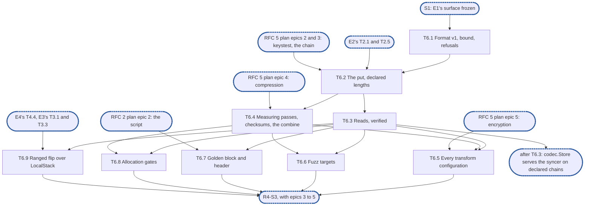

# Epic 6: remote tier v2 block codec

**Sources:** [RFC 4](../docs/internals/rfcs/rfc-4-remote-tier.md) §3.1 to §3.5 (the block format),
§4.3's measuring pass, checksum and `codec.Store` with the paragraph after its block, §4.4's codec
half (a recorded range the store rejects), §4.8's `ErrMalformed` and the material errors passed
through, §4.12's `codec_` rows and its logs for a verification failure, §6's R1 to R4, R14 and R15,
§7.3 but its engine row, §7.1's §3.2 census row but its recovery half and the ranged-flip half of
its §4.4 row, and §7.5's "Suites" paragraph for the seed corpus. Cited, not owned:
[RFC 5](../docs/internals/rfcs/rfc-5-transforms.md) §2.3 (three stages), §2.7 (what the codec
reports for each `Decode` error, and that a transform's own error types never cross it) and §3.1
(`Chain`, `Attempt`, `Encoded` with the `ID` the chain fills, as #5851 amends it, `MaxDecodeLen`);
[RFC 2](../docs/internals/rfcs/rfc-2-carver.md) §4.2 (the name's derivation and its golden vector)
and §5's P4 (`N` = 1,024); [RFC 3](../docs/internals/rfcs/rfc-3-syncer.md) §1.3 (the `Store` and
`Upload` the codec serves) and §2.2 (the memory bound, whose codec part this epic owns: its §7
row's header refusal); [RFC 24](../docs/internals/rfcs/rfc-24-resources.md) §6.2 (the background
CPU token); [RFC 25](../docs/internals/rfcs/rfc-25-observability.md) §8.1 (what the root injects).
E1's document fixes the surface this epic fills (its D5, D6, D9, D10 and D11): "E1 D<n>" below is
that document's decision. Every citation is `develop`'s text with the RFC 4 change of #5904
(`NewPut(name, nonce, pin, src)`, and the census lookup by name that E1 D10 calls
`Config.Census`). The code lands on `develop`, and the paths below are paths there.
**Track:** A.
**Epic 6 estimate: 9 subtasks, 17.25 man-days.**
**Depends on:** **S1**, E1's frozen surface: `pkg/remote`'s types and errors (T1.1) and the codec's
`Store`, `New`, `Config`, `Deps`, `Recorder`, `CPU`, `NewPut`, `Put`, `Attempt`, `Stored` and
`MaxHeaderLen`, with stub bodies (T1.3). **E2**'s in-memory store, `memory.New(clock, sum)` in
each checksum mode (T2.1), and its load record (T2.5). The RFC 5 plan's epic 1 with #5851's
`Encoded.ID`, epic 2 (`keystest`'s in-memory `keys.Provider`, and RFC 5's vectors in the shared
script), epic 3 (the chain and its envelope: no body round-trips before it), epic 4 (zstd and
LZ4, the transforms whose length is not declared) and epic 5 (encryption, the only transform
that uses material). The RFC 2 plan's epic 2 (the one golden-vector script and the golden name).
For the last subtask only: **E3**'s T3.1 (LocalStack over HTTPS in `integration`) and T3.3
(`FlipByte`), and **E4**'s T4.4 (the S3 store's ranged get).
**Blocks:** **R4-S3**, and through it RFC 8 offload plan epic 21, which builds one `codec.Store` per
store and calls `MaxHeaderLen` to size the put side; the RFC 3 plan's syncer, whose `Upload` runs
`(*Put).Attempt` and whose fetcher calls `codec.Store.Get`; the RFC 5 plan's epic 11, which runs
RFC 5's codec rows over this codec and the in-memory store; **E7**, whose content wiring
implements this codec's `Recorder` and offers the format version's settings row, whose default
must be 1, since this codec refuses to write an unset version (D9); **E9**, which joins the fuzz
targets to the nightly `fuzz` suite.

---

## 1. Goal

Epic 6 fills the bodies behind E1's codec surface: the block format's version 1, the encoder that
plans a block and streams it in one remote `Put`, and the decoder that verifies every chunk it
returns. `codec.Store` becomes the one production implementation of RFC 3's `Store`, over any
`remote.Store`.

**At the end of the epic:**

- a block is a header (marker, version, header length, name, nonce, chain ID, a chunk index of at
  most 1,024 entries and a census) followed by one body per chunk, in the fixed-width layout of
  D1, and `MaxHeaderLen(1)` answers its bound;
- `(*Put).Attempt` checks every chunk against its hash and the name against its inputs, encodes
  under the pinned chain, takes body lengths from the chain's declarations or from a measuring
  pass, sends the checksum the store's `Checksum` names before the first byte, keeps its plan
  across its tries and drops it after `ErrCorrupt`, and is safe when two of its tries overlap;
- `codec.Store.Get` returns only chunks verified against their plaintext hash, recomputes a
  whole block's name from its header before yielding a chunk, and reports a recorded range the
  store rejects as `ErrMalformed`;
- every refusal of a header or a body is made before anything is allocated for it, which the
  decoder's fuzz targets assert;
- a write version the binary does not know refuses writes and still reads; the golden block and
  header of `testdata/v1/` decode;
- the `codec_` series are recorded through the codec's `Recorder`, and `unit`'s `remote-allocs`
  option holds the per-chunk encode and verify to a flat allocation count.

### 1.1 In scope

Format version 1 and its header bound (D1); `New`'s refusals and logger; the put's plan, its
measuring passes and its checksums, with the CRC32C combine; `Attempt`, its `Meter` and its CPU
token; `Stored`; `Get`, whole and ranged, its census lookup and its error mapping; `Health`; the
write-version gate; the §7.3 rows but the engine's; §7.1's §3.2 census row's bound half and the
ranged-flip half of its §4.4 row; the decoder's fuzz targets with their seeds; the golden block;
the `remote-allocs` option.

### 1.2 Out of scope

- `codec.Store.GetVersion`, with `remote.Store`'s `GetVersion` and RFC 26's callers: the plan's
  §6 deferral ledger, row one.
- §7.1's §3.2 census row, its recovery half (a header census entry naming material no key record
  holds, at recovery import): the ledger's §3.2 census row, RFC 26.
- The syncer's single re-get of a corrupt ranged chunk, §7.1's §4.4 row's other half: the
  ledger's re-get row, RFC 3 plan epic 6.
- §7.3's engine row (the engine's read and write tests with and without transforms): the ledger's
  composition row, RFC 8 offload plan epic 21.
- The decoder's CPU token for a background read (GC's verification): E1 kept the token on the
  put path (its D5 and §9 point 3), since no v1.1 caller makes a background read; this pull
  request adds the ledger row, owned by RFC 9.
- The format version's settings row, the `codec_` metric definitions, the alert rule and the
  `Recorder` over the registry: E7. Building one `codec.Store` per store, the CPU token and the
  census lookup over the metadata store: RFC 8 offload plan epic 21, whose tests hold the real
  lookup to RFC 4 §4.3's contract.
- The fuzz targets' nightly run in the `fuzz` suite, and §7.5's codec benchmark: E9.
- The store's own put, get and checksum headers, and the `Warn` line for a put's `ErrCorrupt`,
  which the store logs (E4's R51): E4. That a store never parses a block: E1's import walk
  (T1.2), which refuses a store package reaching the codec.
- That an encrypting namespace's chunk-ID key is never beside its blocks (§6's R14, its key
  half): the RFC 5 plan's key records (its epic 6).

### 1.3 Names used here

- **E1**, epic 1, interfaces: `pkg/remote`'s contract and the codec's surface, frozen at S1.
- **E2**, epic 2, conformance suite and test foundations: `remotetest`, the in-memory store with
  its checksum modes and load record.
- **E3**, epic 3, fault transport and LocalStack: `s3fault`, and LocalStack over HTTPS in
  `integration`.
- **E4**, epic 4, S3 data path, errors and client.
- **E6**, this epic, block codec.
- **E7**, epic 7, integration: keys and observability as plain values, and the content wiring's
  builders.
- **E9**, epic 9, E2E green: the nightly runs, the benchmarks and the `fuzz` suite's targets.
- **S1**, the plan's first synchronisation point, the end of E1: the contract and the codec's
  surface agreed with the RFC 3 and RFC 8 offload plans' authors (the RFC 8 offload plan's S1c).
- **S2** appears here only inside **R4-S2**, the suite and in-memory store in CI (end of E2).
- **S3** names the storage service (Amazon S3 and the services compatible with it) everywhere in
  this document, except inside **R4-S3**, store and codec complete (epics 3 to 6 done).
- **The content wiring**, `internal/node/content`: the part of the node that builds the content
  components and hands each its configuration.

## 2. How the general rules apply

The rules are those of [the RFC 4 implementation plan's §1.5](rfc-4-remote-tier-plan.md#15-general-rules-for-each-epic),
cited by number and title and not copied.

| Rule | Subtasks | How |
| --- | --- | --- |
| rule 1, independent unit tests ([`CLAUDE.md`, "Writing tests"](../CLAUDE.md#writing-tests)) | all | the layout, the bound, the gate and the CRC32C combine are pure functions with table and property tests; `codec.Store` runs over E2's in-memory store (kind 2), in each checksum mode, with real chains built by `chain.NewChain` over RFC 5's registered transforms and `keystest`'s in-memory provider (kind 2, D11). Fault wrappers around the in-memory store stall, fail or flip a call on cue (kind 3); pass-through wrappers record what reached the store, the `src` and the CPU token (D11); the `Recorder` and the logger are sinks of outputs. No double answers in a dependency's place |
| rule 2, fuzz tests where relevant ([`CLAUDE.md`, "By kind"](../CLAUDE.md#by-kind)) | T6.1, T6.6 | `FuzzHeader` (T6.1), `FuzzBlock` and `FuzzBody` (T6.6): no panic, every length read inside the buffer, no allocation past the header bound before the header is validated and none past `MaxDecodeLen(MaxChunk)` for a body, and a parsed header re-encodes to the bytes it came from; the golden block and header agree with the independent script (T6.7). Planted seeds are `f.Add` calls built in code; crashers go in `testdata/fuzz/<FuzzName>/`; E9 joins the targets to the nightly `fuzz` suite |
| rule 3, observability follows RFC 25 | T6.2, T6.3, T6.4 | `New` narrows `Deps.Logger` with `With("component", "codec")`; the four series go through `Deps.Recorder` (D7) and no package here imports `pkg/metrics`; a verification failure logs at `Warn` with the block name, an unknown write version once at `Error` from `New`, nothing else per call; no span |
| rule 4, profiling | T6.2, T6.3, T6.8 | every test runs under `internal/prof`'s goroutine and heap checks; T6.8 registers `unit`'s `remote-allocs` option (no `-race`) for the per-chunk encode and verify counts and the bytes allocated per `Attempt` and per `Get` at two block sizes |
| rule 5, public interface and internals ([`CLAUDE.md`, "Verifying a change"](../CLAUDE.md#verifying-a-change)) | all | the internal functions are tested directly, and the behaviour through `codec.Store` under `-race`; a checksum is asserted where the in-memory store checks it and refuses a mismatch, not where the codec computes it; a whole-block read's name check is asserted through `Get` |
| rule 6, known failures shrink | none | `unit` and `integration` keep no `known.yaml`, so every test lands green with the subtask that makes it pass |
| rule 7, v2 ignores v1, and imports only what RFC 0 §1.2 allows | all | nothing from `develop`'s `pkg/block/blockcodec`; production code imports `pkg/remote`, `pkg/transform`, `pkg/transform/keys` and `pkg/metadata/entity`, and `hash/crc32` and `crypto/md5` from the standard library, which E1's import walk (T1.2) checks with no change. Tests import `chain`, RFC 5's transforms, `keystest`, `memory`, `s3`, `s3fault`, `internal/prof` and `lukechampine.com/blake3` |
| rule 8, real dependencies for properties of those dependencies ([`CLAUDE.md`, "Writing tests"](../CLAUDE.md#writing-tests)) | T6.5, T6.9 | the transform rows run over RFC 5's real chain and transforms, never a codec-local transform; the ranged-flip row runs over LocalStack 4.13.1 under E3's fault transport, with the in-memory store not the only store it runs against |
| rule 9, code comment conventions ([`CLAUDE.md`, "Code comments"](../CLAUDE.md#code-comments)) | T6.2, T6.3, T6.4 | RFC 4 carries no `decision:` on the codec; this epic places E1 D10's `ponytail:` (one block-record read per get) and `decision:` (a read with no local record) at the census lookup's call, and its own: D2's at the census learned from the first chunk, D3's at the name check, D5's at the kind of an unknown version, D8's at the plan's drop |
| rule 10, a test must be able to fail ([`CLAUDE.md`, "Writing tests"](../CLAUDE.md#writing-tests)) | all | each test names the break it catches in §6; the fuzz bounds are shown able to fail by breaking the decoder once to allocate first, not by a second decoder kept in the tests |
| rule 11, a symbol is exported only if the RFC's interface uses it | all | nothing beyond E1's surface is exported; the encoder, decoder, layout, gate and combine are unexported (E1 D6), and the test hooks live in `export_test.go` |
| rule 12, each subtask creates only what it declares | all | each file lands with the subtask that first uses it; `export_test.go` with T6.2's buffer count, the allocator hook with T6.1; `remote-allocs` with its first test (T6.8), `testdata/v1/` with the golden rows (T6.7) |

## 3. Requirements and invariants

Every obligation RFC 4 places on the codec, and those E1 hands it, numbered so subtasks and tests
can cite them. Where an owned section's obligation is another epic's to carry out, the row says
whose.

**The layout**

| # | Requirement | Kind | Source | Subtasks |
| --- | --- | --- | --- | --- |
| R1 | A block is a header followed by the chunk bodies in order; the header's first bytes are the format marker, the version and the header length, and it holds the block name, nonce, chain ID, a chunk index of one entry per chunk (its chunk ID and its body's offset and length, in the clear) and the census | invariant | §3.2, §6 R1 | T6.1 |
| R2 | The header length is bounded by a constant of the format version: `N` times one index entry, plus the census at its bound (at most `N` × the stage count entries, each a fixed-width transform ID and version, the material's kind of at most 32 bytes and its ID of at most 255 bytes, each with its own length byte, and a 32-byte fingerprint), plus the fixed fields | MUST | §3.2, RFC 2 §5 P4 | T6.1 |
| R3 | The codec refuses a header that declares a larger length than the bound, more than `N` index entries, more census entries than their bound, or a census material kind longer than 32 bytes or ID longer than 255 bytes, before allocating for it | MUST | §3.2, §7.1 (§3.2 census row), §7.3 (fuzz row), RFC 3 §7 (§2.2 memory-bound row) | T6.1, T6.6 |
| R4 | Each body's length is at most `MaxDecodeLen(MaxChunk)` of the chain the codec is handed, `MaxChunk` being RFC 2's `Max` as `Config` carries it, checked before allocating for the body; the read side never uses the current chain's `MaxEncodedLen` | MUST | §3.2, §7.3 (fuzz row) | T6.3, T6.6 |
| R5 | Each body decodes on its own: one corrupt body loses one chunk, not the block, and a ranged get of one body decodes without the header | MUST | §3.2, §7.3 (corrupt-body and ranged rows) | T6.3 |
| R6 | The name is written into the header and known before encoding starts; the put encodes every body under the pinned chain whose ID the header carries | MUST | §3.2, §4.3 (`NewPut`) | T6.2 |
| R7 | The header's census is the distinct (transform ID, version, material ID, fingerprint) its bodies were encoded under, the set `Stored` returns for the block record | invariant | §3.2, §4.3 (`Stored`) | T6.2, T6.4 |
| R42 | A body naming material the header's census does not list is malformed: a whole-block read checks each body's descriptors against the header's census | MUST | §3.2 | T6.3 |
| R8 | Only the header and one chunk, plain and encoded, are held at once, on the put and on the get: the codec never holds the whole block | invariant | §3.2, §4.3, RFC 3 §2.2 | T6.2, T6.3, T6.8 |
| R9 | No block carries an unkeyed hash of its chunks: the header's chunk IDs are the keyed IDs, equal to block metadata's; every body's offset and length are readable from the index by anyone holding the block, and nothing claims otherwise. The key half (never beside the blocks) is the RFC 5 plan's | invariant | §3.2, §6 R14, §7.3 (encrypting-namespace row) | T6.5 |

**Transforms**

| # | Requirement | Kind | Source | Subtasks |
| --- | --- | --- | --- | --- |
| R10 | Decode inverts encode exactly, for random chunk sets of 1 byte to the chunk maximum under every transform configuration | MUST | §3.3 rule 1, §6 R3, §7.3 (round-trip row) | T6.5 |
| R11 | Identity is over plaintext: the index's chunk IDs and the name come from the chunks' plaintext hashes, never from transformed bytes | MUST | §3.3 rule 2, §6 R3 | T6.2, T6.5 |
| R12 | The chain travels with the block: the codec decodes with `Chain.Decode`, never from configuration, so a block written under another configuration, or under a transform since removed from the chain, still decodes | MUST | §3.3 rule 3, §3.4, §6 R3, §7.3 (configuration and fuzz rows) | T6.5 |
| R13 | Nothing above the codec observes a transform: the codec yields the same chunks with transforms on or off. The engine's row is RFC 8 offload plan epic 21's | MUST NOT | §3.3, §6 R4 | T6.5 |

**Verified reads**

| # | Requirement | Kind | Source | Subtasks |
| --- | --- | --- | --- | --- |
| R14 | Every chunk the codec returns was checked against the plaintext hash the caller expects, after undoing every transform; otherwise it returns an error, never unverified bytes | MUST | §3.4, §6 R2, §7.3 (flip-every-byte row) | T6.3 |
| R15 | A whole-block read checks each index entry against the chunk it decoded and recomputes the name from the entries, the header's nonce and chain ID and the key scope, against the name it was fetched under; a block fetched under another name fails the name check | MUST | §3.4, §6 R1, §7.3 (name row) | T6.3 |
| R16 | Each body is decoded with `Chain.Decode`, passed the block record's census from `Config.Census`: a body naming material the census does not list fails as malformed, and its material is never asked of the provider | MUST | §3.4, §4.3, §7.3 (planted-material row), E1 D10 | T6.5 |
| R17 | `Get` calls `Config.Census` once per block read; an absent block record is `ErrNotFound`, returned unchanged, and any other error of the lookup is returned as itself | MUST | §4.3, §4.8, E1 D10 | T6.3 |
| R18 | A ranged read that fails verification, or a wrong offset or length, is `ErrCorrupt`, and the codec never re-reads: not the header to look for the chunk elsewhere, nor the range | MUST NOT | §3.4, §7.3 (wrong-range row) | T6.3 |
| R19 | A recorded range the store rejects as past the end (`ErrInvalid`) is `ErrMalformed`, which `errors.Is` matches to `ErrCorrupt`; `ErrNotFound` from the store passes through unchanged | MUST | §3.4, §4.4, §4.8, §7.3 (past-end row) | T6.3 |
| R20 | `Get` reads the chunks named in `want`, or the whole block when `want` is empty; ranges adjacent in the block are read with one request; `m` receives the encoded bytes as they arrive, and a zero `Meter` is skipped | MUST | §4.3 (`Get`), §4.1 (`Meter`), §7.3 (`codec.Store` row) | T6.3 |
| R21 | `Health` is the remote store's probe of a direction, passed straight through | MUST | §4.3 (`Health`) | T6.3 |

**Format changes**

| # | Requirement | Kind | Source | Subtasks |
| --- | --- | --- | --- | --- |
| R22 | A writer refuses to write a format version the binary does not know, and still reads every version it knows; with the write version below the newest the codec knows, blocks are written at the write version | MUST | §3.5, §6 R15, §7.3 (write-version row) | T6.2, T6.3 |
| R23 | A block of an unknown version fails with a version error, not a parse error | test row | §3.2, §7.3 (name row) | T6.1, T6.3 |
| R24 | Readers accept every version that may still be stored: a stored fixture of every released version decodes | MUST | §3.5, §7.3 (fixture row) | T6.7 |

**The put**

| # | Requirement | Kind | Source | Subtasks |
| --- | --- | --- | --- | --- |
| R25 | The size, and a checksum when the store needs one, come before the first byte: when every transform declares its length and the store's `Checksum` is None, lengths come from the declarations; otherwise a measuring pass encodes each chunk, keeps its length and checksum, and discards the bytes | MUST | §4.3, §4.1 (`Checksum`) | T6.2, T6.4 |
| R26 | The checksum covers the header: a CRC32C is taken per body and joined to the header's; an MD5 needs a second measuring pass when the lengths also had to be measured. Under every transform configuration, bytes, header and checksum are identical whether the lengths were declared or measured, and the declared size equals the bytes streamed | MUST | §4.3, §7.3 (declared-and-measured row) | T6.4, T6.5 |
| R27 | A `Put` keeps its measured lengths and checksum across its `Attempt`s, so a retry reads `src` once, only to send; an `Attempt` ending in `ErrCorrupt` drops them, so the next measures again | MUST | §4.3, §7.3 (`codec.Store` row) | T6.4 |
| R28 | Every `Attempt` of one `Put` sends the same plan and the same bytes, so one name stays one byte sequence | invariant | §4.3, §6 R13 (its codec part) | T6.4 |
| R29 | Two `Attempt`s of one `Put` may overlap, and are safe when they do: no race under `-race` | MUST | §4.3, §7.3 (`codec.Store` row) | T6.4 |
| R30 | An `Attempt` whose `ctx` ends drops its chunk buffers before it returns | MUST | §4.3, §7.3 (`codec.Store` row) | T6.2 |
| R31 | `Attempt` calls `m.Moved` with each count of bytes sent, which sum to the encoded bytes the store received, and `m.Sent` once, after the last; it returns nil only once the block is stored; a zero `Meter` is skipped | MUST | §4.3 (`Attempt`), §4.1 (`Meter`), §7.3 (`codec.Store` row) | T6.2 |
| R32 | `Stored` returns each chunk's range in the encoded block and the header's census, with nil bodies, once an `Attempt` has returned nil | MUST | §4.3 (`Stored`), E1 D5 | T6.2 |
| R33 | `Attempt` checks each chunk of `src` against its hash through `Config.ChunkID`, recomputes the name through `Config.Name` from the nonce, the pin's chain ID and the chunks' hashes, and refuses a mismatch of either with `ErrInvalid`. The `Attempt` that builds the plan does so before any byte is sent; one that reuses a kept plan reads `src` only to send (R27), so it checks each chunk against the plan's hash as it sends it, and a mismatch aborts the put as the body reader's error (D6) | MUST | E1 D5, E1 D9, §3.2 | T6.2, T6.4 |
| R34 | The codec takes RFC 24 §6.2's CPU token once per chunk it encodes or hashes on the put path, measuring passes included, and returns it before its next network write | MUST | RFC 24 §6.2, E1 D5 | T6.2, T6.4 |
| R35 | `New` refuses a nil store, chain, `ChunkID`, `Name`, `Census`, `Logger`, `Recorder` or `CPU`, or a `MaxChunk` below 1, rather than defaulting it; it does not refuse an unknown `Version` | MUST | E1 D5, RFC 0 §1.2 | T6.2 |

**Errors and observability**

| # | Requirement | Kind | Source | Subtasks |
| --- | --- | --- | --- | --- |
| R36 | Every failure the codec returns wraps exactly one error of §4.8's set, or is a local failure returned as itself (the `ctx`'s, `src`'s, the census lookup's), or a material error; a transform's `ErrMalformed` or `ErrTooLarge` is `ErrCorrupt`, and neither, nor any other transform error type, is reachable by unwrapping | MUST | §4.8, §4.3, §6 R9, RFC 5 §2.7, E1 D10 | T6.2, T6.3 |
| R37 | `ErrMaterialUnavailable` and `ErrMaterialDestroyed` are returned as they are, neither wrapped in one of §4.8's errors nor mapped to one, and a destroyed material is not counted as a verification failure | MUST | §4.8, RFC 5 §2.7 | T6.5 |
| R43 | `ErrUnknownMaterial` from the provider, for material the census lists, is reported as `ErrMaterialUnavailable`, never as `ErrCorrupt` | MUST | RFC 5 §2.7, RFC 5 §3.1 | T6.5 |
| R38 | The codec counts, once and only here, each chunk it returned verified (`codec_chunks_verified_total`), each block encoded with a measuring pass (`codec_measuring_passes_total`), each verification failure by `kind` (`codec_verify_failures_total`): `hash`, and a body's `malformed`, once per chunk; `name`, `version` and a header's `malformed` once per block, and the encode and decode time per block by direction (`codec_seconds`), through the `Recorder` it declares | MUST | §4.12, §1.2, E1 D5 | T6.2, T6.3, T6.4 |
| R39 | A verification failure logs at `Warn` with the block name; every other per-call outcome is a metric, not a log line. A put's `ErrCorrupt` is the store's to log (E4) | MUST | §4.12 | T6.3 |

**Tests**

| # | Requirement | Kind | Source | Subtasks |
| --- | --- | --- | --- | --- |
| R40 | The decoder is fuzzed, whole block and the headerless body path: no panic, and no allocation larger than the header bound before the header is validated; the seeds run in `unit`, fuzzing past them is the `fuzz` suite's | test row | §7.3 (fuzz row), §7.5 "Suites" | T6.1, T6.6 |
| R41 | Flip one byte of a ranged get's body over the S3 store under the fault transport: the codec reports `ErrCorrupt`. The re-get half is the RFC 3 plan's epic 6; the whole-block half is E4's | test row | §7.1 (§4.4 flip row), §4.4 | T6.9 |

R2 and R3 are the codec's part of RFC 3 §2.2's memory bound: the header cap the syncer sizes a
worker by, and the refusal of a header longer than it. Every other §7.3 row maps to a requirement
above by the row named in its `Source`.

## 4. Decisions this epic takes

- **D1. Format version 1 is fixed-width little-endian, header first.** RFC 4 §3.2 leaves widths,
  integer encoding and order to the codec. Fixed widths and no variable-length integers make the
  bound a constant expression and keep every check before allocation a comparison.

  | Offset | Field | Width |
  | --- | --- | --- |
  | 0 | marker, the ASCII bytes `DFSB` | 4 |
  | 4 | format version, `1` | 1 |
  | 5 | header length, in bytes, the fixed part included | 4 |
  | 9 | chunk count, 1 to 1,024 | 2 |
  | 11 | census count, 0 to 3,072 (1,024 chunks × RFC 5 §2.3's three stages) | 2 |
  | 13 | block name | 32 |
  | 45 | nonce | 16 |
  | 61 | chain ID | 32 |
  | 93 | index: per chunk, its chunk ID (32), its body's offset from the block's first byte (4) and its body's length (4) | 40 each |
  | then | census: per entry, transform ID (2), transform version (1), fingerprint (32), the material's kind length (1, 0 to 32) and kind, and its ID length (1, 0 to 255) and ID | 37 + 287 at most |
  | header length | the bodies, in index order, each starting with RFC 5's envelope | |

  The material fields hold `keys.MaterialID`'s kind and ID, the namespace being the block's. RFC
  4 §3.2 bounds the kind at 32 bytes and the ID at 255, each with its own length byte (the
  user's decisions of 2026-11-26), so every data key ID RFC 5 Appendix B allows can be written.
  RFC 5 sets no length for a kind; the kinds its Appendix B.2 names are fixed ASCII names, the
  longest 12 bytes (`chunk-id-key`, `chunking-key`). A kind longer than 32 bytes or an ID longer
  than 255 is refused at the put with `ErrInvalid` (D6). On read a kind length above 32 is
  malformed; with one-byte lengths no ID is longer than 255, so the ID's reachable refusal is a
  length that runs past the census. An entry with no material has kind length 0, ID length 0 and a zero fingerprint.
  The transform ID is `Encoded.ID`, which the chain fills (RFC 5 §3.1 as #5851 amends it).
  Entries are distinct and sorted by transform ID, version, kind, ID and fingerprint, so a census
  collected over every chunk and one learned from the first (D2) write the same bytes; the read
  side parses them as views into the header buffer, with no allocation of their own. The bound is
  `MaxHeaderLen(1)` = 93 + 1,024 × 40 + 3,072 × (37 + 32 + 255) = 1,036,381 bytes, a constant. On read, the
  index's bodies tile the block: the first starts at the header length, each next where the last
  ended, and the stream ends where the last ends; anything else is malformed. A 4-byte offset
  bounds a block at 4 GiB, past any block RFC 2 §5.2's 64 MiB target allows. Prior art (from
  memory): restic's pack format and Kopia's pack index, both fixed-width entries.
- **D2. Without a measuring pass, the census comes from encoding the first chunk.** RFC 4 puts
  the census in the header, which is sent first, and RFC 5's `Attempt` names no transform list: the
  census exists only as `Encode`'s `[]Encoded`. When every `LengthOf` is known no transform
  declines a chunk (RFC 5 §3.1), so each chunk is encoded under the same transforms, versions and
  material, and the planning pass encodes the first chunk once to learn the set. That is one
  chunk encoded twice per block on the declared path, against RFC 4 §4.3's "encoded once, while
  it is sent", and the cost is one chunk's encode. The send pass checks each chunk's descriptors
  against the header's and fails the `Attempt` with `ErrInvalid` on a difference, before the
  block is stored. A `decision:` marker at the planning pass names the assumption and its
  trigger: a transform whose `LengthOf` is known but whose descriptors vary by chunk. The upgrade
  is an `Attempt` method listing its descriptors, which §9 point 2 raises with the RFC 5 plan;
  it changes no stored byte. Prior art: none found.
- **D3. A whole-block read checks the name before it yields any chunk.** The name is a function
  of the header alone (nonce, chain ID, chunk IDs and the key scope), so the codec recomputes it
  once the header is parsed, and only then decodes bodies, each checked against its index entry
  and its descriptors against the header's census (R42). A chunk yielded before the check would
  be verified against a hash no one had authenticated. The marker sits at the check. Prior art
  (from memory): restic's `LoadBlob` checks a blob's ID after decryption, before returning it.
- **D4. The header census is checked on read, and rebuilt from by nothing in v1.1.** Decoding
  passes the block record's census to `Chain.Decode` (RFC 4 §3.4), and a whole-block read also
  checks each body against the header's (R42). Rebuilding a block record's census from headers
  is the recovery import's (RFC 26 §2.3), deferred with the ledger's §3.2 census row. Prior art:
  none needed.
- **D5. Verification failures are `ErrCorrupt`, labelled by what failed.** `kind` is `hash` when a
  decoded chunk's ID differs from the one expected; `name` when the recomputed name differs, counted
  once per block; `version` when the format version is unknown; `malformed` for every structural
  failure: a wrong marker, a header or body bound refused, an index that does not tile, a stream
  longer than its index, a body naming material outside a census, a transform's `ErrMalformed` or
  `ErrTooLarge`, and a recorded range the store rejects (`ErrMalformed`). An unknown version is
  `ErrCorrupt` because RFC 4 §3.5's gate means no reader meets one unless a newer binary wrote
  past it; its message names the version, so it reads as a version error, not a parse error, and
  the marker says so. A transform's error is formatted with `%v`, never `%w`. Prior art: none
  needed.
- **D6. The codec's own refusals are `ErrInvalid`.** At `New`: each nil field and a `MaxChunk`
  below 1, naming the field. At the put: an unknown write version, a chunk whose bytes do not
  match its hash, a name that does not match its inputs, no chunk or more than 1,024, a chunk
  longer than `MaxChunk`, a material kind longer than 32 bytes or ID longer than 255, a transform encoding a
  length other than it declared, a `src` that yields other chunks on a later pass, and an `Encode`
  error that is not a material error. Each is a caller's or a configuration's fault that a retry
  cannot cure, and none counts toward health (RFC 4 §4.8). Each put refusal is returned before the
  `Put` call starts, or as the body reader's error, which the store returns as itself.
- **D7. One measuring-pass count per block measured, and time spent encoding, not sending.**
  `MeasuringPass` is called once per plan that ran a measuring pass, MD5's second pass not counted
  again, so the counter against blocks encoded reads as RFC 4 §4.12 asks. `Took` records the time
  spent in `Encode`, `Decode` and the hashes for one call, excluding the store's I/O, with
  `time.Since`, since nothing asserts the value.
- **D8. One plan per `Put`, behind a one-slot channel.** An `Attempt` takes the slot with its
  `ctx`, measures when no plan is held, installs the plan and releases the slot before sending,
  so an overlapping `Attempt` waits for the measurement rather than repeating it, and gives up
  when its `ctx` ends, which a mutex cannot. An `Attempt` ending in `ErrCorrupt` drops the plan
  only if the held `*plan` is still the one it sent, so a slow try cannot drop the plan a later try
  measured. The marker sits at the drop. Each `Attempt` ranges `src` itself, relying on RFC 4
  §4.3's "each range over `src` yields the block's chunks again from the first" together with its
  rule that two `Attempt`s may overlap. Prior art: `singleflight`'s one call per key (read the
  code), without its shared error.
- **D9. The gate is a function of the write version and the known set.** `writeVersion(v, known)`
  answers whether a version is writable; v1.1 knows `{1}`, and a 0 (unset) is unknown. `New` logs
  an unknown version once at `Error` and every `Attempt` refuses it (D6); reads are unaffected.
  Its test passes `{1, 2}`, the only way to show "below the newest" while one version exists.
  Prior art: none needed.
- **D10. CRC32C is combined per body by GF(2) matrix combination**, since `hash/crc32` offers no
  combine (checked: `go doc hash/crc32`). Prior art (from memory): zlib's `crc32_combine`.
- **D11. The tests' collaborators are real, or wrap real ones.** Chains: `chain.NewChain` over
  RFC 5's registered transforms and `keystest`'s in-memory provider: the empty chain, zstd, LZ4,
  encryption, and zstd with encryption. The name and chunk-ID functions: BLAKE3's derive-key and
  keyed modes over RFC 2 §4.1 and §4.2's inputs, checked once against the golden name in the RFC 2
  plan's `testdata/vectors.json`, read by path; the carver's own functions would add RFC 2 plan
  epic 4 to this epic's path for two closures the golden check already holds. The census lookup:
  a closure over the censuses the test's own `Stored` calls returned, an input derived from the
  code's output, as the content wiring's lookup is over the block records commit writes; the real
  lookup is RFC 8 offload plan epic 21's. The CPU token: a pass-through recorder over a null token
  that grants at once (a load, CLAUDE.md "Writing tests"), whose record of acquires and releases is
  interleaved with the store's reads by a pass-through wrapper around the in-memory store, since
  RFC 24's token has no implementation on `feat/storage-v2` yet. Prior art: none needed.
- **D12. The goldens come from the shared script.** The RFC 2 plan's one golden-vector script
  gains a writer for D1's layout, over RFC 5's envelope encoder in the same script, and writes
  `testdata/v1/`: a block of three chunks under the empty chain with its inputs, and a header
  alone whose census holds an entry with no material and one with material, which the empty chain
  cannot produce. Prior art: RFC 2 §4.2's golden name, kept by the same script.
- **D13. The decoder's allocations are observed per instance.** The decoder takes its header and
  body buffers through an unexported allocator field that `export_test.go` replaces per instance
  with one that records each size requested, so a test asserts a bound holds before any
  allocation without a package-level hook. Prior art: `CLAUDE.md`'s per-instance hook rule.

## 5. Target tree

```text
pkg/remote/codec/
  format.go           T6.1  D1's layout: header encode and parse, the bounds, MaxHeaderLen
  format_test.go      T6.1  the layout table, every refusal, FuzzHeader with its seeds
  export_test.go      T6.1  the allocator hook (D13); T6.2 the chunk-buffer count; T6.4 the
                            pause in the measuring pass
  codec.go            T6.2  New's refusals and logger, writeVersion (D9); T6.3 Health
  put.go              T6.2  NewPut, the plan, Attempt, Stored; T6.4 the measuring passes,
                            the checksum, the plan across Attempts (D8)
  put_test.go         T6.2, T6.4
  support_test.go     T6.2  the test name and chunk-ID functions and their golden check, the
                            pass-through wrappers (D11)
  get.go              T6.3  Get, whole and ranged; the verification and its kinds
  get_test.go         T6.3
  crc32c.go           T6.4  the combine (D10)
  crc32c_test.go      T6.4
  chains_test.go      T6.5  D11's configurations and the transform rows
  fuzz_test.go        T6.6  FuzzBlock, FuzzBody
  golden_test.go      T6.7  the fixture rows
  testdata/v1/        T6.7  the golden block, its inputs and the census header
  allocs_test.go      T6.8  the allocation gates, skipped under -race
  s3_test.go          T6.9  the ranged-flip row, behind the integration tag
pkg/carver/internal/carvetest/gen_vectors.py  T6.7  the v1 block and header writer (D12)
test/suites.yaml      T6.8  unit's remote-allocs option
```

## 6. Subtasks

### T6.1 Format version 1: the header, its bound and its refusals

**Subtask T6.1 estimate: 2 man-days.**

- **Track:** A. **Depends on:** S1.
- **Covers:** R1–R3, R23, R40.
- **Deliverables:** `format.go`: D1's layout as an unexported `header` value with `encodeHeader`
  and `parseHeader`, the second taking a reader and an allocator (D13) and refusing, in this
  order and before allocating the rest, a wrong marker, an unknown version, a length below the
  fixed part or above the bound, a chunk count of 0 or above 1,024, a census count above 3,072;
  then, inside the buffer, an index that does not fit, a kind length above 32, a kind or ID length that runs past the census, a
  census that does not end at the header length, or a census not in D1's canonical form: entries
  out of order or repeated, an entry with no material but a non-zero fingerprint, or a non-zero
  ID length whose kind length is 0. `MaxHeaderLen`'s body: 1,036,381 and true for 1,
  else 0 and false. `export_test.go`'s allocator hook. Consumed by T6.2 (the header it writes),
  T6.3 (the parse), T6.6 and T6.7, and by RFC 8 offload plan epic 21 (`MaxHeaderLen`).
- **Acceptance criteria:**
  - A header with each field at its bound parses, and its re-encoding equals its bytes (R1, R2).
  - Each refusal above is reported with the field that failed (R3). A refusal of the fixed part
    leaves the allocator no request past the fixed part; a refusal inside the buffer, exactly one
    request, the header length, of at most `MaxHeaderLen(1)`, as T6.6 asserts (R3); an unknown version's error names the version, distinct from a parse error's
    (R23).
- **Tests:** a table of headers, one per refusal, each built by hand and asserted refused: those
  of the fixed part with the allocator's record empty past the fixed part (catches a parse that
  allocates the declared length first, R3), those inside the buffer with one request of the
  header length and none after it (catches a census read that allocates per entry, R3); a header at every bound at once accepted (catches an off-by-one bound, R2);
  `MaxHeaderLen(1)` equal to the literal 1,036,381 (catches a bound that forgets the census, R2).
  `FuzzHeader`, seeded with `f.Add` calls for an over-long length, 1,025 entries, 3,073 census
  entries, a kind length of 33, a kind length and an ID length each past the census, a 255-byte ID
  under a 32-byte kind accepted, and two census entries in reverse order and repeated: no panic, every read inside the buffer, and an
  accepted header re-encodes to the bytes it came from (R40). No test double.
- **Rules:** rule 2: `FuzzHeader`. Rule 11: nothing exported but `MaxHeaderLen`'s body.

### T6.2 The put: one pass from declared lengths, streamed

**Subtask T6.2 estimate: 3.5 man-days.**

- **Track:** A. **Depends on:** T6.1; E2's T2.1 and T2.5; the RFC 5 plan's epics 2 and 3.
- **Covers:** R6–R8, R11, R22, R25, R30–R36, R38.
- **Deliverables:** `codec.go`: `New`'s refusals (R35, D6) and `Deps.Logger` narrowed with
  `With("component", "codec")`; `writeVersion` (D9), an unknown `Version` logged once at `Error`.
  `put.go`: `NewPut` keeping its arguments; `Attempt`'s planning pass over `src` (each chunk
  hashed through `Config.ChunkID` and checked, its length, the first chunk encoded for the census
  (D2), the count bound, the name recomputed, R33, the gate), the header, and the send: one
  `store.Put` whose body reader encodes each chunk under the pin as the store reads it, taking
  `Deps.CPU` per chunk hashed or encoded and releasing it before returning bytes to the store
  (R34), calling `m.Moved` for every byte of the put's body, header included, and `m.Sent` at its
  end (nil funcs skipped), its chunk buffers held by the `Attempt` alone and released when its
  `ctx` ends (R30); `Stored`. In this subtask an `Attempt` runs only where no measuring pass is
  needed: every `LengthOf` known and `Checksum` None; T6.4 adds the rest. `support_test.go`
  (D11); `export_test.go`'s chunk-buffer count. Consumed by T6.3's tests (blocks to read), T6.4,
  and the RFC 3 plan's `Upload` and RFC 8 offload plan epic 15, which pass `(*Put).Attempt` to it.
- **Acceptance criteria:**
  - Through `codec.Store` over the in-memory store in mode None with the empty chain, a block of
    1, 2 and 1,024 chunks is stored; its header carries the name, nonce, `pin.ID()`, the chunk
    IDs from `src` and the census (R6, R7, R11); `Stored` returns the ranges the index holds and
    the census with nil bodies, and nil before a successful `Attempt` (R32).
  - The `Meter`'s `Moved` counts sum to the stored object's length, `Sent` is called once after
    the last, and a zero `Meter{}` completes without a panic (R31).
  - A chunk whose bytes do not match its hash, a wrong name, an unknown write version (3, with
    known `{1, 2}`), no chunk or 1,025 chunks, and a chunk over `MaxChunk` are `ErrInvalid` with
    nothing put; write version 1 under known `{1, 2}` writes a version 1 header (R22, R33, D6);
    `New` refuses each nil field and `MaxChunk` 0, naming it (R35).
- **Tests:** at the store as consumer: the in-memory store's object read back and parsed with
  T6.1's parser (catches a header the codec writes but cannot be read, R6, R7). A wrong name and a
  chunk under another's hash, each refused with the in-memory store's load record showing no put
  (catches a check run after the first byte, or a put that trusts `src`'s hashes and stores a
  block whose first read fails after the journal released it, R33). The gate under known `{1, 2}`
  (catches a gate comparing against the newest known, R22). A fault wrapper (kind 3) around the
  in-memory store that cancels the `ctx` after the store read the first body: the `Attempt`
  returns `context.Canceled` and `export_test.go`'s buffer count is 0 (catches a buffer kept past
  return, R30). D11's token recorder, with the store's reads in one record: one acquire per chunk
  hashed and per chunk encoded, each released before the next store read (catches a token held
  across the network write or taken once per block, R34). A transform `Encode` failure surfaces
  as `ErrInvalid` with no transform error reachable by `errors.Is` (R36). The test functions equal
  the golden name (catches a test derivation that is not RFC 2's). The `Recorder` sink shows one
  `Took(DirPut, …)` per `Attempt` (R38).
- **Rules:** rule 3: the logger and the `Error` line. Rule 4: the stalled store's goroutines are
  gone at the leak check. Rule 9: D2's marker.

### T6.3 Reads: whole block and ranges, verified

**Subtask T6.3 estimate: 3 man-days.**

- **Track:** A. **Depends on:** T6.2.
- **Covers:** R4, R5, R8, R14, R15, R17–R23, R36, R38, R39, R42.
- **Deliverables:** `get.go`: `Get`, calling `Config.Census` once (R17) with E1 D10's two
  markers at the call, then either one `store.Get` of the whole block (parse with T6.1, the name
  check before any body, D3; each body bounded, decoded with `Chain.Decode` under the record's
  census and `MaxChunk`, its ID checked against its index entry and its descriptors against the
  header's census, R42; the tiling and trailing-byte checks of D1), or, for `want`, one
  `store.Get` per run of adjacent ranges, each body bounded, decoded and checked against `want`'s
  hash. The error mapping of D5 and R19, every `keys` error returned as it is, `Verified` per
  chunk yielded and `VerifyFailed(kind)` per failure, `Took(DirGet, …)` per call, the `Warn` line
  with the block name. `Health` passed through. Consumed by the RFC 3 plan's fetcher, T6.5 to
  T6.9.
- **Acceptance criteria:**
  - Every chunk yielded was checked against its expected hash (R14); a whole-block read of a
    block stored under another name fails with kind `name` before any chunk is yielded (R15,
    D3); an unknown version fails with kind `version` (R23); a block written at version 1 still
    reads while the write version is one the binary does not know (R22).
  - One corrupt body fails its chunk only, the others yielded; one body read by its range alone
    decodes without the header (R5).
  - A body over `MaxDecodeLen(MaxChunk)`, in the index or in `want`, is refused before the
    allocator sees its length (R4).
  - A recorded range past the end of a block in the in-memory store is `ErrMalformed`; an absent
    block, and a census lookup answering `ErrNotFound`, are `ErrNotFound` unchanged; any other
    lookup error is returned as itself, and the lookup is called once per `Get` (R17, R19).
  - Three adjacent ranges of `want` are one store request; the `Meter` sums to the bytes read,
    and a zero `Meter{}` completes without a panic (R20).
- **Tests:** at `Get`, over the in-memory store holding blocks T6.2 wrote and blocks altered
  byte by byte. Flip every byte of a 4-chunk block in turn: each read fails or yields only chunks
  whose hash matched (catches a check skipped on one path, R14). A header whose census is edited
  to drop the entry a body names, its name still matching: kind `malformed` (catches a header
  census written and never checked, R42). A ranged read at an offset one off and a length one
  short: `ErrCorrupt`, and the load record shows one get and no read of the header (catches a
  re-read, R18). A range past the end of the stored block: `errors.Is` finds `ErrMalformed` and
  `ErrCorrupt`, kind `malformed` recorded (catches the store's `ErrInvalid` passed through, R19).
  A transform's `ErrMalformed` on decode, from a body with its envelope's bytes flipped:
  `errors.Is` finds `ErrCorrupt` and not `transform.ErrMalformed` (catches `%w`, R36). The `Warn`
  line names the block, and a clean read logs nothing (R39); the `Recorder` sink's `Verified`
  equals the chunks yielded and one `Took(DirGet, …)` is recorded (R38); a 4-chunk block fetched
  under another name records one `name` failure, and a block with two flipped bodies two `hash`
  failures (catches a per-block kind counted per chunk, or the reverse, R38). A fault wrapper (kind 3)
  returning a distinct error for each direction's `Health`: each comes back unchanged (catches a
  `Health` that answers itself, R21).
- **Rules:** rule 5: the name check asserted through `Get`, not on the parsed header. Rule 9:
  E1 D10's markers, and D3's and D5's.

### T6.4 Measuring passes, checksums and the plan across tries

**Subtask T6.4 estimate: 3 man-days.**

- **Track:** A. **Depends on:** T6.2; the RFC 5 plan's epic 4.
- **Covers:** R7, R25–R29, R33, R34, R38.
- **Deliverables:** `crc32c.go`: `crc32cCombine(a, b uint32, lenB int64) uint32`, the GF(2)
  matrix combination over the Castagnoli polynomial (D10); it needs nothing but S1, so it is
  built first, while the RFC 5 plan's epic 4 is awaited. `put.go`: the measuring pass (each chunk
  encoded, its length and per-body CRC32C kept, its bytes discarded, its descriptors collected
  into the census), run when a `LengthOf` is unknown or `Checksum` is not None; the CRC32C sum as
  the header's CRC combined with each body's; the MD5 sum over the header and the bodies, a second
  measuring pass when the lengths were measured; the plan kept across `Attempt`s, behind D8's
  slot, and dropped after `ErrCorrupt`; `MeasuringPass` once per plan measured (D7); the CPU token
  on every pass. `export_test.go`'s pause inside the measuring pass, set per instance. Consumed by
  T6.5 and T6.8.
- **Acceptance criteria:**
  - For any split of any byte string into a prefix and a suffix, the combine of their CRC32Cs
    equals the CRC32C of the whole (R26).
  - In modes None, CRC32C and MD5 of the in-memory store, under the empty chain and zstd, a
    block is stored and the store's own check of the sum passes (R25, R26).
  - A second `Attempt` ranges `src` once; after an `Attempt` ending in `ErrCorrupt` the next
    measures again (R27).
  - Two `Attempt`s of one `Put` overlap under `-race` with no race reported, and both send
    identical bytes (R28, R29).
- **Tests:** the combine: a property test over seeded random strings and every split point of
  short ones, `lenB` 0 included, against `hash/crc32`'s Castagnoli table over the concatenation,
  and a fold of 1,024 parts (catches a wrong polynomial, a reflected matrix or a zero-length edge,
  R26). At the store as consumer: the in-memory store in CRC32C and MD5 modes refuses a wrong sum,
  so a stored block proves the sum (catches a checksum that omits the header or combines in the
  wrong order, R26). D11's pass-through counter over the test's chunk iterator counts the ranges:
  declared path in mode None, 2 then 1 on the next `Attempt`; zstd in mode None, 2 then 1; zstd in
  mode MD5, 3 then 1 (catches a plan not kept, or MD5's second pass skipped, R25, R27). A fault
  wrapper (kind 3) that flips a byte of the first put's body: `ErrCorrupt`, then the next
  `Attempt` measures again, shown by the `Recorder` sink's second `MeasuringPass` (catches a plan
  kept after corruption, R27, R38). The pause hook holds the first `Attempt` inside its measuring
  pass while a second starts: one `MeasuringPass` recorded, and a pass-through wrapper recording
  each put's body shows both bodies equal (catches two measurements racing to install, R28, R29).
  A first `Attempt` paused after it sent, a second that drops nothing and stores, then the first
  ending in `ErrCorrupt` from a fault wrapper: a third `Attempt` does not measure (catches a drop
  that removes a plan it did not send, D8). D11's token recorder shows one acquire per chunk on
  each measuring pass (R34). A second `Attempt` whose `src` yields another chunk than the plan
  holds: `ErrInvalid` as the body reader's error, and the in-memory store holds no object for the
  name (catches a retry that trusts its kept plan, R33).
- **Rules:** rule 1: the combine is a pure function. Rule 9: D8's marker at the drop.

### T6.5 Every transform configuration

**Subtask T6.5 estimate: 2.5 man-days.**

- **Track:** A. **Depends on:** T6.3, T6.4; the RFC 5 plan's epic 5.
- **Covers:** R9–R13, R16, R26, R37, R43.
- **Deliverables:** `chains_test.go`: D11's configurations, and RFC 4 §7.3's transform rows and
  the material-error rows over them, through `codec.Store` and the in-memory store. Consumed by
  the RFC 5 plan's epic 11, which runs its own codec rows over the same table.
- **Acceptance criteria:**
  - Random chunk sets, 1 byte to the chunk maximum, round-trip under every configuration (R10).
  - Under every configuration, the block encoded in mode None and the same block encoded in mode
    CRC32C and in mode MD5 have identical bytes and header, and equal standard-library checksums
    over the stored bytes; the declared size equals the bytes streamed (R26).
  - A block encoded under one configuration decodes after the chain is rebuilt with another,
    and after a transform is removed from it (R12).
  - A material ID planted in a body that the block record's census does not list: the read fails
    with kind `malformed` and `keystest`'s provider records no request for it (R16).
  - With the provider reporting the material destroyed, the read's error `errors.Is`
    `ErrMaterialDestroyed` and not `ErrCorrupt`, and no `VerifyFailed` is recorded; unavailable,
    `ErrMaterialUnavailable`; never given, `ErrMaterialUnavailable` too (R37, R43).
  - An encrypting namespace's block holds no unkeyed BLAKE3 hash of any chunk anywhere in its
    bytes; its index's chunk IDs equal the ones the test's chunk-ID function gives; a whole-block
    read verifies its name with a chain holding no material and verifies every chunk with the
    material; scanning the block for RFC 5's clear envelope finds every body at the index's
    offset and length; a ranged read at the index's range verifies without the header (R9, R11).
  - With transforms on and off, `Get` yields the same chunks (R13).
- **Tests:** these rows, at `codec.Store`, over real chains (rule 8). Each names its break: a
  decode reading the configured list instead of the registry (R12); a census lookup skipped so
  the provider is asked (R16); a material error folded into corruption (R37, R43); a header
  writing the plaintext hash rather than the keyed ID (R9, R11); a measured encode that differs
  from the declared one under one transform (R26).
- **Rules:** rule 8: no codec-local transform; a configuration's rows land once its RFC 5 epic
  has.

### T6.6 The decoder's fuzz targets

**Subtask T6.6 estimate: 1 man-days.**

- **Track:** A. **Depends on:** T6.3, T6.4.
- **Covers:** R3, R4, R40.
- **Deliverables:** `fuzz_test.go`: `FuzzBlock`, a whole-block decode of the input through `Get`'s
  decoder over a reader, and `FuzzBody`, the headerless path over one range; both under the empty
  chain and zstd, with T6.1's allocator hook; seeds by `f.Add`: T6.2's blocks, an over-long
  header, a body one byte over `MaxDecodeLen(MaxChunk)`. Consumed by E9.
- **Acceptance criteria:** neither target panics or reads past its input; before the header is
  validated no request exceeds the fixed part, after it none exceeds `MaxHeaderLen(1)`, and no
  body request exceeds `MaxDecodeLen(MaxChunk)`; an accepted header re-encodes to its bytes
  (R3, R4, R40).
- **Tests:** the targets, whose seeds run in `unit`; each bound's check fails on its seed when the
  decoder is broken once to allocate the declared length first (catches a target that asserts
  nothing).
- **Rules:** rule 2 is this subtask.

### T6.7 The golden block and header

**Subtask T6.7 estimate: 1.25 man-days.**

- **Track:** A. **Depends on:** T6.3; the RFC 2 plan's epic 2, and the RFC 5 plan's epic 2's
  vectors in the same script.
- **Covers:** R24.
- **Deliverables:** the script's writer for D1's layout (D12), and `testdata/v1/`: the block of
  three chunks under the empty chain with its inputs, and the census header; `golden_test.go`.
  Consumed by every later format version, whose fixtures join `testdata/` beside it.
- **Acceptance criteria:** every block fixture under `testdata/` decodes through `Get`, chunks
  equal to the inputs, and encoding version 1's inputs gives its bytes exactly; the census
  header parses and re-encodes byte for byte (R24).
- **Tests:** the fixture rows, which fail on any change to D1's layout, census entries included
  (catches a layout drift a round trip cannot see, since both sides would share it). No test
  double.
- **Rules:** rule 2: the goldens come from an implementation the code under test does not share.

### T6.8 The allocation gates

**Subtask T6.8 estimate: 0.5 man-days.**

- **Track:** A. **Depends on:** T6.3, T6.4.
- **Covers:** R8.
- **Deliverables:** `allocs_test.go`, skipped under `-race`, and `test/suites.yaml`'s `unit`
  option `remote-allocs` (`go test -timeout=5m -run '^TestAllocs' ./pkg/remote/codec/`, `tier:
  pr`, no `-race`), as `adapter-allocs` is. Consumed by E9's benchmarks, which read the same
  counts.
- **Acceptance criteria:** with the empty chain, the allocations of an `Attempt` and of a
  whole-block `Get` per chunk do not grow with the chunk count (64 against 1,024 chunks); the
  bytes an `Attempt` allocates do not grow with the block (1 MiB against 8 MiB), and the bytes a
  `Get` allocates beyond the chunks it yields do not either, since a caller may keep a yielded
  chunk (R8).
- **Tests:** these gates; the bytes gate fails once when the put is broken to copy every body
  into one buffer (catches a count-only gate that a single large allocation passes).
- **Rules:** rule 4 is this subtask.

### T6.9 The ranged-flip row over LocalStack

**Subtask T6.9 estimate: 0.5 man-days.**

- **Track:** A. **Depends on:** T6.3; E3's T3.1 and T3.3; E4's T4.4.
- **Covers:** R41.
- **Deliverables:** `s3_test.go`, behind the `integration` tag: a block put through `codec.Store`
  over the S3 store on a fresh LocalStack prefix, then a ranged `Get` of one chunk through E3's
  `FlipByte` on a byte of the reply's body past the envelope.
- **Acceptance criteria:** the `Get` fails with `ErrCorrupt`, kind `hash`, and no chunk yielded;
  without the fault the same `Get` yields the chunk (R41).
- **Tests:** this row (catches a ranged path that trusts an unchecked body). The fault transport
  is kind 3 around the real client.
- **Rules:** rule 8: LocalStack 4.13.1 under the fault transport.

## 7. Order of work



T6.1, T6.2 and T6.3 are the blockers, on one path. T6.1 and the combine in T6.4 need nothing but
S1, so they fill the wait for the RFC 5 plan's epic 3. Checkpoint after T6.3: the RFC 3 plan's
syncer and RFC 8 offload plan epic 15 can put and get through `codec.Store` with a chain whose
lengths are declared, in mode None. T6.9 waits only on E4 and E3.

## 8. Suggested pull requests

| PR | Subtasks | Man-days | After | Why together |
| --- | --- | --- | --- | --- |
| 1 | T6.1 | 2 | — | the format and its bound, which RFC 8 offload plan epic 21 sizes from |
| 2 | T6.2, T6.3 | 6.5 | PR 1, E2, RFC 5 plan epics 2 and 3 | `codec.Store`'s put and get on the declared path, each the other's test |
| 3 | T6.4 | 3 | PR 2, RFC 5 plan epic 4 | the checksums and the plan across tries |
| 4 | T6.5, T6.6, T6.7, T6.8 | 5.25 | PR 3, RFC 5 plan epic 5, RFC 2 plan epic 2 | the rows that read everything above: configurations, fuzz, goldens, allocations |
| 5 | T6.9 | 0.5 | PR 2, E3's T3.1 and T3.3, E4's T4.4 | the row over LocalStack; it can open beside PR 3 and PR 4 |

A suggestion only: one pull request per subtask works as well.

## 9. Open points

1. **The plan's outline differs in four places.** It counts 8 subtasks and 16.5 man-days; this
   document has 9 and 17.25, since the declared and measured puts, the transform rows and the
   goldens each needed their own subtask, and the put checks each chunk's hash before sending. It
   names only the RFC 5 plan's epic 3 as a dependency; the measuring pass's undeclared lengths
   need its epic 4 (zstd, LZ4) and the material rows its epic 5, since no codec-local transform
   stands in (rule 8). It gives the decoder an optional CPU token; E1 kept the token on the put
   path, and the ledger row this pull request adds hands the background read's token to RFC 9.
   Its §4.1 tree shows `testdata/fuzz/` and `testdata/v1/` beneath `internal/node/content`; they
   are `pkg/remote/codec`'s. This pull request leaves the plan's outline as merged, its baseline,
   and reports the differences here, as the sibling breakdowns do.
2. **A census without a measuring pass.** D2 learns the header census by encoding the first chunk
   once more, because RFC 5 §3.1's `Attempt` lists no descriptors. An `Attempt` method returning
   them would remove that encode and D2's per-chunk comparison, and changes no stored byte; it is
   the RFC 5 plan's to take or decline, and D2 stands until it does.
3. **The header bound is dominated by the census.** D1's widths give 1,036,381 bytes for version
   1, of which the census at RFC 4 §3.2's bound is 995,328, against RFC 2's default 1 MiB `Max`.
   RFC 3 §2.2 and its constants table still describe the header cap as the fixed fields and the
   index only (40,960 bytes and the fixed part); the per-worker figure the RFC 3 plan's syncer and
   RFC 8 offload plan epic 21 compute from `MaxHeaderLen` is about 0.95 MiB larger than that text
   suggests. RFC 3's text is for its owner to amend; a tighter census bound (fewer stages per
   chunk, or a shorter kind or material ID) is an RFC 4 change and a new format version.
4. **The census material field's width, resolved by the user (D1).** RFC 4 §3.2 bounds the
   material ID at 255 bytes and the kind at 32, each with its own length byte (the user's
   decisions of 2026-11-26), so a 255-byte data key ID (RFC 5 Appendix B) can be written under
   any kind RFC 5 names. This pull request amends RFC 4 §3.2 and §7.1's row, whose read-side
   form is a kind of 33 bytes or a kind or ID length running past its entry, and whose put-side
   form is a 33-byte kind or a 256-byte ID refused. The kind adds 33 bytes per census entry to
   the bound, which point 3's figures include.
5. **Least certain estimates:** T6.2, whose hashing, streaming reader, CPU token and cancellation
   meet in one loop, and T6.4, whose overlapping tries and plan drop are the epic's concurrency.
