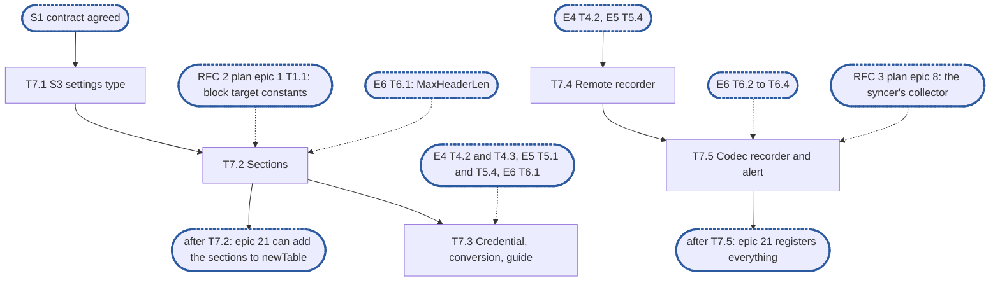

# Epic 7: remote tier v2 integration, keys and observability

**Sources:** [RFC 13](../docs/internals/rfcs/rfc-13-configuration.md) Appendix B's rows for the
remote store's `remote.endpoint`, `remote.credential`, `remote.region`, `remote.trust_roots`,
`remote.bucket`, `remote.storage_class` and `remote.block_target`, and for the namespace's
`remote.prefix` and `remote.block_format_version` (the last five named, and the region's and trust
roots' class corrected to plain live, by this pull request's amendment of Appendix B, D1),
with §4.2 (a default or required), §5 (the binding classes), §5.1 (bound), §5.2 (reaching the same
content another way), §5.4 (a format version written only once every reader reads it) and §5.5's
single-node paragraph, §6 (refused, never replaced; checked twice) and §7 (no secret value), and
§9's "§6 block target range" row and the single-node part of its "§5.4 format version" row;
[RFC 4](../docs/internals/rfcs/rfc-4-remote-tier.md) §3.5 (the version written is a namespace
setting), §4.12 (the definitions of every `remote_` and `codec_` series and the recorders behind
them), Appendix C.3's region, trust-root and HTTPS clauses as the settings state them, and
Appendix C.1's pinned storage class; [RFC 2](../docs/internals/rfcs/rfc-2-carver.md) §5.2's block
target range; [RFC 25](../docs/internals/rfcs/rfc-25-observability.md) §2.1 to §2.4, §2.6, §2.7
and §2.9 for the series, and §7's ticket on `codec_verify_failures_total`. Cited, not owned:
[RFC 3](../docs/internals/rfcs/rfc-3-syncer.md) §2.12 (`syncer_retries_total`, which the alert
subtracts); RFC 4 §4.10 (no key sets the client's limit); [RFC 0](../docs/internals/rfcs/rfc-0-data-lifecycle.md)
§1.2 (only the composers import `pkg/settings` and `pkg/metrics`). Every citation is `develop`'s
text with this pull request's RFC 13 amendment; the code lands on `feat/storage-v2`, and the paths
below are paths there.
**Track:** the team.
**Epic 7 estimate: 5 subtasks, 9.25 man-days.**
**Depends on:** **S1**, E1's frozen surface: `pkg/remote`'s errors and the codec's `MaxHeaderLen`
and `Recorder` (T1.3); the RFC 13 plan's `pkg/settings` (`Of`, `At`, `SelfKey`, `Required`,
`SecretRef`, `FormatVersion`, the `class` and `location:"store"` tags, `Check`, `Read`,
`Versions`), on `feat/storage-v2` already; the RFC 2 plan's epic 1, T1.1, for
`carver.MinBlockTarget` and `carver.MaxBlockTarget`. For the conversions, **E4**'s T4.2 and T4.3
(`NewClient`, `ClientConfig`, `Open`'s prefix refusal) and **E5**'s T5.1 and T5.4 (`judgeClass`,
`ClientConfig.MaxBlockSize`), and **E6**'s T6.1 (`MaxHeaderLen`'s answers). For the recorders,
E4's T4.2 (`Recorder`), E5's T5.4 (`Capability`) and E6's T6.2 to T6.4 (what the codec records);
for the alert, the RFC 3 plan's epic 8, whose collector in `internal/node/content` exports
`syncer_retries_total`.
**Blocks:** **RFC 8 offload plan epic 21**, which adds this epic's three sections to the node's
table with how each change reaches its component, builds every client and `codec.Store` with this
epic's conversion and recorders, registers the collectors and the alert rule, and unseals the
credential; **E8**, whose §4.10 row reads `remote_connections_opened_total` from a scrape of this
epic's recorder and whose limit rule (no key sets it) is this epic's key table; **E9**, which runs
everything over real services.

---

## 1. Goal

Epic 7 gives the remote tier its keys and its metrics. The S3 store declares its settings as a
plain tagged struct with the validator the control plane and the client share; the node's content
wiring turns it, with the block target, the credential's reference and the format version, into
`pkg/settings` sections, and turns a store configuration's settings and unsealed credential into
the client's configuration. On the observability side the content wiring implements the recorders
`pkg/remote/s3` and `pkg/remote/codec` declare over the node's registry, and holds the series
definitions and the one alert expression.

**At the end of the epic:**

- `content.Sections()` returns the remote store's section (`remote.*`, seven keys) and the
  namespace's two (`remote.prefix`, `remote.block_format_version`), each key with RFC 13 Appendix
  B's scope, class and default, and RFC 13's Appendix B check passes over them;
- a block target outside `carver.MinBlockTarget` to `carver.MaxBlockTarget`, an endpoint that is
  not HTTPS, a prefix that does not end in `/`, a storage class off the list of classes needing
  no restore, a trust-root value
  holding no certificate, or a plaintext in place of the credential's reference is refused at
  write and at start, naming the key and the rule;
- a write of `remote.block_format_version` the codec does not know is refused;
- a credential value that is not the S3 form is refused when the API seals it, and a store
  configuration's settings and its unsealed credential become an `s3.ClientConfig`;
- every series of RFC 4 §4.12 is recorded through the recorders the content wiring builds and read
  from a scrape of a real registry; a released store or namespace's series are deleted;
  `codec_verify_failures_total` reads 0 for every kind before any failure;
- the alert expression names only series and labels a registry holding the codec and syncer
  collectors exports;
- `docs/guide/configuration.md` describes the remote store's keys and the credential's format.

### 1.1 In scope

The settings struct and its validator in `pkg/remote/s3`; the three sections in
`internal/node/content`, with the Appendix B check reaching them; Appendix B's remote rows and
the bootstrap's list of setting keys brought to `feat/storage-v2`; the credential's format and its
check at the API's seal; the conversion to `s3.ClientConfig`; the two recorders, the definitions,
their deletion and the alert expression; the configuration guide's remote store section.

### 1.2 Out of scope

- **RFC 8 offload plan epic 21:** adding the sections to `newTable` and to `newReaches` (how a
  change of each key reaches the client or the codec), unsealing the credential, the holding of
  one client per store configuration, the largest encoded block it passes as `MaxBlockSize`, the
  namespace's `codec.Config.Version` read from its section, registering the collectors and the
  alert rule in the node, the label value each entity takes (§9 point 1), and the alert rules' form
  (the RFC 3 plan's O7).
- **E8:** the limit passed to `clientConfig`; until then epic 21 passes its own sum.
- **E4, E5, E6:** the client, the open and the codec that consume these values, and the mapping of
  each S3 outcome to `result` and `cause`, which E4's D3 tests at its sink; E5's refusal text,
  which already names every missing feature (its D4).
- **RFC 23**, the RFC 4 plan's §6.1 deferral ledger row "A remote store's credential set through
  the API running the capability check": the API's call of `Open`, the refused open shown as a
  field error, which needs nothing exported from this epic (D11), and the no-content half of RFC
  13 §9's "§5.1 bound" row for `remote.bucket` and `remote.prefix`, which the store-location gate refuses until the check proves the claim (D13). That half also
  waits on RFC 27's claim, as the RFC 13 plan's ledger row on store-location changes has it (RFC 4
  and RFC 27, "both pieces built"), and for `remote.prefix` on the API's `contentIn` answering per
  namespace rather than "holds content" for all.
- **RFC 15**, the §6.1 ledger row on RFC 13 §9's "§5.4 format version" row: its two-node half,
  and RFC 13 §5.4's refusal to start or join while a namespace writes a block format version the
  node cannot read, which the RFC 13 plan deferred to the RFC 4 plan that declares the key (its
  epic 2's D12). With one block format version and T7.2's gate refusing any other, no namespace can
  hold one, so the refusal moves with the two-node half; this pull request amends both ledgers.
- **The RFC 3 plan's epic 8:** `syncer_retries_total{reason="verify"}` exported at zero from start
  (RFC 25 §2.3), the syncer's half of R29.
- **RFC 5 plan epic 9:** the chain's keys, which join this epic's remote store section (D2).
- **The RFC 2 plan's epic 3 and RFC 8 offload plan epic 21:** `Target`'s key, which RFC 13 has not
  named; this epic names only its own rows.
- **The §6.1 ledger row on RFC 25 §2.4's label cap** (unowned, added by this pull request): the cap
  of 64 values per entity label, its `_other` series and `metrics_label_capped`, which `pkg/metrics`
  does not implement yet; the recorders record whatever label value they are given.
- **E9:** the series read off a store running over real services.

### 1.3 Names used here

- **E1**, epic 1, interfaces: `pkg/remote`'s contract and the codec's surface, frozen at S1.
- **E2**, epic 2, conformance suite and test foundations: the in-memory store.
- **E4**, epic 4, S3 data path, errors and client: `NewClient`, `ClientConfig`, `Open`, the
  `Recorder`.
- **E5**, epic 5, capability check and health: `MaxBlockSize`, `judgeClass`, `Capability`.
- **E6**, epic 6, block codec: `MaxHeaderLen`'s answers and the codec's recording.
- **E7**, this epic.
- **E8**, epic 8, integration: the client limit.
- **E9**, epic 9, E2E green.
- **S1**, the plan's first synchronisation point, the remote store contract agreed (the RFC 8
  offload plan's S1c).
- **S3** names the storage service (Amazon S3 and the services compatible with it) everywhere in
  this document.
- **RFC 8 offload plan epic 21**: the epic of the RFC 8 offload plan that composes the codec, the
  store and the syncer in the node and its content wiring.
- **The content wiring**, `internal/node/content`: the part of the node that builds the content
  components and hands each its configuration, one of RFC 0 §1.2's two composers.

## 2. How the general rules apply

The rules are those of [the RFC 4 implementation plan's §1.5](rfc-4-remote-tier-plan.md#15-general-rules-for-each-epic),
cited by number and title and not copied.

| Rule | Subtasks | How |
| --- | --- | --- |
| rule 1, independent unit tests ([`CLAUDE.md`, "Writing tests"](../CLAUDE.md#writing-tests)) | all | the validators and the conversion are functions of values, table-tested; the sections run through `pkg/settings`' real `Check` and `Read` over a `kvstore` on `t.TempDir()`, as `internal/node/appendixb_test.go` does; the recorders over a real `metrics.New` registry read by a scrape of its handler; all in `unit`. No double |
| rule 2, fuzz tests where relevant ([`CLAUDE.md`, "By kind"](../CLAUDE.md#by-kind)) | none | nothing here decodes bytes off the wire or the disk: the credential is a JSON object the standard decoder reads strictly, and `pkg/settings` decodes every row and fuzzes its own decoder |
| rule 3, observability follows RFC 25 | T7.3 to T7.5 | the series' names, units, labels and buckets are RFC 4 §4.12's and RFC 25 §2's; no package under `pkg/remote` imports `pkg/metrics`; the access key and secret appear in no error or log line (T7.3), and the recorders' signatures never receive them. It departs from the rule's placement of the definitions and the alert in the component's packages: they sit in the content wiring (D7) |
| rule 4, profiling | T7.4, T7.5 | recording allocates nothing, asserted with `testing.AllocsPerRun` in `unit`'s `remote-allocs` option, which E6 registers without `-race` and T7.4 widens to `./internal/node/content` (RFC 25 §2.9) |
| rule 5, public interface and internals ([`CLAUDE.md`, "Verifying a change"](../CLAUDE.md#verifying-a-change)) | all | each key is tested where its value is consumed: a refusal through `Check`, which the API's write calls, and through `Read`, which a start calls; a credential at the API's seal; a trust root by a client that dials with it; a series by a scrape, what an operator reads |
| rule 6, known failures shrink | none | `unit` keeps no `known.yaml`; each test lands green with its subtask |
| rule 7, v2 ignores v1, and imports only what RFC 0 §1.2 allows | T7.1, T7.2, T7.3 | `pkg/remote/s3` gains imports from the standard library only; `pkg/settings`, `pkg/metrics`, `pkg/carver` and `pkg/metadata/entity` are imported by the content wiring alone, a composer; E1's import walk covers the new file. The v1 declarations of `remote.endpoint` and `remote.credential` meet the real section (D12). The API imports neither `internal/node/content` nor `pkg/remote`, as `internal/node/arch_test.go`'s `TestImportRules`, `TestNoComponentImports` and `TestAPIClosure` require: it takes the credential check through its `Deps` (D5) |
| rule 8, real dependencies for properties of those dependencies ([`CLAUDE.md`, "Writing tests"](../CLAUDE.md#writing-tests)) | T7.3 | the trust root converted from a setting is shown trusted by a TLS handshake with an `httptest.NewTLSServer` listener on `127.0.0.1:0`, not by inspecting the pool |
| rule 9, code comment conventions ([`CLAUDE.md`, "Code comments"](../CLAUDE.md#code-comments)) | T7.2, T7.4, T7.5 | D6's `decision:` at the format version's default, D13's at the bucket's and prefix's location tag, D8's at a value outside the closed sets and at an unbound prefix, D10's at the alert's window and granularity |
| rule 10, a test must be able to fail ([`CLAUDE.md`, "Writing tests"](../CLAUDE.md#writing-tests)) | all | each test names the break it catches. R7 is a review rule on the key table, backed by the Appendix B comparison, which fails a key with no RFC row; R19 is a review rule while one block format version exists (T7.2) |
| rule 11, a symbol is exported only if the RFC's interface uses it | T7.1 to T7.3 | exported: `s3.Settings` and `s3.NamespaceSettings` with their `Validate`, which `pkg/settings`' `Of` requires and the control plane calls (RFC 13 §6); `content.Sections`, which the node's table reads; `content.ParseCredential`, which the node wires into the API's `Deps.CheckCredential` and the conversion calls. The recorders, the conversion and the alert expression stay unexported: epic 21's holding sits in the same package |
| rule 12, each subtask creates only what it declares | all | each file lands with its first consumer, named in its subtask; the recorders' unexported constructors are consumed by their tests and by epic 21's holding |

## 3. Requirements and invariants

Every obligation the sources place on this epic, numbered so subtasks and tests can cite them.

**The keys**

| # | Requirement | Kind | Source | Subtasks |
| --- | --- | --- | --- | --- |
| R1 | The remote store's section declares, at remote store scope, `remote.endpoint` and `remote.credential` (live, under §5.2, required), `remote.region` (live, `us-east-1`), `remote.trust_roots` (live, none: the system's roots), `remote.bucket` (bound, required), `remote.storage_class` (next write, `STANDARD`) and `remote.block_target` (next write, 4 MiB), each with Appendix B's class and default | MUST | RFC 13 Appendix B, §5; RFC 4 C.3 | T7.1, T7.2 |
| R2 | The namespace declares, at namespace scope, `remote.prefix` (bound, required) and `remote.block_format_version` (next write, the newest version every node reads) | MUST | RFC 13 Appendix B, §5.4; RFC 4 §3.5 | T7.2 |
| R3 | Every key has a default or is required; a record that omits `remote.endpoint`, `remote.bucket`, `remote.credential` or `remote.prefix` is refused | MUST | RFC 13 §4.2, Appendix B | T7.2 |
| R4 | A change to `remote.bucket` or `remote.prefix` is refused while the store or namespace holds content | MUST | RFC 13 §5.1, Appendix B | T7.2 |
| R5 | A new endpoint or a rotated credential is allowed only once the store's capability check finds what identifies the old location; until that check runs from the API, a change of either is refused and a first value is accepted | MUST | RFC 13 §5.2 | T7.2 |
| R6 | `remote.credential` holds a reference to a secret of the remote credential kind, never a value; a plaintext in its place is refused, and no refusal prints it | MUST, MUST NOT | RFC 13 §6, §7, Appendix B | T7.2 |
| R7 | No key sets a client's connection limit, and no key skips certificate verification | invariant | RFC 4 §4.10, C.3; RFC 13 Appendix B (`remote.trust_roots`) | T7.2 |

**Validation**

| # | Requirement | Kind | Source | Subtasks |
| --- | --- | --- | --- | --- |
| R8 | A value out of range, of the wrong type or naming nothing is refused, naming the key and the rule, and never clamped, rounded or replaced by a default | MUST, MUST NOT | RFC 13 §6 | T7.1, T7.2 |
| R9 | The control plane and the component run the same rules: each rule a key shares with the S3 client, its open or its check is one function all of them call | MUST | RFC 13 §6 ("Checked twice") | T7.1, T7.3 |
| R10 | An endpoint that is not HTTPS is refused | MUST | RFC 4 C.3 | T7.1 |
| R11 | Every object is written in one class the profile pins, `STANDARD` unless set, never the service's default; an archive class, whose get needs a restore, is refused when `remote.storage_class` is written, by accepting only a class on C.1's list of classes needing no restore | MUST | RFC 4 §4.11, C.1; RFC 13 Appendix B | T7.1 |
| R12 | Trust roots replace the system's roots when set; a value holding no certificate, or any block that is not a certificate that parses, is refused | MUST | RFC 4 C.3; RFC 13 Appendix B | T7.1, T7.3 |
| R13 | Requests are signed for the configured region, `us-east-1` unless `remote.region` sets another; the conversion carries it, and E4's `NewClient` signs for it | invariant | RFC 4 C.3 | T7.3 |
| R14 | A block target outside 1 MiB to 64 MiB is refused when written and at start, never clamped; the bounds are the carver's constants | MUST | RFC 2 §5.2; RFC 13 Appendix B | T7.2 |
| R15 | §6: a block target of 512 KiB and of 128 MiB each refused, naming the key and the range; 1 MiB and 64 MiB accepted | test row | RFC 13 §9 | T7.2 |

**The block format version**

| # | Requirement | Kind | Source | Subtasks |
| --- | --- | --- | --- | --- |
| R16 | The version written is a namespace setting; the control plane refuses to advance it past the versions the node reads | MUST | RFC 4 §3.5; RFC 13 §5.4 | T7.2 |
| R17 | §5.4, single node: advancing the namespace's version past what the node reads is refused, and the newest it reads is accepted. The two-node half is RFC 15's | test row | RFC 13 §9 | T7.2 |
| R18 | The versions the settings gate admits for the block format are the versions the codec knows | invariant | RFC 13 §5.4, §5.5 | T7.3 |
| R19 | A new binary keeps writing the version already written and raises it only through the control plane, never at open | invariant | RFC 13 §5.5 | T7.2 |

**The credential**

| # | Requirement | Kind | Source | Subtasks |
| --- | --- | --- | --- | --- |
| R20 | The credential's reference is resolved when the client is built: its value gives the access key and the secret; a value that does not parse is refused, at the API's seal and again when the client is built | MUST | RFC 13 §6, §7 | T7.3 |
| R21 | Neither the access key nor the secret appears in an error, a log line or a metric label | MUST NOT | RFC 13 §6, §7, §9 ("§7 no secret out"); RFC 25 §2.4 | T7.3; the labels by the recorders' signatures (T7.4) |

**Observability**

| # | Requirement | Kind | Source | Subtasks |
| --- | --- | --- | --- | --- |
| R22 | Every store exports the same series, labelled by store: `remote_requests_total` by `op` and `result`, `remote_bytes_total` by `op`, `remote_connections_opened_total`, `remote_list_foreign_total`; a backend adds none of its own | MUST | RFC 4 §4.12 | T7.4 |
| R23 | `remote_request_seconds` folds `op` to `put`, `get`, `delete`, `list`, `health` and `other`, on the `request` buckets | MUST | RFC 4 §4.12; RFC 25 §2.6 | T7.4 |
| R24 | An `ErrDenied` result is labelled with its cause; a call its caller cancelled or whose body reader failed is `result="local"` | MUST | RFC 4 §4.12 | T7.4 |
| R25 | `remote_capability` reports the last check per feature, 1 if present, labelled by store and `namespace`, `conditional_put` among the features | MUST | RFC 4 §4.12 | T7.4 |
| R26 | The codec exports `codec_chunks_verified_total`, `codec_measuring_passes_total`, `codec_verify_failures_total` by `kind` (`hash`, `name`, `version`, `malformed`) and `codec_seconds` by direction, labelled by store | MUST | RFC 4 §4.12 | T7.5 |
| R27 | Each event is counted in one place: a recorder adds to a series only what its component reported | MUST | RFC 4 §4.12; RFC 25 §2.7 | T7.4, T7.5 |
| R28 | Names are `<component>_<what>[_<unit>][_total]` under RFC 4's prefixes, in seconds and bytes; a label is a closed set or an entity label, and none is forbidden | MUST, MUST NOT | RFC 25 §2.1, §2.2, §2.4 | T7.4, T7.5 |
| R29 | A counter an alert reads is exported from start, at zero, for every value of its closed labels: `codec_verify_failures_total` for each `kind`. The syncer's half is the RFC 3 plan's epic 8 | MUST | RFC 25 §2.3, §7; RFC 4 §4.12 | T7.5 |
| R30 | A series is resolved once, when its entity is added; recording is an add or an observe, with no label lookup and no allocation | invariant | RFC 25 §2.9 | T7.4, T7.5 |
| R31 | When an entity is removed, the component that created its series deletes them | invariant | RFC 25 §2.4 | T7.4, T7.5 |
| R32 | The one alert is a ticket on `codec_verify_failures_total` less the failures the syncer's re-get recovered (`syncer_retries_total`, `reason` = `verify`), and it names series that exist | MUST | RFC 25 §7; RFC 4 §4.12; RFC 3 §2.12 | T7.5 |

## 4. Decisions this epic takes

- **D1. The five unnamed rows take keys under `remote.` (the user's decision, 2026-11-26).** RFC 13
  Appendix B named no key for the bucket, the storage class, the block target, the prefix or the
  block format version, and the Appendix B check (`internal/node/appendixb_test.go`) fails a table
  key the appendix lacks, so the keys must be in RFC 13 before epic 21 adds the sections. This pull
  request amends Appendix B with `remote.bucket`, `remote.storage_class`, `remote.block_target`,
  `remote.prefix` and `remote.block_format_version`, and §6's example refusal with
  `remote.prefix`. Every key this component reads then sits under one word, whichever scope holds
  it, and an operator reading `remote.prefix` beside `remote.bucket` sees one location. The
  rejected alternative is a prefix per package (`codec.format_version`, `namespace.prefix`), which
  follows the code rather than what an operator configures. `feat/storage-v2` already ships
  `namespace.prefix` as the documented spelling, though no table declares it yet: `dfsctl namespace
  create`'s help (`cmd/dfsctl/commands/namespace/namespace.go`) and the generated
  `docs/guide/cli.md`, the CLI suite's and the route sweep's waiting rows
  (`cmd/dfsctl/internal/clisuite/stores.go`, `internal/node/routesweep_test.go`) and the API's
  tests (`internal/node/api/stores_test.go`, `store_routes_test.go`). `remote.prefix` replaces that
  spelling, and T7.2 renames those sites to it. Prior art: rclone's S3 backend names its
  options `endpoint`, `region`, `bucket` and `storage_class` under the remote's name (from memory).
  Changing a name once epic 21 registers it means editing the RFC row, the struct tag and every
  provisioning file that uses it, which is why it is settled before epic 21 registers it.
- **D2. The S3 store's settings are a plain tagged struct in `pkg/remote/s3`; what `s3` may not
  type is the content wiring's.** `pkg/settings`' `Of` reads a Go struct whose fields carry
  `json`, `class` and `location` tags and whose `Validate` it calls; tags are strings, so
  `pkg/remote/s3` declares its rows and owns their rules (RFC 13 §6) without importing
  `pkg/settings`. Three fields cannot live there: the credential, which `SecretRef` reads only as an
  `entity.SecretRef` (`pkg/settings/secretref.go`'s `refOf`, refusing any other type closed), and
  `s3` may not import `pkg/metadata/entity` (rule 7); the block target, whose range is the
  carver's constants; and the format version, a one-field section with one consumer. The content
  wiring's section embeds `s3.Settings` and adds the first two, and declares the third; the same
  struct is where RFC 5 plan epic 9 joins the chain's keys to the remote store's section.

  ```go
  package s3 // pkg/remote/s3/settings.go

  // Settings is a store configuration's settings (RFC 13 Appendix B) that the S3 profile reads;
  // Validate is the rule the control plane, the client and the check share (RFC 13 §6).
  type Settings struct {
  	Endpoint     string `json:"endpoint" class:"live" location:"store"`
  	Region       string `json:"region" class:"live"`
  	TrustRoots   string `json:"trust_roots" class:"live"` // PEM; "" is the system's roots
  	Bucket       string `json:"bucket" class:"bound" location:"store"`
  	StorageClass string `json:"storage_class" class:"next write"`
  }

  func (s Settings) Validate() error

  // NamespaceSettings is a namespace's location in the bucket (RFC 4 §4.2).
  type NamespaceSettings struct {
  	Prefix string `json:"prefix" class:"bound" location:"store"`
  }

  func (s NamespaceSettings) Validate() error
  ```

  The architect pass proposed every tagged struct in the content wiring, with the packages
  exporting pure parsers; it was not taken for `s3`'s own fields, since their rules would then be
  the content wiring's or need one export each to stay the component's. Prior art: the RFC 2
  plan's `pkg/carver/section` (plain values, no `pkg/settings`); `internal/identity/settings.go`.
- **D3. Three sections, two of them one key each.** A section's prefix is unique in the table, and
  `pkg/settings` gives a key to the section with the longest prefix on a dot boundary
  (`table.go`'s `lookup`), so the two namespace keys take a section each through `SelfKey`, beside
  the remote store's:

  ```go
  package content // internal/node/content/remote_settings.go

  type remoteSettings struct {
  	s3.Settings
  	Credential  entity.SecretRef `json:"credential" class:"live" location:"store"`
  	BlockTarget bytesize.ByteSize `json:"block_target" class:"next write"`
  }

  func (r remoteSettings) Validate() error // s3.Settings.Validate, then carver.MinBlockTarget..MaxBlockTarget, compared as uint64

  type formatVersion struct {
  	Version uint8 `json:"version" class:"next write"`
  }

  func (f formatVersion) Validate() error // refuses a version codec.MaxHeaderLen does not know

  // Sections is the remote tier's settings sections, for the node's table (RFC 13 Appendix B).
  func Sections() []settings.Section {
  	return []settings.Section{
  		settings.Of("remote", settings.At(entity.ScopeRemote),
  			remoteSettings{Settings: s3.Settings{Region: "us-east-1", StorageClass: "STANDARD"}, BlockTarget: 4 * bytesize.MiB},
  			settings.Required("Endpoint", "Credential", "Bucket"),
  			settings.SecretRef("Credential", entity.SecretRemoteCredential)),
  		settings.Of("remote.prefix", settings.At(entity.ScopeNamespace), s3.NamespaceSettings{},
  			settings.SelfKey(), settings.Required("Prefix")),
  		settings.Of("remote.block_format_version", settings.At(entity.ScopeNamespace),
  			formatVersion{Version: 1}, settings.SelfKey(), settings.FormatVersion("Version")),
  	}
  }
  ```

  `remote` generates no key named `prefix` or `block_format_version`, so `Table.index` panics on
  neither. The block target is an `internal/bytesize.ByteSize`, so `pkg/settings` reads it with
  RFC 13 Appendix B's size grammar (`8MiB`, as `dfsctl` sends it) rather than as a bare number. `formatVersion.Validate` refuses what the codec does not know and runs before the
  `FormatVersion` gate, which checks the node's range (`gates.go`), so a write past both answers
  with `Validate`'s refusal; R17's acceptance criterion reads either. Prior art:
  `internal/node/settings.go`'s `newTable`, which holds `identity` beside `identity.directory`.
- **D4. One rule per check, shared with the client.** `Settings.Validate` and `NewClient` call one
  unexported `checkEndpoint` (`https://` and a host, and no query string, fragment or user info,
  so no credential rides in the URL); `NamespaceSettings.Validate` and `Open` call one
  `checkPrefix` (non-empty, ends in `/`, E4's D1, valid UTF-8 and free of control bytes). The
  query, fragment, user-info, UTF-8 and control-byte refusals are the user's decision of
  2026-11-27. `Validate` and E5's `judgeClass` read one
  unexported allowlist of the classes whose gets need no restore (RFC 4 C.1): `STANDARD`,
  `REDUCED_REDUNDANCY`, `STANDARD_IA`, `ONEZONE_IA`, `INTELLIGENT_TIERING`, `GLACIER_IR` and
  `EXPRESS_ONEZONE`. `GLACIER` and `DEEP_ARCHIVE` are off it because a get of either needs a
  restore the store never requests; `GLACIER_IR` is on it because it serves gets in milliseconds;
  `INTELLIGENT_TIERING` is on it because its own tiers need no restore, and its optional archive
  tiers are a bucket configuration E5's tiering rule refuses. An allowlist rather than a list of
  archive classes, because a class a service adds or names its own way (`OUTPOSTS`, `SNOW`, a
  provider's archive class) is then refused at write until someone shows it needs no restore,
  rather than admitted and found archived at the first get. A `decision:` marker at the list says
  so. This is the user's decision of 2026-11-26. Whichever of T7.1, E4's
  T4.2 and T4.3 or E5's T5.1 lands first writes the function and the others call it; T7.3's table
  through all three catches a drift. Trust roots go through one unexported `checkTrustRoots`,
  which `Validate` and the conversion call: it loops over `pem.Decode` and refuses a block that is
  not `CERTIFICATE`, a block `x509.ParseCertificate` refuses, non-whitespace text left over, and
  no certificate at all, naming the block's position. `AppendCertsFromPEM` alone would not do:
  it accepts a bundle once any block parses and drops the rest silently, so a mistyped CA would
  surface only as TLS errors E4 maps to `ErrTransient`. An
  empty region or storage class is refused, since each has a default and an explicit empty value is
  neither it nor a value. Only the class allowlist is shared with `judgeClass`: it reads an empty
  *reported* class as `STANDARD` (E5's D7) and E4's `ClientConfig` takes `""` as `STANDARD`,
  while `Validate` refuses an explicit empty one, a difference on purpose. Prior art: none needed.
- **D5. The credential is a JSON object, parsed by one function the API and the conversion call.**
  The sealed value of a remote credential is `{"access_key_id": "...", "secret_access_key": "..."}`.

  ```go
  // ParseCredential reads a remote store credential's value (RFC 13 §7): one JSON object with
  // exactly the two names, matched case-sensitively, each once and non-empty, and nothing after
  // it. Its error names the missing or extra field, or says the value is not such an object, and
  // never holds the value or the decoder's text.
  func ParseCredential(value []byte) (accessKeyID, secretAccessKey string, err error)

  // clientConfig is a store configuration's client configuration (RFC 4 C.3). limit is E8's,
  // maxBlock the largest encoded block epic 21 computes (RFC 3 §2.2) from s.BlockTarget, the same
  // snapshot's.
  func clientConfig(s remoteSettings, credential []byte, limit int, maxBlock int64) (s3.ClientConfig, error)
  ```

  The API may not import the content wiring (rule 7), so it declares the check in its `Deps`, as
  it takes `Sealer` and `Settings`: `CheckCredential func(value []byte) error`, which the node sets
  to a closure over `ParseCredential`; a nil `CheckCredential` refuses the seal, failing closed as a
  nil `Sealer` does. Each of the three seal paths of a `SecretRemoteCredential` calls it before it
  seals: `sealStore` (`POST /stores`) after `credentialValue`; `prepareStorePatch`'s seal through
  `storeCredentials.seal` (`PATCH /stores/{id}`); and the credential route, where
  `secretSetting.seal` runs it after its empty-value check and before `capabilityCheck`, so a value
  the client could not use is refused 400 whether or not the check would refuse it 409. A value
  the client could not use is thus refused when it is written (RFC 13 §6's "checked twice"); the
  conversion calls it again when epic 21 unseals. A `block_target` change reaches the client by
  epic 21's rebuild of it (its `newReaches`), so `maxBlock` never lags the target. A JSON object takes a session token or a role later without
  re-sealing every stored credential in a new format. The architect pass proposed `access:secret`
  split at the first colon; it was not taken for that reason. Prior art: rclone's S3 options
  `access_key_id` and `secret_access_key`; the AWS shared credentials file's `aws_access_key_id`
  and `aws_secret_access_key` (from memory).
- **D6. The format version's default is 1, a constant.** RFC 13 §5.4 defaults it to the newest
  version every node reads; on one node with one version that is 1. A default that followed
  `settings.Versions()[entity.FormatBlock].Max` would make a binary that learns version 2 write
  it at once on every namespace that never set the key, which §5.5 forbids: a new binary keeps
  writing the old version until the control plane raises it. A `decision:` marker at the default
  names the ceiling: when a second version lands, the default becomes the installation's active
  block format version, which the node reads from its installation record. Prior art: none needed.
- **D7. The series' definitions and the alert expression live in the content wiring, beside the
  recorders.** A definition's only reader is the recorder that registers it, and `s3` and `codec`
  may not import `metrics.Spec`, so a definition in either would be a second spec type with one
  consumer. RFC 25 §2.8 keeps the name the owning RFC's wherever the code exporting it sits. The
  same holds for the block target's and the format version's rows (D2, D3). This departs from the
  plan, whose D12, rule 3, dependency limits, v1-to-v2 table, tree and epic 7 section put the rows,
  definitions and the rule as plain values in `pkg/remote/s3` and `pkg/remote/codec`; this pull
  request amends those passages. The architect pass proposed the same. Prior art:
  the RFC 3 plan's D4, the syncer's collector in `internal/node/content`.
- **D8. A remote recorder per store configuration, a codec recorder per registered `codec.Store`, each resolved at construction.**

  ```go
  package content // internal/node/content/remote_metrics.go

  // remoteRecorder implements s3.Recorder for one store configuration (RFC 4 §4.12).
  func newRemoteRecorder(m *metrics.Metrics, store string) *remoteRecorder
  func (r *remoteRecorder) Call(op, result, cause string, took time.Duration, bytes int64)
  func (r *remoteRecorder) ConnOpened()
  func (r *remoteRecorder) ForeignKey()
  func (r *remoteRecorder) Capability(prefix, feature string, present bool)
  // bind names the namespace a prefix's capability series carry; unbind deletes them.
  func (r *remoteRecorder) bind(prefix, namespace string) (unbind func())
  func (r *remoteRecorder) close() // deletes every series carrying this store

  // codecRecorder implements codec.Recorder for one codec.Store, under the name the syncer registers it by.
  func newCodecRecorder(m *metrics.Metrics, store string) *codecRecorder
  func (r *codecRecorder) close()
  ```

  The constructor resolves every combination of the closed sets into arrays indexed by each
  value's position, so a call indexes and adds (RFC 25 §2.9): for `remote_requests_total` the
  seven v1.1 `op`s (E4's six and E5's `health`) by `ok`, the five sentinels other than `denied`,
  `local`, and `denied` with each of its three causes. A binding's `remote_capability` children
  are resolved on its first `Capability` of each feature, not at `bind`, so a namespace whose open
  returned before the check exports no capability series: 0 would read as absent (RFC 4 §4.12).
  `bind` and `unbind` publish a new prefix map behind an `atomic.Pointer`, copied on write, and
  `Capability` loads it with no lock and no allocation, so namespaces opening at once on one
  configuration bind beside a running check without a data race.

  A value outside those sets (an `op` such as `recheck`, which lands with RFC 9's calls and adds
  itself to the set then) records nothing, behind a `decision:` marker naming the ceiling: the sets
  are RFC 4's (§4.8's errors, §4.12's ops, C.1's features), and E4's and E5's constants are
  unexported, so T7.4 restates the strings and catches no drift by itself; a new value needs an
  RFC 4 amendment, whose review must reach this list. So does a `Capability` for a prefix no
  `bind` named: epic 21 binds before it opens, and a series under a made-up namespace would be
  worse than none.

  Recorders and bindings are counted per label value: a constructor called for a `store` value
  already live returns that recorder with its count raised, `bind` of a bound prefix raises the
  binding's count, and `close` and `unbind` delete only on the last release, with the vectors'
  `DeletePartialMatch` (client_golang 1.25) on `store`, or on `store` and `namespace`. A live-key
  change makes epic 21 open a new client and re-bind before it releases the old one, and the
  vectors' children are shared per label value, so a delete on the first release would detach the
  new binding's series. The codec's recorder follows its `codec.Store`, not the configuration:
  RFC 3 registers each namespace's `codec.Store` under its own name and labels its series by it
  (RFC 3 §1.3, §2.12), and the alert joins the two on `store` (D10). The architect pass proposed
  one per namespace too. Prior art: the RFC 5 plan's D2 (#5532), the same recorder shape.
- **D9. The labels.** `remote_requests_total{store, op, result, cause}`, `cause` empty except on
  `denied`; `remote_request_seconds{store, op}`; `remote_bytes_total{store, op}`;
  `remote_connections_opened_total{store}`; `remote_list_foreign_total{store}`;
  `remote_capability{store, namespace, feature}`; `codec_chunks_verified_total{store}`;
  `codec_measuring_passes_total{store}`; `codec_verify_failures_total{store, kind}`;
  `codec_seconds{store, direction}`, `direction` being `encode` for `remote.DirPut` and `decode`
  for `remote.DirGet`, on the `request` buckets, since a decode is what a demand read waits on.
  These are E4's D3 labels, which E4 left to this epic to declare. The `codec_` series' `store` is the name the syncer's `Register` gets for that `codec.Store`, so
  the alert's join matches; the `remote_` series' `store` names the store configuration. Epic 21
  chooses both strings (§9 point 1). Prior art: none needed.
- **D10. The alert is one unexported expression; its form is epic 21's.**

  ```go
  // verifyAlert is RFC 25 §7's ticket on chunks that failed verification and that the syncer's
  // single re-get did not recover (RFC 4 §4.12).
  const verifyAlert = `sum by (store) (dittofs_codec_verify_failures_total - dittofs_codec_verify_failures_total offset 1h)` +
  	` - (sum by (store) (dittofs_syncer_retries_total{reason="verify", half="fetch"} - dittofs_syncer_retries_total{reason="verify", half="fetch"} offset 1h)` +
  	` or sum by (store) (dittofs_codec_verify_failures_total - dittofs_codec_verify_failures_total offset 1h) * 0) >= 1`
  ```

  The `or … * 0` keeps a row for a store the syncer never retried, which a bare subtraction drops.
  The two sides are raw deltas over the hour, whole counts, not `increase()`: each `increase` is
  extrapolated with its own clip at the window's start, so their difference drifts with the number
  of recovered failures and crosses any fixed fraction. `half="fetch"` keeps a put's `ErrCorrupt`
  out, which RFC 3 retries under `reason="verify"` too (§2.4) while the codec counts read-side
  failures only. A recovering re-get adds one to each side; one that fails again adds a second
  failure. A `decision:` marker names the ceilings: a failure and its re-get split across the
  window's edge raise a spurious ticket; the subtraction assumes one re-get per failed chunk, as
  RFC 4 §4.12 words it, so a whole-block get failing several chunks and recovered by one re-get
  leaves a remainder; a counter reset in the hour makes its delta negative and a series younger
  than the hour has no `offset` sample, so a restart silences the ticket for an hour. The upgrade
  is a counter of unrecovered failures kept by whoever sees both, if any of these shows. No test
  in the tree evaluates PromQL, so the `or` branch and the arithmetic are reasoned, not tested
  (§9 point 2). Epic 21 owns the rules' form (the RFC 3 plan's O7) and exports the expression in it
  when it registers the rule. Prior art: the Prometheus alerting rule's `expr` (read the documentation).
- **D11. A refused open needs nothing exported for the API.** E5's refusal wraps `remote.ErrInvalid`
  and its text names every missing feature and no credential (E5's D4, R31). The API's field error,
  when RFC 23 wires the check (§1.2), reaches it the way it reaches the credential check, through a func in its `Deps` that the node
  sets (the API imports nothing of `pkg/remote`, rule 7), with the text as its detail, on the key
  the write set. An exported list of the missing features would pin a signature
  no v1.1 code calls. The architect pass reached the same. E5's Blocks and open point 1 are amended
  in this pull request to say so. Prior art: none needed.
- **D12. The v1 keys meet the section; the API's tests keep their own table.**
  `internal/node/api/res_stores.go`'s `storeEndpoint` and `storeCredential` name two keys the
  real section declares; they stay, and their `ponytail:` stays until epic 21 puts the section in
  the node's table. The API's write-path tests keep `writeTable`'s test section: their bound
  `remote.target` must change on an empty store, which the real section's bound keys, both store
  locations, cannot (D13). `pkg/bootstrap/keyspec.go`'s `settingKeys` is Appendix B's list, held to
  it by `TestSettingKeysMatchAppendixB`, which reads RFC 13 on `feat/storage-v2`. So the
  cherry-pick that carries this document's Appendix B amendment to that branch adds, in the same
  change, the keys `settingKeys` lacks there, as #5785 does for `remote.region` and
  `remote.trust_roots`: once #5785 has merged, the five `remote.bucket`, `remote.storage_class`,
  `remote.block_target`, `remote.prefix` and `remote.block_format_version`. The CLI suite's refusal of `remote.region` as an unknown key
  (`cmd/dfsctl/internal/clisuite/stores.go`) runs on the node's own table, so it changes in epic
  21's change that adds `Sections` to `newTable`. So do the other rows waiting on these keys: the
  CLI suite's `store create` row (`unknown_key remote.credential`), the route sweep's `POST
  /stores` and `PATCH` `remote.region` rows (`internal/node/routesweep_test.go`), and the
  `namespace.prefix` rows D1 lists, renamed to `remote.prefix` by T7.2, which would otherwise wait
  forever on a key nothing declares. Prior art: none needed.
- **D13. The bucket and the prefix keep the store-location tag; the region and the trust roots do
  not.** RFC 13 §5.2 names "a store's endpoint, and its credential" as ways to reach content; the
  bucket and the prefix are where it is (§5.1). `pkg/settings` tags all four as the store's
  location (the RFC 13 plan's D9, `section.go`'s doc of `Of`), because a new bucket or prefix that
  held the same content would be proved the same way, and its gate refuses every change of a
  tagged key but its first value until the check exists (`gates.go`'s `decision:`). So on an empty store a bucket change is refused `ErrUnproven`, and a prefix change is refused
  `ErrBound` on every namespace, since the API's `contentIn` answers that every namespace holds
  content (its `decision:`) and the bound gate runs first; both are narrower than RFC 13 §9's
  "§5.1 bound" row, whose no-content half waits with the RFC 23 ledger row (§1.2); a `decision:` marker at the
  tags says so. Region and trust roots change how a request to the same endpoint is signed or
  verified, and the next open's check runs under them anyway; tagging them would refuse every later change of either, since the gate refuses every change of a
  tagged key but its first value. At the store's creation no gate fires, tagged or not:
  `createSettings` writes the record first, so each value judged equals itself. This pull request
  corrects their Appendix B class to plain live. Prior art: none needed.

## 5. Target tree

```text
pkg/remote/s3/
  settings.go          T7.1  Settings, NamespaceSettings and their Validate; checkEndpoint, checkPrefix,
                             the class allowlist (D2, D4)
  settings_test.go     T7.1  the validators' tables; T7.3 the same tables through NewClient, Open, judgeClass
internal/node/content/
  remote_settings.go   T7.2  remoteSettings, formatVersion, Sections (D3); T7.3 ParseCredential, clientConfig (D5)
  remote_settings_test.go  T7.2, T7.3
  remote_metrics.go    T7.4  the remote_ definitions, remoteRecorder (D8, D9); T7.5 the codec_ ones,
                             codecRecorder, verifyAlert (D10)
  remote_metrics_test.go   T7.4, T7.5
internal/node/
  appendixb_test.go         T7.2  tableKeys seeds one instance per scope a section names
  appendixb_remote_test.go  T7.2  Appendix B and the refusal-leak checks over Sections
internal/node/api/
  server.go                      T7.3  Deps.CheckCredential (D5)
  res_stores.go, res_secrets.go  T7.3  Deps.CheckCredential before each seal of a remote credential
  writepath_test.go, store_routes_test.go  T7.3  credential fixtures in the JSON form
internal/node/routesweep_test.go T7.3  the POST /stores row's credential in the JSON form
cmd/dfsctl/internal/clisuite/stores.go  T7.3  the store create row's credential in the JSON form
docs/guide/configuration.md      T7.3  the remote store section
test/suites.yaml                 T7.4  unit's remote-allocs option widened to ./internal/node/content
```

## 6. Subtasks

### T7.1 The S3 store's settings type

**Subtask T7.1 estimate: 1 man-days.**

- **Track:** the team. **Depends on:** S1.
- **Covers:** R1's `s3` fields, R8–R12.
- **Deliverables:** `pkg/remote/s3/settings.go`: `Settings`, `NamespaceSettings` and their
  `Validate`, over the unexported `checkEndpoint`, `checkPrefix`, `checkTrustRoots` and class allowlist of D4,
  which `NewClient`, `Open` and E5's `judgeClass` call once they land. Consumed by T7.2 and T7.3.
- **Acceptance criteria:**
  - `Validate` accepts each of D4's seven classes and refuses an `http://` or host-less endpoint,
    an endpoint with a query string (`https://h/?a=b`), a fragment (`https://h/#f`) or user info
    (`https://key:secret@h/`) (the user's decision of 2026-11-27), an empty region, bucket or
    storage class, `GLACIER`, `DEEP_ARCHIVE` and a class on no list (`OUTPOSTS`), and a trust-root value with no certificate, with a good
    certificate beside a corrupted one, with a block that is not a certificate, or with text left
    over, each error naming the field, the rule and, for a trust root, the block's position.
  - `NamespaceSettings.Validate` refuses `""` and `ns`, a prefix that is not valid UTF-8
    (`"\xffns/"`) and one holding a control byte (`"n\x00s/"`, `"n\ns/"`), and accepts `ns/`
    (the user's decision of 2026-11-27).
- **Tests:** tables over values, at `Validate`, the call the control plane makes: each refusal above
  beside its accepted neighbour, and every listed class accepted beside `GLACIER`, `DEEP_ARCHIVE`
  and `OUTPOSTS` refused (catches a rule inverted or missing, the allowlist turned back into a list
  of archive classes, R8, R10–R12). No double.
- **Rules:** rule 7: the standard library only.

### T7.2 The sections in the content wiring

**Subtask T7.2 estimate: 2.5 man-days.**

- **Track:** the team. **Depends on:** T7.1; the RFC 2 plan's epic 1, T1.1; E6's T6.1, whose
  `MaxHeaderLen` answers `formatVersion.Validate` reads (at S1 it is E1's stub, which knows no
  version).
- **Covers:** R1–R8, R14–R17, R19.
- **Deliverables:** `internal/node/content/remote_settings.go`: `remoteSettings` and its `Validate`
  against `carver.MinBlockTarget` and `carver.MaxBlockTarget`, `formatVersion`, `Sections` (D3),
  with D6's `decision:` at the format version's default. D13's `decision:` goes at the
  `location:"store"` tags on `Bucket` and `Prefix` in `pkg/remote/s3/settings.go`, where they live.
  `internal/node/appendixb_test.go`'s `tableKeys` seeding one instance row for each scope a
  section names, as its `decision:` asks once a section at a per-instance scope is declared, which
  then loses that clause. `internal/node/appendixb_remote_test.go`. D12's `settingKeys` lines and
  RFC 13 Appendix B's remote rows reach `feat/storage-v2` with this document's cherry-pick, before
  this subtask. The shipped `namespace.prefix` sites D1 lists are renamed to `remote.prefix`:
  `dfsctl namespace create`'s help, `docs/guide/cli.md` (regenerated with `go run ./cmd/gendocs`),
  the CLI suite's and the route sweep's rows and the API tests. Consumed by T7.3 and by
  RFC 8 offload plan epic 21, which adds `Sections` to `newTable`.
- **Acceptance criteria:**
  - `compareAppendixB` over a table of `Sections()` reports no failure, its `reported` list holds
    no `remote.*` key, and the sections declare exactly R1's seven keys and R2's two.
  - `Read` over a record holding only the required keys yields each default of R1 and R2.
  - Through `Check`: a record missing each required key refused; `remote.region` and
    `remote.trust_roots` changed on a store that already holds them accepted, beside a change of
    `remote.endpoint` refused `ErrUnproven`; `remote.block_target` 512 KiB and 128 MiB refused naming the
    key and the range, 1 MiB and 64 MiB accepted, and `"8MiB"` read as 8 MiB; a change of `remote.bucket` or `remote.prefix`
    with content refused as bound; a change of the endpoint, the credential or the bucket without
    content refused `ErrUnproven`, a change of `remote.prefix` refused `ErrBound` (every namespace
    holds content to `contentIn`), and each first value accepted; a plaintext in
    `remote.credential` refused; `remote.block_format_version` 2 refused, 0 refused, 1 accepted.
  - Through `Read`, the start's path, a stored `remote.block_target` of 128 MiB refused.
- **Tests:** in `unit`, in `internal/node/appendixb_remote_test.go`, over a `kvstore` on
  `t.TempDir()` with `appendixb_test.go`'s helpers (`tableStore`, `putBeneathCheck`,
  `compareAppendixB`, `refLeaks`). The Appendix B comparison (catches a class, scope or key name
  drifting from RFC 13, and a key added with no RFC row, such as a limit or a skip of
  verification, R1, R2, R7); the defaults read back (catches a default changed from Appendix B's,
  which the comparison does not read, R1, R2); `refLeaks` over the remote section (catches a
  refusal printing a reference or a plaintext, R6); R15's four values through `Check` and the
  128 MiB one through `Read` (catches the range checked only at write, or copied as numbers the
  carver's change leaves behind, R14, R15); the bound, location, required and format-version cases
  above (catch a missing tag or option, R3–R5, R16, R17). R19 has no test while the block format
  has one version, since a default of 1 and one that follows the binary's newest read the same:
  D6's `decision:` and a review rule hold it until a second version lands. No double.
- **Rules:** rule 9: D6's and D13's `decision:`s; rule 11: `Sections` is the one export.

### T7.3 The credential, the conversion and the configuration guide

**Subtask T7.3 estimate: 2.75 man-days.**

- **Track:** the team. **Depends on:** T7.2; E4's T4.2 and T4.3; E5's T5.1 and T5.4; E6's T6.1.
- **Covers:** R9, R12, R13, R18, R20, R21.
- **Deliverables:** in `remote_settings.go`, `ParseCredential` and `clientConfig` (D5); the API's
  `Deps.CheckCredential`, called before each of the three seals D5 names, and the node setting it
  to `ParseCredential`. The credential fixtures that seal a value that is not the JSON object move
  to it, so their answers stay as they are: `apiCredentialStore` (`writepath_test.go`, on which
  most write-path tests build), `store_routes_test.go`, the route sweep's `POST /stores` row and
  the CLI suite's `store create` row.
  `docs/guide/configuration.md`'s remote store section: each key with its scope, class and default,
  the credential's JSON form with an example, the trust roots as a PEM bundle, the region, the
  storage class and its failure domain as E5 logs it, and that no key sets the connection limit or
  skips verification. For `remote.trust_roots` the guide explains why it exists: the client dials
  HTTPS only and no key skips verification, so it is the only way to reach an endpoint whose
  certificate comes from a CA the system does not trust; when to set it: a private or company CA,
  on-premises S3 such as MinIO or Ceph, a self-signed test endpoint; that the bundle replaces the
  system's roots for that store and does not add to them, so it holds every CA the chain needs;
  that `""` uses the system's roots; an example with a PEM bundle in the config file; and that a
  malformed block is refused at write and at start, naming its position. Consumed by RFC 8
  offload plan epic 21's holding and E8.
- **Acceptance criteria:**
  - `clientConfig` maps every field, `Region` `us-east-1` from the default, and refuses, wrapping
    `ErrInvalid`, a credential that is not the object, has an unknown field or an empty one, carries a value after the object, spells a name in
    another case, or repeats a name.
    - `POST /stores`, `PATCH /stores/{id}` and the credential route, each carrying a value that is
    not the object, are refused with a field error on the credential and seal nothing; with the
    object, the credential route's rows still answer 409 `unproven`.
  - A client built by `NewClient` from a `clientConfig` whose trust roots hold an
    `httptest.NewTLSServer`'s certificate completes a request to it; with `TrustRoots` empty it
    fails before the handler sees a request.
  - `s3`'s endpoint table refuses the same values through `Validate` and `NewClient`, its prefix
    table through `NamespaceSettings.Validate` and `Open`, its storage classes, listed and refused, through
    `Validate` and `judgeClass` (`""` diverges on purpose, D4).
    - For every version from 0 to 255, `codec.MaxHeaderLen` answers known exactly when
    `settings.Versions()[entity.FormatBlock]` holds it.
  - `docs/guide/configuration.md`'s `remote.trust_roots` entry states why the key exists, when to
    set it, that the bundle replaces the system's roots rather than adding to them, that `""` uses
    the system's roots, an example PEM bundle in the config file, and that a malformed block is
    refused at write and at start, naming its position.
- **Tests:** in `unit`. The credential cases, at `clientConfig` and at the API's `POST /stores`,
  their errors and a test `slog` handler's records grepped for the access key and the secret
  (catches a decoder's text passed on, or a format checked only when the client is built, R20,
  R21); the mapping table, the region among the fields (R13); the handshake against
  `httptest.NewTLSServer` on `127.0.0.1:0`, the handler counting the requests that reached it
  (catches roots parsed and dropped, R12); the three shared tables in `pkg/remote/s3` (catches the
  control plane's rule and the client's drifting apart, R9); the two version sets compared
  over every version (catches either set drifting past the other, which a sweep through `Check`
  cannot see, since `Validate` runs before the gate, R18). No double.
- **Rules:** rule 3: the secret grep; rule 8: a real TLS handshake.

### T7.4 The remote store's recorder

**Subtask T7.4 estimate: 1.5 man-days.**

- **Track:** the team. **Depends on:** E4's T4.2; E5's T5.4.
- **Covers:** R22–R25, R27, R28, R30, R31.
- **Deliverables:** `remote_metrics.go`: the six `remote_` definitions (D7, D9) and
  `remoteRecorder` (D8), with its `decision:`; `unit`'s `remote-allocs` option widened to
  `./internal/node/content` in `test/suites.yaml`. Consumed by RFC 8 offload plan epic 21, which
  builds one per store configuration and binds each namespace, and E8.
- **Acceptance criteria:**
  - Over a `metrics.New` registry, every combination D8 resolves is in the scrape at 0 after
    construction, and each `Call` adds to exactly its series: for every `op` and `result` E4's D3
    constants hold, `local` and the three `denied` causes among them; `put_control` and
    `get_control` land on the histogram's `other`.
  - A bound `Capability` sets its `{store, namespace, feature}` gauge, `conditional_put` among the
    features; an unbound one and an `op` outside the set record nothing and do not panic; a bound namespace
    with no `Capability` yet exports no `remote_capability` series.
  - Building the recorder for one `store` twice, or binding one namespace twice, then closing or
    unbinding the first, leaves the second's series in the scrape and recording.
  - Under `-race`, a `bind` of namespace B while A's `Capability` runs reports no race.
  - `close` leaves no series with its `store` and the other store's intact; `unbind` leaves no
    `remote_capability` series with its namespace and the other namespace's intact.
  - `Call`, `ConnOpened`, `ForeignKey` and a bound `Capability` allocate 0 per call.
- **Tests:** in `unit`, at the scrape, what an operator reads, calling the recorder with the values RFC 4 §4.8,
  §4.12 and C.1 name, restated since E4's and E5's constants are unexported (catches a value mapped to the wrong series, `local` folded into
  `transient`, or the histogram's fold missing, R22–R24, R27); the capability cases (R25); every
  metric and label name read back against D9's set (R28); `close` and `unbind` with a second store
  and namespace beside them (R31); `testing.AllocsPerRun` in `remote-allocs` (R30). That the store
  hands the right value for each S3 outcome is E4's D3, tested at its sink. No double: the
  registry is real.
- **Rules:** rule 4: the allocation bound; rule 9: D8's `decision:`.

### T7.5 The codec's recorder and the alert

**Subtask T7.5 estimate: 1.5 man-days.**

- **Track:** the team. **Depends on:** T7.4; E6's T6.2, T6.3, T6.4; the RFC 3 plan's epic 8 (the
  syncer's collector).
- **Covers:** R26–R32.
- **Deliverables:** in `remote_metrics.go`, the four `codec_` definitions, `codecRecorder` (D8)
  and `verifyAlert` (D10) with its `decision:`. Consumed by RFC 8 offload plan epic 21, which builds
  one per registered `codec.Store`, under the name it passes the syncer's `Register`, and
  registers the alert in its form.
- **Acceptance criteria:**
  - After construction, `codec_verify_failures_total` reads 0 for each of the four kinds.
  - A block put and got whole through `codec.Store` over E2's in-memory store, then got again after
    one byte of the stored object is flipped, shows the verified chunks, one `hash` failure and an
    `encode` and a `decode` observation of `codec_seconds`.
  - Recording allocates 0 per call; `close` leaves no series with its `store`.
    - Two namespaces on one store configuration, each `codec.Store` registered with the syncer under
    its own name and given a `codecRecorder` of that name: every metric name and every label name
    and value in `verifyAlert`, `half="fetch"` among them, is in the scrape under both names.
- **Tests:** in `unit`, at the scrape, with the codec as the consumer of the recorder: the four zero
  series before any call (catches a counter that first appears at 1, which a rate cannot see, R29);
  the round trip, then the stored object's byte flipped by a raw `Put` of the altered bytes to the
  in-memory store under the same name (catches a kind or a direction mapped wrong, or a count made
  twice, R26, R27); label names against D9 (R28); `AllocsPerRun` in `remote-allocs` (R30); `close`
  (R31). The alert's selectors extracted with a regular expression and each looked up in the
  scrape, its `reason="verify"` and `half="fetch"` among the syncer's values, run beside a planted expression naming
  `dittofs_codec_verify_failure_total`, which must fail (catches a renamed series or label leaving a
  rule that never fires, R32). Doubles: E2's in-memory store (kind 2), written directly.
- **Rules:** rule 9: D10's `decision:`.

## 7. Order of work



T7.1 and T7.2 are the keys half, which needs only S1, the RFC 2 plan's constants,
`pkg/settings` and E6's T6.1 for the codec's known versions, and fills track A's and B's waits. T7.3 waits for the client, the open, the check's
class judgement and the codec's known versions. T7.4 needs only E4's and E5's recorder methods,
so it can run beside T7.2 and T7.3; T7.5 waits for what the codec records and the syncer's
collector.

## 8. Suggested pull requests

| PR | Subtasks | Man-days | After | Why together |
| --- | --- | --- | --- | --- |
| 1 | T7.1, T7.2 | 3.5 | S1; the RFC 2 plan's epic 1, T1.1; E6's T6.1 | the keys: the type, its validator and the sections, with the Appendix B rows |
| 2 | T7.3 | 2.75 | PR 1; E4's T4.2 and T4.3; E5's T5.1 and T5.4; E6's T6.1 | the credential's check and the conversion epic 21's holding calls, and the guide |
| 3 | T7.4, T7.5 | 3 | E4's T4.2; E5's T5.4; E6's T6.2 to T6.4; the RFC 3 plan's epic 8; beside PRs 1 and 2 | the observability half: both recorders and the alert that reads the codec's series |

A suggestion only: one pull request per subtask works as well.

## 9. Open points

The estimate is 5 subtasks and 9.25 man-days against the plan's 6 and 8: the refused open's field
error moved to the RFC 23 ledger row (D11), and the metric definitions and the alert expression
sit beside their recorders (D7), so no subtask builds them on their own.

Review added 1.75 man-days to the 7.5 first proposed: the API's `Deps` check across three seal
paths and the credential fixtures (T7.3), the strict credential parse and the trust-root check
(T7.1, T7.3), the recorders' counted sharing, copy-on-write binding and lazy capability series
(T7.4), and the per-`codec.Store` recorder with the alert's raw deltas (T7.5).

1. **The entity label values, epic 21's.** RFC 25 §2.4 has `store` and `namespace` take the
   object's name, but neither a remote store nor a namespace record holds a name on
   `feat/storage-v2` (`entity.Namespace`, `apiv1.StoreSpec`), only an ID, which §2.4 allows for a
   journal alone. The recorders take whatever string they are given; epic 21 chooses it and hands
   the same one to the syncer's collector so the alert's subtraction matches (D10). Its breakdown
   (#6063, its D9) takes IDs, as the user decided on 2026-11-26, and widens RFC 25 §2.4's
   exceptions to allow them.
2. **The alert rules' form, epic 21's (D10).** The expression is the content; epic 21 wraps it in
   the form it settles with its first rule. No test evaluates it: the tree holds no PromQL engine,
   and adding one is a dependency this epic does not take, so whoever registers the first rule is
   where an evaluating test belongs.
3. **Estimates least certain: T7.2 and T7.3.** T7.2 rests on `tableKeys` seeding a remote-store and
   a namespace instance cleanly, which no section has needed yet; T7.3 on the API's three seal paths
   taking a check before the seal without restructuring their transactions.
