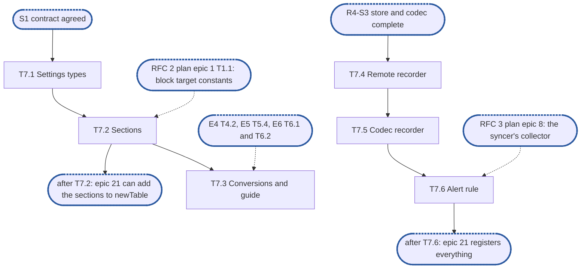

# Epic 7: remote tier v2 integration, keys and observability

**Sources:** [RFC 13](../docs/internals/rfcs/rfc-13-configuration.md) Appendix B's rows for the
remote store's `remote.endpoint`, `remote.credential`, `remote.region`, `remote.trust_roots`,
`remote.bucket`, `remote.storage_class` and `remote.block_target`, and for the namespace's
`remote.prefix` and `remote.block_format_version` (the last five named by this pull request's
amendment of Appendix B, §9 point 1), with §4.2 (a default or required), §5 (the binding classes),
§5.1 (bound), §5.2 (reaching the same content another way), §5.4 (a format version written only
once every reader reads it) and §5.5's single-node paragraph, §6 (refused, never replaced; checked
twice) and §7 (no secret value), and §9's "§6 block target range" row and the single-node part of
its "§5.4 format version" row; [RFC 4](../docs/internals/rfcs/rfc-4-remote-tier.md) §3.5 (the
version written is a namespace setting), §4.12 (the definitions of every `remote_` and `codec_`
series and the recorders behind them), Appendix C.3's region, trust-root and HTTPS clauses as the
settings state them, and Appendix C.1's pinned storage class; [RFC 2](../docs/internals/rfcs/rfc-2-carver.md)
§5.2's block target range; [RFC 25](../docs/internals/rfcs/rfc-25-observability.md) §2.1 to §2.4,
§2.6, §2.9 for the series and §7's ticket on `codec_verify_failures_total`. Cited, not owned:
[RFC 3](../docs/internals/rfcs/rfc-3-syncer.md) §2.12 (`syncer_retries_total`, which the alert
subtracts); RFC 4 §4.10 (no key sets the client's limit); [RFC 0](../docs/internals/rfcs/rfc-0-data-lifecycle.md)
§1.2 (only the composers import `pkg/settings` and `pkg/metrics`). Every citation is `develop`'s
text with this pull request's RFC 13 amendment; the code lands on `feat/storage-v2`, and the paths
below are paths there.
**Track:** the team.
**Epic 7 estimate: 6 subtasks, 9.25 man-days.**
**Depends on:** **S1**, E1's frozen surface: `pkg/remote`'s errors, the codec's `Config.Version`,
`Recorder` and `MaxHeaderLen` (T1.3); the RFC 13 plan's `pkg/settings` (`Of`, `SelfKey`,
`Required`, `SecretRef`, `FormatVersion`, the `class` and `location:"store"` tags, `Check`, `Read`,
`Versions`), on `feat/storage-v2` already; the RFC 2 plan's epic 1, T1.1, for
`carver.MinBlockTarget` and `carver.MaxBlockTarget`. For the conversions, **E4**'s T4.2
(`NewClient`, `ClientConfig`, `Deps`), **E5**'s T5.4 (`ClientConfig.MaxBlockSize`, the checked
`Open`) and **E6**'s T6.1 and T6.2 (`MaxHeaderLen`'s bound, `New`'s write gate). For the
observability half, **R4-S3**: E4's `Recorder` and the calls that record through it (T4.2 to
T4.7), E5's `Capability` and `health` op (T5.4, T5.5), E6's recording (T6.2 to T6.4). For the alert
only, the RFC 3 plan's epic 8, whose collector in `internal/node/content` exports
`syncer_retries_total`.
**Blocks:** **RFC 8 offload plan epic 21**, which adds this epic's three sections to the node's
table with how each change reaches its component, builds every client and `codec.Store` with this
epic's conversions and recorders, registers the alert rule, and unseals the credential; **E8**,
whose §4.10 row reads `remote_connections_opened_total` from a scrape of this epic's recorder and
whose limit rule (no key sets it) is this epic's key table; **E9**, which runs everything over real
services.

---

## 1. Goal

Epic 7 gives the remote tier its keys and its metrics. The S3 store and the codec declare their
settings as plain tagged structs with the validators the control plane calls, the node's content
wiring turns them into `pkg/settings` sections, and the content wiring turns a store
configuration's settings and credential into the client's configuration. On the observability
side the content wiring implements the recorders `pkg/remote/s3` and `pkg/remote/codec` declare
over the node's registry, and holds the series definitions and the one alert rule.

**At the end of the epic:**

- `content.Sections()` returns the remote store's section (`remote.*`, seven keys) and the
  namespace's two (`remote.prefix`, `remote.block_format_version`), each key with RFC 13 Appendix
  B's scope, class and default, and RFC 13's Appendix B check passes over them;
- a block target outside `carver.MinBlockTarget` to `carver.MaxBlockTarget`, an endpoint that is
  not HTTPS, a prefix that does not end in `/`, an archive storage class, a trust-root value
  holding no certificate, or a plaintext in place of the credential's reference is refused at
  write and at start, naming the key and the rule;
- a write of `remote.block_format_version` past what the node reads is refused, and the range the
  gate admits is the range the codec writes;
- a store configuration's settings and its unsealed credential become an `s3.ClientConfig`, and a
  namespace's format version becomes `codec.Config.Version`;
- every series of RFC 4 §4.12 is recorded through the recorders the content wiring builds,
  registered once in a test registry and read from a scrape; a released store or namespace's
  series are deleted; `codec_verify_failures_total` reads 0 for every kind before any failure;
- the alert rule's expression names only series that a registry holding the remote, codec and
  syncer collectors exports;
- `docs/guide/configuration.md` describes the remote store's keys and the credential's format.

### 1.1 In scope

The settings structs and their validators in `pkg/remote/s3` and `pkg/remote/codec`; the three
sections in `internal/node/content`; the Appendix B rows brought to `feat/storage-v2` with the
bootstrap's list of setting keys; the API tests' table switched to the real sections; the
conversions to `s3.ClientConfig` and `codec.Config.Version`; the credential's format; the two
recorders, the definitions and their deletion; the alert rule as a value; the configuration
guide's remote store section.

### 1.2 Out of scope

- **RFC 8 offload plan epic 21:** adding the sections to `newTable` and to `newReaches` (how a
  change of each key reaches the client or the codec), unsealing the credential, the holding of
  one client per store configuration, the largest encoded block it passes as `MaxBlockSize`,
  registering the collectors and the alert rule in the node, the label value each entity takes
  (§9 point 2), and the alert rules' form (the RFC 3 plan's O7), which D10 offers a shape for.
- **E8:** the limit passed to `clientConfig`; until then epic 21 passes its own sum.
- **E4, E5, E6:** the client, the open and the codec that consume these values; E5's refusal text,
  which already names every missing feature (its D4).
- **RFC 23**, the RFC 4 plan's §6.1 deferral ledger row "A remote store's credential set through
  the API running the capability check": the API's call of `Open`, and so the refused open shown
  as a field error, which needs nothing exported from this epic (D11). Until then `pkg/settings`
  refuses every change of a key marked `location:"store"` with `ErrUnproven`, and RFC 13 §9's
  "§5.2 same content" row waits with it.
- **RFC 15**, the §6.1 ledger row on RFC 13 §9's "§5.4 format version" row: its two-node half.
- **RFC 5 plan epic 9:** the chain's keys, which join this epic's remote store section (D2).
- **The RFC 2 plan's epic 3 and RFC 8 offload plan epic 21:** `Target`'s key, which RFC 13 has not
  named; this epic names only its own rows.
- **RFC 25's registry:** the cap of 64 values per entity label with its `_other` series and
  `metrics_label_capped` (RFC 25 §2.4), which `pkg/metrics` does not implement yet (its
  `ponytail:` on `Spec`); the recorders record whatever label value they are given.

### 1.3 Names used here

- **E1**, epic 1, interfaces: `pkg/remote`'s contract and the codec's surface, frozen at S1.
- **E4**, epic 4, S3 data path, errors and client: `NewClient`, `ClientConfig`, `Deps`, the
  `Recorder`.
- **E5**, epic 5, capability check and health: `MaxBlockSize`, the checked `Open`, `Capability`.
- **E6**, epic 6, block codec: `MaxHeaderLen`'s bound, the write gate, the codec's recording.
- **E7**, this epic.
- **E8**, epic 8, integration: the client limit.
- **E9**, epic 9, E2E green.
- **S1**, the plan's first synchronisation point, the remote store contract agreed (the RFC 8
  offload plan's S1c).
- **R4-S3**, store and codec complete: epics 3 to 6 done. **S3** names the storage service
  (Amazon S3 and the services compatible with it) everywhere else in this document.
- **RFC 8 offload plan epic 21**: the epic of the RFC 8 offload plan that composes the codec, the
  store and the syncer in the node and its content wiring.
- **The content wiring**, `internal/node/content`: the part of the node that builds the content
  components and hands each its configuration, one of RFC 0 §1.2's two composers.

## 2. How the general rules apply

The rules are those of [the RFC 4 implementation plan's §1.5](rfc-4-remote-tier-plan.md#15-general-rules-for-each-epic),
cited by number and title and not copied.

| Rule | Subtasks | How |
| --- | --- | --- |
| rule 1, independent unit tests ([`CLAUDE.md`, "Writing tests"](../CLAUDE.md#writing-tests)) | all | the validators and the conversions are functions of values, table-tested; the sections run through `pkg/settings`' real `Check` and `Read` over a `kvstore` on `t.TempDir()`, as `internal/node/appendixb_test.go` does; the recorders over a real `metrics.New` registry read by a scrape of its handler. No double |
| rule 2, fuzz tests where relevant ([`CLAUDE.md`, "By kind"](../CLAUDE.md#by-kind)) | none | nothing here decodes bytes off the wire or the disk: the credential is a JSON object the standard decoder reads, and `pkg/settings` decodes every row and fuzzes its own decoder |
| rule 3, observability follows RFC 25 | T7.3 to T7.6 | the series' names, units, labels and buckets are RFC 4 §4.12's and RFC 25 §2's, defined in the content wiring (D7); no package under `pkg/remote` imports `pkg/metrics`; the credential's access key and secret appear in no error, log line or label (T7.3, T7.4) |
| rule 4, profiling | T7.4, T7.5 | recording allocates nothing, asserted with `testing.AllocsPerRun` in `unit`'s `remote-allocs` option, which E6 registers and which runs without `-race` (RFC 25 §2.9) |
| rule 5, public interface and internals ([`CLAUDE.md`, "Verifying a change"](../CLAUDE.md#verifying-a-change)) | all | each key is tested where its value is consumed: a refusal through `Check`, which the API's write calls, and through `Read`, which a start calls; a trust root by a client that dials with it; a series by a scrape, what an operator reads |
| rule 6, known failures shrink | none | `unit` and `integration` keep no `known.yaml`; each test lands green with its subtask |
| rule 7, v2 ignores v1, and imports only what RFC 0 §1.2 allows | T7.1, T7.2 | `pkg/remote/s3` and `pkg/remote/codec` gain stdlib imports only (`crypto/x509`, `strings`); `pkg/settings`, `pkg/metrics` and `pkg/carver` are imported by the content wiring alone, a composer; E1's import walk covers the new files. The v1 declarations of `remote.endpoint` and `remote.credential` give way to the real section (T7.2) |
| rule 8, real dependencies for properties of those dependencies ([`CLAUDE.md`, "Writing tests"](../CLAUDE.md#writing-tests)) | T7.3 | the trust root converted from a setting is shown trusted by a TLS handshake with an `httptest.NewTLSServer` listener on `127.0.0.1:0`, not by inspecting the pool |
| rule 9, code comment conventions ([`CLAUDE.md`, "Code comments"](../CLAUDE.md#code-comments)) | T7.2, T7.4, T7.6 | D6's `decision:` at the format version's default, D8's at an unbound prefix's dropped capability, D10's at the alert's window |
| rule 10, a test must be able to fail ([`CLAUDE.md`, "Writing tests"](../CLAUDE.md#writing-tests)) | all | each test names the break it catches. R7 is a review rule on the key table, backed by the pinned key list of T7.2; R19 is a review rule while one block format version exists (T7.2) |
| rule 11, a symbol is exported only if the RFC's interface uses it | T7.1, T7.2, T7.6 | exported: `s3.Settings`, `s3.NamespaceSettings` and `codec.Settings` with their `Validate`, which `pkg/settings`' `Of` requires and the control plane calls (RFC 13 §6); `content.Sections`, which the node's table reads; `content.Alert` and `content.VerifyAlert`, which the node registers. The recorders and conversions stay unexported: epic 21's holding sits in the same package |
| rule 12, each subtask creates only what it declares | all | each file lands with its first consumer, named in its subtask; the recorders' unexported constructors are consumed by their tests and by epic 21's holding |

## 3. Requirements and invariants

Every obligation the sources place on this epic, numbered so subtasks and tests can cite them.

**The keys**

| # | Requirement | Kind | Source | Subtasks |
| --- | --- | --- | --- | --- |
| R1 | The remote store's section declares, at remote store scope, `remote.endpoint` and `remote.credential` (live, under §5.2, required), `remote.region` (live, under §5.2, `us-east-1`), `remote.trust_roots` (live, under §5.2, none: the system's roots), `remote.bucket` (bound, required), `remote.storage_class` (next write, `STANDARD`) and `remote.block_target` (next write, 4 MiB), each with Appendix B's class | MUST | RFC 13 Appendix B, §5; RFC 4 C.3 | T7.1, T7.2 |
| R2 | The namespace declares, at namespace scope, `remote.prefix` (bound, required) and `remote.block_format_version` (next write, the newest version every node reads) | MUST | RFC 13 Appendix B, §5.4; RFC 4 §3.5 | T7.1, T7.2 |
| R3 | Every key has a default or is required; a record that omits `remote.endpoint`, `remote.bucket`, `remote.credential` or `remote.prefix` is refused | MUST | RFC 13 §4.2 | T7.2 |
| R4 | A change to `remote.bucket` or `remote.prefix` is refused while the store or namespace holds content | MUST | RFC 13 §5.1 | T7.2 |
| R5 | The keys that say how to reach content (endpoint, credential, region, trust roots, bucket, prefix) are marked as the store's location, so a change is refused until the capability check proves the claim at the new location; a first value is no change | MUST | RFC 13 §5.2, Appendix B ("under §5.2") | T7.2 |
| R6 | `remote.credential` holds a reference to a secret of the remote credential kind, never a value; a plaintext in its place is refused, and no refusal prints it | MUST, MUST NOT | RFC 13 §6, §7 | T7.2 |
| R7 | No key sets a client's connection limit, and no key skips certificate verification | invariant | RFC 4 §4.10, C.3; RFC 13 Appendix B (`remote.trust_roots`) | T7.2 |

**Validation**

| # | Requirement | Kind | Source | Subtasks |
| --- | --- | --- | --- | --- |
| R8 | A value out of range, of the wrong type or naming nothing is refused, naming the key and the rule, and never clamped, rounded or replaced by a default | MUST, MUST NOT | RFC 13 §6 | T7.1, T7.2 |
| R9 | The control plane and the component run the same rules: each rule a key shares with the S3 client or its open is one function both call | MUST | RFC 13 §6 ("Checked twice") | T7.1 |
| R10 | An endpoint that is not HTTPS is refused | MUST | RFC 4 C.3 | T7.1 |
| R11 | Every object is written in one class the profile pins, `STANDARD` unless set, never the service's default; an archive class, whose get needs a restore, is refused | MUST | RFC 4 C.1; RFC 13 Appendix B | T7.1 |
| R12 | Trust roots replace the system's roots when set; a value holding no certificate is refused | MUST | RFC 4 C.3; RFC 13 Appendix B | T7.1, T7.3 |
| R13 | Requests are signed for the configured region, `us-east-1` unless `remote.region` sets another | invariant | RFC 4 C.3 | T7.1, T7.3 |
| R14 | A block target outside 1 MiB to 64 MiB is refused when written and at start, never clamped; the bounds are the carver's constants | MUST | RFC 2 §5.2; RFC 13 Appendix B | T7.2 |
| R15 | §6: a block target of 512 KiB and of 128 MiB each refused, naming the key and the range; 1 MiB and 64 MiB accepted | test row | RFC 13 §9 | T7.2 |

**The block format version**

| # | Requirement | Kind | Source | Subtasks |
| --- | --- | --- | --- | --- |
| R16 | The version written is a namespace setting; the control plane refuses to advance it past the versions the node reads | MUST | RFC 4 §3.5; RFC 13 §5.4 | T7.2 |
| R17 | §5.4, single node: advancing the namespace's version past what the node reads is refused, and the newest it reads is accepted. The two-node half is RFC 15's | test row | RFC 13 §9 | T7.2 |
| R18 | The range the settings gate admits for the block format is the range the codec writes | invariant | RFC 13 §5.4, §5.5 | T7.3 |
| R19 | A new binary keeps writing the version already written and raises it only through the control plane, never at open | invariant | RFC 13 §5.5 | T7.2 |

**Building the client**

| # | Requirement | Kind | Source | Subtasks |
| --- | --- | --- | --- | --- |
| R20 | The credential's reference is resolved when the client is built: its value gives the access key and the secret; a value that does not parse is refused | MUST | RFC 13 §7 | T7.3 |
| R21 | Neither the access key nor the secret appears in an error, a log line or a metric label | MUST NOT | RFC 13 §6, §7, §9 ("§7 no secret out"); RFC 25 §2.4 | T7.3, T7.4 |

**Observability**

| # | Requirement | Kind | Source | Subtasks |
| --- | --- | --- | --- | --- |
| R22 | Every store exports the same series, labelled by store: `remote_requests_total` by `op` and `result`, `remote_bytes_total` by `op`, `remote_connections_opened_total`, `remote_list_foreign_total`; a backend adds none of its own | MUST | RFC 4 §4.12 | T7.4 |
| R23 | `remote_request_seconds` folds `op` to `put`, `get`, `delete`, `list`, `health` and `other`, on the `request` buckets | MUST | RFC 4 §4.12; RFC 25 §2.6 | T7.4 |
| R24 | An `ErrDenied` result is labelled with its cause; a call its caller cancelled or whose body reader failed is `result="local"` | MUST | RFC 4 §4.12 | T7.4 |
| R25 | `remote_capability` reports the last check per feature, 1 if present, labelled by store and `namespace`, `conditional_put` among the features | MUST | RFC 4 §4.12 | T7.4 |
| R26 | The codec exports `codec_chunks_verified_total`, `codec_measuring_passes_total`, `codec_verify_failures_total` by `kind` (`hash`, `name`, `version`, `malformed`) and `codec_seconds` by direction, labelled by store | MUST | RFC 4 §4.12 | T7.5 |
| R27 | Each event is counted in one place: a recorder adds to a series only what its component reported | MUST | RFC 4 §4.12; RFC 25 §2.7 | T7.4, T7.5 |
| R28 | Names are `<component>_<what>[_<unit>][_total]` under RFC 4's prefixes, in seconds and bytes; a label is a closed set or an entity label, and none is forbidden | MUST, MUST NOT | RFC 25 §2.1, §2.2, §2.4 | T7.4, T7.5 |
| R29 | A counter an alert reads is exported from start, at zero, for every value of its closed labels: `codec_verify_failures_total` for each `kind` | MUST | RFC 25 §2.3 | T7.5 |
| R30 | A series is resolved once, when its entity is added; recording is an add or an observe, with no label lookup and no allocation | invariant | RFC 25 §2.9 | T7.4, T7.5 |
| R31 | When an entity is removed, the component that created its series deletes them | invariant | RFC 25 §2.4 | T7.4, T7.5 |
| R32 | The one alert is a ticket on `codec_verify_failures_total` less the failures the syncer's re-get recovered (`syncer_retries_total`, `reason` = `verify`), and it names series that exist | MUST | RFC 25 §7; RFC 4 §4.12; RFC 3 §2.12 | T7.6 |

## 4. Decisions this epic takes

- **D1. The five unnamed rows take keys under `remote.`, pending the user's answer.** RFC 13
  Appendix B named no key for the bucket, the storage class, the block target, the prefix or the
  block format version, and the Appendix B check (`internal/node/appendixb_test.go`) fails a table
  key the appendix lacks, so the keys must be in RFC 13 before epic 21 adds the sections. This pull
  request amends Appendix B with `remote.bucket`, `remote.storage_class`, `remote.block_target`,
  `remote.prefix` and `remote.block_format_version`, and §6's example refusal with
  `remote.prefix`. Every key this component reads then sits under one word, whichever scope holds
  it, and an operator reading `remote.prefix` beside `remote.bucket` sees one location. The
  alternative is a prefix per package (`codec.format_version`, `namespace.prefix`), which follows
  the code rather than what an operator configures. Prior art: rclone's S3 backend names its
  options `endpoint`, `region`, `bucket` and `storage_class` under the remote's name (from memory).
  Changing a name once epic 21 registers it means editing the RFC row, the struct tag and every
  provisioning file that uses it. §9 point 1.
- **D2. The settings are plain tagged structs in the component; the block target is the content
  wiring's field.** `pkg/settings`' `Of` reads a Go struct whose fields carry `json`, `class` and
  `location` tags and whose `Validate` it calls; tags are strings, so `pkg/remote/s3` and
  `pkg/remote/codec` declare their rows and own their rules (RFC 13 §6) without importing
  `pkg/settings`. The block target's range must read the carver's constants, which `s3` may not
  import (rule 7), so the content wiring's section embeds `s3.Settings` and adds the field. The
  same struct is where RFC 5 plan epic 9 joins the chain's keys to the remote store's section.

  ```go
  package s3 // pkg/remote/s3/settings.go

  // Settings is a store configuration's settings (RFC 13 Appendix B), the content wiring's
  // section of them; Validate is the rule the control plane and the client share (RFC 13 §6).
  type Settings struct {
  	Endpoint     string `json:"endpoint" class:"live" location:"store"`
  	Credential   string `json:"credential" class:"live" location:"store"` // a secret's reference
  	Region       string `json:"region" class:"live" location:"store"`
  	TrustRoots   string `json:"trust_roots" class:"live" location:"store"` // PEM; "" is the system's
  	Bucket       string `json:"bucket" class:"bound" location:"store"`
  	StorageClass string `json:"storage_class" class:"next write"`
  }

  func (s Settings) Validate() error

  // NamespaceSettings is a namespace's location in the bucket (RFC 4 §4.2).
  type NamespaceSettings struct {
  	Prefix string `json:"prefix" class:"bound" location:"store"`
  }

  func (s NamespaceSettings) Validate() error
  ```

  ```go
  package codec // pkg/remote/codec/settings.go

  // Settings is a namespace's block format version to write (RFC 4 §3.5).
  type Settings struct {
  	Version uint8 `json:"version" class:"next write"`
  }

  func (s Settings) Validate() error // refuses 0; an unknown version is the gate's and New's (E1 D5)
  ```

  `Validate` never prints `Credential`. The architect pass proposed the tagged structs in the
  content wiring, with the packages exporting pure parsers; it was not taken, since the rules
  would then be the content wiring's, or need one export each to stay the component's. Prior art:
  the RFC 2 plan's `pkg/carver/section` (plain values, no `pkg/settings`); `internal/identity/settings.go`.
- **D3. Three sections, two of them one key each.** A section's prefix is unique in the table, so
  the two namespace keys take a section each through `SelfKey`, beside the remote store's:

  ```go
  package content // internal/node/content/remote_settings.go

  type remoteSettings struct {
  	s3.Settings
  	BlockTarget int64 `json:"block_target" class:"next write"`
  }

  func (r remoteSettings) Validate() error // s3.Settings.Validate, then carver.MinBlockTarget..MaxBlockTarget

  // Sections is the remote tier's settings sections, for the node's table (RFC 13 Appendix B).
  func Sections() []settings.Section {
  	return []settings.Section{
  		settings.Of("remote", settings.At(entity.ScopeRemote),
  			remoteSettings{Settings: s3.Settings{Region: "us-east-1", StorageClass: "STANDARD"}, BlockTarget: 4 << 20},
  			settings.Required("Endpoint", "Credential", "Bucket"),
  			settings.SecretRef("Credential", entity.SecretRemoteCredential)),
  		settings.Of("remote.prefix", settings.At(entity.ScopeNamespace), s3.NamespaceSettings{},
  			settings.SelfKey(), settings.Required("Prefix")),
  		settings.Of("remote.block_format_version", settings.At(entity.ScopeNamespace),
  			codec.Settings{Version: 1}, settings.SelfKey(), settings.FormatVersion("Version")),
  	}
  }
  ```

  The table allows a section whose prefix lies under another's, as `identity` and
  `identity.directory` do, and `remote` generates no key named `prefix` or
  `block_format_version`. Prior art: `internal/node/settings.go`'s `newTable`.
- **D4. One rule per check, shared with the client.** `Settings.Validate` and `NewClient` call one
  unexported `checkEndpoint` (`https://` and a host); `NamespaceSettings.Validate` and `Open` call
  one `checkPrefix` (non-empty, ends in `/`, E4's D1); `Validate` and E5's `judgeClass` read one
  unexported list of archive classes (`GLACIER`, `DEEP_ARCHIVE`, E5's D7). Whichever of T7.1, E4's
  T4.2 and T4.3 or E5's T5.1 lands first writes the function and the others call it. A trust-root
  value is refused when `x509.NewCertPool().AppendCertsFromPEM` finds no certificate, the call the
  conversion makes (D5). An empty region, bucket or storage class is refused, since each has a
  default or is required and an explicit empty value is neither. Prior art: none needed.
- **D5. The credential is a JSON object, parsed in the content wiring.** The sealed value of a
  remote credential is `{"access_key_id": "...", "secret_access_key": "..."}`; `clientConfig` reads
  it with `encoding/json`'s strict decoding (unknown fields refused), and refuses an empty field.
  Its error says which field is missing or that the value is not such an object, and never quotes
  the value or the decoder's text, which embeds what it could not read (RFC 13 §6). A JSON object
  takes a session token or a role later without re-sealing every stored credential in a new
  format. The architect pass proposed `access:secret` split at the first colon; it was not taken
  for that reason. Prior art: rclone's S3 options `access_key_id` and `secret_access_key`; the AWS
  shared credentials file's `aws_access_key_id` and `aws_secret_access_key` (from memory).

  ```go
  // clientConfig is a store configuration's client configuration (RFC 4 C.3). limit is E8's,
  // maxBlock the largest encoded block epic 21 computes (RFC 3 §2.2).
  func clientConfig(s remoteSettings, credential []byte, limit int, maxBlock int64) (s3.ClientConfig, error)
  ```
- **D6. The format version's default is 1, a constant.** RFC 13 §5.4 defaults it to the newest
  version every node reads; on one node with one version that is 1. A default that followed
  `settings.Versions()[entity.FormatBlock].Max` would make a binary that learns version 2 write
  it at once on every namespace that never set the key, which §5.5 forbids: a new binary keeps
  writing the old version until the control plane raises it. A `decision:` marker at the default
  names the ceiling: when a second version lands, the default becomes the installation's active
  block format version, which the node reads from its installation record. Prior art: none needed.
- **D7. The series' definitions and the alert rule live in the content wiring, beside the
  recorders.** A definition's only reader is the recorder that registers it, and `s3` and `codec`
  may not import `metrics.Spec`, so a definition in either would be a second spec type with one
  consumer. RFC 25 §2.8 keeps the name the owning RFC's wherever the code exporting it sits. This
  departs from the layout's `metrics.go` and `alerts.go` under `pkg/remote/s3` and
  `pkg/remote/codec`, which nothing else names. The architect pass proposed the same. Prior art:
  the RFC 3 plan's D4, the syncer's collector in `internal/node/content`.
- **D8. One recorder of each kind per store configuration, resolved at construction.**

  ```go
  package content // internal/node/content/remote_metrics.go

  // remoteRecorder implements s3.Recorder for one store configuration (RFC 4 §4.12).
  func newRemoteRecorder(m *metrics.Metrics, store string) *remoteRecorder
  func (r *remoteRecorder) Call(op, result, cause string, took time.Duration, bytes int64)
  func (r *remoteRecorder) ConnOpened()
  func (r *remoteRecorder) ForeignKey()
  func (r *remoteRecorder) Capability(prefix, feature string, present bool)
  // bind names the namespace a prefix's capability series carry; unbind deletes them.
  func (r *remoteRecorder) bind(prefix, namespace string) (unbind func())
  func (r *remoteRecorder) close() // deletes every series carrying this store

  // codecRecorder implements codec.Recorder for every codec.Store on one store configuration.
  func newCodecRecorder(m *metrics.Metrics, store string) *codecRecorder
  func (r *codecRecorder) close()
  ```

  The constructor resolves every combination of the closed sets into arrays indexed by each
  value's position, so a call indexes and adds (RFC 25 §2.9): for `remote_requests_total` the
  seven v1.1 `op`s by `ok`, the six sentinels other than `denied`, `local`, and `denied` with each
  of its three causes. `bind` resolves a namespace's twelve features. A `Capability` for a prefix
  no `bind` named records nothing, behind a `decision:` marker: epic 21 binds before it opens, and
  a series under a made-up namespace would be worse than none. `close` and `unbind` use the
  vectors' `DeletePartialMatch` on `store`, or on `store` and `namespace`. The codec's recorder is
  per configuration, not per namespace, so a namespace closing deletes no series its neighbours
  share. The architect pass proposed a codec recorder per namespace; it was not taken, since RFC 4
  §4.12 labels the codec's series by store only. Prior art: the RFC 5 plan's D2 (#5532), the same
  recorder shape.
- **D9. The labels.** `remote_requests_total{store, op, result, cause}`, `cause` empty except on
  `denied`; `remote_request_seconds{store, op}`; `remote_bytes_total{store, op}`;
  `remote_connections_opened_total{store}`; `remote_list_foreign_total{store}`;
  `remote_capability{store, namespace, feature}`; `codec_chunks_verified_total{store}`;
  `codec_measuring_passes_total{store}`; `codec_verify_failures_total{store, kind}`;
  `codec_seconds{store, direction}`, `direction` being `encode` for `remote.DirPut` and `decode`
  for `remote.DirGet`, on the `request` buckets, since a decode is what a demand read waits on.
  These are E4's D3 labels, which E4 left to this epic to declare. Prior art: none needed.
- **D10. The alert rule is a value of three strings.**

  ```go
  package content // internal/node/content/remote_alerts.go

  // Alert is one alerting rule (RFC 25 §7): its name, its expression over the exported names,
  // and its class, page or ticket.
  type Alert struct{ Name, Expr, Severity string }

  // VerifyAlert is the ticket on chunks that failed verification and that the syncer's single
  // re-get did not recover (RFC 4 §4.12).
  var VerifyAlert = Alert{
  	Name: "codec_verify_failures",
  	Expr: `sum by (store) (increase(dittofs_codec_verify_failures_total[1h]))` +
  		` - sum by (store) (increase(dittofs_syncer_retries_total{reason="verify"}[1h])) > 0`,
  	Severity: "ticket",
  }
  ```

  A re-get that recovers adds one to each side; one that fails again adds a second failure. The
  one-hour window keeps a failure and its re-get, seconds apart, inside one window; a `decision:`
  marker names the ceiling, a pair split across the window's edge raising a spurious ticket, and
  the upgrade, a counter of unrecovered failures kept by whoever sees both, if one shows. Epic 21
  owns the rules' form (the RFC 3 plan's O7): if its form lands first, this value takes it;
  otherwise this is the first rule and epic 21 adopts or adapts one variable. Prior art: the
  Prometheus alerting rule's `alert`, `expr` and `labels.severity` (read the documentation).
- **D11. A refused open needs nothing exported for the API.** E5's refusal wraps `remote.ErrInvalid`
  and its text names every missing feature and no credential (E5's D4, R31). The API's field error,
  when RFC 23 wires the check (§1.2), is `errors.Is(err, remote.ErrInvalid)` with the text as its
  detail, on the key the write set. An exported list of the missing features would pin a signature
  no v1.1 code calls. The architect pass reached the same. Prior art: none needed.
- **D12. The v1 keys give way to the section.** The API's `storeEndpoint` and `storeCredential`
  (`internal/node/api/res_stores.go`) stay as the API's names for two keys the table now declares,
  and its tests run on the real section instead of `writeTable`'s own `remoteFields`, so a renamed
  key fails every store test. The `ponytail:` there keeps its audit and ETag ceiling and loses its
  "once it names them" clause. `pkg/bootstrap/keyspec.go`'s `settingKeys` is Appendix B's list,
  held to it by `TestSettingKeysMatchAppendixB`, so it gains the new keys when the appendix reaches
  `feat/storage-v2`. `cmd/dfsctl/internal/clisuite/stores.go`'s refusal of `remote.region` as an
  unknown key becomes a refusal of an undeclared one. Prior art: none needed.

## 5. Target tree

```text
pkg/remote/s3/
  settings.go          T7.1  Settings, NamespaceSettings and their Validate (D2, D4)
  settings_test.go     T7.1  the validators' tables
pkg/remote/codec/
  settings.go          T7.1  Settings and its Validate (D2)
  settings_test.go     T7.1
internal/node/content/
  remote_settings.go   T7.2  remoteSettings, Sections (D3); T7.3 clientConfig, the credential (D5)
  remote_settings_test.go  T7.2, T7.3
  remote_metrics.go    T7.4  the remote_ definitions, remoteRecorder (D8, D9); T7.5 the codec_ ones, codecRecorder
  remote_metrics_test.go   T7.4, T7.5
  remote_alerts.go     T7.6  Alert, VerifyAlert (D10)
  remote_alerts_test.go    T7.6
internal/node/
  appendixb_remote_test.go  T7.2  Appendix B and the refusal-leak checks over Sections
internal/node/api/
  res_stores.go        T7.2  the ponytail reworded (D12)
  writepath_test.go    T7.2  the real remote section in place of remoteFields
cmd/dfsctl/internal/clisuite/stores.go  T7.2  the unknown-key case moved off remote.region
pkg/bootstrap/keyspec.go                T7.2  settingKeys with Appendix B's remote keys
docs/internals/rfcs/rfc-13-configuration.md  T7.2  Appendix B's remote rows, as develop has them
docs/guide/configuration.md             T7.3  the remote store section
```

## 6. Subtasks

### T7.1 The settings types in `pkg/remote/s3` and `pkg/remote/codec`

**Subtask T7.1 estimate: 1.25 man-days.**

- **Track:** the team. **Depends on:** S1.
- **Covers:** R1's and R2's fields, R8–R13.
- **Deliverables:** `pkg/remote/s3/settings.go`: `Settings`, `NamespaceSettings` and their
  `Validate`, over the unexported `checkEndpoint`, `checkPrefix` and archive-class list of D4,
  shared with `NewClient`, `Open` and E5's `judgeClass` once they land. `pkg/remote/codec/settings.go`:
  `Settings` and its `Validate`. Consumed by T7.2.
- **Acceptance criteria:**
  - `Validate` refuses an `http://` or host-less endpoint, an empty region, bucket or storage class,
    `GLACIER` and `DEEP_ARCHIVE`, and a trust-root value with no certificate, each error naming the
    field and the rule and none holding `Credential`'s value.
  - `NamespaceSettings.Validate` refuses `""` and `ns`, accepts `ns/`; `codec.Settings.Validate`
    refuses 0 and accepts 1 and 2.
  - Where `NewClient` or `Open` exists, it refuses the same endpoint and prefix through the same
    function.
- **Tests:** tables over values, at `Validate`, the call the control plane makes. Each refusal
  above beside its accepted neighbour (catches a rule inverted or missing, R8, R10–R12); a
  `Settings` whose `Credential` holds `AKIA-secret-value` and an invalid endpoint, the error read
  for that string (catches a validator that prints every field, R6, R21); where E4 has landed, the
  same endpoint table through `NewClient` (catches the two rules drifting, R9). No double.
- **Rules:** rule 7: `crypto/x509` and `strings` only.

### T7.2 The sections in the content wiring

**Subtask T7.2 estimate: 2.25 man-days.**

- **Track:** the team. **Depends on:** T7.1; the RFC 2 plan's epic 1, T1.1.
- **Covers:** R1–R8, R14–R17, R19.
- **Deliverables:** `internal/node/content/remote_settings.go`: `remoteSettings` and its `Validate`
  against `carver.MinBlockTarget` and `carver.MaxBlockTarget`, `Sections` (D3) with D6's
  `decision:` at the format version's default. `internal/node/appendixb_remote_test.go`. D12's
  edits: the API tests' table, the `ponytail:` in `res_stores.go`, the CLI suite's unknown-key
  case, `settingKeys`, and RFC 13 Appendix B's remote rows brought to `feat/storage-v2` from
  `develop`. Consumed by T7.3 and by RFC 8 offload plan epic 21, which adds `Sections` to
  `newTable`.
- **Acceptance criteria:**
  - `compareAppendixB` over a table of `Sections()` reports no failure, and the section declares
    exactly the seven and two keys of R1 and R2.
  - Through `Check`: a record missing each required key refused; `remote.block_target` 512 KiB and
    128 MiB refused naming the key and the range, 1 MiB and 64 MiB accepted; a change of
    `remote.bucket` or `remote.prefix` with content refused as bound; a change of each location
    key, those two without content among them, refused `ErrUnproven`, and its first value accepted; a plaintext in
    `remote.credential` refused; `remote.block_format_version` 2 refused `ErrFormatVersion` and 1
    accepted.
  - Through `Read`, the start's path, a stored `remote.block_target` of 128 MiB refused.
- **Tests:** in `unit`, in `internal/node/appendixb_remote_test.go`, over a `kvstore` on
  `t.TempDir()` with `appendixb_test.go`'s helpers (`tableStore`, `putBeneathCheck`,
  `compareAppendixB`, `refLeaks`). The
  Appendix B comparison (catches a class, scope or key name drifting from RFC 13, R1, R2, R7); a
  pinned list of every declared key (catches a key added unreviewed, such as a limit or a skip of
  verification, R7); `refLeaks` over the remote section (catches a refusal printing a reference
  or a plaintext, R6); R15's four values through `Check` and the 128 MiB one through `Read`
  (catches the range checked only at write, or copied as numbers that the carver's change leaves
  behind, R14, R15); the bound, location, required and format-version cases above (catch a
  missing tag or option, R3–R5, R16, R17). R19 has no test while the block format has one
  version, since a default of 1 and one that follows the binary's newest read the same: D6's
  `decision:` and a review rule hold it until a second version lands. The API's store tests and
  the CLI suite pass on the real section. No double.
- **Rules:** rule 9: D6's `decision:`; rule 11: `Sections` is the one export.

### T7.3 The conversions and the configuration guide

**Subtask T7.3 estimate: 2 man-days.**

- **Track:** the team. **Depends on:** T7.2; E4's T4.2; E5's T5.4; E6's T6.1 and T6.2.
- **Covers:** R12, R13, R18, R20, R21.
- **Deliverables:** in `remote_settings.go`, `clientConfig` (D5) and the namespace's
  `codec.Config.Version` from its section. `docs/guide/configuration.md`'s remote store section:
  each key with its scope, class and default, the credential's JSON form with an example, the
  trust roots as a PEM bundle, the region, the storage class and its failure domain as E5 logs it,
  and that no key sets the connection limit or skips verification. Consumed by RFC 8 offload plan
  epic 21's holding and E8.
- **Acceptance criteria:**
  - `clientConfig` maps every field, `Region` `us-east-1` from the default, and returns `ErrInvalid`
    wrapped for a credential that is not the object, has an unknown field or an empty one.
  - A client built from a `clientConfig` whose trust roots hold an `httptest.NewTLSServer`'s
    certificate completes the TLS handshake with it; the same config with `TrustRoots` empty does
    not.
  - For every version from `settings.Versions()[entity.FormatBlock].Min` to its `Max`,
    `codec.MaxHeaderLen` answers known, and for `Max + 1` unknown.
- **Tests:** in `unit` for the mapping and the credential cases, their errors and a test `slog`
  handler's records grepped for the access key and the secret (catches a decoder's text passed on,
  R20, R21); in `integration` the handshake against `httptest.NewTLSServer` on `127.0.0.1:0`, the
  handler counting the requests that reached it, through `NewClient` and E5's `Open`, which fails
  past the handshake on a listener that is no S3 service (catches roots parsed and dropped, R12);
  a `remoteSettings` with `Region` `eu-west-1`, the signed request's credential scope read by that
  handler (R13); the range test (catches the settings' range and the codec's known set drifting
  apart, R18). No double.
- **Rules:** rule 3: the secret grep; rule 8: a real TLS handshake.

### T7.4 The remote store's recorder

**Subtask T7.4 estimate: 2 man-days.**

- **Track:** the team. **Depends on:** R4-S3: E4's T4.2, T4.3, T4.4, T4.5, T4.6, T4.7; E5's T5.4, T5.5.
- **Covers:** R21's label half, R22–R25, R27, R28, R30, R31.
- **Deliverables:** `remote_metrics.go`: the six `remote_` definitions (D7, D9) and
  `remoteRecorder` (D8), with the `decision:` at an unbound prefix. Consumed by RFC 8 offload plan
  epic 21, which builds one per store configuration and binds each namespace, and E8.
- **Acceptance criteria:**
  - Over a `metrics.New` registry, every combination D8 resolves is in the scrape at 0 after
    construction, and each `Call` adds to exactly its series; `put_control` and `get_control` land
    on the histogram's `other`.
  - Two recorders for two stores on one registry both register and keep apart; `close` leaves no
    series with its `store`; `unbind` leaves no `remote_capability` series with its namespace and
    the other namespace's intact.
  - `Call`, `ConnOpened`, `ForeignKey` and a bound `Capability` allocate 0 per call.
- **Tests:** at the scrape, what an operator reads. The S3 store over LocalStack 4.13.1 with this
  recorder in its `Deps`, through E5's checked `Open`, a `Put`, a `Get`, a `Get` of an absent name,
  a `Get` whose context is cancelled, a `List` over a planted foreign key and a `Health` probe:
  each series read with its labels (catches a value mapped to the wrong series, `local` folded
  into `transient`, or the histogram's fold missing, R22–R24, R27); `remote_capability` read per
  feature for the bound namespace after the open, `conditional_put` among them (R25); a denied
  result through E3's `Answer(507, "InsufficientStorage", nil)` on a `Put`, read with
  `cause="quota"` (R24); every
  label name read back against D9's set, and no label value holding the test's access key or
  secret (R21, R28); `close` and `unbind` (R31); `testing.AllocsPerRun` in `remote-allocs` (R30).
  Doubles: E3's transport (kind 3); the registry is real.
- **Rules:** rule 4: the allocation bound; rule 9: D8's `decision:`.

### T7.5 The codec's recorder

**Subtask T7.5 estimate: 1 man-days.**

- **Track:** the team. **Depends on:** T7.4; E6's T6.2, T6.3, T6.4.
- **Covers:** R26–R31.
- **Deliverables:** in `remote_metrics.go`, the four `codec_` definitions and `codecRecorder` (D8).
  Consumed by RFC 8 offload plan epic 21, which hands it to every `codec.Store` on a
  configuration, and T7.6.
- **Acceptance criteria:**
  - After construction, `codec_verify_failures_total` reads 0 for each of the four kinds.
  - A block put and got whole through `codec.Store` over E2's in-memory store, then got with a
    byte flipped, shows the verified chunks, one `hash` failure and an `encode` and a `decode`
    observation of `codec_seconds`.
  - Recording allocates 0 per call; `close` leaves no series with its `store`.
- **Tests:** at the scrape, with the codec as the consumer of the recorder: the four zero series
  before any call (catches a counter that first appears at 1, which a rate cannot see, R29); the
  round trip and the flipped byte through E2's fault wrapper (catches a kind or a direction mapped
  wrong, or a count made twice, R26, R27); label names against D9 (R28); `AllocsPerRun` in
  `remote-allocs` (R30); `close` (R31). Doubles: E2's in-memory store (kind 2) and its fault
  wrapper (kind 3).

### T7.6 The alert rule

**Subtask T7.6 estimate: 0.75 man-days.**

- **Track:** the team. **Depends on:** T7.5; the RFC 3 plan's epic 8 (the syncer's collector).
- **Covers:** R32.
- **Deliverables:** `remote_alerts.go`: `Alert` and `VerifyAlert` (D10), with the `decision:` at the
  window. Consumed by RFC 8 offload plan epic 21, which registers it.
- **Acceptance criteria:**
  - Every metric name and every label name and value in `VerifyAlert.Expr` is in a scrape of a
    registry holding a `codecRecorder` and the syncer's collector, and `Severity` is `ticket`.
- **Tests:** in `unit`, the expression's selectors extracted with a regular expression and each
  looked up in the scrape, its `reason="verify"` among the syncer's `reason` values (catches a
  renamed series or label leaving a rule that never fires, R32); run beside a planted rule naming
  `dittofs_codec_verify_failure_total`, which must fail. No double.
- **Rules:** rule 9: D10's `decision:`.

## 7. Order of work



T7.1 and T7.2 are the keys half, which needs only S1, the RFC 2 plan's constants and
`pkg/settings`, and fills track A's and B's waits. T7.3 waits for the client, the open and the
codec's bound; T7.4 onwards is the observability half, from R4-S3, and can run beside T7.3.

## 8. Suggested pull requests

| PR | Subtasks | Man-days | After | Why together |
| --- | --- | --- | --- | --- |
| 1 | T7.1, T7.2 | 3.5 | — | the keys: the types, their validators and the sections, with the Appendix B rows |
| 2 | T7.3 | 2 | PR 1 | the conversions epic 21's holding calls, and the guide that describes the keys |
| 3 | T7.4, T7.5, T7.6 | 3.75 | R4-S3; beside PR 2 | the observability half: both recorders and the rule that reads the codec's series |

A suggestion only: one pull request per subtask works as well.

## 9. Open points

1. **The key names, pending the user's answer (D1).** Recommended: the five unnamed rows under
   `remote.` (`remote.bucket`, `remote.storage_class`, `remote.block_target`, `remote.prefix`,
   `remote.block_format_version`), as this pull request amends RFC 13 Appendix B. The other
   option is a prefix per package (`codec.format_version`, `namespace.prefix`). The RFC 2 plan's
   open point 2 waits on the same kind of answer for `Target`.
2. **The entity label values, epic 21's.** RFC 25 §2.4 has `store` and `namespace` take the
   object's name, but neither a remote store nor a namespace record holds a name on
   `feat/storage-v2` (`entity.Namespace`, `apiv1.StoreSpec`), only an ID, which §2.4 allows for a
   journal alone. The recorders take whatever string they are given; epic 21 chooses it, and a
   value other than a name needs RFC 25 §2.4 amended.
3. **The alert rules' form, epic 21's (D10).** If epic 21 settles another form first, T7.6 writes
   `VerifyAlert` in it and `Alert` goes.
4. **Estimates least certain: T7.2 and T7.4.** T7.2 rests on `pkg/settings` accepting a section
   under another's prefix at a different scope with `SelfKey`, which no section does yet; T7.4 on
   LocalStack producing each `result` value without a fault the rule set lacks.
