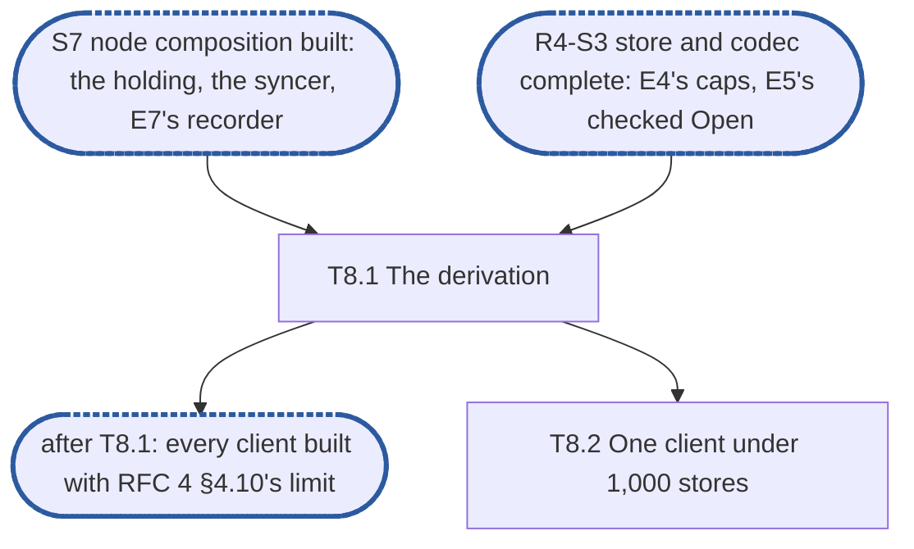

# Epic 8: remote tier v2 client limit

**Sources:** [RFC 4](../docs/internals/rfcs/rfc-4-remote-tier.md) §4.10 (the connection pool
derived from its callers: the derivation, once per client), §6's R11 and R19's limit half, and
§7.1's two §4.10 rows. Cited, not owned: RFC 4 §4.12 (`remote_connections_opened_total`, which
the second row reads), §4.15's `decision:` note (a store's open calls the service outside the
syncer) and Appendix C.3's connection pool row (the caps the limit sets, epic 4's);
[RFC 3](../docs/internals/rfcs/rfc-3-syncer.md) §2.8 (the probes) and §2.10 (`upload_workers`
and `fetch_workers`, fixed for the life of the process); [RFC 24](../docs/internals/rfcs/rfc-24-resources.md)
§7.2 (the counts reduced to fit the transfers pool once the node passes its size);
[RFC 9](../docs/internals/rfcs/rfc-9-gc.md) §7.1 (GC's bound, which v1.1 does not build);
[RFC 0](../docs/internals/rfcs/rfc-0-data-lifecycle.md) §1.2 (allowed imports: the composers
are the node and its content wiring). The RFC 4 follow-up (#5795) is applied where it touches
this epic: `pkg/remote/s3`'s `NewClient(ClientConfig, Deps)` and `Open`. Every citation is
`develop`'s text; the code lands on `develop`, and the paths below are paths there.
**Track:** the team.
**Epic 8 estimate: 2 subtasks, 3.25 man-days.**
**Depends on:** **S7**, RFC 8 offload plan's node composition built: its epic 21 holds one
`*s3.Client` per store configuration, ref-counted, in the node's content wiring
(`internal/node/content`), builds the syncer once with its two worker counts, and registers E7's
recorder over the node's registry; until this epic, it builds each client with the limit
`upload_workers + fetch_workers + 2`. **R4-S3**, store and codec complete: E4's T4.2, whose test
shows the client's caps equal the `ClientConfig.Limit` it is handed, and E5's checked `Open`.
**Blocks:** nothing of this plan. RFC 9's plan passes GC's bound to this epic's derivation when GC
lands (D2).

---

## 1. Goal

Epic 8 replaces the limit RFC 8 offload plan epic 21 builds each S3 client with by RFC 4 §4.10's
derivation, named once in the node's content wiring, and runs §7.1's two §4.10 rows over that
holding.

**At the end of the epic:**

- one unexported function in `internal/node/content` derives a client's limit from the syncer's
  two worker counts, GC's bound and one probe per direction, and the holding builds every client with
  it, once per client, from the counts the syncer was built with;
- GC's bound is an argument the node passes as zero until RFC 9 lands, behind a `decision:`
  marker naming that caller;
- §7.1's first §4.10 row passes as a table test of the derivation, and its second against
  LocalStack 4.13.1 through the holding: 1,000 stores on one store configuration, one client,
  its limit equal to the callers' total, and no more connections opened under load across the
  1,000 stores than the limit;
- `docs/guide/configuration.md`'s remote store section says how many connections a store
  configuration's client holds open at once and that no key sets it.

### 1.1 In scope

The derivation and its one call site in the holding; the `decision:` markers on its inputs (D2,
D3); §7.1's two §4.10 rows; the line in the configuration guide.

### 1.2 Out of scope

- Holding one client per store configuration, ref-counted, its `Close` releasing a reference,
  building the syncer and reading its two settings: RFC 8 offload plan epic 21, as the plan's §6.1
  deferral ledger row on a namespace's store opened in the node has it.
- The caps the limit sets on the client: the per-host cap, the idle connections per host and in
  total, HTTP/1.1 only, and a limit below 1 refused (RFC 4 §4.10's last two clauses, Appendix
  C.3): E4, T4.2.
- GC's bound itself (RFC 9 §7.1) and its term in the limit: RFC 9, as the plan's §6.1 deferral
  ledger row on GC's term in the client limit has it (D2).
- The counts reduced to fit the transfers pool (RFC 24 §7.2), and the limit derived from the
  reduced counts: the caller that first passes the syncer that pool's size, as RFC 3 §1.3's "What
  lands with its first caller" table has it and the plan's §6.1 row on the reduced counts records
  (D3).
- The limit of a backup location's client: RFC 26, under the plan's §6.1 row on a backup
  location's calls, since v1.1 opens no location store.
- That no key sets the limit (R4) is the key table's: E7 declares none.
- The connections a store's open uses for its capability check: RFC 4 §4.15's `decision:` note
  keeps the open outside the syncer and its handful of calls outside the sum; E5 places that
  marker.
- §7.5's steady-load row (ten minutes, the connections opened bounded by the pool size plus the
  service's closes): E9.
- A store's `Close` releasing its reference, and no client left once every store is closed: RFC 8
  offload plan epic 21's holding.

### 1.3 Names used here

- **E1**, epic 1, interfaces: `pkg/remote`'s contract and its import walk.
- **E3**, epic 3, fault transport and LocalStack: LocalStack over HTTPS in `integration`.
- **E4**, epic 4, the S3 data path, errors and client: `NewClient`, `ClientConfig.Limit`, the
  connection caps and the `Recorder`'s `ConnOpened`.
- **E5**, epic 5, the capability check and health: the checked `Open`.
- **E7**, epic 7, keys and observability: the recorder over the node's registry, and the remote
  store section of the configuration guide.
- **E9**, epic 9, E2E green: §7.5's steady-load row.
- **S7**, RFC 8 offload plan S7 node composition built: its epic 21 done, the remote stores held
  one client per store configuration, ref-counted.
- **R4-S3**, store and codec complete: epics 3 to 6 done, every §7.1 and §7.3 row they own green.
- **RFC 8 offload plan epic 21**, the node composes offload: the holding this epic's code sits in.
- **S3** names the storage service (Amazon S3 and the services compatible with it) everywhere in
  this document, except inside **R4-S3**.

## 2. How the general rules apply

The rules are those of [the RFC 4 implementation plan's §1.5](rfc-4-remote-tier-plan.md#15-general-rules-for-each-epic),
cited by number and title and not copied.

| Rule | Subtasks | How |
| --- | --- | --- |
| rule 1, independent unit tests ([`CLAUDE.md`, "Writing tests"](../CLAUDE.md#writing-tests)) | all | the derivation is a pure function of three counts with a table test (T8.1); the holding's run is against LocalStack, a real service (T8.2). No double |
| rule 2, fuzz tests where relevant ([`CLAUDE.md`, "By kind"](../CLAUDE.md#by-kind)) | none | nothing decodes bytes |
| rule 3, observability follows RFC 25 | T8.2 | no new metric, log or span; T8.2 reads `remote_connections_opened_total` from a scrape of the registry E7's recorder writes to, the series an operator reads |
| rule 4, profiling | T8.2 | the 1,000-store run is under `internal/prof`'s goroutine and descriptor checks, as every test is; no allocation assertion, since nothing here is per operation |
| rule 5, public interface and internals ([`CLAUDE.md`, "Verifying a change"](../CLAUDE.md#verifying-a-change)) | all | the limit is asserted where it is consumed: E4's T4.2 test shows the client's caps equal `ClientConfig.Limit`, so T8.1 asserts the holding passes the derivation's value there, and T8.2 counts the connections the client opened, read from the metric |
| rule 6, known failures shrink | none | `unit` and `integration` keep no `known.yaml`; both tests land green |
| rule 7, v2 ignores v1, and imports only what RFC 0 §1.2 allows | T8.1 | the derivation imports nothing and sits in a composer (RFC 0 §1.2), which may import `pkg/remote/s3` and the syncer; no package of `pkg/remote` changes, so E1's import walk is untouched |
| rule 8, real dependencies for properties of those dependencies ([`CLAUDE.md`, "Writing tests"](../CLAUDE.md#writing-tests)) | T8.2 | LocalStack 4.13.1, reached over HTTPS as E3's `integration` cell does, through the checked `Open`; no fault transport, since neither row needs a fault |
| rule 9, code comment conventions ([`CLAUDE.md`, "Code comments"](../CLAUDE.md#code-comments)) | T8.1 | one `decision:` marker at the derivation's call site, holding D2's and D3's clauses |
| rule 10, a test must be able to fail ([`CLAUDE.md`, "Writing tests"](../CLAUDE.md#writing-tests)) | all | each test names the break it catches: a term dropped from the sum, a value other than the derivation's handed to the client, a client per store. R4 has no test: a key nobody adds cannot be caught, so it stays a review rule on E7's key table |
| rule 11, a symbol is exported only if the RFC's interface uses it | T8.1 | nothing exported: RFC 4 gives the derivation no signature, and its one caller is in the same package (D1); the tests read the holding through `export_test.go` |
| rule 12, each subtask creates only what it declares | all | the derivation lands with its call site in the holding; T8.2 adds a test and nothing else |

## 3. Requirements and invariants

This section lists every MUST and MUST NOT that RFC 4 places on this epic, with RFC 3's and RFC
24's terms for the counts it reads. Each is numbered so that subtasks and tests can cite it.

**The derivation**

| # | Requirement | Kind | Source | Subtasks |
| --- | --- | --- | --- | --- |
| R1 | A client's limit is derived when the client is built, from the concurrency of everything that calls stores on it: the syncer's `upload_workers + fetch_workers`, GC's delete and list bound, and one for each probe direction, two, since the syncer runs at most one probe per `ProbeKey` and direction at a time and every store opened from one store configuration is registered under one non-zero `ProbeKey` | MUST | RFC 4 §4.10, §2's table (connection pool size), §6 R11; RFC 3 §2.8 | T8.1 |
| R2 | The limit is derived once per client, not per store: every store opened from one store configuration runs under that one client's limit, and opening more stores neither raises it nor adds a pool | MUST | RFC 4 §4.10, §6 R19 (its limit half) | T8.2 |
| R3 | The worker counts the derivation reads are the ones the syncer runs with: fixed for the life of the process, and, once the node passes the syncer its transfers pool's size, the counts reduced to fit it. The reduced half lands with that caller (§1.2, D3) | MUST | RFC 4 §4.10 ("the concurrency of everything that calls stores"), RFC 3 §2.10, RFC 24 §7.2 | T8.1 |
| R4 | A store has no connection setting of its own: no key sets a client's limit | invariant | RFC 4 §4.10 | T8.1 (the one call site); E7 (its key table) |

**The rows**

| # | Requirement | Kind | Source | Subtasks |
| --- | --- | --- | --- | --- |
| R5 | Construct with syncer pools of 8 and 8 and a GC bound of 4: every client limit is 22 | test row | RFC 4 §7.1, §4.10 | T8.1 |
| R6 | Open 1,000 stores from one store configuration: one client exists, its limit equals the callers' total concurrency, and connections opened under a steady load do not grow with the number of stores | test row | RFC 4 §7.1, §4.10 | T8.2 |

R1's two probe slots are D6's, amended into RFC 4 §4.10 and RFC 3 §2.8 in this epic's pull request.

What already enforces the rest of §4.10 when this epic lands: a client-wide cap at least the
limit and the idle connections sized the same, E4's T4.2 test (its R44).

## 4. Decisions this epic takes

- **D1. The derivation lives in the node's content wiring, unexported, beside the holding that
  calls it.** RFC 4 §4.10 gives the rule and no signature. Its inputs are other components'
  settings (the syncer's two counts, GC's bound), and the one place that knows them all is the
  composer that builds the syncer and the clients, which RFC 0 §1.2 allows to import both.
  `pkg/remote/s3` keeps taking a number (`ClientConfig.Limit`, E4's D1), so the S3 profile names
  no syncer or GC concept, and nothing is exported (rule 11). The plan's layout put a `limit.go`
  in `pkg/remote/s3`; there it would be an exported function with one caller in another package,
  carrying names of RFC 3 and RFC 9 into the store. The architect pass proposed an exported
  `remote.ClientLimit` in the root contract, a pure function RFC 0 §1.2 allows there; it was not
  taken, since its one caller is the composer. Moving it later costs one file and one call site.
  Prior art: rclone sizes its HTTP transport from `--transfers` and `--checkers` in its global
  configuration, not in a backend (from memory).

  ```go
  package content // internal/node/content

  // clientLimit is RFC 4 §4.10's limit for a client every store of one store
  // configuration shares: the syncer's two pools, GC's bound and one probe per
  // direction.
  func clientLimit(uploadWorkers, fetchWorkers, gcBound int) int
  ```

- **D2. GC's bound is an argument from now, passed as zero until RFC 9 lands.** v1.1 builds no GC
  (RFC 9 is planned later), so nothing calls a store for it and its term is truly zero. RFC 4
  §4.10 names it "GC's delete and list bound"; RFC 9 §7.1 states only deletes in flight per
  process, so what RFC 9's plan passes is its own to settle, and the plan's §6.1 row on GC's term
  says so. Settling the argument now means RFC 9 changes one call site's `0` and no signature, and
  its plan tests that value through the holding. Prior art: none needed.
- **D3. The counts are the ones the syncer is built with; in v1.1 nothing reduces them.** The
  holding passes `clientLimit` the two counts it passed the syncer's constructor, never re-reads
  the settings. RFC 24 §7.2's reduction is the syncer's, once the node passes it the transfers
  pool's size, and nothing passes that size in v1.1 (RFC 3 §1.3), so the counts the syncer is
  built with are the ones it runs with. The caller that first passes the size must derive the
  limit from the counts the syncer reports after the reduction, or the limit sits above the
  callers; the plan's §6.1 row on the reduced counts records it. One `decision:` marker at the call
  site holds D2's and D3's clauses. Prior art: none needed.
- **D4. R6 is observed at the holding and at the metric, after proving the service keeps
  connections.** "One client exists" is the holding's count of clients for the configuration,
  read through `export_test.go`; "its limit equals" is the `ClientConfig.Limit` the holding built
  that client with, read the same way, since E4's T4.2 test already shows the client's caps equal
  it; the connections are `remote_connections_opened_total` for the configuration, read from a
  scrape. The load runs `clientLimit`'s value of concurrent callers, each a `Get` of a block put
  beforehand. The opens leave each client they used holding its check puts' idle connections, so
  before the load the test closes every client's idle connections through `export_test.go`;
  otherwise a client per store would serve its one `Get` on the connection its open left, and
  the counter would not tell it apart. First, 1,000 requests over one store: the counter must
  grow by at most the limit plus 2, or the test fails naming LocalStack's connection reuse, since
  a comparison over a service that closes connections proves nothing. Then 1,000 requests over
  all 1,000 stores, one each in turn: the counter grows by at most the limit plus 2 again. A
  client per store opens one connection per store it touches, about 1,000, so the two outcomes
  stand far apart. The exact
  bound, the pool size plus one per close the service started, is §7.5's and E9's. The architect
  pass proposed a fault that holds each reply's body, so that `2L` held requests show exactly `L`
  connections; it was not taken, since E4's T4.2 test already shows the client never opens more
  than its caps allow. Prior art: none found.
- **D5. R6's 1,000 opens run through the checked `Open`, at the smallest block target.** Each open
  runs E5's capability check, which puts the largest encoded block twice (E5's D6), so the row
  sets the block target to RFC 13's floor, 1 MiB, and runs the opens `clientLimit` at a time. That
  is still about 2 GiB of check puts per run, at every pull request in `integration`. If its wall
  time shows, the remedy is E5's D6 `ponytail:` upgrade, the proof once per client, never fewer
  stores: the row's 1,000 is the RFC's, and a node serving 10⁴ namespaces on one configuration pays
  the same check traffic at every start. Prior art: none needed.

- **D6. Two probe slots, one per direction.** RFC 4 §4.10 counted one for the probe. RFC 3 §2.8
  probes each `ProbeKey` in both directions, the RFC 3 plan's epic 5 runs one probe loop per
  `ProbeKey` and direction, and a direction tripped by the failure window is re-admitted by a probe
  against the store's own namespace, so one client could carry two probes at once, and more while
  several of its stores waited for re-admission. A probe past the limit waits inside the client
  behind a transfer's connection, the hidden wait §4.10 exists to remove, and under a slow service
  can outlast the probe's bound and count as a failed probe. So `clientLimit` counts two, RFC 4
  §4.10 is amended to count one per probe direction, and RFC 3 §2.8 to run at most one probe per
  `ProbeKey` and direction at a time, a store's own re-admission probe included; RFC 8 offload plan
  epic 21's interim sum and the plan's D6 become `+ 2`, and R5 and RFC 4 §7.1's row read 22. The
  two slots hold only while every store on one client shares one probe group, so RFC 4 §4.10 also
  requires the engine to register every store opened from one store configuration under one
  non-zero `ProbeKey`.
  Decided by the user on this epic's pull request. Prior art: none needed.

## 5. Target tree

```text
internal/node/content/            RFC 8 offload plan epic 21's content wiring
  limit.go                        T8.1  clientLimit, and its call where the holding builds a client
  limit_test.go                   T8.1  the derivation's table, R5, and the holding's limit
  limit_integration_test.go       T8.2  R6 over LocalStack (integration build tag)
  export_test.go                  T8.1  the holding's clients and their ClientConfig, for the tests
docs/guide/configuration.md       T8.1  one line in the remote store section
```

## 6. Subtasks

### T8.1 The derivation

**Subtask T8.1 estimate: 0.75 man-days.**

- **Track:** the team. **Depends on:** S7, R4-S3.
- **Covers:** R1, R3, R4, R5.
- **Deliverables:** `limit.go`: `clientLimit` (D1), and the holding's client build calling it with
  the two counts it passed the syncer and a GC bound of 0, under one `decision:` marker holding D2's
  and D3's clauses, in place of RFC 8 offload plan epic 21's inline sum; `export_test.go`: the
  holding's clients per store configuration and the `ClientConfig` each was built with, read by
  T8.1's and T8.2's tests, and a call closing each client's idle connections, for T8.2 (D4); `docs/guide/configuration.md`'s remote store section: a store
  configuration's client holds at most `upload_workers + fetch_workers + 2` connections to its
  endpoint open at once, and no key sets it. Consumed by: the holding's client build (here), T8.2,
  and RFC 9, which passes GC's bound.
- **Acceptance criteria:**
  - `clientLimit(8, 8, 4)` is 22 and `clientLimit(0, 0, 0)` is 2 (R5, D6), and each term moves
    the result by its own value.
  - A holding whose syncer is built with `upload_workers` 8 and `fetch_workers` 8 builds the
    configuration's client with `ClientConfig.Limit` equal to `clientLimit(8, 8, 0)`, and with 16
    and 4, `clientLimit(16, 4, 0)` (R1, R3).
- **Tests:** in `unit`, at the function, a table over each term zero and non-zero and RFC 4's row
  (catches a term dropped or counted twice, R1, R5). At the holding, through `export_test.go`, for
  the two pairs of counts above: the `ClientConfig.Limit` the client was built with (catches a
  constant, the inline sum left with a term missing, or the counts taken from somewhere but the
  syncer's build, R1, R3). The holding builds the client, which sends no request, and opens no
  store, so no service is needed. No double.
- **Rules:** rule 9: the one marker sits at the one call site.

### T8.2 One client under 1,000 stores

**Subtask T8.2 estimate: 2.5 man-days.**

- **Track:** the team. **Depends on:** T8.1.
- **Covers:** R2, R6.
- **Deliverables:** `limit_integration_test.go`, under the `integration` tag: §7.1's second §4.10
  row through the holding against LocalStack over HTTPS (E3's `LOCALSTACK_HTTPS_ENDPOINT` and its
  trusted root), with the block target at 1 MiB (D5). Consumed by: `integration`, at every pull
  request.
- **Acceptance criteria:**
  - 1,000 stores opened on one store configuration, under 1,000 prefixes of one fresh bucket, leave
    the holding with one client for that configuration, built with `ClientConfig.Limit` equal to
    `clientLimit` of the syncer's counts (R2, R6).
  - Under D4's load, 1,000 requests over one store grow `remote_connections_opened_total` for the
    configuration by at most the limit plus 2, and 1,000 requests spread one per store over all
    1,000 stores grow it by at most the limit plus 2 again (R2, R6).
- **Tests:** in `integration`, at the holding and the scraped metric (D4): a holding that builds a
  client per store fails the client count, and its connections grow by about one per store, past
  the bound (R2, R6); a limit other than `clientLimit`'s fails the equality. If LocalStack does not
  keep connections, the first run's precondition fails and says so, rather than letting the second
  pass. No double: LocalStack 4.13.1, the checked `Open`, and E7's recorder over a test registry.
- **Rules:** rule 8: no fault transport, since neither half of the row needs a fault. If the run's
  wall time shows in `integration`, the remedy is D5's, never a smaller row.

## 7. Order of work



## 8. Suggested pull requests

| PR | Subtasks | Man-days | After | Why together |
| --- | --- | --- | --- | --- |
| 1 | T8.1, T8.2 | 3.25 | — | the derivation and both of RFC 4's §4.10 rows, the epic's one deliverable |

A suggestion only: one pull request per subtask works as well, T8.1 first.

## 9. Open points

1. **S7 has not been reached, and RFC 8 offload plan epic 21 has no breakdown document.** This
   document names the holding by what it does; its type, its constructor and the name of the inline
   sum T8.1 replaces are epic 21's. When epic 21 is broken down, it may write `clientLimit` itself in
   place of its inline sum; T8.1 then shrinks to its tests and the marker.
2. **Estimate least certain: T8.2**, on LocalStack's throughput for 1,000 checked opens (about 2
   GiB of check puts, D5), on whether LocalStack 4.13.1 keeps HTTPS connections alive (D4's
   precondition measures it), and on the holding's surface, which epic 21 settles.
3. **Serialised re-admission is answered by the RFC 3 plan's epic 5, D3.** D6's amendment to RFC 3
   §2.8 runs a store's own re-admission probe in the one slot of its `ProbeKey` and direction.
   Epic 5's D3 runs the shared probe first and own probes only while the group's last shared
   result passed, so stores the failure window tripped queue at about 2·*K* round trips for *K* of
   them, and own probes do not run while the shared probe fails; its `ponytail:` names the
   ceiling.
