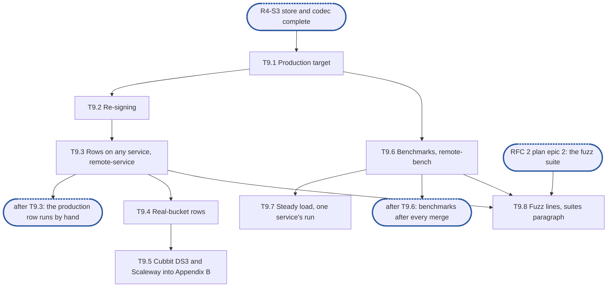

# Epic 9: remote tier v2 E2E green

**Sources:** [RFC 4](../docs/internals/rfcs/rfc-4-remote-tier.md) §7.4's production row and its
paragraph on rows the local emulator cannot hold; §7.2's rule that the fault transport never
answers in the service's place nor pretends a setting; the rows of §7.1 that only a real bucket
can show (§4.7's prefix-revoke half, §4.11's archive-class and archive-tiering open halves, Appendix
C.3's encryption clause on a bucket LocalStack cannot hold); §7.5's benchmarks and its suites
paragraph; §4.10's idle-pool `SHOULD`, which §7.5's steady-load row holds at load; Appendix B, whose
production columns this epic fills. The [RFC index](../docs/internals/rfcs/rfc-index.md), "Test
tiers": "What must not stand in", "A check that did not run is a failure", "Recording results"
and "A proposed target is replaced once, by measurement". [RFC 25](../docs/internals/rfcs/rfc-25-observability.md)
§5.4 (O14), for what the production row's results may not hold. Cited, not owned:
[RFC 29](../docs/internals/rfcs/rfc-29-test-harness.md) §4.3 (tiers and blocking), §4.5 (needs) and
§4.10 (benchmarks); the RFC 2 plan's epic 2, D6, for the shared `fuzz` suite's form. Every citation
is `develop`'s text. The code lands on `feat/storage-v2`, and the paths below are paths there.
**Track:** the team.
**Epic 9 estimate: 8 subtasks, 14.25 man-days.**
**Depends on:** **R4-S3**, the store and codec complete: E3's `s3fault` (`New`, `Inject`,
`StripHeaders`, `FailBatchKey`, `Requests`, `LocalStack`, `FreshBucket` and its record of which
settings LocalStack 4.13.1 holds, D7's signature pin); E4's client (`ClientConfig`, `NewClient`,
`Open`, the connection counters its `export_test.go` reads), its `*_integration_test.go` rows and
`FuzzContentRange`; E5's check inside `Open`, `Health`, and the rows it sends here (its R37, R38
and R42); E6's `codec.Store`, `FuzzHeader`, `FuzzBlock` and `FuzzBody`; E2's `remotetest`. **E7**,
which the plan orders before this epic: nothing of its surface is used here (§9, point 1). **The RFC
2 plan's epic 2**, T2.4: the nightly `fuzz` suite T9.8 adds lines to.
**Blocks:** nothing in this plan. It feeds RFC 4 Appendix B the production columns that decide
which services are supported (§7.4), and the RFC 3 plan's pool-sizing tool reads the put curve
T9.6 measures (RFC 3 §2.11).

---

## 1. Goal

Epic 9 takes the remote tier past `pr`. The same §7.1 rows that run against LocalStack on every pull
request run, by hand, against Cubbit DS3 and Scaleway; the rows only a real bucket can show run
there too; §7.5's benchmarks run after every merge; and the decoders' fuzz targets run nightly.

**At the end of the epic:**

- `dt run remote-service`, with one service's `DITTOFS_TEST_S3_*` variables set, runs every
  service-agnostic §7.1 row and the capability check against that service, in a disposable
  namespace of a bucket the runner names, and a fresh bucket per row that needs a bucket setting;
  without the variables it refuses to start, naming them.
- Header-rewriting faults reach a service that validates SigV4, because the transport signs a
  rewritten request again.
- The prefix-revoke row, the archive-tiering row, the archive-class row on a service found to
  ignore the class header, and the default-encryption row of Appendix C.3 run against a real
  bucket, or record that the service cannot hold the setting.
- Cubbit DS3 and Scaleway each have a production column in Appendix B, written from one run.
- `dt run remote-bench` runs §7.5's benchmarks against LocalStack after every merge, each beside
  its raw-client twin, naming service, region, block size and pool size in every result line, and
  fails only on a count: the steady-load connection bound, one request per probe, per ranged
  chunk and per listing page.
- `dt run fuzz` fuzzes `FuzzContentRange`, `FuzzHeader`, `FuzzBlock` and `FuzzBody`.

### 1.1 In scope

The production target and its fresh buckets in `s3fault`; re-signing; the switch of E2's, E4's,
E5's and E6's service-agnostic §7.1 rows onto the target; the `remote-service` cell and the
`remote` group; the real-bucket rows; the runs against Cubbit DS3 and Scaleway and their Appendix B
columns; §7.5's benchmarks, the `remote-bench` cell and the steady-load row; the four fuzz targets'
lines in the `fuzz` suite; RFC 4 §7.5's suites paragraph.

### 1.2 Out of scope

- **Running the production row and §7.5's daily run in CI:** the RFC 4 plan's §6.1 ledger row on
  the nightly service row, owned `unowned`, triggered by a credential per service allowed to create
  and delete buckets, or a pool of fresh buckets, existing as CI secrets. This epic leaves both at
  `tier: manual` (R2) and names in the cell what CI would need (T9.3).
- **The rows on settings neither LocalStack nor a measured service holds,** in CI: the §6.1 ledger
  row on §7.1's T rows on a setting LocalStack cannot hold, owned `unowned`.
- **Every `Recheck` row and half:** the §6.1 ledger row owned by RFC 9.
- **A backup location's rows, the object-lock lab rows of §7.4 and their release check:** the
  §6.1 ledger row owned by RFC 26. No v1.1 release offers an immutable location.
- **§7.1's two §4.10 rows:** E8.
- **The syncer's re-get of a corrupt ranged chunk:** the §6.1 ledger row owned by the RFC 3 plan's
  epic 6.
- **Replacing §7.5's proposed targets** with measured values: the first run on the reference box
  (RFC index, "A proposed target is replaced once"), which no cell here runs on.
- **AWS S3 and MinIO columns:** not measured by Appendix B; the target takes any endpoint, so
  adding one is a run, not code (§9, point 3).

### 1.3 Names used here

- **E2**, epic 2, conformance suite and test foundations: `remotetest` and the in-memory store.
- **E3**, epic 3, fault transport and LocalStack: `s3fault` and LocalStack over HTTPS in
  `integration`.
- **E4**, epic 4, S3 data path, errors and client.
- **E5**, epic 5, capability check and health.
- **E6**, epic 6, block codec.
- **E7**, epic 7, integration: keys and observability.
- **E8**, epic 8, integration: the client limit.
- **E9**, this epic.
- **R4-S3**, store and codec complete: epics 3 to 6 done, every §7.1 and §7.3 row they own green.
- **S3** names the storage service (Amazon S3 and the services compatible with it) everywhere in
  this document, except inside **R4-S3**.

## 2. How the general rules apply

The rules are those of [the RFC 4 implementation plan's §1.5](rfc-4-remote-tier-plan.md#15-general-rules-for-each-epic),
cited by number and title and not copied.

| Rule | Subtasks | How |
| --- | --- | --- |
| rule 1, independent unit tests ([`CLAUDE.md`, "Writing tests"](../CLAUDE.md#writing-tests)) | T9.1, T9.2 | the target's variables are read by a function of a lookup function, table-tested with a map (an input, not a double); re-signing is a function of a request and credentials, tested on its output. Everything else runs against LocalStack or a real service |
| rule 2, fuzz tests where relevant ([`CLAUDE.md`, "By kind"](../CLAUDE.md#by-kind)) | T9.8 | this epic writes no decoder; it joins E4's and E6's four targets to the nightly `fuzz` suite |
| rule 3, observability follows RFC 25 | T9.3 | no metric, log or span is added. The production row handles real credentials, so its cell greps its own results for the access key and the secret and fails on a hit (R8) |
| rule 4, profiling | T9.3 to T9.7 | the rows keep E2's to E6's `internal/prof` checks on every target; every benchmark calls `b.ReportAllocs()`; the list benchmark reports its peak heap |
| rule 5, public interface and internals ([`CLAUDE.md`, "Verifying a change"](../CLAUDE.md#verifying-a-change)) | T9.2, T9.4, T9.7 | re-signing is shown where it is consumed, a validating service judging the rewritten request (T9.4); the steady-load bound is read from the dialer's own counters, not from the requests sent |
| rule 6, known failures shrink | none | no suite used here keeps a `known.yaml`; a row that fails on a real service is a defect to fix, not a listed failure |
| rule 7, v2 ignores v1, and imports only what RFC 0 §1.2 allows | T9.1, T9.2 | `s3fault` keeps importing `aws-sdk-go-v2` alone (its `aws/signer/v4` for re-signing); nothing from `develop`'s `pkg/block`; tests import what they need |
| rule 8, real dependencies for properties of those dependencies ([`CLAUDE.md`, "Writing tests"](../CLAUDE.md#writing-tests)) | T9.3 to T9.7 | this epic is the rule's last clause: the real services. Every setting applied for real on a fresh bucket of the service; a setting the service refuses is recorded as not held, never pretended (D7) |
| rule 9, code comment conventions ([`CLAUDE.md`, "Code comments"](../CLAUDE.md#code-comments)) | T9.2, T9.3, T9.4, T9.6 | `decision:` markers at re-signing (D3), at the `remote-service` entry's tier (D4), at a row skipped because the service does not hold its setting (D7) and at `remote-bench`'s blocking (D6) |
| rule 10, a test must be able to fail ([`CLAUDE.md`, "Writing tests"](../CLAUDE.md#writing-tests)) | all | each test names the break it catches in §6; the steady-load bound is shown failing on a planted idle pool (T9.7), and re-signing on a request whose signed-header list kept the stripped header (T9.2) |
| rule 11, a symbol is exported only if the RFC's interface uses it | T9.1, T9.2 | `s3fault` exports `Target`, `Service` and `Target.New`, which the rows of E4, E5 and E6 call from their own packages (rule 11's fault-transport clause); `sign` stays unexported |
| rule 12, each subtask creates only what it declares | all | `Target` lands with `FreshBucket` as its first consumer, `Target.New` with re-signing, the `remote_service` tag with its first rows, each suite entry with the tests it runs |

## 3. Requirements and invariants

Every obligation RFC 4, the RFC index and RFC 25 place on this epic, numbered so that subtasks and
tests can cite them.

**The production row**

| # | Requirement | Kind | Source | Subtasks |
| --- | --- | --- | --- | --- |
| R1 | Each production service Appendix B measures passes the capability check and every §7.1 row v1.1 holds, in a disposable namespace, with a fresh bucket for each row that needs a bucket setting | test row | RFC 4 §7.4 | T9.1, T9.3, T9.5 |
| R2 | Until the nightly run holds credentials for a service, the production row runs by hand, so it guards no change meanwhile; the remote tier is under test against a local emulator and at least one real service, the schedule half waiting for those credentials | invariant | RFC 4 §7.4; RFC index, "What must not stand in" | T9.3 |
| R3 | A §7.1 row on a bucket setting the local emulator cannot hold runs against a fresh bucket of a production service, with the setting applied for real | MUST | RFC 4 §7.2, §7.4 | T9.1, T9.4 |
| R4 | The fault transport never answers a request in the service's place with a success, nor reports a setting or a storage class the service does not hold | MUST NOT | RFC 4 §7.2 | T9.2, T9.4 |
| R5 | A service is supported only once it has a column in Appendix B's service semantics table and passes the production row; the row's results go into Appendix B | MUST | RFC 4 §7.4, Appendix B | T9.5 |
| R6 | A check that did not run is a failure: a skip because a service was absent is reported with its reason, and a check skipped in every tier is moved to a tier that runs it | invariant | RFC index, "A check that did not run is a failure" | T9.1, T9.3, T9.4 |
| R7 | The remote tier runs against the emulator and a real service through the same client the store is built with: no row reaches a production service by another path | invariant | RFC index, "What must not stand in" (a harness constructing a component differently from production) | T9.1, T9.3 |
| R8 | No result, log or error the production row leaves behind carries the access key, the secret or a request's signature | MUST NOT | RFC 25 §5.4 (O14) | T9.3 |

**Rows only a real bucket shows**

| # | Requirement | Kind | Source | Subtasks |
| --- | --- | --- | --- | --- |
| R9 | §4.7: revoke access to the store's own prefix only: both probes of that direction fail although a neighbouring prefix stays accessible (T) | test row | RFC 4 §7.1 | T9.4 |
| R10 | §4.11: a bucket holding a tiering rule with an archive tier whose filter could match the prefix: open fails naming it, on a service that holds such a rule (T); the `Recheck` half is RFC 9's | test row | RFC 4 §7.1, Appendix C.1 | T9.4 |
| R11 | §4.11: every object is written in the class the profile names, never the service's default; a bucket that stores what the check wrote in an archive storage class: open fails naming it. Each service's reported class is recorded, and the open half runs on a service found to ignore the class header (T) | test row | RFC 4 §7.1, Appendix C.1 | T9.4, T9.5 |
| R12 | Appendix C.3: a bucket default encryption under which the ETag is not the content MD5, set before open on a store whose check chose the ETag: open fails naming it, on a real bucket where LocalStack holds no such default (T); the drift half is RFC 9's | test row | RFC 4 §7.1, Appendix C.1 | T9.4 |

**Benchmarks**

| # | Requirement | Kind | Source | Subtasks |
| --- | --- | --- | --- | --- |
| R13 | §7.5's benchmarks run against the local emulator after each merge, and against a real service daily; the daily run is by hand until CI holds credentials | invariant | RFC 4 §7.5, §7.4 | T9.6, T9.7 |
| R14 | Every result records the service, region, block size and pool sizes | MUST | RFC 4 §7.5 | T9.6, T9.7 |
| R15 | Every result is recorded in absolute numbers with the commit and the box; results from another box are compared only with themselves; a proposed target is replaced only by the first run on the reference box | invariant | RFC index, "Recording results", "A proposed target is replaced once" | T9.6, T9.7 |
| R16 | No timed check runs per change: the benchmarks' cell fails on a count, never on a throughput or latency figure | invariant | RFC index, "Test tiers" | T9.6 |
| R17 | Codec encode and decode with no transform: MB/s per core, proposed within 10% of plaintext hashing on the same box | bound | RFC 4 §7.5 | T9.6 |
| R18 | Put of one full block at 1 to N workers: MB/s at each step, proposed within 10% of the same curve measured with raw client calls at the service's saturation point | bound | RFC 4 §7.5 | T9.6 |
| R19 | Ranged get of one chunk, 4 KiB to 1 MiB: one request per chunk, and p50 and p99 latency proposed within 10% of a raw client call of the same size | bound | RFC 4 §7.5 | T9.6 |
| R20 | Whole-block get: MB/s, proposed within 10% of a raw client call | bound | RFC 4 §7.5 | T9.6 |
| R21 | Put of one block with and without a measuring pass: MB/s of each, the gap reported | bound | RFC 4 §7.5 | T9.6 |
| R22 | Health probe: exactly one request | bound | RFC 4 §7.5 | T9.6 |
| R23 | List of 100,000 blocks: one request per page of the caller's `n` (1,000, and 500 through `Small`), at most one page held, and peak memory reported | bound | RFC 4 §7.5 | T9.6 |
| R24 | Steady load at a fixed pool size for 10 minutes: connections opened no more than the pool size, plus one per connection the service closed, counted from the transport's close events | bound | RFC 4 §7.5 | T9.7 |
| R25 | Idle connections kept for reuse are sized as the limit, so a connection one request releases is reused by the next rather than reopened; adopted, and held at load by R24's row failing on a smaller idle pool | SHOULD | RFC 4 §4.10 | T9.7 |

**Fuzzing and suites**

| # | Requirement | Kind | Source | Subtasks |
| --- | --- | --- | --- | --- |
| R26 | The codec's fuzz targets, and the store's `Content-Range` reader's, fuzz past their seed corpus in the shared nightly fuzz suite; their seeds keep running in `unit` | invariant | RFC 4 §7.5 ("Suites"), §4.4; the RFC 4 plan's rule 2 | T9.8 |
| R27 | §7.5's suites paragraph names the suite that runs each part: the production row, the benchmarks and the fuzzing | invariant | RFC 4 §7.5 ("Suites") | T9.8 |

## 4. Decisions this epic takes

- **D1. One production service per run, named by six variables.** `DITTOFS_TEST_S3_SERVICE` (the
  name recorded with results, `cubbit-ds3`, `scaleway-fr-par`), `_ENDPOINT`, `_REGION`,
  `_ACCESS_KEY_ID`, `_SECRET_ACCESS_KEY` and `_BUCKET`, the bucket whose fresh prefixes are the
  disposable namespaces. With `_ENDPOINT` unset the target is LocalStack; with it set and another
  missing, `Service` fails the test naming the missing one, since a half-set run is a mistake, not
  an absent service. Each service is one run. The credential must be allowed to create and delete
  buckets, for D2's fresh buckets: the runner's own, by hand. Prior art: the harness's
  `DITTOFS_TEST_KMIP_*` variables (`test/harness/needs/needs.go`, checked); rclone's integration
  tests take one remote per run from its configuration (from memory).
- **D2. Rows choose their service through `s3fault.Service`; only the rows that measure LocalStack
  keep `LocalStack`.** E4's, E5's and E6's §7.1 rows and E4's run of E2's suite call `Service(tb)`
  and build their client from its fields, so one body runs on the emulator in `integration` and on
  a production service in `remote-service` (R1, R7). `FreshBucket` creates its bucket on the same
  target. The rows that pin a LocalStack fact (E3's certificate measurement, its record of held
  settings, D7's signature pin, E5's rows asserting LocalStack's step 1 and step 3 choices) keep
  `LocalStack(tb)`; the choices a production service makes are recorded in Appendix B instead (T9.5).
  Rows that only a real bucket can run sit behind the `remote_service` build tag, so `integration`
  never carries a row that skips on every run (R6). Prior art: the repository's `engine_conformance`
  tag for a suite with its own cell (checked).
- **D3. A rewritten request is signed again.** E3's `StripHeaders` and `FailBatchKey` change
  headers after SigV4 signing, which a validating service refuses as `SignatureDoesNotMatch`
  (E3's D7). `Target.New` builds the transport with the target's credentials, and after an effect
  rewrites a header the transport signs the request again with `aws/signer/v4` at the request's
  own `X-Amz-Date`, over `UNSIGNED-PAYLOAD` (Appendix C.3), so the clock does not move the
  signature. It signs on LocalStack too, so `integration` runs the path; `New` itself stays
  unsigned for D7's pin. A `decision:` marker at `sign` says re-signing changes what the service
  authenticates, never what it decides, so R4 holds; withdraw it if an effect ever rewrites a
  header the service judges the request by. Prior art: `awslabs/aws-sigv4-proxy`, which re-signs
  forwarded requests (from memory).
- **D4. The production row is a manual cell that refuses to start without its variables.**
  `remote-service`, `tier: manual`, `format: go-json`, `needs: [docker, "service:localstack"]` so
  the LocalStack-only rows in the same packages run rather than skip; command `go test
  -tags=integration,remote_service -p 1` over `./pkg/remote/...`. Its first command exits 2 naming
  `DITTOFS_TEST_S3_ENDPOINT` when it is unset, as `journal-bench` refuses without
  `DITTOFS_BENCH_DIR`; its last greps `{out}` for the access key and the secret and fails on a hit
  (R8). No `cloud:` need: `dt` checks none yet (`needs.go`, checked), so one would make the cell
  unrunnable by hand. A `decision:` comment on the entry names the ledger row that flips it to
  `nightly`. Prior art: `journal-bench`'s guard (checked).
- **D5. Each benchmark result names its conditions as benchmark keys.** Sub-benchmarks are named
  `service=<s>/region=<r>/block=<size>/workers=<n>/impl=<store|raw>`, the key-value form of Go's
  benchmark format, so `dt`'s `go-bench` history keeps each condition apart and `benchstat -col
  /impl` reads a row's 10% target from one run (R14, R18 to R20). The commit and the box are `dt`'s
  result record (R15). Prior art: Go's benchmark data format proposal, configuration keys in names
  (from memory).
- **D6. `remote-bench` blocks after a merge, and fails only on counts.** RFC 29 §4.3: a
  non-blocking cell's failure after a merge posts nowhere, so a non-blocking cell would leave the
  steady-load bound and the request counts guarding nothing. Each count a benchmark breaks is a
  `b.Fatalf`; throughput and latency are reported through `dt`'s `go-bench` history and never fail
  the cell (R16). `tier: merge`, `format: exit`, `metrics: go-bench`, one test per benchmark group,
  as `journal-bench-data`. A `decision:` comment says so; make it non-blocking only if a count
  proves noisy on shared runners, which would be a defect in the count. Prior art: `engine-bench`'s
  rule that a count a benchmark breaks fails the cell (checked).
- **D7. A setting the service refuses is recorded, and its row skips with the reason.** A real
  bucket row first applies its setting; a `501`, `NotImplemented` or the service's refusal of the
  configuration call is recorded for Appendix B and the row skips naming the service and the
  setting, never passing (R4, R6). The row stays: it runs on the next service that holds the
  setting. A `decision:` marker says a row no measured service can hold runs nowhere, and that the
  row is withdrawn if the RFC drops the setting from Appendix C.1. Prior art: none found.
- **D8. Prefix revoke is a bucket policy on a fresh bucket.** Two stores on neighbouring prefixes of
  one fresh bucket; a policy denying `s3:PutObject` (then `s3:GetObject`) on the first prefix's
  keys for every principal; both probes of that direction fail on the first store and pass on the
  second; the policy deleted, the next probe passes. The deny names object keys only, so the admin
  client still deletes the policy and the bucket. Prior art: AWS's prefix-scoped bucket-policy
  examples (from memory).
- **D9. The steady-load row is a benchmark run once, with a planted twin.** `BenchmarkSteadyLoad`
  runs ten minutes at `-benchtime=1x`, `P` workers each putting and getting one block in a loop
  on a client of limit `P`, then asserts E4's dialer counts: opened ≤ `P` + service-started closes
  (R24). Its twin, `idle=planted`, runs one minute with the client's idle pool cut to `P/2` through
  `export_test.go` and asserts the bound broken, so the row is shown able to fail on every run
  (R25). Prior art: Appendix B's own connection-pool table, which measured the same reopenings
  (checked).

## 5. Target tree

```text
pkg/remote/s3/s3fault/
  service.go            T9.1  Target, Service, the variables (D1)
  bucket.go             T9.1  FreshBucket on Service's target (E3's file, changed)
  sign.go               T9.2  sign, Target.New (D3)
  service_test.go       T9.1  the variables' table; T9.1 FreshBucket on the target
  sign_test.go          T9.2  the signed-header list after a strip
pkg/remote/s3/
  *_integration_test.go T9.3  §7.1 rows on Service(tb) and Target.New (D2)
  realbucket_test.go    T9.4  the rows only a real bucket shows, behind remote_service
  bench_test.go         T9.6  data-path benchmarks and raw twins, behind integration
  steady_test.go        T9.7  BenchmarkSteadyLoad and its planted twin, behind integration
  export_test.go        T9.6  the raw SDK client on the store's transport; T9.7 the idle cap
pkg/remote/codec/
  bench_test.go         T9.6  encode, decode and plaintext hash
  bench_s3_test.go      T9.6  put with and without a measuring pass, behind integration
test/suites.yaml        T9.3  remote-service, the remote group, remote_service in lint-go's vet
                        T9.6  remote-bench; T9.8 four lines and the timeouts of fuzz
docs/internals/rfcs/rfc-4-remote-tier.md
                        T9.5  Appendix B's production columns; T9.7 one service's benchmark run;
                        T9.8  §7.5's suites paragraph
docs/internals/testing.md  T9.8  regenerated by dt docs
```

## 6. Subtasks

### T9.1 The production target and its fresh buckets

**Subtask T9.1 estimate: 1.25 man-days.**

- **Track:** the team. **Depends on:** R4-S3.
- **Covers:** R1, R3, R6, R7.
- **Deliverables:** `service.go` (D1):

  ```go
  // Target is the S3 service a row runs against: a production service named by the
  // DITTOFS_TEST_S3_* variables, or LocalStack when DITTOFS_TEST_S3_ENDPOINT is unset.
  type Target struct {
      Service, Endpoint, Region   string
      AccessKeyID, SecretAccessKey string
      Roots  *x509.CertPool // nil: the system's roots
      Bucket string         // disposable namespaces are fresh prefixes of it
      Admin  *s3.Client     // reaches the service without the fault transport
  }
  func Service(tb testing.TB) Target
  ```

  `FreshBucket` creates its bucket on `Service(tb)`, named `dittofs-test-<random>` since a
  production service's names are global. Consumed by T9.2 (`Target.New`), T9.3's rows and T9.4's.
- **Acceptance criteria:**
  - With `_ENDPOINT` unset, `Service` is LocalStack's endpoint, roots and the bucket E4's rows use.
  - With `_ENDPOINT` set and any other variable empty, the test fails naming that variable.
  - Two `FreshBucket` calls give two buckets on the target, and neither exists after cleanup.
- **Tests:** the variables read by an unexported function of a lookup function, table-tested with
  a map (catches a missing variable taken for LocalStack, R6); `FreshBucket` in `integration` on
  LocalStack and in `remote-service` on the service (catches a bucket left behind or created on the
  wrong endpoint, R3). No test double.

### T9.2 Re-signing a rewritten request

**Subtask T9.2 estimate: 1 man-days.**

- **Track:** the team. **Depends on:** T9.1.
- **Covers:** R1, R4.
- **Deliverables:** `sign.go` (D3): `func (t Target) New(next http.RoundTripper, fault Fault)
  *Transport`, which is `New` signing every request an effect rewrote; the unexported `sign`, with
  D3's `decision:` marker. Consumed by T9.3's rows and T9.4's.
- **Acceptance criteria:**
  - A put signed by the SDK, stripped of `x-amz-checksum-crc32c` and signed again carries an
    `Authorization` whose signed headers omit the stripped one, under the original `X-Amz-Date`.
  - A request no effect rewrote reaches the service with its original signature.
  - On LocalStack, every E3 alteration row passes through `Target.New` as through `New`.
- **Tests:** at the request the next transport receives: the signed-header list after a strip
  (catches a re-sign that keeps the old list, which a validating service refuses) and after
  `FailBatchKey` with its recomputed `Content-MD5`; the untouched request byte for byte. The
  consumer's half, a validating service judging the rewritten request, is T9.4's.

### T9.3 The §7.1 rows on any service, and the `remote-service` cell

**Subtask T9.3 estimate: 2 man-days.**

- **Track:** the team. **Depends on:** T9.2.
- **Covers:** R1, R2, R6, R7, R8.
- **Deliverables:**
  - E4's, E5's and E6's `*_integration_test.go` rows, and E4's run of E2's suite, on `Service(tb)`
    and `Target.New` (D2). The rows that pin a LocalStack fact keep `LocalStack(tb)`, listed in the
    pull request.
  - `test/suites.yaml`: `remote-service` (D4), with the `decision:` comment naming the §6.1 ledger
    row that would move it to `nightly` and what CI needs (one credential per service allowed to
    create and delete buckets, or a pool of fresh buckets); the `remote` group,
    `[remote-service]`, which T9.6 extends; `remote_service` in lint-go's `go vet -tags=` list.
- **Acceptance criteria:**
  - `dt run integration` runs the same rows as before against LocalStack, none skipped.
  - `dt run remote-service` without the variables exits 2 naming `DITTOFS_TEST_S3_ENDPOINT`.
  - With a service's variables it runs the switched rows against it, and its last command fails
    when the access key or the secret appears anywhere under `{out}`.
- **Tests:** the switched rows themselves on both targets; the grep, seen to fail once on a test
  that logs the secret before the pull request opens (catches a leak through a failure message
  printing a request's headers, R8). The guard and the grep are commands of the cell, checked by
  running it.

### T9.4 The rows only a real bucket shows

**Subtask T9.4 estimate: 2.5 man-days.**

- **Track:** the team. **Depends on:** T9.3.
- **Covers:** R3, R4, R6, R9, R10, R11, R12.
- **Deliverables:** `realbucket_test.go`, behind `remote_service`, each row on a `FreshBucket`:
  - prefix revoke (D8), per direction;
  - an intelligent-tiering configuration with an archive tier over the prefix, then `Open`;
  - one put in the profile's class and the class a get reports, recorded; on a service that
    reports another class, `Open` and its refusal;
  - a default encryption of each kind the service holds (SSE-S3, SSE-KMS, a customer key), the
    ETag compared with the content MD5, then `Open` on a check that chose the ETag (on a
    checksum-ignoring service as it is, on another through E3's checksum-ignoring composition
    under `Target.New`);
  - the consumer half of T9.2: a put under `StripHeaders` through `New`, unsigned again, is refused
    as `ErrDenied` of cause `access`, and through `Target.New` reaches the service's own judgement;
    on a service that checks no signature the row skips saying so.

  Each row that the service refuses to configure follows D7, with its `decision:` marker. The rows
  E3's T3.5 found LocalStack holds are not repeated here. Consumed by T9.5.
- **Acceptance criteria:**
  - Both probes of the revoked direction fail with the neighbouring store's passing; deleting the
    policy restores them (R9).
  - Where the service holds the setting, `Open` fails naming the archive tier, the class or the
    encryption, and succeeds when the ETag proves to be the MD5 under that encryption (R10 to R12).
  - A setting the service refuses skips its row naming service and setting; nothing reports a
    setting the bucket does not hold (R4, R6).
- **Tests:** these rows, at `Open` and `Health`, the layers the node and the syncer consume; each
  verdict compared with the property measured on the same bucket, never with a fixed answer
  (catches a judgement right on LocalStack and wrong on the service). No test double: the
  fault transport is kind 3, around the real service.

### T9.5 The runs against Cubbit DS3 and Scaleway, into Appendix B

**Subtask T9.5 estimate: 2 man-days.**

- **Track:** the team. **Depends on:** T9.4.
- **Covers:** R1, R5, R11.
- **Deliverables:** one `dt run remote-service` per service, in a disposable bucket deleted after;
  RFC 4 Appendix B gains, per service, the run's date, SDK version and commit, and rows for what
  the check chose (integrity mechanism and recorded rejection, batch delete), path-style
  addressing accepted, the class a get reports, each setting held or refused, signature validation,
  and whether the production row passed. A row that fails on a service is a defect in E4 or E5,
  fixed through its own issue before the service's column says it passes.
- **Acceptance criteria:**
  - Both services' columns are written from a run whose cell passed, or name the rows that failed
    and the issue that fixes each.
  - No service is marked supported without both (R5).
- **Tests:** the runs themselves; the RFC edit is checked by review against the run's output,
  which the pull request attaches (with the cell's grep already passed on it, R8).

### T9.6 §7.5's benchmarks and the `remote-bench` cell

**Subtask T9.6 estimate: 3 man-days.**

- **Track:** the team. **Depends on:** T9.1.
- **Covers:** R13 to R23.
- **Deliverables:**
  - `pkg/remote/codec/bench_test.go`: encode and decode under the empty chain beside the plaintext
    hash of the same bytes (R17); `bench_s3_test.go`, behind `integration`: a `codec.Store` put with
    and without a measuring pass (R21).
  - `pkg/remote/s3/bench_test.go`, behind `integration`: put at 1, 2, 4, 8 and 16 workers (R18),
    ranged get of one chunk at 4 KiB, 64 KiB and 1 MiB with p50 and p99 reported (R19),
    whole-block get (R20), each beside its `impl=raw` twin through the SDK client on the store's
    own transport, which `export_test.go` exposes; the health probe (R22); a list of 100,000 blocks
    seeded once, at `n` 1,000 and 500 (R23), with the peak heap reported. Requests are counted from
    `s3fault`'s record, and a count off its bound is `b.Fatalf`.
  - Names in D5's form; `test/suites.yaml`'s `remote-bench` (D6), `needs: [docker,
    "service:localstack"]`, tests `codec`, `put`, `get`, `list` and `steady`, `-count=10` but
    `steady`, writing `{out}/<test>.txt` for `dt`'s `go-bench` reader; `remote-bench` joins the
    `remote` group.
- **Acceptance criteria:**
  - `dt run remote-bench` reports every row of §7.5 but steady load, each line naming service,
    region, block size and workers (R14).
  - A ranged get sending two requests, a probe sending two, or a page over `n` fails the cell;
    no throughput figure does (R16, R19, R22, R23).
- **Tests:** the benchmarks; each count's `b.Fatalf` seen to fire once on a planted second request
  before the pull request opens (catches a count that reads nothing). Under `internal/prof`'s leak
  checks (rule 4).

### T9.7 The steady-load row, and one service's benchmark run

**Subtask T9.7 estimate: 1.75 man-days.**

- **Track:** the team. **Depends on:** T9.6.
- **Covers:** R13, R14, R15, R24, R25.
- **Deliverables:** `steady_test.go` (D9); `export_test.go`'s idle-pool cap for the planted twin;
  `remote-bench`'s `steady` test at `-benchtime=1x`; one run of `remote-bench` against a
  production service by hand (`DITTOFS_TEST_S3_*` set), its results recorded in RFC 4 Appendix B
  with service, region, block size, pool sizes, commit and box.
- **Acceptance criteria:**
  - Against LocalStack, ten minutes at `P` workers open at most `P` connections plus the closes
    the service started (R24).
  - The planted twin reports the bound broken; a twin that sees no breach fails the cell (R25).
  - The recorded service run states the box and commit, and replaces no proposed target (R15).
- **Tests:** the row and its twin, at E4's dialer counters, which count what the transport
  opened, not what the store sent (catches an idle pool smaller than the limit, R25, and a
  counter that drops the service's closes, which the twin's breach would hide).

### T9.8 The fuzz targets nightly, and §7.5's suites paragraph

**Subtask T9.8 estimate: 0.75 man-days.**

- **Track:** the team. **Depends on:** T9.3, T9.6; the RFC 2 plan's epic 2, T2.4.
- **Covers:** R26, R27.
- **Deliverables:** four lines of the `fuzz` suite, `go test -run=^$ -fuzz=^<Name>$ -fuzztime=10m`
  for `FuzzContentRange` in `./pkg/remote/s3/` and `FuzzHeader`, `FuzzBlock` and `FuzzBody` in
  `./pkg/remote/codec/`, with `timeout.test` and `timeout.cell` raised by 40 minutes each (the RFC
  2 plan's D6); RFC 4 §7.5's suites paragraph naming `remote-service` (by hand), `remote-bench`
  (after each merge) and `fuzz` (nightly) in place of "no suite runs yet"; `dt docs`.
- **Acceptance criteria:**
  - `dt run fuzz` fuzzes each of the four for ten minutes, a crasher landing in `{out}`.
  - `dt docs --check` passes.
- **Tests:** none of its own: the targets are E4's and E6's, their seeds already in `unit`;
  `dt docs --check` catches a suite the paragraph names and the registry lacks.

## 7. Order of work



**Checkpoints:**

- After T9.3, the production row runs by hand against any service.
- After T9.6, §7.5's benchmarks run after every merge.

## 8. Suggested pull requests

| PR | Subtasks | Man-days | After | Why together |
| --- | --- | --- | --- | --- |
| 1 | T9.1, T9.2, T9.3 | 4.25 | — | the production target, end to end: the rows run against a real service by hand |
| 2 | T9.4, T9.5 | 4.5 | PR 1 | the rows only a real bucket shows, and the Appendix B columns written from their runs |
| 3 | T9.6, T9.7, T9.8 | 5.5 | PR 1 | the tiers past `pr`: benchmarks after every merge, the steady-load bound, fuzzing nightly |

A suggestion only: one pull request per subtask works as well. PRs 2 and 3 can be open at once.

## 9. Open points

1. **Epic 7 was not yet broken down when this was written.** Nothing here reads E7's settings rows
   or its `Config`: the target builds E4's `ClientConfig` from its own variables, which a test may
   do. If E7's document makes `ClientConfig` reachable only through the content wiring, T9.1 builds
   it the way E7's tests do instead.
2. **Which settings each service holds is unmeasured.** From memory, Scaleway offers a `GLACIER`
   class and lifecycle transitions but no intelligent-tiering call, and neither service is known
   to hold a KMS default encryption. If both refuse them, R10 and R12 run on no service (D7), and
   their only remaining runs are against AWS S3 (point 3).
3. **AWS S3 and MinIO.** Appendix B names them the first to measure. The target takes any endpoint,
   so either is one more run with its own variables; MinIO also runs in a container, with no
   credential to hold. Adding them is the user's call, not this epic's.
