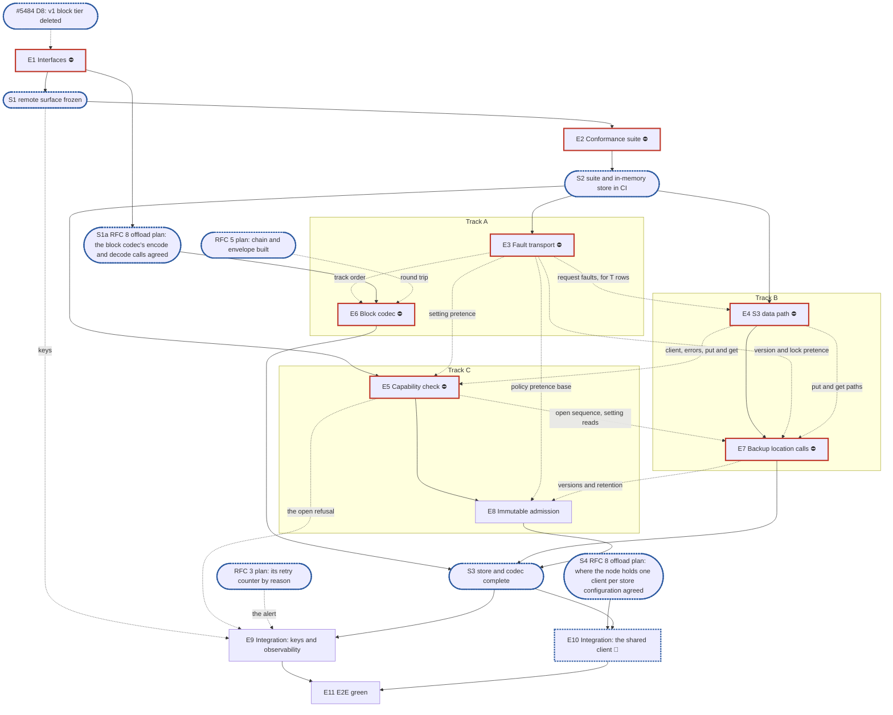

# RFC 4 — the remote tier v2: implementation plan

**Scope:** [RFC 4, the remote block store: block format and store contract](../docs/internals/rfcs/rfc-4-remote-tier.md),
whole (its status is `draft`, not `deferred`): the block codec, the store contract, the in-memory
store, the S3-compatible store with its capability check, the backup location's two modes and
its versioned objects, the fault transport, and the tests and benchmarks of §7. Related RFCs,
each **constraints only**, and each of RFC 2, 3 and 5 with a plan of its own written at the same
time:
- [RFC 0](../docs/internals/rfcs/rfc-0-data-lifecycle.md), the data lifecycle: the vocabulary and
  the failure model the store's errors serve.
- [RFC 2](../docs/internals/rfcs/rfc-2-carver.md), the carver: the block name's derivation
  (§4.2) and the bound `N` on chunks per block (§5, P4), both consumed by the codec (§4.2 D3).
- [RFC 3](../docs/internals/rfcs/rfc-3-syncer.md), the syncer: the store's only caller for
  transfers and probes (§1.3, §2.8), and the source of the pool sizes the client limit is
  derived from (§2.10).
- [RFC 5](../docs/internals/rfcs/rfc-5-transforms.md), transforms: the chain, its envelope,
  `MaxDecodeLen` and the census (§3.1), which the codec calls (§4.2 D3).
- [RFC 6](../docs/internals/rfcs/rfc-6-block-metadata.md), block metadata: the chunk range
  and the block record's census the codec is handed (§2.2, §2.3).
- [RFC 8](../docs/internals/rfcs/rfc-8-engine.md), the engine: it composes the codec with a
  store behind RFC 3's `Store` (§6.3, §6.6), and RFC 8's offload plan composes them into the
  node (S1a, S4).
- [RFC 9](../docs/internals/rfcs/rfc-9-gc.md), GC: the caller of `Delete`, `List`,
  `DeleteVersions` and the `Recheck` pass (§7.5); planned later.
- [RFC 12](../docs/internals/rfcs/rfc-12-snapshots.md), [RFC 26](../docs/internals/rfcs/rfc-26-catalog-backups.md)
  and [RFC 27](../docs/internals/rfcs/rfc-27-namespace-migration.md): a namespace is a prefix
  (RFC 12 §2.1); the backup location record and its callers (RFC 26 §2.4, §4.2); the claim the
  open reads (RFC 27 §2.1).
- [RFC 13](../docs/internals/rfcs/rfc-13-configuration.md), configuration: the remote store's
  and the namespace's keys (Appendix B, §5.4), declared in epic 9.
- [RFC 25](../docs/internals/rfcs/rfc-25-observability.md) and [RFC 29](../docs/internals/rfcs/rfc-29-test-harness.md):
  the rules every epic follows (§1.5 rules 3 and 6).

**Tracks:** A, B and C (§3.4).
**Programme:** [#5488](https://github.com/cubbit/dittofs/issues/5488), "offload: RFC 2–5 and
the engine's offload part", release v1.1, roadmap epic
[#5485](https://github.com/cubbit/dittofs/issues/5485). It builds on the journal-only engine,
stage 3 of #3119 ([`rfc-8-journal-only-engine-plan.md`](rfc-8-journal-only-engine-plan.md)),
whose §6.1 gives offload to "RFC 8's second-part plan", now
`.planning/rfc-8-offload-engine-plan.md`, written at the same time as this one and not yet
merged. That plan composes the codec and the store into the engine and the node, and takes over
#5318 and #4276 (remote clients composed in the node; the in-memory store refused outside
tests). So this plan's integration keeps only what is this component's own: its keys and
observability (epic 9), and the one client per store configuration that its stores share
(epic 10, planned after S4, since where the node holds it is that plan's). Opening a
namespace's store in the node and refusing the in-memory store outside tests stay that plan's
(§6.1). GC (RFC 9, roadmap #3620) is
planned later.
**Naming:** **v1** is the block tier on `develop` and `feat/storage-v2` today:
`pkg/block/remote`, `remote/memory`, `remote/s3`, `pkg/block/blockcodec` and
`pkg/block/blockstoretest`. **v2** is the store and codec RFC 4 describes, built here.
**Transition:** new installations only (#3119). v1 is deleted by #3119's stage 4, D8 of
[`rfc-16-store-cutover-stage4-plan.md`](rfc-16-store-cutover-stage4-plan.md) (#5484), and
nothing here touches it: v1 and v2 never run in one binary, so no metric, log key or setting
carries a version (§1.5 rule 7). Stage 4's plan still lists D8 as a question, recommended yes;
#5488 states the deletion as this programme's premise, and §4.2 D1 depends on it.
**Where the code lands:** `feat/storage-v2`, where the engine, `pkg/sim`, `pkg/metrics`'s
registry, `pkg/settings` and `internal/prof` live; this plan lands on `develop`. Paths below are on
`feat/storage-v2`.
**Defaults used from the skill's inputs:** no dashboards; the package paths of §4.1 proposed
here (pending the user's answer, §6 point 1); external dependencies are §3.3's.
**How it was reviewed:** an independent architect pass proposed the tree and surface (D3,
§6 point 9), then separate adversarial, correctness and simplification passes; their findings
are folded in.

---

## 1. Introduction

### 1.1 What we are building

The two components RFC 4's "Start here" and §1.2 describe, built apart and never calling each
other: the **block codec**, which encodes a planned block and verifies every chunk it returns
(RFC 4 §3), and the **remote block store**, one attempt per call over one service (RFC 4 §4),
profiled for S3-compatible services (Appendix C). Around them: the in-memory store, the
conformance suite every store passes (§7.1), and the fault transport that makes a real store
misbehave on cue (§7.2).

| v1 (deleted by stage 4, D8) | v2 (this plan) |
| --- | --- |
| `pkg/block/remote` (`RemoteStore`, `passthrough.go`) | `pkg/block/remote`: RFC 4 §4.1's contract (epic 1) |
| `pkg/block/remote/memory` | `pkg/block/remote/memory`: the in-memory store (epic 2) |
| `pkg/block/remote/s3` | `pkg/block/remote/s3`: the S3 profile (epics 4, 5, 7, 8, 10) |
| `pkg/block/blockcodec` | `pkg/block/codec` (epic 6) |
| `pkg/block/blockstoretest` (`RemoteBlockStoreConformance`) | `pkg/block/remote/remotetest` (epic 2) |
| no fault transport | `pkg/block/remote/s3/s3fault` (epic 3) |
| `remote.endpoint`, `remote.credential` (already v2's, on `feat/storage-v2`'s API) | kept; bucket, storage class, prefix, block target and the block format version to write added (epic 9) |

**Dependency limits.** The codec imports `remote` for its error values only and RFC 5's
transform package; it imports neither RFC 2's package nor the engine (§4.2 D3). The store
imports no codec, transform, syncer or engine package. The S3 store imports
`aws-sdk-go-v2`, already in `go.mod`.

### 1.2 How the plan is organised

Epics 1 and 2 are the team's: the frozen surface, and the conformance suite with the in-memory
store that passes it. Six middle epics follow RFC 4's own seams, two per track: the fault
transport and the codec (track A), the S3 data path and the backup location's versioned calls
(track B), the capability check and the immutable location's admission (track C). Epic 9 is the
component's keys and observability, epic 10 the client its stores share once RFC 8's offload
plan agrees where the node holds it (S4), and epic 11 the tiers past `pr`: the nightly run
against production services, the rows only a real bucket can show, and the benchmarks.

### 1.3 What epic 1 must deliver

- **`pkg/block/remote`**: every type, constant, interface method and error of RFC 4 §4.1,
  with `Cause` and `DeniedError`; behaviour per method is §4.2 to §4.15's, not epic 1's.
- **No constructor.** RFC 4 §4.1's last paragraph gives each backend its own constructor, and
  nothing outside this plan calls one before S4, so each lands with its first consumer (rule
  12): the in-memory store's in epic 2 (D4), the S3 store's and its client's in epic 4 (D10,
  D11).
- **The codec's exported surface** (RFC 4 §3.2 to §3.5, §4.3's measuring pass and checksum),
  which RFC 4 does not give: proposed in D3 and frozen at S1a, once RFC 8's offload plan
  agrees it, since the engine is its caller.
- **Injection points**: `*slog.Logger` and `*metrics.Registry` (RFC 25 §8.1), on the codec
  here and on the S3 store's client with its constructor; no tracer, since RFC 25 §6.1 lists no
  span for the store and RFC 4 §4.12 names none.
- Stub bodies behind final signatures (rule 11). No internal interface: the conformance suite
  and the two stores consume the public `Store` itself.

### 1.4 What epic 2 must deliver

**The suites.** RFC 4's suites paragraph (end of §7.5) puts §7.1 against the in-memory store
and §7.3 in `unit`, and §7.1 in full against the local emulator under the fault transport in
`integration`. Neither keeps a known-failure file, so no test of this plan starts red: each
lands green with the epic that makes it pass (§1.5 rule 6). Epic 2 needs no registry change:
its rows run in `unit`. What `integration` lacks, `service:localstack` in its `needs` and an
HTTPS endpoint, lands with its first consumer, epic 4 (D10). The nightly service row and the
benchmarks have no suite yet (RFC 4 §7.5): epic 11 registers them, and the rows too large for
`integration`'s budget get a nightly option of it (D12).

**The scenario catalogue, by source.**
- **RFC 4 §7.1, the rows not marked T** whose subject the in-memory store can show: §4.3 put
  then get; §4.4 ranges; §4.5 a batch deleted twice and a batch of 2,500; §4.6 the walk of
  2,500 and the foreign key with the cancel; §4.2 the raw namespace; §4.13 the roles; the
  read-only half of the §4.7 probe row. They run in epic 2 against the in-memory store, and
  against the S3 store over LocalStack in epic 4 (the §4.7 half in epic 5, which builds
  `Health`). The other unmarked rows the in-memory store cannot show: §4.10's two client rows
  (epic 10), §4.8's throttling row (epic 4), §3.2's census row (epic 6), and the §4.7 row's
  prefix-revoke half, which needs a service enforcing per-prefix rights (epic 11). RFC 4 §7.4
  says the in-memory store passes every row not marked T; §6 point 10 proposes the amendment.
- **RFC 4 §7.1, the rows marked T**: each epic that builds the behaviour writes its rows, over
  the S3 store and the fault transport (§5, each epic's **Done when:**).
- **RFC 4 §7.3** (15 rows): epic 6. §7.3's "engine's read and write tests with and without
  transforms" is the RFC 8 offload plan's (§6.1).
- **Measured service behaviour** (RFC 4 Appendix B): the fault transport's presets for a
  service that ignores every put checksum (Cubbit DS3 as measured), one enforcing only CRC32C
  (Scaleway), one ignoring conditional puts, and one clamping an overlong range, each proved by
  the check's refusal or choice (epics 3 and 5).
- **v1's history** (RFC 4 Appendix A): A3 (client retries), A5 (no put checksum), A6 (health as
  an existence check), A7 (no capability check) and A11 (an emulator pinned to a version
  ignoring checksums) are each a §7.1 row already; no row is added.

**The test components.** The conformance suite, `remotetest`, run by each store's own tests
with an opener, each S3 run under a fresh prefix of one bucket as the harness's
`test/harness/fixture/s3.go` already does (its pattern copied, since `newBucket` is
unexported); the in-memory store, a verified in-memory implementation (`CLAUDE.md`, "Writing
tests", kind 2) held to that suite; a fault wrapper around it that turns a namespace read-only
for the §4.7 row (kind 3); and `internal/prof`'s leak checks wired into the suite (rule 4). The
fault transport is epic 3's, landing with its first consumers.

### 1.5 General rules for each epic

> **Instruction for whoever expands an epic into its detailed description and subtasks,
> human or AI:**
>
> - **Creating an epic from this plan: use the `epic-breakdown` skill.** Whenever the user
>   asks to create an epic from this plan, or to expand, detail or break one down, run the
>   `epic-breakdown` skill (`.claude/skills/epic-breakdown/SKILL.md`) on this plan and that
>   epic, rather than writing the epic document freehand. It extracts the RFC's MUST and
>   MUST NOT into numbered requirements, estimates each subtask in man-days and suggests
>   the pull requests. A human doing it by hand follows the same skill.
> - **Epic and subtask, nothing else.** The units of work are the epic and its subtasks,
>   with subtask ids `<e>.<n>` (`subtask 4.3`, or `T4.3` for short), assigned by the epic
>   document. No other word names
>   them: not task, ticket, story, step or phase, in headings, tables, ids or prose.
> - **The epic stands alone for what to build.** Its requirements, subtasks and decisions
>   are in the epic document itself, which never refers to this plan for them or says "see
>   the plan": the RFC sections it implements, the interfaces it builds on, the
>   subtasks, and a short legend of the names it borrows from this plan (E1, E2, S1, the
>   integration epic, …). It cites the numbered rules below, without copying them, in a
>   table of how each applies: each row names its rule by number and bold title, which
>   says what the rule requires, and the table links this §1.5 with a full link (the
>   plan's path and the section's anchor) and the `CLAUDE.md` sections that hold a rule,
>   so the epic reads alone and its reader can still open each rule's text in one click.
> - **The epic document records decisions, not progress, like this plan.** It has no
>   status fields, no checkboxes to tick and no sections to keep up to date as the work
>   goes on. It is revised through a pull request only when a decision changes.
> - **Subtasks are not pull requests.** A subtask is ideally up to 5 man-days. The owner
>   ships subtasks as they see fit, one pull request each or several together; the epic
>   document only suggests a grouping, each suggested pull request ideally up to 15
>   man-days. Cut and group by logic, readability, dependencies and a deliverable that can
>   be named, not to hit a number.
> - **Every subtask states how it meets each rule that applies to it.** A rule that does
>   not apply is named, with the reason.
> - **In the issue tracker, once each document merges,** following `epic-breakdown`
>   Step 6, their one description. Issues point at the documents and copy nothing; once
>   created, their `Estimate` and blocked-by links are the current estimate and
>   dependencies, and the documents are not revised to follow them. The
>   epic issues exist before E2's pull request lands, because each red test's
>   `known.yaml` entry names one; subtask issues come once their epic document has
>   merged. The release an epic ships in is set by the RFC's roadmap epic that its epic
>   issue sits under, never in a document and never on the epic issue on its own: the epic
>   issue and its subtask issues copy that roadmap epic's milestone, and an epic changes
>   release only by moving under the roadmap epic of the other release.

1. **Independent unit tests.** Each epic carries its own unit tests, built on epic 2's
   conformance suite and in-memory store, epic 3's fault transport once it lands, and the
   implementation of an epic it depends on once that has landed. Pure parts are functions of
   their inputs and tested as such: the S3 error table (Appendix C.3), the bucket-setting
   judgements (C.1), the bucket-policy reading (§4.14), the generation arithmetic (§4.14) and
   the header bound (§3.2). E1 declares no internal interface for a test to stand in for
   (rule 12).
2. **Fuzz tests where relevant** (`CLAUDE.md`, "Writing tests", "By kind"). Targets: the
   codec's header and body decoding (RFC 4 §7.3's fuzz row, with its allocation bound); the
   `Content-Range` reader (§4.4); the bucket-policy reader (§4.14), on JSON a bucket's owner
   writes. The SDK parses the service's XML replies; the store's judgements over the SDK's
   types are table-tested, not fuzzed.
3. **Observability follows RFC 25.** Metric names are RFC 4 §4.12's, under the `remote_` and
   `codec_` prefixes RFC 25 §2.1 gives RFC 4; the histogram's `op` folds to six values, as
   §4.12 and RFC 25 §11 say; units, buckets (`request`) and labels are RFC 25 §2's. `Deps`
   carry a `*slog.Logger` narrowed with `With("component", "remote")` or `"codec"` and the
   `*metrics.Registry`. The store owns no health condition (its health is the syncer's, RFC 3
   §2.8, registered in RFC 25 §3.9 as `store_put_unhealthy` and `store_get_unhealthy`) and
   opens no span. Logs are §4.12's: a
   refused open and a drifted setting once at `Error`, `ErrCorrupt`, a verification failure
   and a foreign entry at `Warn`, nothing per call. The one alert, on `codec_verify_failures_total`
   net of the syncer's recovered re-gets (RFC 25 §7, RFC 4 §4.12), is epic 9's.
4. **Profiling.** Tests and benchmarks run under `internal/prof`'s goroutine, descriptor and
   heap checks. Allocations-per-op assertions on: the codec's per-chunk encode and verify; the
   S3 `Put` stream, which holds the header and one chunk and never the block (§3.2, §4.3);
   one `List` page (§4.6).
5. **Public interface and internals.** Tests cover the packages' internal functions and the
   behaviour through `remote.Store` and the codec's surface, under `-race`. Test at the layer
   that **consumes** a value (`CLAUDE.md`, "Verifying a change"): a checksum or retain-until
   the store sends is asserted where the fault transport sees the request, or where the
   service refuses it, not where the store builds it.
6. **Known failures shrink.** No suite this plan uses keeps a `known.yaml` (§1.4), so no test
   lands red: a test lands with the epic that makes it pass, and a test that cannot pass yet
   is not written yet. A later revision that gives RFC 4 a suite of its own with a known file
   follows `CLAUDE.md`, "Writing tests", "By kind", and RFC 29 §4.7.
7. **v2 ignores v1.** No import of, copy from, or behavioural dependence on v1. Under §4.2
   D1's recommended option v1 is deleted (#5484) before epic 1 starts, so there is nothing to
   import and no import test is written; under the other option, epic 1 adds a walk over
   every package of the v2 paths refusing each v1 path, test packages included. v1 is not
   touched.
8. **Real dependencies for properties of those dependencies** (`CLAUDE.md`, "Writing
   tests"). LocalStack 4.13.1 under the fault transport for every §7.1 row marked T and for the
   capability check's choices; the real service for what LocalStack does not enforce (bucket
   policies, credentials' rights and per-prefix access: §4.14's admission and the §4.7
   prefix-revoke row are proved against a real bucket in epic 11, never by the transport's
   pretence alone); the in-memory
   store is never the only store a row runs against (RFC 4 §7.1's last paragraph).
9. **Code comment conventions** (`CLAUDE.md`, "Code comments"). Where RFC 4 carries a
   `decision:` note, its marker goes at the code site that implements it: conditional put
   measured and never sent (§4.3, epic 5); the digest-only delayed duplicate (§4.3, epic 4);
   a block put's size refusal as cause `size` (§4.8, epic 4); the suspended store's repair
   proof trusted (§4.11, epic 5); the open calling the service outside the syncer (§4.15,
   epic 5); the fixed re-list bound (Appendix C.4, epic 5); versioning refused on every
   namespace store (§8 item 4, epic 5); an unreadable policy refused, the bucket owner outside
   the threat model (§4.14, epic 8), and the provocation at record creation as the gate (§7.4,
   epic 8). §4.3's `ponytail:`s are this plan's own.
10. **A test must be able to fail** (`CLAUDE.md`, "Writing tests"), and nothing else would
    catch the change it guards: not the compiler, not the diff, not a later epic's tests. A
    review rule that no test can check, such as "stubs never panic", stays a review rule.
11. **A symbol is exported only if the RFC's interface uses it.** Everything exported is
    frozen at S1, the codec's at S1a, each constructor when it lands (§1.3). The S3 store's error table, its bucket-setting and
    policy readers, the generation arithmetic and the fault transport's presets stay
    unexported or in an `internal/` package of `s3`; the fault transport exports what the
    T rows and RFC 3's and RFC 8's offload plans' tests call.
12. **Each subtask creates only what it declares.** No empty package and no stub without a
    caller. A package, an option or a test helper lands with its first consumer: each knob of
    the fault transport with the rows that use it.

## 2. Epics at a glance

| # | Epic | Content | Subtasks | Man-days | Track | Blocks |
| --- | --- | --- | --- | --- | --- | --- |
| 1 | **Interfaces** ⛔ | `remote`'s contract; the codec's surface, frozen at S1a | 4 | 5.5 | team | **everything** |
| 2 | **Conformance suite and test foundations** ⛔ | `remotetest`, the in-memory store and its read-only wrapper | 5 | 7 | team | **all testing** |
| 3 | **Fault transport** ⛔ | `s3fault` under the real client: request faults, setting pretence, Appendix B's presets | 5 | 7.5 | A | 4, 5, 7, 8 |
| 4 | **S3 data path, errors and client** ⛔ | the client and constructor, put, get, delete, list, control objects, the total error table, `remote_` metrics, LocalStack in `integration` | 8 | 16 | B | 5, 7 |
| 5 | **Capability check, health and Recheck calls** ⛔ | Appendix C.4 at open, the setting judgements, both probes, `Settings`, `RecheckSetting`, `VersionsPage`, `DeleteVersions` | 7 | 14 | C | 7, 8, 9 |
| 6 | **Block codec** ⛔ | format, encode with declared lengths or a measuring pass, verified reads, the version gate, fuzz, `codec_` metrics | 7 | 14 | A | the RFC 8 offload plan |
| 7 | **Backup location: versions, retention and versioned objects** ⛔ | both modes' calls, generations and phases, the location health object, the location store, §4.15's objects | 7 | 17 | B | 8 |
| 8 | **Immutable location admission** | the policy read by effect, the inspection credential, the record-creation provocations, every open's checks | 8 | 19.5 | C | 11 |
| 9 | **Integration: keys and observability** | RFC 13's keys, the registry wiring, the alert rule, the refusal as a field error | 5 | 6.5 | team | 11 |
| 10 | **Integration: the shared client** 🔀 | one client per store configuration, its limit derived from its callers | planned after S4 | planned after S4 | team | 11 |
| 11 | **E2E green** | the nightly service row, the real-bucket rows, §7.5's benchmarks, fuzz past the seeds | 6 | 10.5 | team | — |
| | **Total** | | **62** | **117.5** | | |

**Plan estimate: 62 subtasks, 117.5 man-days, not counting epic 10.**

RFC 4 is 2,117 lines, which gives N = 5. Its cohesive areas are six: the codec (§3), the data
path (§4.2 to §4.6, §4.8, §4.9, §4.13), the open and its re-check calls (§4.7, §4.11), the
backup location's calls (§4.14's calls, §4.15), its admission (§4.14's checks and
provocations), and the fault transport (§7.2), which four of the others consume and the RFC 3
and RFC 8 offload plans' tests reuse, so it is an epic of its own rather than spread across
them.

⛔ = blocker: other epics cannot finish until this one has delivered.
🔀 = synchronisation point: the work waits on an agreement or on everything before it.

## 3. Synchronisation points, blockers and the split

### 3.1 Dependency graph



### 3.2 Synchronisation points

- **S1 🔀 Remote surface frozen** (end of epic 1). `remote`'s contract is reviewed by the team
  and by the authors of the RFC 3 and RFC 8 offload plans, whose code consumes it. Epic 2
  starts here, and so does the keys half of epic 9.
- **S1a 🔀 RFC 8 offload plan: the block codec's encode and decode calls agreed** (epic 1's
  codec surface, D3). The engine is the codec's only caller in v1.1; its shape is agreed with
  that plan before it freezes. Epic 6 starts here.
- **S2 🔀 Suite and in-memory store in CI** (end of epic 2). The conformance suite runs green
  against the in-memory store in `unit`. Epics 3, 4 and 5 start here.
- **S3 🔀 Store and codec complete** (epics 3 to 8 done). Every row of RFC 4 §7.1 and §7.3 this
  plan's epics 2 to 8 own runs green in `unit`, `integration` or its nightly option. Epic 9's
  observability half and epic 10 start here.
- **S4 🔀 RFC 8 offload plan: where the node holds one client per store configuration agreed**
  (external). Which component holds the client of each store configuration, which counts it
  is sized from (RFC 3 §2.10's worker counts, GC's bound, one probe: RFC 4 §4.10), and which
  `Close` releases it. Epic 10 is planned after it.

### 3.3 Blockers

- **E1 and E2** block everything. Keep them short.
- **E3** blocks E4, E5, E7 and E8: their rows marked T run over it. Each of those epics builds
  its behaviour over LocalStack first, so only its T rows wait. E3 comes before E6 on track A
  by order only; the codec needs nothing from it.
- **E4** blocks E5 (the check runs on the client, the error table, put and get) and E7 (a
  versioned put is a put).
- **E5** blocks E7 (the location's open is the check's sequence in another mode), E8 (the
  settings it reads at every open) and E9 (the refused open reported as a field error).
- **E6** blocks the RFC 8 offload plan's put and fetch composition (external).
- **E7** blocks E8: the provocations are versioned puts, retention writes and legal holds.
- **E9 and E10** block E11.
- **#5484, stage 4's D8 (external, rif):** deletes v1, whose paths v2 takes (D1). Epic 1 waits
  on it under D1's recommended option.
- **The RFC 5 plan (external):** the codec cannot round-trip a body until RFC 5's `Chain`
  writes the envelope, even for an empty chain (RFC 5 §3.1's `Chain.Encode`). Epic 6 builds its
  header, bounds and version gate before it, and its round-trip rows after.
- **The RFC 3 plan (external):** epic 9's alert subtracts the syncer's recovered re-gets,
  which the RFC 3 plan exports (RFC 3 §2.12); the alert lands once that counter does.
- **The RFC 2 plan (external), not a blocker:** the codec's whole-block check recomputes the
  name with RFC 2 §4.2's derivation, which the engine passes in (D3); epic 6's tests pass a
  derivation of their own checked against RFC 2 §4.2's golden vector.

### 3.4 Splitting the work

- **Track A, the test transport and the codec:** epic 3, then epic 6. It builds first what the
  other tracks' rows run over, then the codec, which shares nothing with the store and starts
  once S1a has agreed its calls with the engine's authors.
- **Track B, the data path:** epic 4, then epic 7. Every call that moves bytes, first on a
  namespace's store, then the versioned and retained ones of a backup location.
- **Track C, the open:** epic 5, then epic 8. What a store proves before it opens and re-reads
  after, first for a mutable store, then an immutable location's admission.
- **Where the team converges:** epics 1 and 2 before S2; epic 9's observability half, epics 10
  and 11 after S3.
- **Where the tracks wait on each other.** Track C needs epic 4's client and error table before
  its check can run: it opens with Appendix C.1's setting judgements, pure functions over the
  SDK's types, which fill that wait. Track B's epic 7 needs epic 5's open sequence for the
  location's open; its generation arithmetic and versioned objects come first. Track C's epic
  8 needs epic 7's versioned calls for its provocations; the policy reader comes first.
- **Track A's idle stretch.** Track A carries about 21.5 man-days against track B's 33 and
  track C's 33.5. If S1a or the RFC 5 plan's envelope is late, epic 6 waits after epic 3: track
  A fills it with the keys half of epic 9, which needs only S1 and the RFC 13 plan's settings
  table, and with the header, bound and version-gate work of epic 6, which needs neither. What
  remains of the gap is real, and closes only when S1a is agreed.

## 4. Implementation decisions

### 4.1 Directory layout

```text
pkg/block/remote/                      E1: RFC 4 §4.1's contract: types, Store, errors, Cause
pkg/block/remote/remotetest/           E2: the conformance suite (§7.1's shared rows), leak checks
pkg/block/remote/memory/               E2: the in-memory store and its constructor (D4)
pkg/block/remote/s3/                   E4: client, constructor, data path, error table, layout
  check.go settings.go health.go       E5: Appendix C.4, C.1's judgements, probes, Recheck calls
  version.go objects.go location.go    E7: §4.14's calls, generations, §4.15, the location store
  policy.go admit.go                   E8: the policy read by effect, provocations, inspection
  clients.go                           E10: one client per store configuration, its limit
  *_test.go                            E4 to E8: the rows marked T, over s3fault and LocalStack
pkg/block/remote/s3/s3fault/           E3: the fault transport, under the client's http.RoundTripper
pkg/block/codec/                       E1: surface (S1a); E6: format, encode, decode, gate
  testdata/fuzz/ testdata/v1/          E6: fuzz seeds; the golden block of each released version
internal/node/api/res_stores.go        E9: the remote store's keys (with pkg/settings' table)
test/suites.yaml                       E4: service:localstack in integration; E5: its nightly
                                       option; E11: the service and benchmark cells
```

### 4.2 Decisions

- **D1. v2 takes v1's paths, after #5484 deletes v1** — *pending the user's answer* (§6
  point 1). Option (a), recommended: epic 1 starts once stage 4's D8 has deleted v1, and v2 is
  `pkg/block/remote` and `pkg/block/codec`, so no rename follows and the RFC 3 and RFC 8 offload
  plans import final paths from S1. Option (b): v2 starts now under `pkg/block/remotev2`, and
  is renamed when v1 goes, as the journal-only engine did with `enginev2` (#3645); its cost is
  a rename across this plan's packages and every importer the other offload plans have by
  then, and the import walk of rule 7. Prior art: #3645's rename (checked in the RFC 8 plan's
  header). Applied by epic 1.
- **D2. The block's bytes: fixed-width little-endian fields, no variable-length integers.**
  RFC 4 §3.2 leaves widths, integer encoding and order to the codec. Fixed widths make the
  header bound of §3.2 a constant expression and keep the decoder's bounds checks before
  allocation easy to read. Epic 6's document writes the layout table and its golden block,
  which `testdata/v1/` keeps (RFC 4 §7.3's last row). Prior art, from memory: restic's pack
  format (fixed-width entries, header at the end and encrypted, where RFC 4 puts it first and
  in the clear); Kopia's pack index (fixed-width entries). Applied by epic 6.
- **D3. The codec takes the name derivation and the chain as arguments, and imports `remote`
  only for its error values.** Proposed shape, agreed at S1a: an encoder that plans a block
  (its exact size, its checksum of the kind the store's `Checksum` names, each chunk's range and
  the census) from a re-iterable source of the block's chunks, with as many measuring passes as
  RFC 4 §4.3 requires, then streams it; a decoder that reads a whole block or one chunk's range,
  verifying as RFC 4 §3.4 says, with the name recomputed through the derivation function it is
  handed. The derivation is the engine's to pass (RFC 2 §4.2), so the codec has no edge to the
  RFC 2 plan and the key scope stays the engine's. Prior art: the architect pass proposed this
  shape independently; restic's `Repository.LoadBlob` verifies by its blob ID after decryption
  (from memory). Applied by epics 1 and 6.
- **D4. The in-memory store is a mutable namespace store only, with an injected clock for
  `ModTime`.** It answers every call RFC 4 gives only an immutable store or a backup location
  with `ErrInvalid`, as a mutable namespace store does. Its consumers are the conformance
  suite's unmarked rows and the other offload plans' unit tests (the RFC 5 plan's `keys`
  object), none of which reads a version. Prior art: none found. Applied by epic 2, with a
  `ponytail:` (§4.3).
- **D5. CRC32C combined per body by GF(2) matrix combination.** RFC 4 §4.3 takes the checksum
  per body in the measuring pass and joins the header's; `hash/crc32` offers no combine
  (checked: `go doc hash/crc32`). Prior art: zlib's `crc32_combine` (from memory). Applied by
  epic 6.
- **D6. The client takes its limit as a number; deriving it is epic 10's.** Epic 4's client
  sets its connection caps from a limit it is handed (Appendix C.3); the function deriving that
  limit from the callers' concurrency (RFC 4 §4.10) lands with its consumer, the holder of one
  client per store configuration (epic 10, S4). Prior art: rclone sizes its HTTP transport
  from `--transfers` and `--checkers` (from memory). Applied by epics 4 and 10.
- **D7. The fault transport consults `pkg/sim`'s fault schedule and clock through methods it
  declares in standard-library types**, as the RFC index's test harness item 1 asks of every
  seam (`sim.TestClock` satisfies the clock a component declares), and answers a pretended
  bucket setting itself with the service's reply shape, since LocalStack cannot be configured
  into most of §7.2's faults. Prior art: none found for S3 in Go; `toxiproxy` injects at TCP
  level, below the request (from memory). Applied by epic 3.
- **D8. The bucket policy is read into a narrow struct with `encoding/json` and accepted only in
  the one form RFC 4 §4.14 states.** No policy evaluator: the RFC refuses every other form, so
  the reader only has to recognise it. Prior art: none found in Go's standard library or the
  SDK; AWS's policy simulator is a service, not a library (from memory). Applied by epic 8.
- **D9. Timing waits use the injected clock.** The check's bounded re-list (Appendix C.4,
  step 4), the generation ends and the retain-until targets (§4.14) are computed and advanced
  on the clock, never slept. Prior art: the engine's and the journal's use of `pkg/sim`
  (checked on `feat/storage-v2`). Applied by epics 5, 7 and 8.
- **D10. `integration` reaches LocalStack over HTTPS.** Appendix C.3 refuses an endpoint that
  is not HTTPS, and the harness hands `LOCALSTACK_ENDPOINT=http://127.0.0.1:4566`
  (`test/harness/needs/needs.go`). The client's settings carry an optional set of trusted roots
  (none: the system's), which a self-hosted service with a private CA needs anyway, and epic 4
  points the cells at LocalStack's HTTPS listener: `s3.localhost.localstack.cloud:4566`, whose
  certificate LocalStack ships (from memory, to confirm in epic 4), or else its self-signed
  certificate passed as the trusted root. Prior art: LocalStack's own documentation of its
  HTTPS endpoint (from memory). Applied by epic 4.
- **D11. The S3 constructor's sequence is final from epic 4; the check fills it in epic 5.** The
  exported constructor's signature is RFC 4 §4.1's from its first landing. Epic 4 builds the
  store under it with its integrity mode, HTTPS refusal and layout, and tests the data path
  under each integrity mode chosen explicitly through an unexported seam the check later sets;
  epic 5 inserts Appendix C.4's check before the constructor returns. Nothing exported changes.
  Prior art: none found. Applied by epics 4 and 5.
- **D12. The rows of 10⁴ objects and more run in a nightly option of `integration`.** RFC 4
  §7.1's 10⁶-version `Recheck` row, its 10⁵-put generation row and its 10⁴-version
  `ListObjects` row, against LocalStack, do not fit `integration`'s `-p 1 -timeout=20m` on every
  pull request. Epic 5 registers the option, behind its own build tag added to `lint-go`'s vet
  list, as `tier: nightly`; each of those rows is written in its epic and runs there, and a
  smaller instance of the same row runs on every pull request. Prior art: `unit`'s `nonrace`
  option, nightly (checked: `test/suites.yaml`). Applied by epics 5 and 7.

### 4.3 Knowingly simple implementations

- **The in-memory store holds every object in a map under one mutex, mutable mode only**
  (D4). Ceiling: no immutable-mode or versioned-object test can run on it, and concurrent
  tests serialise. Upgrade, with no migration: give it versions when a consumer's unit test
  needs an immutable store without LocalStack. Epic 2.
- **A service with no batch delete deletes one key per request** (RFC 4 §4.5, Appendix C.4
  step 3), one after another within the call (§4.9). Ceiling: Google Cloud Storage's XML API
  pays one round trip per name (Appendix B's notes). Upgrade: a per-name parallel delete is the
  caller's, through more syncer workers, never the store's. Epic 4.
- **Each `ExtendRetention` reads, then writes** (§4.14), with no cache of retain-untils.
  Ceiling: two requests per extension, about `N ÷ G` a day. Upgrade: read the retain-until from
  the `ListObjects` page the copier already holds, which changes the contract, so an RFC 4
  amendment first. Epic 7.

## 5. The epics in detail

### Epic 1 — Interfaces ⛔

**Epic 1 estimate: 4 subtasks, 5.5 man-days.**

The frozen surface of `remote` and the codec, with stub bodies. **Owns:** RFC 4 §1.2, §2,
§4.1's types, interface and errors. **Done when:** S1 and S1a are reached.

**Expected content:**
- `remote`'s types, constants, `Store` and errors, from RFC 4 §4.1, each method's doc naming
  the section that states its obligations.
- The codec's surface (D3), proposed to the RFC 8 offload plan's authors and frozen at S1a.
- Under D1's option (b) only, the import walk of rule 7.

### Epic 2 — Conformance suite and test foundations ⛔

**Epic 2 estimate: 5 subtasks, 7 man-days.**

§1.4's suite and the in-memory store that passes its unmarked rows. **Owns:** RFC 4 §7.1 (the
suite's form and the unmarked rows §1.4 lists). **Done when:** the unmarked rows §1.4 lists
pass against the in-memory store in `unit`; RFC 4 §7.4's first row, as §6 point 10 proposes to
amend it.

**Expected content:**
- `remotetest`: the suite's runner over an opener, its unmarked rows, the leak checks.
- The in-memory store and its constructor, mutable namespace stores only (D4), held to the
  suite.
- The fault wrapper around it that makes a namespace read-only (§4.7's row).

### Epic 3 — Fault transport ⛔

**Epic 3 estimate: 5 subtasks, 7.5 man-days.**

The transport under a real store's client that produces the failures RFC 4 §7.2 names.
**Owns:** RFC 4 §7.2. **Done when:** each request fault and setting pretence §7.2 names is
shown taking effect against LocalStack on a request it alters; the object-lock and policy knobs
are epic 7's and epic 8's (rule 12).

**Expected content:**
- The `http.RoundTripper` wrapper, matching requests by operation and key, on `pkg/sim`'s
  schedule and clock (D7).
- §7.2's request faults.
- §7.2's setting pretence for a mutable store.
- Appendix B's measured services as named presets, which epic 5's check proves.

### Epic 4 — S3 data path, errors and client ⛔

**Epic 4 estimate: 8 subtasks, 16 man-days.**

Every call on a namespace's store that moves or removes a block or a control object, the S3
error table, and the client. **Owns:** RFC 4 §4.2, §4.3 (the store's half), §4.4, §4.5 but
`DeleteVersions`, §4.6, §4.8, §4.9, §4.10's client caps, §4.12's `remote_` rows, §4.13,
Appendix C.2's namespace keys, C.3. **Done when:** RFC 4 §7.1's rows for §4.2, §4.3 (but the
conditional put's), §4.4 (but the codec's ranged-flip half), §4.5, §4.6, §4.8, §4.9 and §4.13,
and the C.3 row's signing and HTTPS clauses, over LocalStack and the fault transport; §1.4's
unmarked rows against the S3 store; RFC 4 §7.4's emulator row for these; RFC 4 R5 to R10, R13's
store half, R16 and R21.

**Expected content:**
- The client and the S3 constructor: retries off, checksum and payload-signing modes pinned,
  HTTPS only with optional trusted roots, its caps from the limit it is handed (Appendix C.3,
  D6, D10, D11).
- `service:localstack` in `integration`'s `needs`, the HTTPS endpoint (D10), the skip naming
  `LOCALSTACK_ENDPOINT`, `dt docs` rerun, and `CLAUDE.md`'s "CI starts no S3 endpoint yet"
  corrected.
- The error table as one total function of operation, status and code (C.3, §4.8), with
  `DeniedError`'s causes.
- `Put` (§4.3), `Get` (§4.4), `Delete` (§4.5), `List` (§4.6), `PutControl` and `GetControl`
  (§4.13), at C.2's keys; the digest-only and size `decision:` markers.
- The `remote_` metrics and §4.12's logs.

### Epic 5 — Capability check, health and Recheck calls ⛔

**Epic 5 estimate: 7 subtasks, 14 man-days.**

What a mutable store proves before it opens, and the calls that re-read it after. **Owns:** RFC
4 §4.5's `DeleteVersions`, §4.7 for a namespace's store, §4.11's store calls, §4.12's
`remote_capability`, §5, Appendix C.1's mutable rows, C.4's steps 1 to 7. **Done when:** RFC 4
§7.1's rows for §4.7 (but the location's and the prefix-revoke half), §4.11 and §4.3's
conditional put, each in its store half (the halves naming GC, the syncer or a folder's holder
are §6.1's), the C.3 row's encryption clause, and the §4.11 10⁶-version row in D12's nightly
option; RFC 4 R12's mutable half and R17's store half.

**Expected content:**
- Appendix C.1's judgements for a mutable store, as pure functions over the SDK's replies.
- The open's sequence, Appendix C.4 steps 1 to 7, inserted into epic 4's constructor (D11), the
  re-list on the clock (D9), refusing with every missing feature named.
- `Health` in both directions (§4.7).
- `Settings`, `RecheckSetting`, `VersionsPage` and `DeleteVersions` (§4.11, §4.5).
- D12's nightly option of `integration`.
- `remote_capability`, the refused open's log and the `decision:` markers rule 9 gives this
  epic.

### Epic 6 — Block codec ⛔

**Epic 6 estimate: 7 subtasks, 14 man-days.**

The codec of D3, on the format of D2. **Owns:** RFC 4 §3.1 to §3.5, §4.3's measuring pass and
checksum, §4.12's `codec_` rows. **Done when:** RFC 4 §7.3's rows but the engine's
transforms-on-and-off row (§6.1); §7.1's §3.2 census row; §7.1's §4.4 ranged-flip half, over
the in-memory store; R1 to R4, R14 and R15.

**Expected content:**
- The layout of D2, its header bound, and the refusals before allocation (§3.2).
- Encode from declared or measured lengths through RFC 5's `Chain`, with D5's combine (§4.3).
- Whole-block and ranged reads, verified as §3.4 says.
- The version gate (§3.5) and the golden block of `testdata/v1/`.
- The decoder's fuzz target (rule 2) and the `codec_` metrics.

### Epic 7 — Backup location: versions, retention and versioned objects ⛔

**Epic 7 estimate: 7 subtasks, 17 man-days.**

Every call a backup location's two stores make, in both modes. **Owns:** RFC 4 §4.7's location
health object, §4.14's calls, §4.15, Appendix C.2's location keys, and the fault transport's
object-lock knobs. **Done when:** RFC 4 §7.1's rows for §4.15, §4.14's rows on the calls (the
local refusal, generations and phases, `Delete` and `ExtendRetention` without a request, the
virtual clock past the lifecycle age), and §4.7's location rows in their store half; the 10⁵-put
and 10⁴-version rows in D12's nightly option; R18 and R20.

**Expected content:**
- The mode at open, the location store and the block folder under it (§4.15's last
  paragraph).
- The versioned and retention calls of §4.1 for blocks and control objects, with §4.14's local
  refusal.
- The generation ends and each name's phase as pure functions on the clock (D9).
- The location health object's life (§4.7, §4.14).
- §4.15's versioned-object calls and their bound.
- The fault transport's knobs for versions, delete markers and lock modes.

### Epic 8 — Immutable location admission

**Epic 8 estimate: 8 subtasks, 19.5 man-days.**

What an immutable location must prove at its record's creation and at every open. **Owns:** RFC
4 §4.14's requirements, denies read by effect, inspection credential and provocations; R12's
immutable half; Appendix C.1's immutable rows; C.4's immutable paragraph; the fault
transport's policy knobs. **Done when:** RFC 4 §7.1's §4.14 rows on admission, over the fault
transport.

**Expected content:**
- The policy reader of D8.
- The bucket-setting judgements of Appendix C.1's immutable table.
- The inspection credential (§4.14).
- The record creation's provocations and how each reply counts (§4.14, C.4).
- Every open's checks, and the outcome the record stores returned to its caller.
- The fault transport's knobs for policies, legal holds and `AssumeRole`; the `decision:`
  markers rule 9 gives this epic.

### Epic 9 — Integration: keys and observability

**Epic 9 estimate: 5 subtasks, 6.5 man-days.**

What wiring the component needs that is decided now. **Owns:** RFC 13 Appendix B's rows for
the bucket, storage class, prefix, block target and block format version to write, and §5.4's
gate on the last; RFC 25 §7's alert on `codec_verify_failures_total`. **Done when:** RFC 13
§9's "§6 block target range" row; RFC 13 §9's "§5.4 format version" row's single-node part;
each metric of RFC 4 §4.12 registered once through `pkg/metrics` and read from a scrape.

**Expected content:**
- The keys in `pkg/settings`' table and `res_stores.go`, the block format version's key marked
  with the RFC 13 plan's `FormatVersion` option (its epic 3's D6); the storage class's default
  as §6 point 2 settles it.
- The `remote_` and `codec_` `Spec`s on the root's registry, the store's and codec's `Deps`
  filled from it.
- The alert rule, net of the syncer's recovered re-gets as RFC 25 §7 words it.
- A refused open reported as a validation error naming the missing features.
- `docs/guide/configuration.md`'s remote store section.

### Epic 10 — Integration: the shared client 🔀

**Epic 10 estimate: planned after S4.**

The client its stores share, once the RFC 8 offload plan agrees where the node holds it (S4).
**Owns:** RFC 4 §4.10's one client per store configuration and its derived limit. **Done
when:** RFC 4 §7.1's two §4.10 rows; R11 and R19.

**Expected content:**
- The function deriving the limit from the callers' concurrency (D6).
- One client per store configuration, its reference released by each store's `Close`.

### Epic 11 — E2E green

**Epic 11 estimate: 6 subtasks, 10.5 man-days.**

The tiers past `pr`, and what only a real bucket shows. **Owns:** RFC 4 §7.4's production row
and release check, §7.5, Appendix B's new columns. **Done when:** RFC 4 §7.4's third row
nightly against each service Appendix B measures; §7.1's §4.7 prefix-revoke half and §4.14's
admission provocations against a real bucket; §7.5's eight benchmarks recorded.

**Expected content:**
- A nightly cell running §7.1 and the check against Cubbit DS3 and Scaleway in disposable
  namespaces (§6 point 5).
- The §4.7 prefix-revoke row and §4.14's provocations against a real bucket per service, into
  Appendix B (the lab rows of §7.4).
- §7.5's benchmarks, after merge against LocalStack and daily against one service.
- Fuzz past the seed corpus nightly; a ten-minute steady-load soak for connections opened.
- RFC 4's suites paragraph (end of §7.5) updated to name the cells it registers.

## 6. Risks and open points

1. **Where v2 lives** (D1) — *pending the user's answer*. Recommended: wait for #5484's D8 and
   take v1's paths. The other offload plans (RFC 2, 3, 5, 8) face the same choice for
   `pkg/block/{carver,syncer}`; the four should answer it the same way.
2. **The storage class's default** — *pending the user's answer*. RFC 13 Appendix B gives
   "the service's default"; RFC 4 §4.11 and Appendix C.1 require a class pinned explicitly,
   never the service's default. Proposed RFC 13 amendment, Appendix B's storage class row:
   default "`STANDARD`, pinned by the S3 profile (RFC 4 §4.11)". Until agreed, epic 9 follows
   RFC 4, the owning RFC (RFC 13 §10).
3. **Epics 7 and 8 before their consumer** — *pending the user's answer*. Their callers are RFC
   26's copier, sweep and restore, which no plan builds yet, and the RFC 3 plan leaves the
   copier outside #5488 too. Written in place: build them in v1.1, since #5485 puts the whole
   RFC in the release and the user asked for the whole RFC. The simplification and adversarial
   passes both favour the other option, the skill's "build only what something uses": hold
   them (36.5 man-days) until RFC 26 is planned, the S3 store refusing `Immutable` at open
   meanwhile, with a §6.1 row.
4. **Rows half the store's, half a caller's.** RFC 4 §7.1's rows that run a `Recheck` pass's
   retries, count its periods, refuse puts on drift, re-get a corrupt chunk, or choose a backup
   version by sequence test RFC 3, RFC 9 or RFC 26 as much as the store. This plan builds the
   store half; the caller halves are §6.1's rows.
5. **The nightly service row needs credentials in CI.** A disposable bucket per service and a
   secret per credential, which CI has none of; epic 11 asks for them. Until then the row runs
   by hand (§6.1).
6. **`CLAUDE.md` says "CI starts no S3 endpoint yet"**, while `tests.yml` starts LocalStack for
   any cell naming `service:localstack`. Epic 4 corrects the sentence when `integration` names
   it. The RFC 3 plan's ledger row "An S3 endpoint in `integration`'s CI cell" is `unowned`:
   epic 4 here is its owner, which that plan should cite.
7. **LocalStack's object lock and bucket policies.** Whether LocalStack 4.13.1 enforces object
   lock, compliance mode and bucket-policy denies is unmeasured (from memory: policies and
   credentials' rights are not enforced in its free edition). Epics 7 and 8 run against it what
   it does and the transport's pretence for the rest; rule 8 puts the proof on a real bucket
   (epic 11).
8. **Cross-plan seams assumed**, none of those plans merged when this was written. RFC 2's plan
   owns the name derivation and its golden vector, which the engine passes to the codec (D3),
   and reads the block target this plan declares (epic 9; the RFC 13 plan's ledger names this
   plan for that range row). RFC 3's plan declares its own narrow `Store`, maps this plan's
   errors through the engine, owns the `Recheck` pass's retries and exports the re-get counter
   epic 9's alert reads. RFC 5's plan builds the `Chain` and envelope the codec calls, and uses
   `PutControl`/`GetControl` for the `keys` object. RFC 8's offload plan composes the codec and
   store behind RFC 3's `Store`, opens a namespace's store in the node, refuses the in-memory
   store outside tests (#4276), and owns S1a and S4.
9. **The architect pass's other proposals, not taken.** It proposed deferring §4.14 and §4.15
   (point 3), the `Recheck` calls until GC exists, and the check's conditional-put and archive
   probes. The first is point 3; the `Recheck` calls reuse epic 5's judgements for about a
   man-day, and the probes are RFC 4's own requirements of every open.
10. **RFC 4 §7.4's in-memory row** — *pending the user's answer*. It says the in-memory store
    passes every §7.1 row not marked T, but four unmarked rows need a client, a throttling
    service, the codec or per-prefix rights (§1.4). Proposed RFC 4 amendment to §7.4's first
    row: "passes the rows of §7.1 not marked T that need no client, codec or service
    permission". Until agreed, epic 2 claims the row as so amended and §1.4 names the four.

### 6.1 Deferral ledger

| Deferred | Why | Owner | Trigger |
| --- | --- | --- | --- |
| A namespace's store opened in the node and the claim handed to its opener; the in-memory store refused outside tests (§1.1 header, #4276) | the node's composition | RFC 8 offload plan | that plan's composition epic |
| The engine's read and write tests with and without transforms (RFC 4 §7.3, §1.4) | an engine test | RFC 8 offload plan | the engine composes the codec |
| The `Recheck` pass: its caller, its retries through `Small`, two missed periods, drift raised through `SetDrift`, no delete on drift, and §7.1's halves counting them (§6 point 4) | the pass is GC's and the syncer's; the store gives its calls | RFC 9; RFC 3 plan for the retries | GC is planned |
| The syncer's single re-get of a corrupt ranged chunk (§7.1's §4.4 row, §6 point 4) | the syncer's behaviour | RFC 3 plan | the RFC 3 plan's epic for §2.4 |
| A backup folder's `Recheck` before each copy and sweep, the version chosen by sequence, the location record's creation adopting a health object (§7.1's §4.11, §4.15 and §4.7 rows, §6 point 4) | callers at a backup location | RFC 26 | RFC 26 is planned |
| The namespace claim's rules after the open reads it (epic 5) | GC's `Claim` decides | RFC 27 | RFC 27 is planned |
| A remote store's credential set through the API running the capability check, and its proven endpoint (the RFC 13 plan's D9 row) | API wiring of the check epic 5 builds | RFC 23 plan | epic 5 lands |
| The nightly service row run in CI rather than by hand (§6 point 5) | CI holds no service credentials | unowned | a disposable bucket and credential per service exist as CI secrets |
| Versions in the in-memory store (§4.3's `ponytail:`, D4) | no consumer reads one | unowned | a unit test needs an immutable store without LocalStack |
| A parallel delete on a service without batch delete (§4.3's `ponytail:`) | concurrency is the caller's | RFC 3 plan; RFC 9 | GC's delete rate on such a service shows in its backlog |
| Reading retain-untils from a listing instead of per extension (§4.3's `ponytail:`) | needs an RFC 4 amendment | RFC 4 | extensions show in a service's throttling |
| Epics 7 and 8, if §6 point 3 is answered "hold" | no consumer before RFC 26 | RFC 26 | RFC 26 is planned |

## 7. RFC coverage

| RFC section | Epic(s) |
| --- | --- |
| RFC 4 "Start here", "In short" | explanatory: none |
| RFC 4 §1, §1.1 | header (scope) |
| RFC 4 §1.2, §2 | 1 |
| RFC 4 §3.1, §3.2, §3.3, §3.4 | 6 |
| RFC 4 §3.5 | 6 (gate); 9 (the namespace's key) |
| RFC 4 §4.1 | 1 (types, interface, errors); 2, 4 (constructors) |
| RFC 4 §4.2 | 4 |
| RFC 4 §4.3 | 4 (the store's put); 5 (conditional put measured); 6 (measuring pass, checksum) |
| RFC 4 §4.4 | 4; 6 (the codec's half) |
| RFC 4 §4.5 | 4 (`Delete`); 5 (`DeleteVersions`) |
| RFC 4 §4.6 | 4 |
| RFC 4 §4.7 | 5 (a namespace's store); 7 (the location health object); 11 (prefix revoke) |
| RFC 4 §4.8, §4.9 | 4 |
| RFC 4 §4.10 | 4 (client caps); 10 (one client per configuration, the limit) |
| RFC 4 §4.11 | 5 |
| RFC 4 §4.12 | 4 (`remote_`); 5 (`remote_capability`); 6 (`codec_`); 9 (registration, alert) |
| RFC 4 §4.13 | 4 |
| RFC 4 §4.14 | 7 (calls); 8 (admission); 11 (real bucket) |
| RFC 4 §4.15 | 7 |
| RFC 4 §5 | 5 |
| RFC 4 §6 | R1–R4, R14, R15: 6; R5–R10, R16, R21: 4; R11, R19: 10; R12: 5 and 8; R13: 4 (store) and the RFC 8 offload plan (minting); R17: 5; R18, R20: 7 |
| RFC 4 §7.1 | 2 (unmarked rows of §1.4); 4, 5, 6, 7, 8 (their rows); 10 (§4.10's); 11 (real bucket) |
| RFC 4 §7.2 | 3; 7, 8 (their knobs) |
| RFC 4 §7.3 | 6 |
| RFC 4 §7.4 | 2 (in-memory); 4 (emulator); 11 (production, release check) |
| RFC 4 §7.5 | 11 |
| RFC 4 §8 | rule 9's markers in 4, 5, 8; item 8 is open in the RFC: none |
| RFC 4 Appendix A | descriptive of v1, deleted: none |
| RFC 4 Appendix B | 3 (presets); 11 (new columns) |
| RFC 4 Appendix C.1 | 5 (mutable); 8 (immutable) |
| RFC 4 Appendix C.2 | 4 (namespace keys); 7 (location keys) |
| RFC 4 Appendix C.3 | 4 |
| RFC 4 Appendix C.4 | 5 (steps 1 to 7); 8 (immutable paragraph) |
| RFC 2 §4.2, §5 | constraints: 6 (D3) |
| RFC 3 §1.3, §2.8, §2.10, §2.12 | constraints: 1, 5, 9, 10 |
| RFC 5 §3.1 | constraints: 6 |
| RFC 6 §2.2, §2.3 | constraints: 6 |
| RFC 8 §6.3, §6.6, §10.2 | constraints: 1 (S1a), 4 (causes), 10 |
| RFC 9 §7.5 | constraints: 5 (§6.1) |
| RFC 12 §2.1 | constraints: 4 |
| RFC 13 Appendix B, §5.4, §2.5 | 9; constraints: 7, 8 |
| RFC 25 §2.1, §3.9, §7, §8.1 | 9; rule 3 |
| RFC 26 §2.4, §4.2 | constraints: 7, 8 (§6.1) |
| RFC 27 §2.1 | constraints: 5 (§6.1) |
