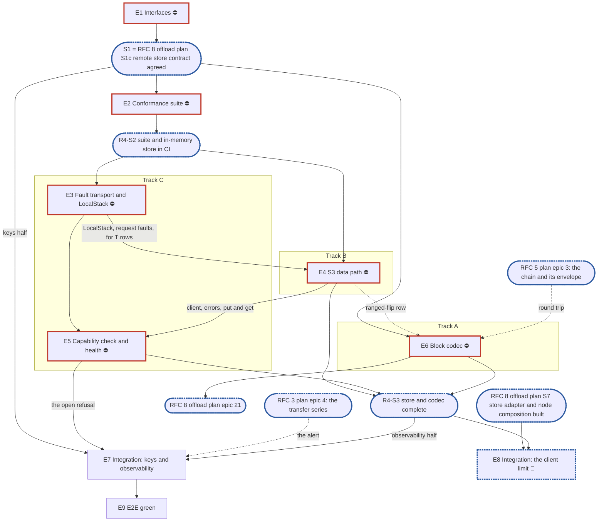

# RFC 4 — the remote tier v2: implementation plan

**Scope:** [RFC 4, the remote block store: block format and store contract](../docs/internals/rfcs/rfc-4-remote-tier.md),
whole (its status is `draft`, not `deferred`), less what has no caller in v1.1: the block codec,
the store contract, the in-memory store, the S3-compatible store with its capability check, the
fault transport, and the tests and benchmarks of §7. What waits for its first caller (a backup
location's calls and the `immutable` mode, for RFC 26; the `Recheck` calls, for RFC 9) is
deferred, and RFC 4 §4.1 is amended in this plan's pull request to say so (§6.1); the same
pull request amends §4.3 for RFC 3's `*Measure` (D3) and §7.1, §7.2 and §7.4 so the fault
transport never pretends a setting (D7). Related RFCs,
each **constraints only**, and each of RFC 2, 3 and 5 with a plan of its own written at the same
time:
- [RFC 0](../docs/internals/rfcs/rfc-0-data-lifecycle.md), the data lifecycle: the vocabulary,
  the failure model the store's errors serve, and §1.2's allowed imports, as the RFC 8 offload
  plan's pull request amends it (rule 7).
- [RFC 2](../docs/internals/rfcs/rfc-2-carver.md), the carver: the block name's derivation
  (§4.2) and the bound `N` on chunks per block (§5, P4), both consumed by the codec (D3).
- [RFC 3](../docs/internals/rfcs/rfc-3-syncer.md), the syncer: the store's only caller for
  transfers and probes (§1.3, §2.8), the source of the pool sizes the client limit is derived
  from (§2.10), and §2.2's memory bound, whose codec part this plan owns (epic 6).
- [RFC 5](../docs/internals/rfcs/rfc-5-transforms.md), transforms: the chain, its envelope,
  `MaxDecodeLen` and the census (§3.1), which the codec calls (D3).
- [RFC 6](../docs/internals/rfcs/rfc-6-block-metadata.md), block metadata: the chunk range
  and the block record's census the codec is handed (§2.2, §2.3).
- [RFC 8](../docs/internals/rfcs/rfc-8-engine.md), the engine: it composes the codec with a
  store (RFC 8 §6.3, §6.6), and RFC 8's offload plan composes them into the node.
- [RFC 9](../docs/internals/rfcs/rfc-9-gc.md), GC: the caller of `Delete`, `List` and the
  `Recheck` pass (§7.5); planned later.
- [RFC 12](../docs/internals/rfcs/rfc-12-snapshots.md), [RFC 26](../docs/internals/rfcs/rfc-26-catalog-backups.md)
  and [RFC 27](../docs/internals/rfcs/rfc-27-namespace-migration.md): a namespace is a prefix
  (RFC 12 §2.1); the backup location record and its callers (RFC 26 §2.4, §4.2); the claim the
  open reads (RFC 27 §2.1).
- [RFC 13](../docs/internals/rfcs/rfc-13-configuration.md), configuration: the remote store's
  and the namespace's keys (Appendix B, §5.4), declared in epic 7.
- [RFC 25](../docs/internals/rfcs/rfc-25-observability.md) and [RFC 29](../docs/internals/rfcs/rfc-29-test-harness.md):
  the rules every epic follows (§1.5 rules 3 and 6).

**Tracks:** A, B and C (§3.4).
**Programme:** [#5488](https://github.com/cubbit/dittofs/issues/5488), "offload: RFC 2–5 and
the engine's offload part", release v1.1, roadmap epic
[#5485](https://github.com/cubbit/dittofs/issues/5485). It builds on the journal-only engine,
stage 3 of #3119 ([`rfc-8-journal-only-engine-plan.md`](rfc-8-journal-only-engine-plan.md)).
The five offload plans share one contract: the synchronisation points are the RFC 8 offload
plan's (`.planning/rfc-8-offload-engine-plan.md`, under review with this one), cited as "RFC 8
offload plan S<x> <name>". That plan's epic 21 composes the codec and the store into the engine
and the node: the RFC 3 `Store` adapter and its error mapping, one client per store
configuration, ref-counted, a namespace's store opened in the node, the in-memory store refused
outside tests (#4276), and the registration of this component's keys, collectors and alert
rules. This plan's integration keeps only what is the component's own: its keys, collectors and
alert rules declared in its own package (epic 7), and the client limit's derivation (epic 8,
planned after RFC 8 offload plan S7). GC (RFC 9, roadmap #3620) is planned later.
**Naming:** **v1** is the block tier on `develop` and `feat/storage-v2` today:
`pkg/block/remote`, `remote/memory`, `remote/s3`, `pkg/block/blockcodec` and
`pkg/block/blockstoretest`. **v2** is the store and codec RFC 4 describes, built here at new
top-level paths, `pkg/remote` and its subpackages (§4.1).
**Transition:** new installations only (#3119). v1 is deleted by #3119's stage 4 (#5484) on its
own schedule; v2 waits for none of it and touches none of it. v1's store and v2's never serve one
namespace, so no metric, log key or setting carries a version (§1.5 rule 7). Two v1 surfaces
outlive stage 4 beside v2: the `remote.endpoint` and `remote.credential` keys of
`internal/node/api/res_stores.go`, which epic 7 moves into `pkg/remote` rather than declaring a
second time, and the `remote_up`, `remote_outage_seconds` and `remote_reads_blocked_total`
collectors of `pkg/metrics/collectors.go`, whose names RFC 4 §4.12's `remote_` series do not
reuse.
**Where the code lands:** `feat/storage-v2`, where the engine, `pkg/sim`, `pkg/metrics`'s
registry, `pkg/settings` and `internal/prof` live; this plan lands on `develop`. Paths below are on
`feat/storage-v2`.
**Defaults used from the skill's inputs:** no dashboards; external dependencies are §3.3's.
**How it was reviewed:** an independent architect pass proposed the tree and surface (D3,
§6 point 6), then separate adversarial, correctness and simplification passes, then a five-lens
review of the five offload plans together, whose cross-plan decisions this revision applies.

---

## 1. Introduction

### 1.1 What we are building

The two components RFC 4's "Start here" and §1.2 describe, built apart and never calling each
other: the **block codec**, which encodes a planned block and verifies every chunk it returns
(RFC 4 §3), and the **remote block store**, one attempt per call over one service (RFC 4 §4),
profiled for S3-compatible services (Appendix C). Around them: the in-memory store, the
conformance suite every store passes (§7.1), and the fault transport that makes a real store
fail on cue (§7.2).

| v1 (deleted by stage 4) | v2 (this plan) |
| --- | --- |
| `pkg/block/remote` (`RemoteStore`, `passthrough.go`) | `pkg/remote`: RFC 4 §4.1's contract (epic 1) |
| `pkg/block/remote/memory` | `pkg/remote/memory`: the in-memory store (epic 2) |
| `pkg/block/remote/s3` | `pkg/remote/s3`: the S3 profile (epics 4, 5, 8) |
| `pkg/block/blockcodec` | `pkg/remote/codec` (epic 6) |
| `pkg/block/blockstoretest` (`RemoteBlockStoreConformance`) | `pkg/remote/remotetest` (epic 2) |
| no fault transport | `pkg/remote/s3/s3fault` (epic 3) |
| `remote.endpoint`, `remote.credential`, declared in `internal/node/api/res_stores.go` | declared in `pkg/remote` with the bucket, storage class, prefix, block target and block format version to write (epic 7); RFC 8 offload plan epic 21 registers them |

**Dependency limits** (RFC 0 §1.2, as amended). The codec imports `pkg/remote` for its error
values and RFC 5's `pkg/transform`; it imports neither the carver nor the engine (D3). The store
imports no codec, transform, syncer or engine package. Nothing of RFC 5 imports `pkg/remote`:
its `keys` object reaches the store through a consumer interface RFC 5 declares, which the
engine's wiring fills. The S3 store imports `aws-sdk-go-v2`, already in `go.mod`.

### 1.2 How the plan is organised

Epics 1 and 2 are the team's: the frozen surface, and the conformance suite with the in-memory
store that passes it. Four middle epics follow RFC 4's own seams: the fault transport and the
capability check (track C), the S3 data path (track B), the codec (track A). Epic 7 is the
component's keys and observability, epic 8 the client limit's derivation once RFC 8's offload
plan has built the client holding (S7), and epic 9 the tiers past `pr`: the nightly run against
production services, the rows only a real bucket can show, and the benchmarks.

### 1.3 What epic 1 must deliver

- **`pkg/remote`**: the types, constants, interface methods and errors of RFC 4 §4.1 that have a
  caller in v1.1, with `Cause` and `DeniedError`; behaviour per method is §4.2 to §4.13's, not
  epic 1's. The calls RFC 4 §4.1 now says land with their first caller are not declared (§6.1).
- **No constructor.** RFC 4 §4.1's last paragraph gives each backend its own constructor, and
  nothing outside this plan calls one before RFC 8 offload plan S7, so each lands with its first
  consumer (rule 12): the in-memory store's in epic 2 (D4), the S3 store's and its client's in
  epic 4 (D9, D10).
- **The codec's exported surface** (RFC 4 §3.2 to §3.5, §4.3's measuring pass and checksum),
  which RFC 4 does not give: proposed in D3 and agreed with the RFC 8 offload plan's authors as
  part of RFC 8 offload plan S1c remote store contract agreed, since the engine is its caller.
- **Injection points**: `*slog.Logger` and `*metrics.Registry` (RFC 25 §8.1), on the codec
  here and on the S3 store's client with its constructor; no tracer, since RFC 25 §6.1 lists no
  span for the store and RFC 4 §4.12 names none.
- Stub bodies behind final signatures (rule 11). No internal interface: the conformance suite
  and the two stores consume the public `Store` itself.
- The import walk of rule 7.

### 1.4 What epic 2 must deliver

**The suites.** RFC 4's suites paragraph (end of §7.5) puts §7.1 against the in-memory store
and §7.3 in `unit`, and §7.1 in full against the local emulator under the fault transport in
`integration`. Neither keeps a known-failure file, so no test of this plan starts red: each
lands green with the epic that makes it pass (§1.5 rule 6). Epic 2 needs no registry change:
its rows run in `unit`. What `integration` lacks, `service:localstack` in its `needs` and an
HTTPS endpoint, lands with its first consumer, epic 3 (D9); the RFC 3, 5 and 8 offload plans
cite it as "RFC 4 plan epic 3", and a test of theirs that needs it waits for it rather than
counting a skip as coverage. The component's suite names are `remote`: the group, the
allocation option `unit/remote-allocs` (epic 6), and the service cell and the benchmark cell
(epic 9); none
exists in `test/suites.yaml` yet, and each lands with its first test.

**The scenario catalogue, by source.**
- **RFC 4 §7.1, the rows not marked T** whose subject the in-memory store can show: §4.3 put
  then get; §4.4 ranges; §4.5 a batch deleted twice and a batch of 2,500; §4.6 the walk of
  2,500 and the foreign key with the cancel; §4.2 the raw namespace; §4.13 the roles; the
  read-only half of the §4.7 probe row. They run in epic 2 against the in-memory store, and
  against the S3 store over LocalStack in epic 4 (the §4.7 half in epic 5, which builds
  `Health`). The other unmarked rows the in-memory store cannot show: §4.10's two client rows
  (epic 8), §4.8's throttling row (epic 4), §3.2's census row (epic 6), and the §4.7 row's
  prefix-revoke half, which needs a service enforcing per-prefix rights (epic 9). RFC 4 §7.4
  says the in-memory store passes every row not marked T; §6 point 2 proposes the amendment.
- **RFC 4 §7.1, the rows marked T**: each epic that builds the behaviour writes its rows, over
  the S3 store and the fault transport (§5, each epic's **Done when:**). Rows on the deferred
  calls are §6.1's.
- **RFC 4 §7.3** (15 rows): epic 6. §7.3's "engine's read and write tests with and without
  transforms" is RFC 8 offload plan epic 21's (§6.1).
- **Measured service behaviour** (RFC 4 Appendix B): faults reproducing a service that ignores
  every put checksum (Cubbit DS3 as measured), one enforcing only CRC32C (Scaleway), and one
  clamping an overlong range, each proved by the check's refusal or choice (epics 3 and 5).
- **v1's history** (RFC 4 Appendix A): A3 (client retries), A5 (no put checksum), A6 (health as
  an existence check), A7 (no capability check) and A11 (an emulator pinned to a version
  ignoring checksums) are each a §7.1 row already; no row is added.

**The test components.** The conformance suite, `remotetest`, run by each store's own tests
with an opener, each S3 run under a fresh prefix of one bucket as the harness's
`test/harness/fixture/s3.go` already does (its pattern copied, since `newBucket` is
unexported); the in-memory store, a verified in-memory implementation (`CLAUDE.md`, "Writing
tests", kind 2) held to that suite; a fault wrapper around it that turns a namespace read-only
for the §4.7 row (kind 3); and `internal/prof`'s leak checks wired into the suite (rule 4). The
fault transport is epic 3's.

### 1.5 General rules for each epic

> **Instruction for whoever expands an epic into its detailed description and subtasks,
> human or AI:**
>
> - **Creating an epic from this plan: use the `epic-breakdown` skill.** Whenever the user
>   asks to create an epic from this plan, or to expand, detail or break one down, run the
>   `epic-breakdown` skill (`.claude/skills/epic-breakdown/SKILL.md`) on this plan and that
>   epic, rather than writing the epic document freehand. It extracts the RFC's MUST and
>   MUST NOT into numbered requirements, estimates each subtask in man-days and suggests
>   the pull requests. A human doing it by hand follows the same skill.
> - **Epic and subtask, nothing else.** The units of work are the epic and its subtasks,
>   with subtask ids `<e>.<n>` (`subtask 4.3`, or `T4.3` for short), assigned by the epic
>   document. No other word names
>   them: not task, ticket, story, step or phase, in headings, tables, ids or prose.
> - **The epic stands alone for what to build.** Its requirements, subtasks and decisions
>   are in the epic document itself, which never refers to this plan for them or says "see
>   the plan": the RFC sections it implements, the interfaces it builds on, the
>   subtasks, and a short legend of the names it borrows from this plan (E1, E2, S1, the
>   integration epic, …). It cites the numbered rules below, without copying them, in a
>   table of how each applies: each row names its rule by number and bold title, which
>   says what the rule requires, and the table links this §1.5 with a full link (the
>   plan's path and the section's anchor) and the `CLAUDE.md` sections that hold a rule,
>   so the epic reads alone and its reader can still open each rule's text in one click.
> - **The epic document records decisions, not progress, like this plan.** It has no
>   status fields, no checkboxes to tick and no sections to keep up to date as the work
>   goes on. It is revised through a pull request only when a decision changes.
> - **Subtasks are not pull requests.** A subtask is ideally up to 5 man-days. The owner
>   ships subtasks as they see fit, one pull request each or several together; the epic
>   document only suggests a grouping, each suggested pull request ideally up to 15
>   man-days. Cut and group by logic, readability, dependencies and a deliverable that can
>   be named, not to hit a number.
> - **Every subtask states how it meets each rule that applies to it.** A rule that does
>   not apply is named, with the reason.
> - **In the issue tracker, once each document merges,** following `epic-breakdown`
>   Step 6, their one description. Issues point at the documents and copy nothing; once
>   created, their `Estimate` and blocked-by links are the current estimate and
>   dependencies, and the documents are not revised to follow them. The
>   epic issues exist before E2's pull request lands, because each red test's
>   `known.yaml` entry names one; subtask issues come once their epic document has
>   merged. The release an epic ships in is set by the RFC's roadmap epic that its epic
>   issue sits under, never in a document and never on the epic issue on its own: the epic
>   issue and its subtask issues copy that roadmap epic's milestone, and an epic changes
>   release only by moving under the roadmap epic of the other release.

1. **Independent unit tests.** Each epic carries its own unit tests, built on epic 2's
   conformance suite and in-memory store, epic 3's fault transport once it lands, and the
   implementation of an epic it depends on once that has landed. Pure parts are functions of
   their inputs and tested as such: the S3 error table (Appendix C.3), the bucket-setting
   judgements (C.1) and the header bound (§3.2). E1 declares no internal interface for a test
   to stand in for (rule 12).
2. **Fuzz tests where relevant** (`CLAUDE.md`, "Writing tests", "By kind"). Targets: the
   codec's header and body decoding, asserting no panic, every length it reads inside the
   buffer, no allocation past the header bound before the header is validated, no body longer
   than `MaxDecodeLen(Max)` accepted, and the same bounds on the headerless path that decodes
   one body from its range alone (RFC 4 §7.3's fuzz and ranged-body rows), and that what it
   decodes re-encodes to bytes that decode to the same value, or
   agrees with the hand-written golden block of `testdata/v1`; and the `Content-Range` reader
   (§4.4), whose parsed range must re-format to an equal range; epic 6 builds the codec's
   targets, epic 4 the `Content-Range` reader's. Each target joins the one
   nightly `fuzz` suite the RFC 2 plan's epic 2 registers, and RFC 4's suites paragraph names
   it (amended in this pull request). The SDK parses the service's XML replies; the store's
   judgements over the SDK's types are table-tested, not fuzzed.
3. **Observability follows RFC 25.** Metric names are RFC 4 §4.12's, under the `remote_` and
   `codec_` prefixes RFC 25 §2.1 gives RFC 4; the histogram's `op` folds to six values, as
   §4.12 and RFC 25 §11 say; units, buckets (`request`) and labels are RFC 25 §2's. `Deps`
   carry a `*slog.Logger` narrowed with `With("component", "remote")` or `"codec"` and the
   `*metrics.Registry`. The store owns no health condition (its health is the syncer's, RFC 3
   §2.8, registered in RFC 25 §3.9 as `store_put_unhealthy` and `store_get_unhealthy`) and
   opens no span. Logs are §4.12's: a refused open once at `Error`, `ErrCorrupt`, a
   verification failure and a foreign entry at `Warn`, nothing per call. The collectors and the
   one alert rule, on `codec_verify_failures_total` net of the syncer's recovered re-gets
   (RFC 25 §7, RFC 4 §4.12), are declared in this component's packages (epic 7); RFC 8 offload
   plan epic 21 registers them in the node. The access key, the secret and a request's
   signature never appear in a log, an error, a metric label or the field error epic 7 hands
   the API: the refused open's log and error, which wrap the SDK's, are grepped for the secret
   in epic 5's test of a refused open.
4. **Profiling.** Tests and benchmarks run under `internal/prof`'s goroutine, descriptor and
   heap checks. Allocations-per-op assertions, in `unit`'s `remote-allocs` option at `tier:
   pr` (epic 6 registers it), whose command runs without `-race`, as `unit`'s `adapter-allocs`
   does, since the race detector shifts allocation counts and empties `sync.Pool`: the codec's
   per-chunk encode and verify. The S3 `Put` stream, which holds the header and one chunk and
   never the block (§3.2, §4.3), and one `List` page (§4.6) need a real endpoint, so their
   assertions run in `integration`'s `s3-allocs` option (`needs: [docker,
   "service:localstack"]`, `tier: pr`; `integration` already runs without `-race`), which epic
   4 registers with its first such test; nothing answers in the service's place.
5. **Public interface and internals.** Tests cover the packages' internal functions and the
   behaviour through `remote.Store` and the codec's surface, under `-race`. Test at the layer
   that **consumes** a value (`CLAUDE.md`, "Verifying a change"): a checksum the store sends is
   asserted where the service refuses it or the fault transport sees the request, not where the
   store builds it.
6. **Known failures shrink.** No suite this plan uses keeps a `known.yaml` (§1.4), so no test
   lands red: a test lands with the epic that makes it pass, and a test that cannot pass yet
   is not written yet. A later revision that gives RFC 4 a suite of its own with a known file
   follows `CLAUDE.md`, "Writing tests", "By kind", and RFC 29 §4.7.
7. **v2 ignores v1, and imports only what RFC 0 §1.2 allows.** No import of, copy from, or
   behavioural dependence on v1. Epic 1's import walk checks every package under `pkg/remote`
   on its own, test packages included: none imports `pkg/block/remote`, `pkg/block/blockcodec`
   or `pkg/block/blockstoretest` while they exist, and none imports anything amended RFC 0
   §1.2 does not allow (the codec → `pkg/transform` is the one edge out of the component). The
   engine's import walk (`TestImportRule`'s allowlist) is the RFC 8 offload plan's to flip. v1 is
   not touched.
8. **Real dependencies for properties of those dependencies** (`CLAUDE.md`, "Writing
   tests"). LocalStack 4.13.1 under the fault transport for every §7.1 row marked T and for the
   capability check's choices; a bucket setting a row needs is set for real on a fresh
   LocalStack bucket (D7), never pretended; the real service for what LocalStack does not hold
   or enforce (per-prefix rights, and the settings §6 point 4 names), in epic 9; the in-memory
   store is never the only store a row runs against (RFC 4 §7.1's last paragraph).
9. **Code comment conventions** (`CLAUDE.md`, "Code comments"). Where RFC 4 carries a
   `decision:` note on what this plan builds, its marker goes at the code site that implements
   it: conditional put measured and never sent (§4.3, epic 5); the digest-only delayed
   duplicate (§4.3, epic 4); a block put's size refusal as cause `size` (§4.8, epic 4); the
   open calling the service outside the syncer (§4.15, epic 5); the fixed re-list bound
   (Appendix C.4, epic 5); versioning refused on every namespace store (§8 item 4, epic 5). The
   plan's own: the `immutable` mode refused at open until its caller lands (D11, epic 5), and
   §4.3's `ponytail:`s. The notes of the deferred calls go with them.
10. **A test must be able to fail** (`CLAUDE.md`, "Writing tests"), and nothing else would
    catch the change it guards: not the compiler, not the diff, not a later epic's tests. A
    review rule that no test can check, such as "stubs never panic", stays a review rule.
11. **A symbol is exported only if the RFC's interface uses it.** Everything exported is
    frozen at S1, each constructor when it lands (§1.3). The S3 store's error table, its
    bucket-setting judgements and the fault presets stay unexported or in an `internal/`
    package of `s3`; the fault transport exports what the T rows and the RFC 3 and RFC 8
    offload plans' tests call.
12. **Each subtask creates only what it declares.** No empty package and no stub without a
    caller. A package, an option or a test helper lands with its first consumer: each fault of
    the transport with the rows that use it, each suite option with its first test.

## 2. Epics at a glance

| # | Epic | Content | Subtasks | Man-days | Track | Blocks |
| --- | --- | --- | --- | --- | --- | --- |
| 1 | **Interfaces** ⛔ | `pkg/remote`'s contract for v1.1's callers; the codec's surface; the import walk | 4 | 5.5 | team | **everything** |
| 2 | **Conformance suite and test foundations** ⛔ | `remotetest`, the in-memory store and its read-only wrapper | 5 | 7 | team | **all testing** |
| 3 | **Fault transport and LocalStack** ⛔ | `s3fault` around the real transport, real bucket settings on fresh buckets, LocalStack over HTTPS in `integration` | 5 | 8 | C | 4, 5 |
| 4 | **S3 data path, errors and client** ⛔ | the client and constructor, put, get, delete, list, control objects, the total error table, `remote_` metrics | 7 | 15 | B | 5 |
| 5 | **Capability check and health** ⛔ | Appendix C.4 at open, the setting judgements, both probes, `immutable` refused | 6 | 12 | C | 7 |
| 6 | **Block codec** ⛔ | format, encode with declared lengths or a measuring pass, verified reads, the version gate, fuzz, `codec_` metrics | 7 | 14.5 | A | RFC 8 offload plan epic 21 |
| 7 | **Integration: keys and observability** | RFC 13's keys, collectors and the alert rule in `pkg/remote`, the refusal as a field error | 5 | 6 | team | 9 |
| 8 | **Integration: the client limit** 🔀 | the limit derived from the callers, on RFC 8's client holding | planned after S7 | planned after S7 | team | — |
| 9 | **E2E green** | the nightly service row, the real-bucket rows, §7.5's benchmarks, fuzz targets in the `fuzz` suite | 6 | 10 | team | — |
| | **Total** | | **45** | **78** | | |

**Plan estimate: 45 subtasks, 78 man-days, not counting epic 8.**

RFC 4 is 2,117 lines, which gives N = 5. Its cohesive areas in v1.1 are four: the codec (§3),
the data path (§4.2 to §4.6, §4.8, §4.9, §4.13), the open (§4.7, §4.11), and the fault
transport (§7.2), which the data path and the open consume and the RFC 3 and RFC 8 offload
plans' tests reuse. The fifth and sixth, the backup location's calls and its admission (§4.14,
§4.15), are deferred to their caller (§6.1), which is why the count is one below N.

⛔ = blocker: other epics cannot finish until this one has delivered.
🔀 = synchronisation point: the work waits on an agreement or on everything before it.

## 3. Synchronisation points, blockers and the split

### 3.1 Dependency graph



Dotted edges are inputs an epic starts without and waits on only for the part named.

### 3.2 Synchronisation points

The `R4-` prefix keeps this plan's own points apart from the RFC 8 offload plan's, which use the
same numbers for other points.

- **S1 🔀 = RFC 8 offload plan S1c remote store contract agreed** (end of epic 1). `pkg/remote`'s
  contract and the codec's encode and decode calls (D3), reviewed by the team and by the
  authors of the RFC 3 and RFC 8 offload plans, whose code consumes them. The RFC 3 plan's Q1
  is answered (`Put(ctx, name, src, m *Measure) (Stored, error)`, D3), so S1 waits on nothing
  outside this plan. Epics 2 and 6 start here, and so does the keys half of epic 7.
- **R4-S2 🔀 Suite and in-memory store in CI** (end of epic 2). The conformance suite runs green
  against the in-memory store in `unit`. Epics 3 and 4 start here.
- **R4-S3 🔀 Store and codec complete** (epics 3 to 6 done). Every row of RFC 4 §7.1 and §7.3
  this plan's epics 2 to 6 own runs green in `unit` or `integration`. Epic 7's observability
  half and epic 8 start here.
- **RFC 8 offload plan S7 store adapter and node composition built** (external): RFC 8 offload
  plan epic 21 done, the client held once per store configuration and ref-counted. Epic 8 is
  planned after it.

### 3.3 Blockers

- **E1 and E2** block everything. Keep them short.
- **E3** blocks E4 and E5: `integration` reaches LocalStack through it, and their rows marked T
  run over its faults. E4 builds its behaviour against a local `dt services up localstack`
  first, so only its `integration` runs and T rows wait.
- **E4** blocks E5: the check runs on the client, the error table, put and get. It also blocks
  epic 6's last subtask only, the §4.4 ranged-flip row, which needs the S3 store under the fault
  transport; the rest of epic 6 starts at S1.
- **E5** blocks E7: the refused open reported as a field error.
- **E6** blocks RFC 8 offload plan epic 21, which wires the codec into the store adapter (RFC 8
  offload plan D5); its epic 15 runs over the in-memory components and does not wait.
- **E7** blocks E9. E8 blocks nothing of this plan: the §4.10 rows are its own.
- **RFC 5 plan epic 3 (external):** the codec cannot round-trip a body until RFC 5's chain
  writes the envelope, even for an empty chain (RFC 5 §3.1's `Attempt.Encode`, as the RFC 5
  plan's pull request amends it). Epic 6 builds its header, bounds and version gate before it,
  and its round-trip rows after.
- **RFC 3 plan epic 4 (external):** epic 7's alert subtracts the syncer's recovered re-gets,
  part of RFC 3 §2.12's transfer series; the alert rule lands once that series does.
- **The RFC 2 plan, not a blocker:** the codec's whole-block check recomputes the name with
  RFC 2 §4.2's derivation, which the engine passes in (D3); epic 6's tests pass a derivation of
  their own checked against RFC 2 §4.2's golden vector, from the one golden-vector script RFC 2
  plan epic 2 keeps.

### 3.4 Splitting the work

- **Track A, the codec:** epic 6. It shares nothing with the store and starts at S1, building
  the layout, header bound and version gate first, and its round trips once RFC 5 plan epic 3
  has the envelope.
- **Track B, the data path:** epic 4. Every call that moves or removes a block or a control
  object on a namespace's store, the error table and the client.
- **Track C, the test transport and the open:** epic 3, then epic 5. First what `integration`
  and the other tracks' rows run over, then what a store proves before it opens.
- **Where the team converges:** epics 1 and 2 before R4-S2; epic 7's observability half, epics
  8 and 9 after R4-S3.
- **Where the tracks wait on each other.** Track C's epic 5 needs epic 4's client and error
  table before its check can run: it opens with Appendix C.1's setting judgements, pure
  functions over the SDK's types, which fill that wait. Track B needs epic 3's LocalStack cell
  for its `integration` runs, and builds against a local LocalStack meanwhile.
- **Load.** Track A carries 14.5 man-days, track B 15 and track C 20. Tracks A and B fill the
  difference with epic 7's keys half, which needs only S1 and the RFC 13 plan's settings table.
  If RFC 5 plan epic 3 is late, track A's round trips wait; the header, bound and gate work and
  the fuzz target over hand-written blocks fill it, and what remains is a real gap that closes
  only when the envelope lands.

## 4. Implementation decisions

### 4.1 Directory layout

```text
pkg/remote/                            E1: RFC 4 §4.1's contract for v1.1: types, Store, errors, Cause
  keys.go metrics.go alerts.go         E7: RFC 13's keys, the collectors' Specs, the alert rule
  imports_test.go                      E1: the import walk (rule 7)
pkg/remote/remotetest/                 E2: the conformance suite (§7.1's shared rows), leak checks
pkg/remote/memory/                     E2: the in-memory store and its constructor (D4)
pkg/remote/s3/                         E4: client, constructor, data path, error table, layout
  check.go settings.go health.go       E5: Appendix C.4, C.1's judgements, probes
  limit.go                             E8: the client limit derived from its callers
  *_test.go                            E4, E5: the rows marked T, over s3fault and LocalStack
pkg/remote/s3/s3fault/                 E3: the fault transport, around the client's http.RoundTripper
pkg/remote/codec/                      E1: surface (S1); E6: format, encode, decode, gate
  testdata/fuzz/ testdata/v1/          E6: fuzz seeds; the golden block of each released version
test/suites.yaml                       E3: service:localstack in integration; E6: unit/remote-allocs;
                                       E9: the remote group's service and benchmark cells
```

### 4.2 Decisions

- **D1. New top-level paths, `pkg/remote` and its subpackages.** The five offload plans agreed
  top-level paths for each component (`pkg/carver`, `pkg/syncer`, `pkg/remote`,
  `pkg/transform`), so no epic waits for #5484 to delete v1's `pkg/block/remote`, and nothing is
  renamed later. Prior art: the journal-only engine's `enginev2` rename (#3645), which this
  avoids. Applied by epic 1.
- **D2. The block's bytes: fixed-width little-endian fields, no variable-length integers.**
  RFC 4 §3.2 leaves widths, integer encoding and order to the codec. Fixed widths make the
  header bound of §3.2 a constant expression and keep the decoder's bounds checks before
  allocation easy to read. Epic 6's document writes the layout table and its golden block,
  which `testdata/v1/` keeps (RFC 4 §7.3's last row), generated by the one golden-vector script
  RFC 2 plan epic 2 keeps. Prior art, from memory: restic's pack format (fixed-width entries,
  header at the end and encrypted, where RFC 4 puts it first and in the clear); Kopia's pack
  index (fixed-width entries). Applied by epic 6.
- **D3. The codec takes the name derivation and the chain as arguments, and imports `pkg/remote`
  only for its error values.** Proposed shape, agreed at S1: an encoder that plans a block (its
  exact size, its checksum of the kind the store's `Checksum` names, each chunk's range and the
  census it writes into the header) from a re-iterable source of the block's chunks, with as
  many measuring passes as RFC 4 §4.3 requires, then streams it; a decoder that reads a whole
  block or one chunk's range, verifying as RFC 4 §3.4 says, with the name recomputed through
  the derivation function it is handed. The derivation is the engine's to pass (RFC 2 §4.2), so
  the codec has no edge to the carver and the key scope stays the engine's. The census is
  persisted at commit by RFC 8 offload plan epics 15 and 19; the codec only writes it into the
  header and checks it on read. The chain it encodes under is pinned by RFC 8 offload plan epic
  15 from mint to commit or abandon, so a measuring pass and the send use one chain. Prior art:
  the architect pass proposed this shape independently; restic's `Repository.LoadBlob` verifies
  by its blob ID after decryption (from memory). The RFC 3 plan's Q1 is answered: RFC 3's
  `Store.Put` is `Put(ctx, name, src, m *Measure) (Stored, error)` with `type Measure struct{
  State any }`: the syncer allocates one per `Upload`, never reads `State`, and sets it to nil
  after an attempt ending in `ErrCorrupt`; the engine's `Store`, the adapter over this codec
  (RFC 8 offload plan), owns `State`. RFC 4 §4.3, as amended in this pull request, says the
  same. So the encoder's plan is a value the adapter keeps in `State` and hands back: a retry
  streams from it without measuring again. `remote.Store`'s own `Put` (RFC 4 §4.1) is
  unchanged and keeps nothing across calls (§4.9). The encoder takes RFC 24 §6.2's CPU token as an input, a one-method acquire it
  declares: it takes one per chunk it encodes or hashes and returns it before the next network
  write; RFC 8 offload plan epic 21 builds the token in the node, and decoding, on the request
  path, takes none. Applied by epics 1 and 6.
- **D4. The in-memory store is a mutable namespace store, with an injected clock for
  `ModTime`.** Its consumers are the conformance suite's unmarked rows and the other offload
  plans' unit tests (the RFC 5 plan's `keys` object), none of which reads a version. Prior art:
  none found. Applied by epic 2, with a `ponytail:` (§4.3).
- **D5. CRC32C combined per body by GF(2) matrix combination.** RFC 4 §4.3 takes the checksum
  per body in the measuring pass and joins the header's; `hash/crc32` offers no combine
  (checked: `go doc hash/crc32`). Prior art: zlib's `crc32_combine` (from memory). Applied by
  epic 6.
- **D6. The client takes its limit as a number; deriving it is epic 8's.** Epic 4's client
  sets its connection caps from a limit it is handed (Appendix C.3); the function deriving that
  limit from the callers' concurrency (RFC 4 §4.10) lands with its consumer, the one client per
  store configuration that RFC 8 offload plan epic 21 holds. Until epic 8 lands, the limit
  epic 21 passes is RFC 4 §4.10's sum over the callers v1.1 has: `upload_workers +
  fetch_workers + 1` (the one for the probe; GC's bound joins with RFC 9), so no cap sits
  below the callers. The client's constructor refuses a limit of 0 or less with `ErrInvalid`.
  Prior art: rclone sizes its HTTP transport from `--transfers` and `--checkers` (from
  memory). Applied by epics 4 and 8.
- **D7. The fault transport only fails, delays or tears what the real service does; a setting
  is set, never pretended**, as RFC 4 §7.2, amended in this pull request, says. It wraps
  the client's real `http.RoundTripper` and, on `pkg/sim`'s
  schedule and clock (through methods it declares in standard-library types, as the RFC index's
  test harness item 1 asks), drops, delays or fails a request with a chosen status and code (a
  scripted error answer, a fault), truncates or flips a byte of a body in either direction,
  strips a checksum header from a request so the service stores what it would without one,
  tears a reply's range short, and holds new keys out of a listing reply. It never answers a
  request in the service's place with a success. A bucket setting a §7.1 row needs (versioning,
  lifecycle rules, default encryption, tiering) is applied for real to a fresh LocalStack bucket
  created for that row; a row on a setting LocalStack cannot hold (§6 point 4) runs against a
  real bucket in epic 9, by hand until CI holds credentials (§6.1), as amended RFC 4 §7.4 says,
  so it guards no pull request meanwhile. Prior art: none found for
  S3 in Go; `toxiproxy` injects at TCP level, below the request (from memory). Applied by epic 3.
- **D8. Timing waits use the injected clock.** The check's bounded re-list (Appendix C.4,
  step 4) is advanced on the clock, never slept. Prior art: the engine's and the journal's use
  of `pkg/sim` (checked on `feat/storage-v2`). Applied by epic 5.
- **D9. `integration` reaches LocalStack over HTTPS, through a variable of its own.** Appendix
  C.3 refuses an endpoint that is not HTTPS, and the harness hands
  `LOCALSTACK_ENDPOINT=http://127.0.0.1:4566` (`test/harness/needs/needs.go`, the `localstack`
  entry). LocalStack already serves HTTPS on the same port: CI's health check reaches
  `https://localhost:4566` with `curl -k` (`.github/workflows/tests.yml`, the `localstack`
  service, on `feat/storage-v2`), so the certificate is one no system root verifies. The
  shared `LOCALSTACK_ENDPOINT` stays plain HTTP, since two consumers read it that way
  (`test/harness/fixture/s3.go` through `http.DefaultClient`, and
  `test/e2e/framework/containers.go`, which hands it to v1's store); epic 3 adds a second
  variable, `LOCALSTACK_HTTPS_ENDPOINT`, to the same `needs` entry, and the certificate the
  container serves, read from it, as the client's trusted root. CI's check (`curl -k`, falling
  back to plain HTTP) proves neither the listener nor the certificate's names, so epic 3's first
  subtask measures it: a Go client trusting only the served certificate dials the variable's
  host. If the certificate does not cover `127.0.0.1`, the variable names a host it does cover,
  resolving to the container. The client's settings carry an
  optional set of trusted roots (none: the system's), which a self-hosted service with a
  private CA needs anyway, and no setting skips verification: a case in epic 4 opens against
  the HTTPS listener without its root and requires the open refused. Prior art: none needed.
  Applied by epics 3 and 4.
- **D10. The S3 constructor's sequence is final from epic 4; the check fills it in epic 5.** The
  exported constructor's signature is RFC 4 §4.1's from its first landing. Epic 4 builds the
  store under it with its integrity mode, HTTPS refusal and layout, and tests the data path
  under each integrity mode chosen explicitly through an unexported seam the check later sets;
  epic 5 inserts Appendix C.4's check before the constructor returns. Nothing exported changes.
  Prior art: none found. Applied by epics 4 and 5.
- **D11. The S3 store refuses `immutable` at open, behind a `decision:` marker**, naming the
  missing caller, as amended RFC 4 §4.1 says, until the backup location's calls land with RFC
  26's copier. Prior art: none needed beyond the RFC. Applied by epic 5.

### 4.3 Knowingly simple implementations

- **The in-memory store holds every object in a map under one mutex, mutable mode only**
  (D4). Ceiling: no immutable-mode or versioned-object test can run on it, and concurrent
  tests serialise. Upgrade, with no migration: give it versions when RFC 26's calls land and a
  unit test needs them without LocalStack (§6.1). Epic 2.
- **A service with no batch delete deletes one key per request** (RFC 4 §4.5, Appendix C.4
  step 3), one after another within the call (§4.9). Ceiling: Google Cloud Storage's XML API
  pays one round trip per name (Appendix B's notes). Upgrade: a per-name parallel delete is the
  caller's, through more workers, never the store's (§6.1). Epic 4.

## 5. The epics in detail

### Epic 1 — Interfaces ⛔

**Epic 1 estimate: 4 subtasks, 5.5 man-days.**

The frozen surface of `pkg/remote` and the codec, with stub bodies. **Owns:** RFC 4 §1.2, §2,
§4.1's types, interface and errors for v1.1's callers. **Done when:** S1 is reached; the import
walk passes.

**Expected content:**
- `pkg/remote`'s types, constants, `Store` and errors for v1.1's callers, each method's doc
  naming the section that states its obligations.
- The codec's surface (D3), agreed at S1.
- The import walk of rule 7.

### Epic 2 — Conformance suite and test foundations ⛔

**Epic 2 estimate: 5 subtasks, 7 man-days.**

§1.4's suite and the in-memory store that passes its unmarked rows. **Owns:** RFC 4 §7.1 (the
suite's form and the unmarked rows §1.4 lists). **Done when:** the unmarked rows §1.4 lists
pass against the in-memory store in `unit`; RFC 4 §7.4's first row, as §6 point 2 proposes to
amend it.

**Expected content:**
- `remotetest`: the suite's runner over an opener, its unmarked rows, the leak checks.
- The in-memory store and its constructor (D4), held to the suite.
- The fault wrapper around it that makes a namespace read-only (§4.7's row).

### Epic 3 — Fault transport and LocalStack ⛔

**Epic 3 estimate: 5 subtasks, 8 man-days.**

The transport that makes a real store fail on cue, and the `integration` cell it runs in.
**Owns:** RFC 4 §7.2 for a mutable store. **Done when:** each fault of D7 is shown taking effect
against LocalStack on a request it alters; `integration` reaches LocalStack over HTTPS in CI
(D9).

**Expected content:**
- `service:localstack` in `integration`'s `needs`, `LOCALSTACK_HTTPS_ENDPOINT` beside the
  plain `LOCALSTACK_ENDPOINT` and the container's certificate as the trusted root (D9), the skip
  naming the variable, `dt docs` rerun, and `CLAUDE.md`'s "CI starts no S3 endpoint yet"
  corrected.
- The `http.RoundTripper` wrapper on `pkg/sim`'s schedule and clock (D7).
- D7's request and reply faults, each with the rows that first use it.
- A fresh LocalStack bucket per row with the settings it needs applied for real (D7).
- Faults reproducing Appendix B's measured services, which epic 5's check proves.

### Epic 4 — S3 data path, errors and client ⛔

**Epic 4 estimate: 7 subtasks, 15 man-days.**

Every call on a namespace's store that moves or removes a block or a control object, the S3
error table, and the client. **Owns:** RFC 4 §4.2, §4.3 (the store's half), §4.4, §4.5's
`Delete`, §4.6, §4.8, §4.9, §4.10's client caps, §4.12's `remote_` rows, §4.13, Appendix C.2's
namespace keys, C.3. **Done when:** RFC 4 §7.1's rows for §4.2, §4.3 (but the conditional
put's), §4.4 (but the codec's ranged-flip half, and the check's refusal that ends the
first-get-`404` row, which is epic 5's), §4.5 (but `DeleteVersions`), §4.6, §4.8, §4.9 and
§4.13, and the C.3 row's signing and HTTPS clauses, over LocalStack and the fault transport; an
open against the HTTPS listener without its trusted root refused (D9); §1.4's unmarked rows
against the S3 store; RFC 4 §7.4's emulator row for these; RFC
4 R5 to R10, R13's store half, R16 and R21.

**Expected content:**
- The client and the S3 constructor: retries off, checksum and payload-signing modes pinned,
  HTTPS only with optional trusted roots and no way to skip verification, its caps from the
  limit it is handed, a limit of 0 or less refused (Appendix C.3, D6, D9, D10). Its dialer
  counts the connections it opens and the ones that close, which `remote_connections_opened_total`
  reports and epic 9's steady-load row reads.
- The error table as one total function of operation, status and code (C.3, §4.8), with
  `DeniedError`'s causes.
- `Put` (§4.3), `Get` (§4.4), `Delete` (§4.5), `List` (§4.6), `PutControl` and `GetControl`
  (§4.13), at C.2's keys; the digest-only and size `decision:` markers. Table tests of the
  ETag comparison (quoted and unquoted, upper and lower case) and `List` cases for an empty
  page marked truncated and for a prefix with non-ASCII and percent-encoded bytes.
- The `remote_` collectors and §4.12's logs.
- The `Content-Range` reader's fuzz target (rule 2), and `integration`'s `s3-allocs` option with
  the `Put` stream's and `List` page's allocation assertions (rule 4).

### Epic 5 — Capability check and health ⛔

**Epic 5 estimate: 6 subtasks, 12 man-days.**

What a mutable store proves before it opens. **Owns:** RFC 4 §4.7 for a namespace's store,
§4.11's open, the claim read at open and returned to the opener (C.4 step 6; what is done with
it is RFC 27's, §6.1), §4.12's `remote_capability`, §5, Appendix C.1's mutable rows, C.4's steps
1 to 7. **Done when:** RFC 4 §7.1's rows for §4.7 (but the location's and the prefix-revoke
half), §4.11's rows on the open, each row's open half where it also names `Recheck` (the archive
class and tiering row; the C.3 row's default encryption changed after open), whose `Recheck`
half is §6.1's, and §4.3's conditional put; the check's refusal ending §7.1's first-get-`404`
row; the C.3 row's encryption clause at open; a refused open whose log and error hold no part of
the secret (rule 3); RFC 4 R12's mutable half; an open in `immutable` mode refused,
naming its missing caller (D11).

**Expected content:**
- Appendix C.1's judgements for a mutable store, as pure functions over the SDK's replies. A
  get that reports no storage class reads as `STANDARD`, since AWS sends no
  `x-amz-storage-class` header for that class; a table case pins it.
- The open's sequence, Appendix C.4 steps 1 to 7, inserted into epic 4's constructor (D10), the
  re-list on the clock (D8), refusing with every missing feature named.
- `Health` in both directions (§4.7).
- `immutable` refused at open (D11).
- `remote_capability`, the refused open's log and the `decision:` markers rule 9 gives this
  epic.

### Epic 6 — Block codec ⛔

**Epic 6 estimate: 7 subtasks, 14.5 man-days.**

The codec of D3, on the format of D2. **Owns:** RFC 4 §3.1 to §3.5, §4.3's measuring pass and
checksum, §4.12's `codec_` rows, and the codec's part of RFC 3 §2.2's memory bound (the header
bound and the largest encoded block it reports, on the put side the maximum of
`Attempt.MaxEncodedLen` over the open attempts, never the current chain's `MaxEncodedLen`: a pin
lives from Mint to Commit or Abandon and can outlive a chain change, RFC 5 §3.1). **Done when:** RFC 4 §7.3's rows but the
engine's transforms-on-and-off row (§6.1); §7.1's §3.2 census row but its recovery half
(§6.1); §7.1's §4.4 ranged-flip half, over LocalStack under epic 3's fault transport in
`integration`, the syncer's re-get excepted (§6.1), as its last subtask once epic 4's store
exists (§3.3); the codec's part of RFC 3 §2.2's memory-bound row; R1 to R4,
R14 and R15.

**Expected content:**
- The layout of D2, its header bound, and the refusals before allocation (§3.2).
- Encode from declared or measured lengths through RFC 5's `Chain`, with D5's combine (§4.3),
  from a plan the adapter holds across retries in RFC 3's `Measure.State` (D3).
- RFC 24 §6.2's CPU token taken per chunk encoded or hashed, as an input (D3).
- Whole-block and ranged reads, verified as §3.4 says.
- The version gate (§3.5) and the golden block of `testdata/v1/`.
- The decoder's fuzz target (rule 2), the `codec_` collectors, and `unit`'s `remote-allocs`
  option (rule 4).

### Epic 7 — Integration: keys and observability

**Epic 7 estimate: 5 subtasks, 6 man-days.**

What the component declares for the node to register. **Owns:** RFC 13 Appendix B's rows for
the remote store's endpoint, credential, bucket and storage class, the namespace's prefix,
block target and block format version to write, and §5.4's gate on the last; RFC 25 §7's alert
on `codec_verify_failures_total`. **Done when:** RFC 13 §9's "§6 block target range" row; RFC 13
§9's "§5.4 format version" row's single-node part; each collector of RFC 4 §4.12 and the alert
rule declared in `pkg/remote` and registered once by a test registry, read from a scrape.

**Expected content:**
- The keys declared in `pkg/remote` against `pkg/settings`' table, the block target's range
  refused there (RFC 13 §6); the carver's constructor keeps its own refusal as a defence (RFC 2
  §5.2, the RFC 2 plan's epic 5), which cites this epic for the setting, moved from
  `internal/node/api/res_stores.go`, the block format version's key marked with the RFC 13
  plan's `FormatVersion` option (its epic 3's D6); the storage class's default as §6 point 1
  settles it. RFC 8 offload plan epic 21 registers them.
- The `remote_` and `codec_` `Spec`s gathered for the node to register.
- The alert rule, net of the syncer's recovered re-gets as RFC 25 §7 words it.
- A refused open's error naming the missing features, for the API to report as a field error.
- `docs/guide/configuration.md`'s remote store section.

### Epic 8 — Integration: the client limit 🔀

**Epic 8 estimate: planned after S7.**

The limit RFC 8 offload plan epic 21's client holding passes to each client, once that plan has
built the holding (RFC 8 offload plan S7 store adapter and node composition built). **Owns:**
RFC 4 §4.10's derivation of the limit from the callers. **Done when:** RFC 4 §7.1's two §4.10
rows against that holding; R11 and R19.

**Expected content:**
- The function deriving the limit from RFC 3 §2.10's worker counts, GC's bound and one probe
  (D6).
- The two §4.10 rows over the holding RFC 8 offload plan epic 21 builds.

### Epic 9 — E2E green

**Epic 9 estimate: 6 subtasks, 10 man-days.**

The tiers past `pr`, and what only a real bucket shows. **Owns:** RFC 4 §7.4's production row,
§7.5, Appendix B's new columns. **Done when:** RFC 4 §7.4's third row run by hand against each
service Appendix B measures and recorded in Appendix B, the nightly run left to §6.1's
credentials row; §7.1's §4.7 prefix-revoke half and the §4.11 settings LocalStack cannot hold
(§6 point 4) against a real bucket; §7.5's benchmarks running after each merge against
LocalStack, the steady-load row's connection count asserted, and a run against one service
recorded by hand; the codec's and the `Content-Range` reader's fuzz targets running nightly in the `fuzz` suite.

**Expected content:**
- The `remote` group's service cell, `tier: manual` until CI holds credentials (§6.1), running
  §7.1 and the check against Cubbit DS3 and Scaleway in disposable namespaces (§6 point 3).
- The prefix-revoke row and the settings rows against a real bucket per service, into Appendix B.
- §7.5's benchmarks in the `remote` group's benchmark cell, `tier: merge`, `needs:
  [docker, "service:localstack"]`, non-blocking: each with `b.ReportAllocs()` and the same
  operation through the raw SDK client in the same run as the baseline its 10% target names;
  `-count=10` and `benchstat` on one host for any comparison across runs.
- §7.5's steady-load row in that cell: ten minutes at a fixed pool size, asserting the
  connections epic 4's dialer opened stay at most the pool size plus the closes it counted.
- The codec's and the `Content-Range` reader's fuzz targets joined to RFC 2 plan epic 2's `fuzz` suite.

## 6. Risks and open points

1. **The storage class's default** — *pending the user's answer*. RFC 13 Appendix B gives
   "the service's default"; RFC 4 §4.11 and Appendix C.1 require a class pinned explicitly,
   never the service's default. Proposed RFC 13 amendment, Appendix B's storage class row:
   default "`STANDARD`, pinned by the S3 profile (RFC 4 §4.11)". Until agreed, epic 7 follows
   RFC 4, the owning RFC (RFC 13 §10).
2. **RFC 4 §7.4's in-memory row** — *pending the user's answer*. It says the in-memory store
   passes every §7.1 row not marked T, but four unmarked rows need a client, a throttling
   service, the codec or per-prefix rights (§1.4). Proposed RFC 4 amendment to §7.4's first
   row: "passes the rows of §7.1 not marked T that need no client, codec, service
   permission or throttling service". Until agreed, epic 2 claims the row as so amended and §1.4 names the four.
3. **The nightly service row needs credentials in CI.** A disposable bucket per service and a
   secret per credential, which CI has none of; epic 9 asks for them. Until then the row runs
   by hand (§6.1).
4. **What LocalStack cannot hold.** D7 sets bucket settings for real. Whether LocalStack 4.13.1
   holds an intelligent-tiering configuration with an archive tier, and reports an archive
   storage class, is unmeasured (from memory: it accepts the calls, without the archive
   behaviour). Epic 3 measures it; a §7.1 row on a setting it cannot hold runs against a real
   bucket in epic 9, never against a pretended reply.
5. **Bucket-setting drift is undetected in v1.1.** With the `Recheck` calls deferred to GC
   (§6.1), a setting that changes after a store opened (versioning turned on, a lifecycle rule
   added) is seen only at the store's next open. RFC 4 §4.1, §1's promise and its versioning
   scenario, as amended here, say so. The worst case is an expiry rule added after open: the
   service deletes blocks, and on a node that never restarts nothing notices until a read
   returns `ErrNotFound`.
6. **The architect pass's proposals.** It proposed deferring §4.14, §4.15 and the `Recheck`
   calls, which this revision does (A1 of the offload contract), and the check's
   conditional-put and archive probes, which stay: they are RFC 4's own requirements of every
   open and cost a few requests each.
7. **Cross-plan seams**, as the offload contract fixes them. RFC 2's plan owns the name
   derivation, its golden vector and the one golden-vector script, and the `fuzz` suite. RFC 3's
   plan declares its own narrow `Store` and exports the transfer series epic 7's alert reads.
   RFC 5's plan builds the `Chain` and envelope the codec calls, and reaches `PutControl` and
   `GetControl` for its `keys` object through a consumer interface of its own. RFC 8's offload
   plan owns the synchronisation points, the RFC 3 `Store` adapter and its error mapping, the
   client holding, the registration of this component's keys, collectors and alert rules, the
   chain pin and the census's persistence, and the RFC 0 §1.2 amendment.

### 6.1 Deferral ledger

| Deferred | Why | Owner | Trigger |
| --- | --- | --- | --- |
| A backup location's calls and the `immutable` mode: §4.14's calls, generations and the location health object, §4.15's versioned objects, §4.14's admission and its provocations against a real bucket, their fault-transport knobs, their §7.1 rows, R18, R20 and R12's immutable half (§1.3, D11; RFC 4 §4.1 as amended) | no caller in v1.1 | RFC 26 | RFC 26's plan starts, or its copier lands |
| Versions in the in-memory store (§4.3's `ponytail:`, D4) | no consumer reads one | RFC 26 | its first unit test needs an immutable store without LocalStack |
| Reading retain-untils from a listing instead of per extension | an optimisation of a deferred call; needs an RFC 4 amendment | RFC 26 | its extensions show in a service's throttling |
| `Settings`, `RecheckSetting`, `VersionsPage`, `DeleteVersions`, the repair proof's acceptance, and the `Recheck` pass itself: its caller, its retries through `Small`, two missed periods, drift raised through `SetDrift`, no delete on drift; the `Recheck` pass's read-back of the `keys` object (RFC 5 Appendix B.2; each writer's own read-back is the RFC 5 plan's epic 8); §7.1's `Recheck` rows, the `Recheck` halves of its archive-class row and of the C.3 row's encryption clause, and its 10⁶-version walk; R17 (§6 point 5; RFC 4 §4.1 as amended) | no caller in v1.1: GC runs it. Until it lands a setting changed after open goes unseen until the next open, and an expiry rule added then deletes blocks a running node notices only when a read returns `ErrNotFound` | RFC 9 | RFC 9's plan starts |
| A parallel delete on a service without batch delete (§4.3's `ponytail:`) | concurrency is the caller's | RFC 9 | GC's delete rate on such a service shows in its backlog |
| The syncer's single re-get of a corrupt ranged chunk (§7.1's §4.4 row) | the syncer's behaviour | RFC 3 plan epic 6 | that epic starts |
| A namespace's store opened in the node; the in-memory store refused outside tests (#4276); the engine's read and write tests with and without transforms (RFC 4 §7.3) | the node's and the engine's composition | RFC 8 offload plan epic 21 | that epic starts |
| What is done with the namespace claim the open reads and returns (epic 5) | GC's `Claim` decides | RFC 27 | RFC 27's plan starts |
| §7.1's §3.2 census row, its recovery half: a header census entry naming material no key record holds is malformed at recovery import | recovery import is a restore's (RFC 26 §2.3) | RFC 26 | RFC 26's plan starts |
| RFC 13 §9's "§5.4 format version" row, its two-node half (epic 7 takes the single-node part) | v1.1 runs one node | RFC 15, as the RFC 13 plan's ledger has it | a second node |
| A remote store's credential set through the API running the capability check, and its proven endpoint (the RFC 13 plan's D9 row) | API wiring of the check epic 5 builds | RFC 23 | epic 5 lands |
| The nightly service row and §7.5's daily run against a service, in CI rather than by hand (§6 point 3) | CI holds no service credentials | unowned | a disposable bucket and credential per service exist as CI secrets |
| §7.1's T rows on a bucket setting LocalStack cannot hold (§6 point 4: the archive storage class and the archive tiering rule as measured in epic 3), run in CI rather than by hand against a real bucket (RFC 4 §7.2 and §7.4 as amended; D7) | CI holds no service credentials, and the transport never pretends a setting | unowned | a disposable bucket and credential per service exist as CI secrets, or a LocalStack release holds the setting |

## 7. RFC coverage

| RFC section | Epic(s) |
| --- | --- |
| RFC 4 "Start here", "In short" | explanatory: none |
| RFC 4 §1, §1.1 | header (scope) |
| RFC 4 §1.2, §2 | 1 |
| RFC 4 §3.1, §3.2, §3.3, §3.4 | 6 |
| RFC 4 §3.5 | 6 (gate); 7 (the namespace's key) |
| RFC 4 §4.1 | 1 (types, interface, errors); 2, 4 (constructors); the calls landing with their caller: §6.1 |
| RFC 4 §4.2 | 4 |
| RFC 4 §4.3 | 4 (the store's put); 5 (conditional put measured); 6 (measuring pass, checksum) |
| RFC 4 §4.4 | 4; 6 (the codec's half) |
| RFC 4 §4.5 | 4 (`Delete`); §6.1 (`DeleteVersions`, RFC 9) |
| RFC 4 §4.6 | 4 |
| RFC 4 §4.7 | 5 (a namespace's store); 9 (prefix revoke); §6.1 (the location health object, RFC 26) |
| RFC 4 §4.8, §4.9 | 4 |
| RFC 4 §4.10 | 4 (client caps); 8 (the limit's derivation); RFC 8 offload plan epic 21 (one client per configuration) |
| RFC 4 §4.11 | 5 (the open); §6.1 (the `Recheck` calls, RFC 9) |
| RFC 4 §4.12 | 4 (`remote_`); 5 (`remote_capability`); 6 (`codec_`); 7 (declaration, alert) |
| RFC 4 §4.13 | 4 |
| RFC 4 §4.14, §4.15 | 5 (`immutable` refused, D11); §6.1 (RFC 26) |
| RFC 4 §5 | 5 |
| RFC 4 §6 | R1–R4, R14, R15: 6; R5–R10, R16, R21: 4; R11, R19: 8; R12: 5 (mutable), §6.1 (immutable); R13: 4 (store) and the RFC 8 offload plan (minting); R17: §6.1 (RFC 9); R18, R20: §6.1 (RFC 26) |
| RFC 4 §7.1 | 2 (unmarked rows of §1.4); 4, 5, 6 (their rows); 8 (§4.10's); 9 (real bucket); §6.1 (deferred calls' rows, the §3.2 census row's recovery half) |
| RFC 4 §7.2 | 3 |
| RFC 4 §7.3 | 6; RFC 8 offload plan epic 21 (the engine's row) |
| RFC 4 §7.4 | 2 (in-memory); 4 (emulator); 9 (production) |
| RFC 4 §7.5 | 9 |
| RFC 4 §8 | rule 9's markers in 4 and 5; item 8 is open in the RFC: none |
| RFC 4 Appendix A | descriptive of v1, deleted: none |
| RFC 4 Appendix B | 3 (faults reproducing it); 9 (new columns) |
| RFC 4 Appendix C.1 | 5 (mutable); §6.1 (immutable, RFC 26) |
| RFC 4 Appendix C.2 | 4 (namespace keys); §6.1 (location keys, RFC 26) |
| RFC 4 Appendix C.3 | 4 |
| RFC 4 Appendix C.4 | 5 (steps 1 to 7); §6.1 (immutable paragraph, RFC 26) |
| RFC 0 §1.2 | constraints: rule 7 |
| RFC 2 §4.2, §5 | constraints: 6 (D3) |
| RFC 3 §1.3, §2.2, §2.8, §2.10, §2.12 | 6 (§2.2's codec part); constraints: 1, 5, 7, 8 |
| RFC 5 §3.1 | constraints: 6 |
| RFC 6 §2.2, §2.3 | constraints: 6 |
| RFC 8 §6.3, §6.6, §10.2 | constraints: 1 (S1), 4 (causes), 6 |
| RFC 9 §7.5 | constraints: §6.1 |
| RFC 12 §2.1 | constraints: 4 |
| RFC 13 Appendix B, §5.4 | 7; §6.1 (§5.4's two-node half) |
| RFC 25 §2.1, §3.9, §7, §8.1 | 7; rule 3 |
| RFC 26 §2.4, §4.2 | constraints: §6.1 |
| RFC 27 §2.1 | constraints: 5, §6.1 |
