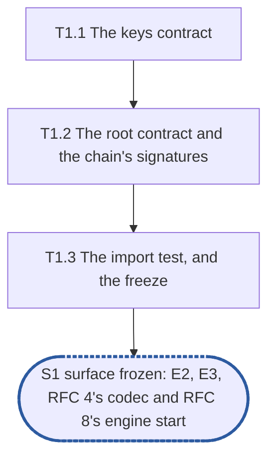

# Epic 1: transforms v2 interfaces

**Sources:** [RFC 5](../docs/internals/rfcs/rfc-5-transforms.md) §2.3 (the stage constants), §2.7
(the error values), §3.1 (the symbols, the pin included), §6 (the series the chain's recorder
carries), §7's T1 and T14 (as the signatures hold them), and Appendix B.2's salvage key (the
wrap's signature only); [RFC 0](../docs/internals/rfcs/rfc-0-data-lifecycle.md) §1.2 (component
imports, as amended), through the import test; [RFC 25](../docs/internals/rfcs/rfc-25-observability.md)
§8 (injection from the root), for the chain's `Deps`.
**Track:** the team.
**Epic 1 estimate: 3 subtasks, 3.75 man-days.**
**Depends on:** nothing. The code lands on `feat/storage-v2`, where `pkg/metadata/entity`'s
`NamespaceID` exists.
**Blocks:** every other epic of RFC 5, through S1:
- E2 needs `Transform` for `transformtest`, and `keys.Provider` with the two engine-facing
  interfaces for `keystest` and its in-memory provider.
- E3 fills `Register`, `NewChain`, the chain and the attempt behind the signatures frozen here.
- E4 and E5 implement `Transform` and register through `chain.Register`.
- E6 and E8 implement `keys.Provider`, the salvage-key wrap and the destroyed-material notice.

It also blocks two plans outside RFC 5:
- RFC 4's codec codes against the root's `Chain`, `Encoded`, `MaxDecodeLen` and errors.
- RFC 8's offload part codes against `Pin`, `Release`, `keys.Provider` and the two interfaces in
  the engine, and against `NewChain` and its `Deps` in the node's content wiring. The RFC 8
  offload plan calls this point S1d.

---

## 1. Goal

Epic 1 declares the transforms' surface that the codec, the engine, the node's content wiring and
every later epic code against, and the test that keeps the component's imports honest. Nothing it
declares runs yet: the two functions in `chain` have stub bodies behind final signatures, and
nothing tests their answers.

**At the end of the epic:**

- `pkg/transform` holds RFC 5 §3.1's contract: the ID and stage types and constants, `Transform`,
  `Encoded`, `Factory`, `Config`, the `Chain` and `Attempt` interfaces, `ErrMalformed` and
  `ErrTooLarge`. It holds nothing else.
- `pkg/transform/keys` holds `MaterialID`, `Provider` with `Current` and `Get`, the material errors,
  and two one-method interfaces the engine holds: the salvage-key wrap and the destroyed-material
  notice.
- `pkg/transform/chain` holds `Register`, `NewChain`, the chain's `Deps` and the `Recorder` it
  declares for RFC 5 §6's series. `Register` and `NewChain` have stub bodies.
- The import test passes on the tree and fails on every planted violation, a v1 path among them.
  It also fails when the root reaches `chain`. So the codec, which imports only the root, reaches
  `MaxDecodeLen` through the root's `Chain`.
- The RFC 4 and RFC 8 plans' authors have agreed the surface (S1).

### 1.1 In scope

The two contract packages and the chain package's exported surface, with doc comments citing
RFC 5. The component's import test, with its allowlist written once for the whole tree. The
review that freezes the surface at S1.

### 1.2 Out of scope

- Every behaviour behind the surface: the registry, the envelope, `NewChain`'s refusals, the pin,
  the composed bounds, the census view, `require`'s check and the chain ID are E3's. The material
  provider is E6's and E8's.
- `Provider.Remove` and `ErrMaterialInUse`. Each lands with its first caller and is added then to
  the interface and to every implementation. These are rows of the RFC 5 plan's §6.1 deferral
  ledger: the `Provider.Remove` row (RFC 9) and the export key's next-generation row (RFC 26).
- Concrete chain and attempt types. `NewChain` returns no value until E3 builds one (D7).
- The provider's own recorder for its gauges, and its `Deps`. E6 declares them with the provider.
- The custody interface the provider declares for master keys. It has one consumer, the
  provider, and lands with it in E6.
- The series specs, the conditions and the alert rules as plain values (E9), and the collectors
  the content wiring builds over the `Recorder` (the RFC 8 offload plan's content wiring).

### 1.3 Names used here

- **E1**, this epic.
- **E2**, epic 2, test foundations: `transformtest`, `keystest` with the in-memory `keys.Provider`,
  RFC 5's golden vectors and the catalogue.
- **E3**, epic 3, the chain: the registry, the envelope, `NewChain`'s refusals, the pin, the
  bounds, the census view, `require`, the chain ID and RFC 5 §6's series.
- **E4**, epic 4, compression: zstd and LZ4.
- **E5**, epic 5, encryption: the AES-256-GCM transform.
- **E6**, epic 6, namespace keys and the provider, `pkg/transform/keys/provider`.
- **E7**, epic 7, key-service custody over KMIP.
- **E8**, epic 8, rotation and the destroyed-material notice.
- **E9**, epic 9, the integration epic: settings, key operations, collectors, alert rules and error
  mapping.
- **E10**, epic 10, the census gauge `transform_census_blocks`, read from the engine's census.
- **S1**, the surface frozen: this epic has merged and its surface is agreed with the RFC 4 and
  RFC 8 offload plans' authors. The RFC 8 offload plan calls it S1d, "transform pipeline agreed".
- **S2**, E2's conformance suites and vectors are in.
- **S3**, not a synchronisation point here: the S3-compatible storage service, as in "the S3 store".

## 2. How the general rules apply

The rules are those of
[RFC 5's plan, §1.5](rfc-5-transforms-plan.md#15-general-rules-for-each-epic), cited by number and
title and not copied.

| Rule | Subtasks | How |
| --- | --- | --- |
| rule 1, independent unit tests ([`CLAUDE.md`, "Writing tests"](../CLAUDE.md#writing-tests)) | T1.3 | the import test runs `go list` over the real tree, and its rule is a pure function tested on planted inputs. No test double of any kind. This epic declares no internal interface for a later test to stand in for |
| rule 2, fuzz every decoder of bytes this component did not just write | none | no decoder: the envelope, the stages' headers and the key records are decoded by E3 to E8 |
| rule 3, observability follows RFC 25 | T1.2 | `chain.Deps` takes the logger and the `Recorder` from the caller (R17). `pkg/metrics`, `pkg/health` and `pkg/settings` are off the allowlist (R16). No series is recorded yet: E3 records them |
| rule 4, profiling | none | no hot path runs here. `internal/prof` is on the test allowlist for E2's first test |
| rule 5, public interface and internals ([`CLAUDE.md`, "Verifying a change"](../CLAUDE.md#verifying-a-change)) | T1.3 | the import test checks what an importer of the contract receives: the transitive closure, not only the direct imports |
| rule 6, known failures shrink | none | no test lands red. The import test lands green with its packages |
| rule 7, v2 ignores v1 and imports only what RFC 0 §1.2 allows | T1.1, T1.2, T1.3 | the contract packages import `entity` and each other only (R2, R3). T1.3's allowlist is rule 7's, written whole (D6) |
| rule 8, real dependencies for properties of those dependencies | none | no property of a store, a key service or a filesystem is tested here |
| rule 9, code comment conventions ([`CLAUDE.md`, "Code comments"](../CLAUDE.md#code-comments)) | T1.2, T1.3 | a `decision:` marker in `NewChain`'s doc comment states that the encrypt stage is required where one is configured (D4). A `ponytail:` marker at the import test states its single-platform listing (D6). RFC 5's other notes go with the code that implements them, in E3 to E5 |
| rule 10, a test must be able to fail ([`CLAUDE.md`, "Writing tests"](../CLAUDE.md#writing-tests)) | T1.3 | each planted violation must produce its message. The declarations carry no test: the compiler holds their signatures, and nothing tests the stubs' answers |
| rule 11, a symbol is exported only if RFC 5's interface or a consumer outside the package uses it | T1.1, T1.2 | every export here is RFC 5 §3.1's, or is consumed by the engine or the content wiring (R14, R17), and is frozen at S1. `ErrNotEscrowed` is exported for E6, which returns it, and E9, which maps it (D5). `Remove` is withheld until its first caller |
| rule 12, each subtask creates only what it declares | all | three packages, each with its first consumer named: the root for the codec, the engine and E3; `keys` for the root, E2 and E6; `chain` for the content wiring and E3. No concrete type yet (D7) |

## 3. Requirements and invariants

Every obligation RFC 5, RFC 0 and RFC 25 place on this epic, with the ones RFC 5's plan sets for it,
numbered so that subtasks and tests can cite them. Most are about declarations. A requirement that
only the compiler can hold says so in §6's subtask.

**Packages and imports**

| # | Requirement | Kind | Source | Subtasks |
| --- | --- | --- | --- | --- |
| R1 | Package `transform` is the model's contract: the value types, the `Transform`, `Chain` and `Attempt` interfaces and the errors. The registry and the chain that implements those interfaces are package `chain` beneath it. A contract keeps no state and no behaviour beyond pure functions and methods over its own value types | invariant | RFC 5 §3.1; RFC 0 §1.2 | T1.2, T1.3 |
| R2 | Package `keys` holds `MaterialID`, `Provider` and the material errors. It is also a contract, and it imports nothing of `transform` | invariant | RFC 5 §3.1 | T1.1, T1.3 |
| R3 | A contract imports only the standard library, libraries outside the component set, and other contracts. The root's module-internal imports are only `keys` and `entity`, and `keys`'s only `entity`, transitively. So the codec and the engine, importing only `transform` and `keys`, reach no implementation through them, and the root never reaches `chain`, a stage or the provider | MUST | RFC 0 §1.2; RFC 5 §3.1; RFC 5 plan §1.5 rule 7 | T1.3 |
| R4 | The namespace ID is `entity.NamespaceID`, a contract, not a copy. No package copies a provider's value types or error values to avoid importing the provider's contract | MUST NOT | RFC 5 §3.1; RFC 0 §1.2 | T1.1, T1.2 |
| R5 | No package of the component imports another component's implementation, directly or transitively. `pkg/settings`, `pkg/metrics` and `pkg/health` hold a contract and its implementation together, so they count as implementations and are not imported either | MUST NOT | RFC 0 §1.2; RFC 5 plan §1.5 rule 7 | T1.3 |
| R6 | Conformance is checked by an import-graph test that follows imports transitively. It fails when production code reaches another component's implementation, when a contract imports an implementation, and on any v1 path | test row | RFC 0 §1.2; RFC 5 plan §1.5 rule 7 | T1.3 |

**The root contract**

| # | Requirement | Kind | Source | Subtasks |
| --- | --- | --- | --- | --- |
| R7 | `ID` is a `uint16`, and `Stage` a `uint8` with `StageCompress`, `StageEncrypt` and `StageRedundancy` numbered from 1 in that order, the order fixed in code | invariant | RFC 5 §2.3, §3.1 | T1.2 |
| R8 | `Transform` declares `ID`, `Stage`, `Kinds`, `MaxEncodedLen` and `LengthOf` under the pinned material, `LengthKey`, `Encode` under the pinned material, and `Decode` with a bound `max` and a `keys.Provider` | MUST | RFC 5 §3.1 | T1.2 |
| R9 | `Encoded` carries `Body`, `Applied`, `Version` and `Material`. `Factory` builds a transform from its settings and a `keys.Provider`. `Config` carries a registered transform's `Name` and its `Settings` | MUST | RFC 5 §3.1 | T1.2 |
| R10 | `Chain` declares `Pin`, `Decode` (taking the block's census) and `MaxDecodeLen(n int) int`. `Attempt` declares `ID`, `MaxEncodedLen`, `LengthOf`, `Encode` and `Release`. A block's chain, bounds and bodies come from its pin, never from the chain's current configuration | MUST | RFC 5 §3.1, §2.8 | T1.2 |
| R11 | `MaxDecodeLen` is a method of the root's `Chain`, answered from the chain's registry. The codec sizes its reads through the chain it is handed, never by importing `chain` and never by a type assertion | MUST NOT | RFC 5 §3.1; RFC 0 §1.2 | T1.2, T1.3 |
| R12 | A transform sees one chunk's bytes and its hash, and returns a body. It never returns a hash or a block name, and is never handed a second chunk | invariant | RFC 5 §7 T1, §2.1 | T1.2 |

**Material and the errors**

| # | Requirement | Kind | Source | Subtasks |
| --- | --- | --- | --- | --- |
| R13 | `MaterialID` carries `Namespace`, `Kind`, `ID` and `Fingerprint`. `Provider` declares `Current(ctx, ns, kind)` and `Get(ctx, id)`. Every call that names material names its namespace: in the `MaterialID`, or as the `ns` that `Current`, `Pin`, `Encode` and `Decode` take | invariant | RFC 5 §3.1, §2.5, §7 T14 | T1.1, T1.2 |
| R14 | The salvage-key wrap and the destroyed-material notice are each an interface declared in `keys` beside `Provider`. The engine takes each as a declared dependency, never by asserting a type on a `keys.Provider`. The wrap returns a fresh key with its wrap under the installation's current master key. The notice returns the material IDs found destroyed since a cursor | MUST NOT | RFC 5 Appendix B.2; RFC 0 §1.2; RFC 5 plan D16, D17 | T1.1 |
| R15 | `Decode`'s errors are §2.7's five, each its own value: `ErrMalformed` and `ErrTooLarge` in `transform`; `ErrUnknownMaterial`, `ErrMaterialUnavailable` and `ErrMaterialDestroyed` in `keys`. `keys` also declares `ErrNotEscrowed` | MUST | RFC 5 §2.7, §3.1 | T1.1, T1.2 |

**Injection**

| # | Requirement | Kind | Source | Subtasks |
| --- | --- | --- | --- | --- |
| R16 | The chain exports RFC 5 §6's series around each transform's call, so a custom transform gets them without writing any. It records them through a recorder it declares, never through `pkg/metrics` | invariant | RFC 5 §6; RFC 5 plan D2, §1.5 rule 3 | T1.2, T1.3 |
| R17 | The chain gets its logger and its recorder from its caller in a `Deps`, never from a global, a registry lookup or a context | invariant | RFC 25 §8; RFC 5 plan D2 | T1.2 |

**The freeze**

| # | Requirement | Kind | Source | Subtasks |
| --- | --- | --- | --- | --- |
| R18 | The surface is reviewed with the RFC 4 and RFC 8 offload plans' authors, and frozen at S1. The one known widening is `Provider.Remove`, with its first caller | MUST | RFC 5 plan §3.2, §1.5 rule 11 | T1.3 |

## 4. Decisions this epic takes

- **D1, the root is the contract, the chain a subpackage.** RFC 5 §3.1 places the registry and
  the chain in `chain`, beneath the contract, and the provider's part in `keys`, so the codec and
  the engine import contracts only (R1–R3). Each shipped stage is its own package and registers
  with `chain`, so a custom transform is one more such package. Prior art: Go's `image` and
  `database/sql`, where each format or driver is a package that registers at init (from memory).
  No marker: the layout states it.

- **D2, `chain.Deps` carries the logger and a `Recorder` the chain declares.** RFC 5 §3.1's
  signatures are indicative, and RFC 25 §8 has every component take its logger and metrics from
  its caller (R17). Under amended RFC 0 §1.2, `pkg/metrics` counts as an implementation, so the
  chain declares a recorder named for its series, and the node's content wiring implements it over
  the root's registry (R16). It has three calls, one per moment the chain observes:

  ```go
  type Recorder interface {
  	// Encoded records one transform's encode of one chunk: transform_chunks_total by applied,
  	// transform_bytes_total and transform_seconds with direction encode.
  	Encoded(transform string, applied bool, in, out int, took time.Duration)
  	// Decoded records one transform's successful decode of one body, direction decode.
  	Decoded(transform string, in, out int, took time.Duration)
  	// DecodeFailed records one transform_decode_failures_total. reason is one of RFC 5 §6's
  	// values: malformed, material_unavailable, material_unknown, material_destroyed, too_large.
  	DecodeFailed(transform string, reason string)
  }
  ```

  `reason` is a plain string rather than a typed constant set, because the content wiring only
  passes it on as a label. `transform_census_blocks` is not the chain's: E10 reads it from the
  census. Two choices are E3's, since neither changes a signature:
  - which `transform` label a failure of the envelope itself carries;
  - whether a nil `Recorder` or `Logger` is refused or recorded nowhere.

  Prior art: RFC 25 §8.1's injection from the root, and the RFC 4 plan's recorders for the S3
  store and the codec (#5795, its D12), which take the same shape.

- **D3, the pin is an `Attempt` value, released without an error.** Following RFC 5 §3.1 as
  amended, `Chain.Pin(ctx, ns)` returns the `Attempt`. The attempt carries the chain ID, the
  bounds, `Encode` and `Release`. `Release` returns nothing, since the engine releases at commit or
  abandonment and has nothing to do with a failure. `Chain.MaxEncodedLen` and `Chain.LengthOf` do
  not exist: only an attempt knows its material (R10). Prior art: a snapshot of configuration
  taken per request, as a database transaction pins its schema version (from memory).

- **D4, `NewChain` takes the store configuration's `require` as a parameter. A configured encrypt
  stage makes the encrypt stage required for every body the chain decodes.** *Pending the user's
  answer (§9, Q1).* RFC 5 §3.1's `NewChain` has no place for §3.2's `require`. §3.2 also makes the
  encrypt stage implicitly required in an encrypting namespace, a fact fixed at the namespace's
  creation. The chain spans a store configuration and so many namespaces. §3.2 refuses adding or
  removing the encrypt stage while any namespace of the configuration holds content, so every
  namespace with a body to read encrypts exactly when the configuration has an encrypt stage. The
  chain can therefore derive the implicit requirement from its own configuration, with no call
  per namespace:

  ```go
  func NewChain(ctx context.Context, cfg []transform.Config, require []string, m keys.Provider, deps Deps) (transform.Chain, error)
  ```

  `require` holds registered transforms' names, as the record holds them. E3 resolves them,
  refuses an unknown one at build (RFC 5 §2.7), and puts a `decision:` marker at the check. The
  marker names §3.2's refusal as what the derivation rests on. It is withdrawn if a configuration
  may ever hold content in both encrypting and non-encrypting namespaces. The alternative, a
  per-namespace interface the chain asks in `Decode`, is Q1's option B. Prior art: none found.

- **D5, the two engine-facing interfaces, and which material errors exist now.** They are declared
  in `keys`, each with one method, named for what the engine needs (R14):

  ```go
  // SalvageWrapper draws a fresh key for one salvage export and wraps it under the
  // installation's current master key, with export as the associated data.
  type SalvageWrapper interface {
  	WrapSalvageKey(ctx context.Context, export []byte) (key, wrap []byte, err error)
  }

  // DestroyedNotice reports the material found destroyed after cursor, and the cursor to pass next.
  type DestroyedNotice interface {
  	DestroyedSince(ctx context.Context, cursor uint64) (ids []MaterialID, next uint64, err error)
  }
  ```

  The wrap's details:
  - `export` is opaque bytes naming the export. The provider frames it into the associated data,
    and E6 fixes that layout with the stored wrap's.
  - `wrap` is the stored wrap of RFC 5 Appendix B.1, so recovery tools read it like any key
    record's.

  The notice's details:
  - The cursor is a `uint64` sequence the provider derives from its durable records, so it means
    the same after a restart (E8's row).
  - The provider may return a bounded batch. The engine polls again until a call returns none.
    It is a poll, not a callback, so nothing runs inside the provider's lock (plan D17).

  The material errors: `ErrUnknownMaterial`, `ErrMaterialUnavailable`, `ErrMaterialDestroyed` and
  `ErrNotEscrowed` are declared now. E6 returns `ErrNotEscrowed` and E9 maps it, and freezing it
  costs nothing. `ErrMaterialInUse` is returned only by `Remove`, so it lands with it (§1.2).

  Prior art: a change feed read by cursor, as the metadata store's generation counters
  (from memory); the AWS Encryption SDK's data-key generation, which returns the plaintext key
  with its encrypted copy (from memory).

- **D6, the import test lists the tree with `go list`, checks module-internal packages
  transitively, and holds the whole allowlist from the start.** RFC 0 §1.2 requires a transitive
  check. One `go list` over `./pkg/transform/...` gives each package's import path, its
  transitive production dependencies (`Deps`), and its direct imports for production files,
  test files and external test files. The rule is a pure function of those lists, so a test feeds
  it planted lists rather than planted packages. `internal/archtest` and the journal's and
  engine's import tests list direct imports only, so none of them is reused.

  The allowlist is rule 7's, written whole now, since a later epic would otherwise widen it one
  import at a time with no review of the rule. It is enforced in three parts:
  - **The contracts' closure.** For the root and `keys`, every module-internal package in `Deps`
    is `pkg/transform/keys` (root only) or `pkg/metadata/entity`.
  - **The rest of the tree's closure.** For every other package, every module-internal package in
    `Deps` is under `pkg/transform/`, or is `pkg/metadata/entity`, `pkg/remote`,
    `internal/keyfile` or `internal/kmip`.
  - **Direct imports outside the module.** For every package, each import that is not the
    standard library is one of `golang.org/x/crypto/...`, `github.com/klauspost/compress/...`,
    `github.com/pierrec/lz4/v4`, `lukechampine.com/blake3` or `github.com/gemalto/kmip-go/...`.
    The root and `keys` import none of them.

  Test files may import other components' implementations (RFC 0 §1.2), never a v1 path, and each
  test-only entry names its reason: `internal/prof` (rule 4) and `pkg/remote/memory` (the provider's
  `keys`-object tests). The epic that writes a test needing another adds it with its reason. A
  `ponytail:` marker records the listing's limit: it runs for the host platform only, which is
  exact while no file of the component carries a platform constraint. The upgrade is to list once
  per platform when one does. Prior art: the Go project's `go/build/deps_test.go`, which holds
  each standard-library package to a transitive dependency rule (from memory).

- **D7, no concrete chain or attempt type in this epic.** `NewChain`'s stub returns
  `nil, errors.ErrUnsupported`, and `Register`'s stub records nothing. E3 adds the unexported chain
  and attempt types with the registry, so no exported or unexported type exists without a caller
  (rule 12). R11 holds through the interface alone. Prior art: none needed.

## 5. Target tree

On `feat/storage-v2`:

```text
pkg/transform/
  transform.go      T1.2  package doc; ID, Stage and its constants, Transform, Encoded, Factory,
                          Config, Chain, Attempt, ErrMalformed, ErrTooLarge
  imports_test.go   T1.3  the import rule over pkg/transform/..., and its planted cases
pkg/transform/keys/
  keys.go           T1.1  package doc; MaterialID, Provider, SalvageWrapper, DestroyedNotice,
                          ErrUnknownMaterial, ErrMaterialUnavailable, ErrMaterialDestroyed,
                          ErrNotEscrowed
pkg/transform/chain/
  chain.go          T1.2  package doc; Register and NewChain (stub bodies), Deps, Recorder
```

## 6. Subtasks

### T1.1 The `keys` contract

**Subtask T1.1 estimate: 0.75 man-days.**

- **Track:** the team. **Depends on:** none.
- **Covers:** R2, R4, R13, R14, R15.
- **Deliverables:** `pkg/transform/keys/keys.go`, importing `context`, `errors` and
  `pkg/metadata/entity` only:

  ```go
  type MaterialID struct {
  	Namespace   entity.NamespaceID
  	Kind        string
  	ID          string
  	Fingerprint [32]byte // HMAC-SHA256(material, "dittofs key check v1"), RFC 5 §2.5
  }

  type Provider interface {
  	Current(ctx context.Context, ns entity.NamespaceID, kind string) (MaterialID, error)
  	Get(ctx context.Context, id MaterialID) ([]byte, error)
  }

  type SalvageWrapper interface {
  	WrapSalvageKey(ctx context.Context, export []byte) (key, wrap []byte, err error)
  }

  type DestroyedNotice interface {
  	DestroyedSince(ctx context.Context, cursor uint64) (ids []MaterialID, next uint64, err error)
  }

  var (
  	ErrUnknownMaterial     = errors.New("keys: unknown material")
  	ErrMaterialUnavailable = errors.New("keys: material unavailable")
  	ErrMaterialDestroyed   = errors.New("keys: material destroyed")
  	ErrNotEscrowed         = errors.New("keys: master key escrow not verified")
  )
  ```

  `Get`'s doc comment states RFC 5 §3.1's error contract: which error answers which case.
  Consumers:
  - T1.2's root, which names `MaterialID` and `Provider`;
  - E2's `keystest` and in-memory provider;
  - E6's and E8's provider;
  - the RFC 8 offload plan's engine, which holds `Provider`, `SalvageWrapper` and
    `DestroyedNotice`.
- **Acceptance criteria:**
  - The package builds and imports nothing of `pkg/transform` (R2) and no copy of the namespace
    ID (R4).
  - Each symbol's doc comment cites the RFC 5 section it implements.
  - No `Remove` and no `ErrMaterialInUse` (§1.2).
- **Tests:** none of its own: declarations only. The compiler holds the signatures, so a
  copied namespace ID or a missing `ns` fails every caller's build (R4, R13). An assertion on a
  `Provider` to reach the wrap or the notice could only be written by a consumer, so R14 is met by
  declaring them. T1.3's import test holds the package's imports (R2).
- **Rules:** as §2.

### T1.2 The root contract and the chain's signatures

**Subtask T1.2 estimate: 1.25 man-days.**

- **Track:** the team. **Depends on:** T1.1.
- **Covers:** R1, R4, R7–R13, R15–R17.
- **Deliverables:**
  - `pkg/transform/transform.go`, RFC 5 §3.1's root symbols as the RFC writes them:
    - `ID`, `Stage` and `StageCompress`, `StageEncrypt`, `StageRedundancy` (`iota + 1`);
    - `Transform`, `Encoded`, `Factory`, `Config`;
    - `Chain` with `Pin`, `Decode` and `MaxDecodeLen(n int) int`;
    - `Attempt` with `ID`, `MaxEncodedLen`, `LengthOf`, `Encode` and `Release`;
    - `ErrMalformed` and `ErrTooLarge`.

    It imports `context`, `errors`, `pkg/metadata/entity` and `pkg/transform/keys` only. The
    package doc says it is the contract and names `chain` as where the registry lives.

    Consumers:
    - RFC 4's codec: `Chain`, `Attempt.Encode`, `Chain.Decode`, `MaxDecodeLen`, `Encoded` and the
      errors;
    - the RFC 8 offload plan's engine: `Pin` and `Release`;
    - E2's `transformtest`: `Transform`;
    - E3 to E5, which implement them.
  - `pkg/transform/chain/chain.go`:

    ```go
    func Register(id transform.ID, name string, f transform.Factory)
    func NewChain(ctx context.Context, cfg []transform.Config, require []string, m keys.Provider, deps Deps) (transform.Chain, error)

    type Deps struct {
    	Logger   *slog.Logger
    	Recorder Recorder
    }

    type Recorder interface {
    	Encoded(transform string, applied bool, in, out int, took time.Duration)
    	Decoded(transform string, in, out int, took time.Duration)
    	DecodeFailed(transform string, reason string)
    }
    ```

    - `Register`'s body records nothing, and `NewChain`'s returns `nil, errors.ErrUnsupported`
      (D7).
    - `NewChain`'s doc comment carries D4's `decision:` marker.
    - `Register` and `NewChain`'s doc comments state the refusals E3 implements (RFC 5 §2.3, §2.7).

    Consumers:
    - E4 and E5, which call `Register` at init;
    - the RFC 8 offload plan's content wiring, which calls `NewChain` and implements `Recorder`;
    - E9, which validates settings by building a chain;
    - E3, which fills the bodies.
- **Acceptance criteria:**
  - The root holds no variable but the two errors, and no function (R1). `Deps` and `Recorder`
    are in `chain`, not in the root.
  - The signatures are RFC 5 §3.1's but for `NewChain`'s `require` and `deps` (D2, D4).
  - `Transform.Encode` and `Transform.Decode` take one chunk's bytes and its `[32]byte` hash and
    return a body or plain bytes, nothing else (R12).
  - Each symbol's doc comment cites the RFC 5 section it implements.
- **Tests:** none of its own. The compiler holds the signatures (R7–R13). R11's "no type
  assertion" is met by declaring `MaxDecodeLen` on `Chain`, and its "no import of `chain`" is
  T1.3's planted case. The stubs' answers are not tested: E3 replaces them.
- **Rules:** as §2.

### T1.3 The import test, and the freeze

**Subtask T1.3 estimate: 1.75 man-days.**

- **Track:** the team. **Depends on:** T1.2.
- **Covers:** R1–R3, R5, R6, R11, R16, R18.
- **Deliverables:**
  - `pkg/transform/imports_test.go`, in package `transform`, as D6 describes:
    - one `go list` over `./pkg/transform/...` reading each package's module-internal `Deps` and the
      direct imports of each package;
    - a pure `violations(pkg string, deps, imports, testImports []string) []string` holding the
      three allowlists and the test-only list, each entry with its reason in a comment;
    - `TestImportRule`, which runs `violations` over every listed package and fails if fewer
      than the three packages of this epic were listed;
    - `TestImportRuleRefuses`, a table of planted lists, each of which must produce a violation
      naming the package and the import.

    The rule's doc comment names what the allowlist leaves out on purpose: `pkg/settings`,
    `pkg/metrics`, `pkg/health`, `pkg/keyprovider`, `pkg/metadata/kvstore` and `pkg/remote/s3`.
    It carries D6's `ponytail:` marker. Consumed by every later epic of RFC 5, whose packages it
    checks.
  - The S1 review: the root's, `keys`'s and `chain`'s exported surface, with D2, D4 and D5, put to
    the RFC 4 and RFC 8 offload plans' authors on this subtask's pull request.
- **Acceptance criteria:**
  - The test passes on the tree of T1.1 and T1.2.
  - Each planted case fails with its message:
    - the root importing `pkg/transform/chain` directly;
    - the root reaching `pkg/transform/keys/provider` only through a dependency's dependency;
    - `keys` importing `pkg/transform`;
    - `chain` importing `pkg/metrics`;
    - a stage importing `pkg/metadata/kvstore` transitively;
    - a package importing the v1 path `pkg/block/middleware`;
    - a stage importing `github.com/pierrec/lz4` (v1's module path, not v4);
    - a test file importing a v1 path;
    - the root importing `lukechampine.com/blake3` directly.
  - The RFC 4 and RFC 8 offload plans' authors approve the pull request carrying the surface
    (S1, R18).
- **Tests:** both are at the rule the later epics' packages are held to, its consumer:
  - `TestImportRule` catches an import a later epic adds past the rule (R3, R5).
  - `TestImportRuleRefuses` catches a rule that checks direct imports only (the transitive case),
    lets the root reach `chain` (R11), or admits `pkg/metrics` (R16) or a v1 path (R6).

  No test double: `go list` reads the real tree, and the planted cases are inputs to a pure
  function.
- **Rules:** as §2.

## 7. Order of work



Checkpoint after T1.2: the whole surface compiles, and the S1 review can start on it while T1.3's
test is written.

## 8. Suggested pull requests

| PR | Subtasks | Man-days | After | Why together |
| --- | --- | --- | --- | --- |
| 1 | T1.1, T1.2, T1.3 | 3.75 | — | the whole surface and the rule that holds its imports, reviewed once for S1 |

A suggestion only: one pull request per subtask works as well, with the S1 review on the last.

## 9. Open points

- **Q1, pending the user's answer: how the chain learns `require` and the encrypting namespace's
  implicit requirement.** D4 writes option A in place.
  - **A (recommended):** `NewChain(ctx, cfg, require []string, m, deps)`. A configured encrypt
    stage makes an encrypt-stage transform required on every body. This is exact under RFC 5
    §3.2's refusal, so no interface is needed and nothing is asked per read.
  - **B:** the same `require`, plus a `NamespaceEncryption` interface in `Deps`. Its method is
    `Encrypts(ctx context.Context, ns entity.NamespaceID) (bool, error)`, implemented by the content
    wiring over the namespace's bound `encrypts`. `Chain.Decode` asks it on every read and fails
    closed on an error. This is exact even if §3.2's refusal is ever relaxed, at the cost of a
    lookup per read and one more interface to freeze.
  - **C:** RFC 5 §3.1's `NewChain` unchanged. E3 widens it after S1, which breaks the freeze the
    RFC 8 offload plan codes against.

  Checked: RFC 5 §3.1 and §3.2, RFC 13 §5.1, the RFC 8 offload plan (#5528), none of which says how
  the chain learns either. From memory: none found elsewhere.
- **The RFC 4 plan's wording.** #5795's RFC 4 plan says RFC 5's `keys` (`pkg/transform/keys`)
  imports `pkg/remote`'s contract. Here, and in RFC 5's plan (rule 7, D8), only the provider
  (`pkg/transform/keys/provider`) does: the `keys` contract imports `entity` only (R3). #5795's
  sentence should name `keys/provider`.
- **The moved key-file format and KMIP transport.** On `feat/storage-v2`, `pkg/keyprovider` imports
  `pkg/internal/dirsync` for the key file and `internal/logger` for KMIP. When E6 and E7 move
  them to `internal/keyfile` and `internal/kmip`, those imports either go, or join D6's allowlist
  with their reason in that epic, after a check that neither is a component's implementation.
- The least certain figure is T1.3's, because the S1 review's turnaround and its folds are not
  known in advance.
