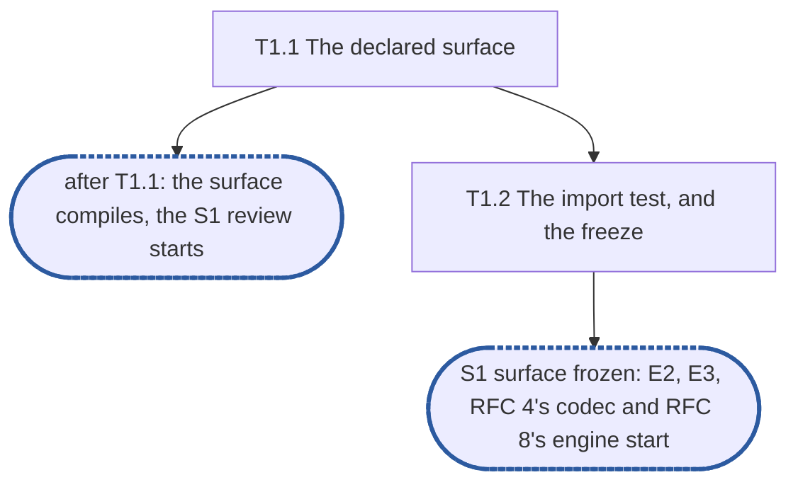

# Epic 1: transforms v2 interfaces

**Sources:** [RFC 5](../docs/internals/rfcs/rfc-5-transforms.md) §2.3 (the stage constants), §2.5 (the
material kinds, and material named with its namespace), §2.7 (the error values), §3.1 as amended by
#5851 (the symbols, the pin included, with `Transform.Version` and `Encoded.ID`), §3.2 (`require`
and the encrypting namespace, as inputs the chain receives), §6 (the series the chain's recorder
carries), §7's T1 and T14 (as the signatures hold them), and Appendix B.2's salvage key (the wrap's
signature only); [RFC 0](../docs/internals/rfcs/rfc-0-data-lifecycle.md) §1.2 (component imports, as
amended), through the import test; [RFC 25](../docs/internals/rfcs/rfc-25-observability.md) §8
(injection from the root), for the chain's `Deps`.
**Track:** the team.
**Epic 1 estimate: 2 subtasks, 3.75 man-days.**
**Depends on:** nothing. The code lands on `develop`, where `pkg/metadata/entity`'s
`NamespaceID` exists.
**Blocks:** every other epic of RFC 5, through S1:
- E2 needs `Transform` for `transformtest`, and `keys.Provider` with the two engine-facing
  interfaces for `keystest` and its in-memory provider.
- E3 fills `Register`, `NewChain`, the chain and the attempt behind the signatures frozen here, and
  reads `Deps.Require` and `Deps.Encrypts`.
- E4 and E5 implement `Transform` and register through `chain.Register`.
- E6 and E8 implement `keys.Provider`, the salvage-key wrap and the destroyed-material notice.

It also blocks two plans outside RFC 5:
- RFC 4's codec codes against the root's `Chain`, `Encoded`, `MaxDecodeLen` and errors.
- RFC 8's offload part codes against `Pin`, `Release`, `keys.Provider`, the material kinds and the
  two interfaces in the engine, and against `NewChain` and its `Deps` in the node's content wiring.
  The RFC 8 offload plan calls this point S1d.

---

## 1. Goal

Epic 1 declares the transforms' surface that the codec, the engine, the node's content wiring and
every later epic code against, and the test that keeps the component's imports honest. Nothing it
declares runs yet: the two functions in `chain` have stub bodies behind final signatures, and
nothing tests their answers.

**At the end of the epic:**

- `pkg/transform` holds RFC 5 §3.1's contract, as amended by #5851: the ID and stage types and
  constants, `Transform` with `Version`, `Encoded` with `ID`, `Factory`, `Config`, the `Chain` and
  `Attempt` interfaces, `ErrMalformed` and `ErrTooLarge`. It holds nothing else.
- `pkg/transform/keys` holds `MaterialID`, `Provider` with `Current` and `Get`, the three kinds
  consumed outside the provider, the three material errors `Decode` can return, and two one-method
  interfaces the engine holds: the salvage-key wrap and the destroyed-material notice.
- `pkg/transform/chain` holds `Register`, `NewChain` and the chain's `Deps`: a logger, the
  `Recorder` it declares for RFC 5 §6's series, the store configuration's `require`, and the
  lookup that says whether a namespace encrypts. `Register` and `NewChain` have stub bodies.
- The import test passes on the tree and fails on every planted violation. It also fails when the
  root reaches `chain`, so the codec, which imports only the root, reaches `MaxDecodeLen` through
  the root's `Chain`.
- The RFC 4 and RFC 8 offload plans' authors have agreed the surface (S1).

### 1.1 In scope

The two contract packages and the chain package's exported surface, with doc comments citing
RFC 5. The component's import test, with its production allowlist written once for the whole tree.
The review that freezes the surface at S1.

### 1.2 Out of scope

- Every behaviour behind the surface: the registry, the envelope, `NewChain`'s refusals, the pin,
  the composed bounds, the census view, `require`'s and the encrypt stage's checks, and the chain
  ID are E3's. The material provider is E6's and E8's.
- `Provider.Remove`, the count of open pins that is its fence, and `ErrMaterialInUse`. Each lands
  with its first caller and is added then to the surface and to every implementation. These are rows
  of the RFC 5 plan's §6.1 deferral ledger: the `Provider.Remove` row (RFC 9) and the export key's
  next-generation row (RFC 26). A `decision:` marker on `keys.Provider` names them (D5).
- `ErrNotEscrowed`. E6 returns it first and declares it then; no plan outside RFC 5 reads it (D5).
- The `export-key`, `master-key` and `salvage-key` kinds: only the provider names them until RFC 26
  consumes the export key, so E6 keeps them unexported (D5).
- Concrete chain and attempt types. `NewChain` returns no value until E3 builds one (D7).
- The provider's own recorder for its gauges, and its `Deps`. E6 declares them with the provider.
- The custody interface the provider declares for master keys. It has one consumer, the
  provider, and lands with it in E6.
- The series specs, the conditions and the alert rules as plain values (E9), the collectors the
  content wiring builds over the `Recorder`, and the `Encrypts` lookup it builds over the
  namespace's bound `encrypts` (the RFC 8 offload plan's content wiring, with E9).

### 1.3 Names used here

- **E1**, this epic.
- **E2**, epic 2, test foundations: `transformtest`, `keystest` with the in-memory `keys.Provider`,
  RFC 5's golden vectors and the catalogue.
- **E3**, epic 3, the chain: the registry, the envelope, `NewChain`'s refusals, the pin, the
  bounds, the census view, `require`, the chain ID and RFC 5 §6's series.
- **E4**, epic 4, compression: zstd and LZ4.
- **E5**, epic 5, encryption: the AES-256-GCM transform.
- **E6**, epic 6, namespace keys and the provider, `pkg/transform/keys/provider`.
- **E7**, epic 7, key-service custody over KMIP.
- **E8**, epic 8, rotation and the destroyed-material notice.
- **E9**, epic 9, the integration epic: settings, the bound `encrypts`, key operations, collectors,
  alert rules and error mapping.
- **E10**, epic 10, the census gauge `transform_census_blocks`, read from the engine's census.
- **S1**, the surface frozen: this epic has merged and its surface is agreed with the RFC 4 and
  RFC 8 offload plans' authors. The RFC 8 offload plan calls it S1d, "transform pipeline agreed".
- **S2**, E2's conformance suites and vectors are in.
- **S3**, not a synchronisation point here: the S3-compatible storage service, as in "the S3 store".

## 2. How the general rules apply

The rules are those of
[RFC 5's plan, §1.5](rfc-5-transforms-plan.md#15-general-rules-for-each-epic), cited by number and
title and not copied.

| Rule | Subtasks | How |
| --- | --- | --- |
| rule 1, **independent unit tests** ([`CLAUDE.md`, "Writing tests"](../CLAUDE.md#writing-tests)) | T1.2 | the import test walks the real tree with `go/build`, and its rule is a pure function tested on planted inputs. No test double of any kind. This epic declares no internal interface for a later test to stand in for; `Deps.Encrypts` is an input, so a test passes a function |
| rule 2, **fuzz every decoder of bytes this component did not just write** | none | no decoder: the envelope, the stages' headers and the key records are decoded by E3 to E8 |
| rule 3, **observability follows RFC 25** | T1.1 | `chain.Deps` takes the logger and the `Recorder` from the caller (R18). `pkg/metrics`, `pkg/health` and `pkg/settings` are off the allowlist (R4). No series is recorded yet: E3 records them |
| rule 4, **profiling** | T1.2 | no hot path runs here. `internal/prof` is on the allowlist of the test-support packages, `transformtest` and `keystest`, whose suites run under it (D6) |
| rule 5, **public interface and internals** ([`CLAUDE.md`, "Verifying a change"](../CLAUDE.md#verifying-a-change)) | T1.2 | the import test checks what an importer of the contract receives: the transitive closure, not only the direct imports |
| rule 6, **known failures shrink** | none | no test lands red. The import test lands green with its packages |
| rule 7, **v2 ignores v1, and imports only what RFC 0 §1.2 allows** | T1.1, T1.2 | the root imports `keys` and `entity`, and `keys` imports `entity` only (R2). T1.2's production allowlist is rule 7's, written whole (D6) |
| rule 8, **real dependencies for properties of those dependencies** | none | no property of a store, a key service or a filesystem is tested here |
| rule 9, **code comment conventions** ([`CLAUDE.md`, "Code comments"](../CLAUDE.md#code-comments)) | T1.1, T1.2 | a `decision:` marker on `keys.Provider` names `Remove` and its first caller (D5). A `decision:` marker at the import test says why test files are not held to the allowlist (D6). RFC 5's other notes go with the code that implements them, in E3 to E5 |
| rule 10, **a test must be able to fail** ([`CLAUDE.md`, "Writing tests"](../CLAUDE.md#writing-tests)) | T1.2 | each planted violation must produce its message. The declarations carry no test: the compiler holds their signatures, and nothing tests the stubs' answers |
| rule 11, **a symbol is exported only if RFC 5's interface or a consumer outside the package uses it** | T1.1 | every export here is RFC 5 §3.1's as amended by #5851, or is consumed by the engine or the content wiring (R13, R14, R16–R18), and is frozen at S1. `Remove`, `ErrMaterialInUse` and `ErrNotEscrowed` are withheld until their first caller |
| rule 12, **each subtask creates only what it declares** | all | three packages, each with its first consumer named: the root for the codec, the engine and E3; `keys` for the root, E2 and E6; `chain` for the content wiring and E3. No concrete type yet (D7) |

## 3. Requirements and invariants

Every obligation RFC 5, RFC 0 and RFC 25 place on this epic, with the ones RFC 5's plan sets for it,
numbered so that subtasks and tests can cite them. Most are about declarations, which the compiler
holds once they exist: §6 says so per subtask.

**Packages and imports**

| # | Requirement | Kind | Source | Subtasks |
| --- | --- | --- | --- | --- |
| R1 | Package `transform` is the model's contract: the value types, the `Transform`, `Chain` and `Attempt` interfaces and the errors. The registry and the chain that implements those interfaces are package `chain` beneath it. A contract keeps no state, and no behaviour beyond pure functions, methods over its own value types and constructors that mint a new value of one | invariant | RFC 5 §3.1; RFC 0 §1.2 | T1.1, T1.2 |
| R2 | Package `keys` holds `MaterialID`, `Provider` and the material errors, and imports nothing of `transform`. The root's module-internal imports are `keys` and `entity` only, and `keys`'s `entity` only, transitively, so the codec and the engine, importing only `transform` and `keys`, reach no implementation through them: never `chain`, a stage or the provider | MUST | RFC 5 §3.1; RFC 0 §1.2; RFC 5 plan §1.5 rule 7 | T1.1, T1.2 |
| R3 | The namespace ID is `entity.NamespaceID`, a contract, not a copy. No package copies a provider's value types or error values to avoid importing the provider's contract | MUST NOT | RFC 5 §3.1; RFC 0 §1.2 | T1.1 |
| R4 | No package of the component's production code imports another component's implementation, directly or transitively. `pkg/settings`, `pkg/metrics` and `pkg/health` hold a contract and its implementation together, so they count as implementations and are not imported either | MUST NOT | RFC 0 §1.2; RFC 5 plan §1.5 rule 7 | T1.2 |
| R5 | An import-graph test follows imports transitively, and fails when production code reaches another component's implementation and when a contract imports an implementation | test row | RFC 0 §1.2; RFC 5 plan §1.5 rule 7 | T1.2 |

**The root contract**

| # | Requirement | Kind | Source | Subtasks |
| --- | --- | --- | --- | --- |
| R6 | `ID` is a `uint16`, and `Stage` a `uint8` with `StageCompress`, `StageEncrypt` and `StageRedundancy` numbered from 1 in that order, the order fixed in code | invariant | RFC 5 §2.3, §3.1 | T1.1 |
| R7 | `Transform` declares `ID`, `Version`, `Stage`, `Kinds`, `MaxEncodedLen` and `LengthOf` under the pinned material, `LengthKey`, `Encode` under the pinned material, and `Decode` with a bound `max` and a `keys.Provider` | MUST | RFC 5 §3.1 as amended by #5851 | T1.1 |
| R8 | `Encoded` carries `ID`, `Body`, `Applied`, `Version` and `Material`, its `ID` filled by the chain. `Factory` builds a transform from its settings and a `keys.Provider`. `Config` carries a registered transform's `Name` and its `Settings` | MUST | RFC 5 §3.1 as amended by #5851 | T1.1 |
| R9 | `Chain` declares `Pin`, `Decode` (taking the block's census) and `MaxDecodeLen(n int) int`. `Attempt` declares `ID`, `MaxEncodedLen`, `LengthOf`, `Encode` and `Release`. A block's chain, bounds and bodies come from its pin, never from the chain's current configuration | MUST | RFC 5 §3.1, §2.8 | T1.1 |
| R10 | `MaxDecodeLen` is a method of the root's `Chain`, answered from the chain's registry, so the codec sizes its reads through the chain it is handed and needs neither an import of `chain` nor a type assertion to reach it | MUST NOT | RFC 5 §3.1; RFC 0 §1.2 | T1.1, T1.2 |
| R11 | A transform never changes a chunk's hash or a block's name, and never sees more than one chunk: `Encode` and `Decode` take one chunk's bytes and its hash, and return a body or the chunk's bytes | invariant | RFC 5 §7 T1, §2.1 | T1.1 |

**Material and the errors**

| # | Requirement | Kind | Source | Subtasks |
| --- | --- | --- | --- | --- |
| R12 | `MaterialID` carries `Namespace`, `Kind`, `ID` and `Fingerprint`. `Provider` declares `Current(ctx, ns, kind)` and `Get(ctx, id)`. Every call that names material names its namespace: in the `MaterialID`, or as the `ns` that `Current`, `Pin`, `Encode` and `Decode` take | invariant | RFC 5 §3.1, §2.5, §7 T14 | T1.1 |
| R13 | A kind is specific to what consumes it, and is named by RFC 5's string: `data-key`, `chunk-id-key` and `chunking-key` are declared once, in `keys`, for the transforms, the engine and the carver's keys that the engine hands it | invariant | RFC 5 §2.5 | T1.1 |
| R14 | The salvage-key wrap and the destroyed-material notice are capabilities the engine does not own, so each is an interface declared in `keys` beside `Provider`, which the engine takes as a declared dependency. The wrap returns a fresh key with its wrap under the installation's current master key. The notice returns the material IDs found destroyed since a cursor | MUST | RFC 5 Appendix B.2; RFC 0 §1.2; RFC 5 plan D16, D17 | T1.1 |
| R15 | `Decode`'s errors are §2.7's five, each its own value: `ErrMalformed` and `ErrTooLarge` in `transform`; `ErrUnknownMaterial`, `ErrMaterialUnavailable` and `ErrMaterialDestroyed` in `keys` | MUST | RFC 5 §2.7, §3.1 | T1.1 |

**What the chain receives**

| # | Requirement | Kind | Source | Subtasks |
| --- | --- | --- | --- | --- |
| R16 | The chain receives the store configuration's `require` and, per namespace, whether it encrypts, since in an encrypting namespace the encrypt stage is implicitly in `require` and a body without it is `ErrMalformed` | MUST | RFC 5 §3.2, §2.5 | T1.1 |
| R17 | The chain exports RFC 5 §6's series around each transform's call, so a custom transform gets them without writing any. It records them through a recorder it declares, never through `pkg/metrics` | invariant | RFC 5 §6; RFC 5 plan D2, §1.5 rule 3 | T1.1, T1.2 |
| R18 | The chain gets its logger and its recorder from its caller in a `Deps`, never from a global, a registry lookup or a context | invariant | RFC 25 §8; RFC 5 plan D2 | T1.1 |

**The freeze**

| # | Requirement | Kind | Source | Subtasks |
| --- | --- | --- | --- | --- |
| R19 | The surface is reviewed with the RFC 4 and RFC 8 offload plans' authors, and frozen at S1. The known widening is `Provider.Remove` with the count of open pins it waits on, at its first caller | MUST | RFC 5 plan §3.2, §1.5 rule 11, D10 | T1.2 |

## 4. Decisions this epic takes

- **D1, the root is the contract, the chain a subpackage.** RFC 5 §3.1 places the registry and
  the chain in `chain`, beneath the contract, and the provider's part in `keys`, so the codec and
  the engine import contracts only (R1, R2). Each shipped stage is its own package and registers
  with `chain`, so a custom transform is one more such package. Prior art: Go's `image` and
  `database/sql`, where each format or driver is a package that registers at init (from memory).
  No marker: the layout states it.

- **D2, `chain.Deps` carries the logger and a `Recorder` the chain declares.** RFC 5 §3.1's
  signatures are indicative, and RFC 25 §8 has every component take its logger and metrics from
  its caller (R18). Under amended RFC 0 §1.2, `pkg/metrics` counts as an implementation, so the
  chain declares a recorder named for its series, and the node's content wiring implements it over
  the root's registry (R17). `NewChain` calls `For` once per transform it builds, so a chunk's
  recording is an add on a series resolved at build, with no label lookup and no allocation (RFC 25
  §2.9); the handle has three calls, one per moment the chain observes:

  ```go
  type Recorder interface {
  	// For resolves one transform's series, labelled by its registered name.
  	For(name string) TransformRecorder
  }

  type TransformRecorder interface {
  	// Encoded records one encode of one chunk: transform_chunks_total by applied,
  	// transform_bytes_total and transform_seconds with direction encode.
  	Encoded(applied bool, in, out int, took time.Duration)
  	// Decoded records one successful decode of one body, direction decode.
  	Decoded(in, out int, took time.Duration)
  	// DecodeFailed records one transform_decode_failures_total under reason's error label.
  	DecodeFailed(reason FailureReason)
  }

  // FailureReason is a decode failure's error label (RFC 5 §6): malformed, material_unavailable,
  // material_unknown, material_destroyed, too_large.
  type FailureReason uint8
  ```

  The details:
  - `reason` is a typed constant set (`ReasonMalformed` … `ReasonTooLarge`) rather than the label
    string, so a `TransformRecorder` resolves one series per reason in `For` and indexes it per
    call.
  - `Deps` carries no clock. `took` is a measurement the chain reports, not a duration it waits
    on, and a test asserts what was recorded, not its value.
  - `transform_census_blocks` is not the chain's: E10 reads it from the census.
  - Two choices are E3's, since neither changes a signature: which `transform` label a failure of
    the envelope itself carries, and whether a nil `Recorder` or `Logger` is refused or recorded
    nowhere.

  Prior art: RFC 25 §8.1's injection from the root, and the RFC 4 plan's recorders for the S3
  store and the codec (#5795, its D12), which take the same shape. No marker.

- **D3, the pin is an `Attempt` value, released without an error.** Following RFC 5 §3.1 as
  amended, `Chain.Pin(ctx, ns)` returns the `Attempt`. The attempt carries the chain ID, the
  bounds, `Encode` and `Release`. `Release` returns nothing, since the engine releases at commit or
  abandonment and has nothing to do with a failure. `Chain.MaxEncodedLen` and `Chain.LengthOf` do
  not exist: only an attempt knows its material (R9). `Pin` returns the provider's error unchanged,
  so a destroyed current key reaches the engine as `keys.ErrMaterialDestroyed`; `Current`'s doc
  comment states that error contract as `Get`'s does. The engine learns what a block depends on
  from the census `Attempt.Encode` returns, so the attempt exposes no list of its pinned material.
  Prior art: a snapshot of configuration taken per request, as a database transaction pins its
  schema version (from memory). No marker.

- **D4, `chain.Deps` carries `Require []string` and `Encrypts func(entity.NamespaceID) bool`,
  supplied by the node's content wiring, as the user decided.** RFC 5 §3.1's `NewChain` has no
  place for §3.2's `require`, and §3.2 makes the encrypt stage implicitly required in an encrypting
  namespace, a fact fixed at the namespace's creation. The chain spans a store configuration and
  so many namespaces, and §3.2 refuses adding or removing the encrypt stage only while a namespace
  holds content. So an empty namespace created as encrypting can outlive the encrypt stage, and a
  chain that derived the rule from its own configuration would then accept a plaintext body there.
  The lookup answers per namespace from the bound setting, so the check fails closed in that case:

  ```go
  func NewChain(ctx context.Context, cfg []transform.Config, m keys.Provider, deps Deps) (transform.Chain, error)

  type Deps struct {
  	Logger   *slog.Logger
  	Recorder Recorder
  	Require  []string                       // the store configuration's require: registered names
  	Encrypts func(entity.NamespaceID) bool  // whether a namespace encrypts, its bound setting
  }
  ```

  `NewChain` keeps RFC 5 §3.1's parameters. `Require` holds registered transforms' names, as the
  record holds them; E3 resolves them and refuses an unknown one at build (RFC 5 §2.7). `Encrypts`
  is a function, not an interface, so a test passes one as an input. It returns no error: the bound
  setting is read once with the namespace and never changes (RFC 13 §5.1). Prior art: `database/sql`'s
  connector, which holds its configuration fixed when it is built (from memory). No marker: the
  rule is RFC 5 §3.2's.

- **D5, the two engine-facing interfaces, the kinds, and which material errors exist now.** The
  interfaces are declared in `keys`, each with one method, named for what the engine needs (R14):

  ```go
  // SalvageWrapper draws a fresh key for one salvage export and wraps it under the
  // installation's current master key, with export as the associated data.
  type SalvageWrapper interface {
  	WrapSalvageKey(ctx context.Context, export []byte) (key, wrap []byte, err error)
  }

  // DestroyedNotice reports the material found destroyed after cursor, and the cursor to pass next.
  type DestroyedNotice interface {
  	DestroyedSince(ctx context.Context, cursor uint64) (ids []MaterialID, next uint64, err error)
  }
  ```

  The wrap's details:
  - `export` is opaque bytes naming the export. The provider frames it into the associated data,
    and E6 fixes that framing.
  - `wrap` is in RFC 5 Appendix B.1's stored-wrap layout, so a recovery tool parses it as it parses
    a key record's. Its associated data differs: a salvage key belongs to no namespace.

  The notice's details:
  - The cursor is a `uint64` sequence the provider derives from its durable records, so it means
    the same after a restart (E8's row).
  - The provider may return a bounded batch. The engine polls again until a call returns none.
    It is a poll, not a callback, so nothing runs inside the provider's lock.

  The kinds: `KindDataKey`, `KindChunkIDKey` and `KindChunkingKey`, the strings `data-key`,
  `chunk-id-key` and `chunking-key` of RFC 5 §2.5. E5 reads the first, the material its encryption declares. The engine
  reads the other two through `Current` and hands them to the carver. Declaring them once keeps the
  string out of three components (R13). The provider's other kinds stay unexported in E6.

  The errors: only those `Decode` returns, which the codec and the engine read, are declared now
  (R15). `ErrNotEscrowed` lands with E6, which first returns it, and `ErrMaterialInUse` with
  `Remove`. A `decision:` marker on `keys.Provider` says `Remove` and its fence land with their
  first caller, GC's retirement or an operator's destroy, and are withdrawn from the ledger then.

  Prior art: a change feed read by cursor, as the metadata store's generation counters
  (from memory); the AWS Encryption SDK's data-key generation, which returns the plaintext key
  with its encrypted copy (from memory).

- **D6, the import test walks the module's import graph with `go/build`, holds production code to
  the whole allowlist, and leaves test files to RFC 0.** It follows two patterns the repository
  already has:
  - `internal/node`'s `TestAPIClosure`, which walks a package's module-internal closure with
    `go/build` and reports each reached package with the one that imported it;
  - the journal's `packageImports`, which parses the files `go/build` sets aside for another
    platform or another build tag, so the rule covers every platform and every tag, the
    `integration` files of E7's suite included.

  The rule is a pure function of each package's direct imports and the closure the walk produced,
  so a test feeds it planted inputs rather than planted packages.

  The production allowlist is rule 7's, written whole now. An allow-list is a contract later
  epics build on, and widening it one import at a time would leave the rule unreviewed. It has
  three parts:
  - **The contracts' closure.** For the root and `keys`, every module-internal package reached is
    `pkg/transform/keys` (root only) or `pkg/metadata/entity`.
  - **The rest of the tree's closure.** For every other package, every module-internal package
    reached is under `pkg/transform/`, or is `pkg/metadata/entity`, `pkg/remote`,
    `internal/keyfile` or `internal/kmip`. `transformtest` and `keystest` may also reach
    `internal/prof`, whose leak check their suites run under (rule 4).
  - **Direct imports outside the module.** For every package, each import that is not the
    standard library is one of `golang.org/x/crypto/...`, `github.com/klauspost/compress/...`,
    `github.com/pierrec/lz4/v4`, `lukechampine.com/blake3`, `github.com/gemalto/kmip-go/...` or
    `github.com/google/uuid`. The root and `keys` import none of them.

  Test files are not held to it. Amended RFC 0 §1.2 binds production code only and lets tests
  import implementations. Every v1 path is deleted on `feat/storage-v2`, so the compiler refuses a
  test that imports one. A `decision:` marker at the rule says so. It is withdrawn if a v1 package
  is ever restored, or if RFC 0 starts holding tests to the rule.

  Prior art: the Go project's `go/build/deps_test.go`, which holds each standard-library package to
  a transitive dependency rule (from memory).

- **D7, no concrete chain or attempt type in this epic.** `NewChain`'s stub refuses a nil
  `Deps.Logger`, `Deps.Recorder`, `Deps.Encrypts` or provider by name, returns
  `nil, errors.ErrUnsupported` for everything else, and `Register`'s stub records nothing. E3 adds the unexported chain
  and attempt types with the registry, so no type exists without a caller (rule 12). R10 holds
  through the interface alone. Prior art: none found. No marker: E3 replaces both bodies.

## 5. Target tree

On `feat/storage-v2`:

```text
pkg/transform/
  transform.go      T1.1  package doc; ID, Stage and its constants, Transform, Encoded, Factory,
                          Config, Chain, Attempt, ErrMalformed, ErrTooLarge
  imports_test.go   T1.2  the import rule over pkg/transform/..., and its planted cases
pkg/transform/keys/
  keys.go           T1.1  package doc; MaterialID, Provider, KindDataKey, KindChunkIDKey,
                          KindChunkingKey, SalvageWrapper, DestroyedNotice, ErrUnknownMaterial,
                          ErrMaterialUnavailable, ErrMaterialDestroyed
pkg/transform/chain/
  chain.go          T1.1  package doc; Register and NewChain (stub bodies), Deps, Recorder,
                          TransformRecorder, FailureReason
```

## 6. Subtasks

### T1.1 The declared surface

**Subtask T1.1 estimate: 2 man-days.**

- **Track:** the team. **Depends on:** none.
- **Covers:** R1–R3, R6–R18.
- **Deliverables:**
  - `pkg/transform/keys/keys.go`, importing `context`, `errors` and `pkg/metadata/entity` only:

    ```go
    type MaterialID struct {
    	Namespace   entity.NamespaceID
    	Kind        string
    	ID          string
    	Fingerprint [32]byte // HMAC-SHA256(material, "dittofs key check v1"), RFC 5 §2.5
    }

    type Provider interface {
    	Current(ctx context.Context, ns entity.NamespaceID, kind string) (MaterialID, error)
    	Get(ctx context.Context, id MaterialID) ([]byte, error)
    }

    const (
    	KindDataKey     = "data-key"
    	KindChunkIDKey  = "chunk-id-key"
    	KindChunkingKey = "chunking-key"
    )

    type SalvageWrapper interface {
    	WrapSalvageKey(ctx context.Context, export []byte) (key, wrap []byte, err error)
    }

    type DestroyedNotice interface {
    	DestroyedSince(ctx context.Context, cursor uint64) (ids []MaterialID, next uint64, err error)
    }

    var (
    	ErrUnknownMaterial     = errors.New("keys: unknown material")
    	ErrMaterialUnavailable = errors.New("keys: material unavailable")
    	ErrMaterialDestroyed   = errors.New("keys: material destroyed")
    )
    ```

    `Current`'s and `Get`'s doc comments state which error answers which case (RFC 5 §3.1, D3).
    `Provider` carries D5's `decision:` marker. Consumers:
    - the root, which names `MaterialID` and `Provider`;
    - E2's `keystest` and in-memory provider;
    - E5, which reads `KindDataKey`;
    - E6's and E8's provider;
    - the RFC 8 offload plan's engine, which holds `Provider`, `SalvageWrapper` and
      `DestroyedNotice` and reads the two chunk kinds.
  - `pkg/transform/transform.go`, RFC 5 §3.1's root symbols as #5851 amends them:
    - `ID`, `Stage` and `StageCompress`, `StageEncrypt`, `StageRedundancy` (`iota + 1`);
    - `Transform`, with `Version() uint8` beside `ID()`;
    - `Encoded`, with `ID ID` beside `Body`, `Applied`, `Version` and `Material`;
    - `Factory` and `Config`;
    - `Chain` with `Pin`, `Decode` and `MaxDecodeLen(n int) int`;
    - `Attempt` with `ID`, `MaxEncodedLen`, `LengthOf`, `Encode` and `Release`;
    - `ErrMalformed` and `ErrTooLarge`.

    It imports `context`, `errors`, `pkg/metadata/entity` and `pkg/transform/keys` only. The package
    doc says it is the contract and names `chain` as where the registry lives. Consumers:
    - RFC 4's codec: `Chain`, `Attempt.Encode`, `Chain.Decode`, `MaxDecodeLen`, `Encoded` and the
      errors;
    - the RFC 8 offload plan's engine: `Pin` and `Release`;
    - E2's `transformtest`: `Transform`;
    - E3 to E5, which implement them.
  - `pkg/transform/chain/chain.go`:

    ```go
    func Register(id transform.ID, name string, f transform.Factory)
    func NewChain(ctx context.Context, cfg []transform.Config, m keys.Provider, deps Deps) (transform.Chain, error)

    type Deps struct {
    	Logger   *slog.Logger
    	Recorder Recorder
    	Require  []string
    	Encrypts func(entity.NamespaceID) bool
    }

    type Recorder interface {
    	For(name string) TransformRecorder
    }

    type TransformRecorder interface {
    	Encoded(applied bool, in, out int, took time.Duration)
    	Decoded(in, out int, took time.Duration)
    	DecodeFailed(reason FailureReason)
    }

    type FailureReason uint8 // ReasonMalformed, ReasonMaterialUnavailable, ReasonUnknownMaterial,
                             // ReasonMaterialDestroyed, ReasonTooLarge
    ```

    `Register`'s body records nothing, and `NewChain`'s refuses a missing dependency by name and
    otherwise returns `nil, errors.ErrUnsupported` (D7).
    The doc comments state the refusals E3 implements (RFC 5 §2.3, §2.7, §3.2) and what each `Deps`
    field is for (D2, D4). Consumers:
    - E4 and E5, which call `Register` at init;
    - the RFC 8 offload plan's content wiring, which calls `NewChain`, implements `Recorder` and
      supplies `Require` and `Encrypts`;
    - E9, which validates settings by building a chain;
    - E3, which fills the bodies.
- **Acceptance criteria:**
  - The root holds no variable but the two errors and no function (R1); `Deps` and `Recorder` are in
    `chain`, not in the root.
  - `keys` imports nothing of `pkg/transform` and no copy of the namespace ID (R2, R3).
  - The signatures are RFC 5 §3.1's as #5851 amends them, but for `NewChain`'s `deps` (D2, D4).
  - Each symbol's doc comment cites the RFC 5 section it implements.
  - No `Remove`, `ErrMaterialInUse` or `ErrNotEscrowed` (§1.2).
- **Tests:** none of its own: declarations only. The compiler holds the signatures, so a copied
  namespace ID, a missing `ns` or a dropped method fails every implementation's and caller's build
  (R3, R6–R16). R10's and R14's "no type assertion" is met by the declarations: the capability is
  on `Chain`, and each engine-facing call is an interface the engine takes. T1.2's import test holds
  the packages' imports (R1, R2). The stubs' answers are not tested: E3 replaces them.
- **Rules:** as §2.

### T1.2 The import test, and the freeze

**Subtask T1.2 estimate: 1.75 man-days.**

- **Track:** the team. **Depends on:** T1.1.
- **Covers:** R1, R2, R4, R5, R10, R17, R19.
- **Deliverables:**
  - `pkg/transform/imports_test.go`, in package `transform`, as D6 describes:
    - a walk with `go/build` over `./pkg/transform/...` that records, per package, its direct
      imports from every file, whatever its platform or tag, and the module-internal packages it
      reaches with the one that imported each;
    - a pure `violations` function holding the three allowlists, each entry with its reason in a
      comment, and D6's `decision:` marker;
    - `TestImportRule`, which runs `violations` over every package walked and fails if fewer than
      the three packages of this epic were walked;
    - `TestImportRuleRefuses`, a table of planted inputs, each of which must produce a violation
      naming the package, the import and the path it was reached by.

    The rule's doc comment names what the allowlist leaves out on purpose: `pkg/settings`,
    `pkg/metrics`, `pkg/health`, `pkg/keyprovider`, `pkg/metadata/kvstore` and `pkg/remote/s3`.
    Consumed by every later epic of RFC 5, whose packages it checks.
  - The S1 review: the root's, `keys`'s and `chain`'s exported surface, with D2 to D5, put to the
    RFC 4 and RFC 8 offload plans' authors on this subtask's pull request.
- **Acceptance criteria:**
  - The test passes on the tree of T1.1.
  - Each planted case fails with its message, one per branch of the rule:
    - the root importing `pkg/transform/chain` (R2, R10);
    - the root reaching `pkg/transform/keys/provider` only through a dependency's dependency (R5);
    - `keys` importing `pkg/transform` (R2);
    - `chain` importing `pkg/metrics` (R4, R17);
    - a stage reaching `pkg/metadata/kvstore` (R4);
    - a stage importing `github.com/pierrec/lz4`, a module off the list (D6);
    - the root importing `lukechampine.com/blake3` directly (R2).
  - The RFC 4 and RFC 8 offload plans' authors approve the pull request carrying the surface
    (S1, R19).
- **Tests:** both are at the rule the later epics' packages are held to, its consumer:
  - `TestImportRule` catches an import a later epic adds past the rule (R2, R4).
  - `TestImportRuleRefuses` catches a rule that checks direct imports only (the transitive case),
    lets the root reach `chain` (R10), or admits `pkg/metrics` (R17).

  No test double: `go/build` reads the real tree, and the planted cases are inputs to a pure
  function.
- **Rules:** as §2.

## 7. Order of work



Checkpoint after T1.1: the whole surface compiles, and the S1 review can start on it while T1.2's
test is written.

## 8. Suggested pull requests

| PR | Subtasks | Man-days | After | Why together |
| --- | --- | --- | --- | --- |
| 1 | T1.1, T1.2 | 3.75 | — | the whole surface and the rule that holds its imports, reviewed once for S1 |

A suggestion only: one pull request per subtask works as well, with the S1 review on the last.

## 9. Open points

- **The RFC 4 plan's wording.** #5795's RFC 4 plan says RFC 5's `keys` (`pkg/transform/keys`)
  imports `pkg/remote`'s contract. Here, and in RFC 5's plan (rule 7, D8), only the provider
  (`pkg/transform/keys/provider`) does: the `keys` contract imports `entity` only (R2). #5795's
  sentence should name `keys/provider`.
- **Which master key wraps a salvage key.** RFC 5 Appendix B.2 says "the installation's current
  master key", but master keys belong to a store configuration, and a stranded tag's share may have
  none the node can establish. The signature does not change either way: the content wiring hands
  the engine the `SalvageWrapper` of the configuration RFC 5 names. Which one that is goes to RFC
  5's author before E6 builds the wrap.
- **The moved key-file format and KMIP transport.** On `feat/storage-v2`, `pkg/keyprovider` imports
  `pkg/internal/dirsync` for the key file and `internal/logger` for KMIP. When E6 and E7 move
  them to `internal/keyfile` and `internal/kmip`, those imports either go, or join D6's allowlist
  with their reason in that epic, after a check that neither is a component's implementation.
- The least certain figure is T1.2's, because the S1 review's turnaround and its folds are not
  known in advance.
