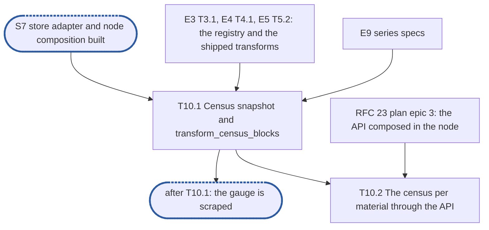

# Epic 10: transforms v2, integration, the census

**Sources:** [RFC 5](../docs/internals/rfcs/rfc-5-transforms.md) §6 (the `transform_census_blocks`
row, and the census per material read through the management API), §5.3 (what the census counts:
every block record until it is pruned), §7's T14 as the listing shows one namespace's material;
[RFC 6](../docs/internals/rfcs/rfc-6-block-metadata.md) §2.3 (the block record's `encodings`) and
§10.1 (the `Census` view on `Blocks`, one per namespace, as an input);
[RFC 25](../docs/internals/rfcs/rfc-25-observability.md) §2.1, §2.3, §2.4, §2.5 and §2.8 as they
bind one gauge; [RFC 23](../docs/internals/rfcs/rfc-23-control-plane.md) §4.1, §4.2 and §5.2 as
they bind one read; [RFC 0](../docs/internals/rfcs/rfc-0-data-lifecycle.md) §1.2 as amended by
#5774. The code lands on `feat/storage-v2`, and the paths below are paths there.
**Track:** the team.
**Epic 10 estimate: 2 subtasks, 5.25 man-days.**
**Depends on:** **S7**: from the RFC 8 offload plan, the block commit that records each block's
`encodings` (its epic 15), the per-namespace `Census` view on `kvstore` (its epic 19), and the
node's registration of the collectors the content wiring builds, with the wiring's start and stop
order (its epic 21). From E3, the registry behind `chain.Register`, which holds each transform's
name; from E4 and E5, `zstd` and `aes-gcm` registered, which the tests count; from E9, the form of
this component's series specs, which the census spec joins. From the RFC 23 plan, the node's
composition of the management API (its epic 3), which the listing's dependency joins.
**Blocks:** nothing.

---

## 1. Goal

Epic 10 shows an operator the census the engine records: how many blocks use each transform and
format version, as a gauge, and, per namespace, how many use each piece of material, through the
management API. That is what an operator reads before retiring a key or dropping a transform from
the build (RFC 5 §5.3).

**At the end of the epic:**

- a scrape shows `transform_census_blocks` per transform name and version, `retired` and `deleted`
  blocks counted until pruned, with no material or key label, so a rotation adds no series (T10.1);
- a scrape reads a snapshot and never the metadata store (T10.1);
- `GET /api/v1/namespaces/{id}/census` lists, for a `viewer`, the namespace's census per
  transform, version and material, paged by cursor, read from the metadata store (T10.2).

### 1.1 In scope

The census refresher, its snapshot and the gauge's collector in `internal/node/content`; the
census spec beside E9's series specs; `chain.Name`, the registry's name of a transform ID; the
census listing in `internal/node/api`, its wire type in `pkg/node/apiv1` and its client accessor.

### 1.2 Out of scope

- Recording the census: the codec collects it (the RFC 4 plan), the engine returns it with the put
  and the block commit writes it into `encodings` (the RFC 8 offload plan's epic 15). The `Census`
  view itself, its record layout and its cost: the RFC 8 offload plan's epic 19.
- Registering the collector in the node, and the content wiring's start and stop order: the RFC 8
  offload plan's epic 21, which this epic's collector joins.
- RFC 5 §8.2's §5.3 row, the census each put returns and the block records it reaches: E11, up to
  its retirement half. The retirement half, the census check before `Remove`, the drain's check and
  the folder censuses of copying backups: the RFC 5 plan's §6.1 deferral ledger, rows
  "`Provider.Remove`, its fence…", "Retirement relocation…", "A drained namespace's key removal…"
  and "The export key's next generation…" (RFC 9 and RFC 26).
- The current data key's ID through the management API (RFC 5 Appendix B.6): E9's key operations.
- A `dfsctl` command for the listing: RFC 5 §6 names the management API, and `dfsctl` reads it as
  any client does (RFC 23 "In short").

### 1.3 Names used here

- **E1**, epic 1, interfaces: the root contract (`transform.ID`, `Encoded`), `keys.MaterialID` and
  the import test.
- **E3**, epic 3, the chain: the registry, `Register`, `NewChain` and RFC 5 §6's other series.
- **E4** and **E5**, epics 4 and 5: the `zstd` and `aes-gcm` transforms and their registration.
- **E9**, the integration epic: the store configuration's settings, the key operations, and this
  component's series specs, conditions and alert rules as plain values the content wiring builds.
- **E11**, epic 11, E2E green: RFC 5's rows through the codec and the engine.
- **S7**, the RFC 8 offload plan's synchronisation point "store adapter and node composition
  built": the engine writes the census at commit, the `Census` view exists, and the node registers
  this component's collectors.
- **The RFC 8 offload plan's epics 15, 19, 20 and 21**: the offload pipeline (the census at
  commit), the restart and metadata reconcile (the `Census` view), health and salvage (the
  `material_destroyed` evaluation, which also reads the census), and the node's composition of
  offload (the collectors' registration).
- **The RFC 23 plan**: the control plane, owner of the management API's server, route table, wire
  types and client, and of the API's composition in the node (its epic 3).

## 2. How the general rules apply

The rules are those of
[RFC 5's plan, §1.5](rfc-5-transforms-plan.md#15-general-rules-for-each-epic), cited by number and
title and not copied.

| Rule | Subtasks | How |
| --- | --- | --- |
| rule 1, independent unit tests ([`CLAUDE.md`, "Writing tests"](../CLAUDE.md#writing-tests)) | all | both subtasks run over the real `kvstore` with blocks committed through its own block commit: T10.1 on the memory KV and on Badger under `t.TempDir()`, T10.2's HTTP tests on the memory KV, and `TestWiredRoleSweep` reaches T10.2's route on both, as it reaches every documented route; the only doubles are the content wiring's injected clock (kind 1) and a fault wrapper around the real `Census` view (kind 3); the refresher's swaps reach the test through a per-instance hook set from `export_test.go` |
| rule 2, fuzz every decoder of bytes this component did not just write | none | nothing here decodes bytes: the view hands decoded records, and the listing's cursor is parsed by the RFC 23 plan's `listing` adapter |
| rule 3, observability follows RFC 25 | T10.1 | the gauge is `transform_census_blocks`, the one series rule 3 gives this epic; its name, help and labels are a plain value beside E9's specs, and the content wiring builds the collector, so no package of `pkg/transform` imports `pkg/metrics`. The refresher logs a failed census read once at `Warn`. Nothing here holds key bytes: the census names material by kind, ID and fingerprint only (RFC 6 §2.3) |
| rule 4, profiling | T10.1 | the refresher's tests run under `internal/prof`'s leak check, which shows its goroutine gone after stop. No hot path: a scrape reads one pointer, and no allocation assertion is added |
| rule 5, public interface and internals ([`CLAUDE.md`, "Verifying a change"](../CLAUDE.md#verifying-a-change)) | all | each is tested where its value is consumed: the gauge on the registry's scrape, the listing on the HTTP answer, never on the snapshot or the row structs alone |
| rule 6, known failures shrink | none | `unit` keeps no `known.yaml`; both subtasks land green, after S7 |
| rule 7, v2 ignores v1, and imports only what RFC 0 §1.2 allows | all | the refresher and the collector are in `internal/node/content`, a composer, which may import `kvstore`, the Prometheus client and `chain`; the API takes the census as `Deps.Census`, a function returning `apiv1.CensusEntry` rows that the content wiring builds over the view and `chain.Name`, so the API imports neither `chain`, `kvstore` nor RFC 5's types; `chain` gains one exported function and no import, so no package of `pkg/transform` imports `pkg/metrics`. `internal/node`'s `TestImportRules` and `TestAPIClosure` hold the API's side; E1's import test holds `chain`'s |
| rule 8, real dependencies for properties of those dependencies | all | the census comes from the real `kvstore`'s view over real block records; no object store or key service is involved |
| rule 9, code comment conventions ([`CLAUDE.md`, "Code comments"](../CLAUDE.md#code-comments)) | all | the `ponytail:` markers of D1, D2 and D4 and the `decision:` markers of D2, D5 and D6, at the sites §4 names |
| rule 10, a test must be able to fail | all | each test in §6 names the bug it catches |
| rule 11, a symbol is exported only if RFC 5's interface or a consumer outside the package uses it | all | `chain.Name` has one consumer, the content wiring (D3); `apiv1.CensusEntry` has the server and the client; the refresher is unexported in `content`, built by the wiring's own constructor |
| rule 12, each subtask creates only what it declares | all | `chain.Name` lands with the collector that calls it, the wire type with the route |

## 3. Requirements and invariants

Every obligation the sources place on the census as an operator reads it, numbered so that
subtasks and tests can cite them. `Source` is RFC 5 unless it names another RFC.

**The gauge**

| # | Requirement | Kind | Source | Subtasks |
| --- | --- | --- | --- | --- |
| R1 | `transform_census_blocks` is a gauge under RFC 5's `transform_` prefix answering what was written per transform ID and version, from block metadata's census; it counts blocks (D7) | MUST | §6, §5.3; RFC 25 §2.1, §2.3 | T10.1 |
| R2 | The census counts every block record until it is pruned, `retired` and `deleted` ones included, so neither the gauge nor the listing leaves out a block by its state | invariant | §5.3; RFC 6 §2.3 | T10.1, T10.2 |
| R3 | Each transform is labelled by its name, never by its numeric ID | MUST | §6; RFC 25 §2.4 | T10.1 |
| R4 | The gauge carries no material ID or key label: the census per material is read through the management API, not exported, so a rotation adds no series | MUST NOT | §6; RFC 25 §2.4 | T10.1 |
| R5 | Every label's values form a set known before deployment | MUST | RFC 25 §2.4 | T10.1 |
| R6 | An entity label, here `transform`, exports at most 64 values per metric per node, later ones summed into `_other` | bound | RFC 25 §2.4 | T10.1 |
| R7 | The gauge stays within one metric's budget of 10,000 series | bound | RFC 25 §2.5 | T10.1 |
| R8 | An export reads the counters and snapshots a component keeps anyway: it takes no lock a request path needs, and its cost does not grow with work in flight | MUST | RFC 25 §2.8 | T10.1 |

**The listing**

| # | Requirement | Kind | Source | Subtasks |
| --- | --- | --- | --- | --- |
| R9 | The census per material is read through the management API | MUST | §6 | T10.2 |
| R10 | A read is consistent: it reads the metadata store, not a node's cache | invariant | RFC 23 §4.2 | T10.2 |
| R11 | The listing pages by cursor: `?limit=` defaults to 100 and is at most 1,000, `?after=` resumes, and a page ends with `next` when more follow; a cursor resumes from a key, never an offset, so a listing that sees inserts behind it neither skips nor repeats what was there when it started; no filter is offered that would scan | MUST | RFC 23 §4.2 | T10.2 |
| R12 | The path takes the namespace's ID, never its name, and the route is in the published OpenAPI document generated from the route table, with its operation ID by RFC 23 §4.1's rule and its least role | MUST | RFC 23 §4.1 | T10.2 |
| R13 | A `viewer` reads it, as every resource but accounts, tokens and the audit | MUST | RFC 23 §5.2 | T10.2 |
| R14 | Material belongs to one namespace: the listing of a namespace shows only that namespace's material | invariant | §7 T14 | T10.2 |

**Secrets and imports**

| # | Requirement | Kind | Source | Subtasks |
| --- | --- | --- | --- | --- |
| R15 | No secret reaches the gauge or the listing: material is shown by its kind, ID and fingerprint only, and secrets are never read through the API | MUST NOT | RFC 25 §2.8; RFC 23 §4.2; RFC 6 §2.3 | T10.1, T10.2 |
| R16 | A component imports another component's contract, never its implementation; a unit holding a contract and its implementation together is imported only by a composer | invariant | RFC 0 §1.2 as amended by #5774 | T10.1, T10.2 |

**What enforces the rows no test can break.** R10 and R14 hold by construction: the listing's one
dependency is the namespace's own view (D4), so it has no snapshot to serve and no other
namespace's records to show; T10.2's tests still assert both at the HTTP answer. R15 holds by
construction: RFC 6 §2.3's `encodings` hold a material kind, ID and fingerprint and no key, so the view
has none to hand on. R16 is held by E1's import test, which fails on the epic's first change if
`chain` imports a metrics or metadata store implementation. R6 and R7 hold by D2's label set, the
compiled-in registry plus one value, and T10.1's test that the build registers at most 38
transforms.

## 4. Decisions this epic takes

- **D1, the gauge reads a snapshot the refresher takes on a period, never the view at scrape.**
  RFC 25 §2.8 has an export read what a component keeps anyway, and RFC 6 declares the `Census`
  view without its cost: a view that walks block records costs O(blocks), about 10⁸ at the
  customer scale, per scrape. So the content wiring runs one refresher. It reads at start and again
  5 minutes after each read ends, never two at once: it lists the namespaces, reads each one's
  `Census` view, sums the entries into an immutable snapshot and swaps it into an
  `atomic.Pointer`, so a scrape sees the old set or the new one, never a mix. A namespace created
  between two reads appears at the next; a drained one leaves at the next. The collector is a
  `prometheus.Collector` over that pointer, built from a `prometheus.Desc` and
  `MustNewConstMetric` as the node's pool series are (`internal/node/budgets.go`). Until the first
  read completes the gauge has no series, rather than zeros that would claim an empty census. A
  read that fails or is cancelled leaves the previous snapshot and logs the error once at `Warn`;
  the next period retries. The period runs on the wiring's injected clock. A `ponytail:` at the
  refresher: a fixed 5-minute period, so the gauge lags commits by up to one period plus one read;
  make it a setting, or read at scrape, when the view answers from counts in O(distinct entries)
  and an operator needs the gauge closer than that. Until then each read costs what the view
  costs, O(blocks) for a walking view, about 10⁸ block records at the customer scale, every period;
  reads never overlap, since the next starts a period after the last ends, so a read that outlasts
  the period widens the lag and adds no load. Prior art: Prometheus's guidance that a
  collector be cheap at scrape, and exporters such as `postgres_exporter` that cache an expensive
  query on an interval (from memory).
- **D2, two labels, `transform` and `version`, summed over namespaces and material.** RFC 5 §6
  labels the gauge per transform ID and version and puts material in the API, and RFC 25 §2.4
  forbids a material ID as a label, so the snapshot sums each entry's block count by the
  transform's name (D3) and the version as a decimal. `namespace`, an entity label RFC 25 allows,
  is left off: RFC 5 §6 does not ask for it, the per-namespace figure is the listing's, and it would
  bring the 64-value cap into play at 10⁴ namespaces. A transform ID the registry does not hold, a
  body written by a transform since dropped from the build, is labelled `transform="unregistered"`
  with its version, so a stale record cannot grow the `transform` values; the registry's name set
  holds `unregistered` from the start, as it holds `envelope` (E3's D7), so no transform registers
  it. The values are therefore the registered names plus one. The version is a `uint8`, a closed set
  of 256, so the series are at most 256 times the values, and R7's 10,000 is the tighter bound: it
  holds while the values number at most 39 (39 × 256 = 9,984), that is up to 38 registered
  transforms, which is also under R6's 64. So the collector implements no `_other`; a `decision:`
  marker says so, withdrawn if a build ever registers 39 transforms, and T10.1's test of the
  process registry's count fails that build. A
  `ponytail:` at the sum: a block whose census names one transform with two pieces of material is
  counted twice; no shipped transform takes more than one piece per body (encryption takes its data
  key, compression none), so the sum is exact; count blocks per transform and version in the view
  when a transform declares two kinds. Prior art: RFC 25 §2.4's entity-label rule itself.
- **D3, `chain.Name` is the registry's name of a transform ID.** The census holds IDs (RFC 6 §2.3)
  and the label takes names (R3), and only the registry, unexported in `chain`, holds both. A
  method on E3's registry type answers it, so a test asks a registry it built through
  `export_test.go` and never registers into the process's (E3's T3.1); the exported package
  function, `func Name(id transform.ID) (string, bool)`, is one line over the process registry that
  `Register` fills at init. It is exported because the content wiring, a composer, calls it, and
  the root contract is not widened, since neither the codec nor the engine needs a name. Prior art:
  `database/sql.Drivers`, the registry's read-back beside `Register` (from memory).
- **D4, the listing reads the namespace's view at each page.** RFC 23 §4.2 makes a read
  consistent, so the listing never serves D1's snapshot. Each page reads the path's namespace's
  `Census` view, orders its entries by key (transform ID and version fixed-width, then material
  kind, material ID and fingerprint, the two strings length-prefixed) and returns those after the
  cursor, through the `listing` adapter's `under`, as `GET /shares/{id}/grants` does, sorting the
  read-back as the connections listing does. A census entry naming no material, a transform that
  takes none, is listed with an empty material. A `ponytail:` at the read: each page reads the
  namespace's whole census and sorts it, so it costs what the view costs, which is O(distinct
  entries) only if the view answers from counts (§9); give the view an after-key, and read only past
  it, when one namespace's census grows past a page. Prior art: the RFC 23 plan's grants and
  connections listings.
- **D5, the route and its rows.** `GET /api/v1/namespaces/{id}/census`, kind namespace, right
  `View`, so its OpenAPI operation ID is `namespaces_census_list` and its role `viewer`. The handler
  is the `list` adapter wrapped, as `onlySelf` wraps the connections listing, to answer `404` for an
  ID with no namespace record before the view is read, and `503` while the node holds no census
  view. A namespace with no block is an empty page. A row is a plain struct, as
  `apiv1.Connection` is:

  ```go
  // CensusEntry is one row of a namespace's census: the blocks whose census
  // names this transform, format version and piece of material.
  type CensusEntry struct {
  	Transform    string `json:"transform"`     // registered name, or "unregistered" as in the gauge
  	TransformID  uint16 `json:"transform_id"`
  	Version      uint8  `json:"version"`
  	MaterialKind string `json:"material_kind"` // "" when the transform takes none
  	MaterialID   string `json:"material_id"`
  	Fingerprint  string `json:"fingerprint"`   // lower-case hex
  	Blocks       int64  `json:"blocks"`
  }
  ```

  The JSON names follow `pkg/node/apiv1`'s snake case. A `decision:` marker at the route says the
  listing counts `retired` and `deleted` blocks, as RFC 5 §5.3 defines the census, so a namespace
  whose files are all removed still lists rows until GC prunes. Prior art: the RFC 23 plan's nested
  listings.
- **D6, every node exports the store-wide gauge.** The census is the metadata store's, so in a
  cluster each node would export the same values and a sum across nodes would multiply them. A
  `decision:` marker at the collector: single node in v1.1 (RFC 11 has no plan), so one node
  exports it; withdraw it when a second node runs, and export the gauge from one node only, for
  example GC's lease holder.
- **D7, the gauge counts blocks.** RFC 5 §6's row reads "bodies written per transform ID and
  version"; the metric's name, `_blocks`, and §5.3's census, which records "which blocks use which
  transform, version and material", both count blocks, and the block record holds no per-body
  count. The gauge counts blocks, and its help text says so. No marker.

## 5. Target tree

```text
pkg/transform/chain/
  registry.go          T10.1  + Name, the registry's name of an ID, and `unregistered` in its
                              name set (D2, D3)
  registry_test.go     T10.1  + Name of a registered and of an unknown ID, the reserved name,
                              the build's transform count
  <E9's series specs>  T10.1  + the transform_census_blocks name, help and labels (D2)
internal/node/content/
  census.go            T10.1  the refresher, its snapshot and the collector (D1, D2, D6)
  census_test.go       T10.1  scrape over kvstore, the clock, the fault wrapper
  export_test.go       T10.1  + the refresher's per-instance swap and wait hook
  content.go           T10.1  + the refresher started and stopped with the wiring, its collector
                              handed to the node's registration
internal/node/api/
  res_census.go        T10.2  the census listing under a namespace (D4, D5)
  routes.go            T10.2  + GET /api/v1/namespaces/{id}/census
  server.go            T10.2  + Deps.Census, a function returning apiv1.CensusEntry rows
  census_test.go       T10.2
  openapi_test.go      T10.2  + the route's operation ID and role
pkg/node/apiv1/
  census.go            T10.2  CensusEntry (D5)
  openapi.json         T10.2  regenerated by cmd/genopenapi
  wire_test.go         T10.2  + a CensusEntry row in TestWireBodies
pkg/node/apiv1/client/
  resources.go         T10.2  + the namespace's census listing, over the generic list helper
internal/node/
  node.go              T10.2  + Census in api.New's Deps, which the content wiring builds over
                              kvstore's view and chain.Name
  check_test.go        T10.2  + the route's viewer entry in leastRole
```

## 6. Subtasks

### T10.1 The census snapshot and `transform_census_blocks`

**Subtask T10.1 estimate: 3 man-days.**

- **Track:** the team. **Depends on:** S7, T3.1, T4.1, T5.2. Also E9's series specs.
- **Covers:** R1, R2, R3, R4, R5, R6, R7, R8, R15, R16.
- **Deliverables:**
  - The registry's `Name` method and `chain.Name(id transform.ID) (string, bool)`, one line over the
    process registry, with `unregistered` in the registry's name set (D2, D3). Consumed by the
    refresher here and by the content wiring's `Deps.Census` (T10.2).
  - The census spec: name `transform_census_blocks`, its help, labels `transform` and `version`, as
    a plain value in the form E9 gives this component's series specs. Consumed by the collector.
  - `internal/node/content/census.go`: the refresher (D1), which takes the namespace listing and the
    per-namespace view as interfaces the wiring declares over the types S7 gives (RFC 6 §10.1's
    `Census(ctx) iter.Seq2[EncodingCount, error]` on each namespace's `Blocks`), and the wiring's
    clock and logger; the snapshot, a map from (name, version) to a block count, summed by D2; the
    collector over the snapshot. D1's `ponytail:`, D2's `decision:` and `ponytail:`, D6's
    `decision:`. The wiring starts the refresher once the store is open, stops it before the store
    closes, and hands the collector to the node's registration (the RFC 8 offload plan's epic 21).
    Consumed by an operator's scrape.
  - `export_test.go`: a per-instance hook reporting each wait the refresher starts on the clock and
    each snapshot it swaps in. Consumed by this subtask's tests.
- **Acceptance criteria:**
  - Blocks committed under `zstd` v1, `aes-gcm` v1 and an unregistered ID scrape as
    `{transform="zstd",version="1"}`, `{transform="aes-gcm",version="1"}` and
    `{transform="unregistered",version="1"}` with their counts, and no other series of the metric.
  - A `retired` and a `deleted` block are counted; a pruned one is not, after the next read.
  - Before the first read completes, the metric has no series, also while that read is held
    mid-iteration; after the clock passes the period,
    the next snapshot shows a commit made since, and a namespace created since.
  - No series of the metric carries a material or key label, and a rotation to a second data key
    with blocks committed under it changes a value and adds no series.
  - A scrape while the view is held mid-read returns at once with the previous snapshot's values.
  - A read that fails, or is cancelled by stop, leaves the previous snapshot: the scrape shows none
    of its partial sum.
  - The build registers at most 38 transforms, so the series stay within R7 (D2).
- **Tests:**
  - At the registry's scrape, over the real `kvstore` on the memory KV and on Badger under
    `t.TempDir()`, blocks committed in two namespaces through its block commit with crafted
    `encodings`, each test waiting on the hook for the swap it asserts: the counts per transform and
    version (catches a count by entries instead of blocks, or a label by ID, R1, R3); a `retired`, a
    `deleted` and a pruned block (catches a filter by state, R2); a block under an unregistered ID
    (catches a label taking the ID, or a count dropped, R5, R6); two data keys (catches a material
    label or a series per rotation, R4); a second namespace created after the first read (catches a
    namespace list read once at start, D1).
  - The injected clock (kind 1): after the first swap, the test waits on the hook for the
    refresher's wait to start, advances the clock to just under the period, commits a block, then
    advances past it and waits for the next swap; the hook has seen exactly two swaps, the second
    holding the block (catches a refresh at each scrape or at every tick, D1).
  - A fault wrapper (kind 3) around the real view, after a first completed read: one that holds the
    iteration until released, with a scrape that returns the first snapshot's values before the
    release (catches a scrape that reads the view, R8); one that fails after the first entry, after
    which the scrape still shows the first snapshot and the captured log has one `Warn` (catches a
    partial snapshot published, D1); one that holds the second read after its first entry until
    the test stops the refresher, whose cancel ends the read, after which the scrape shows the
    first snapshot (catches a cancelled read's partial sum published, D1).
  - A fault wrapper (kind 3) that holds the first read after its first entry: a scrape before the
    release shows no series of the metric (catches zeros, or a partial first sum, exported before
    the first read completes, D1).
  - The process registry's transform count is at most 38, read and never registered into
    (catches a build past R7's series bound, D2).
  - `internal/prof`'s leak check around stop (catches a refresher left running).
  - The registry's `Name` for a registered and an unknown ID, on a registry the test builds through
    `export_test.go` (catches a lookup that misses a registered transform), and registering the
    name `unregistered` on it panics (catches a label shared by a real transform and a stale ID,
    D2).
- **Rules:** rule 3: the series and its spec. rule 7: the collector in the composer. rule 9: the
  markers of D1, D2 and D6.

### T10.2 The census per material through the management API

**Subtask T10.2 estimate: 2.25 man-days.**

- **Track:** the team. **Depends on:** T10.1. Also the RFC 23 plan's epic 3, which builds the
  API's `Deps` in the node, and the RFC 8 offload plan's epic 19 view answering from counts (§9).
- **Covers:** R2, R9, R10, R11, R12, R13, R14, R15, R16.
- **Deliverables:**
  - `pkg/node/apiv1/census.go`: `CensusEntry` (D5). Consumed by the server and the client.
  - `internal/node/api/res_census.go`: the listing of D4 under a namespace through the `listing`
    adapter's `under`, its key of D4, wrapped by D5's `404` and `503`; `Deps.Census`, declared by
    the API over plain rows:

    ```go
    // internal/node/api, Deps
    Census func(ctx context.Context, ns entity.NamespaceID) ([]apiv1.CensusEntry, error)
    ```

    It also holds the route of D5 in the route table, with D4's `ponytail:` and D5's
    `decision:`. Consumed by the client accessor and any API client.
  - `pkg/node/apiv1/openapi.json` regenerated by `go run ./cmd/genopenapi`, which
    `TestOpenAPIMatchesRouteTable` compares with the route table; the route's `viewer` entry in
    `internal/node/check_test.go`'s `leastRole`, which fails on a route it does not list; a
    `CensusEntry` row in `pkg/node/apiv1/wire_test.go`'s `TestWireBodies`.
  - The client accessor in `pkg/node/apiv1/client/resources.go`, one line over its generic `list`
    helper. Consumed by this subtask's tests and any client.
  - The content wiring builds `Deps.Census` over `kvstore`'s per-namespace view and `chain.Name`,
    and `internal/node/node.go` hands it to `api.New`, so the wired node `TestWiredRoleSweep`
    builds answers the route `200`, not `503`.
- **Acceptance criteria:**
  - A `viewer`'s `GET /api/v1/namespaces/{id}/census` lists one row per transform, version and
    material the namespace's block records name, with the block count, `retired` and `deleted`
    blocks included.
  - Two namespaces on one store: each listing shows only its own material.
  - With `?limit=1` over three rows, the three rows each come back exactly once in key order, also
    when a block committed after the first page adds a row whose key sorts below that page's.
  - An ID with no namespace record answers `404`; a namespace with no block an empty page.
  - A server whose `Deps.Census` is nil answers `503` unavailable for a namespace that exists, and
    still `404` for an ID with no namespace record, before any read.
  - The generated OpenAPI document has the route as `namespaces_census_list` with role `viewer`.
- **Tests:**
  - At the HTTP answer, through the client, over the real `kvstore` on the memory KV with committed
    blocks, one of them retired by removing its last ref and one moved to `deleted` by `kvstore`'s
    `MarkDeleted` once its trash time passes on the injected clock: the rows and counts, both of
    those blocks counted, with a block committed just before the read (catches a handler that
    caches, R10; and a filter by state, R2); two namespaces (catches the wrong namespace's view
    read, R14); `limit=1` paging with the insert below the cursor (catches an offset cursor, which
    repeats a row, R11); `limit=1001` refused as the adapter refuses it (R11); an unknown ID (catches
    a missing existence check answering an empty page, D5); a server built with `Deps.Census` nil,
    for a namespace that exists and for an unknown ID (catches a handler answering `200` with an
    empty page while the node holds no view, and a `503` that hides the `404`, D5); a `viewer`'s
    token (catches a stronger right on the route, R13).
  - In `openapi_test.go`, the route's operation ID and `x-dittofs-role` (catches a route outside the
    table or a wrong role, R12).
- **Rules:** rule 5: tested at the HTTP answer. rule 9: the markers of D4 and D5.

## 7. Order of work



The gauge goes first: it lands `chain.Name`, which the listing's rows use, and its snapshot and
fault tests are the higher risk.

## 8. Suggested pull requests

| PR | Subtasks | Man-days | After | Why together |
| --- | --- | --- | --- | --- |
| 1 | T10.1, T10.2 | 5.25 | S7 | the census as an operator reads it, the gauge and the listing over one view |

A suggestion only: one pull request per subtask works as well.

## 9. Open points

- **Needs on the RFC 8 offload plan's epic 19**, not yet broken down. RFC 6 §10.1 declares
  `Census(ctx) iter.Seq2[EncodingCount, error]` on `Blocks`, one view per namespace, and defines no
  `EncodingCount`. This epic needs each entry to carry the transform ID, the format version, the
  material's `keys.MaterialID` (its kind, ID and fingerprint) and a count of the block records whose
  `encodings` name them, `retired` and `deleted` ones included until pruned (R2). T10.1 works with a
  view that walks block records, at D1's lag. T10.2 does not: at a large namespace's 10⁸ blocks a
  walk per page breaks RFC 23 §4.2's listing, so it needs the view to answer from counts kept at
  commit and prune, O(distinct entries). If epic 19 settles another shape or cost, T10.1's sum and
  T10.2's read follow it, and this document is revised before T10.2 starts. Epic 19, and the
  commit that writes `encodings` (its epic 15), depend on RFC 6 §2.3 and Appendix B.2 recording
  each piece of material as (kind, ID, fingerprint), which `CensusEntry.MaterialKind` and D4's
  cursor key read; RFC 4 §3.2's header census carries the same kind.
- **For the RFC 8 offload plan's epic 20**: its `material_destroyed` evaluation reads the same
  census. If the view walks block records, D1's snapshot is the one walk to share, rather than two.
- **The estimate** is 2 subtasks and 5.25 man-days, against no plan figure: RFC 5's plan has
  epic 10 "planned after S7". The least certain is T10.1's, whose wiring into the content wiring's
  start and stop depends on how the RFC 8 offload plan's epic 21 composes it.
