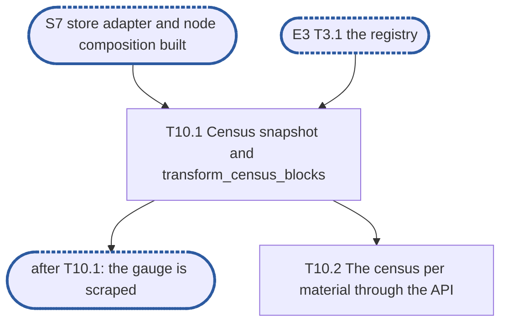

# Epic 10: transforms v2, integration, the census

**Sources:** [RFC 5](../docs/internals/rfcs/rfc-5-transforms.md) §6 (the `transform_census_blocks`
row, and the census per material read through the management API), §5.3 (what the census counts:
every block record until it is pruned), §7's T14 as the listing shows one namespace's material;
[RFC 6](../docs/internals/rfcs/rfc-6-block-metadata.md) §2.3 (the block record's `encodings`) and
§10.1 (the `Census` view, as an input); [RFC 25](../docs/internals/rfcs/rfc-25-observability.md)
§2.1, §2.3, §2.4, §2.5 and §2.8 as they bind one gauge; [RFC 23](../docs/internals/rfcs/rfc-23-control-plane.md)
§4.1, §4.2 and §5.2 as they bind one read; [RFC 0](../docs/internals/rfcs/rfc-0-data-lifecycle.md)
§1.2 as amended by #5774. The code lands on `feat/storage-v2`, and the paths below are paths
there.
**Track:** the team.
**Epic 10 estimate: 2 subtasks, 4.5 man-days.**
**Depends on:** **S7**: from the RFC 8 offload plan, the block commit that records each block's
`encodings` (its epic 15), the `Census` view on `kvstore` (its epic 19), and the node's
registration of the collectors the content wiring builds, with the wiring's start and stop
order (its epic 21). From E3: the registry behind `chain.Register`, which holds each transform's
name. From E9: the form of this component's series specs, which the census spec joins. From the
RFC 23 plan: the API's route table, its `listing` adapter and `pkg/node/apiv1`'s `Page`.
**Blocks:** nothing.

---

## 1. Goal

Epic 10 shows an operator the census the engine records: how many blocks use each transform and
format version, as a gauge, and, per namespace, how many use each piece of material, through the
management API. That is what an operator reads before retiring a key or dropping a transform from
the build (RFC 5 §5.3).

**At the end of the epic:**

- a scrape shows `transform_census_blocks{transform="aes-gcm",version="1"}` and one series per
  other transform and version that a block record names, `retired` and `deleted` blocks included
  until they are pruned, and no series names a namespace, a material ID or a key (T10.1);
- a data-key rotation followed by writes raises a series' value and adds no series (T10.1);
- a scrape never reads the metadata store: it reads a snapshot the census refresher took, so a
  slow or failing census read leaves the scrape fast and the last good values in place (T10.1);
- `GET /api/v1/namespaces/{id}/census` lists, for a `viewer`, one row per transform, version and
  material the namespace's block records name, with the block count, paged by cursor, read from
  the metadata store at each page (T10.2).

### 1.1 In scope

The census refresher, its snapshot and the gauge's collector in `internal/node/content`; the
census spec beside E9's series specs; `chain.Name`, the registry's name of a transform ID; the
census listing in `internal/node/api`, its wire type in `pkg/node/apiv1` and its client accessor.

### 1.2 Out of scope

- Recording the census: the codec collects it (the RFC 4 plan), the engine returns it with the put
  and the block commit writes it into `encodings` (the RFC 8 offload plan's epic 15). The `Census`
  view itself, its record layout and its cost: the RFC 8 offload plan's epic 19.
- Registering the collector in the node, and the content wiring's start and stop order: the RFC 8
  offload plan's epic 21, which this epic's collector joins.
- RFC 5 §8.2's §5.3 row, the census each put returns and the block records it reaches: E11, up to
  its retirement half. The retirement half, the census check before `Remove`, the drain's check and
  the folder censuses of copying backups: the RFC 5 plan's §6.1 deferral ledger, rows "`Provider.Remove`,
  its fence…", "Retirement relocation…", "A drained namespace's key removal…" and "The export key's
  next generation…" (RFC 9 and RFC 26).
- The current data key's ID through the management API (RFC 5 Appendix B.6): E9's key operations.
- A `dfsctl` command for the listing: RFC 5 §6 names the management API, and `dfsctl` reads it as
  any client does (RFC 23 "In short").

### 1.3 Names used here

- **E1**, epic 1, interfaces: the root contract (`transform.ID`, `Encoded`), `keys.MaterialID` and
  the import test.
- **E3**, epic 3, the chain: the registry, `Register`, `NewChain` and RFC 5 §6's other series.
- **E9**, the integration epic: the store configuration's settings, the key operations, and this
  component's series specs, conditions and alert rules as plain values the content wiring builds.
- **E11**, epic 11, E2E green: RFC 5's rows through the codec and the engine.
- **S7**, the RFC 8 offload plan's synchronisation point "store adapter and node composition
  built": the engine writes the census at commit, the `Census` view exists, and the node registers
  this component's collectors.
- **The RFC 8 offload plan's epics 15, 19 and 21**: the offload pipeline (the census at commit), the
  restart and metadata reconcile (the `Census` view), and the node's composition of offload (the
  collectors' registration).
- **S3**, in rule 8's row, is the S3 storage service, not a synchronisation point.
- **The RFC 23 plan**: the control plane, owner of the management API's server, route table and
  wire types.

## 2. How the general rules apply

The rules are those of
[RFC 5's plan, §1.5](rfc-5-transforms-plan.md#15-general-rules-for-each-epic), cited by number and
title and not copied.

| Rule | Subtasks | How |
| --- | --- | --- |
| rule 1, independent unit tests ([`CLAUDE.md`, "Writing tests"](../CLAUDE.md#writing-tests)) | all | both subtasks run over the real `kvstore`, on the memory KV and on Badger under `t.TempDir()`, with blocks committed through its own block commit; the only doubles are the content wiring's injected clock (kind 1) and a fault wrapper around the real `Census` view (kind 3) |
| rule 2, fuzz every decoder of bytes this component did not just write | none | nothing here decodes bytes: the view hands decoded records, and the listing's cursor is parsed by the RFC 23 plan's `listing` adapter |
| rule 3, observability follows RFC 25 | T10.1 | the gauge is `transform_census_blocks`, the one series rule 3 gives this epic; its spec is a plain value beside E9's, and the content wiring builds the collector, so no package of `pkg/transform` imports `pkg/metrics`. The refresher logs a failed census read once at `Warn`. Nothing here holds key bytes: the census names material by ID and fingerprint only (RFC 6 §2.3) |
| rule 4, profiling | T10.1 | the refresher's tests run under `internal/prof`'s leak check, which shows the goroutine gone after stop. No hot path: a scrape reads one pointer, and no allocation assertion is added |
| rule 5, public interface and internals ([`CLAUDE.md`, "Verifying a change"](../CLAUDE.md#verifying-a-change)) | all | each is tested where its value is consumed: the gauge on the registry's scrape, the listing on the HTTP answer, never on the snapshot or the row structs alone |
| rule 6, known failures shrink | none | `unit` keeps no `known.yaml`; both subtasks land green, after S7 |
| rule 7, v2 ignores v1, and imports only what RFC 0 §1.2 allows | all | the refresher and the collector are in `internal/node/content`, a composer, which may import `kvstore`, `pkg/metrics` and `chain`; the API takes the view through an interface it declares; `chain` gains one exported function and no import. E1's import test holds it |
| rule 8, real dependencies for properties of those dependencies | all | the census comes from the real `kvstore`'s view over real block records; no S3 store or KMIP server is involved |
| rule 9, code comment conventions ([`CLAUDE.md`, "Code comments"](../CLAUDE.md#code-comments)) | all | the `ponytail:` markers of D1, D2 and D4 and the `decision:` markers of D2, D5 and D6, at the sites §4 names |
| rule 10, a test must be able to fail | all | each test in §6 names the bug it catches |
| rule 11, a symbol is exported only if RFC 5's interface or a consumer outside the package uses it | all | `chain.Name` has one consumer, the content wiring (D3); `apiv1.CensusEntry` and `apiv1.CensusMaterial` have the server and the client; the refresher is unexported in `content`, built by the wiring's own constructor |
| rule 12, each subtask creates only what it declares | all | `chain.Name` lands with the collector that calls it, the wire types with the route |

## 3. Requirements and invariants

Every obligation the sources place on the census as an operator reads it, numbered so that
subtasks and tests can cite them. `Source` is RFC 5 unless it names another RFC.

**The gauge**

| # | Requirement | Kind | Source | Subtasks |
| --- | --- | --- | --- | --- |
| R1 | `transform_census_blocks` is a gauge under RFC 5's `transform_` prefix: per transform and format version, the number of block records whose census names it, read from block metadata | MUST | §6, §5.3; RFC 25 §2.1, §2.3 | T10.1 |
| R2 | The census counts every block record until it is pruned, `retired` and `deleted` ones included, so neither the gauge nor the listing leaves out a block by its state | invariant | §5.3; RFC 6 §2.3 | T10.1, T10.2 |
| R3 | Each transform is labelled by its name, never by its numeric ID | MUST | §6; RFC 25 §2.4 | T10.1 |
| R4 | The gauge carries no material ID, key or namespace label: the census per material is read through the management API, not exported, so a rotation adds no series | MUST NOT | §6; RFC 25 §2.4 | T10.1 |
| R5 | Every label's values form a set known before deployment: the registered transforms' names and their format versions | MUST | RFC 25 §2.4 | T10.1 |
| R6 | The gauge stays within one metric's budget of 10,000 series | bound | RFC 25 §2.5 | T10.1 |
| R7 | An export reads what the component keeps anyway: it takes no lock a request path needs, and its cost does not grow with work in flight | MUST | RFC 25 §2.8 | T10.1 |

**The listing**

| # | Requirement | Kind | Source | Subtasks |
| --- | --- | --- | --- | --- |
| R8 | The census per material is read through the management API | MUST | §6 | T10.2 |
| R9 | A read is consistent: it reads the metadata store, not a node's cache, so a block committed before the read is counted in it | invariant | RFC 23 §4.2 | T10.2 |
| R10 | The listing pages by cursor: `?limit=` defaults to 100 and is at most 1,000, `?after=` resumes, and a page ends with `next` when more follow; a cursor resumes from a key, so rows added behind it make the next page neither skip nor repeat one; no filter is offered that would scan | MUST | RFC 23 §4.2 | T10.2 |
| R11 | The path takes the namespace's ID, never its name, and the route appears in the API's published OpenAPI document, which is generated from the route table, with its operation ID formed by RFC 23 §4.1's rule and its least role | MUST | RFC 23 §4.1 | T10.2 |
| R12 | A `viewer` reads it, as every resource but accounts, tokens and the audit | MUST | RFC 23 §5.2 | T10.2 |
| R13 | Material belongs to one namespace: the listing of a namespace shows only material whose ID names that namespace | invariant | §7 T14 | T10.2 |

**Secrets and imports**

| # | Requirement | Kind | Source | Subtasks |
| --- | --- | --- | --- | --- |
| R14 | No key byte, unwrapped material or derived key reaches the gauge, the listing, a log line or an error: material is shown by its ID and fingerprint only, and secrets are never read through the API | MUST NOT | RFC 25 §2.8; RFC 23 §4.2; RFC 5 plan §1.5 rule 3 | T10.1, T10.2 |
| R15 | `pkg/transform` and its subpackages import no `pkg/metrics` and no metadata store implementation; only a composer imports them | invariant | RFC 0 §1.2 as amended by #5774 | T10.1, T10.2 |

**How each is enforced.** R14 holds by construction too: RFC 6 §2.3's `encodings` hold a material
ID and a fingerprint and no key, so the view has none to hand on; T10.2's test reads the fingerprint
back as the census holds it. R15 is held by E1's import test, which fails on the epic's first change
if `chain` imports `pkg/metrics`.

## 4. Decisions this epic takes

- **D1, the gauge reads a snapshot the refresher takes on a period, never the view at scrape.**
  RFC 25 §2.8 has an export read what a component keeps anyway, and RFC 6 declares the `Census`
  view without its cost: a view that walks block records costs O(blocks), about 10⁸ at the
  customer scale, per scrape. So the content wiring runs one refresher per metadata store: it reads
  the view once at start and again 5 minutes after each read ends, never two at once, sums it into
  an immutable snapshot and swaps it into an `atomic.Pointer`. The collector reads that pointer and
  nothing else. Until the first read completes the gauge has no series, rather than zeros that
  would claim an empty census. A read that fails or is cancelled leaves the previous snapshot in
  place and logs the error once at `Warn`; the next period retries. The period is the wiring's
  injected clock's, so tests advance it. A `ponytail:` at the refresher: a fixed 5-minute period,
  so the gauge lags commits by up to one period plus one read; make the period a setting, or read
  at scrape, when the view answers from counts in O(distinct entries) and an operator needs the
  gauge closer than that. Prior art: Prometheus's guidance that a collector be cheap at scrape, and
  exporters such as `postgres_exporter` that cache an expensive query on an interval (from memory);
  kube-state-metrics, which serves scrapes from its informer cache (from memory).
- **D2, two labels, `transform` and `version`, summed over namespaces and material.** RFC 5 §6
  labels the gauge per transform ID and version and puts material in the API, and RFC 25 §2.4
  forbids a material ID as a label, so the snapshot sums each view entry's block count by the
  transform's name (D3) and the version as a decimal. The `namespace` label is left off: RFC 5 §6
  does not ask for it, and the per-namespace figure is the listing's. A transform ID the registry
  does not hold, a body written by a transform since dropped from the build, is summed into one
  series labelled `transform="unregistered"`, `version="all"`, so a forged or stale record cannot
  grow the label set; a `decision:` marker says so. A `ponytail:` at the sum: a block whose census
  names one transform with two pieces of material is counted twice; no shipped transform takes more
  than one piece per body (encryption takes its data key, compression none), so the sum is exact;
  count blocks per transform and version in the view when a transform declares two kinds. The
  series are at most the registered transforms times their versions plus one, far inside R6.
  Prior art: RFC 25 §2.4's own entity-label rule; Prometheus's advice to aggregate unbounded
  values out of labels (from memory).
- **D3, `chain.Name` is the registry's name of a transform ID.** The census holds IDs (RFC 6 §2.3)
  and the label takes names (R3), and only the registry, unexported in `chain`, holds both. A
  package function, `func Name(id transform.ID) (string, bool)`, reads the process registry that
  `Register` fills at init; it is exported because the content wiring, a composer, calls it, and
  the root contract is not widened, since neither the codec nor the engine needs a name. Prior art:
  `database/sql.Drivers`, the registry's read-back beside `Register` (from memory).
- **D4, the listing reads the view at each page and keeps the namespace's entries.** RFC 23 §4.2
  makes a read consistent, so the listing never serves D1's snapshot. Each page iterates the
  `Census` view, keeps the entries whose material names the path's namespace, orders them by key
  (transform ID, version, material kind, material ID, fingerprint, each fixed-width or ended by a
  zero byte) and returns those after the cursor, through the RFC 23 plan's `listing` adapter as
  `GET /nodes/{id}/connections` uses it. An entry naming no material, a transform that takes none,
  has no namespace in it and is not listed: it is in the gauge. A `ponytail:` at the read: each page
  walks the whole store's census and drops other namespaces' entries, O(the view's cost) per page;
  give the view a namespace and an after-key, and read only those, when one namespace's listing
  shows in the API's latency. Prior art: the RFC 23 plan's connections listing, which sorts a
  read-back and resumes after a key in the same way.
- **D5, the route and its rows.** `GET /api/v1/namespaces/{id}/census`, kind namespace, right
  `View`, so its OpenAPI operation ID is `namespaces_census_list` and its role `viewer`. A
  namespace with no record is `404`, checked before the view is read, and one with no block is an
  empty page. A row is:

  ```go
  // CensusEntry is one row of a namespace's census: the blocks whose census
  // names this transform, format version and piece of material.
  type CensusEntry struct {
  	Transform   string         `json:"transform"`    // registered name; "" when unregistered
  	TransformID uint16         `json:"transform_id"`
  	Version     uint8          `json:"version"`
  	Material    CensusMaterial `json:"material"`
  	Blocks      int64          `json:"blocks"`
  }

  // CensusMaterial names a piece of material by its kind, its ID and its
  // fingerprint in lower-case hex; never its bytes.
  type CensusMaterial struct {
  	Kind        string `json:"kind"`
  	ID          string `json:"id"`
  	Fingerprint string `json:"fingerprint"`
  }
  ```

  The JSON names follow `pkg/node/apiv1`'s snake case. A listing nested under a resource answers no
  generation or status of its own, as `/shares/{id}/grants` does. A `decision:` marker at the route
  says the listing counts `retired` and `deleted` blocks, as RFC 5 §5.3 defines the census, so a
  namespace whose files are all removed still lists rows until GC prunes. Prior art: the RFC 23
  plan's nested listings (`/shares/{id}/grants`, `/nodes/{id}/connections`).
- **D6, every node exports the store-wide gauge.** The census is the metadata store's, so in a
  cluster each node would export the same values and a sum across nodes would multiply them. A
  `decision:` marker at the collector: single node in v1.1 (RFC 11 has no plan), so one node
  exports it; withdraw it when a second node runs, and export the gauge from one node only, for
  example GC's lease holder.
- **D7, the gauge counts blocks.** RFC 5 §6's row reads "bodies written per transform ID and
  version"; the metric's name, `_blocks`, and §5.3's census, which records per block "which blocks
  use which transform, version and material", both count blocks, and the block record holds no
  per-body count. The gauge counts blocks. No marker: the metric's help text says it.

## 5. Target tree

```text
pkg/transform/chain/
  registry.go          T10.1  + Name, the registry's name of an ID (D3)
  registry_test.go     T10.1  + Name of a registered and of an unknown ID
  <E9's series specs>  T10.1  + the transform_census_blocks spec, a plain value (D2)
internal/node/content/
  census.go            T10.1  the refresher, its snapshot and the collector (D1, D2, D6)
  census_test.go       T10.1  scrape over kvstore, the clock, the fault wrapper
  content.go           T10.1  + the refresher started and stopped with the wiring, its collector
                              handed to the node's registration
internal/node/api/
  res_census.go        T10.2  the census listing under a namespace (D4, D5)
  routes.go            T10.2  + GET /api/v1/namespaces/{id}/census
  server.go            T10.2  + Deps.Census, the view as the API declares it
  census_test.go       T10.2
  openapi_test.go      T10.2  + the route's operation ID and role
pkg/node/apiv1/
  census.go            T10.2  CensusEntry, CensusMaterial (D5)
pkg/node/apiv1/client/
  <the accessors file> T10.2  + the namespace's census listing
internal/node/
  <the API's Deps>     T10.2  + Census, kvstore's view
```

## 6. Subtasks

### T10.1 The census snapshot and `transform_census_blocks`

**Subtask T10.1 estimate: 2.5 man-days.**

- **Track:** the team. **Depends on:** S7, E3's T3.1.
- **Covers:** R1, R2, R3, R4, R5, R6, R7, R14, R15.
- **Deliverables:**
  - `chain.Name(id transform.ID) (string, bool)` over the process registry (D3). Consumed by the
    refresher here and by T10.2's rows.
  - The census spec: name `transform_census_blocks`, labels `transform` and `version`, as a plain
    value in the form E9 gives this component's series specs. Consumed by the collector.
  - `internal/node/content/census.go`: the refresher (D1), which takes the view as an interface the
    wiring declares,
    `interface{ Census(ctx context.Context) iter.Seq2[kvstore.EncodingCount, error] }` in the
    types S7 gives it, and the wiring's clock and logger; the snapshot, a map from (name, version) to
    a block count, summed by D2; the collector over the snapshot, built with `pkg/metrics` from the
    spec. D1's `ponytail:`, D2's `decision:` and `ponytail:`, D6's `decision:`. The wiring starts
    the refresher once the store is open, stops it before the store closes, and hands the collector
    to the node's registration (the RFC 8 offload plan's epic 21). Consumed by an operator's scrape.
- **Acceptance criteria:**
  - Blocks committed under zstd v1, AES-256-GCM v1 and an unregistered ID scrape as
    `{transform="zstd",version="1"}`, `{transform="aes-gcm",version="1"}` and
    `{transform="unregistered",version="all"}` with their counts, and no other series of the metric.
  - A `retired` and a `deleted` block are counted; a pruned one is not, after the next period.
  - Before the first read completes, the metric has no series; after the clock passes the period,
    the next scrape shows a commit made since.
  - No series of the metric carries a `namespace`, a material or a key label, and a rotation to a
    second data key with blocks committed under it changes a value and adds no series.
  - A scrape while the view is held mid-read returns with the previous values, without waiting.
- **Tests:**
  - At the registry's scrape, over the real `kvstore` on the memory KV and on Badger under
    `t.TempDir()`, blocks committed through its block commit with crafted `encodings`: the counts per
    transform and version (catches a count by entries instead of blocks, or a label by ID, R1, R3);
    a `retired`, a `deleted` and a pruned block (catches a filter by state, R2); a block under an
    unregistered ID (catches an unbounded label or a dropped count, R5, D2); two data keys in two
    namespaces (catches a material or namespace label and a series per rotation, R4).
  - The injected clock (kind 1): advanced to just under the period, the scrape is unchanged; past
    it, it shows the new commit (catches a refresh at every scrape or none, D1).
  - A fault wrapper (kind 3) around the real view: one that holds the iteration until released, with
    a scrape that must return first (catches a scrape that reads the view, R7); one that fails after
    the first entry, after which the scrape still shows the previous snapshot and the captured log
    has one `Warn` (catches a partial snapshot published, D1).
  - `internal/prof`'s leak check around stop (catches a refresher left running).
  - `chain.Name` for a registered and an unknown ID (catches a lookup that misses a registered
    transform).
- **Rules:** rule 3: the series and its spec. rule 7: the collector in the composer. rule 9: the
  markers of D1, D2 and D6.

### T10.2 The census per material through the management API

**Subtask T10.2 estimate: 2 man-days.**

- **Track:** the team. **Depends on:** T10.1.
- **Covers:** R2, R8, R9, R10, R11, R12, R13, R14, R15.
- **Deliverables:**
  - `pkg/node/apiv1/census.go`: `CensusEntry` and `CensusMaterial` (D5). Consumed by the server and
    the client.
  - `internal/node/api/res_census.go`: the listing of D4 under a namespace, through the `listing`
    adapter's `under`, its key of D4, the namespace's existence checked first; `Deps.Census`, the
    view as an interface the API declares, nil answering `503` as the other store reads do; the
    route of D5 in the route table, with D4's `ponytail:` and D5's `decision:`. Consumed by the
    client accessor and any API client.
  - The client accessor for the listing in `pkg/node/apiv1/client`, consumed by the API tests here
    and by `dfsctl`'s and other clients' callers.
  - The node fills `Deps.Census` with `kvstore`'s view.
- **Acceptance criteria:**
  - A `viewer`'s `GET /api/v1/namespaces/{id}/census` lists one row per transform, version and
    material the namespace's block records name, with the block count, `retired` and `deleted`
    blocks included.
  - Two namespaces on one store: each listing shows only its own material.
  - With `?limit=1` over three rows, the pages return each row once, in key order, also when a
    block committed between two pages adds a row behind the cursor.
  - An ID with no namespace record answers `404`; a namespace with no block an empty page.
  - The generated OpenAPI document has the route as `namespaces_census_list` with role `viewer`.
- **Tests:**
  - At the HTTP answer, through the client, over the real `kvstore` on the memory KV with committed
    blocks: the rows and counts (catches a listing served from D1's snapshot, which would miss a
    block committed after its last read, R9; and a filter by state, R2); two namespaces (catches an
    entry of another namespace listed, R13); `limit=1` paging with a commit between pages (catches
    an offset cursor, R10); `limit=1001` refused as the adapter refuses it (R10); an unknown ID
    (catches a missing existence check answering an empty page, D5); a `viewer`'s token (catches a
    stronger right on the route, R12).
  - Each row's fingerprint is the lower-case hex of the census's, and the body holds no other field
    of the material (catches a material struct marshalled whole, R14).
  - In `openapi_test.go`, the route's operation ID and `x-dittofs-role` (catches a route outside the
    table or a wrong role, R11).
- **Rules:** rule 5: tested at the HTTP answer. rule 9: the markers of D4 and D5.

## 7. Order of work



The gauge goes first: it lands `chain.Name`, which the listing's rows use, and its snapshot and
fault tests are the higher risk.

## 8. Suggested pull requests

| PR | Subtasks | Man-days | After | Why together |
| --- | --- | --- | --- | --- |
| 1 | T10.1, T10.2 | 4.5 | S7 | the census as an operator reads it, the gauge and the listing over one view |

A suggestion only: one pull request per subtask works as well.

## 9. Open points

- **Needs on the RFC 8 offload plan's epic 19**, not yet broken down. RFC 6 §10.1 declares
  `Census(ctx) iter.Seq2[EncodingCount, error]` and defines no `EncodingCount`. This epic needs
  each entry to carry the transform ID, the format version, the material's `keys.MaterialID` (its
  namespace, kind, ID and fingerprint), and a count of the block records whose `encodings` name that
  triple, `retired` and `deleted` ones included until pruned (R2). It also asks, without depending on
  it, that the view answer from counts kept at commit and prune, O(distinct entries) rather than
  O(blocks): D1 works either way, but D4's listing, read at each page, is only as cheap as the view.
  If epic 19 settles another shape, T10.1's sum and T10.2's rows follow it, and this document is
  revised.
- **Refinement of RFC 5 §6**, which is not edited: its row counts "bodies written"; D7 counts
  blocks, as the metric's name and §5.3 do.
- **The estimate** is 2 subtasks and 4.5 man-days, against no plan figure: RFC 5's plan has epic 10
  "planned after S7". The least certain is T10.1's, whose wiring into the content wiring's start
  and stop depends on how the RFC 8 offload plan's epic 21 composes it.
