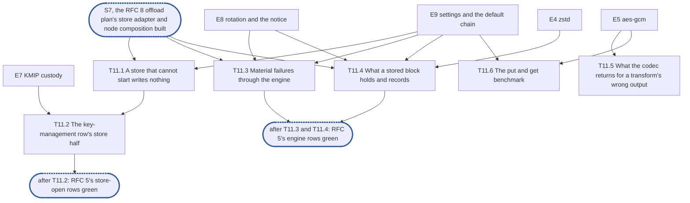

# Epic 11: transforms v2, E2E green

**Sources:** [RFC 5](../docs/internals/rfcs/rfc-5-transforms.md) §2.4 (a ranged read never sees
the block header), §2.6, §2.7 (a chain that cannot be built; what each `Decode` error is reported
as; no transform error type crosses the codec), §5.3 (the census is written with the block; up to
its retirement bullet), §7's T5, T6, T7, T8, T20 and T21, §8.1's Appendix B.2 key-management row
(its store half), §8.2's rows T5, T6, T7 (both, their engine halves), T8 (its `ErrTooLarge` leg),
T20 (its count leg), T21, §2.4 (its ranged get), §5.3 (up to its retirement half) and Appendix
B.5, §8.3 (its put and whole-block get row, its preamble and its suites paragraph), Appendix B.4
(its rows on the provider unreachable at start, unreachable or missing when reading, a fingerprint
that no longer matches, a key lost for good, an encrypting namespace's chunk-ID key lost for good
and a key never given), Appendix B.5 (keyed IDs and clear ranges in the header), and Appendix D's
D9 and D10. [RFC 8](../docs/internals/rfcs/rfc-8-engine.md) §7.5 (an unreachable remote fails a
read distinguishably from **Lost**), §10.4 (a pass refuses at Intent under destroyed current
material) and §15.1's "§10.4 destroyed material" row, and
[RFC 3](../docs/internals/rfcs/rfc-3-syncer.md) §1.3 (material errors fail the call unretried), as
constraints. The [RFC index](../docs/internals/rfcs/rfc-index.md), "Test tiers" (no timed check
per change; recording results; the reference box). Every citation is the RFCs' text on `develop`;
the code lands on `feat/storage-v2`, and the paths below are paths there.
**Track:** the team.
**Epic 11 estimate: 6 subtasks, 9 man-days.**
**Depends on:**
- **The RFC 8 offload plan's S7**, store adapter and node composition built: the node's content
  wiring (`internal/node/content`) builds one `codec.Store` per store with RFC 5's chain and opens
  each namespace's provider (its epic 21); the engine pins, commits `encodings` and refuses at
  Intent (its epic 15); remote reads tell unavailable, corrupt and destroyed apart (its epic 17);
  destroyed material clears offloaded bits and its §15.1 "§10.4 destroyed material" row is green
  (its epic 18); the `Census` view (its epic 19); `engine-conformance` and the `enginetest` fixture
  with RFC 5's chain over `keystest`'s in-memory `keys.Provider` (its epic 12).
- **E9**: the settings rows (`transforms`, `materials`, `require`), validated by building the
  chain, and the default chain of an encrypting namespace, `[{name: aes-gcm}]`.
- **E8**: data-key rotation (`RotateDataKey`) and the destroyed-material notice on
  `keystest.Memory`, which the engine polls. **E7**: the KMIP custody, its harness additions
  (`DITTOFS_TEST_KMIP`, the CA key for a certificate of the test's own) and its failure setups at
  `Open`. **E6**: the provider's `Open`, which unwraps every `current` key record of a namespace as
  it opens and fails on the first it cannot serve (its R51). **E5**: `aes-gcm`; **E4**: `zstd`.
  **E2**: `keystest.Memory` with `Give`, `Replace`, `Destroy` and `Calls`.
- **The RFC 4 plan's epic 6**, the block codec: `codec.Store` with its `Recorder`, and T6.5's
  `chains_test.go`, its table of chain configurations over the in-memory store. **Its epic 9**: the
  `remote-bench` cell (`tier: merge`), `s3fault.Service` and
  `pkg/remote/codec/bench_s3_test.go`.
**Blocks:** no epic. It is the last epic of RFC 5's plan.

---

## 1. Goal

Epic 11 runs the rows of RFC 5 that only the composed system can show: a store that cannot build
its chain or load its material and so writes nothing, a material failure seen through the engine,
what a stored block holds and records, a transform whose output the hash check catches, the
key-management row's store half against a real key server, and the put and get benchmark with the
default chain. It adds no production code and no exported symbol: every row tests what the epics
before it and the RFC 8 offload plan built, and a row that fails is a defect fixed in the subtask
that writes it.

**At the end of the epic:**

- a store whose chain fails to build, or whose material cannot load at start, puts nothing to its
  remote, never a body without its chain, and its journal keeps serving (T11.1);
- against the harness's KMIP server, a store opens and round-trips a block through the codec, and
  a missing key, an unreachable server and an invalid certificate each leave it unopened with
  nothing put (T11.2);
- through the engine, unreachable, replaced and unknown material fail a read as the remote being
  unavailable and the next read succeeds once the material returns; destroyed material fails it as
  **Lost**, unretried, with the codec's verification-failure count unmoved; a lost chunk-ID key
  makes remote-only chunks **Lost** and stops new puts (T11.3);
- a block written through the engine holds no unkeyed chunk hash, lists the chunk IDs block
  metadata records, reads one body at block metadata's range without its header, and records the
  census its header carries (T11.4);
- a transform whose decoded bytes are wrong fails every read through the codec, and one that
  reports `ErrTooLarge` reaches the caller as `ErrCorrupt` (T11.5);
- `remote-bench` reports the put and whole-block get under the default chain beside the same with no
  chain (T11.6).

### 1.1 In scope

Tests only: RFC 5's rows in `engine-conformance` (`pkg/engine/conformance/rfc5_test.go`), one leg
added to RFC 8 §15.1's "§10.4 destroyed material" test, the rows on a composed node
(`internal/node`), the key-management row's store half in `integration` (`internal/node/content`),
two rows in the codec's `chains_test.go`, a `chain` dimension in the codec's S3 benchmark, and RFC
5 §8.3's suites paragraph.

### 1.2 Out of scope

- T8's `ErrMalformed` leg, and the codec halves of T7, T20 and T21 (material errors passed through,
  destroyed not counted, no unkeyed hash, every body found by the clear envelope at its index entry,
  a ranged read without the header that issues one get): the RFC 4 plan's epic 6 runs them at
  `codec.Store` over RFC 5's real chains (its R9, R11, R18, R36, R37 and R43, in T6.3 and T6.5), at
  the layer that consumes a transform's errors and writes the header (D1).
- T20's legs on journal-held chunks (not evicted, offloaded again under current material, read
  back) and a remote-only chunk failing as **Lost**: RFC 8 §15.1's "§10.4 destroyed material" row,
  green by the RFC 8 offload plan's epic 18 before S7. This epic adds one leg to that test (R6).
- T7's chain half and T5's chain half (a failing factory fails `NewChain`): E3. T7's provider half
  (`ErrUnknownMaterial`, the condition naming the ID): E6.
- §8.1's key-management row, its provider half (unwrap at start through the server, the audit
  showing no master key exported, the provider's errors at construction): E7.
- §5.3's retirement half, `Provider.Remove` and T13: the RFC 5 plan's deferral ledger, its
  `Provider.Remove` row and its retirement-relocation row, both owned by RFC 9. §5.3's census as
  the operator sees it (`transform_census_blocks`, the census per material): E10.
- The engine's `material_destroyed` evaluation with `data_loss`: the RFC 8 offload plan's epic 20.
- The other §8.3 rows: E3 (chain overhead, envelope size), E4 (compression ratio, the bound against
  the largest body, its transforms' rates) and E5 (encryption's rate and its split). Replacing the
  put and get row's proposed target with a measured value: the RFC index's rule, by the first run
  on the reference box, which no cell runs on (§9).
- The retry that opens a store whose provider failed at start once the provider answers again
  (every 30 s, D2): the RFC 8 offload plan's epic 21, which opens stores and namespaces (#6063, its
  D10). T11.1 asserts it at the node.

### 1.3 Names used here

- **E2**, epic 2, test foundations: `keystest.Memory`, the in-memory `keys.Provider`, with `Give`,
  `Replace`, `Destroy` and `Calls`.
- **E3**, epic 3, the chain; **E4**, epic 4, compression (`zstd`); **E5**, epic 5, encryption
  (`aes-gcm`).
- **E6**, epic 6, namespace keys and the provider (`Open`); **E7**, epic 7, key-service custody over
  KMIP; **E8**, epic 8, rotation and the destroyed-material notice.
- **E9**, the integration epic: the settings rows, the default chain, the error mapping.
- **E10**, epic 10, the census as the operator sees it.
- **S7**, the RFC 8 offload plan's synchronisation point "store adapter and node composition built",
  which this epic waits on.
- **S3** names the storage service (Amazon S3 and the services compatible with it), never a
  synchronisation point.

## 2. How the general rules apply

The rules are those of
[RFC 5's plan, §1.5](rfc-5-transforms-plan.md#15-general-rules-for-each-epic), cited by number and
title and not copied.

| Rule | Subtasks | How |
| --- | --- | --- |
| rule 1, independent unit tests ([`CLAUDE.md`, "Writing tests"](../CLAUDE.md#writing-tests)) | all | every row runs the real chain and transforms (`aes-gcm`, `zstd`), RFC 4's real codec over its in-memory store (kind 2, under `remotetest`), and E2's `keystest.Memory` (kind 2, under `keystest`) or E6's provider. The fault wrappers (kind 3) are T11.3's around `keystest.Memory`, which answers `ErrMaterialUnavailable` on cue, and T11.5's around the real `aes-gcm`. The codec's `Recorder` the fixture passes is a sink of its outputs |
| rule 2, fuzz every decoder of bytes this component did not just write | none | this epic writes no decoder |
| rule 3, observability follows RFC 25 | T11.1, T11.3, T11.5 | no series, log or condition is added. The rows assert existing outputs: the `material_unavailable` condition naming the namespace (T11.1), the codec's verification-failure count through its `Recorder` (T11.3, T11.5) |
| rule 4, profiling | all | every test under `internal/prof`'s leak check; the benchmark calls `b.ReportAllocs()` (T11.6) |
| rule 5, public interface and internals ([`CLAUDE.md`, "Verifying a change"](../CLAUDE.md#verifying-a-change)) | all | each row is asserted at the layer that consumes the value: a material error at the engine's read, the census at the block record, a header's chunk IDs against block metadata, a store's failure at the node that would have served it |
| rule 6, known failures shrink | T11.3, T11.4 | the rows run after S7 in `engine-conformance`, which keeps `test/engine/known.yaml`, and land green: a row that fails is a defect fixed in its subtask, so no `known.yaml` entry is added |
| rule 7, v2 ignores v1, and imports only what RFC 0 §1.2 allows | all | only test files: they may import implementations (`chain`, `encrypt`, `compress`, `keystest`, `provider`). No v1 path |
| rule 8, real dependencies for properties of those dependencies ([`CLAUDE.md`, "Writing tests"](../CLAUDE.md#writing-tests)) | T11.2, T11.6 | the harness's KMIP server (`service:kmip`) for the key-management row; LocalStack for the benchmark, and a real service by hand |
| rule 9, code comment conventions ([`CLAUDE.md`, "Code comments"](../CLAUDE.md#code-comments)) | none | no production code, so no `decision:` or `ponytail:` marker; D2's retry carries its `decision:` at the RFC 8 offload plan's epic 21's open path (#6063) |
| rule 10, a test must be able to fail | all | each test in §6 names the break that makes it fail, and is shown failing on it before its pull request opens |
| rule 11, a symbol is exported only if RFC 5's interface or a consumer outside the package uses it | none | nothing is exported; T11.1 and T11.2 each write their own store-open assertions rather than share a helper across packages |
| rule 12, each subtask creates only what it declares | all | each helper lands with its first test |

## 3. Requirements and invariants

Every obligation RFC 5 places on this epic, numbered so that subtasks and tests can cite them.
`Source` is RFC 5 unless it names another document.

**A store that cannot start**

| # | Requirement | Kind | Source | Subtasks |
| --- | --- | --- | --- | --- |
| R1 | A store whose chain cannot be built, because a transform's factory fails, does not open: no body reaches its remote, and it never writes without its chain | MUST NOT | §2.7 (a chain that cannot be built), §7 T5, §8.2 T5 | T11.1 |
| R2 | A store whose material cannot be loaded at start, the provider unreachable or a key it needs missing, does not open and puts nothing; a store configured to encrypt never falls back to a body without the encrypt stage | MUST NOT | §2.7, Appendix B.4 (unreachable at start), Appendix D D9 | T11.1, T11.2 |
| R3 | A provider failure at start fails the store it serves, not the journal: the journal keeps serving its shares; once the provider answers again, the store opens within 30 s with no restart, and its journal-held content offloads (D2) | invariant | Appendix D D10 ("recovers"), Appendix B.4 (a key failure is the remote being unavailable); the user's decision, 2026-11-26 | T11.1 |
| R4 | Against a real key-management server, a store configured on it opens and a body round-trips through the codec; a missing key, an unreachable server and an invalid certificate each leave the store unopened, and none falls back to another provider or to writing without encryption | test row | §8.1's Appendix B.2 row, its store half | T11.2 |

**Material failures through the engine**

| # | Requirement | Kind | Source | Subtasks |
| --- | --- | --- | --- | --- |
| R5 | A decode that returns `ErrMaterialUnavailable`, for material unreachable, whose fingerprint no longer matches, or unknown to the provider, reaches the engine as the remote being unavailable: the read fails with an error distinguishable from **Lost**, never returns zeros or an absent chunk, and a read after the material returns succeeds, with no restart (D2) | MUST NOT | §2.7 (the error table), §7 T7, §8.2 T7 (both rows), Appendix B.4 (when reading; fingerprint; never given); RFC 8 §7.5 | T11.3 |
| R6 | A decode that returns `ErrMaterialDestroyed` is not retried and makes the chunk **Lost**, never `ErrCorrupt`, and the codec's verification-failure count does not move | MUST NOT | §2.7, §7 T7, §7 T20, §8.2 T7, §8.2 T20; RFC 3 §1.3 | T11.3 |
| R7 | When an encrypting namespace's chunk-ID key is lost for good, every remote-only chunk of the namespace is **Lost**, and the namespace takes no new write: nothing more is put for it | MUST | Appendix B.4 (an encrypting namespace's chunk-ID key); RFC 8 §10.4 (refused at Intent) | T11.3 |

**What the codec returns**

| # | Requirement | Kind | Source | Subtasks |
| --- | --- | --- | --- | --- |
| R8 | The plaintext hash is checked after the whole chain is undone and before any byte is returned: a transform that decodes without error to the wrong bytes fails every read through the codec, whole-block and ranged | invariant | §2.6, §7 T6, §8.2 T6 | T11.5 |
| R9 | A transform's `ErrTooLarge` on decode is reported as `ErrCorrupt`, and no transform error type is reachable from what the codec returns | MUST NOT | §2.7 (the error table; error types never cross the codec), §7 T8, §8.2 T8 | T11.5 |

**What a stored block holds and records**

| # | Requirement | Kind | Source | Subtasks |
| --- | --- | --- | --- | --- |
| R10 | With encryption on, no unkeyed hash of any chunk of a file written through the engine appears anywhere in its stored blocks; each header's chunk IDs are the keyed ones block metadata records; every read verifies | invariant | §7 T21, §8.2 T21, §8.2 Appendix B.5, Appendix B.5 (chunk IDs are keyed) | T11.4 |
| R11 | With encryption off, each header lists the chunk IDs, none of which equals an unkeyed hash of the file's chunks | test row | §8.2 Appendix B.5, Appendix B.5 (with encryption off) | T11.4 |
| R12 | A ranged read of one body, at the range block metadata records, decodes and verifies without the block header | test row | §2.4 (the envelope's own version), §8.2 §2.4, §8.2 T21 | T11.4 |
| R13 | Under two keys and two chains, the census each block's commit records lists exactly the transform IDs, versions and material IDs its bodies were encoded under | MUST | §5.3 (written with the block), §8.2 §5.3, its first half | T11.4 |

**The put and get benchmark**

| # | Requirement | Kind | Source | Subtasks |
| --- | --- | --- | --- | --- |
| R14 | A put and a whole-block get with the default chain, in MB/s, beside the same with no chain; the proposed target, within 10% on the reference link or the chain named as what the link waits on, is read by hand and never asserted | bound | §8.3 (its put and get row); RFC index, "Test tiers" (no timed check per change) | T11.6 |
| R15 | Run after merge over three corpora, random bytes, a text and source tree and a mixed VM image, each result recording the corpus, the chunk size distribution and the CPU | invariant | §8.3 (its preamble); RFC index, "Recording results" | T11.6 |
| R16 | RFC 5's suites paragraph names the suite that runs the put and get benchmark, which it says no suite runs yet | invariant | §8.3 ("Suites") | T11.6 |

**Mapping of what this epic does not own.** T8's `ErrMalformed` leg and the codec halves of T7,
T20 and T21 are the RFC 4 plan's epic 6's (D1); the clear envelope found at every body's index
entry (Appendix B.5's "chunk lengths are visible", T21's scan) is its T6.5. §2.7's construction
failure at `NewChain` is E3's; R1 is the store's half. Appendix B.4's "a tag fails" is E5's and the
codec's; its rows on a non-encrypting namespace's chunk-ID key and an export key are E6's and E8's,
at the provider. Appendix B.4's three conditions are raised by E6 (`material_unavailable`,
`material_unknown`) and the RFC 8 offload plan's epic 20 (`material_destroyed`); T11.1 asserts one
at the node only. T20's and Appendix B.4's "a chunk still held locally is not lost" is RFC 8
§15.1's "§10.4 destroyed material" row, the RFC 8 offload plan's epic 18's. T21's "no text claims
chunk lengths hidden" binds the RFC's own text and is held by review. §5.3's other bullets (a
census counting every block record until pruned, retirement, removal, copying backups, exports,
erasure) are E10's, RFC 9's or RFC 26's, through the RFC 5 plan's deferral ledger. §8.1's
key-management row's provider half, and its decode leg ("or the decode returns
`ErrMaterialUnavailable`"), are E7's and R5's.

## 4. Decisions this epic takes

- **D1, a row the codec's epic already runs at the codec is cited, not written twice.** The RFC 4
  plan's epic 6 runs, at `codec.Store` over RFC 5's real chains and `keystest`'s provider, the
  `Decode` errors mapped (its R36: a forced `ErrMalformed` as `ErrCorrupt`, no transform error
  reachable; R37 and R43: the material errors passed through, destroyed not counted), and an
  encrypting block with no unkeyed hash, its index's keyed IDs, the clear envelope found at every
  index entry and a ranged read without the header that issues one get (its R9, R11 and R18). The
  codec is the layer that consumes a transform's errors and writes the header, so that test is the
  consumer's. This epic writes the halves only the engine shows (the read's outcome, block
  metadata's IDs and ranges, the block record's census) and the one codec leg epic 6 does not
  force, `ErrTooLarge` (R9). Prior art: none found; `CLAUDE.md`'s "Test the layer that consumes the
  data" is the rule. Leaves no marker.
- **D2, "retried" means a later read succeeds, not a loop inside the node, and a provider failure
  at start makes the store unavailable, not its journal.** RFC 3 §1.3 has the syncer fail a call on
  a material error, retry nothing and count nothing, and RFC 8 §7.5 has the engine fail the read
  distinguishably from **Lost**. So T7's "is retried" is the caller's retry: R5's row reads again
  after the material returns and asserts success, with no restart. At start, Appendix D D10 calls
  v1's failure of "the share's whole block store, journal included" the bug, and Appendix B.4 says
  the store does not open; read together, the store's remote is unavailable as in RFC 8 §11.2's
  remote-unavailable row, and the journal keeps serving. No RFC says when that store opens again:
  the user decided on 2026-11-26 that its provider's open is retried every 30 s on the node's
  clock, with no restart, as RFC 8 §2.5 retries a refused journal, `material_unavailable` naming
  the namespace meanwhile, and that once it opens its journal-held content offloads. The retry and
  its `decision:` are the RFC 8 offload plan's epic 21's (#6063, its D10); T11.1 holds it at the
  node. Rejected: opening it at the next start only, which turns a key server's outage into a
  restart. A chain that cannot build is a configuration defect and is not what the retry covers;
  T11.1's chain leg is unchanged by it. Appendix B.4's
  "the namespace takes no new write" is read as RFC 8 §10.4 implements it: the journal still stages
  a write, and the Intent step refuses every plan of the namespace, so nothing is put for it and its
  content stays dirty and held (R7). Prior art:
  NFSv3's `NFS3ERR_JUKEBOX`, which hands the retry to the client (from memory); RFC 8 §2.5's refused
  share, retried on a period (checked). No marker here: the retry's is epic 21's.
- **D3, the engine rows land green in `engine-conformance`, in a file of their own.** They need the
  composed engine (the carver, the chain, the syncer over the in-memory store, `Refs`), which only
  `enginetest`'s fixture builds, and they run after S7, so each passes when written or exposes a
  defect its subtask fixes. `pkg/engine/conformance/rfc5_test.go` holds them as `TestRFC5_<row>`,
  beside `rfc8_*_test.go`; R6's count leg extends RFC 8's "§10.4 destroyed material" test, which
  already destroys a data key, rather than repeat its setup. Prior art: the suite's own per-RFC
  files (checked: `rfc8_a_test.go` and siblings on `feat/storage-v2`). Leaves no marker.
- **D4, two chains are two runs over the same stores.** §5.1 has a configuration change govern the
  next write, so R13's row writes under chain A, closes the fixture, opens it again over the same
  metadata store, journal directory and remote store with chain B and a rotated data key, and writes
  again. Prior art: none found. Leaves no marker.
- **D5, the benchmark is a `chain` dimension of the codec's S3 benchmark.** §8.3 says "run after
  merge", which is `remote-bench`'s tier, and the RFC 4 plan's epic 9 already runs the codec's put
  there with the empty chain (its T9.4, D5, D6). This epic adds a whole-block get beside that put
  and keys both `corpus=<random|source|vm>/chain=<none|aes-gcm>`, so `benchstat -col /chain` reads
  the 10% from one run; the default chain is the encrypting namespace's, `aes-gcm` alone (E9).
  Chunks are cut by the real carver at the default `Target`, and the chunk size distribution (p50,
  p90, max) and the corpus are printed once as configuration lines. Random bytes always run;
  `source` and `vm` read `$DITTOFS_CORPUS_DIR/<source|vm>/` and skip naming the variable when it is
  unset. Prior art: the RFC 4 plan's epic 9, D5 (checked). Leaves no marker.

## 5. Target tree

```text
internal/node/
  rfc5_open_test.go           T11.1  R1–R3 on a composed node: a chain that cannot build, a
                                     provider that cannot load
internal/node/content/
  kmip_integration_test.go    T11.2  R2, R4 against service:kmip, behind integration
pkg/engine/conformance/
  rfc5_test.go                T11.3  TestRFC5_T7 (R5), TestRFC5_ChunkIDKeyLost (R7)
                              T11.4  TestRFC5_T21AndB5 (R10–R12), TestRFC5_Census (R13)
  rfc8_*_test.go              T11.3  the "§10.4 destroyed material" test gains R6's leg
pkg/remote/codec/
  chains_test.go              T11.5  two rows: a wrong decode (R8), ErrTooLarge (R9)
  bench_s3_test.go            T11.6  the chain dimension and the whole-block get (R14, R15)
docs/internals/rfcs/rfc-5-transforms.md
                              T11.6  §8.3's suites paragraph names remote-bench (R16), on develop
```

## 6. Subtasks

### T11.1 A store that cannot start writes nothing

**Subtask T11.1 estimate: 2.5 man-days.**

- **Track:** the team. **Depends on:** S7, E9.
- **Covers:** R1, R2, R3.
- **Deliverables:** `internal/node/rfc5_open_test.go`, on `nodetest`'s composed node with the
  in-memory remote kind, a key-file provider and Badger under `t.TempDir()`: shares A and B on one
  device journal, each on its own store configuration and its own in-memory remote store. Two
  failures of B at start: its stored `transforms` record edited underneath to a `zstd` level outside
  Appendix A's range, which the settings validator would have refused, so the factory fails at
  `NewChain` (R1); and, with B configured `[{name: aes-gcm}]`, its key file replaced by one under
  another passphrase, so the provider cannot load (R2, Appendix D D9). The recovery leg: the
  original key file put back, and the node's injected clock advanced past 30 s (D2).
- **Acceptance criteria:**
  - In both cases, B's remote store's load record shows no put, ever; no other provider and no
    empty chain is built for B (R1, R2).
  - Share A writes, offloads and reads back throughout (R3).
  - Share B accepts a write while capacity allows and reads it back from its journal (R3, D2).
  - With the key file replaced, `material_unavailable` names B's namespace; with the chain-build
    failure no material condition is raised, and the build's `Error` line names `zstd` and the
    reason (RFC 5 §6) (R2, R1).
  - Recovery, with no restart: with the key file put back and the clock short of 30 s, B is still
    unopened and nothing is put; past 30 s, B's store opens, `material_unavailable` clears, the
    write B's journal held offloads (a put on B's remote's load record, encrypted under B's chain),
    and reads back after eviction (R3, D2).
- **Tests:** at the node, where a share is served. Each names its break: a wiring that builds B's
  store with the chain it could build, or with none, puts to B's remote (R1); a wiring that falls
  back to a store without encryption when the provider fails puts a body (R2, D9); a failure that
  fails the engine's `Start` or closes the journal stops both shares' reads (R3, D10); a node with
  no retry, or one that retries without rebuilding the provider, leaves B unopened past 30 s, and
  one that retries on a timer of its own rather than the node's clock never fires under the test
  (R3, D2). No test
  double: editing B's record is the RFC 13 rows' way of planting a record the validator would
  refuse.

### T11.2 The key-management row's store half

**Subtask T11.2 estimate: 1.25 man-days.**

- **Track:** the team. **Depends on:** T11.1, E7.
- **Covers:** R2, R4.
- **Deliverables:** `internal/node/content/kmip_integration_test.go`, behind `-tags=integration`,
  skipping naming `DITTOFS_TEST_KMIP` when it is unset: one table test that builds the content
  wiring with a store configuration `materials: {provider: kmip, …}` over the in-memory remote
  store, on E7's setups. Each test creates and activates its own master key on `service:kmip`, as
  E7's rows do.
- **Acceptance criteria:**
  - The store opens, and a block of an encrypting namespace put and got through its `codec.Store`
    round-trips, its stored bytes holding none of the chunks' plaintext (R4).
  - A master key missing from the server, a closed listener on `127.0.0.1:0` as the endpoint, and a
    client certificate signed by another CA each leave the store unopened, its remote's load record
    showing no put, and no store built under another provider or without encryption (R2, R4).
- **Tests:** at the content wiring and its `codec.Store`, the calls the engine makes. Its break: a
  wiring that falls back to a key-file provider, or to no provider, on a key-service failure opens
  the store and puts (R4).
- **Rules:** rule 8: the real KMIP server; the certificate case is one only a real server can fail.

### T11.3 Material failures through the engine

**Subtask T11.3 estimate: 2 man-days.**

- **Track:** the team. **Depends on:** S7, E8, E9.
- **Covers:** R5, R6, R7.
- **Deliverables:** `TestRFC5_T7` and `TestRFC5_ChunkIDKeyLost` in
  `pkg/engine/conformance/rfc5_test.go` (D3), on `enginetest`'s fixture with the default encrypting
  chain over `keystest.Memory`, read-ahead off; a fault wrapper (kind 3) around `keystest.Memory`
  whose `Get` answers `ErrMaterialUnavailable` while a switch is on and passes through otherwise;
  R6's leg in RFC 8 §15.1's "§10.4 destroyed material" test. Each read is of one chunk in the
  middle of its block, under a quarter of the block, so RFC 8 §7.8 fetches the chunk alone.
- **Acceptance criteria:**
  - A file offloaded and evicted. With the wrapper's switch on, a read of a remote-only chunk fails
    with the engine's remote-unavailable error, `errors.Is` not **Lost**, returning no byte; switch
    off, and the same read succeeds with no restart (R5, unreachable).
  - `Memory.Replace` of the data key with other bytes: the read fails the same way; `Replace` with
    the original bytes, and it succeeds (R5, fingerprint).
  - Restart onto a fresh `keystest.Memory` given a new current data key but not the one the file's
    blocks name: the read fails the same way; `Give` the old key, and it succeeds (R5, never given:
    T7's second row).
  - In "§10.4 destroyed material", the read of a remote-only chunk after `Memory.Destroy` issues one
    fetch, counted on the in-memory store's load record, and the codec's verification-failure count
    read from the fixture's `Recorder` is unchanged (R6).
  - `Memory.Destroy` of the namespace's chunk-ID key: a read of a remote-only chunk fails as
    **Lost**; a write after it is staged, and no put reaches the remote for it (R7).
- **Tests:** at the engine's read and pass, the consumers of the codec's errors and of the current
  material. Each names its break: an engine that maps every fetch error to **Lost** fails the
  unavailable legs; one that maps every fetch error to unavailable fails the destroyed and the
  chunk-ID key legs; a codec or syncer that counts destroyed material as a verification failure
  moves the count, and one that retries it shows a second fetch; a pass that checks only the data
  key at Intent puts under a lost chunk-ID key.

### T11.4 What a stored block holds and records

**Subtask T11.4 estimate: 1.5 man-days.**

- **Track:** the team. **Depends on:** S7, E4, E8, E9.
- **Covers:** R10, R11, R12, R13.
- **Deliverables:** `TestRFC5_T21AndB5` and `TestRFC5_Census` in
  `pkg/engine/conformance/rfc5_test.go`, on `enginetest`'s fixture: a known file written and
  offloaded, once with encryption on and once off; its chunks' plaintext ranges, keyed IDs and
  block ranges read from block metadata, the unkeyed BLAKE3 of each computed by the test.
- **Acceptance criteria:**
  - Encryption on: no unkeyed hash of any of the file's chunks appears anywhere in any stored block's
    bytes; each header's chunk IDs equal block metadata's for that block; the file reads back
    verified (R10).
  - Encryption off: each header lists the chunk IDs block metadata records, none equal to an
    unkeyed hash of a chunk (R11).
  - With the file evicted and read-ahead off, a read of one chunk in the middle of its block returns
    the verified bytes, and the in-memory store's load record shows one ranged get at block
    metadata's range for that chunk, starting past the header (R12).
  - Chain A `[aes-gcm]` under data key K1, then, per D4, chain B `[zstd with with_encryption:
    accept, aes-gcm]` under K2: each block record's census, read through the `Census` view, equals
    the census in that block's header and lists exactly `aes-gcm` with K1 for A's blocks, and `zstd`
    where a chunk was not declined plus `aes-gcm` with K2 for B's (R13).
- **Tests:** at block metadata and the stored bytes, where T21, Appendix B.5 and §5.3 make their
  claims. Each names its break: a header written with the plaintext hash, or a chunk record keyed
  differently from the header, fails R10 and R11; a demand read that fetches the header first fails
  R12; a commit that records the configured chain's transforms, or the current key rather than the
  pinned one, fails R13 under chain B or after the rotation.

### T11.5 What the codec returns for a transform's wrong output

**Subtask T11.5 estimate: 0.75 man-days.**

- **Track:** the team. **Depends on:** E5.
- **Covers:** R8, R9.
- **Deliverables:** two rows in the RFC 4 plan's epic 6's `pkg/remote/codec/chains_test.go`, over
  its in-memory store, with a fault wrapper (kind 3) around the real `aes-gcm`, registered with
  `chain.Register` under a custom-range ID in the encrypt stage at the test file's `init`, since
  E3's per-test registry lives in `chain`'s `export_test.go`, which `pkg/remote/codec` cannot reach: its `Encode` is `aes-gcm`'s, and its
  `Decode`, per instance and on cue, returns `aes-gcm`'s output with one byte changed and no error,
  or `transform.ErrTooLarge`.
- **Acceptance criteria:**
  - With the changed byte on cue, a whole-block `Get` and a ranged `Get` of each chunk each fail
    with `ErrCorrupt` of kind `hash`, yielding no chunk, the verification-failure count rising once
    per chunk; with the cue off, the same block reads back (R8).
  - With `ErrTooLarge` on cue, each `Get` fails with `ErrCorrupt`, and `errors.Is` finds no
    `transform.ErrTooLarge` (R9).
- **Tests:** at `codec.Store`, the consumer of a transform's output. Its breaks: a codec that
  trusts a transform's success, or checks the hash before undoing the last transform, returns the
  changed bytes (R8); one that wraps the transform's error with `%w` exposes it (R9).

### T11.6 The put and get benchmark with the default chain

**Subtask T11.6 estimate: 1 man-days.**

- **Track:** the team. **Depends on:** E5, E9.
- **Covers:** R14, R15, R16.
- **Deliverables:** in the RFC 4 plan's epic 9's `pkg/remote/codec/bench_s3_test.go`, behind
  `integration`: a whole-block `codec.Store` get beside its put, both keyed per D5, over the S3 store
  on `s3fault.Service(tb)`'s target, `b.ReportAllocs()` in each. Both are named under the `codec`
  test's `-bench=` pattern of `remote-bench` (the RFC 4 plan's epic 9, its T9.4), so its registry
  entry does not change; a name outside that pattern would never run in the cell. On `develop`, RFC 5 §8.3's suites paragraph
  names `remote-bench` for this row.
- **Acceptance criteria:**
  - `dt run remote-bench` reports, for each corpus that ran, both chains' put and get in MB/s, with
    the corpus, the chunk size distribution and the CPU in the result's configuration lines (R14,
    R15).
  - No figure fails the cell; with `DITTOFS_CORPUS_DIR` unset the random corpus still runs, and the
    other two skip naming it (R14, R15).
  - §8.3's paragraph names `remote-bench`, held by review: `dt docs --check` reads only the code
    spans, so it checks that the name exists, not what the paragraph says (R16).
- **Tests:** the benchmark itself, run once by hand over all three corpora against a real service
  through `s3fault`'s production target, the result attached to the pull request; the reference-box
  run that replaces the proposed target is the RFC index's (§9).

## 7. Order of work



T11.1 goes first: it is the row D2's retry bears on, so it fails fast if the composed node
does not keep the journal serving. T11.5 and T11.6 wait on nothing past E5 and E9 and can run at
any point.

## 8. Suggested pull requests

| PR | Subtasks | Man-days | After | Why together |
| --- | --- | --- | --- | --- |
| 1 | T11.1, T11.2 | 3.75 | — | a store that cannot start, with a key file and with a key server |
| 2 | T11.3, T11.4 | 3.5 | — | RFC 5's rows in `engine-conformance`, in one new file |
| 3 | T11.5, T11.6 | 1.75 | — | the codec's rows and the benchmark, both in `pkg/remote/codec` |

The three are independent and can be open at once. A suggestion only: one pull request per
subtask works as well.

## 9. Open points

1. **Needs on the RFC 8 offload plan.** Epic 12's fixture must let a test restart onto a fresh
   `keystest.Memory` over the same stores, wrap the provider it is given, turn read-ahead off, and
   give the codec a `Recorder` whose outputs a test reads (T11.3, T11.4). Epic 15's Intent refusal
   under destroyed current material must cover the chunk-ID key as well as the data key (T11.3,
   R7), which RFC 8 §10.4's "current material" reads as including.
2. **Needs on the corpora.** No cell sets `DITTOFS_CORPUS_DIR`, so `remote-bench` runs only the
   random corpus after a merge, and the three corpora R15 names run by hand. Providing the corpora
   to the cell is the RFC 2 plan's epic 2's corpus, once a runner holds it.
3. **The burn-down is the least certain part.** Each row lands green after S7 or exposes a defect
   in the code it tests, which its subtask fixes; T11.1 (a composed node with two shares) and T11.3
   (five legs through the whole offload path) are the estimates most likely to grow.
4. **The 10% target is proposed.** It is replaced by the first run on the reference box, as the RFC
   index says; no cell runs there, and the result attached to T11.6's pull request is a real
   service's, not the reference link's.
5. The estimate is 6 subtasks and 9 man-days against the plan's 6 and 10: T8's main leg, the
   codec halves (D1) and T20's journal legs (RFC 8 §15.1) are run elsewhere, and the key-management
   row's store half reuses E7's failure setups, while T11.1 gains D2's recovery leg.
