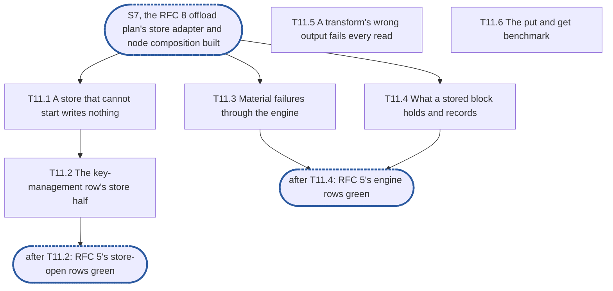

# Epic 11: transforms v2, E2E green

**Sources:** [RFC 5](../docs/internals/rfcs/rfc-5-transforms.md) §2.4 (a ranged read never sees
the block header), §2.6, §2.7 (a chain that cannot be built; what each material error is reported
as), §5.3 (the census is written with the block; up to its retirement bullet), §7's T5, T6, T7,
T20 and T21, §8.1's Appendix B.2 key-management row (its store half), §8.2's rows T5, T6, T7 (both
rows, their engine halves), T20, T21, §2.4 (its ranged get), §5.3 (up to its retirement half) and
Appendix B.5, §8.3 (its put and whole-block get row, its preamble and its suites paragraph),
Appendix B.4 (its rows at start and when reading, and a chunk still held locally), Appendix B.5
(keyed IDs and clear ranges in the header), and Appendix D's D9 and D10 as the RFC 5 plan's §1.4
places them here. [RFC 8](../docs/internals/rfcs/rfc-8-engine.md) §7.5 (an unreachable remote
fails a read distinguishably from **Lost**) and §15.1's "§10.4 destroyed material" row, and
[RFC 3](../docs/internals/rfcs/rfc-3-syncer.md) §1.3 (material errors fail the call unretried), as
constraints. The [RFC index](../docs/internals/rfcs/rfc-index.md), "Test tiers" (no timed check
per change; recording results; the reference box). Every citation is the RFCs' text on `develop`;
the code lands on `feat/storage-v2`, and the paths below are paths there.
**Track:** the team.
**Epic 11 estimate: 6 subtasks, 11.5 man-days.**
**Depends on:**
- **The RFC 8 offload plan's S7**, store adapter and node composition built: the node's content
  wiring (`internal/node/content`) builds one `codec.Store` per store with RFC 5's chain and opens
  each namespace's provider (its epic 21); the engine pins, commits `encodings` and refuses at
  Intent (its epic 15); remote reads tell unavailable, corrupt and destroyed apart, and read one
  chunk ranged (its epic 17); destroyed material clears offloaded bits and its §15.1 "§10.4
  destroyed material" row is green (its epic 18); the `Census` view (its epic 19);
  `engine-conformance` and the `enginetest` fixture with RFC 5's chain over `keystest`'s in-memory
  `keys.Provider` (its epic 12).
- **E9**: the settings rows (`transforms`, `materials`, `require`), validated by building the
  chain, and the default chain of an encrypting namespace, `[{name: aes-gcm}]`.
- **E8**: data-key rotation (`RotateDataKey`) and the destroyed-material notice on
  `keystest.Memory`, which the engine polls. **E7**: the KMIP custody and its harness additions
  (`DITTOFS_TEST_KMIP`, the CA key for a certificate of the test's own). **E6**: the provider's
  `Open`, which unwraps every `current` key record of a namespace as it opens and fails on the first
  it cannot serve (its R51, D10), and loads any other record on first `Get`. **E5**: `aes-gcm`;
  **E4**: `zstd`. **E2**: `keystest.Memory` with `Give`, `Replace`, `Destroy` and `Calls`.
- **The RFC 4 plan's epic 6**, the block codec: `codec.Store` with its `Recorder`, and its T6.5's
  table of chain configurations over the in-memory store. **Its epic 9**: the `remote-bench` cell
  (`tier: merge`), `s3fault.Service` and `pkg/remote/codec/bench_s3_test.go`.
**Blocks:** no epic. It is the last epic of RFC 5's plan.

---

## 1. Goal

Epic 11 runs the rows of RFC 5 that only the composed system can show: a store that cannot build
its chain or load its material and so writes nothing, a material failure seen through the engine,
what a stored block holds and records, a transform whose output the hash check catches, the
key-management row's store half against a real key server, and the put and get benchmark with the
default chain. It adds no production code and no exported symbol: every row tests what the epics
before it and the RFC 8 offload plan built, and a row that fails is a defect fixed in the subtask
that writes it.

**At the end of the epic:**

- a store whose chain fails to build, or whose material cannot load at start, puts nothing to its
  remote, never a body without its chain, and leaves the journal and the node's other shares
  serving (T11.1);
- against the harness's KMIP server, a store opens and round-trips a block through the codec; a
  missing key, an unreachable server and an invalid certificate each leave the store unopened or a
  decode at `ErrMaterialUnavailable`, never another provider or a plaintext write (T11.2);
- through the engine, unavailable and unknown material fail a read as the remote being
  unavailable and the next read succeeds once the material returns; destroyed material fails it as
  **Lost**, once, with the codec's verification-failure count unmoved and journal-held chunks kept
  and re-offloaded (T11.3);
- a block written through the engine holds no unkeyed chunk hash, lists the chunk IDs block
  metadata records, shows every body's offset and length, reads one body ranged without its header,
  and records exactly the census its put returned (T11.4);
- a transform whose decoded bytes are wrong fails every read through the codec (T11.5);
- `remote-bench` reports the put and whole-block get under the default chain beside the same with no
  chain, over three corpora, and RFC 5's suites paragraph names it (T11.6).

### 1.1 In scope

Tests only: RFC 5's rows in `engine-conformance` (`pkg/engine/conformance/rfc5_test.go`), the
extension of RFC 8 §15.1's "§10.4 destroyed material" test, the rows on a composed node
(`internal/node`), the key-management row's store half in `integration` (`internal/node/content`),
the T6 row at `codec.Store`, the put and get benchmark in `remote-bench`, and RFC 5 §8.3's suites
paragraph.

### 1.2 Out of scope

- T8, "the codec returns only its own errors", and the codec halves of T7, T20 and T21: the RFC 4
  plan's epic 6 runs them at `codec.Store` over RFC 5's real chains (its R36, R37 and R43 in T6.3
  and T6.5; R9 and R11 in T6.5), at the layer that consumes a transform's errors (D1).
- T7's chain half and T5's chain half (a failing factory fails `NewChain`): E3. T7's provider half
  (`ErrUnknownMaterial`, the condition naming the ID): E6.
- §8.1's key-management row, its provider half (unwrap at start through the server, the audit
  showing no master key exported, the provider's errors at construction): E7.
- §5.3's retirement half, `Provider.Remove` and T13: the RFC 5 plan's deferral ledger, its
  `Provider.Remove` row and its retirement-relocation row, both owned by RFC 9. §5.3's census as
  the operator sees it (`transform_census_blocks`, the census per material): E10.
- The engine's `material_destroyed` evaluation with `data_loss`: the RFC 8 offload plan's epic 20.
- The other §8.3 rows: E3 (chain overhead, envelope size), E4 (compression ratio, the bound against
  the largest body, its transforms' rates) and E5 (encryption's rate and its split). Replacing the
  put and get row's proposed target with a measured value: the RFC index's rule, by the first run
  on the reference box, which no cell runs on (§9).
- Retrying, without a restart, the open of a namespace whose provider failed at start: the RFC 8
  offload plan's epic 21, which opens namespaces (§9, point 1).

### 1.3 Names used here

- **E2**, epic 2, test foundations: `keystest.Memory`, the in-memory `keys.Provider`, with `Give`,
  `Replace`, `Destroy` and `Calls`.
- **E3**, epic 3, the chain; **E4**, epic 4, compression (`zstd`); **E5**, epic 5, encryption
  (`aes-gcm`).
- **E6**, epic 6, namespace keys and the provider (`Open`); **E7**, epic 7, key-service custody over
  KMIP; **E8**, epic 8, rotation and the destroyed-material notice.
- **E9**, the integration epic: the settings rows, the default chain, the error mapping.
- **E10**, epic 10, the census as the operator sees it.
- **S7**, the RFC 8 offload plan's synchronisation point "store adapter and node composition built",
  which this epic waits on.
- **S3** names the storage service (Amazon S3 and the services compatible with it), never a
  synchronisation point.

## 2. How the general rules apply

The rules are those of
[RFC 5's plan, §1.5](rfc-5-transforms-plan.md#15-general-rules-for-each-epic), cited by number and
title and not copied.

| Rule | Subtasks | How |
| --- | --- | --- |
| rule 1, independent unit tests ([`CLAUDE.md`, "Writing tests"](../CLAUDE.md#writing-tests)) | all | every row runs the real chain and transforms (`aes-gcm`, `zstd`), RFC 4's real codec over its in-memory store (kind 2, under `remotetest`), and E2's `keystest.Memory` (kind 2, under `keystest`) or E6's provider. The only fault wrappers (kind 3) are T11.5's, around a real transform, and T11.2's TCP proxy in front of the real KMIP server. A pass-through wrapper that keeps the census each put returned, never answering in the codec's place, is T11.4's record |
| rule 2, fuzz every decoder of bytes this component did not just write | none | this epic writes no decoder |
| rule 3, observability follows RFC 25 | T11.1, T11.3, T11.5 | no series, log or condition is added. The rows assert existing outputs: the `material_unavailable` condition naming the namespace (T11.1), the codec's verification-failure count through its `Recorder` (T11.3, T11.5) |
| rule 4, profiling | all | every test under `internal/prof`'s leak check; the benchmark calls `b.ReportAllocs()` (T11.6) |
| rule 5, public interface and internals ([`CLAUDE.md`, "Verifying a change"](../CLAUDE.md#verifying-a-change)) | all | each row is asserted at the layer that consumes the value: a material error at the engine's read, the census at the block record, a header's chunk IDs against block metadata, a store's failure at the node that would have served it |
| rule 6, known failures shrink | T11.3, T11.4 | the rows land green after S7, in `engine-conformance`, which keeps `test/engine/known.yaml`; a row that fails is a defect fixed in its subtask, and gains a `known.yaml` entry only after CI shows it, with the fields `CLAUDE.md` "By kind" names (D3) |
| rule 7, v2 ignores v1, and imports only what RFC 0 §1.2 allows | all | only test files: they may import implementations (`chain`, `encrypt`, `compress`, `keystest`, `provider`). No v1 path |
| rule 8, real dependencies for properties of those dependencies ([`CLAUDE.md`, "Writing tests"](../CLAUDE.md#writing-tests)) | T11.2, T11.6 | the harness's KMIP server (`service:kmip`) for the key-management row; LocalStack for the benchmark, and a real service by hand |
| rule 9, code comment conventions ([`CLAUDE.md`, "Code comments"](../CLAUDE.md#code-comments)) | none | no production code, so no `decision:` or `ponytail:` marker; D2's marker, if the user takes it, sits at the RFC 8 offload plan's epic 21's open path |
| rule 10, a test must be able to fail | all | each test in §6 names the break that makes it fail, and is shown failing on it before its pull request opens |
| rule 11, a symbol is exported only if RFC 5's interface or a consumer outside the package uses it | none | nothing is exported |
| rule 12, each subtask creates only what it declares | all | each helper lands with its first test; the `remote-bench` test and the suites line land with the benchmark |

## 3. Requirements and invariants

Every obligation RFC 5 places on this epic, numbered so that subtasks and tests can cite them.
`Source` is RFC 5 unless it names another document.

**A store that cannot start**

| # | Requirement | Kind | Source | Subtasks |
| --- | --- | --- | --- | --- |
| R1 | A store whose chain cannot be built, because a transform's factory fails, does not open: no body reaches its remote, and it never writes without its chain | MUST NOT | §2.7 (a chain that cannot be built), §7 T5, §8.2 T5 | T11.1 |
| R2 | A store whose material cannot be loaded at start, the provider unreachable or a key it needs missing, does not open and writes nothing; a store configured to encrypt never writes a body without the encrypt stage | MUST NOT | §2.7, Appendix B.4 (unreachable at start), Appendix D D9 | T11.1, T11.2 |
| R3 | A provider failure at start fails only the store it serves: the journal keeps serving, and so do the node's other shares on it | invariant | Appendix D D10; the RFC 5 plan's §1.4 | T11.1 |
| R4 | Against a real key-management server, a store configured on it opens and a body round-trips through the codec; a missing key, an unreachable server and an invalid certificate each leave the store unopened or make a decode return `ErrMaterialUnavailable`, and none falls back to another provider or to writing without encryption | test row | §8.1's Appendix B.2 row, its store half | T11.2 |

**Material failures through the engine**

| # | Requirement | Kind | Source | Subtasks |
| --- | --- | --- | --- | --- |
| R5 | A decode that returns `ErrMaterialUnavailable`, for material unreachable, unknown to the provider or whose fingerprint no longer matches, reaches the engine as the remote being unavailable: the read fails with an error distinguishable from **Lost**, never returns zeros or an absent chunk, and succeeds once the material returns, with no restart (D2) | MUST NOT | §2.7 (the error table), §7 T7, §8.2 T7 (both rows), Appendix B.4 (when reading; fingerprint; never given); RFC 8 §7.5 | T11.3 |
| R6 | A decode that returns `ErrMaterialDestroyed` is not retried and makes the chunk **Lost**, never `ErrCorrupt`, and the codec's verification-failure count does not move | MUST NOT | §2.7, §7 T7, §7 T20, §8.2 T7, §8.2 T20; RFC 3 §1.3 | T11.3 |
| R7 | When a data key is destroyed, a chunk it covered whose bytes the journal still holds is not evicted, is offloaded again under the current key and reads back; only a chunk with no local copy is **Lost** | MUST | §7 T20, §8.2 T20, Appendix B.4 (a chunk still held locally) | T11.3 |
| R8 | The plaintext hash is checked after the whole chain is undone and before any byte is returned: a transform that decodes without error to the wrong bytes fails every read through the codec, whole-block and ranged | invariant | §2.6, §7 T6, §8.2 T6 | T11.5 |

**What a stored block holds and records**

| # | Requirement | Kind | Source | Subtasks |
| --- | --- | --- | --- | --- |
| R9 | With encryption on, no unkeyed hash of any chunk of a file written through the engine appears anywhere in its stored blocks; each header's chunk IDs are the keyed ones block metadata records; every read verifies | invariant | §7 T21, §8.2 T21, §8.2 Appendix B.5, Appendix B.5 (chunk IDs are keyed) | T11.4 |
| R10 | With encryption off, each header lists the chunk IDs, none of which equals an unkeyed hash of the file's chunks | test row | §8.2 Appendix B.5, Appendix B.5 (with encryption off) | T11.4 |
| R11 | Chunk lengths are visible: a scan of a stored block for the clear envelope finds every body at the offset and length its header gives | invariant | §7 T21, §8.2 T21, Appendix B.5 (chunk lengths are visible) | T11.4 |
| R12 | A ranged get of one body, at the range block metadata records, decodes and verifies without the block header | test row | §2.4 (the envelope's own version), §8.2 §2.4, §8.2 T21 | T11.4 |
| R13 | Under two keys and two chains, the census each put returns, and the block record its commit writes, list exactly the transform IDs, versions and material IDs used; a block's census does not change after its commit | MUST | §5.3 (written with the block), §8.2 §5.3, its first half | T11.4 |

**The put and get benchmark**

| # | Requirement | Kind | Source | Subtasks |
| --- | --- | --- | --- | --- |
| R14 | A put and a whole-block get with the default chain, in MB/s, beside the same with no chain; the proposed target, within 10% on the reference link or the chain named as what the link waits on, is read by hand and never asserted | bound | §8.3 (its put and get row); RFC index, "Test tiers" (no timed check per change) | T11.6 |
| R15 | Run after merge over three corpora, random bytes, a text and source tree and a mixed VM image, each result recording the corpus, the chunk size distribution and the CPU | invariant | §8.3 (its preamble); RFC index, "Recording results" | T11.6 |
| R16 | RFC 5's suites paragraph names the suite that runs the put and get benchmark, which it says no suite runs yet | invariant | §8.3 ("Suites"); RFC 4 plan epic 9's T9.4 (`remote-bench`) | T11.6 |

**Mapping of what this epic does not own.** T8 and the codec halves of T7, T20 and T21 are the
RFC 4 plan's epic 6's (D1). §2.7's construction failure at `NewChain` is E3's; R1 is the store's
half. §2.7's `ErrMalformed` and `ErrTooLarge` reported as `ErrCorrupt` are the codec's (RFC 4 plan
epic 6, R36). Appendix B.4's "a tag fails" is E5's and the codec's; its rows on an encrypting
namespace's chunk-ID key, a non-encrypting one's and an export key are E6's and E8's, at the
provider. Appendix B.4's three conditions are raised by E6 (`material_unavailable`,
`material_unknown`) and the RFC 8 offload plan's epic 20 (`material_destroyed`); R3 asserts one at
the node only. RFC 8 §15.1's "§10.4 destroyed material" row is the RFC 8 offload plan's epic 18's;
R6 and R7 add T20's legs to it. T21's "no text claims chunk lengths hidden" binds the RFC's own text
and is held by review. §5.3's other bullets (a census counting every block record until pruned,
retirement, removal, copying backups, exports, erasure) are E10's, RFC 9's or RFC 26's, through the
RFC 5 plan's deferral ledger. §8.1's key-management row's provider half is E7's (its R12 and R13).

## 4. Decisions this epic takes

- **D1, a row the codec's epic already runs at the codec is cited, not written twice.** The RFC 4
  plan's epic 6 runs, at `codec.Store` over RFC 5's real chains and `keystest`'s provider, each
  `Decode` error mapped (its R36: `ErrMalformed` and `ErrTooLarge` as `ErrCorrupt`, no transform
  error reachable by unwrapping; R37 and R43: the material errors passed through, destroyed not
  counted), which is RFC 5 §8.2's T8 row whole and T7's and T20's codec halves; and an encrypting
  block with no unkeyed hash, its index's keyed IDs, the clear envelope found at every index entry
  and a ranged read without the header (its R9 and R11), T21's codec half. The codec is the layer
  that consumes a transform's errors and writes the header, so that test is the consumer's. This
  epic writes the halves only the engine shows: the read's outcome, block metadata's IDs and
  ranges, the block record's census. Prior art: none found; `CLAUDE.md`'s "Test the layer that
  consumes the data" is the rule. Leaves no marker.
- **D2, "retried" means the next read succeeds, not a loop inside the node, and a provider failure
  at start makes the store's remote unavailable, not the share unservable (pending the user's
  answer, §9 point 1).** RFC 3 §1.3 has the syncer fail a call on a material error, retry nothing
  and count nothing, and RFC 8 §7.5 has the engine fail the read distinguishably from **Lost**. So
  T7's "is retried" is the caller's retry: R5's row reads again after the material returns and
  asserts success, with no restart, and counts one fetch per read. At start, Appendix D D10 says "a
  key failure is the remote being unavailable, and recovers", and Appendix B.4 says the store does
  not open. This document reads the two together as RFC 8 §11.2's remote-unavailable row for that
  store: its share is attached, accepts writes while capacity allows and serves what its journal
  holds, its store puts nothing and its **Remote** reads fail as unavailable, `material_unavailable`
  names its namespace, and once the provider answers the store opens without a restart. The other
  reading, the share not attached and named in `Stats` as RFC 8 §2.5 treats a refused journal,
  keeps R1 to R3 but drops the journal-serving leg for the failing share. Prior art: NFSv3's
  `NFS3ERR_JUKEBOX`, which hands the retry to the client (from memory); RFC 8 §2.5's refused share,
  retried on a period (checked). No marker here; the RFC 8 offload plan's epic 21, whose open path
  it describes, carries the `decision:`.
- **D3, the engine rows land green in `engine-conformance`, in a file of their own.** They need the
  composed engine (the carver, the chain, the syncer over the in-memory store, `Refs`), which only
  `enginetest`'s fixture builds, and they run after S7, so each passes when written or exposes a
  defect its subtask fixes. `pkg/engine/conformance/rfc5_test.go` holds them as `TestRFC5_<row>`,
  beside `rfc8_*_test.go`; T20's legs extend RFC 8's "§10.4 destroyed material" test, where they
  share its setup, rather than repeat it. Prior art: the suite's own per-RFC files (checked:
  `rfc8_a_test.go` and siblings on `feat/storage-v2`). Leaves no marker.
- **D4, two chains are two runs over the same stores.** §5.1 has a configuration change govern the
  next write, so R13's row writes under chain A, closes the fixture, opens it again over the same
  metadata store, journal directory and remote store with chain B and a rotated data key, and writes
  again; the blocks of the first run are read back after the second, which is T3's row through the
  engine at no extra cost. Prior art: none found. Leaves no marker.
- **D5, the benchmark is a `remote-bench` test at `codec.Store` over the S3 store.** §8.3 says
  "run after merge", which is `remote-bench`'s tier, and the RFC 4 plan's epic 9 already runs the
  codec's put and get there with the empty chain (its T9.4, D5, D6). This epic adds the test
  `chain`, whose sub-benchmarks are keyed `corpus=<random|source|vm>/chain=<none|aes-gcm>`, so
  `benchstat -col /chain` reads the 10% from one run; the default chain is the encrypting
  namespace's, `aes-gcm` alone (E9). Chunks are cut by the real carver at the default `Target`, and
  the chunk size distribution (p50, p90, max) and the corpus are printed once as configuration
  lines. Random bytes always run; `source` and `vm` read `$DITTOFS_CORPUS_DIR/<source|vm>/` and skip
  naming the variable when it is unset, so the cell never passes with every benchmark skipped. The
  reference link is the reference box's, run by hand. Prior art: the RFC 4 plan's epic 9, D5
  (checked). Leaves no marker.

## 5. Target tree

```text
internal/node/
  rfc5_open_test.go           T11.1  R1–R3 on a composed node: a chain that cannot build, a
                                     provider that cannot load, two shares on one journal
internal/node/content/
  kmip_integration_test.go    T11.2  R4 against service:kmip, behind integration
pkg/engine/conformance/
  rfc5_test.go                T11.3  TestRFC5_T7 (R5, R6)
                              T11.4  TestRFC5_T21AndB5, TestRFC5_RangedGet, TestRFC5_Census
  rfc8_*_test.go              T11.3  the "§10.4 destroyed material" test gains T20's legs (R6, R7)
pkg/remote/codec/
  rfc5_test.go                T11.5  TestRFC5_T6 (R8)
  bench_chain_s3_test.go      T11.6  BenchmarkChain, behind integration (R14, R15)
test/suites.yaml              T11.6  remote-bench gains the test chain
docs/internals/rfcs/rfc-5-transforms.md
                              T11.6  §8.3's suites paragraph names remote-bench (R16)
docs/internals/testing.md     T11.6  regenerated by dt docs
```

## 6. Subtasks

### T11.1 A store that cannot start writes nothing

**Subtask T11.1 estimate: 2.5 man-days.**

- **Track:** the team. **Depends on:** S7, E9.
- **Covers:** R1, R2, R3.
- **Deliverables:** `internal/node/rfc5_open_test.go`, on `nodetest`'s composed node with the
  in-memory remote kind, a key-file provider and Badger under `t.TempDir()`: two shares on one
  device journal, share A on store configuration A, share B on store configuration B, each with its
  own in-memory remote store. Two failures of B at start: its stored `transforms` record edited
  underneath to a `zstd` level outside Appendix A's range, which the settings validator would have
  refused, so the factory fails at `NewChain` (R1); and, with B configured `[{name: aes-gcm}]`, its
  key file replaced by one under another passphrase, so the provider cannot load (R2, D9). Consumed
  by T11.2, which reuses the store-open assertions over the KMIP provider.
- **Acceptance criteria:**
  - In both cases, B's remote store's load record shows no put, ever, and no body written for B
    lacks the encrypt stage; no other provider and no empty chain is built for B (R1, R2).
  - Share A writes, offloads and reads back throughout, its remote holding A's blocks (R3).
  - Per D2, share B accepts a write while capacity allows and reads it back from its journal, its
    **Remote** reads fail as unavailable, and `material_unavailable` names B's namespace; with the
    original key file restored, B's store opens with no restart and its journal-held content
    offloads (pending the user's answer, §9 point 1).
- **Tests:** at the node, where a share is served. Each names its break: a wiring that builds B's
  store with the chain it could build, or with none, puts to B's remote (R1); a wiring that falls
  back to a store without encryption when the provider fails puts a plaintext body (R2, D9, found
  by searching B's remote for the written bytes); a failure that fails the engine's `Start`, or the
  journal, stops share A (R3, D10). No test double: the editing of B's record is the RFC 13 rows'
  way of planting a record the validator would refuse.

### T11.2 The key-management row's store half

**Subtask T11.2 estimate: 2 man-days.**

- **Track:** the team. **Depends on:** T11.1, E7, E8.
- **Covers:** R2, R4.
- **Deliverables:** `internal/node/content/kmip_integration_test.go`, behind `-tags=integration`,
  skipping naming `DITTOFS_TEST_KMIP` when it is unset; each test creates and activates its own
  master key on `service:kmip`, as E7's rows do, and builds the content wiring with a store
  configuration `materials: {provider: kmip, …}` over the in-memory remote store. A TCP proxy on
  `127.0.0.1:0` in front of the server, which the test can cut and restore, is a fault wrapper
  (kind 3) around the real server.
- **Acceptance criteria:**
  - The store opens, and a block of an encrypting namespace put and got through its `codec.Store`
    round-trips, its stored bytes holding none of the chunks' plaintext (R4).
  - A master key missing from the server, the proxy cut before start, and a client certificate
    signed by another CA each leave the store unopened, with T11.1's assertions: no put, no other
    provider, no store without encryption (R2, R4).
  - A block written under data key K1, then K2 made current by `RotateDataKey`, the wiring rebuilt
    so the provider holds only the current keys (E6's `Open`), the proxy cut: a get of K1's block
    returns `ErrMaterialUnavailable`, never `ErrCorrupt`; the proxy restored, the same get succeeds
    with no rebuild (R4).
- **Tests:** at the content wiring and its `codec.Store`, the calls the engine makes. Each names
  its break: a wiring that falls back to a key-file or no provider on a key-service failure opens
  the store (R4); a codec that folds a provider's failure into corruption returns `ErrCorrupt` for
  K1's block; a provider that caches a failed unwrap fails the get after the proxy is restored.
- **Rules:** rule 8: the real KMIP server; the certificate case is one only a real server can fail.

### T11.3 Material failures through the engine

**Subtask T11.3 estimate: 2 man-days.**

- **Track:** the team. **Depends on:** S7, E8.
- **Covers:** R5, R6, R7.
- **Deliverables:** `TestRFC5_T7` in `pkg/engine/conformance/rfc5_test.go` (D3), on `enginetest`'s
  fixture with the default encrypting chain over `keystest.Memory`; T20's legs added to RFC 8
  §15.1's "§10.4 destroyed material" test, which already destroys a data key with chunks held in the
  journal. The codec's verification-failure count is read from the `Recorder` the fixture gives the
  codec, a sink of its outputs.
- **Acceptance criteria:**
  - A file offloaded and evicted, its data key then made unavailable by `Memory.Replace` with other
    bytes: each read of a remote-only extent fails with the engine's remote-unavailable error,
    `errors.Is` not **Lost**, returning no byte; `Replace` with the original bytes, and the same read
    succeeds with no restart (R5).
  - The same after a restart onto a fresh `keystest.Memory` that was never given the key: the read
    fails as unavailable; `Give` the key, and it succeeds (R5, T7's second row).
  - Each such read issues one fetch, counted on the in-memory store's load record: nothing in the
    node retries it (R5, D2).
  - `Memory.Destroy` of the data key: a read of a remote-only chunk fails as **Lost** at its first
    fetch and the next read fetches once more, never in a loop; the codec's verification-failure
    count is unchanged; the "§10.4" test's journal-held chunks are not evicted, are offloaded again
    under the new current key and read back (R6, R7).
- **Tests:** at the engine's read, the consumer of the codec's errors. Each names its break: an
  engine that maps every fetch error to **Lost** fails the unavailable legs; one that maps every
  fetch error to unavailable fails the destroyed leg; a codec or syncer that counts destroyed
  material as a verification failure moves the count; a read that loops on unavailable material
  shows more than one fetch.

### T11.4 What a stored block holds and records

**Subtask T11.4 estimate: 2.5 man-days.**

- **Track:** the team. **Depends on:** S7, E8, E4.
- **Covers:** R9, R10, R11, R12, R13.
- **Deliverables:** in `pkg/engine/conformance/rfc5_test.go`: `TestRFC5_T21AndB5`, `TestRFC5_RangedGet`
  and `TestRFC5_Census`, on `enginetest`'s fixture. A known file written and offloaded; its chunks'
  plaintext ranges and keyed IDs read from block metadata, the unkeyed BLAKE3 of each computed by
  the test. A pass-through wrapper around the fixture's `codec.Store` keeps the census each
  `Stored` returned and passes every call through (rule 1).
- **Acceptance criteria:**
  - Encryption on: no unkeyed hash of any of the file's chunks appears anywhere in any stored block's
    bytes; each header's chunk IDs equal block metadata's for that block; the file reads back
    verified (R9).
  - Encryption off: each header lists the chunk IDs block metadata records, none equal to an
    unkeyed hash of a chunk (R10).
  - A scan of each block for the clear envelope finds every body at the offset and length its header
    gives (R11).
  - With the file evicted, a read of one chunk issues one ranged get, at the range block metadata
    records, that starts past the header, and returns the verified bytes (R12).
  - Chain A `[aes-gcm]` under data key K1, then, per D4, chain B `[zstd with with_encryption:
    accept, aes-gcm]` under K2: the census each put returned, and the block record's census read
    through the `Census` view, list exactly the transform IDs, versions and material IDs each block
    used, B's blocks naming `zstd` only where a chunk was not declined; the first run's blocks read
    back after the second, with censuses unchanged (R13).
- **Tests:** at block metadata and the stored bytes, which is where T21 and Appendix B.5 make their
  claims. Each names its break: a header written with the plaintext hash, or a chunk record keyed
  differently from the header, fails R9 and R10; a sealed or padded index the bodies contradict
  fails R11; a demand read that fetches the whole block or the header fails R12's count; a commit
  that records the configured chain's transforms, or the current key rather than the pinned one,
  fails R13 under chain B or after the rotation.

### T11.5 A transform's wrong output fails every read

**Subtask T11.5 estimate: 1 man-days.**

- **Track:** the team. **Depends on:** E5.
- **Covers:** R8.
- **Deliverables:** `TestRFC5_T6` in `pkg/remote/codec/rfc5_test.go`, over the RFC 4 plan's epic
  6's table of chain configurations and its in-memory store: a block encoded under a registry
  holding `aes-gcm`, decoded under one where the same ID builds a fault wrapper (kind 3) around the
  real `aes-gcm` that returns its decoded bytes with one byte changed and no error.
- **Acceptance criteria:**
  - A whole-block `Get` and a ranged `Get` of each chunk each fail with `ErrCorrupt` of kind `hash`,
    and yield no chunk; the verified-chunks count does not move (R8).
  - The same block decoded under the plain registry reads back, so the failure is the wrapper's.
- **Tests:** at `codec.Store`, the consumer of a transform's output. Its break: a codec that
  trusts a transform's success, or checks the hash before undoing the last transform, returns the
  changed bytes.

### T11.6 The put and get benchmark with the default chain

**Subtask T11.6 estimate: 1.5 man-days.**

- **Track:** the team. **Depends on:** E5, E9.
- **Covers:** R14, R15, R16.
- **Deliverables:** `pkg/remote/codec/bench_chain_s3_test.go`, behind `integration`:
  `BenchmarkChain`, a `codec.Store` put and whole-block get of one block over the S3 store on
  `s3fault.Service(tb)`'s target, keyed per D5, `b.ReportAllocs()` in each. `test/suites.yaml`'s
  `remote-bench` gains the test `chain`, at `-count=10`, writing `{out}/chain.txt`. RFC 5 §8.3's
  suites paragraph names `remote-bench` for this row, and `test/harness/bin/dt docs` regenerates
  `docs/internals/testing.md`.
- **Acceptance criteria:**
  - `dt run remote-bench` reports, for each corpus that ran, both chains' put and get in MB/s,
    with the corpus, the chunk size distribution and the CPU in the result's configuration lines
    (R14, R15).
  - No figure fails the cell; with `DITTOFS_CORPUS_DIR` unset the random corpus still runs, and the
    other two skip naming it (R14, R15).
  - `dt docs --check` passes with §8.3's paragraph naming `remote-bench` (R16).
- **Tests:** the benchmark itself, run once by hand against a real service through `s3fault`'s
  production target, the result attached to the pull request; the reference-box run that replaces
  the proposed target is the RFC index's (§9).

## 7. Order of work



T11.1 goes first: T11.2 reuses its store-open assertions, and D2's question decides its last
criterion, so it fails fast if the composed node does not behave as either reading says. T11.5 and
T11.6 wait on nothing past E5 and E9 and can run at any point.

## 8. Suggested pull requests

| PR | Subtasks | Man-days | After | Why together |
| --- | --- | --- | --- | --- |
| 1 | T11.1, T11.2 | 4.5 | — | a store that cannot start, with a key file and with a key server |
| 2 | T11.3, T11.4 | 4.5 | — | RFC 5's rows in `engine-conformance`, in one new file |
| 3 | T11.5, T11.6 | 2.5 | — | the codec's T6 row and the benchmark, both in `pkg/remote/codec` |

The three are independent and can be open at once. A suggestion only: one pull request per
subtask works as well.

## 9. Open points

1. **Pending the user's answer: what a provider failure at start does to its share (D2).**
   Appendix B.4 says "the store does not open"; Appendix D D10 says a key failure "is the remote
   being unavailable, and recovers"; RFC 13 §9 and E6's R51 say "the namespace does not open". No
   RFC says whether the failing store's share serves its journal, or whether the open is retried.
   - **(a) The share is not attached**, named in `Stats` with the store and the cause, and its open
     retried on a period, as RFC 8 §2.5 treats a refused journal: `node.Start` succeeds, share B
     returns no data until the provider answers.
   - **(b) Recommended: the store's remote is unavailable**, RFC 8 §11.2's row: share B is attached
     and serves its journal, accepts writes while capacity allows, puts nothing, fails **Remote**
     reads as unavailable, `material_unavailable` names its namespace, and the store opens without a
     restart once the provider answers. It is the reading D10's "this document says" column gives,
     and it keeps a key server's outage from taking down local work, which is D10's bug.

   Either way the open path is the RFC 8 offload plan's epic 21's, which needs the answer and the
   `decision:` marker; this document writes (b) into T11.1's last criterion.
2. **Needs on the RFC 8 offload plan.** Epic 21's open path, per point 1; epic 12's fixture must
   let a test restart onto a fresh `keystest.Memory` over the same stores (T11.3) and give the codec
   a `Recorder` whose outputs a test reads (T11.3); epic 17's demand read of one chunk must be one
   ranged get of its body (T11.4).
3. **Needs on E6:** `Open` unwraps only a namespace's `current` records and loads any other on its
   first `Get` (its D10), which T11.2's decode leg relies on. If E6 unwraps every record at open,
   that leg makes K1's master key unreachable instead, by naming a second master key for K1's record
   that only the cut proxy reaches.
4. **The burn-down is the least certain part.** Each row lands green after S7 or exposes a defect
   in the code it tests, which its subtask fixes; T11.1 (a composed node, and D2) and T11.4 (five
   rows through the whole offload path) are the estimates most likely to grow.
5. **The 10% target is proposed.** It is replaced by the first run on the reference box, as the RFC
   index says; no cell runs there, and the result attached to T11.6's pull request is a real
   service's, not the reference link's.
6. The estimate is 6 subtasks and 11.5 man-days against the plan's 6 and 10: T8 and the codec
   halves are the RFC 4 plan's epic 6's (D1), but the start-time rows need a composed node with two
   shares (T11.1) and the decode half of the key-management row a rotation and a fault proxy
   (T11.2).
