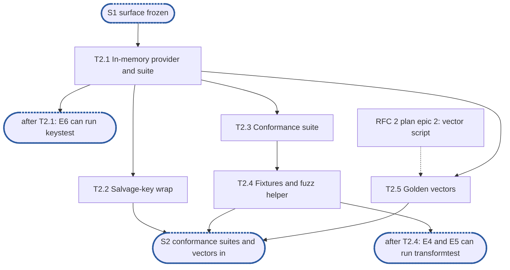

# Epic 2: transforms v2 test foundations

**Sources:** [RFC 5](../docs/internals/rfcs/rfc-5-transforms.md) §8.1's generic rows (T2 twice,
T4, §2.1, concurrency, §2.7 twice, T9 twice) as one suite, and the §2.1, §2.7 and §4 obligations
they check; §4 item 7's fixture mechanism; §3.1's `keys.Provider` as a suite, with §2.5's
namespace and fingerprint rules and §8.2 T12 and T14's "the provider records no call"; the
golden vectors of §2.8, §8.1's Appendix B.1 and T22 rows and §8.2's §2.8 row, from the byte
tables of §2.8 and Appendix B.1, and the envelope vector the RFC 5 plan's §1.4 adds from §2.4's
layout; Appendix B.2's salvage key as the in-memory provider holds it.
Cited, not owned: [RFC 2](../docs/internals/rfcs/rfc-2-carver.md) §3.2 (the chunk maximum), §4.1
and the RFC 2 plan's golden-vector script, which RFC 5's vectors join. Every citation is
`develop`'s text. The code lands on `feat/storage-v2`, and the paths below are paths there.
**Track:** team.
**Epic 2 estimate: 5 subtasks, 11 man-days.**
**Depends on:** **S1**, E1's surface frozen: `transform.Transform`, `Factory`, `Encoded`,
`ErrMalformed` and `ErrTooLarge`; `keys.Provider`, `keys.MaterialID` and the material errors; the
and the salvage-key wrap E1 declares in `keys`. Outside RFC 5's epics, the RFC 2 plan's epic 2
(`.planning/rfc-2-carver-plan.md`, on `develop`):
its golden-vector script with its chain-ID encoder, and its check of `lukechampine.com/blake3`'s
modes against BLAKE3's reference vectors (T2.5 only).
**Blocks:** E3 (the in-memory provider for chain tests and "the provider records no call", the
chain-ID and envelope vectors), E4 (the conformance suite, fixtures and the fuzz helper), E5 (the
suite with its authenticating rows, the chunk vectors, data keys in the in-memory provider), E6
(`keystest.Run` over its provider, the fingerprint, key-wrap and stored-wrap vectors, the
salvage row; it owns the salvage wrap's layout and unwrap), E8 (the keys MAC vector; it adds the destroyed-material notice to the in-memory
provider and the suite), E11 (the in-memory provider's `Destroy` for T20). Outside RFC 5's epics, the
RFC 8 offload plan's engine epics, which run against the in-memory provider (its epic 20 calls
the salvage-key wrap).

---

## 1. Goal

Epic 2 builds what every transform and every provider is held to, and the oracle the format
checks compare against. It writes no transform and no provider of its own beyond a verified
in-memory one.

**At the end of the epic:**

- `transformtest.Run` passes a correct test transform and fails, on exactly the rows expected,
  each of a set of deliberately broken ones: one that exceeds its bound, one whose bound is
  loose, one whose bound under any material is too small, one that encodes nondeterministically,
  one that returns a foreign error, one that loses a byte, one that shares state between calls,
  one that writes into its input, one whose `LengthKey` omits a length-affecting setting, one
  whose `LengthOf` lies, one that clamps to `max`, one that drifts from its fixture, and an
  encrypt-stage one that accepts a flip.
- `keystest.Memory` passes `keystest.Run`, and each of six broken providers around it fails its
  row: one that ignores the namespace, one that keeps its first material current, one that serves
  a replaced key, one that reports a destroyed key as unavailable, one that reports a kind never
  given as unavailable, and one whose call count misses a call.
- RFC 5's golden vectors sit in the RFC 2 plan's script and in
  `pkg/transform/transformtest/testdata/vectors.json`; a Go check written from RFC 5's tables
  recomputes each one and shows each wrong variant the RFC names gives another value.
- §1.4's catalogue names the epic that turns each row green.

### 1.1 In scope

- **`pkg/transform/keystest`:** `Memory`, the in-memory `keys.Provider` (kind 2 of `CLAUDE.md`'s
  "Writing tests"), its salvage-key wrap, and `Run`, the `keys.Provider` suite.
- **`pkg/transform/transformtest`:** `Run`, the transform conformance suite; the `Fixture`
  format and the fixture rows; `FuzzDecode`; `LoadVectors`, the vector file and its check.
- **The RFC 2 plan's script:** RFC 5's vectors added to it, with its output checked in.
- **This document's catalogue** (§1.4).

### 1.2 Out of scope

- The chain, the registry, the envelope's parse and the census view: E3, which checks the
  chain-ID and envelope vectors and runs §8.2's T12 and T14 rows on `Memory`'s call count.
- The shipped transforms, their fixtures and their fuzz targets: E4 and E5. E5 also owns the
  distinct-labels row and Wycheproof's AES-GCM vectors.
- The provider, its custody suite and key-record suite, its gauges and the planted-key log check:
  E6 and E7. The destroyed-material notice in `Memory` and in the suite: E8.
- The keyed gear table's vector and the BLAKE3 modes check: the RFC 2 plan's epic 2.
- The export vectors of §8.1 T22 and its string-map half: deferred to RFC 26 and to an operator
  asking for a cloud key service, the RFC 5 plan's §6.1 rows on export cryptography and on the
  string map.
- Any suite of its own: §8.1 and §8.2 run in `unit` with the packages that call these suites, and
  no suite of RFC 5 keeps a `known.yaml`, so no test lands red.

### 1.3 Names used here

- **E1**, epic 1, interfaces: `pkg/transform`'s and `pkg/transform/keys`' frozen surface, with
  the salvage-key wrap and the import test.
- **E2**, this epic.
- **E3**, the chain; **E4**, compression; **E5**, encryption; **E6**, namespace keys and the
  provider; **E7**, key-service custody; **E8**, rotation and the destroyed-material notice;
  **E9**, integration; **E11**, E2E green.
- **S1**, the surface frozen, which is the RFC 8 offload plan's S1d: E1's symbols no longer
  change.
- **S2**, the conformance suites and vectors in: this epic done; E3 to E6 start.
- **The RFC 2 plan's epic 2**: the carver's test foundations, which own the one golden-vector
  script, in `pkg/carver/internal/carvetest`.
- **The RFC 8 offload plan's engine epics**: the epics that compose the chain and the provider
  into the engine; its epic 20 writes salvage exports.

### 1.4 The catalogue

Each row lands green with the epic named. No row lands red: no suite RFC 5's suites paragraph
names keeps a `known.yaml`.

**RFC 5 §8.1**

| Row | Epic |
| --- | --- |
| T2 round trip; §2.1 bound; concurrency; §2.7 byte flips; T9 twice and from two instances | E2 builds them in `transformtest.Run`; E4 and E5 run them; E3's test transforms run them |
| T2 and T9 fixtures | E2 builds the rows and the format; E4 and E5 ship fixtures |
| T4 fuzz of `Decode`, `max + 1` refused | E2 builds `FuzzDecode`; E4 and E5 add targets |
| §2.7 authenticating rows (every flip, another chunk's hash, destroyed material) | E2 builds them; E5 turns them on |
| Appendix B.1 salts, nonces and keystream | E5 |
| Appendix B.1 wrap count at 2³² − 1, salvage and escrow wraps counted | E6 |
| Appendix B.1 labels distinct, each pinned | E5; E2 computes the vectors |
| Appendix B.1 golden vectors | E2 computes them; E5 checks the chunk part, E6 the fingerprint; the gear table is the RFC 2 plan's |
| T22 stored wrap, key file | E2 computes it; E6 checks it |
| T22 stored wrap, key service, as bytes | E7 |
| T22 export vectors and the string map | deferred: RFC 26, and an operator asking for a cloud key service |
| T18 altered AAD, record copied to another namespace | E6 |
| §2.5 a replaced key refused, gauge 0 | E6; E2's `keystest` row on the refusal |
| §3.1 an enlarging transform before another | E3 |
| Appendix B.2 real key-management server | E7 (provider half), E11 (store half) |

**RFC 5 §8.2**

| Row | Epic |
| --- | --- |
| T11; T3 (both rows); §2.4 envelopes; §2.5 `require`; T12; T10; §2.8 vectors; §3.1 parity removed | E3 (§2.8 vectors computed by E2) |
| §2.4 ranged get | E11 |
| T15 | E9 |
| T16 | E3 (refusal), E9 (default chain) |
| T17 | the RFC 2 plan (disjoint IDs), the RFC 8 offload plan's epic 15 (plan under another namespace's key) |
| T14 | E3 (census view), E6 (provider), on E2's call count |
| T7, a key never given | E3 (chain), E6 (provider) |
| T7, through the engine; T5's store half; T6; T8; T20; T21; Appendix B.5 | E11 |
| T5, a failing factory | E3 (chain), E11 (store) |
| T13, both rows | deferred to RFC 9 (`Remove`); the two-node row unowned, since RFC 11 has no plan |
| §5.3 census | E11, up to its retirement half; retirement deferred to RFC 9 |
| §5.2 relocation; §5.3 drain | deferred to RFC 9 |
| T18: non-encrypting namespace, escrow, `storage` key | E6; `ErrNotEscrowed` through the API, E9; "verifies from the bucket alone" and the refusal at backup-policy creation, deferred to RFC 26 |
| Appendix B.2: failed bucket `keys` put, rotation without escrow, late put of sequence 7 (bucket half) | E8 |
| Appendix B.2 and B.3 rows on backup locations, export keys, recovery import, forged versions | deferred to RFC 26 |
| T19 | deferred to RFC 26 |
| Appendix B.1 in-place rotation; rotation while nothing is written | E8 (read and re-wrap, if the harness's KMIP server can rotate in place), E9 (operation start); destroy-check clauses deferred to RFC 26 |
| Appendix B.1 Locate returning two UIDs | E7 |
| Appendix B.1 key state; Appendix B.2 master key destroyed in the service | E8 |
| Appendix B.1 backup state versions and MACs | deferred to RFC 26 |
| Appendix B.2 a plan under another namespace's key | the RFC 8 offload plan's epic 15 |

**RFC 5 §8.3**

| Benchmark | Epic |
| --- | --- |
| Each transform; encryption's split; compression ratio; `Attempt.MaxEncodedLen` against the largest body | E4, E5 |
| Chain overhead; envelope size | E3 |
| A put and a whole-block get | E11 |

**Other sources**

| Row | Epic |
| --- | --- |
| RFC 5 Appendix D's D1: an incompressible chunk beginning with zstd's frame magic round-trips | E4 |
| D2: a body declaring 64 MiB, and a zstd window above the chunk maximum, fail before allocating | E4 |
| D4: compression turned off between a write and a read | E3; turning encryption on is T15's refusal, E9 |
| D9: a store whose encryption cannot load writes nothing | E11 |
| D10: a provider failure at start leaves the journal serving | E11, with the RFC 8 offload plan |
| Wycheproof's `aes_gcm_test.json` through the transform's call; a tag failure leaves no plaintext in `dst`; two inputs under one chunk key get two nonces; one input under two versions gets two nonces | E5 |
| N concurrent rotations of one namespace leave one current key; the notice's cursor survives a restart; a master-key re-wrap of 10⁴ records resumes after a crash | E8 |
| Decompression bombs for zstd and LZ4 as fuzz seeds | E4 |
| KMIP: expired certificate, revoked key, the key-state table, Item Not Found, an unknown state | E7 |
| A master key Destroyed in the KMIP server refuses `Pin` within one tick | E8 |

## 2. How the general rules apply

The rules are those of
[the RFC 5 plan's §1.5](rfc-5-transforms-plan.md#15-general-rules-for-each-epic), cited by
number and title and not copied.

| Rule | Subtasks | How |
| --- | --- | --- |
| rule 1, independent unit tests ([`CLAUDE.md`, "Writing tests"](../CLAUDE.md#writing-tests)) | all | `Memory` is a kind 2 double held to `keystest.Run`, which E6's provider passes too. The round-trip inputs come from a seeded source (kind 1). The broken transforms and broken providers are subjects under test, not doubles: each exists to fail a row, and nothing stands in for a dependency |
| rule 2, fuzz every decoder of bytes this component did not just write ([`CLAUDE.md`, "Writing tests"](../CLAUDE.md#writing-tests)) | T2.4 | `FuzzDecode` is the helper each transform's target calls. This epic adds no target to the nightly `fuzz` suite: its only decoder is a test transform, and fuzzing it finds nothing in product code. T2.4's seed run of the helper proves it; E4 adds the first target and the suites-paragraph line |
| rule 3, observability follows RFC 25 | none | no series and no log line. `Memory` formats no material into an error, and the planted-key check rule 3 asks of epics 5 to 8 runs against their transforms and provider, not here |
| rule 4, profiling | all | the tests of `keystest` and `transformtest` run under `prof.Watch`; the suites do not call it, since each consumer's test does (rule 4) and `Watch` covers the whole process. Allocation counts per operation are E3's `transform-allocs` option; `FuzzDecode`'s bound is in bytes (D5) |
| rule 5, public interface and internals ([`CLAUDE.md`, "Verifying a change"](../CLAUDE.md#verifying-a-change)) | T2.3, T2.5 | the 64-goroutine row runs under `-race` in `unit`. The vectors are checked here against a second implementation and again where they are consumed, in E3, E5, E6 and E8 |
| rule 6, known failures shrink | none | no red test: no suite RFC 5 names keeps a `known.yaml`, and this epic registers none |
| rule 7, v2 ignores v1, and imports only what RFC 0 §1.2 allows | all | `keystest` imports `keys`, `entity` and the standard library; `transformtest` adds `transform` and `keystest`. Neither imports `chain`, a stage or the provider. The vector check, a test file, also imports `lukechampine.com/blake3`. E1's import test checks no test file, so `internal/prof` in the tests needs no allowlist entry |
| rule 8, real dependencies for properties of those dependencies ([`CLAUDE.md`, "Writing tests"](../CLAUDE.md#writing-tests)) | none | no external system: the suites hold implementations to RFC 5, and the key service and the metadata store are E6's and E7's |
| rule 9, code comment conventions ([`CLAUDE.md`, "Code comments"](../CLAUDE.md#code-comments)) | T2.1, T2.3, T2.4 | `decision:` markers for D2 (one call per transform) and D3 (`Current` with nothing given); a `ponytail:` marker for D5's byte bound |
| rule 10, a test must be able to fail ([`CLAUDE.md`, "Writing tests"](../CLAUDE.md#writing-tests)) | all | every suite row runs against a broken subject that must fail it (D1); each vector comes from Python's libraries working from RFC 5's tables, never from the Go code it checks, and a Go check written from the same tables must agree with it (D7) |
| rule 11, a symbol is exported only if RFC 5's interface or a consumer outside the package uses it | all | §6 names each export's consumer; the suites' rows are unexported and reached through `Run` |
| rule 12, each subtask creates only what it declares | all | `Memory`'s salvage-key wrap lands with E6's row and the engine's epic 20 as consumers; `Fixture` with E4 and E5; `LoadVectors` with E3, E5, E6 and E8 |

## 3. Requirements and invariants

Every obligation RFC 5 places on this epic. "The suite" is `transformtest.Run`; "the provider
suite" is `keystest.Run`.

**The transform conformance suite**

| # | Requirement | Kind | Source | Subtasks |
| --- | --- | --- | --- | --- |
| R1 | `Decode(Encode(p)) == p` byte for byte over 10,000 inputs: random, all zeros, all one byte, sizes from 1 byte to the chunk maximum, and inputs that begin with the transform's own output and with an envelope. `Decode` needs nothing but its arguments and the provider | MUST, test row | RFC 5 §2.1, §3.1 (`Transform.Decode`), §7 T2, §8.1 T2 | T2.3 |
| R2 | Every body is no longer than `MaxEncodedLen(len(input), m)` under the material it was encoded with, nor than `MaxEncodedLen(len(input), nil)`, the bound under any material; an input built to hit the worst case reaches the first | MUST, test row | §2.1, §3.1 (`MaxEncodedLen`), §4 item 2, §8.1 §2.1 | T2.3 |
| R3 | Encode and decode from 64 goroutines under the race detector give the same results as sequential calls | MUST, test row | §2.1 (stateless per call), §8.1 concurrency | T2.3 |
| R4 | Every byte of a body flipped in turn: `Decode` never panics, and returns either an error of §2.7's five or bytes that differ from the input, which the codec's hash check rejects; never a foreign error | MUST, test row | §2.7, §4 item 6, §8.1 §2.7 | T2.3 |
| R5 | A transform that authenticates returns `ErrMalformed` itself for every flip | MUST | §8.1 §2.7 | T2.3 |
| R6 | A transform that authenticates: chunk A's body decoded with chunk B's hash is `ErrMalformed`; a body naming destroyed material is `ErrMaterialDestroyed` | test row | §2.7, §8.1 §2.7 | T2.1, T2.3 |
| R7 | `Encode` of each input twice, and through two instances built by one `Factory` from the same settings, gives identical bodies. Where `LengthOf` answers, the body is applied and its length equals the answer | MUST, test row | §2.1 (deterministic, honest about length), §3.1 (`Factory`, `LengthOf`), §7 T9, §8.1 T9 | T2.3 |
| R8 | `Decode` never allocates or produces more than `max`, however large a body claims its output to be; fuzzed, it never panics | MUST NOT, test row | §2.1, §4 item 5, §7 T4, §8.1 T4 | T2.4 |
| R9 | A body declaring an output of `max + 1` fails with `ErrTooLarge` | test row | §2.7, §8.1 T4 | T2.3 |
| R10 | Every body in every format version's fixture decodes to its recorded plaintext | MUST, test row | §2.5, §4 items 4 and 7, §8.1 T2 | T2.4 |
| R11 | Every input of the fixture of the format version `Encode` writes, encoded with its recorded settings and material, gives exactly its recorded body; an older version's fixture is decoded only | MUST, test row | §4 item 7, §7 T9, §8.1 T9 | T2.4 |
| R12 | A transform ships a fixture holding the inputs, the settings, the material and the bodies its format version wrote from them; a transform with none for the version `Encode` writes fails the suite | MUST | §4 item 7 | T2.4 |
| R13 | One suite, which every transform passes, shipped and custom alike | test row | §4 item 7, §8.1 | T2.3 |
| R29 | `LengthKey` carries every setting that changes a body's length: two settings whose bodies differ in length for one input have different `LengthKey`s | MUST | §2.8 (length-affecting settings), §4 item 2 | T2.3 |
| R30 | `dst` never overlaps the input, and the result is `dst` resliced or a new slice: a round trip with a nil `dst`, and with a `dst` of spare capacity holding junk, gives the right bytes and leaves the input unchanged | MUST NOT | §3.1 | T2.3 |

**The in-memory provider and the provider suite**

| # | Requirement | Kind | Source | Subtasks |
| --- | --- | --- | --- | --- |
| R14 | `Current` is the material new bodies of a kind use in a namespace | MUST | §3.1 (`Provider.Current`) | T2.1 |
| R15 | Every call names its namespace: `Current` of one namespace never returns another's material, and `Get` of an ID looked up in a namespace that was never given it is `ErrUnknownMaterial` | MUST, invariant | §2.5, §3.1 (`MaterialID`, `Provider.Get`), §7 T14, §8.2 T14 | T2.1 |
| R16 | `Get` returns `ErrUnknownMaterial` for an ID the provider was never given, `ErrMaterialUnavailable` for one whose content no longer matches its fingerprint, and `ErrMaterialDestroyed` for one it has lost for good | MUST | §2.7, §3.1 (`Provider.Get`) | T2.1 |
| R17 | The provider refuses to serve an ID whose material no longer matches its recorded fingerprint, as `ErrMaterialUnavailable` | MUST | §2.5, §7 T12, §8.1 §2.5 | T2.1 |
| R18 | A fingerprint is `HMAC-SHA256(material, "dittofs key check v1")`, 32 bytes, carried in `MaterialID` | MUST | §2.5, §3.1, Appendix B.1 (labels; lengths and encodings) | T2.1, T2.5 |
| R19 | A test can assert that the provider records no call: each call of the provider's `Current` or `Get` is counted | test row | §3.1 (`Provider`), §8.2 T12, T14 | T2.1 |
| R31 | `Current` of a kind never given in a namespace is `ErrUnknownMaterial`, the error `Get` gives for the same absence | MUST | §3.1 (`Provider.Current`, `Provider.Get`); D3 | T2.1 |
| R20 | A salvage key is a fresh 32-byte data key, belongs to no namespace, and is returned with its wrap under the installation's current master key; its layout and its unwrap are E6's | MUST | Appendix B.1 (lengths and encodings), Appendix B.2 (key table's `salvage-key` row; "A salvage key seals one salvage export") | T2.2 |

**Golden vectors**

| # | Requirement | Kind | Source | Subtasks |
| --- | --- | --- | --- | --- |
| R21 | Every vector comes from an independent implementation working from RFC 5's byte tables alone, and a changed vector fails the build | MUST, test row | §2.8 (last paragraph), §8.1 Appendix B.1, §8.2 §2.8 | T2.5 |
| R22 | Chain IDs of the empty chain, the default encrypting chain with one data key, and a compress-then-encrypt chain with two materials, over §2.8's encoding under `BLAKE3-derive-key("dittofs transform chain id v1", …)`; swapping two materials, changing one fingerprint byte, or a length prefix of 2 bytes or little-endian each gives another ID | test row | §2.8, §8.2 §2.8 | T2.5 |
| R23 | Envelopes of version 1: version, count, each transform ID as 2 bytes big-endian | MUST | §2.4 | T2.5 |
| R24 | For a fixed data key, plaintext hash, version and input: the salt key, salt, chunk key, nonce key and nonce, the chunk AAD, the chunk nonce input, and one chunk body; a nonce computed with HMAC-SHA256, with BLAKE3's unkeyed or key-derivation mode, or from the output's last 12 bytes, and a key derived with `info` prefixed, each differ from the vector | test row | Appendix B.1 (derivations; joined inputs), §8.1 Appendix B.1 | T2.5 |
| R25 | Every value has the length Appendix B.1 fixes: keys and HKDF outputs 32 bytes (`L = 32`, `salt = none` as 32 zero bytes, `info` the label alone), every MAC and fingerprint 32, nonce 12, tag 16. Every joined field that is not an integer carries a 4-byte big-endian length; an integer is big-endian at its stated width; a value over one field takes it bare | MUST | Appendix B.1 (lengths and encodings) | T2.5 |
| R26 | One fingerprint | test row | §8.1 Appendix B.1 | T2.5 |
| R27 | The key wrap AAD (namespace ID, kind and key ID, each with a 4-byte length) and one key-file stored wrap | test row | Appendix B.1 (key wrap; stored wrap), §8.1 T22 | T2.5 |
| R28 | The keys key and one keys MAC, so the `dittofs keys object v1` label is pinned like every derivation | test row | Appendix B.1 (export cryptography: keys key, keys MAC), §8.1 Appendix B.1 (labels row) | T2.5 |

## 4. Decisions this epic takes

- **D1, a suite is proved by running its rows on broken subjects.** Each row is an unexported
  function that returns an error naming what it found; `Run` runs each in a subtest and reports
  its error. The suite's own tests run every row on each broken subject and assert that the set
  of failing rows is exactly the one written for that subject, fixture rows included where the
  break changes bodies, so a row failing for the wrong reason fails the test too. Every row has a
  broken subject; a row with none is not listed. A broken subject never races, since the race
  detector would fail the whole binary rather than the row: the one breaking R3 keeps state
  under a mutex, and its `Encode` waits until a second call has entered before it reads that
  state, so the two calls overlap on every scheduler, `GOMAXPROCS=1` included. Prior art: Go's
  `testing/fstest.TestFS`, a suite run per implementation, which returns an error rather than
  failing a `testing.T` (from memory).
- **D2, one call per transform package.** `transformtest.Run` is called from each transform's own
  tests with a `Subject`, because only the transform knows its worst-case input, its
  length-affecting settings and its fixtures, which `Run` reads from `testdata/fixtures` in the
  package's directory. §8.1's "a new transform gets it by registering" is met by §4 item 7,
  which makes the call part of registering one. A `decision:` marker on `Run` says so, and that a
  registry-wide check belongs to E3 if a registered transform is ever found without the call.
  The authenticating rows (R5, R6) run for every transform of the encrypt stage; `Subject` can
  turn them on for another stage, never off for this one. Prior art:
  `golang.org/x/net/nettest.TestConn`, called per `net.Conn` implementation (from memory).
- **D3, `Memory` is set up through calls a real provider can also honour.** `Give` stores
  material under the ID given, records its fingerprint and makes it current for its namespace and
  kind; the ID is the caller's because a fixture's body names one. `Replace` changes the content
  under an ID and keeps the recorded fingerprint; `Destroy` marks an ID lost for good, since
  `Remove` lands later. `Get` looks material up by namespace, kind and ID, and compares content
  with the fingerprint the provider recorded, never with the caller's: a transform's body names
  a key ID, not a fingerprint. `keystest.Harness` is those three plus `Calls`, and E6 adapts its
  provider to it over key records and a key file. RFC 5 §3.1 does not say what `Current` returns
  for a kind never given in a namespace; the user decided (#5857) that it is `ErrUnknownMaterial`,
  the error `Get` gives for the same absence, and that `keystest.Run` asserts it (R31), so E6's
  provider is held to it too. `ErrMaterialUnavailable` was rejected because it is retried, so a
  namespace with no key of a kind would retry forever. A `decision:` marker at `Memory.Current`
  says so, to be withdrawn if RFC 5 names another error. Prior art: none found for the harness;
  the error follows `Provider.Get`'s own.
- **D4, the call count is an output `Memory` exports and the suite covers.** `Calls` counts
  `Current` and `Get`; a row asserts each raises it by one and that a failing call counts too. E3
  and E6 assert "the provider records no call" on it, not on a counting fake (`CLAUDE.md`,
  "Writing tests", outputs are not interactions). Prior art: the journal conformance suite's
  counted checks.
- **D5, `FuzzDecode` bounds allocation in bytes.** It decodes into a `dst` of capacity `max`,
  reads `runtime.MemStats.TotalAlloc` around one `Decode`, run alone, and fails above
  `Subject.Scratch` plus 64 KiB: what a correct decoder allocates beyond `dst` is its declared
  working memory (zstd's window, which E4 sets), never the size a body claims. The seeds include
  bodies whose header claims 4 × `max`. That catches the bug R8 exists for and holds under
  `-race`, so it runs in `unit` as it is. A `ponytail:` marker names the ceiling: the check
  covers the whole call, not only up to header validation, and an overrun under 64 KiB passes;
  move to per-call allocation profiles if a transform ever needs that precision.
- **D6, fixtures are one JSON file per case**, under the transform's own
  `testdata/fixtures/v<n>/<case>.json`: the format version, the namespace ID, the plaintext hash,
  the settings as a JSON object, the material (kind, ID, bytes), the input and the body, byte
  strings in hex. The suite loads the material into a fresh `Memory`, builds the transform from
  its `Factory` and the settings, decodes every version's bodies (R10) and re-encodes the inputs
  of the version `Encode` writes (R11), since an older version's bodies are what a new encoder no
  longer writes. A transform writes its fixture once per format version through `Fixture`'s JSON
  form. JSON numbers reach the `Factory` as `float64`, as `encoding/json` decodes them (§9).
  Prior art: Go's `compress/*` packages' golden files under `testdata` (from memory).
- **D7, RFC 5's vectors are written by the RFC 2 plan's script, in
  `pkg/carver/internal/carvetest` (its §1.4 and §4.1), to
  `pkg/transform/transformtest/testdata/vectors.json`**, embedded in `transformtest` and read
  through `LoadVectors`: `pkg/transform` cannot import an `internal` package of `pkg/carver`, so
  the output, not the script, is what crosses. The script computes them with Python's `cryptography` (HKDF, HMAC,
  AES-GCM) and `blake3` (keyed and key-derivation modes), from RFC 5's tables. The chain ID uses
  the same encoder the script's block-name vector uses, so the two cannot disagree. The file
  carries each vector's inputs, so a consumer reproduces it without guessing: the chain-ID
  vectors list, per transform, its ID, format version, length key and materials (kind, ID,
  bytes), and give the compress-then-encrypt chain's two materials, on its encrypt entry, in an
  order their kind-then-ID order reverses. The key-file stored wrap takes a fixed nonce as an
  input, since production draws it at random. CI does not run the script. A Go test in
  `transformtest`, written from RFC 5's tables with `crypto/hkdf`, `crypto/hmac`, `crypto/aes`
  and `lukechampine.com/blake3`, which the RFC 2 plan's epic 2 holds to BLAKE3's reference
  vectors, recomputes every vector and each wrong variant R22 and R24 name, so a hand edit of the
  file, or a script that drifts from the tables, fails `unit`. Prior art: BLAKE3's
  `test_vectors.json`; Wycheproof (from memory).
- **D8, the round-trip inputs come from one seeded source.** The 10,000 inputs have sizes spread
  log-uniformly from 1 byte to the chunk maximum, which `Subject.Max` gives, including 1, 2,
  `Max − 1` and `Max`. The prefixed inputs take their prefix from the transform's own output of
  another input and from envelopes of every count from 0 to 3. The byte-flip rows (R4, R5) flip
  every byte of the bodies of the inputs up to 4 KiB, so their cost is fixed whatever the chunk
  maximum. A failing input is reported with the seed and its index. Prior art: Go's
  `testing/quick`, seeded (from memory).
- **D9, `Memory`'s salvage-key wrap is the smallest that meets R20.** It seals the key with
  AES-256-GCM from the standard library under a master key `Memory` draws at construction, with
  the associated data naming the salvage export that the call is given. Nothing in v1.1 reads the wrap back:
  the engine writes it beside the export as bytes, and recovery tools are RFC 26's. So the
  provider suite's row checks only what holds for every provider, and E6 checks its provider's
  layout against the stored-wrap vector and its unwrap. Prior art: none found.
- **D10, the exported surface of §6 is the user's approved one** (#5857): `Memory` and its six
  methods, `Harness` and `keystest.Run`; `Subject`, `transformtest.Run`, `FuzzDecode`, `Fixture`,
  `Vectors` and `LoadVectors`. A change to it is a revision of this document. Prior art: none
  needed.

## 5. Target tree

```text
pkg/transform/keystest/
  memory.go         T2.1  Memory: Current, Get, Give, Replace, Destroy, Calls
                    T2.2  Memory's salvage-key wrap
  suite.go          T2.1  Harness, Run, the provider suite's rows
                    T2.2  the salvage-key row
  suite_test.go     T2.1  Memory passes; each broken provider fails its row
                    T2.2  Memory's salvage wrap unwraps under its AAD only
pkg/transform/transformtest/
  suite.go          T2.3  Subject, Run, the rows of R1 to R7, R9, R29, R30
  inputs.go         T2.3  the seeded round-trip inputs (D8)
  broken_test.go    T2.3  the test transform and the broken ones
                    T2.4  the broken ones for R8, R10, R11, R12
  fixture.go        T2.4  Fixture, its loader, the rows of R10 to R12
  fuzz.go           T2.4  FuzzDecode
  testdata/fixtures/v1/  T2.4  the test transform's fixture
  vectors.go        T2.5  Vectors, LoadVectors
  vectors_test.go   T2.5  every vector recomputed from RFC 5's tables, and its wrong variants
  testdata/vectors.json  T2.5  the script's output
pkg/carver/internal/carvetest/  T2.5  RFC 5's vectors added to the RFC 2 plan's script
```

## 6. Subtasks

### T2.1 The in-memory provider and the provider suite

**Subtask T2.1 estimate: 2.5 man-days.**

- **Track:** team. **Depends on:** S1.
- **Covers:** R14, R15, R16, R17, R19, R31, R6 (its destroyed-material half, through `Destroy`).
- **Deliverables:**
  - `keystest.Memory`, a `keys.Provider` (D3), consumed by T2.3, E3, E5, E6, E8, E11 and the RFC
    8 offload plan's engine epics:

    ```go
    func NewMemory() *Memory
    func (m *Memory) Current(ctx context.Context, ns entity.NamespaceID, kind string) (keys.MaterialID, error)
    func (m *Memory) Get(ctx context.Context, id keys.MaterialID) ([]byte, error)
    func (m *Memory) Give(ns entity.NamespaceID, kind, id string, material []byte) keys.MaterialID
    func (m *Memory) Replace(id keys.MaterialID, material []byte)
    func (m *Memory) Destroy(id keys.MaterialID)
    func (m *Memory) Calls() uint64
    ```

  - `keystest.Harness` (`keys.Provider` plus `Give`, `Replace`, `Destroy`, `Calls`) and
    `keystest.Run(t *testing.T, newHarness func(t *testing.T) Harness)`, consumed by E6, which
    runs it over its provider, and by E8, which adds the notice's rows.
- **Acceptance criteria:**
  - `Run` passes on `Memory` under `-race`.
  - Each of six broken providers around `Memory` fails exactly its row (D1): one that drops the
    namespace from lookups (R15), one that keeps the first material given as current (R14), one
    that serves content after `Replace` (R17), one that turns `ErrMaterialDestroyed` into
    `ErrMaterialUnavailable` (R16), one that answers `Current` of a kind never given with
    `ErrMaterialUnavailable` (R31), one whose `Calls` counts only successful calls (R19).
- **Tests:** at `Run`'s rows, which E6's provider will run: two namespaces given a data key each,
  `Current` of one never the other's and `Get` with the other's namespace `ErrUnknownMaterial`
  (catches a lookup by ID alone, R15); a second `Give` of a kind becomes current while the first
  still reads (catches a provider serving only its first, or only its latest, R14); an ID never
  given, a replaced one and a destroyed one each return their own error (catches folded errors,
  R16, R17); `Current` of a kind never given is `ErrUnknownMaterial` (catches an absence reported
  as an outage, R31); `Calls` rises by one per call, failing calls included (catches a count that skips
  errors, R19). Each row also runs on its broken provider and must fail. R18's fingerprint is
  checked against the vector in T2.5, an independent oracle, rather than against the formula
  restated here.
- **Rules:** as §2.

### T2.2 The salvage-key wrap

**Subtask T2.2 estimate: 0.5 man-days.**

- **Track:** team. **Depends on:** T2.1.
- **Covers:** R20.
- **Deliverables:** `Memory` implements the salvage-key wrap E1 declares in `keys` (D9), consumed
  by the RFC 8 offload plan's epic 20; the provider suite's salvage row, consumed by E6, whose
  provider runs it.
- **Acceptance criteria:**
  - Two calls return two different 32-byte keys and two different wraps.
  - No wrap contains its key's bytes, raw, in hex or in base64.
  - No namespace's `Current` changes, since a salvage key belongs to no namespace.
- **Tests:** at the provider suite's salvage row, the one E6's provider runs: the three criteria
  above (catch a reused key, a key returned in the clear as its own "wrap", and a salvage key
  written as a namespace's material, R20); the row run on a broken provider returning one fixed
  key must fail. In `keystest`'s own tests, `Memory`'s wrap unwraps under its master key and
  associated data, and fails with the associated data changed or one byte flipped (catches a wrap
  that binds nothing, D9).
- **Rules:** as §2.

### T2.3 The transform conformance suite

**Subtask T2.3 estimate: 3.5 man-days.**

- **Track:** team. **Depends on:** T2.1.
- **Covers:** R1, R2, R3, R4, R5, R6, R7, R9, R13, R29, R30.
- **Deliverables:**
  - `transformtest.Subject` and `transformtest.Run`, consumed by E4 and E5 for the shipped
    transforms and by E3 for its test transforms (D2):

    ```go
    type Subject struct {
        Factory         transform.Factory
        Settings        map[string]any     // the settings the rows run under
        LengthAffecting []map[string]any   // settings that change body length; empty if none (R29)
        Max             int                // the chunk maximum (RFC 2 §3.2)
        WorstCase       func(n int) []byte // an n-byte input whose body reaches MaxEncodedLen
        Scratch         int                // Decode's working memory beyond dst (D5)
        Authenticates   bool               // adds R5 and R6 outside the encrypt stage (D2)
    }
    func Run(t *testing.T, s Subject)
    ```

  - The seeded inputs (D8). The material each call uses is `Memory`'s current material for the
    transform's `Kinds`, read once per namespace as a pin would.
  - In the package's tests: a correct test transform, and the broken transforms (D1).
- **Acceptance criteria:**
  - The test transform passes `Run` under `-race`.
  - Each broken transform fails exactly its expected rows: lossy on one input (R1); a body one
    byte over its bound, a bound one byte loose that no input reaches, and a bound under nil
    material below its bodies (R2); state shared between calls, overlapping by D1's barrier
    (R3); a foreign error on a flip, and a flip decoding back to the input (R4); an encrypt-stage
    transform that accepts one flip, and one that ignores the hash (R5, R6); a random byte in
    each body, and a `LengthOf` one off (R7); one that clamps to `max` instead of refusing (R9);
    a `LengthKey` that omits a length-affecting setting (R29); one that writes into its input
    (R30).
  - A destroyed material, through `Memory.Destroy`, gives `ErrMaterialDestroyed` from an
    authenticating subject.
- **Tests:** at `Run`, the function every transform's package calls: the passing run and the
  broken runs above, each catching the bug its row names. The round trip includes inputs that
  begin with the subject's own output and with envelopes of 0 to 3 IDs (catches a transform
  mistaking its input for its output, R1), and runs with a nil `dst` and with a junk-filled one
  (catches a decoder reading stale `dst` bytes, R30). The `max + 1` row encodes an input of
  `max + 1` bytes, zeros first and random bytes if the transform declines zeros, and decodes it
  with `max` (R9). The authenticating rows use `Memory` (kind 2).
- **Rules:** as §2; rule 9, the `decision:` marker of D2 on `Run`.

### T2.4 Fixtures and the fuzz helper

**Subtask T2.4 estimate: 1.5 man-days.**

- **Track:** team. **Depends on:** T2.3.
- **Covers:** R8, R10, R11, R12.
- **Deliverables:**
  - `transformtest.Fixture`, the JSON form of D6, consumed by E4 and E5, which write their
    fixtures in it; `Run`'s fixture rows, over every `v<n>` directory under the package's
    `testdata/fixtures`.
  - `transformtest.FuzzDecode(f *testing.F, s Subject)`, consumed by E4's and E5's fuzz
    targets: seeds from the fixtures, from round-trip bodies and from bodies claiming 4 × `max`;
    asserts no panic, an error of §2.7's five or at most `max` bytes, and D5's allocation bound.
  - The test transform's fixture under `testdata/fixtures/v1/`.
- **Acceptance criteria:**
  - The test transform passes the fixture rows and a seed run of `FuzzDecode`.
  - A transform whose encoder changed one byte fails R11; one that stopped decoding a `v1` body
    fails R10; one with no fixture for the version it writes fails R12; one that allocates a
    body's claimed size fails R8.
- **Tests:** at `Run` and `FuzzDecode`, which E4 and E5 call: the passing runs and the four
  broken ones above. A `Fuzz` function in the package's tests calls `FuzzDecode` on the test
  transform; plain `go test` runs its seeds.
- **Rules:** as §2; rule 9, the `ponytail:` marker of D5.

### T2.5 The golden vectors

**Subtask T2.5 estimate: 3 man-days.**

- **Track:** team. **Depends on:** T2.1. Outside this epic, the RFC 2 plan's epic 2 script.
- **Covers:** R18 (`Memory` against the vector), R21, R22, R23, R24, R25, R26, R27, R28.
- **Deliverables:**
  - RFC 5's part of the script (D7): the three chain IDs with their inputs and encoded bytes;
    envelopes of 0, 1 and 3 IDs; the chunk derivations, AAD, nonce input and body; one
    fingerprint; the key wrap AAD and one key-file stored wrap with its master key, nonce and key;
    the keys key and one keys MAC.
  - `testdata/vectors.json`, its output.
  - `transformtest.Vectors` and `transformtest.LoadVectors(tb testing.TB) Vectors`, consumed by
    E3 (chain IDs, envelopes), E5 (chunk), E6 (fingerprint, key wrap, stored wrap) and E8 (keys
    MAC).
  - `vectors_test.go`, the second implementation of D7.
- **Acceptance criteria:**
  - The script's block-name vector and RFC 5's chain-ID vectors use one chain-ID encoder.
  - Every vector equals its recomputation from RFC 5's tables, and each wrong variant R22 and
    R24 name gives another value.
  - `LoadVectors` fails a value whose length differs from Appendix B.1's table, naming the field.
  - `Memory`'s fingerprint of the vector's material equals the vector's fingerprint (R18).
- **Tests:** at `LoadVectors` and the vector file, which E3, E5, E6 and E8 read: every vector
  recomputed (catches a hand-edited file or a script that drifted from the tables, R21 to R28);
  the swapped materials, the changed fingerprint byte, the 2-byte and little-endian prefixes, the
  HMAC, unkeyed, key-derivation and last-12-bytes nonces and the prefixed `info` each differ from
  the vector (catches a vector too weak to tell them apart, R22, R24); a copy with one 16-byte key
  and one 11-byte nonce refused (catches a wrong length, R25); `Memory`'s fingerprint against the
  vector (catches a fingerprint the chain ID would encode wrongly, R18). E3, E5, E6 and E8 check
  their Go code against the same file.
- **Rules:** as §2.

## 7. Order of work



T2.1 comes first because three subtasks and five epics build on `Memory`. T2.2 finishes the
`keystest` path before the transform suite starts. T2.5 can run beside T2.3 and T2.4 once the
RFC 2 plan's script exists.

## 8. Suggested pull requests

| PR | Subtasks | Man-days | After | Why together |
| --- | --- | --- | --- | --- |
| 1 | T2.1, T2.2 | 3 | — | `keystest` whole: the in-memory provider and the suite E6 runs |
| 2 | T2.3, T2.4 | 5 | PR 1 | `transformtest` whole: every row E4 and E5 run, fixtures and fuzzing included |
| 3 | T2.5 | 3 | PR 1, and the RFC 2 plan's script | the vectors and their check; open beside PR 2 |

A suggestion only: one pull request per subtask works as well.

## 9. Open points

- **Estimate against the RFC 5 plan's figure.** The plan says 4 subtasks and 9.5 man-days; this
  document says 5 and 11. The salvage-key wrap in `Memory` (T2.2), which the plan's §1.3 gives
  this epic but its §5 leaves out, and the Go check of the vectors (T2.5), which makes a wrong
  vector fail here rather than in a later epic, account for the difference. The plan is not
  edited.
- **Fixture settings and JSON numbers (D6).** RFC 13's settings layer may hand a `Factory`
  integers where `encoding/json` gives `float64`. If it does, `Fixture` decodes numbers with
  `UseNumber` and converts integral ones; to settle when E4 writes the first fixture with a
  level.
- **Round-trip time under `-race`.** 10,000 inputs spread to the chunk maximum are not measured.
  If `unit` cannot afford them, the sizes' spread changes, never the count; T2.3's estimate is
  the least certain, with T2.5's second implementation next.
- **The salvage-key wrap's signature** is E1's; T2.2 implements whatever associated data it
  takes, and its row asserts only what Appendix B.2 says of the key and its wrap.
