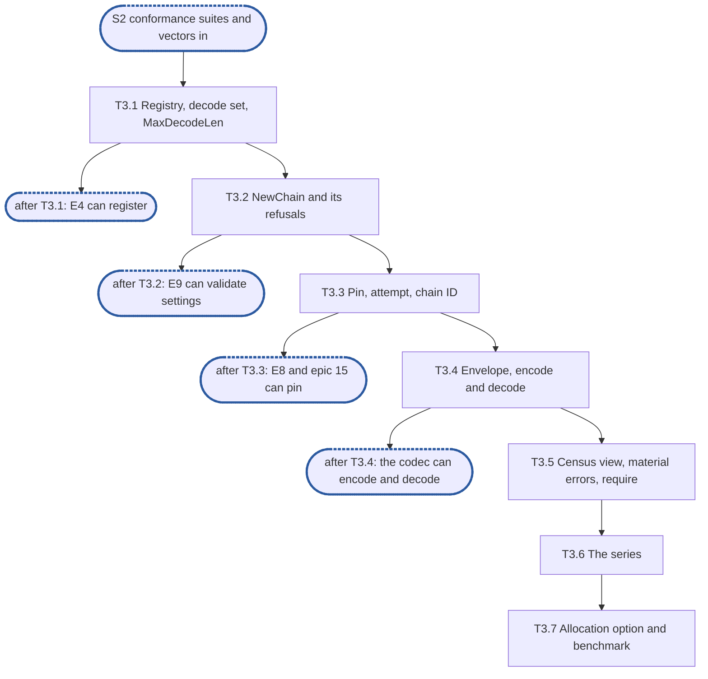

# Epic 3: transforms v2, the chain

**Sources:** [RFC 5](../docs/internals/rfcs/rfc-5-transforms.md) §2.1 (the chain's part: per-step
bounds, determinism within an attempt, length, declining), §2.3, §2.4, §2.5 (the registry, the
census view, `require`), §2.7 (the chain's part: construction failure, the five decode errors,
no foreign error type), §2.8, §3.1 (the behaviour of `Chain`, `Attempt`, `Register` and
`NewChain`, the pin, the two bounds), §3.2 (the refusals at build: stage rules and
`with_encryption: accept`; the implicit encrypt stage at decode), §4 items 1 and 2 as the registry
checks them, §6 (the series around each call and the build failure's log line; not
`transform_census_blocks`, not encryption's series), §7's T3, T4, T9, T10, T11, T12 and T14 (the
chain's halves), and the §8.1 and §8.2 rows §3 names; [RFC 25](../docs/internals/rfcs/rfc-25-observability.md)
§2.9 (series resolved once) and §5.2 (no line per request), as constraints.
**Track:** A.
**Epic 3 estimate: 7 subtasks, 12 man-days.**
**Depends on:** S2. From E1: the root contract (`ID`, `Stage` and its constants, `Transform`,
`Encoded`, `Factory`, `Config`, `Chain`, `Attempt`, `ErrMalformed`, `ErrTooLarge`), `keys`
(`MaterialID`, `Provider`, the material errors), and `chain`'s `Register` and `NewChain` with stub
bodies and the dependencies `NewChain` takes: a logger and a recorder for RFC 5 §6's series that
can be resolved once per transform at build, `Require []string` and `Encrypts
func(entity.NamespaceID) bool` (D11); `Transform.Version` and `Encoded.ID` (D12). From E2: the in-memory `keys.Provider` under `keystest`, whose current material a test can
change, which can be told an ID is unknown or destroyed, and whose exported call count backs "the
provider records no call"; RFC 5 §2.8's three chain-ID vectors from the shared vector script.
**Blocks:** E4, partly: `Register` and the registry's `MaxDecodeLen` (T3.1) hold a compressor's
registration; E8, partly: a data-key rotation's new chain ID is `Attempt.ID` (T3.3); E9: settings
are validated by building the chain with `NewChain` (T3.2), and its `require` key and T15's
encrypting-namespace refusal run through T3.5's check; outside RFC 5's plan, RFC 4's codec, which
calls `Attempt.Encode`, `Chain.Decode` and `Chain.MaxDecodeLen`, and the RFC 8 offload plan's epic
15, which holds the pin, and its content wiring, which sizes RFC 3 §2.2's pools with
`Chain.MaxDecodeLen(Max)`.

---

## 1. Goal

Epic 3 makes the chain real: any set of registered transforms composed in RFC 5's fixed stage
order, behind the self-describing envelope, with the bounds that size every buffer downstream,
the pin that fixes one block's chain and material, the chain ID that names it, and the series a
custom transform gets without writing any. It needs no shipped transform: every test runs on test
transforms registered in the custom ID range.

**At the end of the epic:**

- every registered transform is built once per store for decoding, and `Chain.MaxDecodeLen`
  answers from that set and bounds every attempt the chain can pin (T3.1, T3.4);
- `NewChain` refuses a list out of stage order, two of one stage, one transform twice, a failing
  factory and compression beside encryption without `with_encryption: accept`, logging the
  transform and the reason at `Error` (T3.2);
- `Pin` reads the namespace's current material once per kind, and the attempt's chain ID matches
  RFC 5 §2.8's three vectors and survives a rotation (T3.3);
- an envelope that is unknown, unregistered, repeated or out of order is `ErrMalformed` before any
  transform decodes; a chunk of exactly the maximum round-trips through a transform that enlarges
  by half before another; a body written under a transform since removed from the chain still
  decodes; `Chain.Decode` returns only RFC 5 §2.7's five errors (T3.4);
- a body naming material outside its census, or another namespace's, is `ErrMalformed` with no
  provider call; an unknown census-listed key is `ErrMaterialUnavailable`; `require` refuses a
  body without a required transform (T3.5);
- RFC 5 §6's four series are recorded around every call, per transform (T3.6);
- `unit`'s `transform-allocs` option holds the encode, decode, envelope and recording paths to
  their allocation counts, the decode path is fuzzed, and the chain's overhead is benchmarked
  (T3.7).

### 1.1 In scope

`pkg/transform/chain`: the registry, the decode set, `MaxDecodeLen`, the envelope, `NewChain` and
its refusals, `Pin` and the attempt, the chain ID, composed `Encode` and `Decode` with their
bounds and buffers, the census view, the error discipline, `require`, the series through the
recorder, test transforms, the fuzz target, allocation tests, the overhead benchmark, and
`unit`'s `transform-allocs` option.

### 1.2 Out of scope

- The root contract and `keys`, and the import test: E1.
- `transformtest`, `keystest`, the in-memory `keys.Provider` and the vectors' computation: E2.
  Each transform's own obligations of §2.1 and §4 items 3 to 7, `Encode` asking for no current
  material among them, are held by `transformtest` in E4 and E5.
- The shipped transforms and their fixtures: zstd and LZ4 in E4, AES-256-GCM in E5.
- The provider, fingerprints, the configuration condition naming an unknown ID (raised by the
  provider, which sees the ID when it answers `ErrUnknownMaterial`), and the master-key state
  that makes `Current` fail: E6 and E8. The chain reports the error as `ErrMaterialUnavailable`
  (R29) and passes `Pin`'s failure on (R12).
- The store configuration's settings rows, the bound `encrypts`, T15's refusals at a
  configuration change and the default chain: E9. T15's decode half runs through T3.5's check
  with E9's input (R30, D11).
- `transform_census_blocks` and the census per material: E10. Encryption's own series: E5.
- Through the codec and the engine: the ranged get of §2.4's row, T5's "the store does not open",
  T6, T7 and T8 end to end: E11.
- `Provider.Remove`, its fence and its count of open pins, which `Attempt.Release` will feed: the
  plan's deferral ledger, its first row (§6.1), owned by RFC 9.
- A transform whose bound grows with its settings (D2): the plan's deferral ledger, its last row.

### 1.3 Names used here

- **E1**, epic 1, interfaces: the root contract, `keys`, `chain`'s stubs and the import test.
- **E2**, epic 2, test foundations: `transformtest`, `keystest` with the in-memory `keys.Provider`,
  RFC 5's golden vectors.
- **E4**, epic 4, compression; **E5**, epic 5, encryption; **E6**, epic 6, namespace keys and the
  provider; **E8**, epic 8, rotation and the destroyed-material notice.
- **E9**, the integration epic: the settings rows, the bound `encrypts`, the observability values,
  the error mapping.
- **E10**, epic 10, the census gauge; **E11**, epic 11, E2E green: RFC 5's rows through the codec
  and the engine.
- **S1**, the surface frozen, which is the RFC 8 offload plan's S1d, "transform pipeline agreed".
- **S2**, the conformance suites and vectors in: E2's components exist.

## 2. How the general rules apply

The rules are those of
[RFC 5's plan, §1.5](rfc-5-transforms-plan.md#15-general-rules-for-each-epic), cited by number and
title and not copied.

| Rule | Subtasks | How |
| --- | --- | --- |
| rule 1, independent unit tests ([`CLAUDE.md`, "Writing tests"](../CLAUDE.md#writing-tests)) | all | test transforms in the custom ID range, each test registering them in a registry of its own: real transforms, not doubles, since the chain is what is under test. Material comes from E2's in-memory `keys.Provider` (kind 2, under `keystest`); a transform that fails on cue (its factory, its `Decode`) is a fault wrapper around a test transform (kind 3) |
| rule 2, fuzz every decoder of bytes this component did not just write | T3.4 | `FuzzChainDecode`, which parses the envelope first, seeded from the tests' bodies; T3.4 adds RFC 5 §8.3's suites line naming it, or extends it if E4 or E5 landed theirs first |
| rule 3, observability follows RFC 25 | T3.2, T3.6 | the build failure's `Error` line (T3.2); `transform_chunks_total`, `transform_bytes_total`, `transform_seconds` and `transform_decode_failures_total` through the recorder `NewChain` takes, resolved per transform at build (T3.6). No line and no span per chunk |
| rule 4, profiling | all; T3.7 | every test under `internal/prof`'s `Watch`; T3.7 registers `unit`'s `transform-allocs` option, which E4, E5 and E6 join by test name (D10) |
| rule 5, public interface and internals ([`CLAUDE.md`, "Verifying a change"](../CLAUDE.md#verifying-a-change)) | all | tested at `Chain` and `Attempt`, the calls the codec and the engine make; the census view is asserted where `Decode` reports it and where the provider's call count shows no call; 64 goroutines under `-race` (T3.4) |
| rule 6, known failures shrink | none | `unit` keeps no `known.yaml`; every test lands green |
| rule 7, v2 ignores v1, and imports only what RFC 0 §1.2 allows | all | `chain` imports the root, `keys`, `entity` and BLAKE3; no `pkg/metrics`, `pkg/health` or `pkg/settings`. E1's import test holds it |
| rule 8, real dependencies for properties of those dependencies | none | the chain holds no store and no key service; the material it asks for comes through `keys.Provider`, whose real implementation is E6's |
| rule 9, code comment conventions ([`CLAUDE.md`, "Code comments"](../CLAUDE.md#code-comments)) | T3.1, T3.2, T3.3, T3.4 | `decision:` markers for D1, D6 and D7; `ponytail:` for D8. Of RFC 5's own `decision:` notes, §3.2's goes at T3.2's `with_encryption: accept` check; the others are E4's, E5's and E9's |
| rule 10, a test must be able to fail | all | each test in §6 names the bug it catches; the chain-ID vectors come from E2's independent script, never from this code |
| rule 11, a symbol is exported only if RFC 5's interface or a consumer outside the package uses it | all | `chain` exports only `Register` and `NewChain`, and whatever E1 declares for `NewChain`'s dependencies; the concrete chain, attempt, envelope and census view are unexported |
| rule 12, each subtask creates only what it declares | all | each test transform lands with its first test; `transform-allocs` lands with the first allocation tests (T3.7) |

## 3. Requirements and invariants

Every obligation RFC 5 places on the chain, numbered so that subtasks and tests can cite them.
`Source` is RFC 5 unless it names another RFC.

**Registry and bounds**

| # | Requirement | Kind | Source | Subtasks |
| --- | --- | --- | --- | --- |
| R1 | Every transform compiled in registers by its ID at init; a duplicate ID panics, so no ID is reused within a binary | MUST | §2.5, §3.1 (`Register`), §4 item 1 | T3.1 |
| R2 | A transform declares one of the three stages; the registry refuses one that declares another | MUST | §2.3, §4 item 2 | T3.1 |
| R3 | For each store, the registry builds every registered transform once for decoding, with its default settings and the store's material, and `Chain.Decode` looks transforms up there by the envelope's IDs, never in the configured chain | invariant | §2.5, §3.1, §8.2 T3, T3 | T3.1, T3.4 |
| R4 | `MaxDecodeLen(n)` is the largest body any registered transforms could have written from `n` bytes under any material, one per stage, plus the envelope, answered from the registry; the read side never uses the current chain's bound, so bodies written under a transform since removed from the chain are still admitted and decode | bound | §3.1, §8.2 §3.1 | T3.1, T3.4 |
| R5 | `MaxDecodeLen` bounds every chain that can be pinned: `Attempt.MaxEncodedLen(n)` never exceeds `MaxDecodeLen(n)` | bound | §3.1 | T3.4 |

**Building a chain**

| # | Requirement | Kind | Source | Subtasks |
| --- | --- | --- | --- | --- |
| R6 | A chain holds at most one transform per stage; a configuration that lists transforms out of stage order, two in one stage, or one transform twice is refused at build, never reordered, and nothing is written | MUST | §2.3, §8.2 T11, T11 | T3.2 |
| R7 | A chain with an encrypt stage is refused if its compress stage's settings do not carry `with_encryption: accept`; with it, the chain builds | MUST | §3.2, §8.2 T16, T16 | T3.2 |
| R8 | A transform that cannot start (an unknown name, bad settings, a factory that fails, material it cannot get) fails `NewChain`, which returns no chain, so the store does not open and never writes without it | MUST NOT | §2.7, §3.1, §8.2 T5, T5 | T3.2 |
| R9 | A chain that fails to build logs the transform and the reason at `Error` | invariant | §6 | T3.2 |

**The pin and the chain ID**

| # | Requirement | Kind | Source | Subtasks |
| --- | --- | --- | --- | --- |
| R10 | `Pin` fixes the chain and the namespace's current material for one block: its chain ID, bounds and bodies come from the pin however the configuration or the current material changes meanwhile | invariant | §2.8, §3.1 | T3.3, T3.4 |
| R11 | `Pin` reads `Current` once for each kind a transform declares (`Kinds`), and passes that material to the transform's `MaxEncodedLen`, `LengthOf` and `Encode` | MUST | §3.1 | T3.3, T3.4 |
| R12 | `Pin` fails with the provider's error when the current material cannot be read, or when a key service holds the master key that wraps it in any state but active; the provider decides both (E6, E8), and the chain passes the error on | MUST | §3.1 | T3.3 |
| R13 | The chain ID is `BLAKE3-derive-key("dittofs transform chain id v1", encoded chain)`, 32 bytes, over §2.8's byte table: the count, then per transform in stage order its ID, format version, length key and current material ordered by kind then ID, each with its fingerprint; an empty chain has one | invariant | §2.8 | T3.3 |
| R14 | The chain ID changes whenever a body's bytes or length could (a transform's version, a length-affecting setting, the current material) and nothing else changes it | invariant | §2.8, §8.2 T10, T10 | T3.3 |
| R15 | Golden vectors from an independent implementation: the empty chain, the default encrypting chain with one data key, a compress-then-encrypt chain with two materials; a swapped material order, a changed fingerprint byte, or a 2-byte or little-endian length prefix each gives another ID | test row | §8.2 §2.8 | T3.3 |

**The envelope, encode and decode**

| # | Requirement | Kind | Source | Subtasks |
| --- | --- | --- | --- | --- |
| R16 | A body is envelope version (1 byte), count (1 byte), each applied transform's ID (2 bytes, big-endian) in stage order, then the last applied transform's output; version 1 is that layout. A declined transform is absent from the list, and the body decodes | invariant | §2.4, §8.2 T3 | T3.4 |
| R17 | A reader rejects with `ErrMalformed`, before decoding anything, an envelope with an unknown version, an unregistered ID, the same ID twice, two IDs of one stage, or IDs out of stage order | MUST | §2.4, §8.2 §2.4, T11 | T3.4 |
| R18 | The envelope costs 2 + 2n bytes per chunk | bound | §2.4, §8.3 | T3.4 |
| R19 | `Attempt.Encode` runs the transforms in stage order and `Chain.Decode` undoes the envelope's in reverse; a chunk a transform declines passes to the next unchanged | MUST | §2.1, §2.3 | T3.4 |
| R20 | `Chain.Decode` gives each step the chunk maximum passed through the `MaxEncodedLen` of the steps applied before it, so a step that enlarges is not refused by the next: a chunk of exactly the maximum round-trips through a transform adding 50% before another | invariant | §3.1, §8.1 §3.1 | T3.4 |
| R21 | No step of `Decode` produces more than the bound the chain gives it; an output above it is `ErrTooLarge` | invariant | §2.1, §2.7, §3.1, §8.1 T4, T4 | T3.4 |
| R22 | `dst` never overlaps the input of the step it is passed to; the result may be `dst` resliced or a new slice | MUST NOT | §3.1 | T3.4 |
| R23 | `Attempt.MaxEncodedLen` composes the transforms' bounds under the pinned material, in stage order, plus the envelope, and no body the attempt writes exceeds it | bound | §2.1, §3.1, T4 | T3.4 |
| R24 | `Attempt.LengthOf` composes the transforms' `LengthOf` under the pinned material, false if any one is false, and is exact for the bodies the attempt encodes | MUST | §2.1, §3.1, T9 | T3.4 |
| R25 | Within one attempt, `Encode` returns the same bytes on every call, and two chains built from one configuration encode an input to identical bodies; `Encode` returns one `Encoded` per applied transform | MUST | §2.1, §3.1, §8.1 T9, T9 | T3.4 |
| R26 | `Chain.Decode`'s errors are RFC 5 §2.7's five; no transform's own error type crosses it. An `Encode` error fails the put; a declined chunk is not an error | MUST NOT | §2.7, §3.1, T8 | T3.4, T3.5 |

**Material, census and `require`**

| # | Requirement | Kind | Source | Subtasks |
| --- | --- | --- | --- | --- |
| R27 | `Decode` checks every material ID a body names against the block record's census before asking the provider: an ID outside it is `ErrMalformed`, with no provider call | MUST | §2.5, §3.1, §8.2 T12, T12 | T3.5 |
| R28 | The provider a transform's `Decode` receives answers only for the census's IDs of the namespace being read: an ID of another namespace is `ErrMalformed`, with no provider call | MUST | §2.5, §3.1, §8.2 T14, T14 | T3.5 |
| R29 | `ErrUnknownMaterial` from the provider, for an ID the census lists, is reported as `ErrMaterialUnavailable`, never as `ErrMalformed`; `ErrMaterialDestroyed` is reported as itself. The provider raises the configuration condition naming the ID (E6) | MUST | §2.7, §3.1, §8.2 T7, T7 | T3.5 |
| R30 | With `require`, a body without a required transform is `ErrMalformed`; without it the body decodes. `require` only refuses, never changes how a body decodes. In an encrypting namespace the encrypt stage is required implicitly; E9 supplies whether a namespace encrypts, through `Encrypts` (D11) | MUST | §2.5, §3.2, §8.2 §2.5, T3, T15 | T3.5 |

**Observability and concurrency**

| # | Requirement | Kind | Source | Subtasks |
| --- | --- | --- | --- | --- |
| R31 | The chain records, around each transform's call and labelled by its name, `transform_chunks_total` (`applied`), `transform_bytes_total` and `transform_seconds` (`direction`), and `transform_decode_failures_total` (`error` = `malformed`, `material_unavailable`, `material_unknown`, `material_destroyed`, `too_large`), so a custom transform gets them without writing any | MUST | §6 | T3.6 |
| R32 | A series is resolved once at build; recording is an atomic add or an observe, with no label lookup and no allocation; nothing is logged per chunk | invariant | §6, RFC 25 §2.9, RFC 25 §5.2 | T3.4, T3.6, T3.7 |
| R33 | A chain and its attempts are safe for concurrent use, as each transform is (§2.1's "stateless per call"): 64 goroutines encoding and decoding give the sequential results under the race detector | invariant | §2.1, §8.1 concurrency | T3.4 |

**Mapping of what this epic does not own.** §2.1's obligations on a transform itself
(invertible, self-contained, deterministic, honest about length, declining, asking for no current
material) are each transform's, checked by E2's `transformtest` in E4 and E5; the chain's part is
R19–R25. §2.2 and §2.6 (the hash before and after the chain) and T6, T8 through the codec are RFC
4's codec's, run in E11. §2.5's fingerprint refusal and T12's second half are E6's. §2.7's "the
store does not open" is the engine's, run in E11; the chain's half is R8. §2.8's "a block name
always carries a 32-byte chain ID" is RFC 2's name. §3.1's `Remove` and T13 are the plan's
deferral ledger (§1.2). §3.2's change refusals, the bound `encrypts` and the default chain are
E9's. §4 items 3 to 7 are each transform's, held by `transformtest`. §4 item 1's ID ranges cannot
be told apart by the registry, which sees no package; they are stated on `Register` and held by
review. §8.3's targets, the chain's overhead within 2% of its transforms' own times among them,
are reports run by hand after merge, as §8.3 says; T3.7 delivers the benchmark, which gates
nothing.

## 4. Decisions this epic takes

- **D1, the decode set is built in `NewChain`, and a registered transform that fails to build for
  decoding fails it.** RFC 5 §2.5 has the registry build every transform once per store for
  decoding, and §2.7 refuses a store whose chain cannot be built, but neither says what a failure
  of a transform that is registered and not configured does. Refusing the store is chosen: a
  compiled-in transform's default build needs only the provider, so a failure there is a fault
  the operator must see, and the other choice leaves bodies under that transform unreadable with
  no sign until a read. It requires that a transform's default build reach no material, which §9
  asks of E5. A `decision:` marker at the build names the overturning evidence: a shipped
  transform whose default build needs material a store that does not use it lacks. Prior art: Go's
  `image.RegisterFormat` and `database/sql.Register` register at init and look up by name, with no
  per-store build (from memory).
- **D2, `MaxDecodeLen` composes per stage, once.** For each stage in order, the bound is the larger
  of its input and the largest `MaxEncodedLen(x, nil)` among the registered transforms of that
  stage, so an absent or declining stage costs nothing; then the envelope, 2 + 2 × 3 bytes. Each
  transform's bound is taken at its default settings, which bounds a configured one only while no
  transform's bound grows with its settings (§1.2's ledger row); R5's test holds it for the test
  transforms, and `transformtest` checks each bound grows with `n`. The per-stage maxima are found
  once in `NewChain`. Prior art: none found.
- **D3, the chain returns its own decode errors.** Whatever a step or the provider returns, the
  chain returns a value of its own that wraps exactly one sentinel with `%w` and carries the cause
  as text only, so no foreign type is reachable through `errors.As`, even one that itself wraps a
  sentinel. A transform's `Decode` error that is no sentinel becomes `ErrMalformed`; a provider
  error that is no sentinel, a cancelled context included, becomes `ErrMaterialUnavailable`, since
  the material could not be reached now (§2.7); `ErrUnknownMaterial` becomes a value that is both
  `ErrMaterialUnavailable` and `ErrUnknownMaterial` under `errors.Is`, so the codec treats it as
  unavailable and T3.6's `material_unknown` label still tells it apart.
- **D4, the census view hands the provider the census's `MaterialID`.** It matches a requested ID
  to a census entry on namespace, kind and ID, and calls the provider with the census entry, so the
  fingerprint the provider checks comes from block metadata: a body names a key by its ID alone
  (RFC 5 Appendix B.1's header), never by fingerprint. Prior art: none found.
- **D5, `Pin` reads `Current` once per kind across the chain**, so two transforms declaring one
  kind see one material, and computes the chain ID then, from a few hundred bytes at most. Prior
  art: a database transaction pinning its schema version (from memory).
- **D6, `Attempt.Release` does nothing yet.** In v1.1 the pin counts nothing: the count of open
  pins is `Remove`'s fence, which lands with `Remove`. A `decision:` marker at `Release` names
  that caller, so the count is added where it plugs in. Prior art: none found.
- **D7, the registry's own refusals.** Beyond R1 and R2, `Register` panics on a duplicate name, and
  the decode set's build refuses a transform whose `ID()` differs from the ID it registered under,
  since the envelope and the census would then name the wrong transform. The name `envelope` is in
  the registry's name set from the start, so a refused envelope, which belongs to no transform, is
  recorded under that label and RFC 25 §7's ticket on
  `transform_decode_failures_total{error="malformed"}` sees a planted envelope. A `decision:`
  marker at the label. Prior art: none found.
- **D8, buffers.** Each step but the last writes into a buffer allocated for it; `Chain.Decode`'s
  last step decodes into the caller's `dst`, and `Attempt.Encode` writes the envelope and the last
  output into `dst`, one copy. So a step's `dst` never overlaps its input (R22), and a chain of one
  applied transform allocates nothing with a caller's `dst`. A `ponytail:` marker names the
  per-step allocation and the copy, and the upgrade: pooled scratch when a put or get profile shows
  them. Prior art: none found.
- **D9, `require` is resolved at build.** Each name in `require` must be registered, or `NewChain`
  fails; the check runs on the parsed envelope before any decode, against the resolved IDs and, for
  an encrypting namespace, any transform of the encrypt stage, so replacing one encryption
  transform by another stays allowed (D11). Prior art: none found.
- **D10, `transform-allocs` selects by test name.** The option runs `go test -run '^TestAllocs'
  ./pkg/transform/...` without `-race`, as `journal-index` does, so E4, E5 and E6 add their
  allocation tests by naming them `TestAllocs…` and touch no YAML. The tests skip under `-race`.
  Prior art: `unit`'s own `journal-index` option.
- **D11, how the chain learns that a namespace encrypts, as the user answered.** `NewChain`'s
  dependencies, which E1 declares, carry `Require []string`, the store configuration's `require`,
  and `Encrypts func(entity.NamespaceID) bool`, which the content wiring supplies from the
  namespace's bound setting (E9); T3.5 checks both after the envelope parse. One input fixed when
  the chain is built keeps RFC 5 §3.1's call signatures; a per-call argument to `Chain.Decode`
  would amend every codec call, and a check in the codec after decoding would let a body decode
  before it is refused. A test passes the lookup as an input. Prior art: `database/sql`'s
  connector holds its configuration from open (from memory).
- **D12, the two fields RFC 5 §3.1 lacked, as the user answered.** `Transform` gains `Version()
  uint8`, the format version its `Encode` writes, which `Pin` reads for the chain ID before
  anything is encoded (§2.8), and `Encoded` gains `ID`, the transform that wrote the body, which
  `Attempt.Encode` fills so a transform cannot misreport it and the census records it (RFC 4
  §3.2, RFC 5 §5.3). RFC 5 §3.1 is amended in this document's pull request; E1 declares both.
  Prior art: none found.

## 5. Target tree

```text
pkg/transform/chain/
  registry.go          T3.1  registry, Register's body, the decode set, MaxDecodeLen
  build.go             T3.2  NewChain's body: stage rules, with_encryption, factory failure, log
  pin.go               T3.3  Pin, the attempt, Release
  chainid.go           T3.3  the chain ID's encoding and BLAKE3 derive-key
  envelope.go          T3.4  envelope version 1: append and parse
  codec.go             T3.4  Attempt.Encode, Chain.Decode, bounds, buffers, error discipline
  census.go            T3.5  the census view, material errors, require
  series.go            T3.6  per-transform handles resolved at build, recording around calls
  export_test.go       T3.1  a registry of a test's own
  testtransforms_test.go  T3.1 onwards: the test transforms, each added with its first test
  fuzz_test.go         T3.4  FuzzChainDecode
  allocs_test.go       T3.7  TestAllocs… for Encode, Decode, the envelope parse, recording
  bench_test.go        T3.7  the chain's overhead
  testdata/fuzz/       T3.4  crashers, run by plain go test
test/suites.yaml       T3.7  unit's transform-allocs option
docs/internals/rfcs/rfc-5-transforms.md  T3.4  §8.3's suites line names the fuzz target
```

## 6. Subtasks

### T3.1 Registry, decode set and MaxDecodeLen

**Subtask T3.1 estimate: 1.5 man-days.**

- **Track:** A. **Depends on:** S2.
- **Covers:** R1, R2, R3, R4.
- **Deliverables:** `registry.go`: an unexported registry type and `Register`'s body over the
  process's one instance (D7's refusals); tests build their own instance through `export_test.go`,
  so none touches the process's. The decode set, built per store from every registered factory
  with empty settings and the store's provider (D1), refusing a stage outside the three and a
  mismatched ID; `MaxDecodeLen` per D2. The first test transforms: an identity and one adding 50%,
  each taking its stage as a parameter. Consumed by T3.2 (`NewChain` builds the decode set), T3.4
  (`Decode` looks up the set) and E4 (a compressor registers).
- **Acceptance criteria:**
  - A second `Register` of an ID or a name panics, naming both.
  - `MaxDecodeLen(n)` equals D2's composition over the registered test transforms, whether or not
    they are configured.
  - A registered transform with a bad stage or a mismatched ID fails the decode set's build, and so
    does a failing default factory; a test transform declaring a `data-key` kind builds against a
    provider that holds no data key.
- **Tests:** at `Register` and `Chain.MaxDecodeLen`, which E4 and the content wiring call: a
  duplicate ID and a duplicate name each panic (catches a reused ID, R1); a test transform that
  declares stage 4 fails the build (catches R2), and one returning another ID (catches D7); a
  failing default factory fails it (catches D1); `MaxDecodeLen` over the 50% transform and an
  identity in another stage, compared with a hand-computed value, with the 50% transform not
  configured (catches a bound taken from the configured chain, R4, R3).
- **Rules:** rule 9: D1's `decision:` marker at the decode set's build.

### T3.2 NewChain and its refusals

**Subtask T3.2 estimate: 1.5 man-days.**

- **Track:** A. **Depends on:** T3.1.
- **Covers:** R6, R7, R8, R9.
- **Deliverables:** `build.go`: `NewChain`'s body: resolves each `Config` by name, calls its
  factory, refuses a list out of stage order, two of one stage, one transform twice, an unknown
  name, a failing factory, and an encrypt stage beside a compress stage without
  `with_encryption: accept`; logs one `Error` line naming the transform and the reason, and
  returns no chain. RFC 5 §3.2's `decision:` note placed at the `with_encryption` check. A fault
  wrapper over a test transform's factory that fails on cue (kind 3). Consumed by T3.3 and E9,
  which validates the store configuration's `transforms` by building it.
- **Acceptance criteria:**
  - Each refused list returns an error and a nil chain; nothing is ever reordered.
  - With `with_encryption: accept` in the compress stage's settings, compress and encrypt build.
  - A refusal writes one log line at `Error`, naming the transform.
- **Tests:** at `NewChain`, which E9 and the content wiring call: a table of lists (out of order,
  two in one stage, one twice, unknown name) each refused, and the stage-ordered list built
  (catches a silent reorder, R6); compress plus encrypt test transforms without and with the
  setting (catches R7); the failing-factory wrapper (catches a chain built without the failed
  transform, R8); a `slog` handler writing to a buffer holds one `Error` line per refusal, naming
  the transform (catches a missing line or one without its subject, R9). The handler is an output
  sink, not a double.
- **Rules:** rule 3: the log line names no material.

### T3.3 Pin, the attempt and the chain ID

**Subtask T3.3 estimate: 2 man-days.**

- **Track:** A. **Depends on:** T3.2.
- **Covers:** R10, R11, R12, R13, R14, R15.
- **Deliverables:** `pin.go`: `Pin` reading `Current` once per kind (D5) and returning the
  provider's error unchanged (R12); the attempt holding the configured transforms and their pinned
  material, `ID`, `Release` (D6). `chainid.go`: §2.8's encoding and `blake3.DeriveKey` under
  `dittofs transform chain id v1`; it reads each transform's format version through `Version()`
  (D12), and fills `Encoded.ID`. A test transform with a material kind, whose `Encode` writes the material ID it was
  given. Consumed by T3.4 (the attempt's bounds and `Encode`), E8 (a new data key's chain ID) and
  the RFC 8 offload plan's epic 15 (the pin).
- **Acceptance criteria:**
  - The three §2.8 vectors match, using test transforms that declare the vectors' IDs, versions,
    length keys and material: the chain ID depends on nothing else, so the vector test does not
    wait for E4 or E5.
  - An attempt's `ID` is unchanged after the in-memory provider makes another key current, and
    after the `Settings` map passed to `NewChain` is changed.
  - A provider failure in `Current` fails `Pin` with that error, and no attempt is returned.
- **Tests:** at `Pin` and `Attempt.ID`, which epic 15 and E8 call: the vectors (catch any deviation
  from §2.8's table, R13, R15); the mutations of §8.2's §2.8 row, each asserted to give another ID
  than the vector (catch a sort, prefix or endianness bug that a self-computed vector would share,
  R15); chains differing in version, in a length-affecting setting and in current material give
  three IDs, and one differing only in a setting outside `LengthKey` gives the same (catches R14);
  pin, rotate in the in-memory provider, and mutate the caller's settings map: the ID holds, and
  the provider's count shows one `Current` per kind (catches a re-read or a chain that keeps the
  caller's map, R10, R11); an empty provider fails `Pin` with its `ErrUnknownMaterial` (catches an
  error swallowed or replaced, R12).
- **Rules:** rule 9: D6's `decision:` marker. rule 10: the vectors are E2's.

### T3.4 The envelope, encode and decode

**Subtask T3.4 estimate: 3 man-days.**

- **Track:** A. **Depends on:** T3.3.
- **Covers:** R3, R4, R5, R10, R11, R16, R17, R18, R19, R20, R21, R22, R23, R24, R25, R26, R32,
  R33.
- **Deliverables:** `envelope.go`: append version 1 to a buffer, and parse one against the decode
  set's ID-to-stage lookup, returning the IDs and the payload's offset, refusing every case of R17
  with `ErrMalformed`. `codec.go`: `Attempt.MaxEncodedLen` and `Attempt.LengthOf` composed under
  the pinned material; `Attempt.Encode` running the configured transforms in stage order with
  their pinned material, writing the envelope and returning one `Encoded` per applied transform;
  `Chain.Decode` parsing the envelope, looking each ID up in the decode set, giving each step its
  bound (R20) and returning `ErrTooLarge` for an output above it; the buffers of D8; the error
  discipline of D3. `FuzzChainDecode` over the test transforms with a census: no panic, every read
  offset inside the body, no output above `max`, only the five errors, and an accepted envelope
  re-encodes to its own bytes. RFC 5 §8.3's suites line naming the target (rule 2). Test
  transforms: one that declines every chunk, and a fault wrapper whose `Decode` returns a foreign
  error type, one that wraps `ErrMalformed` among them (kind 3). Consumed by T3.5, T3.6, T3.7 and
  RFC 4's codec.
- **Acceptance criteria:**
  - Round trips through every combination of the test transforms, from 1 byte to the chunk
    maximum, return the input; inputs beginning with a valid envelope round-trip too.
  - A body written under chain A decodes after the chain is rebuilt as B, a transform removed and
    another added; a body written with the 50% transform in the redundancy stage is no longer than
    the rebuilt chain's `MaxDecodeLen` and decodes on a chain rebuilt without it.
  - No body exceeds `Attempt.MaxEncodedLen`, which never exceeds `MaxDecodeLen`; where `LengthOf`
    answers, it equals the body length.
  - `Chain.Decode` returns only the five sentinels.
- **Tests:** at `Attempt.Encode` and `Chain.Decode`, which the codec calls: a table of envelopes
  (version 0 and 2, an unregistered ID, a repeated ID, two IDs of one stage, out of order, a count
  past the body's end) each `ErrMalformed`, and a length check per count (catch each missing
  refusal, R17, R18); the round-trip table (catches a step-order or envelope bug, R16, R19); the
  50% transform before an identity on a chunk of exactly the maximum (catches a step given the
  plaintext maximum, R20); a test transform whose `Decode` would write past its bound gets
  `ErrTooLarge` (catches a missing per-step bound, R21); chain A then B, and §8.2's removed-parity
  row over a chain rebuilt in the same process, which is what a restart rebuilds (catch a decode
  by configuration or a bound from the current chain, R3, R4, T3's first row, and RFC 5 Appendix
  D's row D4: compression turned off between write and read); `Attempt.MaxEncodedLen` against
  `MaxDecodeLen` over every combination and length (catches a decode bound that misses a stage or
  the envelope, R5); the decline-every-chunk transform's envelope omits it (catches §8.2's declined
  row, R16); encode twice and from two chains of one configuration, byte-equal, the length check,
  and a body naming the pinned key after a rotation (catch R10, R11, R23, R24, R25); the
  foreign-error wrappers surface `ErrMalformed` and `errors.As` finds no foreign type (catches R26,
  D3); each step's `dst` shares no memory with its input (catches R22); 64 goroutines under `-race`
  against the sequential results (catches R33); T3.2's `slog` sink holds no line after the round
  trips (catches a line per chunk, R32).
- **Rules:** rule 2: the target joins the nightly `fuzz` suite of the RFC 2 plan's epic 2. rule 9:
  D8's `ponytail:` marker.

### T3.5 The census view, material errors and require

**Subtask T3.5 estimate: 2 man-days.**

- **Track:** A. **Depends on:** T3.4.
- **Covers:** R26, R27, R28, R29, R30.
- **Deliverables:** `census.go`: the view passed to each step's `Decode`, a `keys.Provider` that
  answers `Get` only for a census entry of the namespace being read, handing the provider that
  entry (D4), and refusing everything else with `ErrMalformed` before the provider is called;
  `Current` answers `ErrMalformed`, since decoding never needs it. D3's mapping of the provider's
  errors; `require` resolved at build (D9) and checked after the envelope parse, with the
  namespace's implicit encrypt stage from `Encrypts` (D11). Consumed by T3.6 (the failure labels), E9
  (`require` and T15's decode half) and E6, whose condition names the unknown ID.
- **Acceptance criteria:**
  - A body naming a material ID outside its census, or another namespace's, is `ErrMalformed`,
    and the in-memory provider's call count does not move.
  - A body naming a key by its ID alone decodes, the provider having been asked with the census's
    fingerprint.
  - A census-listed ID the provider never had is `ErrMaterialUnavailable`; once the test adds it,
    the same read decodes. A destroyed ID is `ErrMaterialDestroyed`.
  - With `require` naming a transform, a body without it is `ErrMalformed`; without `require`, the
    same body decodes; an unregistered name in `require` fails `NewChain`.
- **Tests:** at `Chain.Decode`, the codec's call, with E2's in-memory provider: §8.2's T12 row
  (catches a provider asked for a planted ID, R27); §8.2's T14 row's census half, two namespaces on
  one provider, asserting `ErrMalformed` and no call (catches a lookup without the namespace,
  R28); a body naming its key by ID alone, against a provider that refuses a wrong fingerprint
  (catches a fingerprint taken from the bucket, D4); §8.2's T7 row's chain half, the unknown ID
  then the loaded one (catches an unknown key reported as corruption, R29); the destroyed ID
  (catches a destroyed key folded into another error, R29); a provider error that is no sentinel,
  through a fault wrapper (kind 3), is `ErrMaterialUnavailable` (catches D3); §8.2's §2.5 row, the
  implicit encrypt stage under a test's `Encrypts`, and an unregistered `require` name (catch R30, D9).
- **Rules:** rule 5: each refusal asserted where `Decode` returns it and on the provider's count.

### T3.6 The series

**Subtask T3.6 estimate: 1 man-days.**

- **Track:** A. **Depends on:** T3.5.
- **Covers:** R31, R32.
- **Deliverables:** `series.go`: one handle per transform name, resolved from the recorder at
  build for the configured transforms and the decode set, plus the `envelope` handle (D7);
  recording around each call in `Attempt.Encode` and `Chain.Decode`: chunks by `applied`, bytes
  and time by direction, decode failures by error. Consumed by the content wiring, which
  implements the recorder over the root's registry, and by E9's series specs.
- **Acceptance criteria:**
  - After a known sequence of encodes, declines and failures, each series holds exactly the
    expected count per transform and label.
  - Every handle is resolved in `NewChain`, none on a call.
- **Tests:** at the recorder the content wiring implements: a recorder that keeps what it is
  given, an output sink and not a double, holds the expected counts after a scripted run per label,
  `material_unknown` included through D3 (catches a series recorded under the wrong label, or only
  for configured transforms, R31); an envelope refusal lands under `envelope` (catches a planted
  envelope invisible to the ticket, D7); the sink holds every resolution before the first call and
  none after (catches a label lookup per call, R32). Durations are asserted as recorded once per
  call, not by value.
- **Rules:** rule 3: no line per chunk, R32.

### T3.7 Allocation option and benchmark

**Subtask T3.7 estimate: 1 man-days.**

- **Track:** A. **Depends on:** T3.6.
- **Covers:** R32.
- **Deliverables:** `allocs_test.go`: `TestAllocs…` asserting allocations per operation with a
  caller's `dst`: none for the envelope parse, for recording, and for `Attempt.Encode` and
  `Chain.Decode` through one applied transform, and one per further applied step (D8), skipping
  under `-race`; `unit`'s `transform-allocs` option in `test/suites.yaml` (`tier: pr`, D10);
  `bench_test.go`: the chain around two identity transforms against the transforms' own times,
  reported by hand as RFC 5 §8.3 says. Consumed by E4, E5 and E6, which add their allocation tests
  to the option.
- **Acceptance criteria:**
  - `test/harness/bin/dt run unit` runs the option and it passes.
- **Tests:** the allocation tests (catch a buffer allocated beyond D8's count or a label lookup on
  the hot path, R32). The benchmark is a report, compared with `benchstat` over `-count=10`.
- **Rules:** rule 4: the option and the leak check.

## 7. Order of work



T3.1 goes first because E4 and every later subtask build on it; T3.2 and T3.3 follow because E9,
E8 and the RFC 8 offload plan's epic 15 wait on them.

## 8. Suggested pull requests

| PR | Subtasks | Man-days | After | Why together |
| --- | --- | --- | --- | --- |
| 1 | T3.1, T3.2, T3.3 | 5 | — | the registry, the build and the pin: what E4, E8 and E9 build on |
| 2 | T3.4, T3.5 | 5 | PR 1 | the envelope and the full encode and decode path, refusals included |
| 3 | T3.6, T3.7 | 2 | PR 2 | the series, then the allocation checks and the benchmark over the finished path |

A suggestion only: one pull request per subtask works as well.

## 9. Open points

- **Needs on E4 and E5**, whose breakdowns are written in parallel: `with_encryption: accept` sits
  in the compress stage's settings, which the chain reads (T3.2), so E4's compressors must accept
  the key; and a transform's default build reaches no material (D1), so E5's factory must build for
  decoding against a provider that holds no data key for the store.
- **The material ID's 255-byte bound** (RFC 4 §3.2's header census) is not checked by the chain:
  E6 mints the IDs, and RFC 4's codec refuses a longer one. If E6's IDs can ever reach it, `Pin`
  is the place to refuse one before a name is minted.
- The estimate is 7 subtasks and 12 man-days, against the plan's 15: the review passes cut pooled
  buffers, a second fuzz target, an envelope benchmark and a refusal RFC 5 does not ask for. The
  least certain estimate is T3.4's, the envelope, the composed paths and the error discipline
  together.
