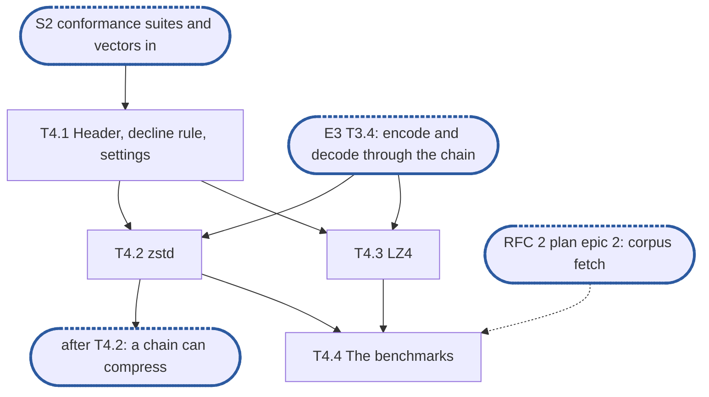

# Epic 4: transforms v2, compression

**Sources:** [RFC 5](../docs/internals/rfcs/rfc-5-transforms.md) Appendix A (the two compressors:
IDs, declining, the header, the bound, the length, the settings and `LengthKey`, and the
`with_encryption: accept` key of its "Leaks" paragraph); §2.1 and §4 items 1, 2 and 4 to 7 as they
bind a transform; §2.5's format versions; §2.7's decode errors as a transform returns them; §2.8's
length-affecting settings; §3.1 as amended by #5851 (`Kinds`, `MaxEncodedLen`, `LengthOf`,
`LengthKey`, `Version`, `Encode`, `Decode`); §3.2's `with_encryption: accept`; §5.4 (a library
swap is decided by the fixtures); §7's T2, T4 and T9; §8.1's generic rows as these two transforms
run them; §8.3's per-transform, compression-ratio and `Attempt.MaxEncodedLen` benchmarks;
Appendix D's rows D1 and D2. Every citation is the RFC's text with #5851's amendment; the code
lands on `feat/storage-v2`, and the paths below are paths there.
**Track:** A.
**Epic 4 estimate: 4 subtasks, 7.25 man-days.**
**Depends on:** **S2**: from E2, `transformtest.Run` with its `Subject`, `transformtest.Fixture`,
`transformtest.FuzzDecode` and `keystest.Memory`. From E1, the root contract (`ID`, `Stage`,
`Transform`, `Encoded`, `Factory`, `ErrMalformed`, `ErrTooLarge`), `keys.MaterialID` and
`keys.Provider`, and the import allowlist naming `github.com/klauspost/compress/...` and
`github.com/pierrec/lz4/v4`. From E3, partly: `Register` and the decode set (T3.1), which a
compressor's registration needs; `NewChain` (T3.2), `Attempt.Encode` and `Chain.Decode` (T3.4),
which the chain-level tests run through; `unit`'s `transform-allocs` option (T3.7). Outside RFC
5's epics, the RFC 2 plan's epic 2: the corpus fetch the ratio benchmark reads, and the nightly
`fuzz` suite the fuzz targets join.
**Blocks:** E9, which validates the compress stage's settings by building the chain with the
registered compressors.

---

## 1. Goal

Epic 4 ships RFC 5's two compressors, zstd and LZ4, as transforms of the compress stage that any
chain can carry: each declines a chunk that would not shrink, decodes inside the bound the chain
gives it whatever a body claims, and is held to RFC 5's conformance suite and to a fixture that
pins its encoder.

**At the end of the epic:**

- a chain configured with `zstd` or `lz4` writes bodies whose envelope names `0x0001` or `0x0002`,
  and a chunk that would save less than 1/16 passes on unchanged, its envelope without the
  compressor (T4.2, T4.3);
- a body declaring more than `max`, or a zstd frame asking for a window beyond it, is refused
  before anything is allocated, and fuzzing finds no panic and no allocation above `max` (T4.1,
  T4.2, T4.3);
- both pass `transformtest.Run` with a `v1` fixture, and an encoder or library change that alters
  one fixture body fails `unit` (T4.2, T4.3);
- a zstd level outside −128 to 22 fails `NewChain`, and `with_encryption: accept` builds (T4.1,
  T4.2);
- each transform's throughput, the compression ratio per corpus and `Attempt.MaxEncodedLen`
  against the largest body are benchmarked (T4.4).

### 1.1 In scope

`pkg/transform/compress/internal/body` (the header, the decline rule and the settings both
compressors share), `pkg/transform/compress/zstd` and `pkg/transform/compress/lz4` (the
transforms, their registration, fixtures, fuzz targets and allocation tests), the benchmarks, and
the two direct dependencies in `go.mod`.

### 1.2 Out of scope

- `Register`, the decode set, `NewChain`'s stage rules and its `with_encryption: accept` check,
  the envelope and the chain ID: E3. This epic's compressors are what those run on.
- `transformtest`, `keystest` and the fixture format: E2.
- The store configuration's `transforms` row, the default chain of an encrypting namespace (no
  compress stage) and the operator-facing text of the size leak: E9.
- The put and whole-block get benchmark with the default chain: E11.
- A padding transform in the compress stage's place: RFC 5 §9 item 3 specifies none until a
  deployment needs one.

### 1.3 Names used here

- **E1**, epic 1, interfaces: the root contract, `keys`, `chain`'s signatures and the import
  test with its allowlist.
- **E2**, epic 2, test foundations: `transformtest` (`Run`, `Subject`, `Fixture`, `FuzzDecode`),
  `keystest.Memory`.
- **E3**, epic 3, the chain: the registry, `NewChain`, the pin, the envelope, encode and decode,
  `unit`'s `transform-allocs` option.
- **E9**, the integration epic: the settings rows, the default chain, the error mapping.
- **E11**, epic 11, E2E green: RFC 5's rows through the codec and the engine, and the put and get
  benchmark.
- **S2**, the conformance suites and vectors in: E2's components exist.
- **The RFC 2 plan's epic 2**: the carver's test foundations, owner of the corpus fetch and of the
  nightly `fuzz` suite of the offload plans.

## 2. How the general rules apply

The rules are those of
[RFC 5's plan, §1.5](rfc-5-transforms-plan.md#15-general-rules-for-each-epic), cited by number and
title and not copied.

| Rule | Subtasks | How |
| --- | --- | --- |
| rule 1, independent unit tests ([`CLAUDE.md`, "Writing tests"](../CLAUDE.md#writing-tests)) | all | each compressor runs E2's `transformtest.Run`; the chain-level tests build a real chain with E3's `NewChain` and E2's `keystest.Memory` (kind 2). The libraries are real. No double |
| rule 2, fuzz every decoder of bytes this component did not just write | T4.1, T4.2, T4.3 | `FuzzHeader` over the shared header (T4.1); `FuzzZstdDecode` and `FuzzLZ4Decode`, each through E2's `FuzzDecode`, seeded with the fixtures and with decompression bombs; all three join the nightly `fuzz` suite, and T4.2 extends RFC 5 §8.3's suites line to name them |
| rule 3, observability follows RFC 25 | none | a compressor records nothing of its own: the chain records RFC 5 §6's series around it (E3). It takes no logger and logs nothing. It holds no material, so the planted-key check of epics 5 to 8 does not apply |
| rule 4, profiling | T4.2, T4.3 | every test under `internal/prof`'s `Watch`, which also shows that the zstd encoder and decoder start no goroutine; `TestAllocs…` for each transform's `Encode` and `Decode` join `transform-allocs` by name |
| rule 5, public interface and internals ([`CLAUDE.md`, "Verifying a change"](../CLAUDE.md#verifying-a-change)) | T4.2, T4.3 | each transform is tested at `Transform`, through `transformtest`, and at the chain the codec calls: registration, refusal at build and Appendix D's D1 run through `NewChain`, `Attempt.Encode` and `Chain.Decode`; 64 goroutines under `-race` |
| rule 6, known failures shrink | none | `unit` keeps no `known.yaml`; every test lands green |
| rule 7, v2 ignores v1, and imports only what RFC 0 §1.2 allows | all | the packages import the root, `keys`, `entity`, `chain` (to register), each other's `internal/body`, and one compression module each; nothing of v1 and no `pkg/metrics`, `pkg/health` or `pkg/settings`. E1's import test holds it |
| rule 8, real dependencies for properties of those dependencies | T4.4 | the libraries are the real ones in every test; the ratio benchmark reads real files, the corpus |
| rule 9, code comment conventions ([`CLAUDE.md`, "Code comments"](../CLAUDE.md#code-comments)) | T4.1, T4.2, T4.3 | RFC 5's Appendix A notes as `decision:` markers: the fixed 1/16 threshold at the decline rule (T4.1), the double compression of a measuring pass at each `LengthOf` (T4.2, T4.3). D7's `decision:` at each `Version`; D9's `ponytail:` at the level mapping |
| rule 10, a test must be able to fail | all | each test in §6 names the bug it catches; the fixtures are written once from the first build and then hold every later one |
| rule 11, a symbol is exported only if RFC 5's interface or a consumer outside the package uses it | all | `zstd` and `lz4` export nothing: each registers at init and is imported for that alone. `internal/body` exports what its two packages call, and `internal` keeps it from everyone else |
| rule 12, each subtask creates only what it declares | all | `internal/body` lands with zstd, its first consumer; each fixture, fuzz target and allocation test with its transform; the benchmark file with T4.4 |

## 3. Requirements and invariants

Every obligation RFC 5 places on the two compressors, numbered so that subtasks and tests can cite
them. `Source` is RFC 5.

**The two transforms and their bodies**

| # | Requirement | Kind | Source | Subtasks |
| --- | --- | --- | --- | --- |
| R1 | zstd is transform `0x0001` and LZ4 `0x0002`, both of the compress stage and in the range `0x0000`–`0x7FFF` kept for shipped transforms, each registered at start; the envelope records the algorithm, and the body never records the level | MUST | Appendix A, §2.3, §4 items 1 and 2 | T4.2, T4.3 |
| R2 | Each body opens with the transform's format version, 1 for both, which `Version` reports; a format change is a new version in that header, never a new ID, and the transform keeps decoding every version it wrote | MUST | Appendix A ("Its header"), §2.5, §2.8, §3.1, §4 item 4 | T4.1, T4.2, T4.3 |
| R3 | `Encode` returns `applied=false` and the chunk unchanged when the body, header included, would save less than 1/16 of the input, and applies otherwise; the threshold is fixed, never a setting | invariant | Appendix A, §2.1 | T4.1, T4.2, T4.3 |
| R4 | After the version, the header holds the decompressed length as an unsigned LEB128 integer of at most 10 bytes; a longer or non-minimal one is malformed | MUST | Appendix A ("Its header") | T4.1 |

**Decoding within bounds**

| # | Requirement | Kind | Source | Subtasks |
| --- | --- | --- | --- | --- |
| R5 | `Decode` refuses a declared length above `max` before allocating, with `ErrTooLarge`: a body declaring `max + 1` fails so, and so does one declaring 64 MiB | MUST | Appendix A ("Its header"), §2.1, §2.7, §4 item 5, §8.1 T4, Appendix D D2 | T4.1, T4.2, T4.3 |
| R6 | zstd's decoder runs with its window capped at the chunk maximum: a frame asking for more is refused before it decodes, so no body makes it allocate more than one chunk | MUST | Appendix A ("Its header"), Appendix D D2 | T4.2 |
| R7 | Fuzzed, `Decode` never panics and never produces or allocates more than `max`, however large a body claims its output to be | MUST NOT | §2.1, §7 T4, §8.1 T4 | T4.2, T4.3 |
| R8 | `Decode` returns only RFC 5 §2.7's errors, so no error type of the libraries crosses it; with every byte of a body flipped in turn it returns one of them or bytes the codec's hash check rejects, and never panics. A declined chunk is not an error | MUST NOT | §2.7, §4 item 6, §8.1 §2.7 | T4.2, T4.3 |

**Bounds, length and settings**

| # | Requirement | Kind | Source | Subtasks |
| --- | --- | --- | --- | --- |
| R9 | `MaxEncodedLen(n, m)` is `n` for every `m`, nil included; no body exceeds it, and an incompressible input reaches it | bound | Appendix A ("Bound"), §2.1, §3.1, §4 item 2, §8.1 §2.1 | T4.2, T4.3 |
| R10 | `LengthOf` answers false: the length is not known without compressing | MUST | Appendix A ("Length"), §2.1 | T4.2, T4.3 |
| R11 | zstd's `level` is 3 when the settings give none; a level outside −128 to 22 is refused when the chain is built. LZ4 takes no level | MUST | Appendix A ("Settings"), §2.7 | T4.1, T4.2 |
| R12 | `LengthKey` is zstd's level as one signed byte, two's complement, and empty for LZ4: every setting that changes a body is in it, and nothing else is | MUST | Appendix A ("Settings"), §2.8, §3.1, §4 item 2 | T4.2, T4.3 |
| R13 | Both build with `with_encryption: accept` in their settings, which the chain reads, and it changes no body | MUST | §3.2, Appendix A ("Leaks"), §8.2 T16 | T4.1, T4.2 |

**A transform's obligations, through the conformance suite**

| # | Requirement | Kind | Source | Subtasks |
| --- | --- | --- | --- | --- |
| R14 | `Decode(Encode(p)) == p`, byte for byte, for every input, inputs that begin with the transform's own header or with an envelope included; an incompressible chunk that begins with zstd's frame magic round-trips through the chain | MUST | §2.1, §7 T2, §8.1 T2, Appendix D D1 | T4.2, T4.3 |
| R15 | Everything `Decode` needs is in the body: neither transform uses material, so `Kinds` is empty | MUST | §2.1, §3.1 | T4.2, T4.3 |
| R16 | Safe to call concurrently, with no memory between calls: encode and decode from 64 goroutines under the race detector give the sequential results | MUST | §2.1, §8.1 concurrency | T4.2, T4.3 |
| R17 | `Encode` of one input with the same settings and format version gives the same body every time, and from two instances built from one configuration | MUST | §2.1, §7 T9, §8.1 T9 | T4.2, T4.3 |
| R18 | Each ships a fixture of inputs, settings and the bodies its first format version wrote; every later build decodes every fixture body and encodes each fixture input to exactly its recorded body, so an encoder whose output differs, a new library version included, is a new format version or a new transform, never a silent change | MUST | §4 item 7, §5.4, §7 T9, §8.1 T2 and T9 | T4.2, T4.3 |

**Benchmarks**

| # | Requirement | Kind | Source | Subtasks |
| --- | --- | --- | --- | --- |
| R19 | Each transform's encode and decode, in MB/s per core, reported per transform against the previous run | test row | §8.3 | T4.4 |
| R20 | The compression ratio per corpus, over random bytes, a text and source tree and a mixed VM image, recorded with the corpus, the chunk size distribution and the CPU | test row | §8.3 | T4.4 |
| R21 | `Attempt.MaxEncodedLen` against the largest body seen is at most 1 on every corpus | bound | §8.3 | T4.4 |

**Mapping of what this epic does not own.** Appendix A's "compresses only where its compress
stage carries `with_encryption: accept`" is E3's check at build (its R7); this epic's part is R13.
"Changing the level affects the next write only" is the pin's (E3's R10). The size leak's
operator-facing text, which must not describe encryption as hiding content on such a chain, is
E9's, with the settings it documents; this epic's doc comment on `with_encryption` names the
leak and claims nothing hidden, held by review. §6's "a transform logs nothing per chunk" holds
because a `Factory` receives no logger and the compressors import no log package, held by review;
their series are the chain's (E3's R31). §2.5's material kinds, §4 item 3's derivation labels and
§8.1's authenticating rows do not apply: neither compressor uses material or authenticates. §8.2's
T16 refusal and the default chain are E3's and E9's. §8.3's targets are reports run by hand after
merge, as §8.3 says; T4.4 delivers the benchmarks, which gate nothing but R21's ratio.

## 4. Decisions this epic takes

- **D1, one package per compressor, and an internal one they share.** RFC 5 §3.1 makes each
  shipped transform its own package, and E2's `transformtest.Run` reads a package's fixtures from
  its own `testdata/fixtures`, so zstd and LZ4 cannot share a directory without their fixtures
  mixing. They are `pkg/transform/compress/zstd` and `pkg/transform/compress/lz4`, beside
  `pkg/transform/compress/internal/body`, which holds the header, the decline rule and the
  settings parse both use, so neither copies the other's format code and nothing outside
  `compress` can import it. Prior art: Go's `compress/flate`, `compress/gzip` and `compress/zlib`,
  one package per format under one parent, sharing nothing exported (from memory).
- **D2, a zstd body is the header and one single-segment frame.** RFC 5 caps the decoder's window
  at the chunk maximum, and a zstd frame's window is otherwise the encoder's choice, rounded to a
  power of two that can exceed a chunk maximum that is not one. The encoder therefore writes one
  frame with the single-segment flag (its window is then its content size), the content size,
  no checksum (the codec's hash decides, §2.6) and no dictionary: `zstd.NewWriter(nil,
  WithEncoderLevel(EncoderLevelFromZstd(level)), WithSingleSegment(true), WithEncoderCRC(false))`,
  used only through `EncodeAll`. `Decode` reads the frame header with `zstd.Header` and refuses,
  as `ErrMalformed` and before decoding, a skippable frame, a dictionary, a frame that is not
  single-segment, or a content size other than the declared length; it then decodes with
  `DecodeAll` into the caller's `dst` when its capacity holds the declared length, or a buffer of
  exactly that length, on a decoder built with `WithDecodeAllCapLimit(true)`, so a second frame or
  a lying block cannot grow it. The codecs are process-wide, built lazily once each: one decoder,
  and one encoder per encoder speed the levels map to (D9), never one per transform, since E3
  builds a transform per store for its decode set and `Transform` has no `Close`. They are built
  with a nil reader and writer, which in v1.20.4 starts no goroutine, and `EncodeAll` and
  `DecodeAll` are safe for concurrent use. `Subject.Scratch` is
  the decoder's per-call block buffers, measured once in T4.2 and stated with its reason in the
  test. Prior art: RFC 8878 §3.1.1.1's single-segment flag; `klauspost/compress` v1.20.4's options
  and `Header`, read in the module cache.
- **D3, an LZ4 body is the header and one LZ4 block, compressed through a pool.** The block format
  carries no length and no checksum; the header gives the length and the codec's hash decides, so
  the frame format's would only repeat them. `Encode` takes an `lz4.Compressor` from a
  `sync.Pool` (one is not safe for concurrent use, and its table is reset per call, so output is
  deterministic) and compresses into a destination as long as the most the decline rule accepts:
  a zero answer is a decline. `Decode` calls `lz4.UncompressBlock` into a buffer of exactly the
  declared length, which bounds it, and refuses a different decoded length. Prior art: the LZ4
  block format specification; `pierrec/lz4/v4` v4.1.33's `Compressor`, whose package-level
  `CompressBlock` is deprecated, read in the module cache.
- **D4, the decline rule in integers.** A body applies when `16 × (n − len(body)) ≥ n`, `body`
  counting the header, and declines otherwise, so "saves less than 1/16" has no rounding case and a
  1-byte chunk always declines. RFC 5's `decision:` note on the fixed threshold goes at this
  function. Prior art: none found.
- **D5, settings are parsed strictly, and integers arrive in any numeric form.** zstd takes
  `level` and `with_encryption`; LZ4 takes `with_encryption` only. `with_encryption` must be the
  string `accept`; any other key or value fails the `Factory`, so a misspelt `levle` fails at build
  rather than writing level 3 under the chain ID the operator did not mean. A level is any Go
  integer type, a `json.Number` or a `float64` holding an integer, which is what `encoding/json`
  and YAML decoders give, checked against −128 to 22 before it is converted so it cannot overflow;
  E2's fixture loader therefore keeps `float64` and needs no `UseNumber`. `with_encryption` is a
  consent, so `true` does not pass for `accept`. Empty settings build, as
  E3's decode set needs (its D1). Prior art: `encoding/json`'s `DisallowUnknownFields` as an
  opt-in for strict decoding (from memory).
- **D6, the registered names are `zstd` and `lz4`.** RFC 5 names the algorithms but not the names
  a configuration lists; these are Appendix A's words, and a store configuration names them from
  the first, so they are settled now. Prior art: the names `zstd` and `lz4` in common use, as
  `tar --zstd` and the `lz4` tool (from memory).
- **D7, a dependency bump that changes a body fails the fixtures, by design.** `go.mod` pins
  each library's version; a bump whose encoder writes different bytes fails R18's fixture row,
  and that failure is the decision point of RFC 5 §5.4, never a flake to regenerate around: the
  bump either waits or ships with a new format version. A `decision:` marker at each `Version`
  says so. Prior art: Go's `compress/*` golden files (from memory).
- **D8, the ratio benchmark reads the corpus from the RFC 2 plan's cache, and makes random bytes
  itself.** A check may not fetch (RFC 2 §1.3), so the benchmark reads the directory the RFC 2
  plan's corpus fetch fills, named by the environment variable that fetch documents, and skips,
  naming the variable, when it is unset. Random bytes come from a seeded source (kind 1). The
  benchmark builds a real chain with `NewChain` and `keystest.Memory` to read
  `Attempt.MaxEncodedLen`, and fails if any body exceeds it (R21). Prior art: the RFC 2 plan's own
  `manual` corpus option.
- **D9, zstd levels collapse onto the library's four encoder speeds.** `EncoderLevelFromZstd` maps
  every level below 3 to the fastest speed and every level from 10 to the best, so two levels can
  write equal bodies under two chain IDs, which costs a missed dedup across a level change and
  nothing else. A `ponytail:` marker at the mapping names the ceiling and the upgrade: an encoder
  honouring each level, when the ratio benchmark shows a level an operator asks for compressing no
  better than its neighbour, which is a new format version (§5.4). Prior art:
  `klauspost/compress`'s own documented mapping, read in the module cache.

## 5. Target tree

```text
pkg/transform/compress/internal/body/
  header.go             T4.1  format version and minimal LEB128 length: append and parse
  decline.go            T4.1  the 1/16 rule (D4)
  settings.go           T4.1  level and with_encryption parsing (D5)
  body_test.go          T4.1
  fuzz_test.go          T4.1  FuzzHeader
pkg/transform/compress/zstd/
  zstd.go               T4.2  the transform, its Factory, registration at init (D2, D6, D9)
  zstd_test.go          T4.2  transformtest.Run, the chain-level tests
  fuzz_test.go          T4.2  FuzzZstdDecode
  allocs_test.go        T4.2  TestAllocsZstd…
  testdata/fixtures/v1/ T4.2
  testdata/fuzz/FuzzZstdDecode/  T4.2  decompression bombs, then crashers
pkg/transform/compress/lz4/
  lz4.go                T4.3  the transform, its Factory, the Compressor pool, registration (D3)
  lz4_test.go           T4.3
  fuzz_test.go          T4.3  FuzzLZ4Decode
  allocs_test.go        T4.3  TestAllocsLZ4…
  testdata/fixtures/v1/ T4.3
  testdata/fuzz/FuzzLZ4Decode/   T4.3
pkg/transform/compress/
  bench_test.go         T4.4  per-transform, ratio and bound benchmarks over the corpus (D8)
go.mod, go.sum          T4.2  klauspost/compress direct; T4.3  pierrec/lz4/v4 added
docs/internals/rfcs/rfc-5-transforms.md  T4.2  §8.3's suites line names the fuzz targets
```

## 6. Subtasks

### T4.1 The shared header, decline rule and settings

**Subtask T4.1 estimate: 1.25 man-days.**

- **Track:** A. **Depends on:** S2.
- **Covers:** R2, R3, R4, R5, R11, R13.
- **Deliverables:** `internal/body`: appending a header (format version, then the length as
  minimal LEB128) and parsing one against `max`, returning the version, the declared length and
  the payload's offset, or `ErrMalformed` (unknown version, over 10 bytes, a tenth byte above 1,
  non-minimal, truncated, a length of 0) or `ErrTooLarge` (above `max`), before any allocation;
  its own reader, since `binary.Uvarint` accepts non-minimal encodings; `FuzzHeader`, asserting
  no panic, every read inside the input, and agreement with `binary.Uvarint` on every minimal
  encoding; the decline rule (D4) with RFC 5's
  `decision:` note; the settings parse (D5), returning the level and refusing anything else.
  Consumed by T4.2 and T4.3.
- **Acceptance criteria:**
  - A length's encoding is minimal and round-trips for 0, 127, 128, 2⁶³ and 2⁶⁴ − 1; an
    11-byte, a non-minimal (`0x80 0x00`) and a truncated encoding are `ErrMalformed`, and so is a tenth byte above 1.
  - A declared length of `max + 1` is `ErrTooLarge`, and the parse allocates nothing.
  - The rule applies at exactly a 1/16 saving and declines one byte short of it.
  - `with_encryption: accept`, a level as `int`, `int8` and integral `float64` parse; a level of
    3.5, `"3"`, a `with_encryption` other than `accept` and an unknown key are refused.
- **Tests:** at the parse and the rule, which both transforms' `Decode` and `Encode` call: the
  length table (catches a non-minimal or over-long length accepted, R4); `max + 1` under
  `testing.AllocsPerRun` (catches an allocation before the bound, R5); the boundary pair at 1/16
  for several `n` (catches a rounding that applies below the threshold, R3); the settings table
  (catches a misspelt key accepted, or `with_encryption` refused, R11, R13); `FuzzHeader` against
  `binary.Uvarint`, an independent decoder (catches a length misread, R4). The transforms' fuzz
  targets reach the parse too (T4.2, T4.3).
- **Rules:** rule 2: `FuzzHeader` joins the nightly `fuzz` suite with T4.2's targets. rule 9: the
  1/16 `decision:` marker.

### T4.2 zstd

**Subtask T4.2 estimate: 3 man-days.**

- **Track:** A. **Depends on:** T4.1, T3.4.
- **Covers:** R1, R2, R3, R5, R6, R7, R8, R9, R10, R11, R12, R13, R14, R15, R16, R17, R18.
- **Deliverables:** `zstd.go`: the transform of D2, ID `0x0001`, stage compress, `Kinds` empty,
  `Version` 1, `MaxEncodedLen(n, m) = n`, `LengthOf` false with RFC 5's double-compression
  `decision:` note, `LengthKey` the level's signed byte, `Encode` declining by D4, `Decode` with
  T4.1's parse and D2's frame checks, every library error returned as `ErrMalformed`; its
  `Factory` (D5) and `chain.Register(0x0001, "zstd", …)` at init (D6). The `v1` fixture: zeros,
  text, source code, random bytes (declined), a chunk beginning with zstd's frame magic, at levels
  −128, 3 and 22. `FuzzZstdDecode`, through `transformtest.FuzzDecode`, with seeds: a body
  declaring 64 MiB, a frame claiming a window of 2³¹, a frame whose content size differs from the
  header, two concatenated frames, and a high-ratio frame expanding past the declared length.
  `TestAllocsZstd…` for `Encode` and `Decode`. `go.mod` makes `klauspost/compress` direct. RFC 5
  §8.3's suites line extended to name the fuzz targets, and the targets added to the nightly
  `fuzz` suite in the form the RFC 2 plan's epic 2 registers it. Consumed by E9 and by the content
  wiring, which imports the package for its registration.
- **Acceptance criteria:**
  - `transformtest.Run` passes with `Settings` `{level: 3}`, `LengthAffecting` levels −5 and 19,
    `WorstCase` seeded random bytes, and D2's `Scratch`, under `-race`.
  - Built through `NewChain` with `zstd`, a compressible chunk's envelope names `0x0001`, and an
    incompressible one's names nothing and decodes; a level of −129 or 23 fails `NewChain`, and
    `with_encryption: accept` builds.
  - Each fuzz seed is refused before allocating more than `Scratch`, with `ErrTooLarge` or
    `ErrMalformed`.
  - `Encode` and `Decode` with a caller's `dst` of enough capacity stay within an allocation count
    measured when the test lands and stated in it with its reason, since the library allocates
    internally.
- **Tests:** at `Transform`, through `transformtest.Run`, and at the chain the codec calls:
  `Run`'s rows (catch a lossy, unbounded, racy or nondeterministic encoder and a foreign error,
  R7, R8, R9, R14, R16, R17) and its fixture rows over `v1` (catch an encoder or library change,
  R18, D7); `LengthKey` for −128, −1, 0, 3 and 22 is `0x80`, `0xFF`, `0x00`, `0x03` and `0x16`, from
  Appendix A's definition (catches an unsigned or wider key, R12); the chain-level round trip and
  refusals above (catch a wrong ID, a registration missing, a level range not enforced at build,
  R1, R11, R13); Appendix D's D1 through the chain, an incompressible chunk beginning with
  `28 B5 2F FD` (catches a body read as compressed because it looks like a frame, R14); the fuzz
  seeds (catch a decoder sized by a body's claim, R5, R6, R7); `internal/prof`'s `Watch` around
  the package's tests (catches a goroutine the encoder or decoder starts, D2); the allocation
  tests (catch a buffer allocated per call, rule 4). No double: the in-memory provider the chain
  needs is E2's kind 2.
- **Rules:** rule 2: the target and the suites line. rule 9: the double-compression `decision:`
  note at `LengthOf`, D7's at `Version`, D9's `ponytail:` at the level mapping.

### T4.3 LZ4

**Subtask T4.3 estimate: 1.5 man-days.**

- **Track:** A. **Depends on:** T4.1, T3.4.
- **Covers:** R1, R2, R3, R5, R7, R8, R9, R10, R11, R12, R14, R15, R16, R17, R18.
- **Deliverables:** `lz4.go`: the transform of D3, ID `0x0002`, stage compress, `Kinds` empty,
  `Version` 1, `MaxEncodedLen(n, m) = n`, `LengthOf` false with RFC 5's double-compression
  `decision:` note, `LengthKey` empty, `Encode` through the `Compressor` pool and D4's bound,
  `Decode` with T4.1's parse and `UncompressBlock`, errors returned as `ErrMalformed`; its
  `Factory`, refusing a `level` (D5), and `chain.Register(0x0002, "lz4", …)` at init (D6). The
  `v1` fixture: the zstd fixture's inputs. `FuzzLZ4Decode` with seeds: a body declaring 64 MiB, a
  block whose matches expand past the declared length, a block shorter than the declared length.
  `TestAllocsLZ4…`. `go.mod` adds `pierrec/lz4/v4`. Consumed by E9 and the content wiring.
- **Acceptance criteria:**
  - `transformtest.Run` passes with empty `Settings`, no `LengthAffecting`, `WorstCase` seeded
    random bytes, under `-race`.
  - Through `NewChain` with `lz4`, a compressible chunk's envelope names `0x0002`; a `level`
    fails `NewChain`; `with_encryption: accept` builds.
  - Each fuzz seed is refused, and `Decode` allocates at most the declared length.
  - `Encode` and `Decode` with a caller's `dst` allocate nothing after one warm-up call: the
    `Compressor` pool and `UncompressBlock` into `dst` need nothing more.
- **Tests:** as T4.2's, for LZ4: `Run` and its fixture rows (R7, R8, R9, R14, R16, R17, R18);
  `LengthKey` empty (catches a setting leaking into the chain ID, R12); the chain-level checks
  (R1, R11); the fuzz seeds (R5, R7); 64 goroutines sharing the pool under `-race` (catches a
  `Compressor` used by two calls at once, R16); the allocation tests.
- **Rules:** rule 2: the target. rule 9: the double-compression note at `LengthOf`, D7's at
  `Version`.

### T4.4 The benchmarks

**Subtask T4.4 estimate: 1.5 man-days.**

- **Track:** A. **Depends on:** T4.2, T4.3. Outside this epic, the RFC 2 plan's epic 2 corpus
  fetch.
- **Covers:** R19, R20, R21.
- **Deliverables:** `pkg/transform/compress/bench_test.go`: for each compressor, encode and decode
  throughput with `b.SetBytes` and `b.ReportAllocs`, over seeded random bytes and each corpus file
  cut at the chunk sizes RFC 2's carver would; the ratio per corpus, reported as a custom metric
  with the corpus name, the chunk size distribution and the CPU (`b.ReportMetric`, logged with the
  run); the largest body against `Attempt.MaxEncodedLen`, through a chain built with `NewChain`
  and `keystest.Memory` (D8). Consumed by the operator reading the reports, and by D9's upgrade
  trigger.
- **Acceptance criteria:**
  - With the corpus present, every benchmark runs and reports; without it, the corpus benchmarks
    skip naming the variable and the random-bytes ones still run.
  - A body longer than `Attempt.MaxEncodedLen` fails the run, naming the corpus, the file and the
    chunk.
- **Tests:** the bound check (catches a compressor whose declared bound a real corpus exceeds,
  R21). The rest are reports, compared with `benchstat` over `-count=10` on one machine, as
  `CLAUDE.md`'s "Writing tests" says.
- **Rules:** rule 8: the corpus is real files.

## 7. Order of work



T4.1 goes first because both compressors build on it. zstd goes before LZ4: its frame checks are
the higher risk, and the format code both share is proved on it first. T4.3 needs only T4.1 and
can run beside T4.2.

## 8. Suggested pull requests

| PR | Subtasks | Man-days | After | Why together |
| --- | --- | --- | --- | --- |
| 1 | T4.1, T4.2 | 4.25 | E3's T3.4 | the shared format and zstd end to end: a chain can compress |
| 2 | T4.3, T4.4 | 3 | PR 1 | LZ4 on the proved format, then the benchmarks over both |

A suggestion only: one pull request per subtask works as well.

## 9. Open points

- **Needs on E2**, whose breakdown is in review: `transformtest`'s §2.1 bound row must count a
  declined chunk, passed on unchanged, as reaching `MaxEncodedLen(n) = n`, since a compressor's
  applied body is always shorter (R9); and D5 settles E2's open point on fixture numbers: a level
  arrives as `float64` and the `Factory` takes it, so the fixture loader needs no `UseNumber`.
- **Needs on the RFC 2 plan's epic 2**, not yet broken down: the environment variable naming its
  corpus cache (D8), and whether the corpus holds a mixed VM image, the third corpus RFC 5 §8.3
  names. If it does not, R20's VM-image corpus is added to that fetch.
- **The fuzz suite's form** is the RFC 2 plan's epic 2's; T4.2 adds its targets in whatever form
  that suite takes, and extends RFC 5 §8.3's suites line, which E3's T3.4 adds first if it lands
  first.
- **The package layout** refines the RFC 5 plan's §4.1, which shows one `pkg/transform/compress/`
  directory: D1 follows RFC 5 §3.1's one package per shipped transform.
- **The estimate** is 4 subtasks and 7.25 man-days, against the plan's 4 and 8.5: the shared
  header package lets LZ4 reuse what zstd proves. The least certain is T4.2's, whose frame checks
  rest on `klauspost/compress`'s `Header` and cap limit, and whose allocation ceiling is measured
  only when the code exists.
