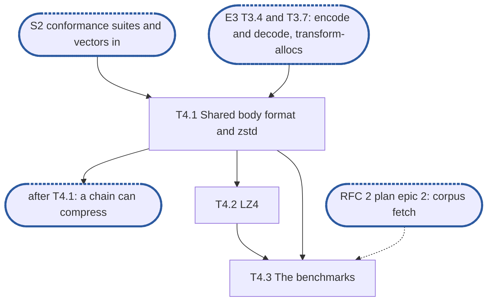

# Epic 4: transforms v2, compression

**Sources:** [RFC 5](../docs/internals/rfcs/rfc-5-transforms.md) Appendix A (the two compressors:
IDs, declining, the header, the bound, the length, the settings and `LengthKey`, and the
`with_encryption: accept` key of its "Leaks" paragraph); §2.1 and §4 items 1, 2 and 4 to 7 as they
bind a transform; §2.3's compress stage; §2.5's format versions; §2.7's decode errors as a
transform returns them; §2.8's length-affecting settings; §3.1 as amended by #5851 (`Kinds`,
`MaxEncodedLen`, `LengthOf`, `LengthKey`, `Version`, `Encode`, `Decode`); §3.2's
`with_encryption: accept`; §5.4 (a library swap is decided by the fixtures); §7's T2, T4 and T9;
§8.1's generic rows as these two transforms run them; §8.2's T16 (the compressors' half); §8.3's
per-transform, compression-ratio and `Attempt.MaxEncodedLen` benchmarks; Appendix D's rows D1 and
D2. Every citation is the RFC's text with #5851's amendment; the code lands on
`feat/storage-v2`, and the paths below are paths there.
**Track:** A.
**Epic 4 estimate: 3 subtasks, 7 man-days.**
**Depends on:** **S2**: from E2, `transformtest.Run` with its `Subject`, `transformtest.Fixture`,
`transformtest.FuzzDecode` and `keystest.Memory`. From E1, the root contract (`ID`, `Stage`,
`Transform`, `Encoded`, `Factory`, `ErrMalformed`, `ErrTooLarge`), `keys.MaterialID` and
`keys.Provider`, and the import allowlist naming `github.com/klauspost/compress/...` and
`github.com/pierrec/lz4/v4`. From E3: `Register` and the decode set (T3.1), which a compressor's
registration needs; `NewChain` (T3.2), `Attempt.Encode` and `Chain.Decode` (T3.4), which the
chain-level tests run through; `unit`'s `transform-allocs` option (T3.7), which runs the
allocation tests. Outside RFC 5's epics, the RFC 2 plan's epic 2: the corpus fetch the ratio
benchmark reads, and the nightly `fuzz` suite the fuzz targets join.
**Blocks:** E9, which validates the compress stage's settings by building the chain with the
registered compressors.

---

## 1. Goal

Epic 4 ships RFC 5's two compressors, zstd and LZ4, as transforms of the compress stage that any
chain can carry: each declines a chunk that would not shrink, decodes inside the bound the chain
gives it whatever a body claims, and is held to RFC 5's conformance suite and to a fixture that
pins its encoder.

**At the end of the epic:**

- a chain configured with `zstd` or `lz4` writes bodies whose envelope names `0x0001` or `0x0002`,
  and a chunk that would save less than 1/16 passes on unchanged, its envelope without the
  compressor (T4.1, T4.2);
- a body declaring more than `max`, a zstd frame asking for a window beyond it, a block that runs
  past the declared length and a frame followed by anything are refused before the decoder grows
  any buffer, and fuzzing finds no panic and no allocation above `max` (T4.1, T4.2);
- both pass `transformtest.Run` with a `v1` fixture covering every zstd encoder speed, and an
  encoder or library change that alters one fixture body fails `unit` (T4.1, T4.2);
- a zstd level outside −128 to 22 fails `NewChain`, and `with_encryption: accept` builds and
  changes no body (T4.1, T4.2);
- each transform's throughput, the compression ratio per corpus and `Attempt.MaxEncodedLen`
  against the largest body are benchmarked (T4.3).

### 1.1 In scope

`pkg/transform/compress/internal/body` (the header, the decline rule and the settings both
compressors share), `pkg/transform/compress/zstd` and `pkg/transform/compress/lz4` (the
transforms, their registration, fixtures, fuzz targets and allocation tests), the benchmarks, and
the two direct dependencies in `go.mod`.

### 1.2 Out of scope

- `Register`, the decode set, `NewChain`'s stage rules and its `with_encryption: accept` check,
  the envelope and the chain ID: E3. This epic's compressors are what those run on.
- `transformtest`, `keystest` and the fixture format: E2.
- The store configuration's `transforms` row, the default chain of an encrypting namespace (no
  compress stage) and the operator-facing text of the size leak: E9.
- The put and whole-block get benchmark with the default chain: E11.
- A padding transform in the compress stage's place: RFC 5 §9 item 3 specifies none until a
  deployment needs one.

### 1.3 Names used here

- **E1**, epic 1, interfaces: the root contract, `keys`, `chain`'s signatures and the import
  test with its allowlist.
- **E2**, epic 2, test foundations: `transformtest` (`Run`, `Subject`, `Fixture`, `FuzzDecode`),
  `keystest.Memory`.
- **E3**, epic 3, the chain: the registry, `NewChain`, the pin, the envelope, encode and decode,
  `unit`'s `transform-allocs` option.
- **E9**, the integration epic: the settings rows, the default chain, the error mapping.
- **E11**, epic 11, E2E green: RFC 5's rows through the codec and the engine, and the put and get
  benchmark.
- **S2**, the conformance suites and vectors in: E2's components exist.
- **The RFC 2 plan's epic 2**: the carver's test foundations, owner of the corpus fetch and of the
  nightly `fuzz` suite of the offload plans.

## 2. How the general rules apply

The rules are those of
[RFC 5's plan, §1.5](rfc-5-transforms-plan.md#15-general-rules-for-each-epic), cited by number and
title and not copied.

| Rule | Subtasks | How |
| --- | --- | --- |
| rule 1, independent unit tests ([`CLAUDE.md`, "Writing tests"](../CLAUDE.md#writing-tests)) | all | each compressor runs E2's `transformtest.Run`; the chain-level tests build a real chain with E3's `NewChain` and E2's `keystest.Memory` (kind 2). The libraries are real. No double |
| rule 2, fuzz every decoder of bytes this component did not just write | T4.1, T4.2 | `FuzzZstdDecode` and `FuzzLZ4Decode`, each through E2's `FuzzDecode`, seeded with the fixtures and with crafted bodies, and each asserting on a successful decode that the output is exactly the header's declared length and that `Decode(Encode(out)) == out` whenever `Encode` applies, the re-encode check `CLAUDE.md`'s fuzz rule allows, since neither library has an independent decoder in the tree; both reach the shared header parse, and both join the nightly `fuzz` suite. T4.1 extends RFC 5 §8.3's suites line to name them |
| rule 3, observability follows RFC 25 | none | a compressor records nothing of its own: the chain records RFC 5 §6's series around it (E3). It takes no logger and logs nothing. It holds no material, so the planted-key check of epics 5 to 8 does not apply |
| rule 4, profiling | T4.1, T4.2, T4.3 | every test and benchmark under `internal/prof`'s `Watch`, which also shows the zstd codecs start no goroutine; the zstd package's `TestMain` and the benchmark file build and warm every codec before the first `Watch`, so its heap baseline already holds them (D3); `TestAllocs…` for each transform's `Encode` and `Decode` join `transform-allocs` by name |
| rule 5, public interface and internals ([`CLAUDE.md`, "Verifying a change"](../CLAUDE.md#verifying-a-change)) | T4.1, T4.2 | each transform is tested at `Transform`, through `transformtest`, and at the chain the codec calls: registration, refusal at build, decoding with the decode set's default build, and Appendix D's D1 run through `NewChain`, `Attempt.Encode` and `Chain.Decode`; `transformtest`'s 64 goroutines under `-race` |
| rule 6, known failures shrink | none | `unit` keeps no `known.yaml`; every test lands green |
| rule 7, v2 ignores v1, and imports only what RFC 0 §1.2 allows | all | the packages import the root, `keys`, `entity`, `chain` (to register), the shared `internal/body`, and one compression module each; nothing of v1 and no `pkg/metrics`, `pkg/health` or `pkg/settings`. E1's import test holds it |
| rule 8, real dependencies for properties of those dependencies | T4.3 | the libraries are the real ones in every test; the ratio benchmark reads real files, the corpus |
| rule 9, code comment conventions ([`CLAUDE.md`, "Code comments"](../CLAUDE.md#code-comments)) | T4.1, T4.2 | RFC 5's Appendix A notes as `decision:` markers: the fixed 1/16 threshold at the decline rule (T4.1), the double compression of a measuring pass at each `LengthOf` (T4.1, T4.2). A `decision:` at each `Version` that a library bump changing a fixture body is a new format version (R18, §5.4); D5's at the level-0 mapping; D7's `ponytail:` markers at the level mapping and the encoder pool |
| rule 10, a test must be able to fail | all | each test in §6 names the bug it catches; the fixtures are written once from the first build and then hold every later one |
| rule 11, a symbol is exported only if RFC 5's interface or a consumer outside the package uses it | all | `zstd` and `lz4` export nothing: each registers at init and is imported for that alone. `internal/body` exports what its two packages call, and `internal` keeps it from everyone else |
| rule 12, each subtask creates only what it declares | all | `internal/body` lands with zstd, its first consumer; each fixture, fuzz target and allocation test with its transform; the benchmark file with T4.3 |

## 3. Requirements and invariants

Every obligation RFC 5 places on the two compressors, numbered so that subtasks and tests can cite
them. `Source` is RFC 5.

**The two transforms and their bodies**

| # | Requirement | Kind | Source | Subtasks |
| --- | --- | --- | --- | --- |
| R1 | zstd is transform `0x0001` and LZ4 `0x0002`, both of the compress stage and in the range `0x0000`–`0x7FFF` kept for shipped transforms, each registered at start; the envelope records the algorithm, and the body never records the level, so a transform built with default settings decodes a body written at any level | MUST | Appendix A, §2.3, §4 items 1 and 2 | T4.1, T4.2 |
| R2 | Each body opens with the transform's format version, one byte, which `Version` reports; a format change is a new version in that header, never a new ID, and the transform keeps decoding every version it wrote | MUST | Appendix A ("Its header"), §2.5, §2.8, §3.1, §4 item 4 | T4.1, T4.2 |
| R3 | `Encode` returns `applied=false` and the chunk unchanged when the body, header included, would save less than 1/16 of the input; the threshold is fixed, never a setting | invariant | Appendix A, §2.1 | T4.1, T4.2 |
| R4 | After the version, the header holds the decompressed length as an unsigned LEB128 integer of at most 10 bytes; a longer or non-minimal one is malformed | MUST | Appendix A ("Its header") | T4.1 |

**Decoding within bounds**

| # | Requirement | Kind | Source | Subtasks |
| --- | --- | --- | --- | --- |
| R5 | `Decode` refuses a declared length above `max` before allocating, with `ErrTooLarge`: a body declaring `max + 1` fails so, and so does one declaring 64 MiB | MUST | Appendix A ("Its header"), §2.1, §2.7, §4 item 5, §8.1 T4, Appendix D D2 | T4.1, T4.2 |
| R6 | zstd's decoder runs with its window capped at the chunk maximum: a frame asking for more is refused before it decodes, so no body makes it allocate more than one chunk | MUST | Appendix A ("Its header"), Appendix D D2 | T4.1 |
| R7 | Fuzzed, `Decode` never panics and never produces or allocates more than `max`, however large a body claims its output to be | MUST NOT | §2.1, §7 T4, §8.1 T4 | T4.1, T4.2 |
| R8 | `Decode` returns only RFC 5 §2.7's errors, so no error type of the libraries crosses it, and refuses as `ErrMalformed` a body this transform did not write; with every byte of a body flipped in turn it returns one of them or bytes the codec's hash check rejects, and never panics. A declined chunk is not an error | MUST NOT | §2.7, §4 item 6, §8.1 §2.7 | T4.1, T4.2 |

**Bounds, length and settings**

| # | Requirement | Kind | Source | Subtasks |
| --- | --- | --- | --- | --- |
| R9 | `MaxEncodedLen(n, m)` is `n` for every `m`, nil included; no body exceeds it, and an incompressible input, declined and passed on unchanged, reaches it | bound | Appendix A ("Bound"), §2.1, §3.1, §4 item 2, §8.1 §2.1 | T4.1, T4.2 |
| R10 | `LengthOf` answers false: the length is not known without compressing | MUST | Appendix A ("Length"), §2.1 | T4.1, T4.2 |
| R11 | A zstd level outside −128 to 22 is refused when the chain is built | MUST | Appendix A ("Settings"), §2.7 | T4.1 |
| R22 | zstd's `level` is 3 when the settings give none; LZ4 takes no level | SHOULD | Appendix A ("Settings") | T4.1, T4.2 |
| R12 | `LengthKey` is zstd's level as one signed byte, two's complement, and empty for LZ4: every setting that changes a body is in it, and nothing else is | MUST | Appendix A ("Settings"), §2.8, §3.1, §4 item 2 | T4.1, T4.2 |
| R13 | Both build with `with_encryption: accept` in their settings, which the chain reads, and it changes neither the body nor `LengthKey` | MUST | §3.2, Appendix A ("Leaks"), §8.2 T16 | T4.1, T4.2 |

**A transform's obligations, through the conformance suite**

| # | Requirement | Kind | Source | Subtasks |
| --- | --- | --- | --- | --- |
| R14 | `Decode(Encode(p)) == p`, byte for byte, for every input, inputs that begin with the transform's own header or with an envelope included; an incompressible chunk that begins with zstd's frame magic round-trips through the chain | MUST | §2.1, §7 T2, §8.1 T2, Appendix D D1 | T4.1, T4.2 |
| R15 | Everything `Decode` needs is in the body: neither transform uses material, so `Kinds` is empty | MUST | §2.1, §3.1 | T4.1, T4.2 |
| R16 | Safe to call concurrently, with no memory between calls: encode and decode from 64 goroutines under the race detector give the sequential results | MUST | §2.1, §8.1 concurrency | T4.1, T4.2 |
| R17 | `Encode` of one input with the same settings and format version gives the same body every time, and from two instances built from one configuration | MUST | §2.1, §7 T9, §8.1 T9 | T4.1, T4.2 |
| R18 | Each ships a fixture of inputs, settings and the bodies its first format version wrote; every later build decodes every fixture body and encodes each fixture input to exactly its recorded body, so an encoder whose output differs, a new library version included, is a new format version or a new transform, never a silent change | MUST | §4 item 7, §5.4, §7 T9, §8.1 T2 and T9 | T4.1, T4.2 |

**Benchmarks**

| # | Requirement | Kind | Source | Subtasks |
| --- | --- | --- | --- | --- |
| R19 | Each transform's encode and decode, in MB/s per core, reported per transform against the previous run | test row | §8.3 | T4.3 |
| R20 | The compression ratio per corpus, over random bytes, a text and source tree and a mixed VM image, recorded with the corpus, the chunk size distribution and the CPU | test row | §8.3 | T4.3 |
| R21 | `Attempt.MaxEncodedLen` against the largest body seen is at most 1 on every corpus | bound | §8.3 | T4.1, T4.2, T4.3 |

**Mapping of what this epic does not own.** Appendix A's "compresses only where its compress
stage carries `with_encryption: accept`" is E3's check at build (its R7); this epic's part is R13.
"Changing the level affects the next write only" is the pin's (E3's R10). The size leak's
operator-facing text, which must not describe encryption as hiding content on such a chain, is
E9's; this epic's doc comment on `with_encryption` names the leak and claims nothing hidden, held
by review. §6's "a transform logs nothing per chunk" holds because a `Factory` receives no logger
and the compressors import no log package, held by review; their series are the chain's (E3's
R31). §2.5's material kinds, §4 item 3's derivation labels and §8.1's authenticating rows do not
apply: neither compressor uses material or authenticates. §8.3's figures are reports run by hand
after merge, as §8.3 says; R21 is enforced in `unit` by `transformtest.Run`'s bound row over every
round-trip input (E2's R2), and T4.3's corpus check reports it on real files.

## 4. Decisions this epic takes

- **D1, one package per compressor, and an internal one they share.** RFC 5 §3.1 makes each
  shipped transform its own package, and E2's `transformtest.Run` reads a package's fixtures from
  its own `testdata/fixtures`, so zstd and LZ4 cannot share a directory without their fixtures
  mixing. They are `pkg/transform/compress/zstd` and `pkg/transform/compress/lz4`, beside
  `pkg/transform/compress/internal/body`, which holds the header, the decline rule and the
  settings parse both use, so neither copies the other's format code and nothing outside
  `compress` can import it. The header's version is 1 for both, the first format each writes.
  The length is read with `binary.Uvarint`, which already refuses an overlong encoding, and
  reports a 10-byte value of 2⁶⁴ or more as overflow, which the parse returns as `ErrMalformed`,
  not R5's `ErrTooLarge`: such a header is not a length at all, and both map to `ErrCorrupt`. It
  refused when `binary.AppendUvarint` of the value is shorter than what was read, which makes it
  minimal. Prior art: Go's `compress/flate`, `compress/gzip` and `compress/zlib`, one package per
  format under one parent, sharing nothing exported (from memory).
- **D2, a zstd body is the header and exactly one single-segment frame, checked block by block
  before it is decoded.** RFC 5 caps the decoder's window at the chunk maximum, and a frame's window
  is otherwise the encoder's choice. The encoder writes one frame with the single-segment flag (its
  window is then its content size), the content size, no checksum (the codec's hash decides, §2.6)
  and no dictionary, through `EncodeAll` on a writer built with `WithSingleSegment(true)` and
  `WithEncoderCRC(false)`. The decoder grows its output while it writes a block and checks the size
  only afterwards, and it decodes every frame that follows the first, so the decoder's own caps are
  not enough. `Decode` therefore reads the frame header with `zstd.Header` and walks the frame's
  3-byte block headers, and refuses as `ErrMalformed`, before decoding:
  - a skippable frame, a dictionary, a checksum, or a frame that is not single-segment;
  - a content size other than the declared length;
  - raw and RLE blocks whose sizes add up to more than the declared length;
  - a frame that does not end exactly at the end of the body.

  It then decodes with `DecodeAll` into a buffer whose capacity is the declared length plus one
  block (128 KiB), the most a compressed block can overrun before the library refuses it, and
  refuses any decoded length other than the declared one. `Subject.Scratch` is that slack plus the
  decoder's own per-call buffers. Prior art: RFC 8878 §3.1.1.1 (single-segment frames) and §3.1.1.2
  (block headers); `klauspost/compress` v1.20.4's `Header`, `DecodeAll` and `seqdec.go`, read in the
  module cache.
- **D3, the zstd codecs are process-wide, and `klauspost/compress` is v1.20.4.** E3 builds a
  transform per store for its decode set, and `Transform` has no `Close`, so per-transform codecs
  would multiply their memory by the store count and never be released. There is one decoder,
  with `WithDecoderConcurrency(0)` so it decodes `GOMAXPROCS` bodies at once rather than the
  library's default of 4, and one encoder per encoder speed a configured level maps to (D7), built
  on first use with `WithEncoderConcurrency(GOMAXPROCS)`. All of them are built with a nil reader or
  writer, which starts no goroutine, and `EncodeAll` and `DecodeAll` are safe for concurrent use.
  They are never freed, and one best-speed encoder slot alone holds a table of about 32 MiB, so
  the first `prof.Watch` that built them would fail its heap check: the package's `TestMain`, and
  the benchmarks before their first `Watch`, build every codec and warm each slot first.
  `feat/storage-v2` pins v1.20.3 as indirect, whose `DecodeAll` allocates the declared size up front
  and keeps the caller's buffer in a pooled decoder; T4.1 makes v1.20.4 direct. Prior art: the
  library's own advice to reuse one `Decoder` and one `Encoder` for `DecodeAll` and `EncodeAll`.
- **D4, an LZ4 body is the header and one LZ4 block, compressed through a pool.** The block format
  carries no length and no checksum; the header gives the length and the codec's hash decides, so
  the frame format's would only repeat them. `Encode` takes an `lz4.Compressor` from a
  `sync.Pool` (one is not safe for concurrent use, and its table is reset per call, so output is
  deterministic) and compresses into a destination as long as the most D6's rule accepts: a zero
  length is a decline whatever error accompanies it, since the library reports a short
  destination as an error. `Decode` calls `lz4.UncompressBlock` into a buffer of exactly the
  declared length, which bounds it, and refuses a different decoded length. Prior art: the LZ4 block
  format specification; `pierrec/lz4/v4` v4.1.33's `Compressor`, read in the module cache.
- **D5, settings are parsed strictly.** zstd takes `level` and `with_encryption`; LZ4 takes
  `with_encryption` only. Any other key, a `with_encryption` other than the string `accept` (it is a
  consent, so `true` does not pass), or a level that is not an integer in −128 to 22 fails the
  `Factory`, so a misspelt `levle` fails at build rather than writing under a chain ID the operator
  did not mean. A level may arrive as a `float64`, as `encoding/json` gives it, and is range-checked
  before conversion. Empty settings build, as E3's decode set needs (its D1). A level of 0 encodes
  as zstd's default, 3, as zstd itself defines it, but its `LengthKey` is `0x00`, the level as
  given, as RFC 5 Appendix A defines the key: `level: 0` and `level: 3` write the same bodies under
  two chain IDs, a missed dedup across that change only; a `decision:` marker says so. Prior art: `encoding/json`'s
  `DisallowUnknownFields` (from memory); zstd's own level-0 convention.
- **D6, the decline rule in integers.** A body applies when `16 × (n − len(body)) ≥ n`, `body`
  counting the header, and declines otherwise, so "saves less than 1/16" has no rounding case and a
  1-byte chunk always declines. A length of 0 is therefore never written, and the header parse
  refuses it. RFC 5's `decision:` note on the fixed threshold goes at this function. Prior art: none
  found.
- **D7, zstd levels collapse onto the library's four encoder speeds.** `EncoderLevelFromZstd` maps
  every level below 3 except 0 to the fastest speed, 6 to 9 to the better one and every level from 10 to the
  best, so two levels can write equal bodies under two chain IDs, which costs a missed dedup across
  a level change. A `ponytail:` marker at the mapping names the ceiling and the upgrade: an encoder
  honouring each level, when the ratio benchmark shows a level an operator asks for compressing no
  better than its neighbour, which is a new format version (§5.4). A second `ponytail:` at the
  encoder pool states the memory T4.1 measures for one best-speed encoder slot, times
  `GOMAXPROCS`, and the upgrade: a lower encoder concurrency when that shows in a node's memory.
  Prior art: `klauspost/compress`'s own documented mapping, read in the module cache.
- **D8, the registered names are `zstd` and `lz4`.** RFC 5 names the algorithms but not the names
  a configuration lists; these are Appendix A's words, and a store configuration names them from
  the first, so they are settled now. Prior art: `tar --zstd` and the `lz4` tool (from memory).
- **D9, the ratio benchmark reads the corpus from the RFC 2 plan's cache, and makes random bytes
  itself.** A check may not fetch (RFC 2 §1.3), so the benchmark reads the directory the RFC 2
  plan's corpus fetch fills, `$DITTOFS_CORPUS_DIR/<kind>/<name>` with the kinds `source`, `vm`
  (a mixed Debian raw image) and `media` (the RFC 2 plan's epic 2, its D8), and skips, naming
  the variable, when it is unset. Random bytes come from a seeded source (kind 1). Files
  are cut at fixed chunk sizes up to the chunk maximum, and the distribution is recorded with the
  result. Prior art: the RFC 2 plan's own `manual` corpus option.

## 5. Target tree

```text
pkg/transform/compress/internal/body/
  header.go             T4.1  format version and minimal LEB128 length: append and parse (D1)
  decline.go            T4.1  the 1/16 rule (D6)
  settings.go           T4.1  level and with_encryption parsing (D5)
  body_test.go          T4.1
pkg/transform/compress/zstd/
  zstd.go               T4.1  the transform, its Factory, registration at init (D2, D3, D7, D8)
  frame.go              T4.1  the frame and block-header walk before decoding (D2)
  zstd_test.go          T4.1  transformtest.Run, the chain-level tests
  fuzz_test.go          T4.1  FuzzZstdDecode
  allocs_test.go        T4.1  TestAllocsZstd…
  testdata/fixtures/v1/ T4.1
  testdata/fuzz/FuzzZstdDecode/  T4.1  crafted seeds, then crashers
pkg/transform/compress/lz4/
  lz4.go                T4.2  the transform, its Factory, the Compressor pool, registration (D4)
  lz4_test.go           T4.2
  fuzz_test.go          T4.2  FuzzLZ4Decode
  allocs_test.go        T4.2  TestAllocsLZ4…
  testdata/fixtures/v1/ T4.2
  testdata/fuzz/FuzzLZ4Decode/   T4.2  crafted seeds, then crashers
pkg/transform/compress/
  bench_test.go         T4.3  per-transform, ratio and bound benchmarks (D9)
go.mod, go.sum          T4.1  klauspost/compress v1.20.4 direct; T4.2  pierrec/lz4/v4 added
docs/internals/rfcs/rfc-5-transforms.md  T4.1  §8.3's suites line names the fuzz targets
test/suites.yaml        T4.1  FuzzZstdDecode's `fuzz` line, timeout.test and timeout.cell raised;
                        T4.2  FuzzLZ4Decode's, likewise
```

## 6. Subtasks

### T4.1 The shared body format and zstd

**Subtask T4.1 estimate: 4.25 man-days.**

- **Track:** A. **Depends on:** S2, T3.4, T3.7.
- **Covers:** R1, R2, R3, R4, R5, R6, R7, R8, R9, R10, R11, R12, R13, R14, R15, R16, R17, R18, R21,
  R22.
- **Deliverables:**
  - `internal/body`: appending a header and parsing one against `max`, returning the version, the
    declared length and the payload's offset, or `ErrMalformed` (unknown version, overlong,
    non-minimal or truncated length, a length of 0) or `ErrTooLarge` (above `max`), before any
    allocation (D1); the decline rule (D6) with RFC 5's `decision:` note; the settings parse (D5).
    Consumed by `zstd` here and `lz4` in T4.2.
  - `zstd`: the transform, ID `0x0001`, stage compress, `Kinds` empty, `Version` 1,
    `MaxEncodedLen(n, m) = n`, `LengthOf` false with RFC 5's double-compression `decision:` note,
    `LengthKey` the level's signed byte, 3's when none is given (D5), `Encode` declining by D6, `Decode` with the header
    parse and D2's walk, every library error returned as `ErrMalformed`; the codecs of D3; its
    `Factory` (D5) and `chain.Register(0x0001, "zstd", …)` at init (D8). Consumed by E9 and by the
    content wiring, which imports the package for its registration.
  - The `v1` fixture: zeros, text, source code, random bytes (declined), a chunk beginning with
    zstd's frame magic, at levels −128, 3, 6 and 22, one per encoder speed.
  - `FuzzZstdDecode`, through `transformtest.FuzzDecode`, with seeds: a body declaring 64 MiB, a
    frame claiming a window of 2³¹, a content size other than the header's, a raw block, an RLE
    block and a compressed block each running past the declared length, a valid frame followed by
    a skippable frame and by an empty frame, and a frame with a checksum. On a successful decode
    the target asserts the output is exactly the header's declared length and, whenever `Encode`
    applies, that `Decode(Encode(out)) == out` (§2's rule 2 row).
  - `TestAllocsZstd…` for `Encode` and `Decode`. `go.mod`'s v1.20.4 bump (D3). RFC 5 §8.3's suites
    line extended to name the fuzz targets, and `FuzzZstdDecode` added to the nightly `fuzz` suite
    in `test/suites.yaml` as one `go test -run=^$ -fuzz=^FuzzZstdDecode$ -fuzztime=10m` line,
    raising its `timeout.test` and `timeout.cell` by ten minutes and the build (the RFC 2 plan's
    epic 2, its D6).
- **Acceptance criteria:**
  - `transformtest.Run` passes with `Settings` `{level: 3}`, `LengthAffecting` levels −5, 6 and 19,
    `WorstCase` seeded random bytes, and D2's `Scratch`, under `-race`.
  - Built through `NewChain` with `zstd`, a compressible chunk's envelope names `0x0001`, and an
    incompressible one's names nothing and decodes; a level of −129 or 23 fails `NewChain`.
  - Every fuzz seed is `ErrTooLarge` or `ErrMalformed`.
  - `Encode` and `Decode` with a caller's `dst` stay within an allocation count measured when the
    test lands and stated in it with its reason, the codecs built and every decoder slot warmed
    first, since the library allocates internally.
- **Tests:** at the header parse and the decline rule, which both transforms call: a varint
  table (0, 127, 128, 2⁶³ and 2⁶⁴ − 1 round-trip through the length reader; an 11-byte encoding,
  a 10-byte one of 2⁶⁴, a non-minimal `0x80 0x00` and a truncated one refused as `ErrMalformed`;
  catches a length misread, R4) and a header table (a declared 0 `ErrMalformed`, `max` accepted,
  `max + 1` and 2⁶³ `ErrTooLarge`; catches a refusal dropped, R5); `max + 1` under
  `testing.AllocsPerRun` (catches an allocation before the bound, R5); the boundary pair at 1/16 for
  several `n` (catches a rounding that applies below the threshold, R3); the settings table: a
  level as an integer and as an integral `float64` accepted, 3.5, `"3"`, `with_encryption: true`
  and an unknown key refused (catches a misspelt key accepted, R11, R13). At `Transform`, through
  `transformtest.Run`, over a `keystest.Memory` holding no material (catches a transform that asks
  the provider for anything, R15): its rows (catch a lossy, unbounded, racy or nondeterministic encoder and a
  foreign error, R7, R8, R9, R14, R16, R17, R21) and its fixture rows over `v1` (catch an encoder or
  library change, R18). `LengthKey` for −128, −1, 0, 3 and 22 is `0x80`, `0xFF`, `0x00`, `0x03` and
  `0x16`, from Appendix A's definition and D5 (catches an unsigned or wider key, R12, R22); with and
  without `with_encryption: accept`, the same `LengthKey` and the same body (catches a setting that
  leaks into the output, R13). At the chain the codec calls: the round trip and refusals above
  (catch a wrong ID, a missing registration, a range not enforced at build, R1, R11); the −128 and
  22 fixture bodies decoded by the decode set's default build (catches a level recorded in the body
  and required on decode, R1); Appendix D's D1, an incompressible chunk beginning with
  `28 B5 2F FD` (catches a body read as a frame because it looks like one, R14). The fuzz seeds
  (catch a decoder sized by a body's claim, a block overrun, or a trailing frame accepted, R5, R6,
  R7, R8). `internal/prof`'s `Watch` around the package's tests (catches a goroutine the codecs
  start, D3). The allocation tests (catch a buffer allocated per call, rule 4). No double: the
  in-memory provider the chain needs is E2's kind 2.
- **Rules:** rule 2: the target and the suites line. rule 9: the markers of §2's rule 9 row for
  zstd.

### T4.2 LZ4

**Subtask T4.2 estimate: 1.5 man-days.**

- **Track:** A. **Depends on:** T4.1.
- **Covers:** R1, R2, R3, R5, R7, R8, R9, R10, R12, R13, R14, R15, R16, R17, R18, R21, R22.
- **Deliverables:** `lz4`: the transform of D4, ID `0x0002`, stage compress, `Kinds` empty,
  `Version` 1, `MaxEncodedLen(n, m) = n`, `LengthOf` false with RFC 5's double-compression
  `decision:` note, `LengthKey` empty, `Encode` through the `Compressor` pool and D6's bound,
  `Decode` with the shared header parse and `UncompressBlock`, errors returned as `ErrMalformed`;
  its `Factory`, refusing a `level` (D5), and `chain.Register(0x0002, "lz4", …)` at init (D8). The
  `v1` fixture: the zstd fixture's inputs. `FuzzLZ4Decode` with seeds: a body declaring 64 MiB, a
  block whose matches expand past the declared length, a block shorter than the declared length;
  on success, the same two assertions as `FuzzZstdDecode`.
  `TestAllocsLZ4…`. `FuzzLZ4Decode`'s `fuzz` line in `test/suites.yaml`, with both timeouts
  raised, as T4.1's. `go.mod` adds `pierrec/lz4/v4`. Consumed by E9 and the content wiring.
- **Acceptance criteria:**
  - `transformtest.Run` passes with empty `Settings`, no `LengthAffecting`, `WorstCase` seeded
    random bytes, under `-race`.
  - Through `NewChain` with `lz4`, a compressible chunk's envelope names `0x0002`; a `level` fails
    `NewChain`; `with_encryption: accept` builds and changes no body.
  - An input that LZ4 shrinks by about 1/32 is declined, not an error.
  - Every fuzz seed is `ErrTooLarge` or `ErrMalformed`.
  - `Encode` and `Decode` with a caller's `dst` allocate nothing after one warm-up call.
- **Tests:** `Run` and its fixture rows (R7, R8, R9, R14, R16, R17, R18, R21); `LengthKey` empty, and
  the same body with and without `with_encryption: accept` (catch a setting leaking into the chain
  ID or the output, R12, R13); the chain-level checks (R1, R22); the 1/32 input through `Encode`
  (catches the library's short-destination error failing a put, R3, R8); the fuzz seeds (R5, R7);
  the allocation tests.
- **Rules:** rule 2: the target. rule 9: the markers of §2's rule 9 row for LZ4.

### T4.3 The benchmarks

**Subtask T4.3 estimate: 1.25 man-days.**

- **Track:** A. **Depends on:** T4.1, T4.2. Outside this epic, the RFC 2 plan's epic 2 corpus
  fetch.
- **Covers:** R19, R20, R21.
- **Deliverables:** `pkg/transform/compress/bench_test.go`: for each compressor, encode and decode
  throughput with `b.SetBytes`, `b.ReportAllocs` and `b.RunParallel`, over seeded random bytes and
  each corpus file cut at D9's sizes; the ratio per corpus as a custom metric, logged with the
  corpus name, the chunk size distribution and the CPU; the largest body against
  `Attempt.MaxEncodedLen`, through a chain built with `NewChain` and `keystest.Memory`. Consumed
  by the operator reading the reports, and by D7's upgrade triggers.
- **Acceptance criteria:**
  - With the corpus present, every benchmark runs and reports; without it, the corpus benchmarks
    skip naming the variable and the random-bytes ones still run.
  - A body longer than `Attempt.MaxEncodedLen` fails the run.
- **Tests:** the bound check, a report on real files of what `unit` already enforces (R21). The rest
  are reports, compared with `benchstat` over `-count=10` on one machine, as `CLAUDE.md`'s
  "Writing tests" says.
- **Rules:** rule 8: the corpus is real files.

## 7. Order of work



zstd goes first: its frame checks are the higher risk, and the format code both compressors share
lands with it. LZ4 reuses that format, and the benchmarks run over both.

## 8. Suggested pull requests

| PR | Subtasks | Man-days | After | Why together |
| --- | --- | --- | --- | --- |
| 1 | T4.1 | 4.25 | E3's T3.4 and T3.7 | the shared format and zstd end to end: a chain can compress |
| 2 | T4.2, T4.3 | 2.75 | PR 1 | LZ4 on the proved format, then the benchmarks over both |

A suggestion only: one pull request per subtask works as well.

## 9. Open points

- **Needs on E2**, whose breakdown is in review: `transformtest`'s §2.1 bound row must count a
  declined chunk, passed on unchanged, as reaching `MaxEncodedLen(n) = n`, since a compressor's
  applied body is always shorter (R9). D5 settles E2's open point on fixture numbers: a level
  arriving as `float64` is accepted, so the fixture loader needs no `UseNumber`.
- **RFC 5 §8.3's suites line** is extended by T4.1, or first by E3's T3.4 if it lands first.
- **Refinements of the RFC 5 plan**, which is not edited: its §4.1 shows one
  `pkg/transform/compress/` directory, and D1 follows RFC 5 §3.1's one package per shipped
  transform; its D4 caps the zstd decoder's window and memory through the library, and D2 enforces
  the cap by checking the frame and its blocks before decoding, since one process-wide decoder
  cannot carry a per-call `max` and the library checks a block's size only after writing it.
- **The estimate** is 3 subtasks and 7 man-days, against the RFC 5 plan's 4 and 8.5: the shared
  body format lands with zstd, and LZ4 reuses it; the plan's fourth subtask, fixtures and fuzz
  targets, is split between T4.1 and T4.2, each landing its own transform's. The least certain is T4.1's, whose frame walk
  and allocation ceiling are measured only when the code exists.
