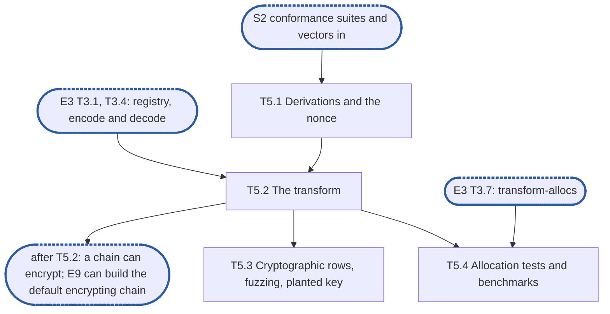

# Epic 5: transforms v2, encryption

**Sources:** [RFC 5](../docs/internals/rfcs/rfc-5-transforms.md) Appendix B's opening (the
transform's ID, stage and material kind); Appendix B.1's chunk part (the derivations, the labels,
the joined inputs, the lengths and encodings, the header and the bounds, the plain-terms
consequences); §2.1 and §4 items 1 to 7 as they bind a transform; §2.3's encrypt stage; §2.5's
"Material says what it is for" for `data-key`, format versions, and "a read asks only for material
its block recorded" as a transform's `Decode` meets it; §2.7's decode errors as a transform returns
them; §2.8's empty length key; §3.1 as amended by #5851 (`Kinds`, `MaxEncodedLen`, `LengthOf`,
`LengthKey`, `Version`, `Encode`, `Decode`, `Encoded`, `Factory`); §5.4 (a library swap is decided
by the fixtures); §6 and Appendix B.6's `encryption_chunks_total`; §7's T2, T4, T9 and T14 as this
transform meets them; §8.1's generic rows, its two §2.7 authenticating rows and its three Appendix
B.1 rows on salts and nonces, labels and golden vectors (the chunk part); §8.3's per-transform
benchmark and encryption's encode split; Appendix B.4's rows a decode sees; Appendix B.5's two
`decision:` notes. Every citation is the RFC's text with #5851's amendment; the code lands on
`feat/storage-v2`, and the paths below are paths there.
**Track:** B.
**Epic 5 estimate: 4 subtasks, 7.75 man-days.**
**Depends on:** **S2**: from E2, `transformtest.Run` with its `Subject`, `transformtest.Fixture`,
`transformtest.FuzzDecode`, `transformtest.LoadVectors` with Appendix B.1's chunk vectors, and
`keystest.Memory`. From E1, the root contract (`ID`, `Stage`, `Transform`, `Encoded`, `Factory`,
`ErrMalformed`, `ErrTooLarge`), `keys.MaterialID`, `keys.Provider`, the `data-key` kind constant
and the material errors, and the import allowlist naming `lukechampine.com/blake3`. From E3:
`Register` and the decode set (T3.1), which the transform's registration and its material-free
build need; `NewChain` (T3.2) and `Attempt.Encode` and `Chain.Decode` with the census view (T3.4,
T3.5), which the chain-level tests run through; `unit`'s `transform-allocs` option (T3.7), which
runs the allocation tests. Outside RFC 5's epics, the RFC 2 plan's epic 2, whose nightly `fuzz`
suite the fuzz target joins, and the RFC 2 plan's epic 4, whose choice of BLAKE3 library the nonce
inherits (§9).
**Blocks:** E9, which builds the default chain of an encrypting namespace and validates the
encrypt stage's settings with the registered `aes-gcm`, and defines `encryption_chunks_total` from
the chain's encode count of it (D6); E11, whose codec and engine rows run the default encrypting
chain. E6 calls the standard library's AES-256-GCM for the key-file wrap on its own and needs
nothing exported here.

---

## 1. Goal

Epic 5 ships RFC 5's one encryption transform, AES-256-GCM from the standard library under a
per-chunk key and a nonce derived from the exact bytes sealed, as a transform of the encrypt stage
that any chain can carry: it seals under the data key the attempt pinned, authenticates every byte
of its body and the chunk it belongs to, and is held to RFC 5's conformance suite, its golden
vectors, Wycheproof's AES-GCM vectors and a fixture that pins its output.

**At the end of the epic:**

- a chain configured with `aes-gcm` writes bodies whose envelope names `0x0010`, each opening with
  version 1 and the pinned data key's ID, and every one of them decodes (T5.2);
- the salt key, salt, chunk key, nonce key, nonce, chunk AAD, nonce input and one body equal RFC 5's
  golden vectors, computed by an independent implementation (T5.1, T5.2);
- every flipped byte of a body, a body read under another chunk's hash and a tag failure are
  `ErrMalformed` with no plaintext left in `dst`; a destroyed data key is `ErrMaterialDestroyed`;
  a body larger than `max` is `ErrTooLarge` before anything is allocated or asked for (T5.2,
  T5.3);
- two different inputs under one plaintext hash get two nonces and share no keystream, and the
  standard library's AES-256-GCM, as the transform calls it, passes Wycheproof (T5.3);
- the transform builds for decoding with no data key in the store, so a store whose namespaces do
  not encrypt still opens (T5.2);
- encode and decode throughput, and encode's split between the nonce's BLAKE3 pass and the GCM
  seal, are benchmarked (T5.4).

### 1.1 In scope

`pkg/transform/encrypt/aesgcm`: the chunk derivations and the nonce, the header, `Encode` and
`Decode` with their bounds and errors, the `Factory` and the registration, the fixture, the fuzz
target, the Wycheproof check, the allocation tests and the benchmarks.

### 1.2 Out of scope

- `Register`, the decode set, `NewChain`, the census view that answers only listed material,
  `require` and the implicit encrypt stage of an encrypting namespace, the chain ID with the data
  key as material, and RFC 5 §6's four series around each call: E3.
- `transformtest`, `keystest`, the fixture format and the vectors' computation: E2.
- The provider: data keys, their records, fingerprints and their check, the three failures and
  their conditions, and Appendix B.6's two gauges: E6. The key-file wrap, which also seals with
  AES-256-GCM, under a random nonce: E6. Key-service custody: E7. Rotation and the
  destroyed-material notice: E8.
- The store configuration's rows, the default chain of an encrypting namespace, the bound
  `encrypts`, T15's refusals, and the series spec of `encryption_chunks_total` (D6): E9.
- Appendix B.5's row and T21 through the codec, and the put and whole-block get benchmark with the
  default chain: E11.
- Appendix B.1's export cryptography (frames, the sealed header, the MACs, the state and progress
  keys) and §8.1 T22's export vectors: the plan's deferral ledger, its row on export cryptography,
  owned by RFC 26.
- A second encryption transform, AES-256-GCM-SIV once a standard library ships it (§5.4): no epic;
  it is a new transform with a new ID when it comes.

### 1.3 Names used here

- **E1**, epic 1, interfaces: the root contract, `keys`, `chain`'s signatures and the import test
  with its allowlist.
- **E2**, epic 2, test foundations: `transformtest` (`Run`, `Subject`, `Fixture`, `FuzzDecode`,
  `LoadVectors`), `keystest.Memory`, RFC 5's golden vectors, and its catalogue of the rows each
  epic turns green.
- **E3**, epic 3, the chain: the registry and decode set, `NewChain`, the pin, the envelope,
  encode and decode, the census view, `unit`'s `transform-allocs` option.
- **E4**, epic 4, compression, whose package layout and strict settings this epic follows.
- **E6**, epic 6, namespace keys and the provider; **E7**, epic 7, key-service custody; **E8**,
  epic 8, rotation and the destroyed-material notice.
- **E9**, the integration epic: the settings rows, the default chain, the series specs, the error
  mapping.
- **E11**, epic 11, E2E green: RFC 5's rows through the codec and the engine.
- **S2**, the conformance suites and vectors in: E2's components exist.
- **The RFC 2 plan's epic 2**: the carver's test foundations, owner of the golden-vector script and
  of the nightly `fuzz` suite of the offload plans. **The RFC 2 plan's epic 4**: the carver and
  identity, which settles the BLAKE3 library question.
- **The content wiring**: the RFC 8 offload plan's `internal/node/content`, which builds the chain
  and imports this package for its registration.

## 2. How the general rules apply

The rules are those of
[RFC 5's plan, §1.5](rfc-5-transforms-plan.md#15-general-rules-for-each-epic), cited by number and
title and not copied.

| Rule | Subtasks | How |
| --- | --- | --- |
| rule 1, independent unit tests ([`CLAUDE.md`, "Writing tests"](../CLAUDE.md#writing-tests)) | all | the transform runs E2's `transformtest.Run`; the chain-level tests build a real chain with E3's `NewChain`; material comes from E2's `keystest.Memory` (kind 2); a provider answering a foreign error is a fault wrapper around `Memory` (kind 3, T5.2). The cipher, HKDF, HMAC and BLAKE3 are the real libraries |
| rule 2, fuzz every decoder of bytes this component did not just write | T5.3 | `FuzzAESGCMDecode`, through E2's `FuzzDecode`, seeded with the fixture and crafted headers; it joins the nightly `fuzz` suite, and T5.3 extends RFC 5 §8.3's suites line to name it |
| rule 3, observability follows RFC 25 | T5.2, T5.3 | the transform records nothing of its own: `encryption_chunks_total` is the chain's encode count of the encrypt stage (D6), and RFC 5 §6's series are E3's. It takes no logger and logs nothing. The planted-key check: a known data key is planted and every error the transform returns is searched for its bytes and for each key it derives (T5.3, R31) |
| rule 4, profiling | T5.2, T5.3, T5.4 | every test under `internal/prof`'s `Watch`; `TestAllocsAESGCM…` for `Encode` and `Decode` join `transform-allocs` by name, each count measured when it lands and stated with its reason (T5.4). The BLAKE3 library's goroutines end inside the call, which `Watch` must see as no leak (§9) |
| rule 5, public interface and internals ([`CLAUDE.md`, "Verifying a change"](../CLAUDE.md#verifying-a-change)) | T5.1, T5.2, T5.3 | the derivations are checked where `Encode` and `Decode` consume them, against the vectors; the transform at `Transform`, through `transformtest`, and at the chain the codec calls: registration, the build without a data key, a round trip through `Pin`, `Attempt.Encode` and `Chain.Decode` with a census, and a flipped key ID refused by the census view; `transformtest`'s 64 goroutines under `-race` |
| rule 6, known failures shrink | none | `unit` keeps no `known.yaml`; every test lands green |
| rule 7, v2 ignores v1, and imports only what RFC 0 §1.2 allows | all | the package imports the root, `keys`, `entity`, `chain` (to register), the standard library's `crypto/aes`, `crypto/cipher`, `crypto/hkdf`, `crypto/hmac` and `crypto/sha256`, and `lukechampine.com/blake3`; nothing of v1, of the provider, of `pkg/metrics`, `pkg/health` or `pkg/settings`. E1's import test holds it |
| rule 8, real dependencies for properties of those dependencies ([`CLAUDE.md`, "Writing tests"](../CLAUDE.md#writing-tests)) | T5.3 | the cipher is the standard library's in every test, and Wycheproof checks it as the transform calls it; the transform holds no store and no key service |
| rule 9, code comment conventions ([`CLAUDE.md`, "Code comments"](../CLAUDE.md#code-comments)) | T5.1, T5.2 | RFC 5's Appendix B.5 notes as `decision:` markers: determinism per namespace at the salt derivation (T5.1), no header key and lengths in the clear at the header writer (T5.2). D4's `decision:` at `Decode`'s nonce read, D6's at `Encode`'s `Applied`, D3's `ponytail:` at the derivation call, and a `decision:` at `Version` that a library whose bodies differ from the fixture is a new format version (§5.4) |
| rule 10, a test must be able to fail | all | each test in §6 names the bug it catches; the vectors come from E2's independent script, never from this code, and Wycheproof's from outside the project |
| rule 11, a symbol is exported only if RFC 5's interface or a consumer outside the package uses it | all | the package exports nothing: it registers at init and is imported for that alone, as E4's compressors are |
| rule 12, each subtask creates only what it declares | all | the derivations land with their vector test (T5.1) and their first caller (T5.2); the fixture and the chain-level tests with the transform; the Wycheproof file and the fuzz target with T5.3; the allocation tests and benchmarks with T5.4 |

## 3. Requirements and invariants

Every obligation RFC 5 places on the encryption transform, numbered so that subtasks and tests can
cite them. `Source` is RFC 5 unless it names another source.

**The transform and its body**

| # | Requirement | Kind | Source | Subtasks |
| --- | --- | --- | --- | --- |
| R1 | Encryption is transform `0x0010`, of the encrypt stage, in the range `0x0000`–`0x7FFF` kept for shipped transforms, registered at start under the name `aes-gcm` that a configuration's `require` lists | MUST | Appendix B, §2.3, §4 items 1 and 2, §8.2 §2.5 | T5.2 |
| R2 | Its material kind is `data-key`, and it accepts material of no other kind: `Kinds` declares that one, no setting names another, and material of any other kind, or of a namespace other than the one being encoded, is refused, never used | MUST | Appendix B, §2.5 ("Material says what it is for"), §3.1 (`Kinds`), §7 T14 | T5.2 |
| R3 | A body is the header (version, 1 byte; data key ID length, 1 byte; data key ID), then the 12-byte nonce, then the ciphertext with its 16-byte tag, full length; a key ID longer than 255 bytes cannot be written and is refused | MUST | Appendix B.1 ("Its header"; lengths and encodings) | T5.2 |
| R4 | The ciphertext is AES-256-GCM (NIST SP 800-38D) from the standard library, under the chunk key and the nonce, over the input, with the chunk AAD | MUST | Appendix B.1 | T5.2 |
| R5 | A body stores the data key's ID and nothing derived: not the salt, not a derived key; `Decode` derives the salt again from the hash it is given | invariant | Appendix B.1 ("In plain terms") | T5.2 |
| R6 | A format change is a new version in the header, never a new ID, and the transform keeps decoding every version it wrote; a version it does not know is `ErrMalformed` | MUST | §2.5, §4 item 4, Appendix B.1 | T5.2 |

**Derivations**

| # | Requirement | Kind | Source | Subtasks |
| --- | --- | --- | --- | --- |
| R7 | salt key = HKDF-SHA256(data key, salt none, info `dittofs chunk salt v2`); salt = HMAC-SHA256(salt key, plaintext hash), over the hash's bytes alone; chunk key = HKDF-SHA256(data key, salt, info `dittofs chunk key v2`); nonce key = HKDF-SHA256(data key, salt, info `dittofs chunk nonce v2`). Every HKDF is RFC 5869 with `L = 32`, salt none is 32 zero bytes, and `info` is the label's ASCII bytes alone | MUST | Appendix B.1 (derivations; lengths and encodings) | T5.1 |
| R8 | The chunk AAD is the transform ID (2 bytes, big-endian), the version (1 byte), the data key ID (4-byte length, its bytes) and the plaintext hash (4-byte length, 32 bytes) | MUST | Appendix B.1 (joined inputs) | T5.1 |
| R9 | The nonce is the first 12 bytes of BLAKE3's keyed mode under the nonce key over the chunk nonce input: the chunk AAD (4-byte length, its bytes), then the input (4-byte length, its bytes), the input being what reaches the encrypt stage | MUST | Appendix B.1 (derivations; joined inputs; lengths and encodings) | T5.1 |
| R10 | Every value derived from the data key has its own versioned label, shared with no other derivation of Appendix B.1, and each is pinned by a golden vector | MUST, test row | §4 item 3, Appendix B.1 (labels), §8.1 Appendix B.1 | T5.1 |
| R11 | Golden vectors from an independent implementation working from Appendix B.1's tables alone: the salt key, salt, chunk key, nonce key and nonce for a fixed data key, plaintext hash, version and input, and one chunk body with its AAD | test row | §2.8 (last paragraph), §8.1 Appendix B.1 | T5.1, T5.2 |
| R12 | A data key is 32 bytes; material of another length is never used as one | MUST | Appendix B.1 (lengths and encodings) | T5.2 |

**One key and nonce, one input**

| # | Requirement | Kind | Source | Subtasks |
| --- | --- | --- | --- | --- |
| R13 | No chunk key and nonce ever seal two different inputs: two different inputs under one plaintext hash and data key (a chunk compressed at two levels, or declined then compressed) both decode, carry different nonces and share no keystream, so the XOR of their ciphertexts is not the XOR of their inputs; one input under one data key, sealed with two versions in the AAD, gets two nonces | invariant, test row | Appendix B.1 ("In plain terms"), §8.1 Appendix B.1 | T5.1, T5.3 |
| R14 | Two different chunks under one data key get different salts; one chunk under two data keys gets two different bodies | test row | §8.1 Appendix B.1 | T5.3 |
| R15 | The standard library's AES-256-GCM, called as the transform calls it once the keys are derived (its `seal` and `open`, since `Decode` derives its own key and AAD), passes Wycheproof's AES-GCM vectors for a 256-bit key, 96-bit nonce and 128-bit tag | test row | E2's catalogue (other sources) | T5.3 |

**Decoding and its errors**

| # | Requirement | Kind | Source | Subtasks |
| --- | --- | --- | --- | --- |
| R16 | A tag failure is `ErrMalformed`, returns no plaintext, and leaves no unauthenticated plaintext in `dst` | MUST NOT | §2.7, Appendix B.4 ("A tag fails"), E2's catalogue (other sources) | T5.3 |
| R17 | `Decode` refuses a body whose plaintext would exceed `max` with `ErrTooLarge`, before it allocates or asks the provider for anything | MUST | §2.1, §2.7, §4 item 5, §8.1 T4 | T5.2 |
| R18 | Everything is authenticated: every byte of a body flipped in turn, and a body decoded with another chunk's hash, is `ErrMalformed`, returned by the transform itself or, for a key ID flipped to one its block's census does not list, by the census view before the provider is asked | MUST | Appendix B.1 ("In plain terms"), §2.5, §8.1 §2.7 (both rows) | T5.2 |
| R19 | `Decode` asks the provider only for the data key its body names, by namespace, kind `data-key` and ID, and returns the provider's material errors as themselves: a destroyed key is `ErrMaterialDestroyed`, never `ErrMalformed` | MUST | §2.5, §2.7, §3.1 (`Decode`), §8.1 §2.7, Appendix B.4 | T5.2 |
| R20 | `Decode` returns only §2.7's errors, so no error type of the libraries or the provider crosses it | MUST NOT | §2.7, §4 item 6 | T5.2 |
| R21 | Fuzzed, `Decode` never panics and never produces or allocates more than `max`, however a body was crafted | MUST NOT | §2.1, §7 T4, §8.1 T4 | T5.3 |

**Encode, bounds, settings and the census**

| # | Requirement | Kind | Source | Subtasks |
| --- | --- | --- | --- | --- |
| R22 | `Encode` seals under the pinned data key it is passed, getting its content from `Provider.Get`, and never asks for the current material; the `Encoded` it returns names that material and its format version | MUST | §3.1 (`Encode`, `Encoded`), §2.8 | T5.2 |
| R23 | Under the pinned data key, `MaxEncodedLen` and `LengthOf` are both exact, `n + 30` plus the key ID's length; under any material, `MaxEncodedLen(n) = n + 285`; no body exceeds either | bound | Appendix B.1 ("Its header"), §2.1, §3.1, §4 item 2, §8.1 §2.1 | T5.2 |
| R24 | `LengthKey` is empty: the stage has no length-affecting setting | MUST | Appendix B.1 ("Its header"), §2.8, §4 item 2 | T5.2 |
| R25 | The registry builds the transform once per store for decoding, with its default settings and the store's material, so building it reaches no material: a store holding no data key still builds it | MUST | §2.5, E3's D1 | T5.2 |
| R26 | `Encode` of one input under one data key and format version gives the same body every time, and from two instances built from one configuration | MUST | §2.1, §7 T9, §8.1 T9 | T5.2 |
| R27 | `Decode(Encode(p)) == p`, byte for byte, for every input, inputs that begin with this transform's own header or with an envelope included | MUST | §2.1, §7 T2, §8.1 T2 | T5.2 |
| R28 | Safe to call concurrently, with no memory between calls but read-only configuration and material: encode and decode from 64 goroutines under the race detector give the sequential results | MUST | §2.1, §8.1 concurrency | T5.2 |
| R29 | A fixture of inputs, settings, material and the bodies the first format version wrote; every later build decodes every fixture body and encodes each fixture input to exactly its body, so a library whose output differs is a new format version or a new transform, never a silent swap | MUST | §4 item 7, §5.4, §7 T9, §8.1 T2 and T9 | T5.2 |

**Observability and secrecy**

| # | Requirement | Kind | Source | Subtasks |
| --- | --- | --- | --- | --- |
| R30 | `encryption_chunks_total` counts the chunks encrypted. The transform never declines a chunk, so the chain's per-transform encode count of the encrypt stage is that count (D6) | MUST | §6, Appendix B.6 | T5.2 |
| R31 | No key byte, unwrapped material or derived key reaches an error string the transform returns | invariant | RFC 5 plan §1.5 rule 3 | T5.3 |

**Benchmarks**

| # | Requirement | Kind | Source | Subtasks |
| --- | --- | --- | --- | --- |
| R32 | Encode and decode in MB/s per core, reported against the previous run | test row | §8.3 | T5.4 |
| R33 | Encode split into the nonce's keyed BLAKE3 pass and the AES-256-GCM seal, in MB/s per core with the nonce pass's share of encode time, the CPU's AES and hash instruction-set extensions named | test row | §8.3 | T5.4 |

**Mapping of what this epic does not own.** The chain ID's data-key material and its fingerprint
are E3's (its R13), from `Pin`; the fingerprint's check is the provider's (E6). The census view
that answers only listed IDs is E3's (its R27, R28): R18 relies on it for a flipped key ID, and
T5.2's chain-level test runs through it. `require: [aes-gcm]` and the implicit encrypt stage of an
encrypting namespace are E3's checks (its R30) and E9's input. §6's "a transform logs nothing per
chunk" holds because a `Factory` receives no logger and this package imports no log package, held
by review, as in E4. §8.3's `Attempt.MaxEncodedLen` against the largest body is enforced in `unit`
by `transformtest.Run`'s bound row over every round-trip input (E2's R2), and exactly so here
(R23). Appendix B.1's key wrap, stored wrap, wrap count and key-service rules are E6's and E7's;
its state of a master key and its primary-version read are E8's; its export cryptography is RFC
26's. Appendix B.4's rows other than a tag failure and a destroyed key are the provider's (E6) and
the engine's (E11). Appendix B.5's claims are checked through the codec in E11; this epic places its
two `decision:` notes (§2, rule 9).

## 4. Decisions this epic takes

- **D1, the package is `pkg/transform/encrypt/aesgcm`, the name `aes-gcm`, the format version 1.**
  RFC 5 §3.1 makes each shipped transform its own package, E2's `transformtest.Run` reads a
  package's fixtures from its own `testdata/fixtures`, and §5.4 expects a second encryption
  transform (AES-256-GCM-SIV) with its own ID and fixtures, so this one takes a directory of its
  own under `encrypt`, as E4's compressors did under `compress`. The name is the one RFC 5 §8.2's
  `require: [aes-gcm]` row uses, and a store configuration names it from the first, so it is settled
  now. The version is 1, the first format this transform writes: the labels' `v2` versions the
  derivations (§2.8's table), not the body. Prior art: E4's D1 and D8; Go's `crypto/*` packages,
  one per algorithm (from memory).
- **D2, settings are strict and the factory reaches no material.** The encrypt stage has no
  setting, so any key fails the `Factory`, as E4's strict settings refuse an unknown one; a nil
  provider fails it too, since `Encode` gets its key's content from the provider the factory was
  given. The factory calls neither `Current` nor `Get`, so E3's decode set builds it for a store
  that holds no data key (R25, E3's D1). RFC 5 §2.5 refuses material of another kind "at
  construction"; a factory that reaches no material has none to refuse, and with no setting nothing
  can name a kind, so the refusal is where material first arrives: `Encode` refuses a pinned list
  that is not exactly one `data-key` of the namespace being encoded, with a key ID of at most 255
  bytes, and content that is not 32 bytes; `Decode` asks only for kind `data-key`, so another
  kind never reaches it. Prior art: `encoding/json`'s `DisallowUnknownFields` (from memory); E4's
  D5.
- **D3, the derived keys are computed per call, and nothing is cached.** Each `Encode` and
  `Decode` derives the salt key, salt, chunk key and nonce key from the data key, which costs a few
  HMAC-SHA256 calls and one AES key schedule per chunk, beside a GCM pass over the whole chunk.
  A cache of derived keys would be a copy of key material that a key's removal must also erase
  (RFC 5 T13), and `Remove` does not exist yet. A `ponytail:` marker at the derivation call names
  the ceiling, the HKDF and HMAC calls per chunk, and the upgrade: a cache keyed by namespace, key
  ID and fingerprint, emptied by `Remove`, when T5.4's benchmark or a put profile shows the
  derivations. Prior art: the AWS Encryption SDK's caching materials manager, a bounded cache of
  data keys added in front of an uncached default (from memory).
- **D4, `Decode` reads the nonce from the body and does not recompute it.** RFC 5 Appendix B.1 says
  the tag authenticates the nonce with the rest, so a recomputation would add a BLAKE3 pass over
  every chunk read and catch only an encoder that broke its own derivation, which the fixture and
  the vectors already catch. A `decision:` marker at the read names the rule and its ceiling:
  withdraw it if a format version ever stores a nonce the tag does not cover. This keeps `Decode`
  free of BLAKE3 entirely. Prior art: AES-GCM-SIV recomputes its synthetic IV on decryption
  because there it is the tag (RFC 8452, from memory); here it is not.
- **D5, the provider's errors pass through as themselves, and everything else is a sentinel.**
  `Decode` returns `ErrUnknownMaterial`, `ErrMaterialUnavailable`, `ErrMaterialDestroyed` and
  `ErrMalformed` from `Get` unchanged, so E3's chain sees them (and maps `ErrUnknownMaterial` to
  unavailable, its R29); any other error from `Get`, a cancelled context included, is returned as
  `ErrMaterialUnavailable`, since the key could not be reached now, and the cipher's own error as
  `ErrMalformed`. A key of the wrong length from `Get` is `ErrMaterialUnavailable` on `Decode`, the
  material the store holds being unusable now, and an error on `Encode`. Prior art: E3's D3.
- **D6, `encryption_chunks_total` is the chain's encode count of the encrypt stage.** A `Factory`
  receives no recorder (RFC 5 §3.1; E1's D2), and the transform never declines a chunk, so every
  `Encoded(aes-gcm, applied=true)` the chain records (E3's T3.6) is one chunk encrypted. E9's series
  spec defines `encryption_chunks_total` from that call for every transform of the encrypt stage,
  so a successor transform counts too, and the transform records nothing itself. A `decision:`
  marker at `Encode`'s `Applied: true` says the count relies on it, to be withdrawn if encryption
  ever declines a chunk. Prior art: none found.
- **D7, Wycheproof's vectors are a filtered copy in `testdata`.** `unit` may not fetch, so T5.3
  checks in the cases of `aes_gcm_test.json` with a 256-bit key, a 96-bit nonce and a 128-bit tag,
  with the source commit and the Apache-2.0 licence in the file's header, and drops the rest, which
  the transform never calls. Prior art: Go's own `crypto` tests run Wycheproof's vectors, fetched as
  a module (from memory); a vendored copy is what an offline `unit` allows.

## 5. Target tree

```text
pkg/transform/encrypt/aesgcm/
  derive.go             T5.1  labels, salt key, salt, chunk key, nonce key, chunk AAD,
                              nonce input, nonce (D3)
  derive_test.go        T5.1  the chunk vectors, the labels distinct
  aesgcm.go             T5.2  the transform, its Factory, the header, Encode, Decode, seal and
                              open, registration at init (D1, D2, D4, D5, D6)
  aesgcm_test.go        T5.2  transformtest.Run, the chain-level tests
  testdata/fixtures/v1/ T5.2
  crypto_test.go        T5.3  Wycheproof, nonces and keystream, dst on a tag failure, the
                              planted key
  fuzz_test.go          T5.3  FuzzAESGCMDecode
  testdata/wycheproof/aes_gcm_test.json  T5.3  the filtered vectors (D7)
  testdata/fuzz/FuzzAESGCMDecode/        T5.3  crafted seeds, then crashers
  allocs_test.go        T5.4  TestAllocsAESGCM…
  bench_test.go         T5.4  encode, decode and encode's split
docs/internals/rfcs/rfc-5-transforms.md  T5.3  §8.3's suites line names the fuzz target
```

## 6. Subtasks

### T5.1 The chunk derivations and the nonce

**Subtask T5.1 estimate: 1.5 man-days.**

- **Track:** B. **Depends on:** S2.
- **Covers:** R7, R8, R9, R10, R11, R13 (its two-versions half).
- **Deliverables:** `derive.go`: the three label constants; unexported functions deriving the salt
  key, the salt, the chunk key and the nonce key from a data key and a plaintext hash through
  `crypto/hkdf` and `crypto/hmac`, building the chunk AAD and the chunk nonce input with their
  4-byte length prefixes, and computing the nonce as the first 12 bytes of `lukechampine.com/blake3`'s
  keyed mode under the nonce key, in one function, so the library question of §9 touches one site.
  Appendix B.5's determinism `decision:` note at the salt derivation. Consumed by T5.2's `Encode`
  and `Decode`, and by T5.4's split benchmark.
- **Acceptance criteria:**
  - Each derived value equals its vector in E2's `LoadVectors` for the vector's data key,
    plaintext hash, version and input.
  - The chunk AAD and the nonce input equal their vectors byte for byte.
  - The three labels differ from each other and from every other label of Appendix B.1's table.
- **Tests:** at the derivations `Encode` and `Decode` call: the vector test (catches a wrong
  label, a prefixed `info`, an empty `salt` taken for 32 zero bytes the other way round, a
  16-byte `L`, a missing or 2-byte length prefix, the hash's or the input's prefix dropped, and a
  nonce taken from the wrong end or another BLAKE3 mode, R7, R8, R9, R11); a table of Appendix
  B.1's ten labels checked pairwise distinct with this package's three among them (catches a label
  reused by copy and paste, R10); the nonce of one input and data key with version 1 and with
  version 2 in the AAD, which must differ (catches an AAD left out of the nonce input, R13). No
  double: the vectors are an oracle computed outside this code.
- **Rules:** rule 9: the determinism marker. rule 10: the vectors are E2's.

### T5.2 The transform

**Subtask T5.2 estimate: 3.25 man-days.**

- **Track:** B. **Depends on:** T5.1, T3.1, T3.4.
- **Covers:** R1, R2, R3, R4, R5, R6, R11 (the body), R12, R17, R18, R19, R20, R22, R23, R24,
  R25, R26, R27, R28, R29, R30.
- **Deliverables:**
  - `aesgcm.go`: the transform, ID `0x0010`, stage encrypt, `Kinds` `[data-key]`, `Version` 1
    with its §5.4 `decision:` note, `LengthKey` empty, `MaxEncodedLen` and `LengthOf` exact under a
    pinned key and `n + 285` under nil, never above `n + 285` for any material.
  - `Encode`: D2's checks on the pinned material; the key from `Get` on the provider the factory
    was given, since `Encode` takes none; the derivations of
    T5.1; the header, the nonce and `Seal` appended to `dst`; `Encoded{Body, Applied: true, Version:
    1, Material}` with D6's marker. Appendix B.5's "no header key, lengths in the clear"
    `decision:` note at the header writer.
  - `Decode`: the header parse (an unknown version, a key ID running past the body, or a body
    shorter than its header, nonce and tag is `ErrMalformed`); `ErrTooLarge` when the plaintext
    would exceed `max`, before any allocation or provider call; `Get` on the provider `Decode` is
    handed, for a `MaterialID` of the namespace, kind `data-key` and the body's key ID with no
    fingerprint, which E3's census view fills from the census (its D4); the derivations; `Open` into `dst` when its capacity suffices,
    else into a buffer of exactly the plaintext length; D4's marker; D5's error mapping.
  - Unexported `seal` and `open` around `cipher.NewGCM`, the one call T5.3's Wycheproof test
    drives.
  - Its `Factory` (D2) and `chain.Register(0x0010, "aes-gcm", …)` at init (D1). Consumed by E9 and
    by the content wiring, which imports the package for its registration.
  - The `v1` fixture: one data key with a 1-byte ID and one with a 255-byte ID; inputs of 1 byte, a
    text, 64 KiB of seeded random bytes, and one beginning with this transform's own header.
  - A fault wrapper around `keystest.Memory` whose `Get` answers a foreign error on cue (kind 3),
    for D5.
- **Acceptance criteria:**
  - `transformtest.Run` passes with empty `Settings`, no `LengthAffecting`, `WorstCase` seeded
    random bytes and the `Scratch` measured for `Decode`, under `-race`, its authenticating rows on
    since the stage is encrypt.
  - Built through `NewChain` with `aes-gcm` and pinned against `Memory` holding a data key, a
    chunk's envelope names `0x0010` and the round trip through `Attempt.Encode` and `Chain.Decode`
    with the attempt's census returns the input.
  - E3's decode set builds the transform against a `Memory` holding no data key, and `Memory`'s
    call count is 0 after it.
  - Any setting, and a nil provider, fail the `Factory`.
- **Tests:**
  - At `Transform`, through `transformtest.Run` (catch a lossy, unbounded, inexact-length, racy or
    nondeterministic encoder, a foreign error, a flip that decodes, a body that ignores its hash, a
    destroyed key folded into another error, R17, R18, R19, R20, R23, R26, R27, R28), and its
    fixture rows over `v1` (catch an encoder or library change, R29).
  - The chunk vector's body from `Encode` under the vector's key, hash and input (catches a
    header, nonce or AAD laid out apart from the vector's, R3, R4, R11).
  - Pinned under key A, `Memory` then given key B, which becomes current: the body still names A
    and decodes under A (catches an `Encode` that asks for the current key, R22); the returned
    `Encoded.Material` equals the pinned `MaterialID` (catches a census that loses the key, R22).
  - `Encode` refusals, each returning an error and no body: material of kind `chunk-id-key`, a data
    key of another namespace, two materials, a 256-byte key ID, a 16-byte data key (catch a key
    used for two purposes, another tenant's key, a key ID the header cannot hold, AES-128 under a
    short key, R2, R3, R12).
  - `Decode` with `max` one byte below a body's plaintext: `ErrTooLarge`, and `Memory`'s count
    unchanged (catches a decode sized by the body or a provider asked before the bound, R17).
  - Version 0 and 2, a key ID length past the body, and a body one byte short of its tag:
    `ErrMalformed` (catch an unknown version decoded or a truncated parse, R6, R3).
  - The fault wrapper's foreign error: `ErrMaterialUnavailable`, and `errors.As` finds no foreign
    type (catches a provider error crossing the transform, R20).
  - At the chain the codec calls: the round trip above (catches a wrong ID or a missing
    registration, R1); a byte of the key ID flipped in a body: `ErrMalformed` from `Chain.Decode`,
    and the count unchanged (catches the flip E2's suite runs, reached through the census view,
    R18); the build against an empty `Memory` (catches a factory that reaches material, R25).
  - `LengthKey` is empty and the chain ID equals E2's "default encrypting chain" vector under its
    key (catches a setting or version leaking into the chain ID, R24, R5).
  - No double but the fault wrapper: the provider is E2's kind 2.
- **Rules:** rule 9: the B.5 header marker, D4's, D6's and the §5.4 marker at `Version`.

### T5.3 The cryptographic rows, fuzzing and the planted key

**Subtask T5.3 estimate: 2 man-days.**

- **Track:** B. **Depends on:** T5.2.
- **Covers:** R13, R14, R15, R16, R21, R31.
- **Deliverables:**
  - `testdata/wycheproof/aes_gcm_test.json`, filtered and attributed (D7), and the test driving
    T5.2's `seal` and `open` with each case, asserting a minimum case count so a filter that
    matches nothing cannot pass empty.
  - `crypto_test.go`'s rows of RFC 5 §8.1's Appendix B.1 row and E2's catalogue.
  - `FuzzAESGCMDecode`, through `transformtest.FuzzDecode`, with seeds: the fixture bodies, a key
    ID length of 255 over a 10-byte body, a header with no nonce, a body of exactly the header,
    nonce and tag, version 0 and version 2. Added to the nightly `fuzz` suite in the form the RFC 2
    plan's epic 2 registers it; RFC 5 §8.3's suites line extended to name it.
- **Acceptance criteria:**
  - Every valid Wycheproof case seals to its ciphertext and tag and opens to its message; every
    invalid case fails to open.
  - Every fuzz seed is `ErrMalformed` or `ErrTooLarge`, or decodes to at most `max` bytes.
- **Tests:**
  - Wycheproof through `seal` and `open` (catches a cipher called with the wrong key size, nonce
    position, AAD or tag length, R15).
  - After each invalid Wycheproof case and after a flipped tag on a real body, opened into a `dst`
    of ample capacity filled with a marker: no window of the plaintext appears in `dst`'s capacity
    (catches unauthenticated plaintext left behind, R16).
  - One chunk compressed two ways, two inputs under one hash and data key: both decode, the nonces
    differ, and the XOR of the ciphertexts, past the header, is not the XOR of the inputs (catches
    a nonce derived from the hash alone, R13).
  - Two chunks under one data key give two salts; one chunk under two data keys gives two bodies
    (catch a salt without the hash or a key without the data key, R14).
  - The fuzz seeds, then the fuzzer (catch a panic, an out-of-range read or a decoder sized by a
    claim, R21).
  - A known data key planted in `Memory`, then every error returned by the rows above and by
    `Encode`'s refusals of T5.2 searched for the key's bytes, raw, in hex and in base64, and for
    each key T5.1 derives from it (catches key material formatted into an error, R31).
  - No double: the cipher is the standard library's, the vectors Wycheproof's.
- **Rules:** rule 2: the target and the suites line. rule 3: the planted key. rule 8: the real
  cipher.

### T5.4 Allocation tests and benchmarks

**Subtask T5.4 estimate: 1 man-days.**

- **Track:** B. **Depends on:** T5.2, T3.7.
- **Covers:** R32, R33.
- **Deliverables:** `allocs_test.go`: `TestAllocsAESGCMEncode` and `TestAllocsAESGCMDecode` with a
  caller's `dst` of ample capacity, at a fixed 64 KiB input, each asserting the count measured
  when the test lands and stating its sources (the AES key schedule and GCM per chunk, the HKDF and
  HMAC calls, and, on `Encode`, the BLAKE3 library's per call), skipping under `-race`; they join
  `transform-allocs` by name. `bench_test.go`: encode and decode with `b.SetBytes`,
  `b.ReportAllocs` and `b.RunParallel` over seeded random bytes at 4 KiB, 64 KiB and the chunk
  maximum; encode's split, the nonce function of T5.1 and `seal` timed apart, with the nonce's
  share logged with the CPU's AES and hash extensions as `golang.org/x/sys/cpu` reports them.
  Consumed by the operator reading the reports, by D3's upgrade trigger and by the RFC 2 plan's
  epic 4's library choice.
- **Acceptance criteria:**
  - `test/harness/bin/dt run unit` runs the allocation tests in `transform-allocs`, and they pass.
  - The benchmarks run and report; the split's two parts add up to within the variance of the
    whole encode.
- **Tests:** the allocation tests (catch a buffer allocated per call beyond the stated count,
  rule 4). The rest are reports, compared with `benchstat` over `-count=10` on one machine, as
  `CLAUDE.md`'s "Writing tests" says.
- **Rules:** rule 4: the option and the stated counts.

## 7. Order of work



The derivations go first: they are the riskiest part, pinned by vectors no other code can satisfy
by accident, and the transform builds on them. T5.2 is the blocker for E9 and E11; the rows of
T5.3 and the measurements of T5.4 follow on the finished transform.

## 8. Suggested pull requests

| PR | Subtasks | Man-days | After | Why together |
| --- | --- | --- | --- | --- |
| 1 | T5.1, T5.2 | 4.75 | E3's T3.4 | the derivations and the transform end to end: a chain can encrypt |
| 2 | T5.3, T5.4 | 3 | PR 1, E3's T3.7 | the cryptographic rows, fuzzing and the measurements over the finished transform |

A suggestion only: one pull request per subtask works as well.

## 9. Open points

- **Needs on E2**, whose breakdown is in review (#5857): `transformtest`'s authenticating rows must
  hand `Decode` a view that answers only the material `Encode` returned in `Encoded.Material` and
  gives `ErrMalformed` for any other ID, as E3's census view does in production. Run on
  `keystest.Memory` directly, a flipped byte of the key ID makes `Decode` ask for an ID never given,
  `Memory` answers `ErrUnknownMaterial`, and the "every flip is `ErrMalformed`" row (E2's R5) fails
  for any transform that names its material in its body, this one first. The chunk vectors also
  need their version to be 1 and the "default encrypting chain" vector to carry ID `0x0010`, version
  1 and an empty length key, the values T5.2 writes.
- **The BLAKE3 library.** The nonce hashes the chunk AAD and the whole input, up to the chunk
  maximum, so it hashes far more than one BLAKE3 chunk of 1 KiB on every encode. `lukechampine.com/blake3`
  v1.4.1, the version `feat/storage-v2` pins, allocates in proportion to the input on such a write
  and starts goroutines inside `Hasher.Write` (the RFC 2 plan's epic 1 measured it). Encode's
  allocation count (T5.4) therefore depends on the library, and the goroutines must end inside the
  call for `internal/prof`'s `Watch` to pass. This epic does not decide between hashing through the
  library's `guts` primitives, another BLAKE3 implementation and an RFC 2 amendment: the RFC 2
  plan's epic 4 owns that choice. T5.1 keeps the nonce in one function, and T5.4's stated count is
  measured again when that choice lands. If the chosen code lives inside `pkg/carver`, this package
  cannot import it (an implementation of another component), so the choice needs a home both can
  import, which that epic should say.
- **FIPS 140 mode.** A caller-chosen GCM nonce is not an approved use, and Go's FIPS 140 mode
  (`GODEBUG=fips140=only`) may refuse `Seal` with one (from memory, not checked on Go 1.26). RFC 5
  Appendix B.1 chose the derived nonce; if an operator needs FIPS mode, that is an RFC question,
  not this epic's.
- **Needs on E9**: `encryption_chunks_total` is defined from the chain's encode count of every
  encrypt-stage transform, not recorded by this transform (D6).
- **Refinements of the RFC 5 plan**, which is not edited: its §4.1 shows one `pkg/transform/encrypt/`
  directory, and D1 follows RFC 5 §3.1's one package per shipped transform, as E4 did; its
  expected content caches the salt key per data key, and D3 derives it per call, since a cache of
  derived keys is a copy a key's removal must erase and the benchmark has not shown the cost; it
  gives this epic the "kind refusal at construction", which D2 places where material first
  arrives, since the factory reaches none.
- **The estimate** is 4 subtasks and 7.75 man-days, against the RFC 5 plan's 4 and 8.5: no
  salt-key cache, and no recomputation of the nonce on decode. The least certain is T5.2's, the
  transform end to end with its chain-level tests, then T5.4's, whose allocation counts wait on the
  BLAKE3 choice.
