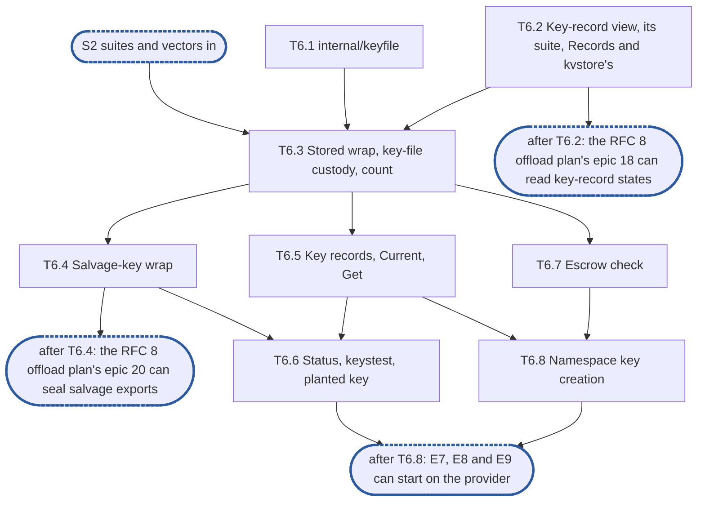

# Epic 6: transforms v2, namespace keys and the provider

**Sources:** [RFC 5](../docs/internals/rfcs/rfc-5-transforms.md) §2.5 (material held by
namespace, kind and ID; fingerprints and their refusal; the kinds the provider holds that no
transform consumes); §2.7's material errors as the provider returns them, and its rule that a store
whose material cannot load does not open; §3.1's `keys.Provider` (`Current`, `Get`), its fingerprint
and `ErrNotEscrowed`; Appendix B.1's key wrap, its associated data and the key file's input of it, the
2³² wrap bound and its count, the stored wrap, the lengths of keys and the plain-terms rule that
master keys never leave the provider; Appendix B.2's key table, its salvage key, "every namespace has
a chunk-ID key and an export key from its creation" with its `decision:` note, the escrow rule, "no
storage-key fallback", key records and their states, export key IDs, "the key records keep every key
ID", and a block commit that checks its material against the key records; Appendix B.4's rows at the
provider and its conditions; Appendix B.6's two gauges; §7's T7, T12, T14 and T18 as the provider
meets them; §8.1's §2.5, T18, T22 (the key file), wrap-count and golden-vector (fingerprint) rows;
§8.2's T7, T14 and T18 rows, the provider's halves.
[RFC 16](../docs/internals/rfcs/rfc-16-metadata-store.md) §4.2's rows `NS‖ns‖key‖kind‖keyID` and
`MKW‖masterKeyID`, §4.2.1's encoding of key kinds, key IDs and master key IDs, and §4.3's codecs.
[RFC 13](../docs/internals/rfcs/rfc-13-configuration.md) §4.2 (a key file's verified escrow), §7 (the
key rules), §9's rows "§7 namespace keys", "§7 chunk-ID key" and "§7 key table" (its
non-encrypting-namespace and escrow clauses), and Appendix C (the key file's passphrase, the
`storage` role's retired keys). [RFC 0](../docs/internals/rfcs/rfc-0-data-lifecycle.md) §1.2
(component imports as amended, and a verified in-memory implementation of every interface a
component takes). Every citation is the RFCs' text on `develop`; the code lands on
`feat/storage-v2`, and the paths below are paths there.
**Track:** C.
**Epic 6 estimate: 8 subtasks, 18.25 man-days.**
**Depends on:** **S2**: from E2, `keystest.Run` with its `Harness` (`Give`, `Replace`, `Destroy`,
`Calls`) and its salvage row, and `transformtest.LoadVectors` with the fingerprint, key wrap AAD and
key-file stored-wrap vectors. From E1, `keys.MaterialID`, `keys.Provider`, the three kinds,
`keys.SalvageWrapper`, the three material errors, and the import test with its allowlist, which
names `internal/keyfile`, `golang.org/x/crypto/...` and `github.com/google/uuid`. Nothing from E3 or
E5: the key-file wrap calls the standard library's AES-256-GCM itself. On `feat/storage-v2`,
`pkg/keyprovider`'s key-file format, `pkg/metadata/kv` and its `keys` and `kvtest` packages,
`pkg/metadata/kvstore` with its `kvstoretest` openers, `badgerkv` and `fdbkvtest`.
**Blocks:**
- E7, which adds key-service custody beside the key file's, extracting the `custody` interface
  over both with its suite and its `primary` and `state` reads (D3).
- E8, which builds rotation, the bucket's `keys` object with the `keyseq` key lock, the destroyed
  marking and the notice on the key records, the view and its in-memory implementation, and the key
  creation of this epic.
- E9, which validates the settings with `ValidateConfig`, hands live changes to `Reconfigure`, maps
  `ErrWrapLimit`, calls `CreateKeys` from namespace creation, starts `VerifyEscrow` from the
  `verify-escrow` action, records its result in the store configuration, maps `ErrNotEscrowed`, and
  defines the gauges and conditions over `Status`.
- Outside RFC 5's epics, the RFC 8 offload plan: its epic 18's commit reads a key record's state
  through `kvstore` (R50) and its tests use `keystest.Records`; its epic 20 calls `WrapSalvageKey`;
  its epic 21's content wiring builds the provider with `kvstore`'s view and the `storage` keys' IDs
  and fingerprints, calls `Open` as it opens each namespace, and turns `Status` into collectors and a health source.

---

## 1. Goal

Epic 6 builds the material provider of one store configuration: the namespace keys of RFC 5
Appendix B.2, each stored as a key record in the metadata store and wrapped under a master key read
from a key file, served by namespace, kind and ID with their fingerprints checked, and created with a
namespace as the key table says.

**At the end of the epic:**

- `pkg/transform/keys/provider` implements `keys.Provider` and `keys.SalvageWrapper`, and passes E2's
  `keystest.Run` with the same call count E2's in-memory provider exports (T6.6);
- every namespace key is a key record under `NS‖ns‖key‖kind‖keyID`, wrapped under the key-file
  master key with associated data naming its namespace, kind and ID, in Appendix B.1's stored-wrap
  layout, except a non-encrypting namespace's chunk-ID key, held in the clear (T6.3, T6.5, T6.8);
- the provider reaches key records through a view it declares, which `kvstore` implements and
  `keystest.Records` implements in memory, both held to one suite (T6.2);
- every wrap first raises the master key's one server-wide count, `MKW‖masterKeyID`, and the 2³²nd
  wrap is the last (T6.3);
- `Current` and `Get` refuse material whose fingerprint no longer matches, tell a key never given from
  one unreachable and from one destroyed, and report the first two by ID for RFC 25's conditions
  (T6.5, T6.6);
- a namespace gets its keys at creation per Appendix B.2's table, once, under concurrent and failed
  creations (T6.8); an encrypting one is refused `ErrNotEscrowed` until the key file's escrow check
  has passed (T6.7, T6.8); a master key that is a `storage` key is refused (T6.3);
- a salvage key is drawn and wrapped under the configuration's master key, bound to its export
  (T6.4);
- the key-file format lives in `internal/keyfile`, which `pkg/keyprovider` and the provider both
  import (T6.1).

### 1.1 In scope

`internal/keyfile`; the `MKW` kind in `pkg/metadata/kv/keys`; the key-record view's suite and
in-memory implementation in `keystest`, and `kvstore`'s implementation; `pkg/transform/keys/provider`:
the stored wrap, the key-file custody with its wrap count, the key record and its codec, `Current`
and `Get` with their cache and failures, `Status`, the escrow check, namespace key creation, the
salvage-key wrap, `ValidateConfig` and `Reconfigure`; `ErrNotEscrowed` and `ErrWrapLimit` in
`pkg/transform/keys`; the fuzz targets, the allocation test and
the `keystest.Run` run.

### 1.2 Out of scope

- Key-service custody over KMIP, the custody interface its second implementation needs (D3), the
  version-qualified IDs a service reports, `internal/kmip`, and §8.1's key-management and T22
  key-service rows: E7.
- A key record reaching the bucket's `keys` object before it becomes current, at creation as at
  every rotation; the object itself with its sequence and MAC, and the namespace's key lock,
  `NS‖ns‖keyseq‖target`, with its subtag, which every writer of a `keys` object takes; the
  non-encrypting namespace's chunk-ID key in that object; data-key and master-key rotation, the
  key-file escrow check at rotation, retired master-key files; the primary-version and key-state read;
  marking `destroyed` the records a destroyed master key wraps; the destroyed-material notice: E8.
- The settings rows, the store configuration's record of a passed escrow check (D6), the
  `verify-escrow` and `rotate-*` operations and their `dfsctl` commands, calling key creation from
  namespace creation, `ErrNotEscrowed` through the API, the series specs, conditions and alert
  rules: E9.
- A namespace that does not open because its key was refused, a body refused through the chain
  because its key was, and §8.2 T7 through the engine: the RFC 8 offload plan and E11.
- The offload commit's read of a key record's state with conflict tracking (RFC 8 §10.4): the RFC 8
  offload plan's epic 18, on the state this epic stores readable (R50).
- That a chunk ID computed under each namespace's chunk-ID key differs (RFC 13 §9 "§7 chunk-ID key",
  RFC 5 §8.2 T17's first half): the RFC 2 plan's epic 4, which computes chunk IDs; this epic's half is
  that the two keys differ (R46).
- `Provider.Remove`, its fence, `ErrMaterialInUse`, and erasing a destroyed key's wrapped bytes:
  the RFC 5 plan's §6.1 deferral ledger, its `Provider.Remove` row (RFC 9).
- The escrow refusal at backup-policy creation, the export key's next generation and the `retiring`
  state's pending set: the ledger's export-key row (RFC 26). The recovery import and "every chunk
  verifies from the bucket alone": the ledger's recovery-import row (RFC 26).
- A key-file master key current in one installation only, which a move's importer enforces: the
  ledger's re-home and move row (RFC 27).
- Building the provider in the node, the `storage` keys' fingerprints, the collectors and the health
  source: the RFC 8 offload plan's epic 21.

### 1.3 Names used here

- **E1**, epic 1, interfaces: `keys.Provider`, `keys.MaterialID`, the kinds, `keys.SalvageWrapper`,
  the material errors, the import test and its allowlist.
- **E2**, epic 2, test foundations: `keystest.Run`, `keystest.Harness`, `keystest.Memory`, and
  `transformtest.LoadVectors` with RFC 5's golden vectors.
- **E3**, epic 3, the chain, whose `unit` option `transform-allocs` runs `TestAllocs…` tests.
- **E4**, epic 4, compression, whose first fuzz target added RFC 5's suites line naming the fuzz
  targets.
- **E5**, epic 5, encryption, which consumes the data key through `Get`.
- **E6**, this epic.
- **E7**, epic 7, key-service custody over KMIP.
- **E8**, epic 8, rotation and the destroyed-material notice.
- **E9**, epic 9, the integration epic: settings, the key operations, error mapping, series specs,
  conditions and alert rules.
- **E11**, epic 11, E2E green: RFC 5's rows through the codec and the engine.
- **S2**, E2's conformance suites and vectors are in.
- **The content wiring**, `internal/node/content`, which builds the provider; and **the RFC 8
  offload plan's epics 18, 20 and 21**: destroyed material at commit, the salvage export, and the
  node's composition of this component.

## 2. How the general rules apply

The rules are those of
[RFC 5's plan, §1.5](rfc-5-transforms-plan.md#15-general-rules-for-each-epic), cited by number and
title and not copied.

| Rule | Subtasks | How |
| --- | --- | --- |
| rule 1, **independent unit tests** ([`CLAUDE.md`, "Writing tests"](../CLAUDE.md#writing-tests)) | all | the provider's tests run on `keystest.Records`, a verified in-memory view (kind 2) held to the same suite as `kvstore`'s (D2); randomness is an injected `io.Reader` and time an injected clock (kind 1); a failing or erroring store is a fault wrapper around `keystest.Records`, or `kvtest.FaultKV` beneath `kvstore` (kind 3); the provider passes E2's `keystest.Run` |
| rule 2, **fuzz every decoder of bytes this component did not just write** ([`CLAUDE.md`, "Writing tests"](../CLAUDE.md#writing-tests)) | T6.3, T6.5 | `FuzzStoredWrap` (T6.3) and `FuzzKeyRecord` (T6.5): no panic, every length read inside the buffer, and what decodes re-encodes to bytes that decode to the same value. Both join the nightly `fuzz` suite in the form E4's target did, and RFC 5 §8.3's suites line names them |
| rule 3, **observability follows RFC 25** | T6.5, T6.6 | the provider imports no `pkg/metrics` or `pkg/health`: `Status` returns, as plain values, the material it cannot reach, the material it was never given, and each namespace's current data key's start, which the content wiring turns into `material_unavailable`, `material_unknown` and the two gauges (D8). A planted key's bytes are searched for in every log line, error, `Status` value and stored record (T6.6, R43) |
| rule 4, **profiling** | T6.5 | every test under `internal/prof`'s `Watch`; `TestAllocsProviderGet` asserts no allocation for `Get` on a cached key and joins `transform-allocs` by name |
| rule 5, **public interface and internals** ([`CLAUDE.md`, "Verifying a change"](../CLAUDE.md#verifying-a-change)) | T6.2, T6.5, T6.6, T6.8 | each rule is tested where its value is consumed: a record copied to another namespace is refused by `Get`, not only by the unwrap; a created namespace's keys are read back through `Current` and `Get`; a destroyed state is read back by `kvstore` as its offload commit will; concurrency runs under `-race`, with both transactions held open by a barrier rather than by timing |
| rule 6, **known failures shrink** | none | `unit` and `integration` keep no `known.yaml` for this component; every test lands green |
| rule 7, **v2 ignores v1, and imports only what RFC 0 §1.2 allows** | T6.1, T6.2, T6.3 | the provider imports `keys`, `entity`, `internal/keyfile`, `golang.org/x/crypto`, `github.com/google/uuid` and the standard library; never `kvstore`, `pkg/keyprovider`, `pkg/settings`, `pkg/metrics` or `pkg/health`. It declares the key-record view in plain types, which `kvstore` and `keystest` satisfy without importing it (D1). `internal/keyfile` imports no module-internal package (D14). E1's import test holds both |
| rule 8, **real dependencies for properties of those dependencies** ([`CLAUDE.md`, "Writing tests"](../CLAUDE.md#writing-tests)) | T6.2, T6.8 | the view's suite runs on `kvstore` over the Badger and FoundationDB openers its own suite uses; key creation's ordering claim is tested with `kvtest.FaultKV` failing the commit beneath `kvstore`, and with a committed creation found again by a fresh provider |
| rule 9, **code comment conventions** ([`CLAUDE.md`, "Code comments"](../CLAUDE.md#code-comments)) | T6.2, T6.3, T6.4, T6.5, T6.7, T6.8 | RFC 5's `decision:` note on the clear chunk-ID key at key creation (R27); D1's at the view's `Update`, D5's at the wrap count, D6's at `VerifyEscrow`, D11's at the failure mapping, D13's at `WrapSalvageKey`, D15's at the `storage`-key check; D10's `ponytail:` at the cache |
| rule 10, **a test must be able to fail** ([`CLAUDE.md`, "Writing tests"](../CLAUDE.md#writing-tests)) | all | each test in §6 names the bug it catches; the fingerprint and wrap vectors are E2's, computed by an independent implementation, never by this code |
| rule 11, **a symbol is exported only if RFC 5's interface or a consumer outside the package uses it** | T6.2, T6.3, T6.5, T6.6, T6.7, T6.8 | each export names its consumer in §6: `New`, `Open`, `Reconfigure`, `ValidateConfig`, `ErrWrapLimit`, `Config`, `Deps`, `StorageKey`, `Row`, `KeyRecords` for the content wiring, `kvstore` and `keystest`; `Calls` for `keystest.Harness`; `Status` for the content wiring; `CreateKeys`, `VerifyEscrow`, `Escrow` and `ErrNotEscrowed` for E9; `keystest.Records` and `RunKeyRecords` for the provider's tests, `kvstore`'s tests and the RFC 8 offload plan's. They are frozen when E9 first calls them |
| rule 12, **each subtask creates only what it declares** | all | the view lands with its first consumer, the custody (T6.3); the key file's custody is concrete code, and the interface E7 needs lands with E7's second implementation (D3); the `keyseq` subtag is not added: this epic writes no `keys` object, and its writers conflict through a range guard (D1), so the key lock lands with E8's first writer of one |

## 3. Requirements and invariants

Every obligation the sources place on this epic, numbered so that subtasks and tests can cite them.
`Source` is RFC 5 unless it names another source.

**Imports, the view and the moved format**

| # | Requirement | Kind | Source | Subtasks |
| --- | --- | --- | --- | --- |
| R1 | The provider imports another component's contract, never its implementation: not `pkg/metadata/kvstore`, not `pkg/keyprovider`, not `pkg/settings`, `pkg/metrics` or `pkg/health`; it declares what it needs of the metadata store as an interface of its own, named for the need, and builds and passes its tests with that interface supplied by a verified in-memory implementation held to the same suite as the real one | MUST, MUST NOT | RFC 0 §1.2; RFC 5 plan §1.5 rule 7, D7 | T6.2, T6.3 |
| R2 | The key-file format moves to `internal/keyfile`, which `pkg/keyprovider` and the provider both import; `pkg/keyprovider`'s exported surface and its tests do not change, and `internal/keyfile` imports neither `pkg/keyprovider` nor any other implementation | MUST | RFC 5 plan D5, §1.5 rule 7; RFC 0 §1.2 | T6.1 |

**Material, fingerprints and failures**

| # | Requirement | Kind | Source | Subtasks |
| --- | --- | --- | --- | --- |
| R3 | Material is held by namespace, kind and ID, and every call names its namespace: `Current` of one namespace never returns another's material, and `Get` of an ID under a namespace that does not hold it is `ErrUnknownMaterial` | MUST, invariant | §2.5, §3.1, §7 T14, §8.2 T14; E2 R15 | T6.5, T6.6 |
| R4 | Each piece of material carries a fingerprint, `HMAC-SHA256(material, "dittofs key check v1")`, 32 bytes, recorded with its ID; it is checked after unwrapping | MUST | §2.5; §3.1 (`MaterialID`); Appendix B.1 (labels, lengths); Appendix B.2 | T6.5 |
| R5 | The provider refuses to serve an ID whose material no longer matches its recorded fingerprint, as `ErrMaterialUnavailable`, and reports it for the `material_unavailable` condition | MUST | §2.5; §7 T12; §8.1 §2.5 row; Appendix B.4 | T6.5, T6.6 |
| R6 | `Get` returns `ErrUnknownMaterial` for an ID the provider was never given, `ErrMaterialUnavailable` for one it cannot reach now or whose content no longer matches its fingerprint, and `ErrMaterialDestroyed` for one whose record is `destroyed` | MUST | §3.1 (`Provider.Get`); §2.7; Appendix B.2 ("the provider can tell a key it never had…") | T6.5 |
| R7 | `Current` is the material new bodies of a kind use in a namespace, and is served only as `Get` would serve it: a kind the namespace was never given is `ErrUnknownMaterial`, current material that cannot be reached or no longer matches its fingerprint is `ErrMaterialUnavailable`, and destroyed current material `ErrMaterialDestroyed` | MUST | §3.1 (`Provider.Current`, `Provider.Get`); §2.5; E1 T1.1 (`Current`'s doc); E2 D3 | T6.5, T6.6 |
| R8 | An `ErrUnknownMaterial` answer reports the ID for the `material_unknown` condition, until the key is loaded and a read of it succeeds | MUST | §2.7; Appendix B.4; §8.2 T7; RFC 25 §3.9 | T6.5, T6.6 |
| R9 | `encryption_keys_unavailable` is the count of keys the provider cannot currently return with a matching fingerprint, and the `material_unavailable` condition names them | MUST | Appendix B.6; Appendix B.4; RFC 5 plan §1.5 rule 3 | T6.6 |
| R10 | `encryption_current_key_age_seconds`, labelled `namespace`, is how long the namespace's current data key has been current | MUST | Appendix B.6 | T6.5, T6.6 |
| R11 | Each call of `Current` or `Get`, a failing one included, raises an exported count, so a test can assert that the provider records no call | test row | §8.2 T12, T14; RFC 5 plan §1.4; E2 R19 | T6.6 |
| R12 | The provider passes E2's provider suite, `keystest.Run` | test row | RFC 5 plan §1.4; E2 T2.1, T2.2 | T6.6 |
| R41 | A master key that cannot be read or unwrapped at start fails the provider's construction, so the store does not open and nothing is written without it | MUST | §2.7 (a chain that cannot be built); Appendix B.4 (unreachable at start) | T6.3 |
| R51 | A namespace opens only once every current key record of it has been unwrapped and checked against its fingerprint, once per key, so a store whose master key or key service cannot be reached when a namespace opens does not open it | MUST | Appendix B.4 (unreachable at start); §9 item 2 ("once per key when the namespace opens"); RFC 13 §9 "§7 namespace keys" ("the namespace does not open") | T6.5 |
| R52 | A store configuration's provider settings are checked for their shape before they are accepted, without reading a file or dialling a service, so a malformed value is refused at the write | MUST | RFC 13 §6 (validation before commit); E9 T9.1 | T6.3 |
| R53 | A running provider takes a changed configuration without a restart, and refuses one whose master key is not the one it holds, so no namespace's records are left under a key it cannot unwrap | MUST | RFC 13 §5 (the live binding class); E9 D12; Appendix B.2 | T6.7 |
| R42 | Material that cannot be reached when read is `ErrMaterialUnavailable`, never `ErrUnknownMaterial` and never zeros, and a later read succeeds once it can be reached | MUST | Appendix B.4; §7 T7 | T6.5 |

**Key records**

| # | Requirement | Kind | Source | Subtasks |
| --- | --- | --- | --- | --- |
| R13 | Each namespace key is a key record under `NS‖ns‖key‖kind‖keyID`: its kind, ID, fingerprint, the ID of the master key that wraps it, the wrapped bytes (the key itself for a non-encrypting namespace's chunk-ID key, with no master key ID), and its state, `current`, `retiring`, `retired` or `destroyed`; a destroyed key keeps only ID, fingerprint and state. This epic writes no `retiring` record (D9) | MUST | Appendix B.2 ("Where wrapped keys live"); RFC 16 §4.2 | T6.2, T6.5 |
| R14 | A record whose master key ID differs from the one inside its wrapped bytes is refused as corrupt | MUST | RFC 16 §4.2 (`NS‖ns‖key‖kind‖keyID`) | T6.5 |
| R15 | Each persisted value is a version byte and a fixed field order; an unknown version is refused | MUST | RFC 16 §4.3 | T6.2, T6.5 |
| R16 | The key records keep every key ID the namespace has ever issued: no write of this epic deletes one | invariant | Appendix B.2 | T6.2 |
| R50 | A key record's state is readable where a block commits, so a commit that checks the material its pin holds against the key records refuses one marked `destroyed` | MUST | Appendix B.2 ("A destroyed master key destroys the key records it wraps"); RFC 8 offload plan, epic 18 | T6.2 |
| R18 | A key record holds no secret: the master key is never written to the metadata store | invariant | Appendix B.2; RFC 13 §7 | T6.6 |

**The key wrap and its count**

| # | Requirement | Kind | Source | Subtasks |
| --- | --- | --- | --- | --- |
| R19 | A namespace key is stored only wrapped: the nonce, 12 bytes from a cryptographic random source, followed by AES-256-GCM under the master key of the key bytes, with `AAD = namespace ID ‖ kind ‖ key ID`, each field with a 4-byte big-endian length, and a 16-byte tag; the key file passes those AAD bytes to AES-256-GCM | MUST | Appendix B.1 ("Key wrap", "Lengths and encodings", the key wrap AAD row, "The AAD reaches each provider's input") | T6.3 |
| R20 | Every wrapped key is stored as provider kind (1 byte, `0x01` for the key file) ‖ master-key ID length (2 bytes, big-endian) ‖ master-key ID ‖ wrap length (4 bytes, big-endian) ‖ wrap bytes; for the key file the master-key ID is a minted ID's bytes | MUST | Appendix B.1 ("stored wrap") | T6.3 |
| R21 | A wrapped record whose namespace, kind or key ID is changed in the AAD, or which is copied into another namespace's key records, fails to unwrap | MUST, test row | Appendix B.1; §7 T18; §8.1 T18 | T6.3, T6.5 |
| R22 | A master key makes at most 2³² wraps: every wrap first raises that master key's one server-wide count, `MKW‖masterKeyID`, by a conditional write before the wrap's bytes are used, and the wrap at a count of 2³² is refused with an error asking for a master-key rotation, one sentinel a caller can map (E9); every wrap counts, a key record's, a salvage key's and the escrow check's test record's | MUST | Appendix B.1 ("A master key makes at most 2³² wraps"); RFC 16 §4.2 (`MKW‖masterKeyID`); §8.1's wrap-count row | T6.2, T6.3, T6.4, T6.7, T6.8 |
| R23 | The key-file provider holds its master key in its own process memory; a master key never leaves the provider, and a namespace key is stored only wrapped | invariant | Appendix B.1 (plain terms) | T6.3 |
| R24 | Every master, data, chunking, chunk-ID and export key is 32 bytes from a cryptographic random source, drawn when created, never derived | MUST | Appendix B.1 ("Lengths and encodings") | T6.4, T6.8 |
| R45 | The provider's fingerprint, key wrap AAD and key-file stored wrap equal RFC 5's golden vectors, computed by an independent implementation | test row | §8.1's Appendix B.1 golden-vector row (the fingerprint), §8.1 T22 (the key file's stored wrap); E2 T2.5 | T6.3, T6.5 |

**The key table and key creation**

| # | Requirement | Kind | Source | Subtasks |
| --- | --- | --- | --- | --- |
| R26 | Every namespace has a chunk-ID key and an export key from its creation; an encrypting one also gets its first data key and chunking key then; a non-encrypting one has no chunking key | MUST | Appendix B.2 (table; "Every namespace has a chunk-ID key…"); §7 T18; §8.2 T18 | T6.8 |
| R27 | A non-encrypting namespace's chunk-ID key is held in the clear in its key record, with no master key ID; every other namespace key is wrapped under a master key of its store configuration | MUST | Appendix B.2 (table and its `decision:` note); RFC 13 §7; RFC 13 §9 "§7 key table" | T6.8 |
| R28 | A namespace has one current data key and one current export key at a time, and one chunk-ID key and one chunking key for its life; concurrent creations of its keys therefore leave one set, which D1 makes hold by having any two writers of one namespace's key records conflict | invariant | Appendix B.2 (table); D1 | T6.2, T6.8 |
| R29 | An export key's ID is its generation, 8 bytes big-endian, 1 for the namespace's first, followed by a minted ID's bytes | MUST | Appendix B.2 ("An export key's ID carries its generation"); RFC 16 §4.2 | T6.8 |
| R31 | A namespace key ID is at most 255 bytes, the bound of RFC 4's header census and of the metadata store's key encoding | bound | RFC 16 §4.2.1; RFC 4 §3.2 | T6.8 |
| R32 | A failure or crash beneath key creation leaves no wrap in use without its committed record: a record is committed before its key is served, and a repeated creation finds the committed set or makes a fresh one | invariant, test row | RFC 5 plan §1.5 rule 8; Appendix B.1 ("a crash can only overcount") | T6.8 |
| R46 | Two non-encrypting namespaces get different chunk-ID keys, so one file's chunk IDs can differ between them; computing those IDs is the carver's (§1.2) | test row | RFC 13 §9 "§7 chunk-ID key"; Appendix B.2 | T6.8 |

**Escrow and the `storage` key**

| # | Requirement | Kind | Source | Subtasks |
| --- | --- | --- | --- | --- |
| R34 | A key-file master key's off-host escrow is verified by handing the copy back once: the provider checks that the copy unwraps a test record and that its fingerprint matches | MUST | Appendix B.2 ("Where the master key lives"); RFC 13 §4.2 | T6.7 |
| R35 | Until its current key-file master key's escrow check has passed (a key-service master key needs none), creating an encrypting namespace on a store configuration is refused with `ErrNotEscrowed`, naming the key; once it has passed, creation succeeds | MUST | Appendix B.2; §3.1 (`ErrNotEscrowed`); §8.2 T18; RFC 13 §4.2; RFC 13 §9 "§7 key table" | T6.7, T6.8 |
| R37 | A configuration none of whose namespaces encrypts or takes catalog backups needs no escrow: a non-encrypting namespace is created without it. The backup half is RFC 26's (§1.2) | MUST | Appendix B.2 ("The check is per key…") | T6.8 |
| R38 | The `storage` wrapping key never wraps a namespace key: the provider, given that key's ID and fingerprint and never the key, refuses a key-file master key whose ID or fingerprint matches, so a master-key file holding the `storage` key's bytes under another ID is refused too; a key-service master key, which has no bytes here, is compared by E7 | MUST NOT | Appendix B.2 ("No storage-key fallback"); §8.2 T18; RFC 13 §7; RFC 5 plan D5 | T6.3 |

**The salvage key**

| # | Requirement | Kind | Source | Subtasks |
| --- | --- | --- | --- | --- |
| R39 | A salvage key is a fresh 32-byte key for one salvage export, wrapped under "the installation's current master key" with associated data naming the export, returned with its wrap in the stored-wrap layout; it belongs to no namespace, so no key record is written, and its wrap raises the master key's count. Which master key that is, D13 decides pending RFC 5's author (§9) | MUST | Appendix B.2 (table's `salvage-key` row; "A salvage key seals one salvage export"); Appendix B.1; RFC 5 plan D16; E2 R20 | T6.4 |
| R40 | A salvage key unwraps only under its master key and its export's associated data | test row | Appendix B.2; RFC 5 plan §5 (epic 6, "Done when") | T6.4 |

**Concurrency, logs, cost and decoders**

| # | Requirement | Kind | Source | Subtasks |
| --- | --- | --- | --- | --- |
| R43 | No key byte, unwrapped material, master key or passphrase reaches a log line, an error string or a reported value: IDs and fingerprints only | MUST NOT | RFC 5 plan §1.5 rule 3 | T6.6 |
| R44 | `Get` on a cached key allocates nothing | bound | RFC 5 plan §1.5 rule 4 | T6.5 |
| R47 | A namespace's chunking key replaced under the same ID is refused by fingerprint | test row | RFC 13 §9 "§7 namespace keys" (the provider's half); §2.5 | T6.5 |
| R48 | The stored wrap's and the key record's decoders never panic and never read past their buffer, and what they decode re-encodes to bytes that decode to the same value | MUST | RFC 5 plan §1.5 rule 2; `CLAUDE.md` "Writing tests", "By kind" | T6.3, T6.5 |
| R49 | The provider is safe for concurrent use: `Current` and `Get` (§3.1), key creation (D7) and the wraps from many goroutines under the race detector give the results of sequential calls | invariant | RFC 5 plan §1.5 rule 5; §3.1 | T6.6, T6.8 |

`R17`, `R25`, `R30`, `R33` and `R36` are not used: candidates numbered while extracting were
merged into R28 (writers of one namespace's records conflict, and one current key of each kind),
R22, the bucket gate (E8, §1.2) and R35.

## 4. Decisions this epic takes

- **D1, the key-record view is three calls in plain types, and every write is guarded.**
  The provider declares, in `pkg/transform/keys/provider`:

  ```go
  // Row is one key record as the metadata store holds it: its kind, ID and state as RFC 5
  // Appendix B.2 names them ("data-key", "current", …), and the rest of the record in the
  // provider's codec. It is an alias of an unnamed struct, so kvstore and keystest satisfy
  // KeyRecords without importing this package.
  type Row = struct {
  	Kind, ID, State string
  	Record          []byte
  }

  type KeyRecords interface {
  	// Load returns every key record of ns.
  	Load(ctx context.Context, ns entity.NamespaceID) ([]Row, error)
  	// Update runs fn on ns's key records in one transaction that conflicts with any other write
  	// of them, and writes the rows fn returns, each replacing the record of its kind and ID. It
  	// deletes nothing. fn may run more than once and must have no other effect.
  	Update(ctx context.Context, ns entity.NamespaceID, fn func(rows []Row) ([]Row, error)) error
  	// RaiseWrapCount adds n to masterKeyID's wrap count if the sum stays at most limit, and
  	// reports whether it did.
  	RaiseWrapCount(ctx context.Context, masterKeyID []byte, n, limit uint64) (bool, error)
  }
  ```

  Go's type identity makes an unnamed struct with the same exported fields one type in every
  package, so `kvstore`'s and `keystest`'s methods, written with the literal struct, satisfy
  `KeyRecords` and import nothing of the provider (R1). A named `Row` would force the import.
  The state travels beside the record, not inside the provider's codec, so `kvstore` stores it as a
  byte it can read itself: the RFC 8 offload plan's epic 18 reads it in the commit transaction (R50).
  `kvstore` maps the kind and the state between RFC 5's strings and RFC 16 §4.2.1's bytes
  (`keys.KeyChunkID`, `KeyChunking`, `KeyExport`, `KeyData`, and the state's own enumeration) and
  refuses any other. `Update` calls `GuardRange(NS‖ns‖key‖)` before it scans, because a scan is
  never tracked (`kv.Reader`): without the guard, two creators of one namespace each see no record,
  write different ones under different IDs, and both commit. With it, the second commit aborts,
  `kv.KV.Update` retries `fn`, and the retry sees the first's records (R28). The key lock,
  `NS‖ns‖keyseq‖target`, is not needed for that: it orders writers of a `keys` object, and lands with
  E8's first one. A `decision:` marker at `Update` says that every write of `NS‖ns‖key‖…` goes
  through it, so the guard covers every writer. Prior art: `kv.Txn.GuardRange`'s own doc, "how a
  check over a range (the directory is empty) is made safe against a concurrent insert" (checked);
  RFC 14's `OpenRecords`, the other consumer-declared view; the Go specification's type identity
  rule for struct types (checked).

- **D2, the view's suite and its verified in-memory implementation live in `keystest`.** RFC 0 §1.2
  has every component build and pass its tests with each interface it takes supplied by a verified
  in-memory implementation, shipped beside the contract's conformance suite. So `keystest` gains
  `Records`, the in-memory view, and `RunKeyRecords`, the suite, both in plain types. `keystest`
  must not import the provider: the provider's own tests import `keystest`, and the import would be
  a cycle. So `RunKeyRecords` takes the view as an interface literal with `KeyRecords`'s three
  methods, which Go treats as the same interface; no named type of the provider is copied. The
  provider's tests run on `Records`; `kvstore`'s own tests run `RunKeyRecords` over the Badger and
  FoundationDB openers its `kvstoretest.Run` already uses (`suite_test.go`, `suite_fdb_test.go`),
  importing `keystest`, a test-support package of contracts, which amended RFC 0 §1.2 allows a
  test. The RFC 8 offload plan's epic 21 therefore has no key-record suite left to run (§9); its
  epics 18 and 20 use `Records` as their plan says. Prior art: E2's `keystest.Memory` beside
  `keystest.Run`, the same pattern for `keys.Provider`.

- **D3, no custody interface yet.** The key file's wrap and unwrap are concrete code in the
  provider, and the stored wrap's provider kind is the constant `0x01`. The plan's D6 declares a
  custody interface with a suite in E6; with one implementation here that interface would have no
  second user until E7, so E7, which adds `kmip.go` in the same package, extracts the unexported
  interface over both, `kind`, `wrap`, `unwrap`, `primary(ctx) (masterKeyID []byte, err error)` and
  `state(ctx, masterKeyID []byte) error`, with the key file's answers to the two reads (its one
  master key ID, and nil), and the suite `runCustody` of their shared rows (rule 12). Nothing
  exported changes when it does. The provider-level rules written here for the key file are
  keyed on the stored wrap's kind, so a kind `0x02` wrap skips the escrow gate (D6) and the ID and
  fingerprint `storage`-key check (D15), which E7 replaces with its own comparison by UID. Prior
  art: none needed.

- **D4, key IDs are minted IDs' bytes.** A namespace key's ID is 16 bytes of a random UUID with its
  version bits set (`uuid.NewRandomFromReader` over the injected reader), held as the `ID` string's
  raw bytes; an export key's is its generation's 8 bytes and then such 16 bytes. So no ID exceeds
  24 bytes, far under R31's 255. The key file's master key ID, recorded in the file as a UUID's
  text, is parsed to its 16 bytes for the stored wrap and the `MKW` row; a file whose ID is not a
  UUID is refused as corrupt. Logs and errors print IDs in hex. Prior art: RFC 16's minted IDs
  (`entity.NewFileID`), checked.

- **D5, the wrap count is a conditional raise by `n` under a limit the caller passes.** Every wrap
  calls `RaiseWrapCount(ctx, masterKeyID, n, 1<<32)` for the wraps it is about to make before it
  draws a nonce, and refuses when it reports no raise with `keys.ErrWrapLimit`, wrapped with the
  master key's ID and asking for a rotation; E9 maps it to its own problem type rather than an
  internal error. The sentinel is in `keys`, beside `ErrNotEscrowed`, since E9 imports only the
  contract. Key creation raises once by its number of wrapped keys, so the one hot `MKW` row
  takes one write per namespace; a salvage wrap and an escrow check raise by one. Passing the limit
  keeps the bound in RFC 5's code and lets the suite use a limit of 3; the provider's test reaches a
  count of 2³² − 1 through the same call on `Records`, `RaiseWrapCount(ctx, id, 1<<32-1, 1<<32)`. A
  `decision:` marker at the raise says that a failure between the raise and the wrap overcounts by
  design. Prior art: RFC 16 §4.2's `MKW` row, "raised by a conditional write inside the wrap call"
  (checked).

- **D6, a passed escrow check is recorded in the store configuration, not by the provider.** RFC 5
  says when the check must have passed but not where a pass is kept across restarts, and RFC 16
  §4.2 has no row for it; RFC 13 §4.2 lists a key file's verified escrow among the store
  configuration's values. So `VerifyEscrow` returns the master key's ID and fingerprint on a pass,
  E9's `verify-escrow` action records them in the configuration, and the provider's `Config`
  carries the passes back at every start. The gate opens only for a pass naming the loaded master
  key's ID and fingerprint, so a key file replaced under its ID finds it shut; it applies to a
  key-file master key only, since a key service's never leaves the service (Appendix B.2), so it is
  open for a kind `0x02` master key (D3). The gate opens only from passes the configuration has
  committed, through `Config.Escrowed` at `New` or `Reconfigure` (D16): `VerifyEscrow` remembers
  nothing, so a pass whose recording transaction failed opens no gate. A `decision:` marker at
  `VerifyEscrow` names this split, to be withdrawn if RFC 16 gains a row for it. Prior art: none
  found.

- **D7, key creation is idempotent and wraps before it writes.** `CreateKeys` checks the escrow
  gate, raises the count once (D5), draws and wraps every key, then calls `Update`; if the namespace
  already holds key records, `fn` returns nothing and the existing keys stand, so a chunk-ID key is
  never replaced. A conflict, a lost race or a failure after the wraps therefore only overcounts,
  which Appendix B.1 allows, and no wrap is in use without its committed record (R32). Its records
  are written `current` directly: E8 inserts the bucket's `keys` put before they become current.
  Prior art: `CREATE … IF NOT EXISTS` (from memory).

- **D8, gauges and conditions are read, not recorded.** RFC 5's plan (its D2) gives the provider a
  recorder for its gauges. Both gauges are levels, read at scrape: `Status()` returns the IDs the
  provider cannot reach, the IDs it was asked for and never given, and each loaded namespace's
  current data key's start, as plain values, and the content wiring builds the two gauges and the
  two conditions from it (R8 to R10). No recorder, no import. Prior art: the Prometheus client's
  `GaugeFunc` and collectors that read state at scrape (from memory).

- **D9, a key record carries the time it entered its state.** `encryption_current_key_age_seconds`
  needs when the current data key became current, which RFC 16 §4.2's row does not list, and the
  gauge must survive a restart. The codec's version 1 holds it as 8 bytes of Unix nanoseconds, from
  the injected clock. A field added later would be a version 2 every reader keeps, so it is settled
  now (§9 proposes the row's wording). The `retiring` state's pending set lands with the export
  key's rotation (RFC 26), as a codec version 2: RFC 16 §4.3's per-value version byte reads both.
  Prior art: RFC 16 §4.3's lazy upgrade (checked).

- **D10, the cache never evicts, is filled when a namespace opens, and refreshes on every write and
  every unknown miss.** As RFC 5's plan's §4.3 knowingly-simple entry says, every unwrapped key stays
  until stop. `Open(ctx, ns)`, which the content wiring calls as it opens each namespace, loads its
  rows and unwraps and checks every `current` record, failing on the first that cannot be served
  (R51): loading on first use would let a namespace open while its key service is unreachable, and
  fail only at the first write or read. Each namespace's
  rows are cached too, loaded on first use; after the provider's own `Update` succeeds they become
  the rows `fn` saw plus the rows it returned, and after any `Update` error that namespace's rows
  are dropped, since `kv.KV.Update` may report an error for a commit that happened. A `Get` or
  `Current` that finds no row reloads the namespace once before answering `ErrUnknownMaterial`, so
  a record another writer added (a recovery import, a second node) is found without a restart;
  misses are rare, since a read asks only for IDs its census lists. A `Load` that fails is
  `ErrMaterialUnavailable` and caches nothing. A row's state is checked before its cached key, so a
  record the provider marks `destroyed` stops being served at once. `Get` returns the cached slice,
  which callers must not modify, so a cached `Get` allocates nothing (R44; §9). A `ponytail:` at the
  cache names its ceiling, about 32 bytes and an ID per key, and the upgrade, a bounded cache that
  re-reads on a miss when one node serves about 10⁶ namespaces. Prior art: none found.

- **D11, an unreadable record is unavailable material.** A record that fails its codec, whose two
  master key IDs differ (R14), whose wrap names a master key the provider does not hold, or whose
  unwrap fails, is `ErrMaterialUnavailable`, reported in `Status` and logged once at `Error`, never
  `ErrMaterialDestroyed`: the right record or key may come back, and only a `destroyed` state is
  loss for good (Appendix B.4). A `decision:` marker says so. Prior art: none found.

- **D12, the salvage and escrow wraps use the key wrap's AAD layout with an empty namespace.**
  A salvage key's AAD is namespace ID (length 0) ‖ `salvage-key` ‖ the export bytes `WrapSalvageKey`
  is given; the escrow check's test record's is namespace ID (length 0) ‖ `escrow-check` ‖ a fresh
  minted ID. Every namespace ID is 16 bytes, so neither AAD can equal a namespace key's, and each is
  bound to its export or its check. The kind strings, with `export-key`, `master-key` and
  `salvage-key`, stay unexported, as E1's D5 left them. Recovery tools must rebuild the salvage AAD
  to unwrap, so §9 proposes it as RFC 5 text. Prior art: none found.

- **D13, a salvage key is wrapped under the provider's own configuration's current master key.**
  Appendix B.2 says "the installation's current master key", but master keys belong to a store
  configuration and an installation may have several. The provider serves one configuration, so
  `WrapSalvageKey` wraps under that configuration's current master key, and which provider the
  engine is handed is the content wiring's choice. A `decision:` marker at `WrapSalvageKey` names
  the reading, pending the RFC author's answer (§9). Prior art: none found.

- **D14, `internal/keyfile` takes the whole format, not the file's publication.** It holds the
  encoding and decoding of the key file: `Generate(passphrase string, weak bool)` and
  `Open(raw []byte, passphrase string) (id string, key []byte, err error)`, with the Argon2 bounds and
  the format's errors. `CreateKeyFile`, which publishes a file with a hard link and syncs its
  directory through `pkg/internal/dirsync`, stays in `pkg/keyprovider`, so `internal/keyfile`
  imports no module-internal package and needs no allowlist entry. `pkg/keyprovider` keeps its
  exported functions and error values; it translates `internal/keyfile`'s errors into its own
  rather than aliasing them, since `ErrUnwrapFailed` is also its block-key unwrap's error and
  `ErrPassphraseMissing`'s message names the environment variable. Its unexported names its tests
  call stay, as thin wrappers. Prior art: Go's own `internal/` packages shared by two public ones
  (checked).

- **D16, a running provider is reconfigured in place, and never changes master key that way.**
  `(*Provider).Reconfigure(ctx, cfg Config) error` is what the content wiring calls when the store
  configuration's live settings change (E9's reach). It checks `cfg`'s shape (D17), reads the key
  file `cfg` names, and refuses with an error naming both IDs a master key other than the one it
  holds; otherwise it replaces the escrow passes and the passphrase. A refused call changes
  nothing. E7 adds the key-service fields; E8 adds opening a retired key file listed at run time and
  the swap of the current key file a rotation makes, which is the one path to another master key.
  A `decision:` marker at the refusal says so. Prior art: none found.

- **D17, the shape check reads nothing.** `ValidateConfig(cfg Config) error`, a pure function, refuses
  an empty `KeyFile` or `Passphrase` and an `Escrow` whose `MasterKeyID` is not a UUID's text; it
  opens no file, so a settings write is checked where the file is absent, as on a node that has not
  received it yet. E7 adds the key-service fields' rules. `New` and `Reconfigure` call it first.
  Prior art: RFC 13 §6's validation before commit (checked).

- **D15, the `storage` keys are refused at construction, for a key-file master key.** `Deps` carries every `storage` key the
  node holds, the current one and RFC 13 Appendix C's retired ones, each as its ID, as its key file
  records it, and its fingerprint; `New` compares each with the loaded master key's and fails on any
  match, naming the master key ID (R38). A fingerprint is one-way, so the provider still holds no
  `storage` key. An entry whose fingerprint is zero, which the content wiring passes when it cannot
  read a `storage` key's bytes (a key service's, §9), is checked by its ID alone; a `decision:`
  marker names that ceiling: such a key's bytes under another ID are not caught. The check runs on
  the key-file master key only: a key-service master key (kind `0x02`) has no bytes to fingerprint,
  and E7 compares it with the `storage` key's UID in its primary-version read (D3). Prior art: none
  found.

## 5. Target tree

```text
internal/keyfile/
  keyfile.go            T6.1  Generate, Open, the Argon2 bounds, ErrCorrupt, ErrUnwrap, ErrPassphrase
  keyfile_test.go       T6.1  a file pkg/keyprovider wrote opens; one Generate writes opens there
pkg/keyprovider/
  local.go, keyfile.go  T6.1  delegate to internal/keyfile, translating its errors; CreateKeyFile stays
pkg/metadata/kv/keys/
  keys.go, format.go    T6.2  KindMKW 0x4D, its name
  keys_test.go          T6.2  MKW in the table's list
pkg/transform/keystest/
  records.go            T6.2  Records, the in-memory key-record view
  recordsuite.go        T6.2  RunKeyRecords, the view's suite
  records_test.go       T6.2  Records passes; each broken view fails its row
pkg/metadata/kvstore/
  keyrecords.go         T6.2  KeyRecords: Load, the guarded Update, RaiseWrapCount; kinds and states as bytes
  keyrecords_test.go    T6.2  RunKeyRecords over the suite's Badger and FoundationDB openers
pkg/transform/keys/
  keys.go               T6.3  ErrWrapLimit
                        T6.7  ErrNotEscrowed
pkg/transform/keys/provider/
  doc.go                T6.3  package doc
  wrap.go               T6.3  the key wrap AAD, the stored wrap's encode and parse, the key-file wrap and unwrap
  provider.go           T6.3  Row, KeyRecords, Config, ValidateConfig, Escrow, StorageKey, Deps, Provider, New
                        T6.5  Open, Current, Get, the cache, Calls
                        T6.6  Status
  salvage.go            T6.4  WrapSalvageKey
  record.go             T6.5  the key record and its codec
  escrow.go             T6.7  VerifyEscrow, the escrow gate, Reconfigure
  create.go             T6.8  CreateKeys
  export_test.go        T6.8  the pause before CreateKeys' Update
  wrap_test.go          T6.3  vectors, the AAD rows, the count, the storage keys, FuzzStoredWrap
  salvage_test.go       T6.4  the salvage wrap and its unwrap
  record_test.go        T6.5  FuzzKeyRecord, the codec's refusals
  provider_test.go      T6.5  the read path's rows, TestAllocsProviderGet
  keystest_test.go      T6.6  the Harness adapter and keystest.Run; Status; the planted key
  escrow_test.go        T6.7  the escrow rows
  create_test.go        T6.8  the key table, concurrency, the failed and committed creations
  testdata/fuzz/        T6.3, T6.5  crashers, when found
```

## 6. Subtasks

### T6.1 The key-file format in `internal/keyfile`

**Subtask T6.1 estimate: 0.75 man-days.**

- **Track:** C. **Depends on:** none.
- **Covers:** R2.
- **Deliverables:**
  - `internal/keyfile` (D14), consumed by T6.3 and T6.7, which open the master key and an escrow
    copy, and by `pkg/keyprovider`:

    ```go
    func Generate(passphrase string, weak bool) ([]byte, error)
    func Open(raw []byte, passphrase string) (id string, key []byte, err error)

    var ErrCorrupt, ErrUnwrap, ErrPassphrase error
    ```

  - `pkg/keyprovider`'s `GenerateKeyFile`, `GenerateWeakKeyFile` and its key-file read delegating to
    it, translating its errors into `pkg/keyprovider`'s own; `CreateKeyFile` unchanged.
- **Acceptance criteria:**
  - `pkg/keyprovider`'s tests pass unchanged, `kmip_integration_test.go` included.
  - `internal/keyfile` imports only the standard library, `golang.org/x/crypto/argon2` and
    `github.com/google/uuid`.
- **Tests:** a file `pkg/keyprovider` wrote before the move opens through `Open`, and one `Generate`
  writes opens through `pkg/keyprovider` (catch a format split between the two packages). The
  corrupt-file, bounds and passphrase rows are `pkg/keyprovider`'s existing ones, which now run
  through `internal/keyfile` and catch the bounds lost in the move.
- **Rules:** rule 7: no module-internal import, so E1's import test needs no new entry.

### T6.2 The key-record view: its suite, `Records` and `kvstore`'s

**Subtask T6.2 estimate: 3.5 man-days.**

- **Track:** C. **Depends on:** none.
- **Covers:** R1, R13, R15, R16, R22 (the conditional raise), R28 (the conflict), R50.
- **Deliverables:**
  - `pkg/metadata/kv/keys`: `KindMKW byte = 0x4D`, its name in `format.go`, and the kind in
    `keys_test.go`'s list, as RFC 16 §4.2.1's table gives it. Consumed by `kvstore` below.
  - `keystest.Records` and `keystest.RunKeyRecords` (D2), consumed by the provider's tests from
    T6.3, by `kvstore`'s tests, by E8, and by the RFC 8 offload plan's epics 18 and 20:

    ```go
    func NewRecords() *Records
    func (r *Records) Load(ctx context.Context, ns entity.NamespaceID) ([]struct{ Kind, ID, State string; Record []byte }, error)
    func (r *Records) Update(ctx context.Context, ns entity.NamespaceID, fn func(rows []struct{ Kind, ID, State string; Record []byte }) ([]struct{ Kind, ID, State string; Record []byte }, error)) error
    func (r *Records) RaiseWrapCount(ctx context.Context, masterKeyID []byte, n, limit uint64) (bool, error)

    func RunKeyRecords(t *testing.T, newView func(t *testing.T) interface{ /* the three methods above */ })
    ```

  - `kvstore`'s view, the same three methods on `*kvstore.KeyRecords`, returned by
    `(*Store).KeyRecords()`, consumed by the content wiring and by the RFC 8 offload plan's epic 18.
    Rows live at `NS‖ns‖key‖kind‖keyID`, the kind as RFC 16 §4.2.1's byte and the ID as a byte
    string; the value is a version byte, the state as a byte, then the record as given. `MKW`'s
    value is the store's counter codec (`encodeCounter`).
- **Acceptance criteria:**
  - `RunKeyRecords` passes on `Records` and on `kvstore` over Badger and, where `fdbkvtest` runs,
    FoundationDB.
  - Each of four broken views around `Records` fails exactly its row: one without the conflict, one
    that deletes a row not returned, one that raises past the limit, one that shares rows across
    namespaces.
  - `kvstore` refuses a kind or state outside RFC 5's names, and an unknown value version.
- **Tests** (the suite's rows, plain types, no provider):
  - Two `Update`s of one namespace, each writing a row only when it sees none, with a barrier inside
    `fn` on its first run so both snapshots are taken before either commits: exactly one row results
    (catches a missing guard, a scan relied on, R28).
  - Two namespaces' `Update`s run concurrently without conflict, and `Load` of one never returns the
    other's rows (catches a guard or prefix shared across namespaces).
  - A row written replaces the one of its kind and ID, its state included; one not returned stays
    (catch a delete or a lost state, R13, R16).
  - `RaiseWrapCount` by 1 with limit 3 from 8 goroutines: exactly three report a raise; by 2 from a
    count of 2 under limit 3: refused, and the count stays 2 (catch a raise lost to a race, an
    unconditional write, or a partial raise, R22).
  - In `kvstore`'s tests: a row written `destroyed` reads back as `destroyed` from the stored state
    byte without decoding the record (catches a state hidden in the provider's bytes, R50); a value
    with an unknown version is refused (R15).
- **Rules:** rule 7: `kvstore`'s production code imports nothing of `pkg/transform`; only its test
  imports `keystest`. rule 8: the real backends. rule 9: D1's `decision:` at `Update`.

### T6.3 The stored wrap, the key-file custody and its count

**Subtask T6.3 estimate: 3 man-days.**

- **Track:** C. **Depends on:** T6.1, T6.2.
- **Covers:** R1, R19, R20, R21, R22, R23, R38, R41, R45 (key wrap AAD and stored wrap), R48 (the
  stored wrap), R52.
- **Deliverables:**
  - The package and its constructor, consumed by the content wiring (the RFC 8 offload plan's epic
    21) and by every later subtask:

    ```go
    type Row = struct {
    	Kind, ID, State string
    	Record          []byte
    }

    type KeyRecords interface { /* D1 */ }

    type Config struct {
    	KeyFile    string   // the master key's file
    	Passphrase string   // RFC 13 Appendix C's
    	Escrowed   []Escrow // passes recorded in the store configuration (D6)
    }

    // Escrow is a passed escrow check: what VerifyEscrow (T6.7) returns and the store
    // configuration records.
    type Escrow struct {
    	MasterKeyID string   // as the key file records it
    	Fingerprint [32]byte
    }

    // StorageKey is one storage wrapping key, by its ID and fingerprint (D15).
    type StorageKey struct {
    	ID          string
    	Fingerprint [32]byte // zero when its bytes cannot be read: checked by ID alone
    }

    type Deps struct {
    	Records     KeyRecords
    	StorageKeys []StorageKey
    	Logger      *slog.Logger
    	Now         func() time.Time // injected clock, kind 1
    	Rand        io.Reader        // keys, nonces and IDs; crypto/rand.Reader in production
    }

    type Provider struct{ /* unexported */ }

    func New(ctx context.Context, cfg Config, deps Deps) (*Provider, error)
    ```

  - `wrap.go`, unexported: the key wrap AAD (R19), the stored wrap's encode and parse (R20), the
    key-file wrap, which raises the count (D5), draws a 12-byte nonce from `Deps.Rand` and seals, and
    the unwrap, which checks the master key ID and opens.
  - `New`: checks `cfg` with `ValidateConfig`, reads the key file through `internal/keyfile`,
    refuses a non-UUID ID and every `storage` key (D15), and fails if the file cannot be read or
    unwrapped (R41).
  - `func ValidateConfig(cfg Config) error` (D17), consumed by E9's settings validation.
  - `keys.ErrWrapLimit`, the wrap count's sentinel (D5), consumed by E9's error mapping.
  - `FuzzStoredWrap`, joined to the nightly `fuzz` suite and named in RFC 5 §8.3's suites line.
- **Acceptance criteria:**
  - A wrap unwraps under its AAD; a changed namespace, kind or key ID in the AAD fails; a flipped
    byte of the wrap fails; the master key ID is the one in the stored wrap.
  - With the count reached through `RaiseWrapCount(…, 1<<32-1, 1<<32)` (D5), one wrap succeeds and
    the next is refused with `keys.ErrWrapLimit` under `errors.Is`, naming the master key, the two
    made with the AADs of two namespaces (R22).
  - `ValidateConfig` refuses an empty key file, an empty passphrase and a non-UUID escrow ID, and
    accepts a valid `Config` whose key file does not exist (R52).
  - `New` fails for a missing file, a wrong passphrase, a `storage` key's ID, a `storage` key's
    bytes under another ID (a retired one's included), and an entry with a zero fingerprint and the
    master key's ID.
- **Tests:**
  - E2's key wrap AAD and stored-wrap vectors: the AAD from the vector's fields, and the stored wrap
    from the vector's master key, nonce (served by `Deps.Rand`) and key, byte for byte; and the
    vector's stored wrap unwraps to its key (catch a field order, a length width or an endianness
    apart from RFC 5's, R19, R20, R45).
  - The AAD rows above (catch a wrap that binds nothing, R21).
  - `ValidateConfig`'s rows, with the key file absent (catch a shape check that opens the file, or
    one that lets a malformed value through, R52).
  - The count row above, on `Records`, and a wrap whose raise is refused draws no nonce from
    `Deps.Rand` (catch a bound off by one, a count per namespace, or bytes made before the count,
    R22).
  - The `storage`-key refusals, by ID, by bytes under a new ID, and for a retired key (catch a check
    of the ID alone or of the current key alone, R38).
  - `FuzzStoredWrap`'s seeds: the vector, a zero-length ID, lengths past the end (catch a parse that
    trusts a length, R48).
- **Rules:** rule 9: D5's `decision:` at the raise, D15's at the zero fingerprint. rule 11: `Row`,
  `KeyRecords`, `Config`, `Escrow`, `StorageKey`, `Deps`, `Provider` and `New` for the content
  wiring, `kvstore`, `keystest` and E9.

### T6.4 The salvage-key wrap

**Subtask T6.4 estimate: 0.5 man-days.**

- **Track:** C. **Depends on:** T6.3.
- **Covers:** R22 (the salvage wrap counts), R24, R39, R40.
- **Deliverables:** `(*Provider).WrapSalvageKey(ctx context.Context, export []byte) (key, wrap
  []byte, err error)`, E1's `keys.SalvageWrapper`, consumed by the RFC 8 offload plan's epic 20:
  a 32-byte key from `Deps.Rand`, wrapped under D12's AAD in the stored-wrap layout, no key record
  written (D13).
- **Acceptance criteria:**
  - Two calls return different keys and different wraps; the count rises by one per call.
  - No namespace's records change.
- **Tests:** the wrap unwraps under the master key and the export's AAD, and fails under another
  export's bytes (catches a salvage AAD that omits the export, R40); the count before and after
  (catches an uncounted wrap, R22); `Load` before and after (catches a salvage key written as
  material, R39). E2's salvage row runs with the rest of `keystest.Run` in T6.6.
- **Rules:** rule 9: D13's `decision:`.

### T6.5 Key records, `Current` and `Get`

**Subtask T6.5 estimate: 3.75 man-days.**

- **Track:** C. **Depends on:** T6.3.
- **Covers:** R3, R4, R5, R6, R7, R8 (the reload), R10 (the start time recorded), R13, R14, R15,
  R21 (copied record), R42, R44, R45 (fingerprint), R47, R48 (the key record), R51.
- **Deliverables:**
  - `record.go`: the key record's bytes, version 1: fingerprint, the time it entered its state
    (D9), master key ID, wrapped or clear bytes, each length-prefixed; a `destroyed` record keeps
    the fingerprint only, its ID and state being the row's. Encode and decode, unexported. Consumed
    by T6.6, T6.8 and E8.
  - `(*Provider).Open(ctx context.Context, ns entity.NamespaceID) error`, consumed by the content
    wiring as it opens each namespace (D10): every `current` record unwrapped, checked and cached,
    the first failure returned as `Get` would return it, so the namespace does not open.
  - `(*Provider).Current` and `(*Provider).Get`, `keys.Provider`, consumed by E3's chain, E5's
    transform and the engine: rows cached per namespace and keys per ID with D10's refreshes; both
    serve material only after its state, its unwrap through the stored wrap and its fingerprint have
    been checked, and map every failure per R6 and D11.
  - `FuzzKeyRecord`, joined to the nightly `fuzz` suite and named in RFC 5 §8.3's suites line.
  - `TestAllocsProviderGet`, in `transform-allocs` by name.
- **Acceptance criteria:**
  - `Current` returns the `current` record of the kind with its fingerprint, and answers as `Get`
    would for an absent, unreachable, replaced or destroyed one.
  - `Get` returns the key for a matching record; `ErrUnknownMaterial` for an ID absent from the
    namespace after one reload; `ErrMaterialDestroyed` for a `destroyed` record; `ErrMaterialUnavailable`
    for a fingerprint mismatch, a record whose two master key IDs differ, a failed unwrap, an unknown
    codec version and a failed `Load`.
  - A cached `Get` allocates nothing.
- **Tests:**
  - Each `Get` answer above from rows the test writes through `Records` (catch errors folded into
    one, a destroyed key reported as unavailable, R6).
  - A fault wrapper around `Records` fails `Load`: `Get` is `ErrMaterialUnavailable`, not
    `ErrUnknownMaterial`; the fault cleared, the same `Get` succeeds (catch an outage reported as an
    absence, or a failure cached, R42).
  - A row added through `Records` directly after a first read: `Get` of its ID succeeds on the same
    provider (catches a miss that never reloads, R8).
  - One namespace's wrapped data key copied, as a row, into another namespace's records: `Get` there
    is `ErrMaterialUnavailable` and returns no bytes (catches an AAD checked at wrap time only, R21).
  - A chunking key's row rewritten with another key's wrap under the same ID and the old
    fingerprint: `Open` of its namespace, `Get` and `Current` on a fresh provider all
    `ErrMaterialUnavailable` (catch a fingerprint read from the unwrapped bytes rather than the
    record, a `Current` that serves a replaced key, and a namespace that opens over one, R5, R7,
    R47, R51).
  - A namespace one of whose current rows names a master key the provider does not hold: `Open`
    fails with `ErrMaterialUnavailable` before any `Get`, and a namespace whose rows all unwrap
    opens and then serves `Get` with no further unwrap (catch keys loaded only on first use, R51).
  - The fingerprint of E2's vector material equals the vector (catches a label or HMAC slip, R4,
    R45).
  - A record's two master key IDs made to differ: refused (catches a lookup that trusts the copy,
    R14).
  - `FuzzKeyRecord`'s seeds: a wrapped record, a clear one, a `destroyed` one, an unknown version,
    lengths past the end (catch a decoder that panics or trusts a length, R15, R48).
  - `TestAllocsProviderGet`, skipping under `-race` (catches a copy or a map key built per call,
    R44).
- **Rules:** rule 9: D10's `ponytail:` at the cache, D11's `decision:` at the mapping.

### T6.6 `Status`, the provider suite and the planted key

**Subtask T6.6 estimate: 1.75 man-days.**

- **Track:** C. **Depends on:** T6.4, T6.5.
- **Covers:** R3, R5, R7, R8, R9, R10, R11, R12, R18, R43, R49.
- **Deliverables:**
  - `(*Provider).Calls() uint64`, consumed by `keystest.Harness` and by E3's "no call" rows run on
    the provider.
  - `(*Provider).Status() Status`, consumed by the content wiring (D8):

    ```go
    type Status struct {
    	Unavailable  []keys.MaterialID                // material_unavailable; encryption_keys_unavailable is its length
    	Unknown      []keys.MaterialID                // material_unknown
    	CurrentSince map[entity.NamespaceID]time.Time // encryption_current_key_age_seconds
    }
    ```

    An ID leaves `Unavailable` or `Unknown` at its next successful read.
  - `keystest_test.go`: the `Harness` adapter, in package `provider`, over `Records`. `Give` wraps the
    material under the key file and writes its row through `Update`, retiring the kind's previous
    current row; `Replace` rewrites the row with the new material's wrap and the old fingerprint;
    `Destroy` marks the row `destroyed`. After each, the adapter opens a fresh provider over the same
    `Records`, since the cache holds what the old one read (D10); `Calls` sums across them.
- **Acceptance criteria:**
  - `keystest.Run` passes on the provider under `-race`, its salvage row included (R12).
  - After a failed `Get` of an ID never given, `Status().Unknown` names it; once it is given and read,
    it is gone (R8).
- **Tests:**
  - `keystest.Run` (catches every row E2 holds the in-memory provider to, R3, R5, R7, R11, R12).
  - A replaced key: `Get` refused and `Status().Unavailable` holds it, so the gauge is 1 (catches a
    refusal that is not reported, R5, R9).
  - `CurrentSince` equals the injected clock's time at the row's write, and survives a fresh
    provider (catches an age measured from process start, R10).
  - 64 goroutines of `Current` and `Get` over two namespaces under `-race` (catches an unguarded
    cache, R49).
  - The planted key: a known data key, chunking key, master key and passphrase, then the captured
    log, every error and `Status` value of the rows above, and every row `Records` holds, searched
    for their bytes, raw, in hex and in base64 (catches key material formatted into a message, and a
    master key persisted, R18, R43).
- **Rules:** rule 1: the adapter is test code over the real provider, not a double. rule 3: the
  planted key.

### T6.7 The escrow check and `Reconfigure`

**Subtask T6.7 estimate: 2 man-days.**

- **Track:** C. **Depends on:** T6.3.
- **Covers:** R22 (the test record counts), R34, R35 (the gate), R53.
- **Deliverables:**
  - `ErrNotEscrowed` in `pkg/transform/keys`, as RFC 5 §3.1 declares it, consumed by T6.8 and E9.
  - `escrow.go`, consumed by E9's `verify-escrow` action and T6.8:

    ```go
    func (p *Provider) VerifyEscrow(ctx context.Context, copy []byte) (Escrow, error)
    ```

    It opens the copy with the configured passphrase, wraps a fresh test key under the master key
    with D12's AAD (raising the count), unwraps it with the copy's key, compares the copy's ID and
    fingerprint with the master key's, and on a pass returns them; it records nothing (D6).
  - The gate, unexported: a key-file master key is escrowed when a pass for its ID and fingerprint
    is in the `Config.Escrowed` last given to `New` or `Reconfigure`.
  - `(*Provider).Reconfigure(ctx context.Context, cfg Config) error` (D16), consumed by the content
    wiring's reach of E9's settings section, and widened by E7 and E8.
- **Acceptance criteria:**
  - A copy of the master key file passes and returns the key's ID and fingerprint.
  - A copy of another key file, a copy under the same ID holding other bytes, and an unreadable copy
    each fail with `ErrNotEscrowed`, naming the key, and leave the gate shut.
- **Tests:** each row above (catch a check of the ID alone, a check that never unwraps, R34); the
  count rises by one per check (catches an uncounted test record, R22); a pass made, then a fresh
  provider with that `Escrow` in `Config.Escrowed` has the gate open, one without it shut, and one
  whose `Escrow` names the ID with another fingerprint shut (catch a pass kept only in memory, or a
  replaced key file let through, R35, D6); after `VerifyEscrow` passes, the gate stays shut until
  `Reconfigure` hands it the pass (catches a gate opened by an uncommitted pass, D6). `Reconfigure`
  with another key file's `Config`: refused naming both IDs, and the provider still serves and wraps
  under its own key; with a new passphrase and an added pass: accepted, the gate open (catch a
  master key swapped at run time, or a live change that needs a restart, R53).
- **Rules:** rule 9: D6's `decision:`.

### T6.8 Namespace key creation

**Subtask T6.8 estimate: 3 man-days.**

- **Track:** C. **Depends on:** T6.5, T6.7.
- **Covers:** R22 (one raise per creation), R24, R26, R27, R28, R29, R31, R32, R35, R37, R46, R49.
- **Deliverables:** `(*Provider).CreateKeys(ctx context.Context, ns entity.NamespaceID, encrypts
  bool) error`, consumed by E9's namespace creation and E8: Appendix B.2's table (D7): a chunk-ID key,
  wrapped when `encrypts` and in the clear otherwise; an export key of generation 1; when
  `encrypts`, a data key and a chunking key; each 32 bytes from `Deps.Rand`, each ID minted (D4).
  `ErrNotEscrowed` before any wrap when `encrypts` and the gate is shut. `export_test.go`'s
  per-instance pause before `Update`, for the concurrency row.
- **Acceptance criteria:**
  - An encrypting namespace has four `current` rows, each served by `Current` and `Get`; a
    non-encrypting one has two, its chunk-ID key in the clear with no master key ID, and `Current`
    of `chunking-key` is `ErrUnknownMaterial`.
  - A second `CreateKeys` of a namespace changes nothing and makes no row.
  - With the gate shut, creating an encrypting namespace is `ErrNotEscrowed` naming the key, and
    nothing is written or counted; a non-encrypting one succeeds.
- **Tests:**
  - The two key sets above, read back through `Current` and `Get`, and the count raised once by the
    number of wrapped keys (catch a missing or extra kind, a wrapped clear key or a clear wrapped
    one, an uncounted wrap, R22, R26, R27).
  - The export key's ID: 24 bytes, its first 8 the big-endian 1 (catches a generation laid out
    otherwise, R29, R31).
  - Eight `CreateKeys` of one namespace, each paused before its `Update` until all eight have
    wrapped, then released, under `-race`: one set of rows, and every caller then reads the same IDs
    (catches creation outside the guard, R28, R49).
  - Failed and committed creations, with `kvstore` over `badgerkv` under `t.TempDir()`: a
    `kvtest.FaultKV` rule failing the `Update`'s commit leaves `Current` on a fresh provider
    `ErrUnknownMaterial`, the count showing the wraps, and the next `CreateKeys` makes a full set;
    after a committed creation, a fresh provider over the reopened store finds it and a repeated
    `CreateKeys` keeps it (catch a key served without its record, or a set replaced on retry, R32).
  - The escrow gate: refused, then `VerifyEscrow` and `Reconfigure` with its pass, then accepted; and a non-encrypting namespace
    with the gate shut (catch a gate on the wrong kind of namespace, R35, R37).
  - RFC 13's "§7 chunk-ID key" row, this epic's half: two non-encrypting namespaces get different
    chunk-ID keys (catches a fixed or shared chunk-ID key, R46).
- **Rules:** rule 8: the failed commit beneath `kvstore`. rule 9: RFC 5's `decision:` note on the
  clear chunk-ID key at the branch that writes it.

## 7. Order of work



T6.1 and T6.2 run in parallel. After T6.3, T6.4, T6.5 and T6.7 can run in parallel; T6.6 and T6.8
close the epic.

## 8. Suggested pull requests

| PR | Subtasks | Man-days | After | Why together |
| --- | --- | --- | --- | --- |
| 1 | T6.1 | 0.75 | — | the moved format alone, a refactor `pkg/keyprovider`'s tests check |
| 2 | T6.2 | 3.5 | — | the key-record view's suite and both implementations, with the `MKW` kind; open beside PR 1 |
| 3 | T6.3, T6.4, T6.7 | 5.5 | PR 1, PR 2 | the provider's constructor and everything that wraps: the key-file custody and its count, the salvage key and the escrow check, which `Config` and `New` name |
| 4 | T6.5, T6.6 | 5.5 | PR 3 | the read path and the suite that holds it: records, `Open`, `Current`, `Get`, `Status`, `keystest.Run` |
| 5 | T6.8 | 3 | PR 4 | key creation, the provider's last writer, with its failure rows |

A suggestion only: one pull request per subtask works as well.

## 9. Open points

- **Which master key wraps a salvage key, for RFC 5's author.** Appendix B.2 says "the
  installation's current master key", but a master key belongs to a store configuration (B.2's
  table, RFC 13 §4.2) and an installation may have several. The recommendation, which D13 builds:
  the current master key of the store configuration of the stranded tag's share, so the salvage key
  is held off the host exactly where that share's data keys are; when the node cannot establish the
  share's configuration at all, no provider exists to wrap under, which RFC 1 §3 and the RFC 8
  offload plan's epic 20 decide. The wording to propose: "wrapped under the current master key of
  its share's store configuration". E6's code does not change with the answer: only which provider
  the content wiring hands the engine does.
- **The salvage AAD as RFC text (D12).** Proposed for Appendix B.1's joined-inputs table: "salvage
  key wrap AAD | namespace ID (4-byte length 0) ‖ `salvage-key` (4-byte length, ASCII) ‖ the export's
  name (4-byte length, its bytes)", so a recovery tool can rebuild it, with a golden vector beside
  the key-file stored wrap's.
- **Where a passed escrow check is kept (D6).** RFC 16 has no row for it and RFC 13 §4.2 lists it
  among the store configuration's values without naming a setting. E9 needs a setting, per store
  configuration, listing each passed master key's ID and fingerprint, written by `verify-escrow` and
  read into `Config.Escrowed`.
- **RFC 16 §4.2's key-record row lacks the state's start time (D9).** The row should read "and
  state, with the time it entered it". RFC 16 §4.2.1 should also enumerate the state's bytes beside
  the kind's, which T6.2 fixes in `kvstore` (D1). Proposed for the next RFC 16 revision; nothing
  waits on it.
- **RFC 5 §8.1's §2.5 row says "availability gauge 0".** Appendix B.6 defines no availability
  gauge: `encryption_keys_unavailable` counts unavailable keys, so a refused key makes it 1. T6.6
  asserts B.6's count; the row's wording is for RFC 5's author.
- **`Get`'s slice is the cache's (D10).** E1's doc for `keys.Provider.Get` should say that callers
  must not modify the bytes returned; E5 only reads them. A copy per call would break R44.
- **The `storage` keys' fingerprints.** The content wiring passes them (D15). For a key-file
  `storage` key it reads the file through `internal/keyfile.Open`; `pkg/keyprovider`'s surface,
  which does not change, offers no bytes for a KMIP `storage` key, whose entry is then checked by ID
  alone. For the RFC 8 offload plan's epic 21 and RFC 13's plan.
- **The RFC 8 offload plan's epic 21 runs no key-record suite.** Its plan has the content wiring's
  tests run RFC 5's key-record suite against `kvstore`; with D2, `kvstore`'s own tests run it over
  every backend, and epic 21 only passes `kvstore`'s view to `New`. Its epic 18 reads the state byte
  `kvstore` stores (R50).
- **Departures from RFC 5's plan's layout.** The key-record suite runs from `kvstore`'s tests, not the
  content wiring's (D2); no custody interface or suite until E7 (D3), so E7, whose draft takes the
  interface and `runCustody` from this epic, extracts them itself, with `primary` and `state`; no
  recorder for the gauges (D8); the `keyseq` subtag and key lock, which the plan's epic 6 lists,
  move to E8, whose "Owns" line should then name RFC 16 §4.2's `NS‖ns‖keyseq‖target` row (D1). Each needs nothing of another
  epic but E7's extraction of the interface, E8's lock and E9's gauges over `Status`.
- **Needs on E8.** The `keyseq` subtag (`0x07` under `NS‖ns`) and the key lock land with E8's first
  writer of a `keys` object, which takes it in its `Update` beside D1's range guard; E8's writes go
  through the provider's `Update`, so D10's cache follows them, and the bucket put before
  creation's records become current (D7) is E8's too.
- **Estimate.** 8 subtasks and 18.25 man-days, against RFC 5's plan's 8 and 19: no custody
  interface or suite here (D3) and the trimmed duplicate tests outweigh the in-memory view's suite.
  The least certain estimates are T6.5's, where every failure mapping, the cache's refreshes and the
  codec meet, and T6.2's state and kind mapping across two backends.
