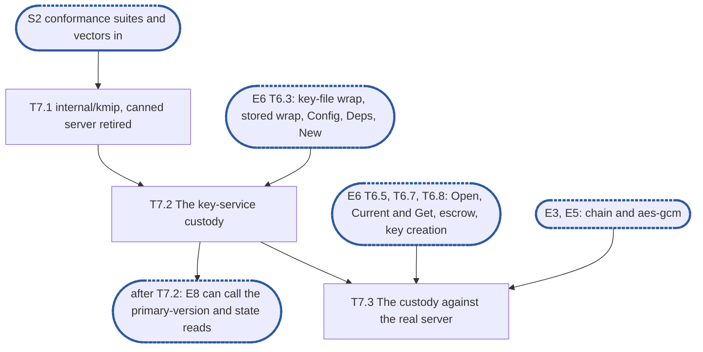

# Epic 7: transforms v2, key-service custody

**Sources:** [RFC 5](../docs/internals/rfcs/rfc-5-transforms.md) Appendix B.1's key-service wrap
(the stored wrap's key-service layout, the version-qualified master-key ID, the associated data as
bytes, "the provider does not wait for a wrap to notice it", the primary-version read, the
ambiguous answer, and the state read of "a master key the service holds in any state but active
stops new writes", each as the custody answers it), B.1's "master keys never leave the key
provider" and its note that a key service keeps its own wrap bound; Appendix B.2's `master-key`
row as a key service holds it, "Where the master key lives" for a key service and "No storage-key
fallback" as a key-service master key meets it; Appendix B.4's first two rows as a custody failure
reaches them; §8.1's key-management row (its provider half), its T18 rows and T22's key-service
stored wrap as bytes; §8.2's Appendix B.1 ambiguous-Locate row and in-place rotation row, their
custody halves; §9 item 2. Outside RFC 5: the RFC 5 plan's D6 and D14 (the custody seam, the
transport moved out of `pkg/keyprovider`), its §1.4 catalogue's KMIP rows, its O5 and O9; the RFC
13 plan's deferral-ledger row on `kmip_fake_test.go`, which this epic owns. The code lands on
`feat/storage-v2`, and the paths below are paths there.
**Track:** B.
**Epic 7 estimate: 3 subtasks, 9.5 man-days.**
**Depends on:** **S2**: from E2, `transformtest.LoadVectors` and its vector file with the key
wrap AAD vector (its R27), and the vector script's Go recompute test. From E1, `keys.MaterialID`,
`keys.Provider`, the material errors and the import allowlist naming `internal/kmip` and
`github.com/gemalto/kmip-go/...`. From E6 (#5976): T6.3's key-file wrap and unwrap and the stored-wrap
codec in `wrap.go`, concrete code with the provider kind fixed at `0x01` (E6's D3), and `Config`,
`Deps` with its `StorageKeys`, and `New`; T6.5's `Open(ctx, ns)`, which unwraps every current
record as a namespace opens, and `Current` and `Get`; T6.7's escrow rule and T6.3's `storage`-key
check, both keyed on the stored wrap's kind so that kind `0x02` skips them; T6.8's namespace key
creation; and `kvstore`'s `KeyRecords` over `badgerkv`. From E3 and E5, `NewChain`, `Pin`, `Attempt.Encode` and
`Chain.Decode` with the `aes-gcm` transform, which T7.3's body round trip runs. The harness's
`service:kmip` (PyKMIP 0.10.0) in `integration`.
**Blocks:** E8, which calls the primary-version read and the state read at open and on its
ticker, re-wraps on a new primary version, refuses `Pin` on a state that is not active and marks
records under a destroyed master key; E9 (#5993), whose `materials` row for `provider: kmip`
fills `Config.KMIP`, with `ClientKey` from the resolved `remote.kmip_client_key`, and whose remote
section's apply calls E6's `(*Provider).Reconfigure(ctx, Config) error`, the KMIP part of which
is T7.2's `reconfigure`, and whose settings validation calls E6's `ValidateConfig(cfg Config)
error`, whose KMIP rules are T7.2's; E11, whose key-management row's store half runs this custody.

---

## 1. Goal

Epic 7 ships the second master-key custody RFC 5 Appendix B.1 names: a KMIP server that holds the
master key and never releases it. The provider asks the server to wrap and unwrap each namespace
key, stores what the server returned in the stored wrap's key-service layout under the
version-qualified ID of the key that wrapped it, and reads the server's current primary version and
each master key's state, which epic 8's rotation and write refusal are built on. The KMIP
transport the RFC 13 key provider already has moves to `internal/kmip`, so both providers speak
KMIP through one transport, and the canned KMIP server its tests used goes.

**At the end of the epic:**

- a provider over the KMIP custody opens against the harness's server, unwrapping each namespace
  key through it, and a body sealed under one of them round-trips through the chain; the server's
  own log shows no Get during the open (T7.3);
- every stored wrap of a key service is `0x02` ‖ the master-key ID `<name>/<uid>` ‖ the wrap
  bytes of D2, `<name>` the configured server name or, when none is set, the endpoint (D3), and equals the golden vector for the vector's inputs; the wrap bytes open under
  the master key with exactly the key wrap AAD (T7.2, T7.3);
- a missing key, an unreachable server, an invalid or expired certificate and a revoked key each
  fail the open with `ErrMaterialUnavailable`, never destroyed, never a fallback (T7.3);
- the primary-version read reports the key a name resolves to, fails on two current versions,
  and reports the new one once the name is retargeted; the state read classes every KMIP state
  as active, destroyed or unavailable (T7.1, T7.2, T7.3);
- `pkg/keyprovider` runs over `internal/kmip` with its exported surface unchanged, and no test
  of either package runs against a canned server (T7.1).

### 1.1 In scope

`internal/kmip`: the moved round trip, TLS setup, message read, symmetric-key Get and state read,
and the key-state table. `pkg/keyprovider`'s KMIP file over it, and its tests split into pure
tests and integration rows. `pkg/transform/keys/provider/kmip.go`: `KMIPConfig`, the key-service
custody, its Encrypt, Decrypt and Locate payloads, the wrap bytes, the primary-version and state
reads, and the unexported `custody` interface T7.2 extracts over the key file's wrap and the
key service's, with its suite `runCustody` over both. The
key-service stored-wrap vector. The harness changes the live rows need, and those rows against
`service:kmip`.

### 1.2 Out of scope

- The stored-wrap codec, the key-file wrap and unwrap and their wrap count, the key-file move to `internal/keyfile`, the provider's
  `Current`, `Get`, fingerprints, cache, its open, escrow rule, the `storage`-key refusal for a key
  file, key creation and gauges: E6. This epic extracts the `custody` interface over E6's key-file
  code and the key service's, and writes `runCustody`, run on both.
- Calling the primary-version and state reads at open and on the provider's ticker, keeping the
  last state when a read fails, re-wrapping on a new primary version, refusing `Pin` while a
  master key is not active, raising `material_unavailable` and `material_destroyed` for a master
  key, and marking the records under a destroyed one: E8. The "no record is re-wrapped" and
  "`material_unavailable` names the master key" halves of §8.2's ambiguous-Locate row are E8's
  for that reason (§9).
- The `materials` settings row for `provider: kmip`, the `rotate-master-key` operation and its
  start from E8's report: E9. The key-management row's store half (the store does not open, the
  decode through the codec): E11.
- A cloud key service taking associated data as a string map, and §8.1 T22's string-map half: the
  RFC 5 plan's deferral ledger, its row on a cloud key service, unowned. The master-key destroy
  check: its row on the export key's next generation, owned by RFC 26.
- Pooled KMIP connections: a `ponytail:` marker at the round trip names one TLS connection per
  call as the ceiling, and a pooled connection with a concurrency bound as the upgrade once a
  cold start or a master-key rotation shows the handshakes in a profile (§2, rule 9).

### 1.3 Names used here

- **E1**, epic 1, interfaces: `keys`, the root contract and the import test with its allowlist.
- **E2**, epic 2, test foundations: `transformtest.LoadVectors`, the vector file and its
  catalogue of the rows each epic turns green.
- **E3**, epic 3, the chain; **E5**, epic 5, encryption, whose `aes-gcm` transform the body round
  trip uses.
- **E6**, epic 6, namespace keys and the provider: the key-file wrap and the stored-wrap codec,
  `kvstore`'s `KeyRecords`, the provider's `Config`, `Deps`, `New` and `Open`.
- **E7**, this epic.
- **E8**, epic 8, rotation and the destroyed-material notice: the ticker, the re-wrap and the
  `Pin` refusal on a master key's state.
- **E9**, the integration epic: the settings rows and the key operations.
- **E11**, epic 11, E2E green: RFC 5's rows through the codec and the engine.
- **S2**, the conformance suites and vectors in: E2's components exist.
- **The RFC 2 plan's epic 2**: owner of the one vector script, in `pkg/carver/internal/carvetest`,
  whose output `transformtest` embeds, and of the nightly `fuzz` suite.
- **The RFC 13 plan**: `.planning/rfc-13-config-plan.md`, whose deferral ledger gives this epic the
  replacement of `kmip_fake_test.go`'s canned server.
- **The content wiring**: the RFC 8 offload plan's `internal/node/content`, which builds the
  provider and its custody from the store configuration.
- **`service:kmip`**: the harness's PyKMIP 0.10.0 server, started by `dt services up kmip`.

## 2. How the general rules apply

The rules are those of
[RFC 5's plan, §1.5](rfc-5-transforms-plan.md#15-general-rules-for-each-epic), cited by number and
title and not copied.

| Rule | Subtasks | How |
| --- | --- | --- |
| rule 1, independent unit tests ([`CLAUDE.md`, "Writing tests"](../CLAUDE.md#writing-tests)) | all | the wrap bytes, the Locate answer, the error mapping, the key-state table, the TLS setup, the framing and the response decode are pure functions with table tests; the custody runs `runCustody`, which T7.2 writes over both custodies, against the real server, and the provider over it is E6's, on `kvstore` over `badgerkv` in memory. No double: the server-side binding is proven by opening the server's wrap bytes under the test's own master key (D6) |
| rule 2, fuzz every decoder of bytes this component did not just write | T7.1, T7.2 | `FuzzReadMessage` over the KMIP frame read (wire bytes) and `FuzzKMIPWrap` over the wrap bytes a key record carries (store bytes); both join the nightly `fuzz` suite in the form the RFC 2 plan's epic 2 registers, and T7.2 extends RFC 5 §8.3's suites line to name them |
| rule 3, observability follows RFC 25 | T7.2, T7.3 | the custody records no series and takes no logger: a failure is an error the provider (E6) reports and E8's ticker logs. Its errors carry master-key IDs, endpoints and KMIP result codes only; T7.3 plants a known namespace key and searches every error the custody and the provider return for its bytes (R20) |
| rule 4, profiling | T7.1, T7.3 | every test under `internal/prof`'s `Watch`, so a TLS connection left open is a leak. No allocation gate: a KMIP call runs once per key at open, not per chunk, and is off the hot paths rule 4 lists |
| rule 5, public interface and internals ([`CLAUDE.md`, "Verifying a change"](../CLAUDE.md#verifying-a-change)) | T7.2, T7.3 | the associated data is asserted as the server bound it, by opening its output (T7.3); a custody failure is asserted where the provider's open and `Get` return it, not only at the custody (T7.3); the key-state table where the keyprovider's open and the custody's state read consume it (T7.1, T7.2) |
| rule 6, known failures shrink | none | `integration` and `unit` keep no `known.yaml` for this RFC; every row lands green |
| rule 7, v2 ignores v1, and imports only what RFC 0 §1.2 allows | T7.1, T7.2 | `internal/kmip` imports the standard library and `github.com/gemalto/kmip-go/...` only: the one log line of the moved code stays in `pkg/keyprovider` (D1), so `internal/logger` does not move and nothing joins E1's allowlist. `kmip.go` imports `internal/kmip`, `kmip-go`, `keys` and `entity`. Neither imports `pkg/keyprovider`; E1's import test holds both |
| rule 8, real dependencies for properties of those dependencies ([`CLAUDE.md`, "Writing tests"](../CLAUDE.md#writing-tests)) | T7.1, T7.3 | every round trip runs against `service:kmip` under `-tags=integration`; a state the server cannot be put into (Destroyed: PyKMIP's Destroy deletes the object) is a row of the pure key-state table, which is data; the certificate rows use certificates the server or the client really refuses, each beside a control row that succeeds |
| rule 9, code comment conventions ([`CLAUDE.md`, "Code comments"](../CLAUDE.md#code-comments)) | T7.1, T7.2 | T7.1 adds the `ponytail:` on one TLS connection per call at `internal/kmip`'s `Do`; `decision:` markers at the key-state table and the unwrap's error mapping (D4), at the wrap-bytes writer (D2), at the Locate check (D3), at the `storage`-key comparison (D8), at `reconfigure`'s swap (D10), and at the wrap, that a key-service wrap raises no wrap count since the service keeps its own bound (R7) |
| rule 10, a test must be able to fail | all | each test in §6 names the bug it catches; the stored-wrap vector comes from the RFC 2 plan's script, never from this code; the audit is the server's log, not the client's own record |
| rule 11, a symbol is exported only if RFC 5's interface or a consumer outside the package uses it | T7.1, T7.2 | `internal/kmip` exports what `pkg/keyprovider` and `kmip.go` call; the provider gains `KMIPConfig`, the type of the `Config.KMIP` field E9 and the content wiring fill, and nothing else: the custody stays behind the unexported `custody` interface T7.2 extracts, built by `New` |
| rule 12, each subtask creates only what it declares | all | the transport moves with its two callers' first use (T7.1: keyprovider; T7.2: the custody); the primary-version and state reads land with the wrap that calls the first, T7.3's rows, and E8 as consumers (D3); the harness changes land with T7.3, their first reader |

## 3. Requirements and invariants

Every obligation RFC 5 places on the key-service custody, numbered so that subtasks and tests can
cite them. `Source` is RFC 5 unless it names another source.

**The wrap and its stored form**

| # | Requirement | Kind | Source | Subtasks |
| --- | --- | --- | --- | --- |
| R1 | A key-service provider asks the service to wrap and to unwrap each namespace key, and stores the result in the one stored-wrap layout every wrap uses: provider kind `0x02`, master-key ID length (2 bytes, big-endian), master-key ID, wrap length (4 bytes, big-endian), wrap bytes | MUST | Appendix B.1 (key wrap; stored wrap) | T7.2 |
| R2 | The wrap bytes hold what the service returned, joined by D2, and no field of the service's output is interpreted: the provider splits back only the fields it joined and hands each to the service unchanged | MUST | Appendix B.1 (stored wrap: "never parsed") | T7.2 |
| R3 | The master-key ID is the immutable, version-qualified identifier of the key that made the wrap, as ASCII bytes: the service's full resource name of the key version (D3), never an alias or a key name a later rotation retargets. An ID that is not ASCII, or longer than its 2-byte length holds, is refused | MUST, MUST NOT | Appendix B.1 (stored wrap) | T7.2, T7.3 |
| R4 | The key wrap AAD (namespace ID ‖ kind ‖ key ID) reaches the service as bytes, the same bytes the key file passes to AES-256-GCM, and nothing else; the KMIP profile names bytes, not a string map | MUST | Appendix B.1 (the AAD paragraph); RFC 5 plan D14 | T7.2, T7.3 |
| R5 | A wrapped key whose namespace ID, kind or key ID in the AAD is changed fails to unwrap through the service; one namespace's wrapped data key copied into another namespace's records does not unwrap there | test row | §8.1 T18, Appendix B.1 (the AAD binds) | T7.3 |
| R6 | A golden vector from an independent implementation pins one key-service stored wrap, as bytes, and the associated data the service bound is checked against the key wrap AAD vector | test row | §8.1 T22; RFC 5 plan O5 | T7.2, T7.3 |
| R7 | A key service draws its own nonces and keeps its own bound: a key-service wrap raises no wrap count (`MKW‖masterKeyID`) | invariant | Appendix B.1 ("A master key makes at most 2³² wraps") | T7.2, T7.3 |

**The primary version and the key state**

| # | Requirement | Kind | Source | Subtasks |
| --- | --- | --- | --- | --- |
| R8 | The custody reads the service's current primary version of a master key, as its version-qualified ID. A service that rotates the key in place, or a name retargeted to another key, makes the next read and the next wrap report the new ID, while records wrapped under the old one still unwrap | MUST | Appendix B.1 ("The provider does not wait for a wrap to notice it"), §8.2's Appendix B.1 in-place rotation row, its custody half | T7.2, T7.3 |
| R9 | A read that finds more than one current version for a master key (a Locate returning two UIDs) fails, with an error naming the master key, and fails again on the next read with the same answer; a read that fails reports no version, and a wrap that needs it wraps nothing | MUST | Appendix B.1 (the ambiguous answer), §8.2's Appendix B.1 ambiguous-Locate row, its custody half | T7.2, T7.3 |
| R10 | The custody reads the state of a master key the service holds. Destroyed and Destroyed Compromised report it destroyed; Active reports it active; every other state, a state value the provider does not know and Item Not Found report it unavailable, so a misconfigured endpoint never reports a key destroyed; a read that gets no answer reports no state, so E8 keeps the last one (Appendix B.1, "a read that fails changes nothing"). Compromised still decrypts and is not destroyed | MUST | Appendix B.1 ("A master key the service holds in any state but active stops new writes"), Appendix B.4; RFC 5 plan D17; E2's catalogue (KMIP rows) | T7.1, T7.2, T7.3 |

**Custody through the real server**

| # | Requirement | Kind | Source | Subtasks |
| --- | --- | --- | --- | --- |
| R11 | A key-service provider never fetches a master key: it asks the service to unwrap each namespace key, once per key when the namespace opens, and holds only the unwrapped namespace keys | invariant | Appendix B.1 ("master keys never leave the key provider"), Appendix B.2 (the `master-key` row), §9 item 2 | T7.2, T7.3 |
| R12 | Against a real key-management server, not a stand-in: the provider unwraps each namespace key through the server at start, the server's audit shows no master key exported, and a body round-trips | test row | §8.1's Appendix B.2 row, its provider half | T7.3 |
| R13 | A missing key, an unreachable server and an invalid certificate each return the provider's error, the store does not open, and none falls back to another provider or to writing without encryption; an expired client or server certificate and a revoked key do the same. The decode half of §8.1's row is E11's | MUST NOT, test row | §8.1's Appendix B.2 row, Appendix B.4 (its first two rows); E2's catalogue (KMIP rows) | T7.3 |
| R14 | A key-service master key lives off the host: it needs no escrow check, and creating an encrypting namespace under it is not refused with `ErrNotEscrowed` | MUST | Appendix B.2 ("Where the master key lives") | T7.3 |
| R15 | No namespace key is wrapped under the `storage` wrapping key: a key-service master key whose UID is the KMIP `storage` key's is refused | MUST NOT | Appendix B.2 ("No storage-key fallback"); the RFC 13 plan's epic 2, R13 (a KMIP key's `KeyUID`) | T7.2, T7.3 |
| R16 | The key-service custody passes the custody conformance suite against the harness's KMIP server | test row | RFC 5 plan D6; E6's D3 (`runCustody`, written here) | T7.2, T7.3 |

**The moved transport**

| # | Requirement | Kind | Source | Subtasks |
| --- | --- | --- | --- | --- |
| R17 | The round trip, TLS setup, message read, symmetric-key Get and state read live in `internal/kmip`, which both key providers import and which imports neither; `pkg/keyprovider`'s exported surface does not change, and its `kmip_integration_test.go` still passes over the moved transport | invariant | RFC 5 plan D14, §3.2 (the RFC 13 row) | T7.1 |
| R18 | A message read from the server is bounded: a frame declaring more than the cap is refused before its body is allocated, and no read runs past the frame | invariant | `CLAUDE.md` "Writing tests", "By kind" (fuzz); RFC 5 plan §1.5 rule 2 | T7.1 |
| R19 | No test of `pkg/keyprovider` or `internal/kmip` runs against a canned KMIP server: each case `kmip_fake_test.go` held is a test of a pure function or a row against the harness's real KMIP server | invariant | the RFC 13 plan §6.1 (its `kmip_fake_test.go` row); `CLAUDE.md` "Writing tests" | T7.1 |

**Secrecy**

| # | Requirement | Kind | Source | Subtasks |
| --- | --- | --- | --- | --- |
| R20 | No namespace key byte or unwrapped material reaches an error the custody or the provider over it returns: master-key IDs, endpoints and KMIP result codes only | invariant | RFC 5 plan §1.5 rule 3 | T7.3 |

**Mapping of what this epic does not own.** The stored-wrap codec and the key-file wrap, its
count and T22's key-file vector are E6's; R1 uses E6's codec with kind `0x02`. The fingerprint
check after an unwrap (§2.5), the cache that makes R11's "once per key" hold, the open that
unwraps each current key, the escrow rule and the key file's `storage`-key refusal are E6's; R11,
R12, R13 and R14 test this custody through them, and R15's key-service comparison is this epic's
(D8). Calling the reads of R8 to R10 at open and on the ticker, a failed state read leaving the
last state in force, the re-wrap, the `Pin` refusal, the conditions and the destroy marking are
E8's (§1.2). §8.1 T22's string map, §8.2 T19 and the destroy-check clauses of the Appendix B.1
rows are the RFC 5 plan's deferral-ledger rows. §5.4's post-quantum paragraph describes where the
exposure is and binds no code here. B.4's rows past the first two are E6's and E11's.

## 4. Decisions this epic takes

- **D1, `internal/kmip` holds what moved; the custody's own payloads stay in `kmip.go`.** Both
  providers need the round trip, the TLS setup, the message read, the response decode, the
  symmetric-key Get, the state read and the key-state table (D4), so those move out of
  `pkg/keyprovider`, as the RFC 5 plan's D14 names them. Encrypt, Decrypt, Locate, Create,
  Activate and DeleteAttribute payloads that only the custody or its tests send stay in
  `pkg/transform/keys/provider`: `kmip-go` v0.1.0 has KMIP 1.4 structs for Create and Destroy and
  only the tags for the rest, so those are unexported structs with `ttlv` tags, as
  `pkg/keyprovider` already writes its GetAttributes payload. The moved code's one log line, the
  warning on a retired key marked Compromised, belongs to `pkg/keyprovider`'s retired-key loader
  and stays there, so `internal/kmip` imports no logger and E1's allowlist gains nothing. No
  marker: nothing is skipped. Prior art: Go's own `internal/` packages shared by two consumers,
  `crypto/internal/...` (from memory).
- **D2, the wrap bytes of a key service are a versioned join of the Encrypt response's fields.**
  KMIP's Encrypt returns three fields, the IV the server drew, the authentication tag and the
  data, so storing "exactly what the service returned" needs a join: version (1 byte, `1`) ‖ IV
  length (2 bytes, big-endian) ‖ IV ‖ tag (16 bytes) ‖ data. The cryptographic parameters are
  fixed (AES, GCM, a 16-byte tag, Random IV), so they are not stored; the IV length is, since
  PyKMIP draws 16 bytes and other servers 12. It is settled now because every key record and
  every salvage wrap under a key service carries it from the first namespace, and RFC 26's
  recovery import reads it back: a change later is version 2, which every reader keeps. Storing
  the Encrypt response's TTLV verbatim was the other candidate: it repeats the UID the stored wrap
  already carries, needs a TTLV decoder over store bytes, and the vector script cannot compute it
  without one. A `decision:` marker at the writer names the layout, says no field is interpreted,
  and is withdrawn if a profile ever returns its wrap as one opaque blob. Prior art: Vault's
  transit ciphertexts, prefixed `vault:v1:` so a format change is a new version (from memory);
  AWS KMS's opaque ciphertext blob (from memory).
- **D3, a master key is configured by its KMIP Name; its version-qualified ID is `<name>/<uid>`,
  `<name>` a configured server name that defaults to the endpoint (the user's decision,
  2026-11-26).** `KMIPConfig.Key` is a KMIP Name attribute value, the alias a
  rotation retargets. The primary-version read is a Locate for an Active symmetric key of that
  Name: one UID is the primary version; none, or more than one, fails the read, naming the key
  and the count. A wrap reads the primary version first, so a wrap after a retarget reports the
  new ID without waiting for E8's ticker (R8), and an ambiguous answer wraps nothing (R9). A UID
  is immutable in KMIP (a ReKey makes a new object), but it is unique only within one server, and
  PyKMIP numbers them `1`, `2`, …: E8's marking of "every key record whose stored wrap names that
  master key's ID, in every namespace" would then mark another configuration's records under
  another server's key `1`. So the ID is a server name, `/`, and the UID, the full resource name
  of the key version that RFC 5 asks for: `KMIPConfig.ServerName`, filled from E9's
  `kmip.server_name`, or the configured endpoint when it is empty. Example: `kms-a/3` with the
  name set, `127.0.0.1:5696/3` without. The name exists so that an endpoint change that reaches the
  same server's keys, a DNS rename or a failover to another node of a KMIP cluster holding the same
  UIDs, leaves every record's ID as it is; with no name set, such a change, or an endpoint respelled
  (`localhost` for `127.0.0.1`), makes the primary version differ from the records' IDs, which E8
  treats as a rotation and re-wraps under the same key: a cost, not a loss. A name is the
  operator's claim that the endpoints it is given reach one server's key set: two servers given one
  name collide as bare UIDs would, so the `decision:` marker at the ID's writer says so. A changed
  name is a rotation too (D10). Rejected: the bare UID, as RFC 13's `KeyUID` names it, unique
  within one server only; and the endpoint alone, which re-wraps every record on any failover.
  Both reads join the unexported `custody` interface T7.2 extracts, as E6's D3 names
  it: `kind`, `wrap`, `unwrap`, `primary(ctx) (masterKeyID []byte, err error)` and `state(ctx,
  masterKeyID []byte) error`, the last nil for active and `keys.ErrMaterialDestroyed` or
  `keys.ErrMaterialUnavailable` for any other state the service answers, Item Not Found included,
  and, for a read that gets no answer (a dial, TLS or timeout failure, or a failed status other
  than Item Not Found), an error wrapping neither, so E8 tells a timeout from an inactive key and
  keeps the last state; the interface needs no type of `internal/kmip`; the
  key file answers its one master key ID and nil, and `runCustody` holds both custodies to the same
  rows. An interface lands now, not in E6, because the key service is its second implementation. A
  `decision:` marker at the Locate check names the rule, and one at the ID's writer names the
  name's default and its collision ceiling. Prior art: KMIP 1.4's ReKey and Locate (from memory);
  AWS KMS's key ARN, a key ID qualified by region and account (from memory).
- **D4, the key-state table has three classes, and only the state read reports destroyed.**
  `internal/kmip` maps a state and the error of its read to active, destroyed or unavailable
  (R10), as one table both providers use: `pkg/keyprovider`'s retired-key loader takes its
  "material gone" case from it, and its current-key check stays "Active or refused", its own rule.
  An unwrap that fails is unavailable whatever the server answers, since a failed Decrypt cannot
  tell a destroyed key from a misconfigured endpoint, and only Destroyed or Destroyed Compromised
  in a state read starts E8's marking. `decision:` markers at the table and at the unwrap's error
  mapping say so, to be withdrawn if a KMIP profile ever reports destruction on Decrypt
  unambiguously. Prior art: KMIP 1.4's state model; the RFC 5 plan's D17 (from memory for KMIP).
- **D5, the canned server goes, and nothing replaces it.** The RFC 13 plan's ledger row asks for
  a fake that passes a conformance suite. None is needed: every case of `kmip_fake_test.go` is
  either a pure function of what the server sent (TLS setup, key-material extraction with its
  length check, framing, the response decode with its missing payload, the GetAttributes decode
  with its missing State, the state decisions over every state, Destroyed included) or a round trip
  PyKMIP answers (a failed Get; the happy path, which `kmip_integration_test.go`'s
  `TestKMIP_WrapUnwrapRoundTrip` already covers). So the row is discharged by this recorded
  decision rather than by a new double. No marker: no gate is narrowed. Prior art: `CLAUDE.md`'s
  "Writing tests" ("put the logic in a function of its inputs").
- **D6, the server-side binding is proven by opening the server's output, not by recording what
  was sent.** §8.1 T22 asks for "a fake service that records the authenticated data it is sent";
  a recorder would show only what this client sent. Instead the test creates its own master key,
  reads its bytes with a Get outside the audit window (the test owns the key; the custody never
  calls Get), and opens D2's IV, tag and data with AES-256-GCM under E2's key wrap AAD vector.
  That proves the server bound exactly those bytes and that D2's split is right, with no double
  and no transport seam: the custody holds a `*kmip.Client`. Whether this meets T22's wording is
  for RFC 5's author (§9). No marker: no gate is narrowed. Prior art: none found.
- **D7, the audit is the server's own log.** The harness mounts a writable directory for PyKMIP's
  log and names the file in `DITTOFS_TEST_KMIP_LOG`. A test notes the file's size and inode, runs
  the provider's `Open` of each namespace, and reads what the file gained: no `Processing operation: Get` line, and
  at least one Decrypt per key record (the log names the operation, not the UID, and
  `integration` runs with `-p 1`, so the window holds only this test's calls). A file smaller than
  its starting size or with another inode means PyKMIP's handler rotated it, and fails the test
  rather than pass on a truncated window. A client-side record would only show what this code
  sent, and §8.1's row asks what the server saw. No marker. Prior art: none found.
- **D8, a key-service master key is compared to the `storage` key by UID, and the comparison fails
  closed.** Its bytes never reach the process, so it has no fingerprint, and `pkg/keyprovider`
  offers no bytes for a KMIP `storage` key either. RFC 13 names a KMIP key by its `KeyUID`; an entry of E6's
  `Deps.StorageKeys` holds it as its `ID`, with a zero fingerprint, when the `storage` key is a KMIP
  key, and E6's own ID and fingerprint check skips kind `0x02` (its D15). The custody refuses a
  primary version whose UID equals any entry's `ID`, in the
  primary-version read, so every wrap and E8's reads at open and on the ticker refuse it (R15),
  and the check has one site. It compares the UID alone, not the endpoint, since two spellings of
  one endpoint would otherwise let the `storage` key through; two servers whose keys happen to
  share a UID are refused, visibly, and the operator names another key. A `decision:` marker at
  the comparison says so, to be narrowed to endpoint and UID if KMIP servers ever report a stable
  server identity. Prior art: the RFC 13 plan's epic 2, its D9, which compares by `KeyUID` with
  its endpoint for two roles of one installation.

- **D9, the client key arrives as PEM bytes; the certificate and the CA stay paths.** E9 (#5993)
  resolves the client key from `remote.kmip_client_key`, a secret reference of kind `SecretKey`
  (E9's key, which RFC 13 Appendix B does not list yet, E9's §9), into bytes, so `KMIPConfig.ClientKey` holds the
  key's PEM and never a path to a file left on disk. `internal/kmip.TLSConfig` takes the three PEMs
  as bytes, built with `tls.X509KeyPair`; `pkg/keyprovider` reads its files and passes their bytes,
  its exported surface unchanged. The certificate and the CA are not secret, so they stay paths
  read at construction and at `reconfigure`. No marker: nothing is skipped. Prior art: Go's
  `tls.X509KeyPair`, the in-memory form of `LoadX509KeyPair` (checked).
- **D10, a running custody takes a new endpoint, server name, certificates and timeout, never a new
  key.** E9's
  remote section is live (RFC 13 Appendix B), and its apply calls each provider's `Reconfigure`
  (E6's R53); a new master key is refused there (E9's D2), so `reconfigure` refuses a
  changed `Key` too and changes only how the server is reached. It builds and checks the new
  client before the swap, so a bad certificate leaves the running one serving. A `decision:` marker
  at the swap says a call in flight finishes on the old client and that the change of master-key
  ID a changed server name, or an endpoint change with no name set, causes is a rotation E8 runs,
  not a loss. Prior art: Go's
  `tls.Config.GetClientCertificate`, which swaps a certificate on a live client (from memory).

## 5. Target tree

```text
internal/kmip/
  kmip.go              T7.1  Client, NewClient, TLSConfig, Do (the round trip, its
                             ponytail:), the message read, the response decode,
                             GetSymmetricKey, State
  state.go             T7.1  Class, Classify: the key-state table (D4)
  kmip_test.go         T7.1  TLS setup, key-material extraction, framing, the response and
                             GetAttributes decodes, a dial to a closed listener
  state_test.go        T7.1  the table over every KMIP state, Item Not Found, an unknown value
  fuzz_test.go         T7.1  FuzzReadMessage
  testdata/fuzz/FuzzReadMessage/  T7.1
pkg/keyprovider/
  kmip.go              T7.1  over internal/kmip; the retired-key warning stays (D1)
  kmip_test.go         T7.1  the current- and retired-key state decisions, as a table
  kmip_fake_test.go    T7.1  deleted (D5)
  kmip_integration_test.go  T7.1  + a Get of an unknown UID
pkg/transform/keys/provider/
  kmip.go              T7.2  KMIPConfig, the custody, its payloads, the wrap bytes (D2), the
                             primary-version and state reads (D3, D4, D8)
  custody.go           T7.2  the custody interface, extracted (E6's D3)
  wrap.go, provider.go T7.2  the key file behind it, with its primary and state answers;
                             Config.KMIP, New choosing the custody
  custody_test.go      T7.2  runCustody over the key file
  kmip_test.go         T7.2  the wrap bytes against the vector, malformed wrap bytes, the
                             Locate answer, the error mapping, the storage-key comparison
  kmip_fuzz_test.go    T7.2  FuzzKMIPWrap
  testdata/fuzz/FuzzKMIPWrap/  T7.2
  kmip_integration_test.go  T7.3  the live rows (-tags=integration)
pkg/carver/internal/carvetest/  T7.2  the key-service stored-wrap row of the vector script
pkg/transform/transformtest/testdata/vectors.json  T7.2  its output; LoadVectors's field and
                             the Go recompute test's row
test/harness/env.sh    T7.3  a writable log mount; DITTOFS_TEST_KMIP_LOG and
                             DITTOFS_TEST_KMIP_CA_KEY in kmip.env; reuse only with both set
docs/internals/rfcs/rfc-5-transforms.md  T7.2  §8.3's suites line names the two fuzz targets
```

## 6. Subtasks

### T7.1 The KMIP transport in `internal/kmip`, and the canned server retired

**Subtask T7.1 estimate: 2 man-days.**

- **Track:** B. **Depends on:** S2.
- **Covers:** R10 (the table), R17, R18, R19.
- **Deliverables:**
  - `internal/kmip/kmip.go`, moved from `pkg/keyprovider/kmip.go` with its error handling and
    validation intact:
    ```go
    type Client struct{ /* endpoint, TLS config, timeout */ }
    func NewClient(endpoint string, tls *tls.Config, timeout time.Duration) *Client
    func TLSConfig(clientCertPEM, clientKeyPEM, serverCAPEM []byte) (*tls.Config, error)
    func (c *Client) Endpoint() string
    func (c *Client) Do(ctx context.Context, op kmip14.Operation, payload any) (ttlv.TTLV, error)
    func (c *Client) GetSymmetricKey(ctx context.Context, uid string) ([]byte, error)
    func (c *Client) State(ctx context.Context, uid string) (kmip14.State, error)
    ```
    `Do` is the round trip, still sending KMIP 1.4's protocol version, which the associated-data
    fields need, split so the response decode (no batch item, a failed status, a missing or
    non-TTLV payload) and the GetAttributes decode (no State attribute, a State of the wrong
    type) are unexported functions of the response's bytes. A failure names the operation, the
    UID and the KMIP result status and reason by their names; no error type is exported, since
    every caller treats each failure alike (D4). T7.1 adds the `ponytail:` at `Do` naming one TLS
    connection per call, a handshake per unwrap at a cold start, and the pooled connection that
    replaces it (§1.2). `GetSymmetricKey` keeps the 32-byte check, consumed by `pkg/keyprovider`
    and T7.3's binding check; `Do`, `State` and `Endpoint` by it and by T7.2.
  - `internal/kmip/state.go`: `type Class int` with `Active`, `Unavailable`, `Destroyed`, and
    `func Classify(state kmip14.State, err error) Class`, the table of D4 with its `decision:`
    marker. Consumed by `pkg/keyprovider`'s retired-key loader and T7.2's state read.
  - `pkg/keyprovider/kmip.go` over `internal/kmip`, its exported surface unchanged; its
    current-key and retired-key state decisions become unexported functions of the uid and the
    state, so the canned server's Destroyed rows are rows of their table. The `internal/logger`
    warning stays here (D1), and `internal/kmip`'s errors reach its callers wrapped under its own
    `keyprovider:` prefix, so its error texts keep their start.
  - `pkg/keyprovider/kmip_fake_test.go` deleted (D5); its TLS, key-material, framing, nil-payload
    and missing-State cases move to `internal/kmip`'s tests as pure tests, its dial-error case
    dials a listener on `127.0.0.1:0` closed before the call, its failed-Get round trip becomes a
    row of `kmip_integration_test.go`, and its happy path is the live round trip that file already
    holds.
  - `FuzzReadMessage` in `internal/kmip`, seeded with a valid frame, a padded one, a short header
    and a length above the cap; it joins the nightly `fuzz` suite.
- **Acceptance criteria:**
  - `pkg/keyprovider`'s exported identifiers are the same before and after (`go doc -all` diffed),
    and its `kmip_integration_test.go`, the new row included, passes against `service:kmip`.
  - E1's import test passes with `internal/kmip` importing the standard library and `kmip-go`
    only.
  - No file of either package starts a TLS listener that answers KMIP.
- **Tests:**
  - The key-state table: every `kmip14.State` value, an unknown value, a failed read with Item Not
    Found and a dial error, each to its class (catches Compromised or Deactivated taken as
    destroyed, an unknown value taken as active, a misconfigured endpoint reported destroyed, R10).
  - `pkg/keyprovider`'s decisions over the same states: current key refused unless Active, retired
    key refused only when destroyed (catches the move changing RFC 13's behaviour, R17).
  - The response decode: no batch item, a failed status with its reason, a success with no payload,
    a non-TTLV payload; the GetAttributes decode with no State and with a State of another type;
    each an error and none a panic (catches the nil-payload panic the canned server once caught,
    R19).
  - The framing: a frame with and without padding, a short read, a length one above the cap
    refused before its body is allocated, under the fuzzer too (catches an allocation sized by a
    claim, R18).
  - TLS setup and key-material extraction with its length check: the moved table cases (R17).
  - The dial to a closed listener returns an error within the timeout (R17).
  - The integration row: a Get of a UID the server never issued returns an error naming Item Not
    Found (catches a status or reason lost in the move, R17).
  - No double: the server is `service:kmip`, and the rest are pure functions.
- **Rules:** rule 9: the `ponytail:` at `Do`. rule 7: no logger in `internal/kmip`.

### T7.2 The key-service custody

**Subtask T7.2 estimate: 4 man-days.**

- **Track:** B. **Depends on:** T7.1, T6.3.
- **Covers:** R1, R2, R3, R4, R6 (the vector), R7 (the marker), R8, R9, R10 (the read), R11, R15,
  R16 (the suite); E6's R52 and R53 for the KMIP fields; and E9's two asks (D9, D10).
- **Deliverables:**
  - `pkg/transform/keys/provider/kmip.go`:
    ```go
    type KMIPConfig struct {
        Endpoint   string        // host:port
        ServerName string        // qualifies the master-key ID (D3); empty: Endpoint
        Key        string        // the KMIP Name of the master key (D3)
        ClientCert string        // path to the client certificate's PEM
        ClientKey  []byte        // the client key's PEM, resolved from remote.kmip_client_key (D9)
        ServerCA   string        // path to the server CA's PEM; empty: the system roots
        Timeout    time.Duration // 0: internal/kmip's default
    }
    ```
    E6's `Config` gains `KMIP KMIPConfig`, and `New` builds the key-service custody when its
    `Endpoint` is set and refuses a configuration naming both a key file and a key service; E6's
    `storage`-key check skips kind `0x02`, whose check is D8's. The custody refuses a `KMIPConfig`
    missing its endpoint, key or certificate, as `pkg/keyprovider` does, and dials nothing at
    construction; E6's `Open(ctx, ns)` dials it as it unwraps each current record. Consumed by the
    content wiring and by E9's `materials` row, which fills it.
  - `reconfigure(cfg KMIPConfig) error` on the KMIP custody, the KMIP part of E6's
    `(*Provider).Reconfigure(ctx, cfg Config) error` (its R53, #5976), which E9's remote section's
    apply calls (D10): it
    refuses a changed `Key`, a missing field, or a certificate, key or CA that does not load,
    leaving the running client in force; otherwise it builds the new `*kmip.Client` and swaps it in
    under the custody's lock, so a call in flight finishes on the old one and the next uses the new.
    A changed `ServerName`, or an endpoint changed with no `ServerName` set, changes the
    master-key ID the next primary-version read reports (D3), which E8 treats as a rotation; an
    endpoint changed under a set `ServerName` does not. Consumed by `Reconfigure` and, through it, E9.
  - The KMIP rules of E6's `ValidateConfig(cfg Config) error` (its R52), which reads no file and
    dials nothing: a configuration naming both a key file and `KMIP.Endpoint` is refused; with
    `KMIP.Endpoint` set, an endpoint that is not `host:port`, an empty `Key`, `ClientCert` or
    `ClientKey`, a `ClientKey` that is not one PEM block, a `ServerName` that is not printable
    ASCII, and a negative `Timeout` are each refused,
    naming the field. `reconfigure` and the custody's constructor run the same rules first, then
    load the files. Consumed by E9's settings validation.
  - `custody.go`: the unexported `custody` interface of D3, extracted over E6's key-file wrap and
    unwrap in `wrap.go`, which move behind it unchanged with `kind` `0x01`, and gain `primary` (its
    one master key ID) and `state` (nil); the provider calls its custody through the interface,
    chosen by the stored wrap's kind on unwrap. Consumed by the KMIP custody below and by E8.
  - `custody_test.go`: `runCustody(t, newCustody func(t *testing.T) custody)`, the suite both
    custodies run: a wrap unwraps under its AAD; a changed namespace, kind or key ID in the AAD
    fails; a flipped byte of the wrap fails; the master key ID a wrap reports is `primary`'s and
    the stored wrap's; `state` of `primary` is nil. Run here on the key file, and by T7.3 on the
    key service. E6's key-file tests of the same rows stay as they are.
  - The custody, unexported, implementing that interface with `kind` `0x02`: wrap (the
    primary-version read, then an Encrypt under that UID with AES, GCM, a 16-byte tag, Random IV
    and the key wrap AAD as KMIP 1.4's Authenticated Encryption Additional Data, R4), the stored
    wrap through E6's codec with the master-key ID `<name>/<uid>` of the UID the response
    names, `<name>` the `ServerName` or, when empty, the `Endpoint`, refused if not ASCII or too long (R1, R3); unwrap (the UID taken from after the last `/`
    of the stored ID, a Decrypt under it with the fields of D2, R2); the primary-version read (D3,
    D8); the state read (`internal/kmip.State` and `Classify`, R10).
  - The Encrypt, Decrypt and Locate request and response payloads, unexported structs with `ttlv`
    tags (D1).
  - The wrap-bytes writer and reader of D2, with its `decision:` marker; the Locate answer's check
    as a function of the UIDs returned, with its `decision:` marker; the `storage`-key comparison
    of D8 with its `decision:` marker; the error mapping (any failure of a wrap, an unwrap or a read
    other than the state read's unanswered one (D3) is `keys.ErrMaterialUnavailable`, wrapped with the master-key ID, the endpoint and the KMIP
    result codes; never `ErrMaterialDestroyed`, D4); the wrap's `decision:` that it raises no wrap
    count (R7); the ID's writer with D3's `decision:` on the name's default and its collision
    ceiling.
  - `FuzzKMIPWrap` over the wrap-bytes reader, seeded with the vector's bytes and truncations of
    them: no panic; the IV, tag and data it returns lie inside the input; and an accepted input
    re-encodes through D2's writer to exactly the input bytes, since the join has no padding or
    reserved bytes. It joins the nightly `fuzz` suite; RFC 5 §8.3's suites line names it and
    `FuzzReadMessage`.
  - The key-service stored-wrap vector: a row of the RFC 2 plan's vector script with a fixed
    endpoint, UID, IV, tag and data, its output in `vectors.json`, its field in `LoadVectors` and
    its row in `transformtest`'s Go recompute test.
  Consumed by T7.3, by E8's ticker (the two reads), and by E11.
- **Acceptance criteria:**
  - The stored wrap built from the vector's endpoint, UID, IV, tag and data equals the vector byte
    for byte, and the reader splits it back into exactly those fields.
  - The Locate check returns the UID for one, and an error naming the key and the count for none
    and for two.
  - `runCustody` passes on the key file, and E6's provider tests pass unchanged over the extracted
    interface.
  - A primary version whose UID equals a `Deps.StorageKeys` entry's `ID` is an error, whatever the
    endpoint (D8).
  - `reconfigure` refuses a changed `Key`, an empty endpoint and a client key that does not parse,
    and the custody's client is the old one after each refusal.
  - The master-key ID is `kms-a/3` for `ServerName` `kms-a` and UID `3`, and `127.0.0.1:5696/3`
    for an empty `ServerName` at that endpoint; after a `reconfigure` to another endpoint it is
    still `kms-a/3` with the name set, and the new endpoint's without it.
  - `ValidateConfig` refuses each KMIP rule's case, naming its field, with no file present and no
    listener (catches a check that reads or dials, R52's "without reading a file or dialling").
- **Tests:**
  - The vector (catches a field order, a length width or a byte order apart from D2 and RFC 5's
    layout, a missing kind byte, an ID without its qualifier, R1, R3, R6).
  - The ID's qualifier over a set and an empty `ServerName`, before and after an endpoint change
    (catches a default not applied, a name ignored, or a failover that re-qualifies every record,
    D3).
  - The reader over a truncated join, an IV length past the end, a body shorter than its tag, an
    unknown version: each refused, no panic, under the fuzzer too (catches a decoder sized by a
    claim, R2).
  - The ID check: a non-ASCII UID and an ID of 65,536 bytes refused (R3).
  - The Locate check over zero, one and two UIDs (catches a read that picks the first of two, R9).
  - The error mapping: a failed status, a dial error and a cancelled context each map to
    `ErrMaterialUnavailable` under `errors.Is`, never `ErrMaterialDestroyed` (catches a
    misconfigured endpoint reported as lost material, R10, D4); for `state`, the dial error and the
    cancelled context map to neither, and Item Not Found to `ErrMaterialUnavailable` (catches a
    timeout read as an inactive key, which would refuse `Pin`, R10).
  - The `storage`-key comparison: the same UID refused at the same endpoint and at another
    spelling of it (catches a comparison that lets a respelled endpoint through, R15).
  - `runCustody` on the key file: its AAD rows (catch a wrap that binds nothing behind the
    interface), and `primary` the ID every wrap reports with `state` nil (catches a key file that
    answers no primary, which E8's ticker would read as a rotation, R16).
  - No double: the round trips are T7.3's, against the real server.
- **Rules:** rule 2: `FuzzKMIPWrap` and the suites line. rule 9: D2's, D3's (the Locate check and
  the ID's writer), D4's and D8's markers, and R7's. rule 11: `KMIPConfig` and the `Config.KMIP` field are the only new exports.

### T7.3 The custody against the real server

**Subtask T7.3 estimate: 3.5 man-days.**

- **Track:** B. **Depends on:** T7.2, T6.5, T6.7, T6.8, E5's `aes-gcm` transform.
- **Covers:** R3, R4, R5, R6 (the binding), R7, R8, R9, R10 (the live read), R11, R12, R13, R14,
  R15, R16, R20.
- **Deliverables:**
  - `test/harness/env.sh`: a writable mount for PyKMIP's log (`-l`), named in `kmip.env` as
    `DITTOFS_TEST_KMIP_LOG`; the CA key's path as `DITTOFS_TEST_KMIP_CA_KEY`, so a test can sign an
    expired client certificate and a valid one beside it; `svc_kmip_up` reuses a running server
    only when `kmip.env` sets both, so a server started before this change is replaced. The log is
    written at DEBUG, which prints responses: it stays under the state directory and is never
    uploaded as a CI artifact.
  - `kmip_integration_test.go` (`-tags=integration`), skipping with the variable's name when
    `DITTOFS_TEST_KMIP` is unset. Each test creates its own keys through `Do`: Create (kmip-go's
    payload, with the Encrypt and Decrypt usage bits PyKMIP's Encrypt and Decrypt require), then
    Activate, under a Name of the test's name and a random suffix, since the server's database
    outlives a run; `t.Cleanup` revokes each key, since PyKMIP refuses to destroy an Active one,
    then destroys it. The revoked-key row uses `provision.py`'s `dittofs-deactivated`.
  - `runCustody` run against the custody over `service:kmip`.
- **Acceptance criteria:**
  - `test/harness/bin/dt run integration` runs the rows and they pass, with `service:kmip` up.
  - With `DITTOFS_TEST_KMIP` unset, each test skips naming it, and none is counted a pass.
- **Tests:**
  - `runCustody` over the KMIP custody, its AAD rows among them: a changed namespace ID, kind or key
    ID, and a record copied to another namespace, each fail to unwrap (R5, R16).
  - A provider over the custody with three namespaces' key records, each opened through `Open`
    inside the audit window of D7: the log gains no Get and at least three Decrypts; a body sealed by `aes-gcm`
    under one namespace's data key round-trips through `NewChain`, `Pin`, `Attempt.Encode` and
    `Chain.Decode` (catches a custody that fetches the master key, or an open that unwraps
    nothing, R11, R12).
  - The binding (D6): one stored wrap's IV, tag and data, opened locally with AES-256-GCM under the
    test key's bytes (read by the test with `GetSymmetricKey` outside the audit window) and E2's
    key wrap AAD vector for the record, give the record's key; under any other AAD they fail
    (catches an AAD hex-encoded, mapped or missing, and a split of D2 apart from the server's
    fields, R4, R6).
  - Failures at open: a Name nobody created; an endpoint on a closed `127.0.0.1:0` listener; a
    server CA the test generated; a client certificate signed by the harness CA that expired an
    hour ago, beside a control certificate from the same generator, valid, that opens; the server's
    certificate seen as expired through the client's `tls.Config.Time` set a year ahead (the
    injected clock); the revoked `dittofs-deactivated` key. Each fails the namespace's
    `Open` with `ErrMaterialUnavailable` under `errors.Is`, never destroyed, so it does not open, and no body was encoded without
    encryption (catches a fallback to another provider or to plaintext, an expiry nobody checks, a
    certificate row passing for another reason, R13).
  - The custody's `state` over an Active key, a revoked one and a destroyed one (PyKMIP's Destroy
    deletes it, so the read finds Item Not Found): nil, `ErrMaterialUnavailable` and
    `ErrMaterialUnavailable`, never `ErrMaterialDestroyed` (catches a missing object reported as
    lost material, R10).
  - `Reconfigure` on a running provider over the custody: a new client certificate and
    key (signed by the harness CA) and a new timeout; the next unwrap succeeds over the new client,
    and a reconfigure to a certificate the server refuses is itself refused, with unwraps still
    succeeding on the old client (catches a swap applied before it is checked, or one that drops
    the running client, D10). With `ServerName` set, a reconfigure from `127.0.0.1` to `localhost`
    at the same port leaves the primary-version read's ID unchanged and the records unwrapping;
    with it empty, the read reports the new endpoint's ID (catches a name that does not hold the ID
    across a failover, D3).
  - After the three namespaces' creation, the `badgerkv` store's keys under the `MKW` kind scanned:
    none for the KMIP master key (catches a key-service wrap counted against the key file's bound,
    R7).
  - An encrypting namespace created on a provider over the custody with no escrow check run:
    created (catches the escrow rule applied to a key service, R14).
  - Two Active keys created under one Name: the primary-version read fails naming the key and the
    count, twice in a row, and a wrap attempted between them fails with no Encrypt in the log
    (catches a read that picks one of two, or a wrap that proceeds on an ambiguous answer, R9).
  - A key under Name N wraps a record; a second key is created under N and the first key's Name is
    removed with DeleteAttribute (PyKMIP has no ReKey): the read reports the second key's ID, the
    next wrap stores it, and the first record still unwraps under its own ID (catches an ID taken
    from the Name, which a retarget would silently repoint, R3, R8).
  - A provider whose `Deps.StorageKeys` names the test key's UID: the first namespace's key creation
    and `Open` are refused, and nothing is wrapped (catches the comparison of D8 skipped in the read,
    R15).
  - A known namespace key planted and wrapped, then every error the rows above return searched for
    its bytes raw, in hex and in base64 (catches key material formatted into an error, R20).
  - Every test under `internal/prof`'s `Watch`. No double: the server is `service:kmip`, the key
    records `kvstore` over `badgerkv` in memory, and the server certificate's expiry is the
    client's injected clock.
- **Rules:** rule 8: the real server and real certificates, each refusal beside a control. rule 4:
  `Watch`. rule 5: the binding asserted as the server made it. rule 3: the planted key.

## 7. Order of work



T7.1 goes first: it waits on nothing of E6, lands the transport both providers need and settles
the canned server, so it can merge while E6 is in progress. T7.2 is the blocker for E8's reads and
waits on E6's key-file wrap, which it moves behind the interface. T7.3 holds the finished custody to the real server.

## 8. Suggested pull requests

| PR | Subtasks | Man-days | After | Why together |
| --- | --- | --- | --- | --- |
| 1 | T7.1 | 2 | S2 | the move and the canned server's retirement, which touch RFC 13's package and nothing of RFC 5's; open alongside E6's work |
| 2 | T7.2, T7.3 | 7.5 | PR 1, E6's T6.3, T6.5, T6.7 and T6.8 | the custody and every row that holds it to the real server: the custody lands with its tests |

A suggestion only: one pull request per subtask works as well.

## 9. Open points

- **`remote.kmip_client_key` and `kmip.server_name` are E9's keys (#5993)**, which RFC 13
  Appendix B does not list yet (E9's §9). D9 reads the resolved bytes and D3 the name whatever the
  keys are called; only E9's rows and the content wiring change if a name does. E9's
  `materials.kmip` block gains `server_name` for D3, in #5993.
- **Which side owns what, with E6** (#5976). E6 owns the stored-wrap codec, the key-file wrap
  and unwrap as concrete code, `Config`, `Deps`, `New`, `Open` and every provider-level rule, its
  escrow rule and its `storage`-key check keyed on the stored wrap's kind so that kind `0x02` skips
  both. E7 extracts the unexported `custody` interface over the key file and the key service, with
  `primary` and `state` and the key file's answers to them, writes `runCustody` and runs it on both
  (D3, as E6's D3 hands it over), adds `Config.KMIP`, and owns `internal/kmip`, the KMIP custody and
  the key-service `storage`-key comparison (D8). E6 has folded the three needs this document raised:
  `Open` unwraps every current record, so an unreachable custody stops the namespace opening
  (B.4's first row), and the two checks skip kind `0x02` (R14).
- **Needs on E8.** §8.2's ambiguous-Locate row asks that no record be re-wrapped and that
  `material_unavailable` name the master key, over two periods: both are E8's ticker and re-wrap,
  so T7.3 holds the read's half and E8's breakdown must take the rest, or the row is unowned; the
  same for the in-place rotation row, whose re-wrap is E8's. PyKMIP 0.10.0 cannot reach Destroyed
  (its Destroy deletes the object, so a state read finds Item Not Found, which is unavailable): the
  RFC 5 plan's epic 8 rows that ask for Destroyed and Destroyed Compromised "against the harness's
  KMIP server" cannot run there, and the destroyed class is held by T7.1's pure table and E8's own
  tests of its marking. For the RFC 5 plan's O9, read in PyKMIP 0.10.0's source, not run: it has no
  ReKey, so it cannot rotate in place, but its Locate filters by Name and State and its
  DeleteAttribute lets a test retarget a Name, the alias case RFC 5 treats alike (T7.3). Its
  Decrypt refuses any key that is not Active, so a test that revokes the old key cannot unwrap the
  records still under it, which a real server in the Deactivated state may: E8's re-wrap rows
  retarget the Name rather than revoke.
- **PyKMIP's GCM support**, read in its 0.10.0 source, not run: Encrypt and Decrypt take GCM with
  Authenticated Encryption Additional Data and a tag length, and the server draws a 16-byte IV
  when none is sent, so D2 stores the IV's length. Whether its log at DEBUG names Get as
  `Processing operation: Get`, which D7 reads, is from the source too.
- **For RFC 5's author:** Appendix B.1 says "a profile for a service MUST name which of the two it
  uses", and that the wrap bytes are "exactly what the service returned, never parsed". The KMIP
  profile here (associated data as bytes, the wrap bytes as D2's join of the Encrypt response's
  three fields, a master key named by its Name and identified by `<name>/<uid>`, the name
  defaulting to the endpoint) is written at `kmip.go`; whether RFC 5 carries it in Appendix B.1 is the author's call, as is whether D6's
  local open meets §8.1 T22's "a fake service that records the authenticated data it is sent"
  (the RFC 5 plan's O5).
- **The RFC 13 plan's ledger row** on `kmip_fake_test.go` is discharged by D5 when T7.1 lands:
  the canned server is deleted and no fake replaces it. The row's text, which asks for a fake that
  passes a conformance suite, should be marked so in that plan.
- **Refinements of the RFC 5 plan**, which is not edited: its epic 7 section gives this epic the
  whole ambiguous-Locate row, and the "no record is re-wrapped" and `material_unavailable` clauses
  need E8's ticker (above); its §4.3 simplification on one TLS connection per call is carried at
  `internal/kmip`'s `Do`, not in the provider; its O5's recording wrapper is replaced by D6.
- **The estimate** is 3 subtasks and 9.5 man-days, against the RFC 5 plan's 4 and 7: the canned
  server's cases are split into pure tests and integration rows rather than moved as they are
  (D5), the harness gains the server's log and the CA key, the custody interface and its suite are
  extracted here over both custodies rather than taken from E6, the KMIP part of the running
  provider's reconfiguration is added for E9 (D10), the master-key ID's server name is added (D3), and the live rows of the plan's two last subtasks are one subtask. The
  least certain is T7.3, whose certificate rows depend on how PyKMIP's TLS layer reports an expired
  client certificate, and whose audit depends on PyKMIP's log lines.
