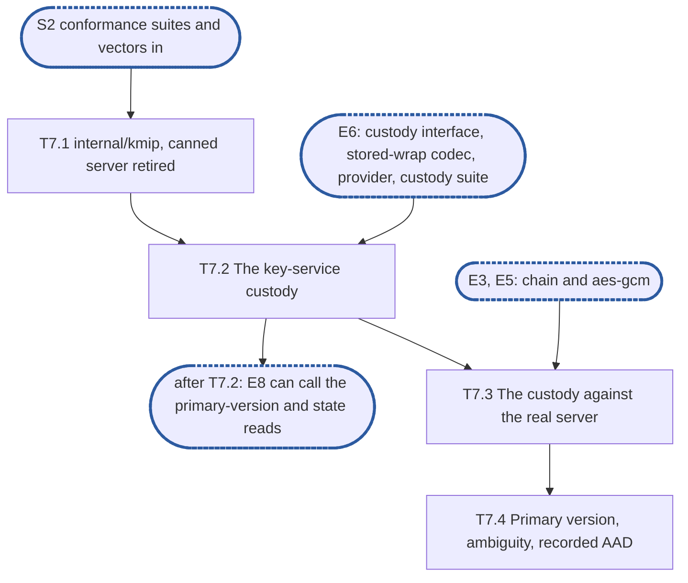

# Epic 7: transforms v2, key-service custody

**Sources:** [RFC 5](../docs/internals/rfcs/rfc-5-transforms.md) Appendix B.1's key-service wrap
(the stored wrap's key-service layout, the version-qualified master-key ID, the associated data as
bytes, "the provider does not wait for a wrap to notice it", the primary-version read, the
ambiguous answer, and the state read of "a master key the service holds in any state but active
stops new writes", each as the custody answers it), B.1's "master keys never leave the key
provider" and its note that a key service keeps its own wrap bound; Appendix B.2's `master-key`
row as a key service holds it, "Where the master key lives" for a key service and "No storage-key
fallback" as a key-service master key meets it; Appendix B.4's rows a custody failure reaches;
§8.1's key-management row (its provider half), its T18 rows and T22's key-service stored wrap as
bytes; §8.2's Appendix B.1 ambiguous-Locate row and in-place rotation row, their custody halves;
§9 item 2. Outside RFC 5: the RFC 5 plan's D6 and D14 (the custody seam, the transport moved out
of `pkg/keyprovider`) and its O5 and O9; the RFC 13 plan's deferral-ledger row on
`kmip_fake_test.go`, which this epic owns. The code lands on `feat/storage-v2`, and the paths
below are paths there.
**Track:** B.
**Epic 7 estimate: 4 subtasks, 8.25 man-days.**
**Depends on:** **S2**: from E2, `keystest.Memory`, `transformtest.LoadVectors` and its vector
file with the key wrap AAD vector (its R27), and the vector script's Go recompute test. From E1,
`keys.MaterialID`, `keys.Provider`, the material errors and the import allowlist naming
`internal/kmip` and `github.com/gemalto/kmip-go/...`. From E6: the custody interface the provider
declares (D6) with its conformance suite in `keystest`, the stored-wrap codec, the provider's
`Current` and `Get`, namespace key creation, the escrow rule and the `storage`-key refusal, which
T7.2 implements against and T7.3 and T7.4 run through. From E3 and E5, `NewChain`, `Pin`,
`Attempt.Encode` and `Chain.Decode` with the `aes-gcm` transform, which T7.3's body round trip
runs. The harness's `service:kmip` (PyKMIP 0.10.0) in `integration`.
**Blocks:** E8, which calls the primary-version read and the state read on its ticker, re-wraps
on a new primary version, refuses `Pin` on a state that is not active and marks records under a
destroyed master key; E9, whose `materials` row for `provider: kmip` fills `KMIPConfig`; E11,
whose key-management row's store half runs this custody.

---

## 1. Goal

Epic 7 ships the second master-key custody RFC 5 Appendix B.1 names: a KMIP server that holds the
master key and never releases it. The provider asks the server to wrap and unwrap each namespace
key, stores what the server returned in the stored wrap's key-service layout under the
version-qualified ID the server reports, and reads the server's current primary version and each
master key's state for the rotation and the write refusal epic 8 builds on them. The KMIP
transport the RFC 13 key provider already has moves to `internal/kmip`, so both providers speak
KMIP through one transport, and the canned KMIP server its tests used goes.

**At the end of the epic:**

- a provider over the KMIP custody opens against the harness's server, unwraps each namespace key
  through it once, and a body sealed under one of them round-trips through the chain; the server's
  own log shows no Get of a master key (T7.3);
- every stored wrap of a key service is `0x02` ‖ the server's Unique Identifier ‖ the wrap bytes
  of D2, and equals the golden vector for the vector's inputs; the associated data the server
  receives is exactly the key wrap AAD (T7.2, T7.4);
- a missing key, an unreachable server, an invalid or expired certificate and a revoked key each
  fail the open or the read with `ErrMaterialUnavailable`, never destroyed, never a fallback
  (T7.3);
- the primary-version read reports the key a name resolves to, fails on two current versions,
  and reports the new one once the name is retargeted; the state read classes every KMIP state
  as active, destroyed or unavailable (T7.1, T7.2, T7.4);
- `pkg/keyprovider` runs over `internal/kmip` with its exported surface unchanged, and no test
  of either package runs against a canned server (T7.1).

### 1.1 In scope

`internal/kmip`: the moved round trip, TLS setup, message read, symmetric-key Get and state read,
and the key-state table. `pkg/keyprovider`'s KMIP file over it, and its tests split into pure
tests and integration rows. `pkg/transform/keys/provider/kmip.go`: `KMIPConfig`, the key-service
custody, its Encrypt, Decrypt and Locate payloads, the wrap bytes, the primary-version and state
reads. The key-service stored-wrap vector. The harness changes the live rows need, and those rows
against `service:kmip`.

### 1.2 Out of scope

- The custody interface, its conformance suite, the stored-wrap codec, the key-file custody and
  its wrap count, the key-file move to `internal/keyfile`, the provider's `Current`, `Get`,
  fingerprints, cache, escrow rule, `storage`-key refusal, key creation and gauges: E6. This epic
  implements E6's interface for a key service and runs E6's suite against the real server.
- Calling the primary-version and state reads at open and on the provider's ticker, keeping the
  last state when a read fails, re-wrapping on a new primary version, refusing `Pin` while a
  master key is not active, raising `material_unavailable` and `material_destroyed` for a master
  key, and marking the records under a destroyed one: E8. The "no record is re-wrapped" and
  "`material_unavailable` names the master key" halves of §8.2's ambiguous-Locate row are E8's
  for that reason (§9).
- The `materials` settings row for `provider: kmip`, the `rotate-master-key` operation and its
  start from E8's report: E9. The key-management row's store half (the store does not open, the
  decode through the codec): E11.
- A cloud key service taking associated data as a string map, and §8.1 T22's string-map half: the
  RFC 5 plan's deferral ledger, its row on a cloud key service, unowned. The master-key destroy
  check: its row on the export key's next generation, owned by RFC 26.
- Pooled KMIP connections: a `ponytail:` marker at the round trip names one TLS connection per
  call as the ceiling, and a pooled connection with a concurrency bound as the upgrade once a
  cold start or a master-key rotation shows the handshakes in a profile (§2, rule 9).

### 1.3 Names used here

- **E1**, epic 1, interfaces: `keys`, the root contract and the import test with its allowlist.
- **E2**, epic 2, test foundations: `keystest.Memory`, `transformtest.LoadVectors`, the vector
  file and its catalogue of the rows each epic turns green.
- **E3**, epic 3, the chain; **E5**, epic 5, encryption, whose `aes-gcm` transform the body round
  trip uses.
- **E6**, epic 6, namespace keys and the provider: the custody interface and its suite, the
  key-file custody, the provider.
- **E7**, this epic.
- **E8**, epic 8, rotation and the destroyed-material notice: the ticker, the re-wrap and the
  `Pin` refusal on a master key's state.
- **E9**, the integration epic: the settings rows and the key operations.
- **E11**, epic 11, E2E green: RFC 5's rows through the codec and the engine.
- **S2**, the conformance suites and vectors in: E2's components exist.
- **The RFC 2 plan's epic 2**: owner of the one vector script, in `pkg/carver/internal/carvetest`,
  whose output `transformtest` embeds.
- **The RFC 13 plan**: `.planning/rfc-13-config-plan.md`, whose deferral ledger gives this epic the
  replacement of `kmip_fake_test.go`'s canned server.
- **The content wiring**: the RFC 8 offload plan's `internal/node/content`, which builds the
  provider and its custody from the store configuration.
- **`service:kmip`**: the harness's PyKMIP 0.10.0 server, started by `dt services up kmip`.

## 2. How the general rules apply

The rules are those of
[RFC 5's plan, §1.5](rfc-5-transforms-plan.md#15-general-rules-for-each-epic), cited by number and
title and not copied.

| Rule | Subtasks | How |
| --- | --- | --- |
| rule 1, independent unit tests ([`CLAUDE.md`, "Writing tests"](../CLAUDE.md#writing-tests)) | all | the wrap bytes, the Locate answer, the error mapping, the key-state table, the TLS setup and the framing are pure functions with table tests; the custody runs E6's suite against the real server, and the provider over it is E6's, with E2's `keystest.Memory` where a second provider is needed. The one double is T7.4's recording wrapper, which passes every call to the real server (D6) |
| rule 2, fuzz every decoder of bytes this component did not just write | T7.1, T7.2 | `FuzzReadMessage` over the KMIP frame read (wire bytes) and `FuzzKMIPWrap` over the wrap bytes a key record carries (store bytes); both join the nightly `fuzz` suite in the form the RFC 2 plan's epic 2 registers, and T7.2 extends RFC 5 §8.3's suites line to name them |
| rule 3, observability follows RFC 25 | T7.2, T7.4 | the custody records no series and takes no logger: a failure is an error the provider (E6) reports and E8's ticker logs. Its errors carry IDs, endpoints and KMIP result codes only; T7.4 plants a known namespace key and searches every error and the captured log for its bytes (R20) |
| rule 4, profiling | T7.1, T7.3, T7.4 | every test under `internal/prof`'s `Watch`, so a TLS connection left open is a leak. No allocation gate: a KMIP call runs once per key at open, not per chunk, and is off the hot paths rule 4 lists |
| rule 5, public interface and internals ([`CLAUDE.md`, "Verifying a change"](../CLAUDE.md#verifying-a-change)) | T7.2, T7.3, T7.4 | the associated data is asserted where the server receives it (T7.4); a custody failure is asserted where the provider's `Get` and open return it, not only at the custody (T7.3); the key-state table where the keyprovider's open and the custody's state read consume it (T7.1, T7.2) |
| rule 6, known failures shrink | none | `integration` and `unit` keep no `known.yaml` for this RFC; every row lands green |
| rule 7, v2 ignores v1, and imports only what RFC 0 §1.2 allows | T7.1, T7.2 | `internal/kmip` imports the standard library and `github.com/gemalto/kmip-go/...` only: the one log line of the moved code stays in `pkg/keyprovider` (D1), so `internal/logger` does not move and nothing joins E1's allowlist. `kmip.go` imports `internal/kmip`, `kmip-go`, `keys` and `entity`. Neither imports `pkg/keyprovider`; E1's import test holds both |
| rule 8, real dependencies for properties of those dependencies ([`CLAUDE.md`, "Writing tests"](../CLAUDE.md#writing-tests)) | T7.1, T7.3, T7.4 | every round trip runs against `service:kmip` under `-tags=integration`; a state the server cannot be put into (Destroyed: PyKMIP's Destroy deletes the object) is a row of the pure key-state table, which is data; the certificate rows use certificates the server really refuses |
| rule 9, code comment conventions ([`CLAUDE.md`, "Code comments"](../CLAUDE.md#code-comments)) | T7.1, T7.2 | the `ponytail:` on one TLS connection per call moves to `internal/kmip`'s round trip (T7.1); `decision:` markers at the key-state table (D4), at the wrap-bytes writer (D2), at the Locate check (D3), at the unwrap error mapping (D4) and at the wrap call, that a key-service wrap raises no wrap count since the service keeps its own bound (R7) |
| rule 10, a test must be able to fail | all | each test in §6 names the bug it catches; the stored-wrap vector comes from the RFC 2 plan's script, never from this code; the audit is the server's log, not the client's own record |
| rule 11, a symbol is exported only if RFC 5's interface or a consumer outside the package uses it | T7.1, T7.2 | `internal/kmip` exports what `pkg/keyprovider` and `kmip.go` call; `kmip.go` exports `KMIPConfig` and its constructor, which E9 and the content wiring call, and nothing else: the custody is reached through E6's interface |
| rule 12, each subtask creates only what it declares | all | the transport moves with its two callers' first use (T7.1: keyprovider; T7.2: the custody); the primary-version and state reads land with T7.4's rows and E8 as consumers (§4, D3); the harness changes land with T7.3, their first reader |

## 3. Requirements and invariants

Every obligation RFC 5 places on the key-service custody, numbered so that subtasks and tests can
cite them. `Source` is RFC 5 unless it names another source.

**The wrap and its stored form**

| # | Requirement | Kind | Source | Subtasks |
| --- | --- | --- | --- | --- |
| R1 | A key-service provider asks the service to wrap and to unwrap each namespace key, and stores the result in the one stored-wrap layout every wrap uses: provider kind `0x02`, master-key ID length (2 bytes, big-endian), master-key ID, wrap length (4 bytes, big-endian), wrap bytes | MUST | Appendix B.1 (key wrap; stored wrap) | T7.2 |
| R2 | The wrap bytes are what the service returned and are never interpreted: the provider splits back only the fields it joined (D2) and hands each to the service unchanged | MUST | Appendix B.1 (stored wrap: "never parsed") | T7.2 |
| R3 | The master-key ID is the immutable, version-qualified identifier the service reports for that wrap, as its ASCII bytes; never an alias or a key name a later rotation retargets. An ID that is not ASCII, or longer than its 2-byte length holds, is refused | MUST, MUST NOT | Appendix B.1 (stored wrap) | T7.2 |
| R4 | The key wrap AAD (namespace ID ‖ kind ‖ key ID) reaches the service as bytes, the same bytes the key file passes to AES-256-GCM, and nothing else; the KMIP profile names bytes, not a string map | MUST | Appendix B.1 (the AAD paragraph); RFC 5 plan D14 | T7.2, T7.4 |
| R5 | A wrapped key whose namespace ID, kind or key ID in the AAD is changed fails to unwrap through the service; one namespace's wrapped data key copied into another namespace's records does not unwrap there | test row | §8.1 T18, Appendix B.1 (the AAD binds) | T7.3 |
| R6 | A golden vector from an independent implementation pins one key-service stored wrap, as bytes; the authenticated data the service is sent is captured by a wrapper that passes each call to the real server | test row | §8.1 T22; RFC 5 plan O5 | T7.2, T7.4 |
| R7 | A key service draws its own nonces and keeps its own bound: a key-service wrap raises no wrap count (`MKW‖masterKeyID`) | invariant | Appendix B.1 ("A master key makes at most 2³² wraps") | T7.3 |

**The primary version and the key state**

| # | Requirement | Kind | Source | Subtasks |
| --- | --- | --- | --- | --- |
| R8 | The custody reads the service's current primary version of a master key, as its version-qualified ID. A service that rotates the key in place, or a name retargeted to another key, makes the next read and the next wrap report the new ID, while records wrapped under the old one still unwrap | MUST | Appendix B.1 ("The provider does not wait for a wrap to notice it"), §8.2's Appendix B.1 in-place rotation row, its custody half | T7.2, T7.4 |
| R9 | A read that finds more than one current version for a master key (a Locate returning two UIDs) fails, with an error naming the master key, and fails again on the next read with the same answer; a read that fails reports no version | MUST | Appendix B.1 (the ambiguous answer), §8.2's Appendix B.1 ambiguous-Locate row, its custody half | T7.2, T7.4 |
| R10 | The custody reads the state of a master key the service holds. Destroyed and Destroyed Compromised report it destroyed; Active reports it active; every other state, a state value the provider does not know, Item Not Found and a failed read report it unavailable, so a misconfigured endpoint never reports a key destroyed. Compromised still decrypts and is not destroyed | MUST | Appendix B.1 ("A master key the service holds in any state but active stops new writes"), Appendix B.4; RFC 5 plan D17; E2's catalogue (KMIP rows) | T7.1, T7.2 |

**Custody through the real server**

| # | Requirement | Kind | Source | Subtasks |
| --- | --- | --- | --- | --- |
| R11 | A key-service provider never fetches a master key: it asks the service to unwrap each namespace key, once per key when the namespace opens, and holds only the unwrapped namespace keys | invariant | Appendix B.1 ("master keys never leave the key provider"), Appendix B.2 (the `master-key` row), §9 item 2 | T7.2, T7.3 |
| R12 | Against a real key-management server, not a stand-in: the provider unwraps each namespace key through the server at start, the server's audit shows no master key exported, and a body round-trips | test row | §8.1's Appendix B.2 row, its provider half | T7.3 |
| R13 | A missing key, an unreachable server and an invalid certificate each return the provider's error (the provider does not open, or `Get` returns `ErrMaterialUnavailable`), and none falls back to another provider or to writing without encryption; an expired certificate and a revoked key do the same | MUST NOT, test row | §8.1's Appendix B.2 row, Appendix B.4 (its first two rows); E2's catalogue (KMIP rows) | T7.3 |
| R14 | A key-service master key lives off the host: it needs no escrow check, and creating an encrypting namespace under it is not refused with `ErrNotEscrowed` | MUST | Appendix B.2 ("Where the master key lives") | T7.3 |
| R15 | No namespace key is wrapped under the `storage` wrapping key: a key-service master key whose version-qualified ID, at the same endpoint, is the `storage` key's is refused | MUST NOT | Appendix B.2 ("No storage-key fallback"); the RFC 13 plan's epic 2, R13 (a KMIP key's `KeyUID` with its endpoint) | T7.2, T7.4 |
| R16 | The key-service custody passes the custody conformance suite against the harness's KMIP server | test row | RFC 5 plan D6 | T7.3 |

**The moved transport**

| # | Requirement | Kind | Source | Subtasks |
| --- | --- | --- | --- | --- |
| R17 | The round trip, TLS setup, message read, symmetric-key Get and state read live in `internal/kmip`, which both key providers import and which imports neither; `pkg/keyprovider`'s exported surface does not change, and its `kmip_integration_test.go` still passes over the moved transport | invariant | RFC 5 plan D14, §3.2 (the RFC 13 row) | T7.1 |
| R18 | A message read from the server is bounded: a frame declaring more than the cap is refused before its body is allocated, and no read runs past the frame | invariant | `CLAUDE.md` "Writing tests", "By kind" (fuzz); RFC 5 plan §1.5 rule 2 | T7.1 |
| R19 | No test of `pkg/keyprovider` or `internal/kmip` runs against a canned KMIP server: each case `kmip_fake_test.go` held is a test of a pure function or a row against `service:kmip` | invariant | the RFC 13 plan §6.1 (its `kmip_fake_test.go` row); `CLAUDE.md` "Writing tests" | T7.1 |

**Secrecy**

| # | Requirement | Kind | Source | Subtasks |
| --- | --- | --- | --- | --- |
| R20 | No namespace key byte or unwrapped material reaches an error the custody returns or a log line: master-key IDs, endpoints and KMIP result codes only | invariant | RFC 5 plan §1.5 rule 3 | T7.4 |

**Mapping of what this epic does not own.** The stored-wrap codec and the key-file wrap, its
count and T22's key-file vector are E6's; R1 uses E6's codec with kind `0x02`. The fingerprint
check after an unwrap (§2.5), the cache that makes R11's "once per key" hold, the escrow rule and
the site of the `storage`-key refusal are E6's; R11, R14 and R15 test this custody through them.
Calling the reads of R8 to R10 at open and on the ticker, a failed state read leaving the last
state in force, the re-wrap, the `Pin` refusal, the conditions and the destroy marking are E8's
(§1.2). §8.1 T22's string map, §8.2 T19 and the destroy-check clauses of the Appendix B.1 rows
are the RFC 5 plan's deferral-ledger rows. §5.4's post-quantum paragraph describes where the
exposure is and binds no code here. B.4's rows past the first two are E6's and E11's.

## 4. Decisions this epic takes

- **D1, `internal/kmip` holds what moved; the custody's own payloads stay in `kmip.go`.** The
  round trip, the TLS setup, the message read, the response decode, the symmetric-key Get and the
  state read move out of `pkg/keyprovider`, with the key-state table (D4), as the plan's D14
  says; Encrypt, Decrypt and Locate, which only the custody sends, are payload structs in
  `pkg/transform/keys/provider/kmip.go`, since `kmip-go` v0.1.0 declares no KMIP 1.4 payloads for
  them (it has their tags). The moved code's one log line, the warning on a retired key marked
  Compromised, belongs to `pkg/keyprovider`'s retired-key loader and stays there, so
  `internal/kmip` imports no logger and E1's allowlist gains nothing. Prior art: Go's own
  `internal/` packages shared by two consumers, `crypto/internal/...` (from memory).
- **D2, the wrap bytes of a key service are a versioned join of the Encrypt response's fields.**
  KMIP's Encrypt returns three fields, the IV the server drew, the authentication tag and the
  data, so "exactly what the service returned" needs a join: version (1 byte, `1`) ‖ IV length (2
  bytes, big-endian) ‖ IV ‖ tag length (2 bytes, big-endian) ‖ tag ‖ data. The cryptographic
  parameters are fixed (AES, GCM, a 16-byte tag, Random IV), so they are not stored. It is settled
  now because every key record and every salvage wrap under a key service carries it from the
  first namespace, and RFC 26's recovery import reads it back: a change later is version 2, which
  every reader keeps. A `decision:` marker at the writer names the layout and says that nothing
  in the fields is interpreted. Prior art: Vault's transit ciphertexts, prefixed `vault:v1:` so a
  format change is a new version (from memory); AWS KMS's opaque ciphertext blob (from memory).
- **D3, a master key is named by its KMIP Name; its version-qualified ID is the Unique
  Identifier.** `KMIPConfig.Key` is a KMIP Name attribute value, the alias a rotation retargets.
  The primary-version read is a Locate for an Active symmetric key of that Name: one UID is the
  primary version; none, or more than one, fails the read, naming the key and the count, and
  changes nothing. A wrap reads the primary version, then Encrypts under that UID, and stores the
  UID the response names, so a wrap after a retarget reports the new ID without waiting for E8's
  ticker (R8). A UID is immutable in KMIP: a ReKey makes a new object with a new UID and moves the
  Name to it. The read and the state read land here although E8 is their caller on a schedule,
  because they are KMIP round trips that only a real server can test, and §8.2's ambiguous-Locate
  row is this epic's; a `decision:` marker at the Locate check names the rule. Prior art: KMIP
  1.4's ReKey and Locate (from memory); AWS KMS's alias resolved to a key ID at each call (from
  memory).
- **D4, the key-state table has three classes, and only the state read reports destroyed.**
  `internal/kmip` maps a state and the error of its read to active, destroyed or unavailable
  (R10), as one table both providers use: `pkg/keyprovider`'s retired-key loader takes its
  "material gone" case from it, and its current-key check stays "Active or refused", its own rule.
  An unwrap that fails is unavailable whatever the server answers, since a failed Decrypt cannot
  tell a destroyed key from a misconfigured endpoint, and only Destroyed or Destroyed Compromised
  in a state read starts E8's marking. `decision:` markers at the table and at the unwrap's error
  mapping say so, to be withdrawn if a KMIP profile ever reports destruction on Decrypt
  unambiguously. Prior art: KMIP 1.4's state model; the RFC 5 plan's D17 (from memory for KMIP).
- **D5, the canned server goes, and nothing replaces it.** The RFC 13 plan's ledger row asks for
  a fake that passes a conformance suite. None is needed: every case of `kmip_fake_test.go` is
  either a pure function of what the server sent (TLS setup, key-material extraction, framing,
  the response decode with its missing payload, the state decisions over every state, Destroyed
  included) or a round trip PyKMIP can answer (a wrong-length key, a failed Get, a dead endpoint).
  So the row is discharged by this recorded decision rather than by a new double. Prior art:
  `CLAUDE.md`'s "Writing tests" ("put the logic in a function of its inputs").
- **D6, the one test seam is the round trip, as a one-method interface the custody declares.**
  `kmip.go` holds the transport as `interface{ Do(ctx, op, payload) (ttlv.TTLV, error) }`,
  `*kmip.Client` in production. T7.4's wrapper records each request and passes it to the real
  client, never answering in its place, so §8.1 T22's "a fake service that records the
  authenticated data it is sent" is met by the form `CLAUDE.md` allows (the plan's O5). Prior art:
  `net/http`'s `RoundTripper` (from memory).
- **D7, the audit is the server's own log.** The harness mounts PyKMIP's log under its state
  directory and names it in `DITTOFS_TEST_KMIP_LOG`; a test reads what the log gained during its
  own window (`integration` runs with `-p 1`) and asserts no Get naming a master key's UID, and
  one Decrypt per key record at open. A client-side record would only show what this code sent,
  and §8.1's row asks what the server saw. Prior art: none found.
- **D8, a key-service master key is compared to the `storage` key by endpoint and UID only.** Its
  bytes never reach the process, so it has no fingerprint here; RFC 13 names a KMIP `storage` key
  by its `KeyUID` with its endpoint, and the custody refuses a primary version equal to it at the
  same endpoint, in the primary-version read, so the open, every wrap and E8's ticker all refuse
  it (R15). Prior art: the RFC 13 plan's epic 2, its D9.

## 5. Target tree

```text
internal/kmip/
  kmip.go              T7.1  Client, TLSConfig, Do (the round trip, its ponytail:), the
                             message read, the response decode, ResultError,
                             GetSymmetricKey, State
  state.go             T7.1  Class, Classify: the key-state table (D4)
  kmip_test.go         T7.1  TLS setup, key-material extraction, framing, the response
                             decode, a dial to a closed listener
  state_test.go        T7.1  the table over every KMIP state, Item Not Found, an unknown value
  fuzz_test.go         T7.1  FuzzReadMessage
  testdata/fuzz/FuzzReadMessage/  T7.1
pkg/keyprovider/
  kmip.go              T7.1  over internal/kmip; the retired-key warning stays (D1)
  kmip_test.go         T7.1  the current- and retired-key state decisions, as a table
  kmip_fake_test.go    T7.1  deleted (D5)
  kmip_integration_test.go  T7.1  + a wrong-length key, a Get of an unknown UID
test/kmip/provision.py T7.1  + an AES-128 key
pkg/transform/keys/provider/
  kmip.go              T7.2  KMIPConfig, NewKMIPCustody, the custody, its Encrypt,
                             Decrypt and Locate payloads, the wrap bytes (D2), the
                             primary-version and state reads (D3, D4, D8)
  kmip_test.go         T7.2  the wrap bytes against the vector, malformed wrap bytes, the
                             Locate answer, the error mapping
  kmip_fuzz_test.go    T7.2  FuzzKMIPWrap
  testdata/fuzz/FuzzKMIPWrap/  T7.2
  kmip_integration_test.go  T7.3, T7.4  the live rows (-tags=integration)
pkg/carver/internal/carvetest/  T7.2  the key-service stored-wrap row of the vector script
pkg/transform/transformtest/testdata/vectors.json  T7.2  its output; LoadVectors's field and
                             the Go recompute test's row
test/harness/env.sh    T7.3  PyKMIP's log under the state directory; DITTOFS_TEST_KMIP_LOG
                             and DITTOFS_TEST_KMIP_CA_KEY in kmip.env
docs/internals/rfcs/rfc-5-transforms.md  T7.2  §8.3's suites line names the two fuzz targets
```

## 6. Subtasks

### T7.1 The KMIP transport in `internal/kmip`, and the canned server retired

**Subtask T7.1 estimate: 2.25 man-days.**

- **Track:** B. **Depends on:** S2.
- **Covers:** R10 (the table), R17, R18, R19.
- **Deliverables:**
  - `internal/kmip/kmip.go`, moved from `pkg/keyprovider/kmip.go` with its error handling and
    validation intact:
    ```go
    type Client struct{ /* endpoint, TLS config, timeout */ }
    func NewClient(endpoint string, tls *tls.Config, timeout time.Duration) *Client
    func TLSConfig(clientCert, clientKey, serverCA string) (*tls.Config, error)
    func (c *Client) Do(ctx context.Context, op kmip14.Operation, payload any) (ttlv.TTLV, error)
    func (c *Client) GetSymmetricKey(ctx context.Context, uid string) ([]byte, error)
    func (c *Client) State(ctx context.Context, uid string) (kmip14.State, error)
    type ResultError struct{ Op kmip14.Operation; Status kmip14.ResultStatus; Reason kmip14.ResultReason; Message string }
    ```
    `Do` is the round trip, split so the response decode (no batch item, a failed status as a
    `*ResultError`, a missing or non-TTLV payload) is an unexported function of the response's
    bytes. A `ponytail:` at `Do` names one TLS connection per call, a handshake per unwrap at a
    cold start, and the pooled connection that replaces it (§1.2). `GetSymmetricKey`
    is consumed by `pkg/keyprovider` alone; `Do` and `State` by it and by T7.2.
  - `internal/kmip/state.go`: `type Class int` with `Active`, `Unavailable`, `Destroyed`, and
    `func Classify(state kmip14.State, err error) Class`, the table of D4 with its `decision:`
    marker. Consumed by `pkg/keyprovider`'s retired-key loader and T7.2's state read.
  - `pkg/keyprovider/kmip.go` over `internal/kmip`, its exported surface unchanged; its
    current-key and retired-key state decisions become unexported functions of the uid and the
    state, so the canned server's Destroyed rows are rows of their table. The `internal/logger`
    warning stays here (D1).
  - `pkg/keyprovider/kmip_fake_test.go` deleted (D5); its TLS, material, framing and nil-payload
    cases move to `internal/kmip`'s tests as pure tests, its dial-error case dials a listener on
    `127.0.0.1:0` closed before the call, and its wrong-length and failed-Get round trips become
    rows of `kmip_integration_test.go`, the first against an AES-128 key `provision.py` adds.
  - `FuzzReadMessage` in `internal/kmip`, seeded with a valid frame, a padded one, a short header
    and a length above the cap; it joins the nightly `fuzz` suite.
- **Acceptance criteria:**
  - `pkg/keyprovider`'s exported identifiers are the same before and after (`go doc -all` diffed),
    and its `kmip_integration_test.go`, the two new rows included, passes against `service:kmip`.
  - E1's import test passes with `internal/kmip` importing the standard library and `kmip-go`
    only.
  - No file of either package starts a TLS listener that answers KMIP.
- **Tests:**
  - The key-state table: every `kmip14.State` value, an unknown value, Item Not Found as a
    `*ResultError` and a dial error, each to its class (catches Compromised or Deactivated taken as
    destroyed, an unknown value taken as active, a misconfigured endpoint reported destroyed, R10).
  - `pkg/keyprovider`'s decisions over the same states: current key refused unless Active, retired
    key refused only when destroyed (catches the move changing RFC 13's behaviour, R17).
  - The response decode: no batch item, a failed status with its reason, a success with no payload,
    a non-TTLV payload, each an error and none a panic (catches the nil-payload panic the canned
    server once caught, R19).
  - The framing: a frame with and without padding, a short read, a length one above the cap
    refused before its body is allocated, under the fuzzer too (catches an allocation sized by a
    claim, R18).
  - TLS setup and key-material extraction: the moved table cases (R17).
  - The dial to a closed listener returns an error within the timeout (R17).
  - The two integration rows: a 16-byte key refused by length, a Get of a UID the server never
    issued returns a `*ResultError` (catches a check lost in the move, R17).
  - No double: the server is `service:kmip`, and the rest are pure functions.
- **Rules:** rule 9: the `ponytail:` moves with `Do`. rule 7: no logger in `internal/kmip`.

### T7.2 The key-service custody

**Subtask T7.2 estimate: 2.5 man-days.**

- **Track:** B. **Depends on:** T7.1, E6's custody interface and stored-wrap codec.
- **Covers:** R1, R2, R3, R4, R6 (the vector), R8, R9, R10 (the read), R11, R15.
- **Deliverables:**
  - `pkg/transform/keys/provider/kmip.go`:
    ```go
    type KMIPConfig struct {
        Endpoint   string        // host:port
        Key        string        // the KMIP Name of the master key (D3)
        ClientCert string        // paths, as RFC 13's secret references resolve them
        ClientKey  string
        ServerCA   string
        Timeout    time.Duration // 0: internal/kmip's default
    }
    func NewKMIPCustody(cfg KMIPConfig) (<E6's custody interface>, error)
    ```
    The constructor refuses a config missing its endpoint, key or certificate, as
    `pkg/keyprovider` does, and dials nothing. Consumed by the content wiring and by E9's
    `materials` row, which fills it.
  - The custody, unexported, implementing E6's interface: wrap (the primary-version read, then an
    Encrypt under that UID with AES, GCM, a 16-byte tag, Random IV and the key wrap AAD as KMIP
    1.4's Authenticated Encryption Additional Data, R4), the stored wrap through E6's codec with
    kind `0x02` and the UID the response names, refused if not ASCII or too long (R1, R3); unwrap
    (a Decrypt under the stored UID with the fields of D2, R2); the primary-version read (D3,
    D8); the state read (`internal/kmip.State` and `Classify`, R10). Each round trip through the
    one-method interface of D6.
  - The Encrypt, Decrypt and Locate request and response payloads, unexported structs with `ttlv`
    tags, as `pkg/keyprovider` already writes its GetAttributes payload.
  - The wrap-bytes writer and reader of D2, with its `decision:` marker; the Locate answer's check
    as a function of the UIDs returned, with its `decision:` marker; the error mapping (any
    failure of a wrap, an unwrap or a read is `keys.ErrMaterialUnavailable`, wrapped with the
    UID, the endpoint and the KMIP result codes; never `ErrMaterialDestroyed`, D4); the wrap's
    `decision:` that it raises no wrap count (R7).
  - `FuzzKMIPWrap` over the wrap-bytes reader, seeded with the vector's bytes and truncations of
    them; it joins the nightly `fuzz` suite; RFC 5 §8.3's suites line names it and
    `FuzzReadMessage`.
  - The key-service stored-wrap vector: a row of the RFC 2 plan's vector script with a fixed UID,
    IV, tag and data, its output in `vectors.json`, its field in `LoadVectors` and its row in
    `transformtest`'s Go recompute test.
  Consumed by T7.3 and T7.4, by E8's ticker (the two reads), and by E11.
- **Acceptance criteria:**
  - The stored wrap built from the vector's UID, IV, tag and data equals the vector byte for byte,
    and the reader splits it back into exactly those fields.
  - The Locate check returns the UID for one, and an error naming the key and the count for none
    and for two.
  - A primary version equal to the `storage` key's UID at the same endpoint is an error (D8).
- **Tests:**
  - The vector (catches a field order, a length width or a byte order apart from D2 and RFC 5's
    layout, a missing kind byte, R1, R6).
  - The reader over a truncated join, an IV or tag length past the end, an unknown version: each
    refused, no panic, under the fuzzer too (catches a decoder sized by a claim, R2).
  - The UID check: a non-ASCII UID and one of 65,536 bytes refused (R3).
  - The Locate check over zero, one and two UIDs (catches a read that picks the first of two, R9).
  - The error mapping: a `*ResultError`, a dial error and a cancelled context each map to
    `ErrMaterialUnavailable` under `errors.Is`, never `ErrMaterialDestroyed` (catches a misconfigured
    endpoint reported as lost material, R10, D4).
  - The `storage`-key comparison: same UID, same endpoint refused; same UID, another endpoint
    allowed (catches a comparison by UID alone, R15).
  - No double: the round trips are T7.3's and T7.4's, against the real server.
- **Rules:** rule 2: `FuzzKMIPWrap` and the suites line. rule 9: D2's, D3's and D4's markers, and
  R7's. rule 11: `KMIPConfig` and `NewKMIPCustody` are the only exports.

### T7.3 The custody against the real server

**Subtask T7.3 estimate: 2.25 man-days.**

- **Track:** B. **Depends on:** T7.2, E6's provider and custody suite, E5's `aes-gcm` transform.
- **Covers:** R5, R7, R11, R12, R13, R14, R16.
- **Deliverables:**
  - `test/harness/env.sh`: PyKMIP's log written under the state directory (`-l`) and named in
    `kmip.env` as `DITTOFS_TEST_KMIP_LOG`; the CA key's path as `DITTOFS_TEST_KMIP_CA_KEY`, so a
    test can sign an expired client certificate. Consumed by this subtask and T7.4.
  - `kmip_integration_test.go` (`-tags=integration`), skipping with the variable's name when
    `DITTOFS_TEST_KMIP` is unset; each test creates its own named keys through `Do` (Create and
    Activate, the Name carrying the test's name) and destroys them in `t.Cleanup`.
  - E6's custody suite run against the custody over `service:kmip`.
  - The key-management row's provider half and its failures, below.
- **Acceptance criteria:**
  - `test/harness/bin/dt run integration` runs the rows and they pass, with `service:kmip` up.
  - With `DITTOFS_TEST_KMIP` unset, each test skips naming it, and none is counted a pass.
- **Tests:**
  - E6's custody suite over the KMIP custody, its AAD rows among them: a changed namespace ID, kind
    or key ID, and a record copied to another namespace, each fail to unwrap (R5, R16).
  - A provider over the custody with three namespaces' key records: at open, the log gains exactly
    one Decrypt per record and no Get naming the master key's UID; a second `Get` of the same
    material gains nothing; a body sealed by `aes-gcm` under one namespace's data key round-trips
    through `NewChain`, `Pin`, `Attempt.Encode` and `Chain.Decode` (catches a custody that fetches
    the master key, or unwraps per read, R11, R12).
  - A key name nobody created, an endpoint on a closed `127.0.0.1:0` listener, a server CA the
    test generated, a client certificate signed by the harness CA that expired an hour ago, and a
    revoked (Deactivated) master key: each fails the provider's open, or its `Get`, with
    `ErrMaterialUnavailable`, never destroyed; `Current` returns no material; and nothing was
    encoded without encryption (catches a fallback to another provider or to plaintext, an expiry
    the client ignores, R13).
  - The same three namespaces, then the metadata store's `MKW` rows read: none for the KMIP
    master key's UID (catches a key-service wrap counted against the key file's bound, R7).
  - An encrypting namespace created on a provider over the custody with no escrow check run:
    created (catches the escrow rule applied to a key service, R14).
  - Every test under `internal/prof`'s `Watch`. No double: the server is `service:kmip`, the
    metadata store E6's verified in-memory view.
- **Rules:** rule 8: the real server and real certificates. rule 4: `Watch`.

### T7.4 The primary version, the ambiguous answer and the recorded AAD

**Subtask T7.4 estimate: 1.25 man-days.**

- **Track:** B. **Depends on:** T7.3.
- **Covers:** R4, R6 (the recorded AAD), R8, R9, R15, R20.
- **Deliverables:** the rows below in `kmip_integration_test.go`, and the recording wrapper of D6
  around the real `*kmip.Client`, which records each request payload and passes the call through.
- **Acceptance criteria:** the rows pass against `service:kmip` under `dt run integration`.
- **Tests:**
  - Two Active keys created under one Name: the primary-version read fails naming the key and
    the count, twice in a row, and the server's log gains no Encrypt between them (catches a read
    that picks one of two, or one that re-wraps on an ambiguous answer, R9).
  - A key under Name N wraps a record; a second key is created under N and the first key's Name is
    removed (PyKMIP's DeleteAttribute: PyKMIP has no ReKey): the read reports the second key's UID,
    the next wrap stores it, and the first record still unwraps under its own UID (catches an ID
    taken from the Name, which a retarget would silently repoint, R3, R8).
  - Through the recording wrapper: the Authenticated Encryption Additional Data of each Encrypt
    equals E2's key wrap AAD vector for the record's namespace, kind and key ID, and no other
    field carries it (catches an AAD hex-encoded, mapped or missing, R4, R6).
  - A custody whose `storage` key is named as the test key's UID at the same endpoint: the open
    is refused (catches the comparison of D8 skipped in the read, R15).
  - A known namespace key planted and wrapped, then every error the rows above and T7.3's failure
    rows return, and the log captured from the custody's callers, searched for its bytes raw, in
    hex and in base64 (catches key material formatted into an error, R20).
  - The one double is the recording wrapper, which answers nothing in the server's place
    (`CLAUDE.md`'s pass-through form).
- **Rules:** rule 3: the planted key. rule 5: the AAD asserted where the server receives it.

## 7. Order of work



T7.1 goes first: it waits on nothing of E6, lands the transport both providers need and settles
the canned server, so it can merge while E6 is in progress. T7.2 is the blocker for E8's reads and
waits on E6's interface. T7.3 and T7.4 are the live rows over the finished custody, T7.3 first,
since its harness changes are what T7.4 reads.

## 8. Suggested pull requests

| PR | Subtasks | Man-days | After | Why together |
| --- | --- | --- | --- | --- |
| 1 | T7.1 | 2.25 | S2 | the move and the canned server's retirement, which touch RFC 13's package and nothing of RFC 5's; open alongside E6's work |
| 2 | T7.2, T7.3, T7.4 | 6 | PR 1, E6's provider | the custody and every row that holds it to the real server: the custody lands with its tests |

A suggestion only: one pull request per subtask works as well.

## 9. Open points

- **E6 is not yet written.** This document assumes of E6 what the RFC 5 plan's D6 and E6's
  section say: a custody interface the provider declares, with wrap and unwrap taking associated
  data and returning the master-key ID of each wrap, and the primary-version read; its conformance
  suite in `keystest`; the stored-wrap codec; the provider's `Deps` carrying the `storage` key's
  ID. Ownership: E6 owns the interface, its suite, the codec, the key-file custody and every
  provider-level rule; E7 owns `internal/kmip`, the KMIP custody and its state read. If E6
  declares no state read, E8 adds it to the interface and its KMIP method is T7.2's. If E6's
  `Deps` names the `storage` key by ID alone, D8 needs its endpoint too, as RFC 13 forms a KMIP
  key's ID; E6 should carry both.
- **Needs on E8.** §8.2's ambiguous-Locate row asks that no record be re-wrapped and that
  `material_unavailable` name the master key, over two periods: both are E8's ticker and
  re-wrap, so T7.4 holds the read's half and E8 should hold the rest; the same for the in-place
  rotation row, whose re-wrap is E8's. For the RFC 5 plan's O9, read in PyKMIP 0.10.0's source,
  not run: it has no ReKey, so it cannot rotate in place, but its Locate filters by Name and State
  and its DeleteAttribute and ModifyAttribute (KMIP 1.0 and later) let a test retarget a Name, the
  alias case RFC 5 treats alike (T7.4). Its Decrypt refuses any key that is not Active, so a test
  that revokes the old key cannot unwrap the records still under it, which a real server in the
  Deactivated state may: E8's re-wrap rows retarget the Name rather than revoke.
- **PyKMIP's GCM support**, read in its 0.10.0 source, not run: Encrypt and Decrypt take GCM with
  Authenticated Encryption Additional Data and a tag length, and the server draws a 16-byte IV
  when none is sent, so D2's lengths must not assume 12.
- **For RFC 5's author:** Appendix B.1 says "a profile for a service MUST name which of the two it
  uses". The KMIP profile (associated data as bytes, the wrap bytes of D2, a master key named by
  its Name and identified by its UID) is written at `kmip.go` here; whether RFC 5 should carry it
  in Appendix B.1 is the author's call.
- **The RFC 13 plan's ledger row** on `kmip_fake_test.go` is discharged by D5 when T7.1 lands:
  the canned server is deleted and no fake replaces it. The row's text, which asks for a fake that
  passes a conformance suite, should be marked so in that plan.
- **Refinements of the RFC 5 plan**, which is not edited: its epic 7 section gives this epic the
  whole ambiguous-Locate row, and the "no record is re-wrapped" and `material_unavailable` clauses
  need E8's ticker (above); its §4.3 simplification on one TLS connection per call is carried at
  `internal/kmip`'s `Do`, not in the provider.
- **The estimate** is 4 subtasks and 8.25 man-days, against the RFC 5 plan's 4 and 7: the canned
  server's cases are split into pure tests and integration rows rather than moved as they are
  (D5), and the harness gains the server's log and the CA key (T7.3). The least certain is T7.3,
  whose certificate rows depend on how PyKMIP's TLS layer reports an expired client certificate.
