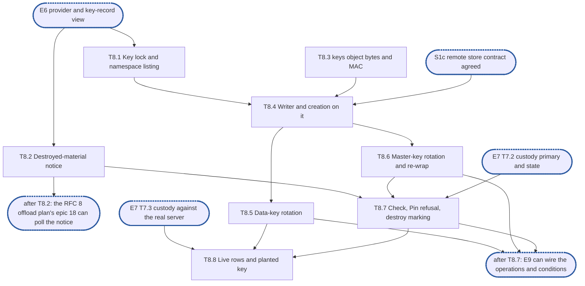

# Epic 8: transforms v2, rotation and the destroyed-material notice

**Sources:** [RFC 5](../docs/internals/rfcs/rfc-5-transforms.md) §5.1 (a stored body stays
readable while its material is held); Appendix B.1's keys key and keys MAC, "the provider does not
wait for a wrap to notice it" (the primary-version read, its period, the operation it starts, the
failed and the ambiguous read) and "a master key the service holds in any state but active stops
new writes", with §3.1's `Pin` doc that cites it; Appendix B.2's escrow rule at rotation ("the check
is per key"), "a key record reaches the bucket before it is used" and "every version of a `keys`
object is authenticated", the bucket's half of each (the sequence, the MAC, the key lock, the
read-back before and after a writer's own put, a destroy's put), the `keys` object's content in the
key table (a non-encrypting namespace's chunk-ID key in the clear), and "a destroyed master key
destroys the key records it wraps"; Appendix B.3's master-key and data-key rotations and its last
paragraph (the chunk-ID and chunking keys never rotate); Appendix B.4's destroyed material as the
provider reports it; §8.2's Appendix B.2 rows, their bucket halves (a failed bucket put, two
rotations at once, a late put of sequence 7, a key-file rotation without escrow, a master key
destroyed in the service), and its Appendix B.1 rows, their read and re-wrap halves (an in-place
rotation, a rotation while nothing is written, the ambiguous answer, the key state), and T18's key
control object clause; §8.1's Appendix B.1 rows for the keys key and keys MAC. [RFC 16](../docs/internals/rfcs/rfc-16-metadata-store.md) §4.2's row
`NS‖ns‖keyseq‖target` and §4.2.1's `keyseq` subtag. [RFC 4](../docs/internals/rfcs/rfc-4-remote-tier.md)
§4.13 (the `keys` control object, its role, its bound, `ErrNotFound` for an absent one).
[RFC 8](../docs/internals/rfcs/rfc-8-engine.md) §10.4 (what the engine does with the notice, and its
reseed from the key records). [RFC 9](../docs/internals/rfcs/rfc-9-gc.md) §7.5 (the recheck period). [RFC 13](../docs/internals/rfcs/rfc-13-configuration.md) §9's "§7 key
table" row, its data-key rotation clause and its key-object clause, and Appendix C's
`retired_files` pattern for a key-file rotation. Outside the RFCs: E1's `keys.DestroyedNotice`
(its R14 and D5), E2's `keystest.Harness` and the keys MAC vector (its R28), E6's key-record view
and provider, E7's custody reads (its D3), and the RFC 4 plan's deferral row on the `Recheck`
pass, which leaves each writer's own read-back to this epic. Every citation is the text on
`develop`; the code lands on `feat/storage-v2`, and the paths below are paths there.
**Track:** C.
**Epic 8 estimate: 8 subtasks, 17.25 man-days.**
**Depends on:** **S2**: from E2, `keystest.Memory`, `keystest.Harness` and `keystest.Run`, and
`transformtest.LoadVectors` with the keys key and keys MAC vector. From E1, `keys.MaterialID`,
`keys.Provider`, `keys.DestroyedNotice` and the material errors. From E6, the whole provider:
`KeyRecords` with `Row`, `keystest.Records` and `RunKeyRecords`, `kvstore`'s view, the key record and
its codec, the stored wrap, the key-file custody and its wrap count, `Config`, `Deps`, `New`,
`Current`, `Get`, `Status`, `VerifyEscrow`, `CreateKeys` and the `Harness` adapter. From E7, the
custody's `primary` and `state` reads, the key-service custody and `Config.KMIP` (T8.7 and T8.8
only). From E3 and E5, `NewChain`, `Pin` and `Chain.Decode` with the `aes-gcm` transform, which
T8.5's consumer rows run. **RFC 8 offload plan S1c**: RFC 4's `PutControl`, `GetControl` and
`RoleKeys`, and `pkg/remote/memory` with its `Wrap` and `SetReadOnly` (the RFC 4 plan's epic 2),
from T8.3 on. On `feat/storage-v2`, `pkg/metadata/kv/keys`, `kvtest.FaultKV`, `badgerkv`,
`fdbkvtest` and `pkg/sim`'s `TestClock`. The harness's `service:kmip` in `integration` (T8.8).
**Blocks:**
- E9, which runs `RotateDataKey` and `RotateMasterKey` from the `rotate-data-key` and
  `rotate-master-key` operations, starts `rotate-master-key` from `Deps.RotationNeeded`, records a
  key-file rotation's files in the store configuration (`Config.RetiredKeyFiles`), and builds the
  master-key conditions from `Status`.
- Outside RFC 5's epics, the RFC 8 offload plan: its epic 18 polls `DestroyedSince` and runs
  against `keystest.Memory`'s; its epic 21 passes `Deps.KeysObjects`, `Deps.After` and
  `Deps.RotationNeeded` and runs `Run`.

---

## 1. Goal

Epic 8 makes a namespace's keys change over time without losing one: every key record reaches the
bucket's `keys` object before it is used, data keys and master keys rotate, the provider notices a
key service's new primary version and a master key's state on its own period, a master key found
destroyed destroys the records it wraps before anyone hears of it, and the engine reads destroyed
material through a notice.

**At the end of the epic:**

- every new or rewritten key record is in the namespace's `keys` object, at a sequence one above
  the last recorded under the key lock and under a MAC of its current export key, before it becomes
  current; a failed put leaves the old key current, a late put is repaired by the next writer, and
  two writers at once leave both records in the last version (T8.3, T8.4);
- `RotateDataKey` makes a new data key current, so new pins get a new chain ID while old bodies
  still decode; concurrent rotations leave one current key; a crash beneath one leaves the old key
  current (T8.5);
- `RotateMasterKey` re-wraps every record under the configuration's current master key, refuses an
  unescrowed key-file key, and finishes after a crash at 10⁴ records (T8.6);
- the provider reads each master key's primary version and state at open and every RFC 9 §7.5
  period, reports a new primary version for E9 to start the rotation, and refuses `Pin` while a
  master key wrapping a namespace's current data key is not active, with no restart (T8.7);
- a master key found destroyed marks `destroyed` every record whose wrap names it, in every
  namespace, before the decode, a condition or the notice reports it, once (T8.7);
- `DestroyedSince` reports destroyed material on the provider and on `keystest.Memory`, under
  `keystest.Run` (T8.2, T8.7).

### 1.1 In scope

The `keyseq` subtag and the key lock in E6's view, with its namespace listing, in `kvstore`,
`keystest.Records` and `RunKeyRecords`; the `keys` object's format, keys MAC and fuzz target; the
writer that every change of key records goes through, and E6's key creation moved onto it; data-key
and master-key rotation; key-file master keys held as retired; the periodic check, its report, the
`Pin` refusal and the destroy marking; the notice on the provider, on `keystest.Memory` and in
`keystest.Run`; the live rows against `service:kmip`.

### 1.2 Out of scope

- The key-record view's first three calls, the key record, the stored wrap, the key-file custody
  and its count, `Current`, `Get`, the cache, escrow and key creation's table: E6. The key-service
  custody, its `primary` and `state` reads and the key-state table: E7.
- The `rotate-data-key` and `rotate-master-key` operations, their `dfsctl` commands, starting
  `rotate-master-key` from the report unless one runs, recording a key-file rotation in the store
  configuration, the conditions and alert rules: E9.
- The engine's use of the notice (`Unmark`, the reseed, the commit's refusal): the RFC 8 offload
  plan's epic 18. Building the provider in the node and running `Run`: its epic 21.
- Each backup location's `keys` object, its puts and read-backs, the export key's next generation,
  its `retiring` state and re-seals, the master-key destroy check and `ErrMaterialInUse`, the escrow
  gate at rotation for a configuration that takes catalog backups, and the
  destroy-check clauses of §8.2's Appendix B.1 rows: the RFC 5 plan's deferral ledger, its export-key
  row (RFC 26).
- The `keys` object's read-back on each `Recheck` pass: the ledger's `Recheck` row (RFC 9).
  Moving the periodic read into GC's recheck pass: the ledger's primary-version row (RFC 9).
- The recovery import of key records from `keys` objects, and raising the sequence above what it
  finds: the ledger's recovery-import row (RFC 26).
- Relocating the blocks of a rotated-away data key, and where a retiring set is recorded: the
  ledger's retirement row (RFC 9). `Provider.Remove` and an operator's destroy: the ledger's
  `Provider.Remove` and destroy-operation rows.
- A master key shared by two installations, and moves: the ledger's re-home and move row (RFC 27).

### 1.3 Names used here

- **E1**, epic 1, interfaces: `keys.Provider`, `keys.MaterialID`, `keys.DestroyedNotice`, the
  material errors.
- **E2**, epic 2, test foundations: `keystest.Memory`, `keystest.Harness`, `keystest.Run`, and
  `transformtest.LoadVectors` with the keys MAC vector.
- **E3**, epic 3, the chain: `NewChain`, `Pin`, `Chain.Decode`, the chain ID.
- **E4**, epic 4, compression, whose first fuzz target added RFC 5's suites line naming the fuzz
  targets.
- **E5**, epic 5, encryption: the `aes-gcm` transform.
- **E6**, epic 6, namespace keys and the provider.
- **E7**, epic 7, key-service custody over KMIP.
- **E8**, this epic.
- **E9**, epic 9, the integration epic: settings, the key operations, conditions and alert rules.
- **E11**, epic 11, E2E green: RFC 5's rows through the codec and the engine.
- **S2**, E2's conformance suites and vectors are in.
- **S1c**, the RFC 8 offload plan's synchronisation point "remote store contract agreed": RFC 4's
  contract with its control objects.
- **The RFC 8 offload plan's epics 18 and 21**: destroyed material in the engine, and the node's
  composition of this component.
- **`service:kmip`**: the harness's PyKMIP 0.10.0 server, started by `dt services up kmip`.

## 2. How the general rules apply

The rules are those of
[RFC 5's plan, §1.5](rfc-5-transforms-plan.md#15-general-rules-for-each-epic), cited by number and
title and not copied.

| Rule | Subtasks | How |
| --- | --- | --- |
| rule 1, **independent unit tests** ([`CLAUDE.md`, "Writing tests"](../CLAUDE.md#writing-tests)) | all | the provider's tests run on `keystest.Records` and on `pkg/remote/memory`'s store, both verified in-memory implementations (kind 2); time is `pkg/sim`'s `TestClock` through `Deps.After` and `Deps.Now`, randomness an injected reader (kind 1); a failed put is `memory.Wrap`'s read-only mode, a failed commit `kvtest.FaultKV`, and a master key reported destroyed a wrapper around the real key-file custody that answers `state` on cue (kind 3, D8). `Deps.RotationNeeded` is an output the tests read |
| rule 2, **fuzz every decoder of bytes this component did not just write** ([`CLAUDE.md`, "Writing tests"](../CLAUDE.md#writing-tests)) | T8.3 | `FuzzKeysObject` over the object the writer reads back: no panic, every length read inside the buffer, and what decodes re-encodes to bytes that decode to the same value. It joins the nightly `fuzz` suite in the form E4's target did, and RFC 5 §8.3's suites line names it |
| rule 3, **observability follows RFC 25** | T8.7, T8.8 | the provider imports no `pkg/metrics` or `pkg/health`: `Status` gains the master keys it cannot use and those found destroyed, as plain values E9 turns into `material_unavailable` and `material_destroyed`. A planted data key, master key and export key are searched for in every log line and error of the rotation, check and marking rows (T8.8) |
| rule 4, **profiling** | all | every test under `internal/prof`'s `Watch`, so a writer's retry left running is a leak. No allocation gate: rotation, the check and the notice run per key or per period, off rule 4's hot paths |
| rule 5, **public interface and internals** ([`CLAUDE.md`, "Verifying a change"](../CLAUDE.md#verifying-a-change)) | T8.4, T8.5, T8.7 | each rule is asserted where its value is consumed: the bucket gate where `Current` serves the key, not where the put returns; a data-key rotation where E3's `Pin` gives a new chain ID and `Decode` reads an old body; the state refusal at `Pin`; a destroyed master key at `Get`, at the notice, and at `kvstore`'s stored state byte, which the RFC 8 offload plan's epic 18 commit reads |
| rule 6, **known failures shrink** | none | `unit` and `integration` keep no `known.yaml` for this component; every test lands green |
| rule 7, **v2 ignores v1, and imports only what RFC 0 §1.2 allows** | T8.1, T8.4 | the provider gains `pkg/remote`, RFC 4's contract, for `Role`, `RoleKeys`, `Version` and `ErrNotFound`, as RFC 5's plan's rule allows; never `pkg/remote/memory` outside its tests, never `kvstore`. `kvstore` imports nothing of `pkg/transform`. E1's import test holds both |
| rule 8, **real dependencies for properties of those dependencies** ([`CLAUDE.md`, "Writing tests"](../CLAUDE.md#writing-tests)) | T8.1, T8.4, T8.5, T8.6, T8.8 | the key lock's conflict runs in `RunKeyRecords` over `kvstore` on Badger and FoundationDB; each ordering claim (a record current only after the put, a crash beneath a rotation, a re-wrap resumed) runs on `kvstore` over `badgerkv` under `t.TempDir()` with `kvtest.FaultKV` failing or crashing the commit; key states and the primary version against `service:kmip` |
| rule 9, **code comment conventions** ([`CLAUDE.md`, "Code comments"](../CLAUDE.md#code-comments)) | T8.1, T8.2, T8.3, T8.4, T8.6, T8.7 | `decision:` markers at `Namespaces` (D1), at the bucket ahead of its counter (D4), the object's bound (D3), the escrow refusal at rotation (D6), the put-less mark and the switch (D9), the notice's incarnation (D10) and one provider per configuration (D12); `ponytail:` at the walk of every namespace (D5) |
| rule 10, **a test must be able to fail** ([`CLAUDE.md`, "Writing tests"](../CLAUDE.md#writing-tests)) | all | each test in §6 names the bug it catches; the keys MAC is checked against E2's vector, computed by an independent implementation; the object's layout against a checked-in fixture |
| rule 11, **a symbol is exported only if RFC 5's interface or a consumer outside the package uses it** | T8.1, T8.2, T8.4, T8.5, T8.6, T8.7 | `ControlStore`, the new `Deps` and `Config` fields and `Status` fields for the content wiring and E9; `RotateDataKey`, `RotateMasterKey` and `Run` for E9 and the content wiring; `DestroyedSince` for E1's interface; `Records.Namespaces` and the widened `Update` for the provider's tests and `kvstore`'s. The check itself stays unexported |
| rule 12, **each subtask creates only what it declares** | all | the `keyseq` subtag lands with the view's sequence, which T8.4 consumes; the namespace listing with T8.6 and T8.7 as consumers; the notice lands with its feed from loads and is extended by the marking; nothing for backup locations, which have no writer in v1.1 |

## 3. Requirements and invariants

Every obligation the sources place on this epic, numbered so that subtasks and tests can cite them.
`Source` is RFC 5 unless it names another source.

**The key lock and the `keys` object**

| # | Requirement | Kind | Source | Subtasks |
| --- | --- | --- | --- | --- |
| R1 | A namespace's key lock is its `NS‖ns‖keyseq‖target` row, the target empty for its own object, holding the last sequence put there under the current export-key generation; every writer of the `keys` object reads and rewrites it with tracking in the transaction that decides the put, so two writers conflict and never put one sequence twice | MUST | RFC 16 §4.2 (`NS‖ns‖keyseq‖target`), §4.2.1 (`keyseq` 0x07); Appendix B.2 | T8.1, T8.4 |
| R2 | One call writes the object at a time: a writer takes the key lock, reads the object's last sequence from it, and writes the whole object from the key records under it at the next sequence, so two writers never drop each other's record; two rotations started at once leave both records in the object's last version | MUST, test row | Appendix B.2 ("Every version of a `keys` object is authenticated"); RFC 4 §4.13; §8.2's Appendix B.2 row (two rotations) | T8.4, T8.5 |
| R3 | The `keys` object holds every key record of the namespace as the metadata store holds it, wrapped, and a non-encrypting namespace's chunk-ID key in the clear | MUST, test row | Appendix B.2 (table; "A key record reaches the bucket before it is used"); RFC 4 §4.13; §8.2 T18; RFC 13 §9 "§7 key table" | T8.3, T8.4 |
| R4 | Each version carries a sequence, raised by one at every write, and the keys MAC under the export key current when it was written, whose ID it names: `keys key = HKDF-SHA256(export key, salt = namespace ID, info = "dittofs keys object v1")`, `keys MAC = HMAC-SHA256(keys key, namespace ID ‖ sequence ‖ export key ID ‖ SHA-256 of the key records)`, each field that is not an integer length-prefixed, the sequence 8 bytes | MUST | Appendix B.1 (export cryptography; "Every joined field is length-prefixed"); Appendix B.2 | T8.3 |
| R5 | The keys key and keys MAC equal RFC 5's golden vector, computed by an independent implementation | test row | §8.1's Appendix B.1 rows (labels, golden vectors); E2 R28 | T8.3 |
| R6 | A control object is small and bounded by a constant of the profile, 256 KiB, and an absent one is `ErrNotFound` | bound | RFC 4 §4.13; RFC 4 plan epic 2 D9 | T8.3, T8.4 |
| R7 | The `keys` object's decoder never panics and never reads past its buffer, and what it decodes re-encodes to bytes that decode to the same value | MUST | RFC 5 plan §1.5 rule 2; `CLAUDE.md` "Writing tests", "By kind" | T8.3 |

**A record reaches the bucket before it is used**

| # | Requirement | Kind | Source | Subtasks |
| --- | --- | --- | --- | --- |
| R8 | Every new or rewritten key record, at the namespace's creation, at every rotation and every re-wrap, is written to the namespace's `keys` object and becomes current only once that put has succeeded; a put that fails leaves the old key current | MUST, test row | Appendix B.2; Appendix B.3; RFC 16 §4.2 (`NS‖ns‖key‖kind‖keyID`); §8.2's Appendix B.2 row ("Fail the bucket's `keys` put") | T8.4, T8.5, T8.6 |
| R9 | The call that rotates or re-wraps makes the bucket's put itself, retries it with backoff, and returns once it has succeeded | MUST | Appendix B.2 | T8.4 |
| R10 | Under the lock, a writer reads back the object before its own change, and when the sequence found is below the last one recorded it writes the whole object again at the next sequence first; a put of sequence 7 landing after sequence 8 is repaired at 9 by the next writer | MUST, test row | Appendix B.2 ("The lock orders writers, not puts"); §8.2's Appendix B.2 row (late put), bucket half | T8.4 |
| R11 | After its own `keys` put, a writer reads back once more and requires its own sequence before it puts any version sealed under a key that put added; this epic also requires it before its change commits (D4) | MUST | Appendix B.2 | T8.4 |
| R12 | A destroy owns its puts as a rotation does: it makes the bucket's put, retried until it succeeds; a destroy marking's put runs beside the check rather than holding it (D9); a destroy that marks the namespace's current export key makes no put, since no version could be authenticated | MUST | Appendix B.2 | T8.7 |

**Rotation**

| # | Requirement | Kind | Source | Subtasks |
| --- | --- | --- | --- | --- |
| R13 | Rotating a data key makes a new data key current for its namespace, new material with a new ID, so the chain ID changes and new chunks use it; the old key is no longer current but is still held, so every body that names it still decodes | MUST, test row | Appendix B.3; §5.1; RFC 13 §9 "§7 key table" (data-key rotation clause) | T8.5 |
| R14 | A namespace has one current data key at a time: N concurrent rotations of one namespace leave exactly one current data key | invariant, test row | Appendix B.2 (table); RFC 5 plan §1.4 | T8.5 |
| R15 | The chunk-ID key and the chunking key never rotate: no rotation changes either | MUST NOT | Appendix B.3 (last paragraph) | T8.5, T8.6 |
| R16 | A crash torn beneath a rotation leaves the old key current, and the rotation can be run again | invariant, test row | RFC 5 plan §1.5 rule 8, §5 (epic 8, "Done when") | T8.5 |
| R17 | Rotating a master key makes a new master key current and re-wraps every namespace key wrapped under the old one, in every namespace, rewriting its key record; no stored body changes and no block is relocated; each re-wrap counts as a wrap | MUST | Appendix B.3; Appendix B.1 ("Every wrap counts") | T8.6 |
| R18 | A key-file master key becomes current, by rotation as at creation, only once its own escrow check has passed, where any namespace of the configuration encrypts (the catalog-backup half lands with RFC 26, §1.2); a key-file rotation without it is refused with `ErrNotEscrowed`, and no wrap of any kind is made under such a key while the rule applies (D6) | MUST, test row | Appendix B.2 ("The check is per key"); Appendix B.3; §8.2's Appendix B.2 row (rotation without escrow) | T8.6 |
| R19 | A master-key re-wrap of 10⁴ records cut short by a crash is completed by running it again, and re-wraps none twice | test row | RFC 5 plan §1.4 | T8.6 |

**The primary version and the master key's state**

| # | Requirement | Kind | Source | Subtasks |
| --- | --- | --- | --- | --- |
| R20 | The provider reads the current primary version of each master key the configuration uses when the configuration opens and then every recheck period, on a ticker of its own at RFC 9 §7.5's period until GC runs the read | MUST | Appendix B.1 ("The provider does not wait for a wrap to notice it"); RFC 9 §7.5 | T8.7 |
| R21 | A primary version other than the one current records name starts a `rotate-master-key` operation, unless one for that master key is running; this epic reports it, E9 starts the operation. A key service rotating in place, or an alias retargeted, while nothing is written is seen at the next period and its records are re-wrapped | MUST, test row | Appendix B.1; §8.2's Appendix B.1 rows (in-place rotation, rotation while nothing is written), read and re-wrap halves | T8.7, T8.8 |
| R22 | A read that fails changes nothing and is retried at the next period; so does one that finds more than one current version, which re-wraps nothing, is logged and raises `material_unavailable` for that master key, two periods running | MUST, test row | Appendix B.1; §8.2's Appendix B.1 ambiguous-answer row, its re-wrap and condition halves | T8.7, T8.8 |
| R23 | At each read the provider also reads the state of every master key that wraps a namespace's current data key, and refuses `Pin` for that namespace while the last state read is not active: `ErrMaterialDestroyed` and `material_destroyed` when the service reports it destroyed, `ErrMaterialUnavailable` and `material_unavailable` for every other state, an unknown one included; an active key pins; a failed state read leaves the last state in force; no restart is needed; the refusal applies to new writes only, and a decode changes only once the records are marked (R24) | MUST, test row | Appendix B.1 ("A master key the service holds in any state but active stops new writes"); §3.1 (`Pin`); Appendix B.4; §8.2's Appendix B.1 key-state row | T8.7, T8.8 |

**Destroyed material**

| # | Requirement | Kind | Source | Subtasks |
| --- | --- | --- | --- | --- |
| R24 | A master key the provider finds destroyed marks `destroyed`, in the metadata store, every key record whose stored wrap names that master key's ID, in every namespace of the configuration and of every kind; a record already re-wrapped under another master key is not marked; a marked record keeps that master key's ID (RFC 16 §4.2) | MUST, test row | Appendix B.2 ("A destroyed master key destroys the key records it wraps"); §8.2's Appendix B.2 master-key destroy row | T8.7 |
| R25 | The marking commits before the provider reports that master key, or any key it wraps, as destroyed by any other means: a decode's `ErrMaterialDestroyed`, the `material_destroyed` condition, or the notice; a block pinned under such a key then fails its commit | MUST | Appendix B.2; RFC 8 §10.4 | T8.7 |
| R26 | The marking is idempotent: a record already marked is left as it is, so a later read that finds the master key still destroyed writes nothing and reports nothing twice, and a marking cut short by a crash is completed by the next read, with `Pin` refused throughout | MUST, test row | Appendix B.2; §8.2's Appendix B.2 master-key destroy row | T8.7 |
| R27 | A destroyed material ID is one whose key record is `destroyed`, lost for good: an unavailable or unknown key, and a master key the service reports compromised, are never reported destroyed | MUST NOT | Appendix B.4; RFC 5 plan D17 | T8.2, T8.7 |
| R28 | The notice returns the material IDs the provider has found destroyed after a cursor, and the cursor to pass next, possibly as a bounded batch; a cursor from before a restart skips no ID found destroyed since | MUST | E1 R14, D5; RFC 5 plan D17; RFC 8 §10.4 | T8.2 |
| R29 | The notice reports a destroyed key record on `keystest.Memory` and on the provider, under `keystest.Run`, and, on the provider, every data key and chunking key a master key reported destroyed wraps | test row | RFC 5 plan §1.4, §5 (epic 8, "Done when"); E2 T2.1 | T8.2, T8.7 |

**Concurrency and secrecy**

| # | Requirement | Kind | Source | Subtasks |
| --- | --- | --- | --- | --- |
| R30 | No key byte, unwrapped material, derived key, passphrase, master key or export key reaches a log line, an error string or a reported value: IDs and fingerprints only; the one key in the `keys` object in the clear is a non-encrypting namespace's chunk-ID key | MUST NOT | RFC 5 plan §1.5 rule 3; Appendix B.2 (table) | T8.8 |
| R31 | Rotations, re-wraps, the check and the notice are safe for concurrent use with `Current` and `Get`, under the race detector | invariant | RFC 5 plan §1.5 rule 5 | T8.5, T8.7 |

## 4. Decisions this epic takes

- **D1, the key lock is the view's `Update`, which now carries the sequence.** E6's `Update` already
  guards `NS‖ns‖key‖`, so every write of a namespace's records conflicts with every other. E8 widens
  it rather than adding a call: `fn` also gets the last sequence recorded for the namespace's own
  object and returns the sequence to record, and `kvstore` reads `NS‖ns‖keyseq‖` (the subtag 0x07,
  the target empty) with a tracked `Get` and writes it when it changes. Every writer of key records
  is a writer of the `keys` object (R8), so no caller of the old signature remains: E6's
  `CreateKeys` moves onto the writer (T8.4) and its `Harness` adapter passes the sequence through. The
  view also gains `Namespaces(ctx, store)`, every namespace whose namespace record names that remote
  store, the store configuration the provider serves (`Deps.Store`, its scope ID), which `kvstore`
  answers from RFC 16 §4.2's reverse index `NSR‖store‖ns` and `Records` from the namespaces a test
  added to it under that store, so a re-wrap and a destroy marking reach every namespace of the
  configuration and none of another's, whose records name master keys this provider does not hold
  and must never re-wrap under its own (R17, R24). In production every key row
  sits under a namespace record, since E9 creates a namespace's keys in its create, except the rows
  of a create whose transaction failed after `CreateKeys`; those name no block and no namespace, so
  a re-wrap or a mark that skips them loses nothing, and a retried create that reuses one fails to
  unwrap, closed. A `decision:` marker at `Namespaces` says so, withdrawn if keys are ever created
  outside a namespace's create. `RunKeyRecords` therefore takes, beside the view, a hook that
  creates a namespace's record on a store: `kvstore`'s writes `NS‖ns‖info` and its `NSR` key through
  `ControlPlane`'s `PutNamespace`, `Records`' adds the ID under the store. Prior art: E6's D1, the guard this rides on; RFC 16
  §4.2's row, which names the row as both lock and sequence (checked).

  ```go
  type KeyRecords interface {
  	Load(ctx context.Context, ns entity.NamespaceID) ([]Row, error)
  	// Update runs fn on ns's key records and on the last sequence recorded for ns's own keys
  	// object, in one transaction that conflicts with any other write of either, and writes the
  	// rows fn returns and the sequence it returns. It deletes nothing. fn may run more than
  	// once and must have no other effect.
  	Update(ctx context.Context, ns entity.NamespaceID, fn func(seq uint64, rows []Row) (uint64, []Row, error)) error
  	RaiseWrapCount(ctx context.Context, masterKeyID []byte, n, limit uint64) (bool, error)
  	// Namespaces returns every namespace whose namespace record names store.
  	Namespaces(ctx context.Context, store [16]byte) ([]entity.NamespaceID, error)
  }
  ```

- **D2, the provider reaches a namespace's `keys` object through RFC 4's own two control calls.**
  RFC 5's plan's D8 has the provider declare the put and the get it needs over `pkg/remote`:

  ```go
  // ControlStore is what the provider needs of a namespace's remote store (RFC 4 §4.13).
  type ControlStore interface {
  	PutControl(ctx context.Context, role remote.Role, body []byte) error
  	GetControl(ctx context.Context, role remote.Role) (body []byte, v remote.Version, err error)
  }
  ```

  `Deps.KeysObjects func(ctx context.Context, ns entity.NamespaceID) (ControlStore, error)` returns
  the namespace's store, which the content wiring opens; the provider passes only `remote.RoleKeys`.
  The method set is `remote.Store`'s own, so RFC 4's stores and `pkg/remote/memory`'s satisfy it with
  no adapter, and an absent object is `remote.ErrNotFound`, not a copy. Prior art: E6's D1, the same
  consumer-declared shape for the metadata store.

- **D3, the `keys` object's bytes, version 1.** Settled now, because a recovery import reads every
  bucket written from the first namespace on (RFC 26 §2.3), so a change later is a version 2 every
  reader keeps:

  ```text
  format version  1 byte, 1
  namespace ID    4-byte length ‖ 16 bytes
  sequence        8 bytes, big-endian
  export key ID   4-byte length ‖ bytes
  records         record count (8 bytes, big-endian) ‖ per row: kind, ID, state, record,
                  each a 4-byte length ‖ bytes, as the view's Row holds them
  keys MAC        32 bytes, over the fields above as R4 joins them, "SHA-256 of the key
                  records" taken over the records field's bytes
  ```

  The rows are written in the order of their kind byte and then ID, so one set of records is one
  byte string. A decode refuses an unknown version, a namespace other than the one asked for, a
  length past the end and trailing bytes; it checks the MAC where the export key is given, which
  the writer always gives, so it trusts no sequence it cannot authenticate (D4). The object is at
  most 256 KiB (R6): a write that would exceed it is refused before any put, naming the namespace and the count, and
  changes nothing. At about 150 bytes a record that is about 1,700 records, and since no record is
  ever deleted, a namespace that rotates its data key daily reaches it in about four years; a
  `decision:` marker at the check names that ceiling and §9 raises it with RFC 5's author. Prior
  art: RFC 5's plan's D8; RFC 4 §3.5's versioned block format (checked).

- **D4, one writer for every change of key records, with its claim and its change in two
  transactions around the put.** Under one mutex per namespace, so a process never races itself
  on a namespace (the key lock orders the processes) and a namespace whose bucket refuses its puts
  holds no other namespace's writer, for a namespace:

  1. `GetControl` the object, decode it and verify its MAC under the namespace's current export
     key, and take its sequence `f`: 0 when `ErrNotFound`, and 0 too, logged at `Error` naming the
     namespace, when it does not decode or its MAC does not verify, so a version this writer cannot
     authenticate is taken as lagging and step 2's repair puts over it, and no planted sequence is
     ever adopted.
  2. In `Update`, read the recorded sequence `r`. If `f > r`, a claim's commit was lost after its
     put landed, the one way the bucket gets ahead in v1.1: take `f` as `r`. If `f < r`, a put
     landed late or a writer died after its claim: run a pass with an empty change first, which
     puts the whole object of the committed records at `r + 1` (R10), then start again.
  3. Compute the change against the rows `Update` saw, drawing and wrapping any new key once,
     with one raise of the wrap count for the wraps it makes; a restart reuses those wraps for the
     records it still writes, so a restart never wraps or counts twice. Record `r + 1`, the claim,
     a checked add that refuses, naming the namespace and putting nothing, at r = 2⁶⁴ − 1, and
     build the object of the rows with the change applied. A change never rewrites a `destroyed`
     record, which stays destroyed (Appendix B.2), and a namespace whose current export key is
     `destroyed` is refused `ErrMaterialDestroyed` before anything is claimed: no version of it
     could be authenticated. A wrap under a master key with no state read yet (D7) reads its state
     here, once. Nothing else is written here, so no
     record becomes current before the put (R8).
  4. `PutControl` the object, retrying with backoff on `Deps.After`, doubling from 1 s to the
     check period, until it succeeds or the context ends (R9). Before each retry, re-read the
     recorded sequence: once another writer has moved it past `r + 1`, drop this put and start
     again from 1, so a stale put never retries over a newer one.
  5. `GetControl` again and require `r + 1` under a MAC that verifies (R11); anything else starts
     again from 1.
  6. In `Update`, require the recorded sequence to still be `r + 1` and write the change; another
     writer having moved it starts again from 1, recomputing the change against what is then
     current.

  The mutex is the writer's alone: `Current` and `Get` read the cached rows and never wait on it,
  so a writer blocked in its put delays no `Pin` (T8.4's failed-put row pins meanwhile). A crash or
  a failure between 3 and 6 leaves the change uncommitted, the old key current and a claim at or
  above the bucket's sequence, which the next writer's step 2 repairs. An object at `r + 1` may
  then hold a record that never became current: a genuinely wrapped key no body names, which costs
  nothing. A `decision:` marker at step 2's `f > r` says that only this installation writes the
  object in v1.1, and to refuse there instead once RFC 26's recovery import or RFC 27's moves can
  put another installation's versions in the bucket. Prior art: two-phase commit's prepare and
  commit, with the bucket's object as the resource prepared (from memory); RFC 16 §4.2's row for
  the claim in "the transaction that decides the put" (checked).

- **D5, a re-wrap, a destroy marking and the check at open walk every namespace.**
  `RotateMasterKey` and the marking call `Namespaces` on the provider's own store and run the
  writer per namespace, changing
  only the records whose stored wrap names the master key in question; the check at open loads
  every namespace once to learn every master key a record names (D7). A `ponytail:` at the walk
  names its ceiling, one `Load` per namespace of the configuration per open, rotation, destroy or
  `Reconfigure` that swaps the key file,
  and the upgrade, an index of records by master key ID, when an open or a rotation over the
  namespaces shows the walk in a profile. Prior art: none found.

- **D6, a key-file rotation follows RFC 13 Appendix C's two steps.** `Config` gains
  `RetiredKeyFiles []string`, the key files that still unwrap what they wrapped, and the next key
  before it becomes current, as `keys.<role>.local.retired_files` is for RFC 13's own keys. `New`
  opens every file, refusing each as E6's `storage`-key check refuses the current one; the custody
  unwraps under whichever key the stored wrap names, and wraps under `Config.KeyFile`'s. The steps
  are E9's: the operator adds the new file as retired and runs `verify-escrow` with its copy, which
  `VerifyEscrow` now accepts for any key it holds, matched by the copy's ID, returning the pass and
  recording nothing (E6's T6.7); E9 records the pass in the store configuration's `Escrowed`, so it
  reaches the provider in the next `Config`; then the configuration names the file as `KeyFile` and
  the old one as retired, and `rotate-master-key` runs `RotateMasterKey`. Each change reaches a
  running provider through E6's `(*Provider).Reconfigure(ctx, Config) error`, with no restart, and
  the escrow gate opens only from the passes in the `Config` handed to `New` or `Reconfigure`: this
  epic's half of `Reconfigure` opens every file newly listed in `RetiredKeyFiles`, or
  newly named as `KeyFile`, as `New` does, and refuses the whole `Config`, changing nothing, if one
  cannot be read or is a `storage` key; a file dropped from the list while a record it wraps
  remains is refused too, naming the file. Once `Reconfigure` returns, the new file unwraps and
  passes `VerifyEscrow`; its gate opens once a `Config` carrying that pass is handed in; and after a
  swap every wrap is made under the new `KeyFile` and the check's next
  read reports the new primary (D7). A swap handed back, as E9's failure hook does, is one more
  `Reconfigure`. A wrap in flight finishes under the key it started with.
  While any namespace of the configuration holds a data key, which the provider learns from the
  walk at open (D7) and keeps from every writer's change since, a key-file master key whose escrow
  gate is shut wraps nothing: `CreateKeys` of any namespace, a non-encrypting one included,
  `WrapSalvageKey`, `RotateDataKey` and `RotateMasterKey` each return `ErrNotEscrowed`, naming the
  key, before they wrap anything (R18): a `Reconfigure` may swap `KeyFile` to an unescrowed file,
  but nothing is wrapped under it, so it never becomes current in Appendix B.2's sense. A
  re-wrap the new key's wrap count refuses returns E6's `keys.ErrWrapLimit`, the namespaces not
  reached staying under the old key, which still unwraps them. A
  `decision:` marker at the check says the gate is the namespace's encrypting, and that catalog
  backups join it with RFC 26. Prior art: RFC 13 Appendix C's rotation of its own keys (checked).

- **D7, the check runs at open over every master key a record names, then on `Deps.After`.** At
  `New` the check walks every namespace (D5) and reads the custody's `primary` and the `state` of
  the primary and of every master key any record names, a `destroyed` record's kept ID included
  (D9), so a marking cut short under a key that is not the primary is
  resumed at open too (R26). `New` fails if a state read fails, as a provider unreachable at start
  fails (Appendix B.4); a failed primary-version read at open is reported in `Status`, not fatal,
  since every record still unwraps. `Run(ctx)` repeats the reads every `checkPeriod`, 5 minutes,
  RFC 9 §7.5's proposal, until `ctx` ends, for the primary, for every master key that wraps a
  current data key, and for every master key whose marking has not completed (D9), so a marking cut
  short resumes at the next period even where the key wraps no current data key; the content
  wiring runs it. `Current(ns, data-key)` refuses
  `ErrMaterialUnavailable` while the master key wrapping that data key has no state read, so a key
  this provider has not read never pins; since every read takes the primary's state and a writer
  reads the state of a key it wraps under that has none (D4 step 3), a key first used after `New`,
  an empty install's first `CreateKeys` or the first wrap under B after a swap, pins as soon as its
  change commits, with or without `Run`. The check calls `Deps.RotationNeeded(masterKeyID)` at every
  read, at open and each period, while any record names a wrapping master key other than
  `primary`, a set kept from D5's walk and every writer's change since, so a rotation made while
  the node was down is seen, one that failed is started again at the next period, and a read with
  every record under the primary starts nothing (Appendix B.1); E9 starts `rotate-master-key`
  unless one runs. A failed read leaves the last answer in force (R22, R23): a failed state read is
  an error of the custody's `state` that is neither material error (E7's D3), so a timeout never
  refuses `Pin`. Prior art: RFC 9 §7.5's own fixed
  period; AWS KMS's automatic rotation, which leaves re-encryption to the caller (from memory).

- **D8, a master key's state reaches `Pin` through `Current`.** `Pin` reads `Current` for each kind
  its transforms declare (§3.1), so `Current(ns, data-key)` returns the refusal while the master key
  wrapping that namespace's current data key was last read as not active, and nothing in the chain
  changes. `Get` is not touched by the state (R23); it changes only when the records are marked
  (D9). `Status` gains `MasterKeysUnavailable` and `MasterKeysDestroyed`, the IDs as the custody
  reports them. The tests reach a destroyed state through a fault wrapper (kind 3) around the real
  key-file custody whose `state` fails with `keys.ErrMaterialDestroyed` for an ID on cue, set per
  provider from `export_test.go`, because PyKMIP deletes a destroyed key, which then reads as Item
  Not Found, unavailable (E7's T7.3 and §9); a changed primary is a real one, a provider opened on
  the next key file (D6), and the in-place case runs against `service:kmip` (T8.8). Prior art: none
  found.

- **D9, a destroy marking commits every mark before any destroyed answer, and its puts do not
  hold the check.** When a read finds a master key destroyed, the check first refuses `Pin` with
  `ErrMaterialUnavailable`, then walks every namespace (D5), marking in one `Update` per namespace
  each record that names the key, keeping the key's ID in the mark (RFC 16 §4.2), and claiming the
  next sequence, with no put first: a bucket that
  lags by a destroyed mark loses nothing, since the key it names cannot be unwrapped anyway. Once
  every namespace has committed, it switches `Pin` to `ErrMaterialDestroyed`, adds to the notice
  the material ID of every record the marking covers, each data key and chunking key that master
  key wraps, since a block's `encodings` name those and never the master key, and adds the master
  key's ID to `Status.MasterKeysDestroyed`. Until that switch, a row read `destroyed` whose kept master key ID
  is one with a marking in progress is answered `ErrMaterialUnavailable` by `Get` and fed to no
  notice, so no report outruns a mark (R25), while a key an earlier marking already reported stays
  destroyed. Each marked namespace's bucket then lags its claim, and the check
  starts, in a goroutine `Run` owns, a pass with an empty change per marked namespace (D4 step 2's
  repair), retried until it succeeds or the provider stops: that pass owns the destroy's bucket put
  (R12), and the check goes on reading other keys meanwhile. A namespace whose current export key
  the marking destroyed gets no pass: the writer refuses it (D4 step 3), since its bucket's last
  version is sealed under that export key, which only the destroyed master key unwraps, so no
  reader could authenticate a version holding the marks, and a pass retried there would never end. A marking cut short leaves the
  refusal at unavailable; the next read, at the next period or the next open, walks again, marks
  what is left, and runs the repair pass on every namespace holding a record marked under that
  key, which the mark's kept ID finds, so a crash between a mark and its put still reaches the
  bucket and a restart still reports the master key in `Status.MasterKeysDestroyed`. A record already
  `destroyed`, or wrapped under another master key, is skipped, so a repeat writes nothing.
  `decision:` markers at the switch and at the put-less mark say why. Prior art: none found.

- **D10, the notice is per incarnation, fed only by what is reported destroyed.** The provider
  appends, once each, every material ID the switch of D9 reports and every ID `Open` finds
  `destroyed` whose kept master key ID has no marking in progress; a writer's own cache refresh
  feeds nothing. The cursor is
  a 32-bit incarnation, drawn from `Deps.Rand` at `New`, then the 32-bit index into that list; a
  cursor of another incarnation, 0 included, reads from the start, and so does an index past the
  list's end, which this incarnation never returned. So a cursor from before a restart skips
  nothing: what was destroyed before it is in the key records, which RFC 8 §10.4 has the engine
  reseed from at start, and what the provider finds after it is listed; a provider replaced while
  its engine runs lists what its `Open`s find. An incarnation drawn equal to the old one, with
  probability 2⁻³², would skip; §9 names it. A batch is at most 256 IDs. `keystest.Memory`'s
  `Destroy` appends in the same way, with a fixed incarnation. A `decision:` marker at the cursor
  says it is not durable, and why RFC 8's reseed makes that safe; §9 asks E1's doc to say so.
  Prior art: a change feed read by cursor with an epoch in its high bits, as Kafka's leader epoch
  (from memory).

- **D11, a data-key rotation retires the old key and schedules nothing.** `RotateDataKey` writes a
  new `current` data-key record and rewrites the old one `retired`, through the writer; it relocates
  nothing and records no retiring set, which RFC 5's plan's D9 leaves to RFC 9. It returns
  `ErrUnknownMaterial` for a namespace with no data key, so a non-encrypting namespace never gains
  one, and `ErrMaterialDestroyed` for one whose data key is `destroyed`, which it never rewrites as
  `retired` (D4 step 3): that would hand RFC 8 §10.4's commit check a live state for a lost key. Prior art: RFC 5's plan's D9.

- **D12, one provider per store configuration on a node.** A rotation reaches another provider's
  cache only at a miss (E6's D10), so two providers of one configuration could serve two current
  data keys for a while. The content wiring builds one provider per store configuration per node,
  for the life of the engine, and v1.1 runs one node. A `decision:` marker at `New` names the
  ceiling, to be withdrawn when a second node serves a configuration (RFC 11's ledger row). Prior
  art: none found.

## 5. Target tree

```text
pkg/metadata/kv/keys/
  keys.go               T8.1  NSKeyseq 0x07, its name
  keys_test.go          T8.1  keyseq in the NS table's list
pkg/metadata/kvstore/
  keyrecords.go         T8.1  Update with the keyseq row read and written tracked; Namespaces
  keyrecords_test.go    T8.1  RunKeyRecords' new rows over Badger and FoundationDB
pkg/transform/keystest/
  records.go            T8.1  Records: the sequence, Namespaces, the namespace hook
  recordsuite.go        T8.1  RunKeyRecords: the lock and listing rows
  records_test.go       T8.1  the two broken views
  memory.go             T8.2  Memory.DestroyedSince; Destroy feeds it
  suite.go              T8.2  Harness gains keys.DestroyedNotice; the notice rows
pkg/transform/keys/provider/
  provider.go           T8.1  KeyRecords widened
                        T8.4  ControlStore, Deps.KeysObjects, Deps.After
                        T8.6  Config.RetiredKeyFiles
                        T8.7  Deps.RotationNeeded, Status fields, Run
  notice.go             T8.2  DestroyedSince, the feed from loads
  keysobject.go         T8.3  the keys object's encode, decode, keys key and MAC, the bound
  writer.go             T8.4  the writer (D4)
  create.go             T8.1  the sequence passed through
                        T8.4  CreateKeys onto the writer
  rotate.go             T8.5  RotateDataKey
                        T8.6  RotateMasterKey, the walk
  escrow.go             T8.6  VerifyEscrow over every held key
  check.go              T8.7  the check, the Pin refusal, the destroy marking
  export_test.go        T8.4  the pause after a writer's put
                        T8.7  the custody fault wrapper hook
  keysobject_test.go    T8.3  the vector, the fixture, refusals, FuzzKeysObject
  writer_test.go        T8.4  gate, failed put, late put, two writers, crash seams
  rotate_test.go        T8.5, T8.6  rotation rows
  check_test.go         T8.7  check, refusal, marking rows
  notice_test.go        T8.2  the notice's rows; T8.7 its marking row
  keystest_test.go      T8.1  the sequence passed through
                        T8.2  the adapter's DestroyedSince
  kmip_rotate_integration_test.go  T8.8  the live rows (-tags=integration)
  testdata/keys-object-v1.bin      T8.3  the layout fixture
  testdata/fuzz/FuzzKeysObject/    T8.3  crashers, when found
docs/internals/rfcs/rfc-5-transforms.md  T8.3  §8.3's suites line names FuzzKeysObject
```

## 6. Subtasks

### T8.1 The key lock and the namespace listing in the view

**Subtask T8.1 estimate: 1.75 man-days.**

- **Track:** C. **Depends on:** E6's T6.2.
- **Covers:** R1.
- **Deliverables:**
  - `pkg/metadata/kv/keys`: `NSKeyseq byte = 0x07` under `NS‖ns`, its name, and its place in
    `keys_test.go`'s list, as RFC 16 §4.2.1's table gives it. Consumed by `kvstore` below.
  - The widened `KeyRecords` of D1, in the provider, and the same signatures on
    `*keystest.Records` and `*kvstore.KeyRecords`; `RunKeyRecords` takes the four methods. Consumed
    by T8.4 (the sequence) and by T8.6 and T8.7 (`Namespaces`). `Deps.Store [16]byte`, the scope ID
    of the remote store whose configuration the provider serves, consumed by the content wiring. E6's callers of `Update`, the
    `Harness` adapter and `CreateKeys`, pass the sequence through unchanged until T8.4.
  - `kvstore`: `NS‖ns‖keyseq‖` with an empty target, read with a tracked `Get` and written when
    `fn` returns another value, its value a version byte and the store's counter codec;
    `Namespaces` over a range read of `NSR‖store‖`, RFC 16 §4.2's reverse index.
  - `Records` keeps running `Update` optimistically, as E6 built it: `fn` on a snapshot, the
    conflict found at commit, so the lock row's barrier can hold two first runs at once.
- **Acceptance criteria:**
  - `RunKeyRecords` passes on `Records` and on `kvstore` over Badger and, where `fdbkvtest` runs,
    FoundationDB.
  - A broken `Records` that keeps the sequence outside the transaction fails the lock row, and one
    that lists only namespaces it was asked about fails the listing row.
- **Tests** (the suite's rows, plain types):
  - Two `Update`s of one namespace, each raising the sequence from the value it saw, with a barrier
    inside `fn` on their first runs so both see the same value: the sequence ends two above where it
    started, and the two runs that committed saw different values (catches a sequence read without
    tracking, so two writers claim one sequence, R1).
  - A sequence written survives a fresh view over the same store, and starts at 0 for a namespace
    that never had one (catches a sequence kept in memory).
  - `Namespaces` lists every namespace the suite's hook created on the store, those an `Update`
    then wrote included, and `Load` of each returns its own rows, and lists none created on another
    store (catch a listing that misses a namespace, which a re-wrap would then leave under the old
    master key, or one that reaches another configuration's records, which a re-wrap would wrap
    under this provider's key).
- **Rules:** rule 7: `kvstore` still imports nothing of `pkg/transform`. rule 8: the real backends. rule 9: D1's `decision:` at
  `Namespaces`.

### T8.2 The destroyed-material notice

**Subtask T8.2 estimate: 1 man-days.**

- **Track:** C. **Depends on:** E6's T6.3, T6.6 (its `Harness` adapter keeping one provider through
  the reload hook in `export_test.go`, which re-opens every namespace the provider held, #6067).
- **Covers:** R27, R28, R29 (the destroyed record).
- **Deliverables:**
  - `(*Provider).DestroyedSince(ctx context.Context, cursor uint64) ([]keys.MaterialID, uint64,
    error)`, E1's `keys.DestroyedNotice`, consumed by the RFC 8 offload plan's epic 18: D10's
    feed, filled by every `Open` that finds a row `destroyed`; T8.7 adds the marking's switch.
  - `(*keystest.Memory).DestroyedSince`, fed by `Destroy`, consumed by the RFC 8 offload plan's
    epic 18 and E11.
  - `keystest.Harness` gains `keys.DestroyedNotice`; `keystest.Run` gains the notice's rows. E6's
    adapter keeps one provider for the run: after each write through `Records` it calls the
    provider's per-instance reload hook (`export_test.go`, E6's T6.6), which drops the cache and
    re-opens each namespace the provider held, so a row `Destroy` marks feeds the notice as `Open`
    does (D10) and the notice keeps one incarnation.
- **Acceptance criteria:**
  - `keystest.Run` passes on `Memory` and on the provider, each broken provider of E2's rows still
    failing its own row, and a broken `Memory` that reports a replaced key as destroyed failing the
    notice row.
- **Tests:**
  - In `keystest.Run`: `Destroy(id)`, then `Get(id)` is `ErrMaterialDestroyed` and
    `DestroyedSince(0)` names `id` once; passing the returned cursor names nothing; a second
    `Destroy` is named after it and the first is not named again; a replaced key and an ID never
    given are never named (catch a notice that repeats, skips, or reports a missing key as lost,
    R27, R28, R29).
  - On the provider: two rows destroyed and reported, a cursor taken after the first so its index
    is 1, then a fresh provider over the same records with its own `Deps.Rand` stream, so it draws
    another incarnation, three rows `destroyed` while it was down, and an `Open` of their namespace:
    the old cursor names all three, where one that ignores the incarnation reads from index 1 and
    skips one (catches a cursor whose
    index is read against another incarnation's list, skipping IDs, R28).
  - 300 destroyed IDs: two batches, 256 and 44, the second cursor naming nothing more (catches a
    batch that drops the remainder).
- **Rules:** rule 9: D10's `decision:` at the cursor. rule 11: the method is E1's interface.

### T8.3 The `keys` object: its bytes and its MAC

**Subtask T8.3 estimate: 0.75 man-days.**

- **Track:** C. **Depends on:** none.
- **Covers:** R3 (the object holds the rows as given), R4, R5, R6 (the bound), R7.
- **Deliverables:** `keysobject.go`, unexported, consumed by T8.4: D3's encode and decode, the keys
  key and MAC through `crypto/hkdf`, `crypto/hmac` and `crypto/sha256`, the 256 KiB bound;
  `testdata/keys-object-v1.bin`; `FuzzKeysObject`, joined to the nightly `fuzz` suite and named in
  RFC 5 §8.3's suites line.
- **Acceptance criteria:**
  - The keys key and MAC of E2's vector inputs equal the vector.
  - The fixture decodes to its known namespace, sequence, export key ID and rows, and the same
    fields encode to the fixture's bytes.
  - A decode refuses an unknown version, another namespace, a length past the end, trailing bytes
    and, where the export key is given, a MAC that does not verify.
- **Tests:**
  - E2's keys MAC vector (catches a joined field laid out apart from Appendix B.1, R4, R5).
  - The fixture both ways (catches a layout change that would strand every object already written,
    R3).
  - One row's bytes changed, and two rows swapped: the MAC fails (catches a MAC over less than the
    records, R4).
  - An object one byte over 256 KiB is refused by the encoder (catches a bound left to the store,
    R6).
  - `FuzzKeysObject`'s seeds: the fixture, an empty record list, lengths past the end (catch a
    decoder that panics or trusts a length, R7).
- **Rules:** rule 9: D3's `decision:` at the bound. rule 10: the MAC's oracle is E2's vector.

### T8.4 The writer, and key creation on it

**Subtask T8.4 estimate: 3.75 man-days.**

- **Track:** C. **Depends on:** T8.1, T8.3. Outside this epic, S1c.
- **Covers:** R1, R2, R3, R6, R8, R9, R10, R11.
- **Deliverables:**
  - `ControlStore`, `Deps.KeysObjects` (D2) and `Deps.After func(time.Duration) <-chan struct{}`,
    `pkg/sim`'s `TestClock.After` in tests, consumed by the content wiring.
  - `writer.go`: D4's writer, unexported, over a change function of the rows; consumed by
    `CreateKeys` here, T8.5, T8.6 and T8.7.
  - `CreateKeys` (E6's T6.8) writes its records through the writer, so a namespace's keys are
    served only once its first `keys` object is in the bucket at sequence 1.
  - `export_test.go`: a per-provider pause after a writer's put and before its read-back.
- **Acceptance criteria:**
  - A created namespace's object, read from the memory store, holds its records, its chunk-ID key
    in the clear when it does not encrypt, and a MAC that verifies under its export key.
  - E6's creation rows still pass, now through the writer.
- **Tests** (on `Records` and `memory.Store`, unless named):
  - With `memory.Wrap(store).SetReadOnly(true)`, `CreateKeys` keeps retrying: once `TestClock.Armed`
    shows its backoff timer set, `Current` of the new namespace is `ErrUnknownMaterial`, a `Pin`
    of another namespace succeeds and `CreateKeys` of a third, whose store accepts puts, returns; the fault cleared and the clock advanced, it returns, and
    `Current` serves the key (catches a record made current before its put, or a writer that holds
    readers or another namespace's writer, R8, R9).
  - The late put: after a write at sequence 7 and one at 8, the bytes read back at 7 put again
    through the store directly; the next writer reads back 7 below the recorded 8, puts the whole
    object at 9, and its own change at 10 (catches a writer that trusts the bucket's sequence or
    skips the repair, R10).
  - Two writers of one namespace on two providers over one `Records` and one store, the first
    paused after its put while the second runs to the end, then released: the first's read-back
    finds the second's sequence and starts again, both changes end in the last version, and no
    sequence was put twice (catches a missing second read-back, or a writer that drops another's
    record, R1, R2, R11).
  - The claim's commit lost after its put landed, by `kvtest.FaultKV` failing the claim's `Update`
    beneath `kvstore` over `badgerkv` after the test has put the object at the next sequence
    itself: the next writer takes the bucket's sequence and writes above it (catches a namespace
    locked for good by a bucket ahead of its counter).
  - An object over the bound: refused, nothing put, nothing committed (R6).
  - An object put through the store directly at sequence 2⁶⁴ − 1 under a MAC that does not verify,
    and then one that does not decode: each time the next writer logs it, puts the whole object at
    one above the recorded sequence and its change above that (catch a writer that adopts an
    unauthenticated sequence, which wedges the namespace at 2⁶⁴ − 1, or loops on an object it
    cannot read, R10).
- **Rules:** rule 8: the faults beneath `kvstore`. rule 9: D4's `decision:` at `f > r`. rule 11:
  `ControlStore` and the two `Deps` fields for the content wiring.

### T8.5 Data-key rotation

**Subtask T8.5 estimate: 1.5 man-days.**

- **Track:** C. **Depends on:** T8.4.
- **Covers:** R2 (two rotations), R8, R13, R14, R15, R16, R31.
- **Deliverables:** `(*Provider).RotateDataKey(ctx context.Context, ns entity.NamespaceID)
  (keys.MaterialID, error)`, consumed by E9's `rotate-data-key` operation: D11's rotation through
  the writer, refused `ErrNotEscrowed` when the namespace encrypts and the key-file gate is shut
  (D6).
- **Acceptance criteria:**
  - After a rotation `Current(ns, data-key)` is the new ID, the old ID's `Get` still serves its key,
    and the chunk-ID and chunking keys are the ones before.
  - A non-encrypting namespace's rotation is `ErrUnknownMaterial` and writes nothing.
- **Tests:**
  - Through E3's chain with E5's `aes-gcm` over the provider: `Pin` before and after a rotation give
    different chain IDs, and a body encoded under the first pin still decodes after it (catch a
    rotation that keeps the chain ID, or drops the old key, R13; RFC 13 §9's data-key clause).
  - The chunk-ID and chunking keys' IDs before and after (catches a rotation that touches them,
    R15).
  - Eight `RotateDataKey`s of one namespace at once, on two providers over one `Records` and one
    store, under `-race`: exactly one `current` data-key row, seven new `retired` ones beside the
    first, and the last object holding all nine (catch two current keys, or a dropped record, R2,
    R14, R31).
  - With the bucket's put refused, the old key stays current until the call returns an error at
    the context's end (§8.2's failed-put row, R8).
  - A namespace whose data key a destroyed master key's marking left `destroyed`:
    `RotateDataKey` is `ErrMaterialDestroyed` and the row stays `destroyed` (catches a lost key
    rewritten `retired`, which RFC 8 §10.4's commit check would then pass, R25).
  - On `kvstore` over `badgerkv` under `t.TempDir()`: `kvtest.FaultKV` failing the writer's final
    `Update`, then a reopened store and a fresh provider: the old key current, and a second rotation
    succeeds (catches a torn rotation that leaves no current key, R16).
- **Rules:** rule 5: the chain ID asserted at `Pin`, its consumer.

### T8.6 Master-key rotation and the re-wrap

**Subtask T8.6 estimate: 3 man-days.**

- **Track:** C. **Depends on:** T8.4.
- **Covers:** R8, R15, R17, R18, R19.
- **Deliverables:**
  - `Config.RetiredKeyFiles []string` and the key-file custody over several keys (D6), consumed by
    E9's settings and the content wiring; its half of E6's `Reconfigure`: files added to `RetiredKeyFiles` and a swap of `KeyFile` opened and taken up with
    no restart, a bad file or a dropped file still in use refusing the whole `Config` (D6),
    consumed by E9's settings apply and `rotate-master-key`'s swap.
  - `VerifyEscrow` matching the copy among every held key, still returning the pass and recording
    nothing (D6).
  - `(*Provider).RotateMasterKey(ctx context.Context) error`, consumed by E9's
    `rotate-master-key` operation: the escrow refusal, then D5's walk re-wrapping, through the
    writer, every record whose stored wrap names a master key other than the custody's `primary`,
    each wrap made once and counted once (D4 step 3).
- **Acceptance criteria:**
  - After a rotation every wrapped record names the new master key, the clear chunk-ID key and the
    destroyed records are untouched, every key still serves, and a fresh provider without the old
    file still serves them all.
  - Before the rotation completes, every record still serves under whichever key wraps it.
- **Tests:**
  - Two encrypting namespaces and one non-encrypting under key file A; B added as retired, escrowed,
    then made current: `RotateMasterKey` re-wraps every wrapped record under B, B's count rises by
    exactly the number re-wrapped, and a provider with only B serves every key (catch a record left
    under A, a clear key wrapped, or an uncounted re-wrap, R15, R17).
  - A second writer's claim landing between one namespace's re-wrap and its final `Update`, which
    restarts it: the count still rises by that namespace's records once (catches a restart that
    wraps and counts again, R17).
  - On one running provider, no restart: B added to `RetiredKeyFiles` through `Reconfigure`, then
    `VerifyEscrow` with B's copy returns a pass; `KeyFile` swapped to B with A retired through
    `Reconfigure` without that pass: `RotateMasterKey` is `ErrNotEscrowed`; the same `Config` with
    the pass in `Escrowed`, through `Reconfigure`:
    the next `CreateKeys` wraps under B and `RotateMasterKey` re-wraps the rest; the swap handed
    back: wraps go under A again and every record still serves (catch a file or a swap taken up
    only at restart, or a gate opened by `VerifyEscrow` itself, R17, R18).
  - Through `Reconfigure`: an unreadable file, a `storage` key's file, and A dropped from the list while
    a record it wraps remains, each refused, the provider's `Config` unchanged (catches a partial
    swap that strands records).
  - B current without its escrow check: `ErrNotEscrowed` naming B, and no record changed; with only
    non-encrypting namespaces, the rotation succeeds (catch a rotation under an unescrowed key, or a
    gate on the wrong namespaces, R18).
  - `KeyFile` swapped to an unescrowed B through `Reconfigure` while an encrypting namespace exists:
    `CreateKeys` of a non-encrypting namespace and `WrapSalvageKey` are `ErrNotEscrowed` naming B,
    and B's wrap count is unchanged; with only non-encrypting namespaces, both wrap under B (catch a
    wrap under an unescrowed key by a path other than rotation, R18).
  - On `kvstore` over `badgerkv` under `t.TempDir()`, 2,500 encrypting namespaces, 10⁴ records:
    `kvtest.FaultKV` failing the final `Update` of the 1,000th namespace, then a reopened store, a
    fresh provider and `RotateMasterKey` again: every record under B, and B's count risen by 10⁴ plus
    the failed namespace's four (catches a resume that re-wraps finished namespaces, or misses one,
    R8, R19).
- **Rules:** rule 8: the faults beneath `kvstore`. rule 9: D5's `ponytail:` at the walk, D6's
  `decision:` at the gate.

### T8.7 The check: primary version, state, `Pin` refusal and destroy marking

**Subtask T8.7 estimate: 4 man-days.**

- **Track:** C. **Depends on:** T8.2, T8.6. Outside this epic, E7's T7.2.
- **Covers:** R12, R20, R21, R22, R23, R24, R25, R26, R27, R29 (the master key), R31.
- **Deliverables:**
  - `Deps.RotationNeeded func(masterKeyID []byte)`, `(*Provider).Run(ctx context.Context) error`,
    and `Status.MasterKeysUnavailable` and `Status.MasterKeysDestroyed [][]byte`, consumed by the
    content wiring and E9.
  - `check.go`: the check of D7 at `New` and on each period; `Current`'s refusal of D7 and D8; the
    marking of D9 with its repair passes, feeding T8.2's notice at its switch.
  - `export_test.go`: the per-provider hook that wraps the custody in D8's fault wrapper.
- **Acceptance criteria:**
  - `New` fails when a state read fails, and succeeds with the primary-version read failed, which
    `Status` reports.
  - Advancing the clock by the check period runs the check once, with no restart.
- **Tests** (on the key-file custody, wrapped where named):
  - Records under A, a provider opened on B with A retired: `RotationNeeded` receives B at the open
    and again at the next period, a rotation having failed between; after `RotateMasterKey` succeeds,
    nothing more; a provider opened on B with every record under B receives nothing (catch a report
    lost, a failed rotation left until the next start, or a rotation started at every open, R20,
    R21).
  - A provider opened on an empty `Records` with no `Run`: `CreateKeys`, then `Pin` of the new
    namespace pins; the same after a `Reconfigure` swap to an escrowed B (catches a key first used
    after `New` left without a state read, refused until the period).
  - The wrapper's `primary` failing, and failing as ambiguous, for two periods: nothing reported,
    no row rewritten, `Status.MasterKeysUnavailable` naming the key each period (catches a re-wrap
    on an ambiguous answer, R22).
  - The wrapper's `state` answering nil, then failing as a timed-out read, then answering
    `ErrMaterialUnavailable`, then timing out again: after each period `Pin` through E3's chain
    pins, still pins, refuses `ErrMaterialUnavailable`, then keeps that refusal; `Get` of the cached data key serves
    throughout (catch a refusal not reaching `Pin`, a failed read setting or clearing it, or a decode
    refused, R23).
  - A master key reported destroyed, with records under it in two namespaces, and in a third whose
    export key and one other record are already re-wrapped under another key: after one period every
    record naming the key reads `destroyed` from `kvstore`'s state byte, keeping the key's ID, the
    re-wrapped ones do not; `Pin` and `Get` are
    `ErrMaterialDestroyed`; the notice names once each data key and chunking key the marked records
    hold, and neither the master key nor the re-wrapped records' keys; the first two namespaces, whose export key
    is marked, get no put and no pass left running, and once the third's repair pass ends its `keys`
    object holds its marks (catch a report before the marks, a mark left out of the bucket, a repair
    that spins on a destroyed export key, or a record wrongly marked, R12, R23, R24, R25, R27, R29).
  - A second master key found destroyed while the first's marking above has been reported: `Get` of
    the first's data keys stays `ErrMaterialDestroyed` throughout the second's marking (catches a
    hold-back that takes back what was already reported).
  - The same with the bucket refusing puts: the switch to `ErrMaterialDestroyed` still happens at
    that period, and the next period's reads of another key still run (catches a check held by a
    bucket, R12, R20).
  - The next period, the key still destroyed: no row written, nothing named again (R26).
  - The marking's `Update` in the second namespace failed by `kvtest.FaultKV`, where the destroyed
    key is not the primary: `Pin` and `Get` refuse `ErrMaterialUnavailable`, never destroyed, the
    notice names nothing and `Status.MasterKeysDestroyed` is empty; a fresh provider's check at open
    marks the rest, switches to `ErrMaterialDestroyed` and brings every namespace's object up to date,
    and a third provider, opened after that, still names the key in `Status.MasterKeysDestroyed`
    (catches a marking not resumed at open, a destroyed answer before every mark commits, or a
    destroyed master key forgotten at restart, R25, R26).
  - A master key wrapping only a non-encrypting namespace's export key, found destroyed at open, its
    marking's `Update` failed: the next period completes it, with no restart (catches a cut marking
    left until the next open because its key wraps no current data key, R26).
  - 64 goroutines of `Current` and `Get` across a period's check and a marking, under `-race`
    (R31).
- **Rules:** rule 5: the refusal at `Pin`, the mark at `kvstore`'s state byte. rule 9: D9's
  `decision:` markers.

### T8.8 The live rows against `service:kmip`, and the planted key

**Subtask T8.8 estimate: 1.5 man-days.**

- **Track:** C. **Depends on:** T8.5, T8.7. Outside this epic, E7's T7.3.
- **Covers:** R21, R22, R23, R30.
- **Deliverables:** `kmip_rotate_integration_test.go` under `-tags=integration`, over E7's custody
  and `service:kmip`, with `kvstore` over `badgerkv` and the memory store; the planted-key helper,
  also called from T8.5 to T8.7's unit tests. With `DITTOFS_TEST_KMIP` unset the file skips, naming
  the variable, as E7's T7.3 does.
- **Acceptance criteria:** each row below passes against the harness's server with no restart of
  the provider, and `dt run integration` runs it.
- **Tests:**
  - The Name retargeted to a second key while nothing is written: at the next period
    `RotationNeeded` names the new key's ID, `<name>/<uid>` with the server name defaulting to the
    endpoint (E7's D3), `RotateMasterKey` re-wraps every record under it, and each
    still unwraps, under the old UID before and the new one after (catches a rotation unseen without
    a write, R21; §8.2's in-place and alias rows, read and re-wrap halves, as E7's §9 finds PyKMIP
    has no ReKey).
  - A second key added under the same Name, for two periods: each read fails, no record re-wrapped,
    `Status.MasterKeysUnavailable` names the key (R22, the re-wrap and condition halves E7 leaves
    here).
  - The master key active: `Pin` succeeds; revoked, which PyKMIP leaves Deactivated, and revoked
    for compromise, which it leaves Compromised: after one period `Pin` is `ErrMaterialUnavailable`
    while `Get` of a cached key still serves, and nothing is marked; destroyed in the server, which
    PyKMIP answers as Item Not Found: `Pin` is `ErrMaterialUnavailable` and nothing is marked
    (catch a missing or compromised key reported as destroyed, R23, R27).
  - The planted key: a known data key, export key, the keys key derived from it, a key-file master
    key and its passphrase; then the captured log, every error and every `Status` value of these
    rows and of T8.5 to T8.7's, searched for their bytes, raw, hex and base64; and every `keys`
    object written, for every key but a non-encrypting namespace's chunk-ID key (catches key
    material in a message or an object, R30).
- **Rules:** rule 8: the real server. rule 3: the planted key.

## 7. Order of work



T8.1, T8.2 and T8.3 run in parallel; T8.2 is first among them because another plan's epic waits on
it. After T8.4, T8.5 and T8.6 run in parallel. T8.8 closes the epic.

## 8. Suggested pull requests

| PR | Subtasks | Man-days | After | Why together |
| --- | --- | --- | --- | --- |
| 1 | T8.1, T8.2 | 2.75 | — | the view's lock and listing, and the notice the engine polls: both change E6's surfaces and nothing else |
| 2 | T8.3, T8.4 | 4.5 | PR 1 | the `keys` object and the writer that puts it, with creation moved onto it |
| 3 | T8.5, T8.6 | 4.5 | PR 2 | the two rotations over the writer |
| 4 | T8.7, T8.8 | 5.5 | PR 3 | the periodic check with its refusal and marking, and the live rows that exercise it |

A suggestion only: one pull request per subtask works as well.

## 9. Open points

- **The `keys` object's ceiling, for RFC 5's author (D3).** RFC 4 bounds a control object at 256
  KiB and RFC 5 keeps every key ID a namespace ever issued, so a namespace's object fills after
  about 1,700 records, four years of daily data-key rotations. The writer refuses past it. Raising
  it is either a larger bound in RFC 4's profile or a `keys` object split across several control
  objects, a format version 2; nothing needs either before a namespace has rotated about a
  thousand times.
- **E1's doc for `DestroyedNotice` (D10).** E1 says the cursor "means the same after a restart". It
  means less and is still safe: a cursor from another incarnation reads from the start of what this
  provider has found, and RFC 8 §10.4's reseed covers what was destroyed before. E1's doc comment
  should say that, and the RFC 8 offload plan's epic 18 should not persist the cursor.
- **E6's `Reconfigure` (D6).** E6 adds `(*Provider).Reconfigure(ctx, Config) error`; this epic
  takes its key-file part, E7 the KMIP part, as E9's D12 asks. E9 carries each pass `VerifyEscrow`
  returns into `Config.Escrowed` before the swap's `Reconfigure`.
- **E6's surfaces this epic changes.** `KeyRecords.Update` gains the sequence and the view gains
  `Namespaces` (D1); `CreateKeys` moves onto the writer, which E6's D7 left to this epic; `Config`
  gains `RetiredKeyFiles` and `VerifyEscrow` accepts a copy of any held key (D6). E6's document
  lists the `keyseq` subtag and key lock as this epic's (its D1).
- **Needs on E9.** A key-file rotation is two configuration changes and an operation (D6): E9's
  `materials` row takes `retired_files`, the operation runs `RotateMasterKey` and, on success,
  nothing more is recorded, since the next open reports from the key file it is given. E9 starts
  `rotate-master-key` from `Deps.RotationNeeded` unless one runs, which is called at every read,
  open and period, while a record is under a master key other than the primary (D7), so a failed
  rotation is started again at the next period; a read with every record under the primary starts
  nothing.
- **Needs on the RFC 8 offload plan's epic 21.** It passes `Deps.KeysObjects` (each namespace's
  RFC 4 store), `Deps.After` and `Deps.RotationNeeded`, runs `Run` for the provider's life, and
  builds one provider per store configuration for the engine's life, rebuilding both together on
  a reload (D10, D12).
- **The notice's incarnation (D10).** A 32-bit incarnation drawn at random repeats an old one with
  probability 2⁻³² per restart, and a cursor of the old one would then skip IDs. RFC 8 §10.4's
  reseed at the engine's start covers it while the two restart together; a durable incarnation,
  one more row, is the upgrade if a provider ever outlives its engine.
- **Pending re-wraps across nodes (D12).** A second node serving a configuration would see
  another node's rotation only at a cache miss; RFC 11's ledger row owns that.
- **RFC 5's plan's O9.** E7 read PyKMIP 0.10.0's source: no ReKey, but a Name can be retargeted, the
  alias case RFC 5 treats as an in-place rotation, and a destroyed key is deleted. T8.8 retargets
  the Name and revokes rather than destroys; a destroyed state reaches the provider's tests through
  D8's fault wrapper, so no row moves to the cloud-key-service ledger row.
- **Departures from RFC 5's plan's outline for this epic.** The key lock and the namespace listing are
  here (E6's D1). RFC 5's plan's catalogue row "the notice's cursor survives a restart" is met as R28
  states it, no ID skipped, rather than by a durable cursor (D10). The master-key destroy check over
  locations stays the ledger's (§1.2).
- **A destroy with no bucket put, and a mark that keeps its master key's ID, for RFC 5's author
  (D9).** Appendix B.2 has a destroy make the bucket's put; where the marking destroys a namespace's
  current export key, no version could be authenticated, so this epic puts nothing there, and RFC 5
  says so in this change. RFC 16 §4.2 had a destroyed key keep only ID, fingerprint and state; a mark
  by a destroyed master key now also keeps that key's ID, so a marking cut short is found again and
  the master key is still reported destroyed after a restart.
- **Estimate.** 8 subtasks and 17.25 man-days, against RFC 5's plan's 5 and 11. The key lock and listing
  moved here from E6 (T8.1), the notice gained rows in `keystest` and on `Memory` (T8.2), and key
  creation moved onto the writer (T8.4). Folding a review added 1.25: the store-scoped
  listing, the authenticated read-back, the escrow gate on every wrap, and the check's state reads
  and resumed marking. The least certain are T8.4, whose retries, read-backs and
  crash seams meet in one loop, and T8.7, where the marking's ordering against every report, its
  repair passes and the walk at open meet.
