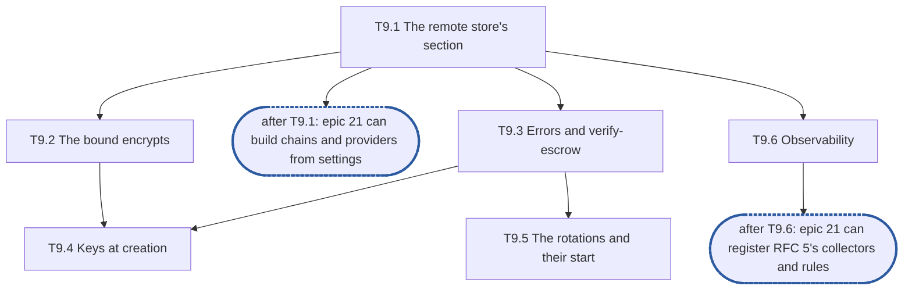

# Epic 9: transforms v2, integration

**Sources:** [RFC 5](../docs/internals/rfcs/rfc-5-transforms.md) §3.2 (the store configuration's
`transforms`, `materials` and `require`; whether a namespace encrypts, fixed at its creation; the
refusal to add or remove the encrypt stage; compression beside encryption only with
`with_encryption: accept`; the default chain of an encrypting namespace); §5.1's exception; §6's
series table and its alerts; Appendix B.2's escrow rule as namespace creation applies it, and "every
namespace has a chunk-ID key and an export key from its creation"; Appendix B.3's data-key and
master-key rotations as operations an operator or the primary-version read starts; Appendix B.4's
three conditions; Appendix B.6's three series; §8.2's T15 and T16 rows, T18's `ErrNotEscrowed`
clause through the API, and the Appendix B.1 row of a key service rotating in place while nothing
is written, its start. [RFC 13](../docs/internals/rfcs/rfc-13-configuration.md) §4.2 (the material
provider and the master key required, a key file's verified escrow), §5 and §5.1 (binding classes; a
bound setting refuses change), §6 (refused, never replaced; one validator), §7 (references only),
§9's "§5.1 encryption bound" row, and Appendix B's rows for `encrypts`, the master keys, the
transform chain, the material provider and `with_encryption`.
[RFC 23](../docs/internals/rfcs/rfc-23-control-plane.md) §4.1's actions `rotate-data-key`,
`rotate-master-key` and `verify-escrow`, §4.6 (operations, scheduled work), §4.7 (errors), §5.2
(their role), §6 (the audit), §7 (the CLI). [RFC 25](../docs/internals/rfcs/rfc-25-observability.md)
§2.1 (prefixes), §2.4 and §2.5 (labels and the series budget), §2.9 (recording), §3.9's
`material_unavailable`, `material_unknown` and `material_destroyed` rows, §7 (alerting), §8
(injection from the root). The RFC 5 plan's §5 entry for this epic, D15 and §6.1, where a row cites
them. Every citation is the RFCs' text on `develop`; the code lands on `develop`, and the
paths below are paths there.
**Track:** the team.
**Epic 9 estimate: 6 subtasks, 16.75 man-days.**
**Depends on:**
- **E3**: `chain.Register` and its registry (T3.1); `NewChain` with its refusals, the
  `with_encryption: accept` check among them (T3.2); the census view's check of `require` and of
  the implicit encrypt stage through `Deps.Encrypts` (T3.5); the recorder calls (T3.6).
- **E4** and **E5**: `zstd` (`0x0001`), `lz4` (`0x0002`) and `aes-gcm` (`0x0010`) registered at
  init, with strict settings; E5's factory refuses a nil provider.
- **E6**: `provider.New`, `Config`, `Escrow`, `(*Provider).CreateKeys`, `VerifyEscrow`, `Status`,
  `keys.ErrNotEscrowed`, and its D6: a passed escrow check is recorded in the store configuration and
  handed back in `Config.Escrowed`; `ValidateConfig(cfg Config) error`, the shape check that reads
  no file (its R52, D17); `(*Provider).Reconfigure(ctx, Config) error`, which a running provider
  takes and which refuses a master key other than the one it holds (its R53, D16); `VerifyEscrow`
  returning a pass and recording nothing, so the gate opens only from passes given to `New` or
  `Reconfigure`; `keys.ErrWrapLimit`. **E7**: `KMIPConfig`, the type of `Config.KMIP`, and the
  key-service fields of `ValidateConfig` and `Reconfigure`.
- **E8**: `(*Provider).RotateDataKey(ctx, ns) (keys.MaterialID, error)` and
  `RotateMasterKey(ctx) error`, both refusing `ErrNotEscrowed` where the key-file gate is shut;
  `Deps.RotationNeeded func(masterKeyID []byte)`, which its check calls at every read, at open and
  each period, while a record is under a master key other than the primary; `Config.RetiredKeyFiles`, with `VerifyEscrow` accepting a copy
  of any held master key (its D6); `Status.MasterKeysUnavailable` and `MasterKeysDestroyed` (its
  D8). Its `Deps.KeysObjects`, `Deps.After` and `Run` are the RFC 8 offload plan's epic 21's to pass
  and run, not this epic's (§9, "Needs on E8").
- Outside RFC 5's epics, on `feat/storage-v2`: `pkg/settings` (`Of`, the `bound` class, `CheckTx`,
  `SecretRef`, `SelfKey`, `ErrBound`); the node's `newTable()` and `newReaches()`
  (`internal/node/settings.go`); the management API's problem table, its `ownKeys`, its action
  routes and `contentIn` (`internal/node/api`), and the operation runner
  (`internal/node/runner.go`); `internal/node/content`, the content wiring. The RFC 4 plan's epic 7
  declares the remote store's section (`remote`), which this epic's fields join (D3).

**Blocks:**
- E10, whose census listing sits beside the namespace read (its T10.2).
- E11, whose codec and engine rows run through the settings and the chain this epic validates.
- Outside RFC 5's plan, the RFC 8 offload plan's epic 21, which registers in the node the
  collectors, the health source and the alert rules this epic builds (T9.6), and builds each store
  configuration's chain from the section declared here (T9.1, T9.2).

---

## 1. Goal

Epic 9 makes RFC 5's component something an operator configures, runs and watches through the node:
the store configuration's chain and material provider as settings checked by the component's own
rules, the one fact about a namespace that never changes (whether it encrypts), the namespace's keys
made at its creation, the three key actions of RFC 23, and the series, conditions and alert rules
RFC 5 and RFC 25 name.

**At the end of the epic:**

- a store configuration's `remote.transforms` and `remote.require` are validated by building the
  chain, so a misspelt setting, an out-of-order list or compression beside encryption without
  `with_encryption: accept` is refused at the write, naming the field (T9.1);
- `remote.materials` names a key file or a KMIP key service, by reference only, is required on every
  store configuration, and its master key changes only by `rotate-master-key` (T9.1);
- adding or removing the encrypt stage is refused while a namespace names the configuration,
  replacing one encryption transform by another is not, and a namespace states `encrypts` at its
  creation, which must match the configuration's chain then and never changes (T9.1, T9.2);
- `POST /stores/{id}:verify-escrow` records a passed escrow check, and creating an encrypting
  namespace on a key-file master key without one is `409` `not_escrowed`, naming the key, with no
  namespace written (T9.3, T9.4);
- a namespace's creation makes its keys, and its read shows its current data key's ID (T9.4);
- `rotate-data-key` and `rotate-master-key` run as operations, and a key service's new primary
  version starts `rotate-master-key` with no administrator (T9.5);
- RFC 5 §6's and Appendix B.6's series, the three material conditions and four alert rules exist as
  plain values, built by the content wiring into a recorder, gauges, a health source and rules (T9.6).

### 1.1 In scope

`pkg/transform/chain`'s observability values and `StageOf`; the content wiring's remote-store
fields, their validation and their reach, namespace `encrypts`, the `Encrypts` lookup, the
recorder, the gauges and the health source; the management API's problem rows, the three actions,
key creation at namespace creation and the data key's ID on the namespace read; the two operation
kinds and their steps; the start of `rotate-master-key` from the primary-version read; the `dfsctl`
commands, `docs/guide/cli.md` and `docs/guide/configuration.md`'s entries; the existing namespace
creates that must now state `encrypts`.

### 1.2 Out of scope

- The chain's refusals at build, the census view's `require` and implicit encrypt-stage checks, and
  the recording around each call: E3. The transforms' strict settings: E4, E5.
- Key records, key creation, the escrow check, `Status` and the provider's failures: E6. KMIP custody:
  E7. Rotation itself (the new key, the re-wrap, the bucket's `keys` object), the primary-version
  read and its ticker, the master-key state read, the destroyed marking and the notice: E8. This
  epic calls them.
- `transform_census_blocks` and the census per material through the management API: E10.
- A store that does not open, T5's "nothing is written", T7 and T20 through the engine: E11.
- Registering the collectors, the health source and the rules in the node, and evaluating
  `material_destroyed` with `data_loss` from the census and the journal: the RFC 8 offload plan
  (its epics 20 and 21). This epic gives that condition its name and its alert rule only.
- The block format version's setting, default 1: the RFC 4 plan's epic 7.
- The operator's destroy operation and its `dfsctl` command: the RFC 5 plan's deferral ledger, its
  row on the operator's destroy, unowned. `Provider.Remove`, so `rotate-data-key` revokes nothing:
  its `Provider.Remove` row, owned by RFC 9.
- The escrow refusal at backup-policy creation, escrow required because a namespace takes catalog
  backups, and every export-key rotation: its row on the export key's next generation, owned by
  RFC 26.
- A cloud key service taking associated data as a string map: its row on a cloud key service,
  unowned.

### 1.3 Names used here

- **E1**, epic 1, interfaces: `chain.Deps` (`Logger`, `Recorder`, `Require`, `Encrypts`),
  `chain.Recorder`, `transform.Config`, `keys.Provider`, `keys.MaterialID`, the material errors and
  the import test.
- **E2**, epic 2, test foundations: the in-memory `keys.Provider` (`keystest`).
- **E3**, epic 3, the chain: the registry, `NewChain`, the census view, the recorder calls.
- **E4**, epic 4, compression: `zstd` and `lz4`. **E5**, epic 5, encryption: `aes-gcm`.
- **E6**, epic 6, namespace keys and the provider. **E7**, epic 7, key-service custody.
- **E8**, epic 8, rotation and the destroyed-material notice.
- **E9**, this epic.
- **E10**, epic 10, the census gauge and the census per material.
- **E11**, epic 11, E2E green: RFC 5's rows through the codec and the engine.
- **The content wiring**: `internal/node/content`, the composer that builds the chain and the
  provider (RFC 0 §1.2 as amended).
- **The RFC 8 offload plan's epic 21**: the node composing offload, which registers every
  component's collectors, health sources and alert rules.
- **S3**, not a synchronisation point here: the S3-compatible storage service.

## 2. How the general rules apply

The rules are those of
[RFC 5's plan, §1.5](rfc-5-transforms-plan.md#15-general-rules-for-each-epic), cited by number and
title and not copied.

| Rule | Subtasks | How |
| --- | --- | --- |
| rule 1, **independent unit tests** ([`CLAUDE.md`, "Writing tests"](../CLAUDE.md#writing-tests)) | all | real chains from E3's `NewChain` over E4's and E5's registered transforms; the real provider over `kvstore` and Badger under `t.TempDir()`, or E2's in-memory `keys.Provider` (kind 2) where the provider is not the subject; the real API over an in-memory control-plane store, called through `pkg/node/apiv1/client`; the operation runner on an injected clock (kind 1); a fault wrapper around the control-plane store (kind 3, T9.4). The sections run through the real `settings.Table`. No double answers in a dependency's place |
| rule 2, **fuzz every decoder of bytes this component did not just write** | none | no new decoder: settings are decoded by `pkg/settings`' strict decode, transform settings by E4's and E5's factories, the API body by its strict JSON decode |
| rule 3, **observability follows RFC 25** | T9.6, T9.3 | the series, conditions and rules as plain values in `chain` (D8), built by the content wiring over the root's registry and health evaluator (R32); the planted-key check on `verify-escrow`'s body and on every series, condition and audit record (R35) |
| rule 4, **profiling** | T9.6 | the recorder is on the encode and decode path: `TestAllocsRecorder` holds it at zero allocations per call, in `transform-allocs`, whose command T9.6 extends to `internal/node/content` |
| rule 5, **public interface and internals** ([`CLAUDE.md`, "Verifying a change"](../CLAUDE.md#verifying-a-change)) | all | each rule is asserted where its consumer meets it: a refusal through the API's write and the generic setting route, not only through `Validate`; T15's plant through a chain built with the content wiring's `Encrypts`; a series read back from a scrape of the registry, not from the recorder's state; an escrow pass read by a provider the node built after the commit |
| rule 6, **known failures shrink** | none | every test here lands green in `unit` or `integration`, neither of which keeps a `known.yaml` |
| rule 7, **v2 ignores v1, and imports only what RFC 0 §1.2 allows** | T9.1, T9.6 | `chain` gains plain values only and imports nothing new; `pkg/settings`, `pkg/metrics` and `pkg/health` are imported by the content wiring and the node alone; the API reaches the provider and the chain only through `Deps` it declares, over plain values (`Deps.Keys`, `Deps.Encrypting`), so it imports neither `provider` nor `chain`. The API imports `pkg/transform/keys`, a contract, for its error values only, which T9.3 adds to `internal/node`'s `componentAllowed`. E1's import test holds `chain`'s side and `internal/node`'s `TestImportRules` and `TestAPIClosure` the API's |
| rule 8, **real dependencies for properties of those dependencies** ([`CLAUDE.md`, "Writing tests"](../CLAUDE.md#writing-tests)) | T9.4, T9.5 | key creation through the API runs the real provider over `kvstore` on Badger; the in-place rotation row runs against the harness's `service:kmip` in `integration`, retargeting the key's Name (§9, O9) |
| rule 9, **code comment conventions** ([`CLAUDE.md`, "Code comments"](../CLAUDE.md#code-comments)) | T9.1, T9.2, T9.3, T9.4, T9.5, T9.6 | `decision:` markers for D2, D4, D5, D7, D9, D10, D11 and D12; `ponytail:` for D6. RFC 5 §3.2's own note is E3's, at its `with_encryption` check. `SelfKey`'s existing `decision:` marker, which names its one user, gains `encrypts` |
| rule 10, **a test must be able to fail** ([`CLAUDE.md`, "Writing tests"](../CLAUDE.md#writing-tests)) | all | each test names the change that turns it red |
| rule 11, **a symbol is exported only if RFC 5's interface or a consumer outside the package uses it** | T9.1, T9.6 | `chain` exports `StageOf`, `Spec`, `Rule` and their three lists, each consumed by the content wiring; nothing else in `pkg/transform` is exported here. This epic is where E6's `CreateKeys`, `VerifyEscrow` and `Status` and E8's rotation calls are first called, so they freeze here |
| rule 12, **each subtask creates only what it declares** | all | no new package: the values join `chain`, and the wiring joins `internal/node/content`, `internal/node/api` and `internal/node`. The destroy operation is not built |

## 3. Requirements and invariants

Every obligation RFC 5, RFC 13, RFC 23 and RFC 25 place on this epic, numbered so that subtasks and
tests can cite them. Where another epic does the rest, the row says so.

**The store configuration**

| # | Requirement | Kind | Source | Subtasks |
| --- | --- | --- | --- | --- |
| R1 | A store configuration's `transforms` lists registered transforms, each a name and its settings, at most one per stage and in stage order; a list breaking that is refused at the write, and nothing is written | MUST | RFC 5 §3.2, §8.2 T11; RFC 13 §6 | T9.1 |
| R2 | `materials` names the material provider and how to reach it, as a reference to secret material and never the material itself, and is required on every store configuration, whether or not its chain encrypts | MUST | RFC 5 §3.2; RFC 13 §4.2, §7, Appendix B (material provider, master keys) | T9.1 |
| R3 | `require` lists transforms every body must carry, is optional, and an unregistered name in it is refused | MUST | RFC 5 §3.2, §2.5 | T9.1 |
| R4 | A change to the chain governs the next write only, the encrypt stage excepted (R9); the material provider is live | invariant | RFC 5 §3.2, §5.1; RFC 13 §5, Appendix B (transform chain, material provider) | T9.1 |
| R5 | A value out of range, of the wrong type or naming nothing registered is refused with an error naming the field and the rule, never clamped or replaced by a default; the control plane runs the component's own validator, the same one the component runs when the chain is built; an unknown field is refused | MUST | RFC 13 §6, §9 ("§6 refused", "§6 one validator", "§6 unknown field") | T9.1 |
| R6 | A chain with an encrypt stage and a compress stage whose settings lack `with_encryption: accept` is refused at the write (E3 refuses it at build) | MUST | RFC 5 §3.2, §8.2 T16; RFC 13 Appendix B (`with_encryption`) | T9.1 |
| R7 | The default chain compresses nothing: `transforms` defaults to empty, so an encrypting configuration that names only its encryption transform has no compress stage | MUST | RFC 5 §3.2, §8.2 T16; RFC 13 Appendix B (transform chain) | T9.1 |
| R8 | Master keys rotate by re-wrapping: the master key a configuration wraps under changes only through its rotation, never by rewriting the reference in place | invariant | RFC 13 Appendix B (master keys); RFC 5 Appendix B.3 | T9.1 |

**Whether a namespace encrypts**

| # | Requirement | Kind | Source | Subtasks |
| --- | --- | --- | --- | --- |
| R9 | A change that adds the encrypt stage to a store configuration, or removes it, is refused while any namespace of the configuration holds content, and nothing is written; a change replacing the encryption transform by another of the encrypt stage is allowed, and every older body still decodes | MUST | RFC 5 §3.2, §5.1, §8.2 T15; RFC 13 §5, §5.1 | T9.1, T9.2 |
| R10 | Whether a namespace encrypts is stated at its creation, required with no default, recorded, and never changes. It is whether its store configuration's chain had an encrypt stage at that moment | MUST | RFC 5 §3.2; RFC 13 §4.2, §5.1, Appendix B (`encrypts`) | T9.2 |
| R11 | In an encrypting namespace the encrypt stage is implicitly required, so a body without it is `ErrMalformed`; the chain checks it (E3), from whether the namespace encrypts as its bound setting says, which this epic supplies through `Encrypts` | MUST | RFC 5 §3.2, §8.2 T15; E3 R30 | T9.2 |
| R12 | Turning encryption on for a namespace that holds content is refused; turning compression on is accepted, and what was written before still reads | test row | RFC 13 §9 ("§5.1 encryption bound") | T9.2 |
| R13 | T15's row: with a namespace holding content, removing the encryption transform from its configuration and adding one to a non-encrypting configuration are both refused, nothing written; replacing it by a second encryption transform is allowed and every older body decodes; a body without the encrypt stage planted in an encrypting namespace is `ErrMalformed` | test row | RFC 5 §8.2 T15 | T9.2 |

**Keys at a namespace's creation**

| # | Requirement | Kind | Source | Subtasks |
| --- | --- | --- | --- | --- |
| R14 | Every namespace has a chunk-ID key and an export key from its creation, and an encrypting one its first data key and chunking key too: creating a namespace creates its keys (E6 makes them) | MUST | RFC 5 Appendix B.2 | T9.4 |
| R15 | Where a namespace encrypts, a key-file master key must have passed its escrow check: until it has, creating an encrypting namespace is refused with `ErrNotEscrowed`, naming the key, and nothing is created. The same rule for catalog backups is RFC 26's | MUST | RFC 5 Appendix B.2, §8.2 T18; RFC 13 §4.2, §9 ("§7 key table") | T9.4 |
| R16 | The escrow check is a setup step: the operator hands the off-host copy back once, the provider checks it (E6), and the pass is recorded in the store configuration so that it holds across restarts | MUST | RFC 5 Appendix B.2; RFC 13 §4.2; E6 D6 | T9.3 |
| R17 | T18's API clause: on a key-file provider without a verified escrow, creating an encrypting namespace through the API is refused with `ErrNotEscrowed`; after the escrow check passes, it succeeds | test row | RFC 5 §8.2 T18 | T9.4 |

**The key operations**

| # | Requirement | Kind | Source | Subtasks |
| --- | --- | --- | --- | --- |
| R18 | `rotate-data-key` is a `POST` on a namespace, `admin`'s, and an operation | MUST | RFC 23 §4.1, §4.6, §5.2; RFC 5 Appendix B.3 | T9.5 |
| R19 | `rotate-master-key` is a `POST` on a remote store, `admin`'s, and an operation; a new key-file master key becomes current only after its escrow check, where Appendix B.2 requires one (E8 checks it) | MUST | RFC 23 §4.1, §4.6, §5.2; RFC 5 Appendix B.3 | T9.5 |
| R20 | `verify-escrow` is a `POST` on a remote store, `admin`'s, and not an operation | MUST | RFC 23 §4.1, §5.2; RFC 5 Appendix B.2 | T9.3 |
| R21 | A data-key or master-key rotation is driven by the operation runner, its steps recorded durably and each idempotent; a second request for the same kind on the same target while one runs is refused `409` `operation_running`, naming it | MUST | RFC 23 §4.6 | T9.5 |
| R22 | An operation no call started carries no account, read as the schedule, and the write that creates it carries its audit record with the schedule as actor | MUST | RFC 23 §4.6, §6 | T9.5 |
| R23 | A key service that rotates a master key in place, or retargets its alias, while the namespace writes nothing, has a `rotate-master-key` operation started at the next period by the primary-version read (E8 reads it and re-wraps), with no administrator, unless one runs for that master key | test row | RFC 5 §8.2 (Appendix B.1, in-place rotation and alias rows), Appendix B.1; RFC 5 plan §5 (epic 9) | T9.5 |
| R24 | `rotate-data-key` revokes nothing while removal has not landed: its help says the old key stays held, so it does not answer a leaked data key | MUST | RFC 5 Appendix B.3; RFC 23 §4.1; RFC 5 plan §5 (epic 9), §6.1 (`Provider.Remove`) | T9.5 |
| R25 | Each action has a `dfsctl` command, and the CLI reference is regenerated from the command tree | MUST | RFC 23 §7; RFC 5 plan D15; `CLAUDE.md` ("Frequent commands") | T9.3, T9.5 |

**Errors**

| # | Requirement | Kind | Source | Subtasks |
| --- | --- | --- | --- | --- |
| R26 | An error the API returns is a problem body whose `code` is the component's error value by its name; one table maps every error to a status, a test proves it total, and an error it does not name is a `500` that is counted | MUST | RFC 23 §4.7 | T9.3 |
| R27 | Material that cannot be reached now, or that the provider was never given, fails as the remote being unavailable: retryable, never a client's mistake | invariant | RFC 5 §2.7, Appendix B.4; RFC 25 §3.9; RFC 23 §4.7 (`retryable`) | T9.3 |

**Observability**

| # | Requirement | Kind | Source | Subtasks |
| --- | --- | --- | --- | --- |
| R28 | Each transform is labelled by its name, so a custom transform gets RFC 5 §6's series without writing any | MUST | RFC 5 §6 | T9.6 |
| R29 | `transform_chunks_total` (counter, `applied`), `transform_bytes_total` (counter, `direction`, and the label D10 adds), `transform_seconds` (histogram, by direction) and `transform_decode_failures_total` (counter, `error` = `malformed`, `material_unavailable`, `material_unknown`, `material_destroyed` or `too_large`) exist as RFC 5 §6 states them; `transform_census_blocks` is E10's | MUST | RFC 5 §6 | T9.6 |
| R30 | `encryption_chunks_total` (counter) counts chunks encrypted; `encryption_current_key_age_seconds` (gauge, labelled `namespace`) is how long the namespace's current data key has been current, its ID read through the management API; `encryption_keys_unavailable` (gauge) counts configured keys the provider cannot return with a matching fingerprint | MUST | RFC 5 Appendix B.6 | T9.6, T9.4 |
| R31 | No single metric exceeds 10,000 series at the reference profile | bound | RFC 25 §2.5 | T9.6 |
| R32 | Names carry the `transform_` or `encryption_` prefix, shown without the deployment's; each series is resolved once and recorded with an atomic add or an observe; the registry and logger come from the root, never a global | MUST | RFC 25 §2.1, §2.9, §8; RFC 5 §6 | T9.6 |
| R33 | `material_unavailable` and `material_unknown` are namespace conditions naming the material, raised from what the provider reports; `material_destroyed` names the material too, and the engine evaluates it (the RFC 8 offload plan) | MUST | RFC 5 Appendix B.4, B.6; RFC 25 §3.9 | T9.6 |
| R34 | Alerts are on conditions wherever one exists: `material_unavailable` and `material_unknown` page at 5 min, `material_destroyed` pages at once; `transform_decode_failures_total{error="malformed"}`, net of the syncer's recovered re-gets, is a ticket | MUST | RFC 25 §3.9, §7; RFC 5 §6 | T9.6 |
| R35 | No key byte, unwrapped material, derived key or passphrase reaches a log line, an error string, an audit record, a label or a condition: IDs and fingerprints only | MUST NOT | RFC 5 plan §1.5 rule 3; RFC 13 §7, §9 ("§7 no secret out") | T9.3, T9.6 |

## 4. Decisions this epic takes

- **D1, the chain's settings are validated by building the chain with no material.** RFC 13 §6 has
  the control plane run the component's validator, and the chain is validated by building it. A
  store being created has no provider yet, and E5's factory refuses a nil one, so the section's
  `Validate` passes `NewChain` an unexported provider that holds no material and answers every call
  `keys.ErrUnknownMaterial`, which no factory reaches (E5's D2), a discarding logger and a recorder
  that keeps nothing. The same `NewChain` builds the serving chain, so the write and the build share
  one validator (R5). Prior art: `database/sql`'s `Open`, which checks a DSN without connecting
  (from memory). No marker: the doc comment says it.

- **D2, a configuration's master key changes through `rotate-master-key` only.** Rewriting the key
  file's path or the KMIP key's name in place would make the provider wrap under a key whose escrow
  nothing checked and leave records under one it no longer holds (R8). The remote section's
  `CheckTx`, which every writer passes (the API's routes, the provisioning reload), refuses a write
  whose `key_file` or `kmip.key` differs from the row's once the store exists, its first value
  passing; `ownKeys` gains `remote.materials`, so the generic route's refusal names the route.
  `retired_files`, E8's `Config.RetiredKeyFiles`, may only grow: an operator adds the next key file
  there and runs `verify-escrow` with its copy, which E8's `VerifyEscrow` accepts for any held key
  (E8's D6), and a removal is refused, since dropping a file that still unwraps records is a
  master-key destroy, the deferral ledger's destroy row. The removal is judged by the records, not
  by what this node's provider holds, which is empty on a node whose provider is not running: it
  passes only if every master key a key record of the store names, read through E8's walk over
  the store's namespaces (`Keys.MasterKeysNamed`, T9.1, §9), is the master key of `key_file` or of a
  file the new `retired_files` still lists, each file's ID read with `internal/keyfile` (E6's R2);
  a remaining file that cannot be read, or records that cannot be read, refuse the write as
  unavailable (R27), naming the file or the store. So a file that still wraps a record stays on any
  node, and a mistyped path, which wraps nothing, can go: `ValidateConfig` reads no file, so such a
  path commits, and E8's `Reconfigure` then refuses the whole `Config`, which would hold every later
  live change of the section, and the store's next start, until the path could go.
  `rotate-master-key` then names a file already retired, and swaps it in over separate turns
  (T9.5). Where Appendix B.2 asks for an escrow, the transaction that would commit the swap first
  reads `remote.escrowed` and whether a namespace of the store encrypts, both tracked, and fails the
  operation `not_escrowed`, writing nothing, unless the list holds the named file's master key ID and
  fingerprint (`Keys.KeyFileID`, read with `internal/keyfile`), so an unescrowed file is never
  `key_file` (R19). The swap is that transaction's write of it and the current `key_file`,
  with the raw `tx.PutSetting`, which no section's `CheckTx` judges, since that check refuses the
  changed `key_file` and the file leaving `retired_files` that a swap is; only a later turn,
  once the provider has taken the named file as its key file, calls `RotateMasterKey`,
  since the reach hands the swap to the provider only after the commit and a call in the same turn
  would run under the old key, pass, and leave the new one current unchecked. That turn waits at
  most 5 minutes from the swap's commit, recorded in its cursor, on the injected clock: a reach
  `Reconfigure` refused never hands the swap over, so the step then fails and its failure hook
  swaps the files back, and the next start opens the old key file rather than an unrotated swap.
  The hook swaps them back with the same raw write (T9.5). Those two writes are the only ones the
  check does not see, and the `decision:` marker at the check names them. E8 still refuses
  `RotateMasterKey` under a shut gate (its D6), which covers the one race the escrow read leaves: a
  namespace whose keys `CreateKeys` made under the old key before the swap and whose record commits
  after it, so the hook swaps back and nothing was wrapped under the new key; a create committing
  first conflicts with the swap's tracked read, which retries and sees the encrypting namespace.
  Endpoint, server name, certificates and
  timeout stay writable (D12). A `decision:` marker at the check names the route. Prior art: the store's own `remote.credential`, written only by its route
  (checked, `internal/node/api/res_settings.go`'s `ownKeys`).

- **D3, the remote store's section carries `transforms`, `require`, `materials`,
  `kmip_client_key` and `escrowed`.** The rows join the remote store's section, which the RFC 4
  plan's epic 7 declares under the prefix `remote`; `Of` takes one typed struct per prefix, so the
  content wiring declares it over a struct embedding RFC 4's settings and this epic's, unexported,
  with one `Validate` calling both. Whichever epic lands first declares the struct, and the other
  adds its embed. `pkg/transform` declares no settings type: `Of` reads `class` tags, and
  `transform.Config` is E1's frozen contract with no `json` tags, so the wiring's struct holds the
  rows and converts them to `[]transform.Config` and `provider.Config`. The KMIP client key is its
  own key, `remote.kmip_client_key`, an `entity.SecretRef` of kind `SecretKey`, because `SecretRef`
  applies to a top-level field only. RFC 5 §3.2 names the first three keys; no RFC names the last two
  (§9). Prior art: RFC 13 Appendix B's dotted keys (checked).

- **D4, a passed escrow check reaches the provider only from the committed setting.** E6's D6
  records the pass in the configuration. `remote.escrowed` holds the list of `Escrow` values (master
  key ID and fingerprint), class live; the section's `CheckTx` refuses any write of it that changes
  the list, and `ownKeys` names `:verify-escrow`, so no operator can type a pass the provider never
  made. A store's create writes every row before it judges any (`createSettings`,
  `internal/node/api/res_settings.go`), so that check reads the new list as the stored one and sees
  no change; and `ownKeys` guards only the generic route. So `createStore` refuses
  `remote.escrowed` in `spec.settings`, naming the field, as it refuses `remote.credential` (T9.1):
  without it an operator, the least role for `POST /stores`, would create a store with its gate
  already open and skip `verify-escrow`'s `admin`. `verify-escrow` alone appends a pass, with `tx.PutSetting` in its own transaction; a key-file
  rotation needs its next key's pass recorded first (D2). The provider learns of it only through the section's reach (D12), after the commit,
  so a pass whose transaction failed opens no gate: E6's `VerifyEscrow` records nothing, and its gate
  opens only from the passes `Reconfigure` is given (its D16). A `decision:` marker
  at the refusal says why, and that `verify-escrow` is the one writer of `remote.escrowed`, to be withdrawn if RFC 16 gains a row for the pass. Prior art: RFC 13
  §2.5's system fields of a backup location, which the record holds and the operator never writes
  (checked).

- **D5, `encrypts` is stated by the operator and checked against the chain where the store is
  known.** RFC 13 makes it required with no default, and RFC 5 records it from the configuration's
  chain at creation. Both hold if the namespace's create states it and is refused unless it equals
  whether the store's `remote.transforms` hold an encrypt-stage transform then. The comparison runs
  in `createNamespace`, which knows the store, through a tracked read of `remote.transforms` in the
  write's transaction; a section's `CheckTx` sees only the namespace scope and cannot find the store.
  It is a namespace section with `SelfKey`, so its key is `encrypts` as RFC 13 Appendix B spells it,
  class `bound`. `contentIn` answers that every namespace holds content, so any later change is
  refused, which is R10's "never changes" with no code of its own. On the store side the control
  plane cannot see content, so the remote section's `CheckTx` refuses adding or removing the encrypt
  stage while a namespace names the store (`tx.StoreNamed`, tracked): wider than "holds content", so
  it fails closed. A create and a chain change racing each other read each other's key, so one of
  the two retries. A `decision:` marker at each check says so. Prior art: none found.

- **D6, keys are created before the namespace record commits.** The escrow refusal must leave no
  namespace, and the provider writes key records in its own transaction, not the control plane's, so
  the create's pre-write step draws the namespace's ID and calls `CreateKeys`, and the transaction
  then writes the record under that ID. Before `CreateKeys`, the pre-write step refuses an
  `encrypts` that is missing or differs from the store's chain, read untracked (D5's check, which
  the transaction repeats tracked), so a mismatch is `400` with no key record made, not
  `not_escrowed` or a set of records under an ID no namespace takes. `CreateKeys` returns only once
  the namespace's `keys` object put has succeeded (E8's R8, R9), so the record commits after the
  bucket holds its keys; since no record names the namespace's store yet, `Keys.CreateKeys`
  registers the drawn ID with the store it is called for, and `Deps.KeysObjects` answers that ID
  from it (§9, needs on the RFC 8 offload plan's epic 21); the create unregisters it once its
  transaction loop has ended, committed or failed, since a committed record names the store and a
  failed create's ID is never asked for again, so the registrations held are those of the creates
  in flight. The pre-write step runs once per request, so a conflict
  retry of the transaction reuses the ID and the keys; a request whose transaction fails, or a
  client's retry that finds no idempotency record, draws a new ID and leaves the first one's records
  under an ID no namespace holds. `ponytail:` those records stay until a namespace's removal erases
  its keys, which lands with `Provider.Remove` (RFC 9): each costs up to four small rows and four
  wraps of the master key's count; sweep records whose namespace has no record if a store shows them
  accumulating. Prior art: two-phase creation with an idempotent first phase, as Kubernetes'
  finalizers (from memory).

- **D7, a rotation step is idempotent by what it reads, with no token.** RFC 23 §4.6 makes each step
  idempotent, and a rotation retried after a crash must finish the same rotation, not start a
  second; E8's calls take no token. `RotateMasterKey` re-wraps only the records not already under
  the configuration's current master key, so running it again after a crash changes nothing more
  (E8's T8.6). For a data key, the operation's first turn only records in its cursor
  (`StepResult.Next`) the namespace's current data key ID and calls nothing; a later turn calls
  `RotateDataKey` only while that key is still current, and one that finds another key current
  ends `succeeded` with it. A turn whose answer was not committed runs again from the same cursor
  (`step.Step`'s contract), so a first turn that also called would, interrupted before its commit,
  record the new key as the one to replace and mint a second; `noneRunning` keeps a
  second rotation off the namespace meanwhile. A `decision:` marker at the step says so. Prior art:
  a compare-and-swap on the observed version, as an `If-Match` write (RFC 23 §4.4, checked).

- **D8, the component's observability values are one table in `chain`.** The plan's rule 3 puts
  the series specs, the conditions and the alert rules as plain values in this component's packages,
  and RFC 25 §2.1 gives the prefixes per RFC, so `chain/observe.go` holds the series of RFC 5 §6
  and Appendix B.6, the three condition names and the four alert rules, with two small types, `Spec`
  and `Rule`, since `chain` may not import `pkg/metrics`. The provider's gauges are read from
  `Status` at scrape (E6's D8), and the chain's series through the recorder E1 declared; neither
  package records anything new. `encryption_chunks_total` is the chain's `Encoded` call with
  `applied` for a transform of the encrypt stage (E5's D6), which the recorder tells by
  `chain.StageOf`. Prior art: the RFC 4 plan, whose metric definitions and alert rule are plain
  values in its packages (checked).

- **D9, a namespace the lookup does not know encrypts.** `Deps.Encrypts` is
  `func(entity.NamespaceID) bool`, called on the decode path with no context, so it answers from a
  map alone and never reads the control plane. The content wiring fills the map, with its own
  context, off that path: every namespace naming the store, read when the store's chain is built,
  then each namespace at its create and its open, before a binding serves it. `encrypts` is bound,
  so a value read is kept for the namespace's life. A namespace not in the map is answered `true`
  and nothing is stored for it. A fill that fails is retried in the background, with backoff on the
  content wiring's clock, until it succeeds, and an absent ID answered `true` wakes that retry
  without waiting for it (a non-blocking signal, so the decode path still reads nothing), so the
  map is corrected with no new open. The map is an `atomic.Pointer` to a map each fill copies and
  replaces, so the decode path reads it with no lock and never sees one half written. Its
  plaintext bodies are refused
  rather than trusted until then, since failing closed costs a refused read that should not happen
  and failing open admits a planted body. A `decision:` marker at the lookup says so, and that a
  failed read is never cached.
  Prior art: none found.

- **D10, `transform_bytes_total` carries `side` (`in`, `out`) beside `direction`.** RFC 5 §6 counts
  "bytes in and out, labelled `direction`", whose ratio is what the transform costs or saves, and
  a ratio needs both sides of one direction. RFC 25 §2.4 wants a label's values named in the owning
  RFC's table, so the label is proposed to RFC 5's author (§9); a `decision:` marker at the spec
  names it until the RFC does. Prior art: none found.

- **D11, unavailable and unknown material answer `503`, retryable.** RFC 23 §4.7's `503` row names
  the metadata store unreachable, the node starting and the API at its bound; RFC 5 Appendix B.4 and
  RFC 25 §3.9 make both material failures behave as an unavailable remote, which recovers without the
  client changing anything. So `ErrMaterialUnavailable` is `503` `material_unavailable` and
  `ErrUnknownMaterial` `503` `unknown_material`, both retryable; `ErrMaterialDestroyed` is `409`
  `material_destroyed` and `ErrNotEscrowed` `409` `not_escrowed`, codes by the errors' names as RFC
  23 §4.7 says. A rotation step answers the same errors through the same rows, as a
  `*apiv1.Problem`, because the runner retries with no end any other error that does not wrap
  `step.ErrStepFailed` (`step.Failure`): a plain
  `ErrNotEscrowed` would spin a key-file rotation and never run its failure hook. Only
  `ErrMaterialUnavailable` and store errors stay retried inside a step, and so does
  `ErrUnknownMaterial`, since material the provider was not given yet, a key service's new version
  or a file just after the reach, arrives without the client; but bounded: the step records in its
  cursor the injected clock's time it first met the error, and fails `unknown_material` once that
  is 5 minutes old, `material_unknown`'s page delay, so a material never given ends rather than
  spins. The `400` on a non-encrypting namespace's `rotate-data-key` keeps the one known permanent
  case from starting. A `decision:` marker at the rows says why `503` reaches past §4.7's list. Prior art:
  RFC 7231's `503` for a dependency that is temporarily unavailable (from memory).

- **D12, the material provider is live through the section's reach.** RFC 13 Appendix B makes it
  live, and `internal/node/settings.go` requires every section with live keys to have an entry in
  `newReaches()`, or a change of it fails. The remote section's apply hands each store's provider its
  new `Config` through E6's `Reconfigure` (its D16); with D2 refusing a new master key, the apply changes only a KMIP endpoint,
  server name, certificates and timeout, the escrow passes, and a retired key file added (which it opens) or the
  swap a rotation makes. E7 adds the KMIP fields to it, and E8 the retired files and the swap (E6's
  D16; §9). A
  `decision:` marker at the apply says it refuses nothing D2 has not. Prior art: the identity
  section's apply in the same table (checked).

## 5. Target tree

```text
pkg/transform/chain/
  stage.go            T9.1  StageOf
  observe.go          T9.6  Spec, Rule; Series(), Conditions(), Rules()
  stage_test.go, observe_test.go
internal/node/content/
  remote.go           T9.1  the remote section's fields, Validate (D1), CheckTx (D2, D4, D5),
                            the reach's apply (D12); the conversion to transform.Config and
                            provider.Config
  encrypts.go         T9.2  the encrypts section, in Sections(); the Encrypts lookup (D9) and
                            Deps.Encrypting over StageOf
  keys.go             T9.1  Keys: MasterKeysNamed, KeyFileID; T9.3 VerifyEscrow; T9.4 CreateKeys, CurrentDataKey;
                      T9.5  RotateDataKey, RotateMasterKey, CurrentKeyFile, the
                            primary-version reader
  observe.go          T9.6  the recorder, the gauges and the health source
  remote_test.go, encrypts_test.go, keys_test.go, observe_test.go
internal/node/
  settings.go         T9.1  the remote section's reach
  arch_test.go        T9.3  componentAllowed admits pkg/transform/keys' error values
  keyops.go           T9.5  the two step rows and Deps.RotationNeeded's start
  runner.go           T9.5  stepRow.failed takes the operation
  node.go             T9.5  the machine-password row's failed hook takes the operation
internal/identity/
  rotate.go           T9.5  RotateFailed takes the operation and ignores it
internal/node/api/
  res_settings.go     T9.1  ownKeys rows for remote.materials and remote.escrowed
  problems.go         T9.3  rows for pkg/transform/keys' errors
  res_stores.go       T9.1  createStore refuses remote.escrowed; T9.3 verify-escrow
  res_namespaces.go   T9.2  encrypts checked against the store's chain; T9.4 key creation
                            before the write, the current data key on the read
  res_domain.go       T9.5  action and noneRunning over any target
  routes.go           T9.3, T9.5  the three action rows
pkg/node/apiv1/
  opkind.go           T9.5  OpRotateDataKey, OpRotateMasterKey
  namespace.go        T9.4  the current data key in the namespace's status
cmd/dfsctl/commands/
  store/              T9.3  verify-escrow; T9.5 rotate-master-key
  namespace/          T9.2  create states --encrypts; T9.5 rotate-data-key
docs/guide/cli.md     T9.2, T9.3, T9.5  regenerated
docs/guide/configuration.md  T9.1, T9.2  the remote store's transform and material keys, encrypts
```

## 6. Subtasks

### T9.1 The remote store's section

**Subtask T9.1 estimate: 4 man-days.**

- **Track:** the team. **Depends on:** E3's T3.1 and T3.2; E4's and E5's registrations; E6's
  `Config` and `Escrow`; E7's `KMIPConfig`; E8's walk of the master keys a store's records name,
  callable with no provider running, which `Keys.MasterKeysNamed` reads (§9).
- **Covers:** R1, R2, R3, R4, R5, R6, R7, R8, R9 (the store's side).
- **Deliverables:**
  - `pkg/transform/chain/stage.go`:

    ```go
    // StageOf is the stage of a registered transform, by its name.
    func StageOf(name string) (transform.Stage, bool)
    ```

    Consumed by the remote section's `CheckTx` (this subtask), the namespace check (T9.2) and the
    recorder (T9.6).
  - `internal/node/content/remote.go`, unexported but for the section and its conversion: the
    fields `transforms` (`[]{name, settings}`, class next write, default empty), `require` (next
    write), `materials` (live: `key_file` with `retired_files`, or `kmip` with `endpoint`, `server_name`, `key`,
    `client_cert`, `server_ca`, `timeout`), `kmip_client_key` (`entity.SecretRef`, kind `SecretKey`) and
    `escrowed` (live, a list of `Escrow`); `Required("Materials")`; `Validate` building the chain
    with no material (D1) and refusing a `materials` with neither or both of `key_file` and
    `kmip.endpoint`, or a KMIP block missing its key or certificates, through E6's `ValidateConfig`, with E7's key-service rules, each refusal naming the field; `CheckTx` refusing a changed master key and a removed retired
    file while a key record of the store names a master key that neither `key_file` nor a file the
    new `retired_files` lists holds (`Keys.MasterKeysNamed(ctx, store [16]byte) ([][]byte, error)`
    and `Keys.KeyFileID(path string) (id []byte, fingerprint [32]byte, err error)`, neither reading
    a running provider; a file or the records unreadable refuse it as unavailable, D2), a changed
    `escrowed` (D4), and an encrypt stage gained or lost (`StageOf`) while `tx.StoreNamed` (D5), all
    with `settings.ErrBound` or a field error naming the route; the conversion to
    `[]transform.Config` and `provider.Config`, the passphrase from the root (RFC 13 Appendix C).
  - `internal/node/settings.go`: the fields join the remote section (D3), and the section's reach
    hands each store's provider its new `Config` (D12).
  - `internal/node/api/res_settings.go`: `ownKeys` rows `remote.materials` (`PATCH
    /api/v1/stores/{id}`) and `remote.escrowed` (`POST /api/v1/stores/{id}:verify-escrow`).
  - `internal/node/api/res_stores.go`: `createStore` refuses `spec.settings` carrying
    `remote.escrowed` `400`, naming `spec.settings.remote.escrowed`, beside its `remote.credential`
    refusal (D4).
  - `docs/guide/configuration.md`: the five keys, each with an example.
  - Consumed by T9.2 to T9.5, the RFC 8 offload plan's epic 21 (each store's chain and provider)
    and E11.
- **Acceptance criteria:**
  - The zero `transforms` validates and builds a chain with no stage; `[{name: aes-gcm}]` builds one
    with no compress stage (R7).
  - Out of stage order, two of one stage, an unregistered name, a misspelt `levle`, and `zstd`
    without `with_encryption: accept` beside `aes-gcm` are each `400` naming the field; with it, the
    pair is accepted (R1, R5, R6); an unregistered name in `require` is refused naming `require`
    (R3).
  - A store created without `remote.materials` is `400` `required` (R2).
  - On an existing store, a changed key file or KMIP key name is refused naming the route, and a
    changed KMIP endpoint or server name, or a retired file added, is accepted and reaches the
    provider (R4, R8); a `kmip` block with no `server_name` converts to an empty
    `KMIPConfig.ServerName`, which E7's custody reads as the endpoint (E7's D3); a
    retired file whose key wraps a record is refused, on a node whose provider is running and on
    one whose provider is not, and one whose path names no file is accepted, after which a
    KMIP endpoint change reaches the provider again; `remote.escrowed` written by
    `PATCH`, the generic route or a provisioning reload is refused.
  - `POST /stores` by an `operator` carrying `remote.escrowed` in `spec.settings` is `400` naming
    `spec.settings.remote.escrowed`; no store, no setting written (D4).
  - Adding `aes-gcm` to, or removing it from, a store a namespace names is `409` `bound_setting`,
    nothing written; with no namespace it is accepted; replacing it by another encrypt-stage
    transform is accepted (R9).
- **Tests:**
  - Through the API over the in-memory control plane and the real settings table, with E4's and
    E5's registered transforms: each acceptance row above (catch a validator looser than the build,
    R1, R3, R5, R6, R7).
  - The same lists given to `NewChain` with the converted `[]transform.Config` and E2's in-memory
    provider: the same refusals (catches the API and the component disagreeing, R5).
  - The master-key and escrow refusals through `PATCH`, the generic route, the provisioning
    reload and `POST /stores` as an `operator`, the last then creating an encrypting namespace on
    the store and asserting `not_escrowed` (catch a refusal in one route only, or a create judged
    against its own rows, R8, D2, D4).
  - A mistyped retired file added, its reach refused, then removed (catches a section held by a
    file nothing can remove, D2).
  - Records under key file A, A retired by a swap to B before the re-wrap, then A's removal judged by a
    `Keys` over the same Badger records whose store's provider was never started: refused naming
    A; once `RotateMasterKey` has re-wrapped every record under B, accepted (catches a removal judged by this node's provider
    state, which is empty there, D2).
  - The encrypt-stage rows, one of them racing a namespace's create in two transactions, of which
    one retries (catches an untracked read, R9, D5).
  - A KMIP endpoint change seen by the provider after the reach runs (catches a live key with no
    reach, R4, D12).
- **Rules:** rule 9: D2's, D4's, D5's and D12's markers.

### T9.2 The bound `encrypts` and the `Encrypts` lookup

**Subtask T9.2 estimate: 2 man-days.**

- **Track:** the team. **Depends on:** T9.1; E3's T3.5.
- **Covers:** R9 (the namespace's side), R10, R11, R12, R13.
- **Deliverables:**
  - `internal/node/content/encrypts.go`: the namespace section `encrypts`, `SelfKey`, class
    `bound`, `Required`; the `Encrypts` lookup the chain's `Deps` take, a map read only, filled off
    the decode path at the chain's build and at each namespace's create and open, a failed fill
    retried in the background with backoff and woken by an absent ID's lookup, an absent ID
    answered `true` and never stored (D9). Declared in `content.Sections()`, beside the RFC 4 plan's epic 7's
    sections. `SelfKey`'s
    `decision:` marker names its second user.
  - `res_namespaces.go`: `createNamespace` reads the store's `remote.transforms` tracked and refuses
    an `encrypts` that differs from whether they hold an encrypt-stage transform, naming
    `spec.settings.encrypts` (D5). It asks `Deps.Encrypting(transforms json.RawMessage) (bool,
    error)`, which the content wiring builds over `chain.StageOf`, so the API imports no `chain`.
  - Every existing namespace create made to state `encrypts`: the API's and the client's tests, the
    fixtures under `internal/node/testdata`, `clisuite`'s rows, and `dfsctl namespace create`, which
    gains `--encrypts`; `go run ./cmd/gendocs`; `docs/guide/configuration.md`'s entry.
  - Consumed by T9.4 (the create) and the RFC 8 offload plan's epic 21 (the chain's `Deps`).
- **Acceptance criteria:**
  - A namespace created with `encrypts` omitted is `400` `required`; with `encrypts: true` on a store
    whose chain does not encrypt, or `false` on one that does, it is refused naming the field (R10).
  - Any later change of `encrypts` is `409` `bound_setting` (R10, R12).
  - Compression added to a store holding a namespace is accepted, and bodies written before decode
    (R12).
- **Tests:**
  - Through the API: the creation rows and the change row above (catch a namespace that can start
    or stop encrypting, R10, R12).
  - T15's rows through the API and a chain the content wiring builds: removing and adding
    `aes-gcm` refused (T9.1's check, asserted here at the namespace's content); replacing it by a test
    transform registered in the encrypt stage accepted, the older bodies decoding through a chain
    built from the new settings (catches a decode tied to the configured chain, R13); a body without
    the encrypt stage, planted through a chain built from a non-encrypting configuration, decoded by
    a chain whose `Encrypts` is the content wiring's lookup over the namespace's bound setting, is
    `ErrMalformed` (catches a lookup read from the chain rather than the namespace, R11, R13).
  - A namespace of the store not yet opened answered from the fill at the chain's build; the fill
    failed by a fault wrapper around the control-plane store, the namespace answered `true`, then,
    with the fault lifted and no open or create, `false` once the background retry runs on the
    injected clock (catch a false `malformed` before the open, D9 failing open, a failure cached,
    and a fill nothing retries); a decode under a control-plane read that blocks returns at once (catches a
    read on the decode path).
- **Rules:** rule 5: each refusal asserted at the API's write and at the decode that consumes the
  lookup. rule 9: D5's and D9's markers.

### T9.3 The error table and `verify-escrow`

**Subtask T9.3 estimate: 1.5 man-days.**

- **Track:** the team. **Depends on:** T9.1; E6's `VerifyEscrow` and `ErrNotEscrowed`.
- **Covers:** R16, R20, R25 (`verify-escrow`), R26, R27, R35.
- **Deliverables:**
  - `internal/node/arch_test.go`: `componentAllowed` gains `pkg/transform/keys`, and `onlyNames`
    admits only its `Err` names, with the reason: a contract, for the error table.
  - `internal/node/api/problems.go`: `pkg/transform/keys` added to the packages the totality test
    covers, with D11's four rows and `ErrWrapLimit` `409` `wrap_limit`, so a spent master key asks
    for a rotation rather than answering a `500`. The chain's refusals reach the API only as `settings.ErrInvalid`
    from the section's `Validate`, so `pkg/transform`'s errors take no row.
  - `internal/node/content/keys.go`: `Keys`, one per node over its stores' providers, which T9.1
    declares with `MasterKeysNamed` and `KeyFileID` and the API reaches through an interface it declares (`Deps.Keys`), now with
    `VerifyEscrow(ctx, store [16]byte, copy []byte) (masterKeyID string, fingerprint [32]byte, err
    error)`, plain values, so the API imports no `provider`; the section decodes the entry into
    `provider.Escrow`.
  - The route `POST /stores/{id}:verify-escrow`, `admin`'s, body `{"copy": <base64>}`: its pre-write
    step calls `Keys.VerifyEscrow`, and on a pass the transaction appends the master key's ID and
    fingerprint to
    `remote.escrowed` with `tx.PutSetting`, with its audit record naming the master key's ID and
    fingerprint and never the copy (D4).
  - `dfsctl store verify-escrow <store> --copy <file>`, its `clisuite` row, and `go run
    ./cmd/gendocs`.
- **Acceptance criteria:**
  - Each `keys` error reaches the problem body by its name, status and `retryable`; a new error
    declared in `keys` fails the totality test (R26, R27).
  - A pass is recorded once and opens the gate of a provider the node builds afterwards; a failed
    check records nothing (R16).
  - `operator` is refused `403` (R20).
- **Tests:** the totality test with `keys` covered (catches an unmapped material error as a `500`,
  R26); `ErrUnknownMaterial` answered retryable (catches a client told its request is wrong, R27);
  a copy of the key file passed, then a provider built from the committed setting opening the gate,
  and one built after a pass whose transaction a fault wrapper failed keeping it shut (catch a pass
  held in memory only, or one opened before its commit, R16, D4); another file's copy refused
  `not_escrowed` and nothing written; the planted key: a known key file, passphrase and copy, then
  the captured log, the audit records, every error and problem body searched for their bytes, raw,
  hex and base64 (catches the copy logged or audited, R35); the role row (R20).
- **Rules:** rule 3: the planted key. rule 7: the API imports `keys`' error values, a contract,
  and reaches the provider only through `Deps.Keys`; `TestImportRules` holds it. rule 9: D11's marker.

### T9.4 Keys at a namespace's creation, and its current data key

**Subtask T9.4 estimate: 2.25 man-days.**

- **Track:** the team. **Depends on:** T9.2, T9.3; E6's `CreateKeys`.
- **Covers:** R14, R15, R17, R30 (the key ID).
- **Deliverables:**
  - `Keys.CreateKeys(ctx, store [16]byte, ns entity.NamespaceID, encrypts bool) error` and
    `Keys.CurrentDataKey(ctx, store [16]byte, ns entity.NamespaceID) (keys.MaterialID, bool, error)`,
    the `MaterialID` carrying the key's ID and fingerprint.
  - `Keys.CreateKeys` registers the drawn ID with its store before E6's `CreateKeys` runs, so the
    content wiring's `Deps.KeysObjects` answers a namespace with no record yet, and returns once the
    `keys` object put has succeeded (D6); `Keys.Unregister(store [16]byte, ns entity.NamespaceID)`,
    which the create calls once its transaction loop ends, committed or failed (D6).
  - `res_namespaces.go`: the create's pre-write step draws the ID, reads `encrypts` from the request,
    refuses it missing or different from the store's chain (D5's check, untracked here), and only
    then calls `CreateKeys` before the transaction, which writes the record under that ID (D6); the
    read adds the current data key's ID and fingerprint to the namespace's status, absent for a
    namespace that does not encrypt (Appendix B.6's "the key ID itself is read through the management
    API"). `apiv1.NamespaceStatus` gains the field. E10's census listing sits beside this read, at
    its own route (its T10.2).
- **Acceptance criteria:**
  - An encrypting namespace on a key-file store without a pass is `409` `not_escrowed`, naming the
    key; no namespace record and no key record exist afterwards (R15, R17).
  - After `verify-escrow` passes, the same create succeeds, and `Current` answers its four kinds
    (R14, R17).
  - A non-encrypting namespace on the same store is created with no pass, with a chunk-ID key and an
    export key only (R14, R15).
  - The namespace read shows the data key's ID and fingerprint, and no key byte.
  - `encrypts: true` on a store whose chain does not encrypt is `400` naming
    `spec.settings.encrypts`, on a key-file store with or without a pass, and no key record exists
    afterwards (D6).
  - The namespace's `keys` object holds its records when its record commits; with the bucket's put
    failing, `CreateKeys` retries it with backoff (E8's R9), so the create waits: a request whose
    context ends first fails and leaves no namespace record, and once the put succeeds the create
    commits (D6).
  - After a create that commits and one whose transaction fails for good, `Keys` holds no
    registration, and the committed namespace's `KeysObjects` answers from its record (D6).
- **Tests:** through the API, with the real provider over `kvstore` on Badger under `t.TempDir()`
  and a key file: the three rows above, reading the key records back through a fresh provider
  (catch keys made after the record, or the gate checked after a wrap, R14, R15, R17); a commit
  failed once by a fault wrapper around the control-plane store (kind 3), so the transaction
  retries: one namespace, and its keys are the one set `CreateKeys` made (catches a retry inside the
  write drawing a second ID, D6); a commit failed for good: no namespace, and the key records left
  under the drawn ID are those D6's marker names (catches an orphan larger than it states); the
  read's field compared with `Current`'s answer; the mismatched `encrypts` rows, the key records
  listed afterwards (catch keys made before the check); the bucket put failed by a fault wrapper
  around the memory remote store, on the injected clock: with the request's context bounded and ended
  while the put still fails, no namespace record; with the fault lifted and the clock advanced, the
  create commits and the `keys` object is read back at the record's commit (catch a record committed
  before its keys reach the bucket, a create that fails at the first refused put rather than waiting
  on E8's retry, or a put with no store to resolve); the
  registrations, read through a per-instance hook from `export_test.go`, empty after the committed
  and the failed create (catches a map that grows with every create, D6).
- **Rules:** rule 8: the provider and its records are real. rule 9: D6's `ponytail:` at the
  pre-write step.

### T9.5 The two rotation operations and their start

**Subtask T9.5 estimate: 4.75 man-days.**

- **Track:** the team. **Depends on:** T9.3; E8's `RotateDataKey`, `RotateMasterKey`,
  `Deps.RotationNeeded` and `Config.RetiredKeyFiles`; E8's `Reconfigure` taking a swap whole,
  which `Keys.CurrentKeyFile` reads (§9).
- **Covers:** R18, R19, R21, R22, R23, R24, R25.
- **Deliverables:**
  - `pkg/node/apiv1/opkind.go`: `OpRotateDataKey OpKind = "namespace.rotate-data-key"` and
    `OpRotateMasterKey OpKind = "store.rotate-master-key"`, in the closed set.
  - `res_domain.go`: `action` and `noneRunning` take the target's kind and reference, so an action
    starts an operation on a namespace or a store as it does on the installation.
  - `Keys.CurrentKeyFile(store [16]byte) string` reads no provider:
    `Keys` keeps, per store, the last `Config` that `provider.New` or `Reconfigure` accepted, and
    E8's `Reconfigure` refuses a whole `Config`, changing nothing, if one file cannot be opened (its
    D6), so that `Config`'s `KeyFile` is the file the provider wraps under. No epic declares a
    provider query for it (§9).
  - Routes `POST /namespaces/{id}:rotate-data-key` (no body) and `POST /stores/{id}:rotate-master-key`
    (`{"key_file": <path>}` naming a file already in `retired_files` for a key file; no body for a key
    service, whose primary version E8's check reads), both `admin`'s, refused `409`
    `operation_running` while one of the kind runs on the target, and a `key_file` not among
    `retired_files` refused `400` naming it. `rotate-data-key` on a namespace whose bound
    `encrypts` is `false` is refused `400` naming `encrypts`, before any operation: such a namespace
    has no data key, and E8 answers its rotation `ErrUnknownMaterial`.
  - `Keys.RotateDataKey` and `Keys.RotateMasterKey` over E8's calls; `internal/node/keyops.go`: their step rows in the
    runner (D7). Each step answers `keys`' errors as T9.3's rows do, as a `*apiv1.Problem`, so
    `ErrNotEscrowed`, `ErrMaterialDestroyed` and `ErrWrapLimit` fail the operation,
    `ErrMaterialUnavailable` and store errors are retried, and `ErrUnknownMaterial` is retried until
    5 minutes after the step first met it, recorded in its cursor, then fails (D11). The data-key
    step's first turn records the current data key ID and calls nothing; a later turn calls
    `RotateDataKey` while that key is still current (D7). The key-file master-key step's first turn
    records the current `key_file` in its cursor and writes nothing else; the next, unless
    `key_file` already names the named file, reads `remote.escrowed` and whether a namespace of the
    store encrypts, both tracked, and fails `not_escrowed`, writing nothing, where one does and the
    list holds no pass with the named file's ID and fingerprint (`Keys.KeyFileID`, D2); otherwise it
    commits the swap of `key_file` and the named retired file in that same control-plane write, with
    the raw `tx.PutSetting`, never through the settings table, whose `CheckTx` refuses a swap (D2),
    and records the swap's time in its cursor; a later turn
    leaves `More` unset, so the runner waits a period between turns rather than spinning, and
    answers neither `Done` nor an error until `Keys.CurrentKeyFile` names the named file, which the
    section's reach hands to the provider after the commit (D12), and only then calls
    `RotateMasterKey` (D2); if 5 minutes pass on the injected clock from the recorded time first, as
    when the reach's `Reconfigure` refused the swap, it fails the operation `material_unavailable`,
    naming the file, and the hook swaps back (D2). A key-service step calls `RotateMasterKey` alone.
  - `internal/node/runner.go`: `stepRow.failed` takes the operation,
    `func(tx entity.ControlPlaneTx, op entity.Operation) error`, since a kind's hook otherwise
    cannot find the target it must repair; `identity.RotateFailed` ignores it. The key-file step's
    hook reads the store from `op.Target` and both files from `op.Params` and `op.Step`, and swaps
    them back with the raw `tx.PutSetting` only while `key_file` names the new file, so a failure
    before the swap writes nothing
    and an unescrowed key never stays current (D2).
  - `Deps.RotationNeeded` for each store's provider, which the content wiring builds and the RFC 8
    offload plan's epic 21 passes: on a master key's ID, one control-plane `Write` creating an
    `OpRotateMasterKey` operation on that store with the zero `Account` and its audit record whose
    actor is the schedule, creating none while one of that kind runs on the store. E8 calls it at every
    read, at open and each period, while a record is under a master key other than the primary (its
    D7), so a failed rotation is started again at the next period and a store with every record
    under the primary starts none.
  - `dfsctl namespace rotate-data-key <ns>` and `dfsctl store rotate-master-key <store> [--key-file
    <path>]`, each with `--wait`; `rotate-data-key`'s help says the old key stays held and readable,
    and that stopping a leaked key needs the relocation and removal that have not landed (R24);
    `rotate-master-key`'s help gives the key-file order: add the file to `retired_files`, run
    `verify-escrow` with its copy, then rotate; `clisuite` rows; `go run ./cmd/gendocs`.
- **Acceptance criteria:**
  - Each route answers `202` with the operation; the operation ends `succeeded`, and the namespace's
    current data key, or the store's master key, is the new one (R18, R19).
  - A second request while one runs is `409` `operation_running` naming it (R21).
  - A key-file rotation to a file with no recorded pass, on a store with an encrypting namespace,
    ends `failed` with `not_escrowed`, `key_file` never named the new file and the old key stays
    current; on a store with none, the same rotation succeeds (R19). `RotateMasterKey` is called
    only after the provider has taken the new key file. The swap commits on a store whose
    section has a `CheckTx`, and the swap back too.
  - A swap whose reach `Reconfigure` refuses ends `failed` `material_unavailable` 5 minutes after
    the swap on the injected clock, `key_file` names the old file again, and a provider started
    afresh from the stored settings opens the old file as its key file (D2).
  - `rotate-data-key` on a namespace that does not encrypt is `400` naming `encrypts`, and no
    operation is created; an operation whose call answers `ErrWrapLimit` ends `failed` with that
    code rather than retrying; one answered `ErrUnknownMaterial` succeeds once the material is
    given within 5 minutes, and ends `failed` `unknown_material` when it is not (R18, D11).
  - A call of `RotationNeeded` starts one operation with no account, its audit record naming the
    schedule; one while it runs starts none (R22, R23).
- **Tests:**
  - Through the API and the runner on the injected clock, the real provider over Badger and key
    files: each rotation to `succeeded`, read back through the namespace read and a fresh provider
    (R18, R19); the runner stopped after the data-key step's call and before its commit, and a new
    runner started over the same store: one new data key, not two (catches a step that is not
    idempotent, R21, D7); the same for the master-key step, every record under the new key once
    (D7); the same stop after the data-key step's first turn but before its commit, then a new
    runner: one new data key (catches a first turn that calls); the master-key step's swap
    committed and the runner stopped before its cursor's commit: the rerun swaps nothing more (D2);
    the concurrent request (R21); the swap and the swap back committed through the real settings
    table with the remote section's `CheckTx` declared, the stored `key_file` and `retired_files`
    read back (catches a swap routed through the check, which refuses it, D2); the escrow rows and
    the swap back, the swap's reach delayed until
    after the step's next turn, and the stored `key_file` read at every turn of the unescrowed row
    (catch an unescrowed key made `key_file` even for a turn, an unescrowed key left current, a call made under the old
    key, a hook with no store, a `not_escrowed` retried forever, or escrow demanded where Appendix
    B.2 asks none, R19, D2, D11); the non-encrypting namespace row, and `ErrUnknownMaterial` met
    by a key-service step whose material is given 1 minute later on the injected clock, and never
    given, advanced past 5 minutes (catch an unknown that fails at once, or spins, D11); the swap's reach refused
    by a fault wrapper around the reach's `Reconfigure` (kind 3), the clock advanced past 5 minutes, then
    a fresh provider built from the stored settings (catches a step that waits forever on a refused
    reach, or a swap left for the next start, D2); the role rows (R18,
    R19); the help text read from the command tree (catches a help that promises revocation, R24).
  - The start, driven by the real provider as E8's T8.7 does: records under key file A, a provider
    opened on B with A retired, so its first read calls `RotationNeeded` with B; one operation
    started that ends `succeeded` with every record under B, and a second call while it runs starts
    none (catches a start per report, R23); the operation's `Account` and the audit record's actor
    (catch an operation that looks operator-started, R22).
  - In `integration` against `service:kmip`: PyKMIP 0.10.0 cannot rotate a key in place (E7's and
    E8's §9), so the row retargets the master key's KMIP Name to a second key while nothing is
    written, the alias case RFC 5 treats alike, advances the provider's period on the injected clock,
    and asserts an operation started with no administrator's call and every key record re-wrapped
    under the second key (R23 end to end; E8's T8.8 holds the read and the re-wrap alone).
- **Rules:** rule 8: the end-to-end row against the real key service. rule 9: D7's marker. rule 11:
  E8's rotation calls freeze when these steps first call them.

### T9.6 The observability values and their builders

**Subtask T9.6 estimate: 2.25 man-days.**

- **Track:** the team. **Depends on:** T9.1; E3's T3.6; E6's `Status`.
- **Covers:** R28, R29, R30, R31, R32, R33, R34, R35.
- **Deliverables:**
  - `pkg/transform/chain/observe.go`:

    ```go
    // Spec is one series this component exports, named without the deployment's prefix.
    type Spec struct {
        Name   string
        Help   string
        Type   string   // "counter", "gauge" or "histogram"
        Labels []string
    }

    // Rule is one alert rule, RFC 25 §7: on a condition, or on a series filtered by labels.
    type Rule struct {
        Condition string
        Series    string
        Match     map[string]string
        Class     string        // "page" or "ticket"
        After     time.Duration // how long it lasts before it alerts; 0 is at once
    }

    func Series() []Spec        // RFC 5 §6 but the census gauge, and Appendix B.6
    func Conditions() []string  // material_unavailable, material_unknown, material_destroyed
    func Rules() []Rule
    ```

    `transform_bytes_total` labelled `transform`, `direction` and `side` (D10);
    `encryption_chunks_total` with no label. Consumed by the content wiring and its tests.
  - `internal/node/content/observe.go`, over the root's `*metrics.Registry` and logger:
    - the `chain.Recorder` the chain's `Deps` take: its `For`, which `NewChain` calls for every
      registered transform when a store's chain is built (E3's T3.6), resolves that transform's
      series and creates its `transform_decode_failures_total` series at zero for each `error`
      value, so the alerting counter exists at zero from the store's open (RFC 25 §2.3); the other
      series appear on first use. Every call on the `TransformRecorder` it returns is an atomic
      add or an observe; an encode by an encrypt-stage transform (`chain.StageOf`) with `applied`
      also adds to `encryption_chunks_total`;
    - a collector reading each provider's `Status` at scrape: `encryption_keys_unavailable` as
      `len(Unavailable)`, `encryption_current_key_age_seconds{namespace}` as now minus
      `CurrentSince`;
    - a `health.Source` raising `material_unavailable` and `material_unknown` per material in
      `Status`, on its namespace, the material ID in the detail; each of E8's
      `Status.MasterKeysUnavailable` as `material_unavailable` on every namespace the store's
      provider has opened. `MasterKeysDestroyed` raises nothing here: E8 marks the records it wraps
      before listing it, and the engine's `material_destroyed` reports them, so the condition keeps
      one owner (RFC 25 §2.7);
    - the rules, as `Rules()` gives them, for the RFC 8 offload plan's epic 21 to register.
- **Acceptance criteria:**
  - After a scripted run of encodes, declines, decodes and each decode failure, a scrape holds the
    expected count per series and label; an encrypt-stage encode counts once in
    `encryption_chunks_total` and an `lz4` one does not (R28, R29, R30).
  - A replaced key makes the gauge 1 and raises `material_unavailable` naming the namespace and the
    ID; a key never given raises `material_unknown`; both clear at the next good read (R30, R33).
  - Every rule names a series of `Series()` or a name of `Conditions()`, with its class and delay as
    RFC 25 §3.9 and §7 state them (R34).
- **Tests:** a registry built for the test, the recorder and the collector registered, read from a
  scrape (catches a series under the wrong name, type or label, which the registry's own checks
  refuse, R29, R32); a test transform registered under a custom name gets the four series (R28); the
  gauge and the conditions from the real provider with a replaced key and an unknown one (catch a
  gauge read from a stale copy, R30, R33); a master-key material in `Status` raised on each opened
  namespace (catches a condition with no namespace to carry it, R33); the rule test, each rule's
  name looked up in the two lists (catches a rule on a series that does not exist, R34); a scrape
  after a chain with `aes-gcm` is built and before any decode holds the five `error` series of
  `transform_decode_failures_total{transform="aes-gcm"}` at 0 (catches a counter an alert reads
  that first appears at 1, R29); `TestAllocsRecorder` at zero allocations per call, which T9.6 adds
  `internal/node/content` to `transform-allocs`' package list to run (R32); the planted key,
  searched for in every label, condition and detail (R35). R31 holds by construction:
  `encryption_current_key_age_seconds{namespace}` is the one per-namespace series, and `namespace`
  is an entity label RFC 25 §2.4 caps at 64 values per metric; §9 names who applies the cap.
- **Rules:** rule 3: values in `chain`, builders in the composer. rule 4: the allocation test. rule
  9: D10's marker at the series.

## 7. Order of work



T9.1 goes first because every later subtask reads the section; T9.3 comes before T9.4 and T9.5
because both answer through its error table and T9.4's test needs a recorded pass. T9.6 needs only
T9.1 and can run beside T9.2 to T9.5.

## 8. Suggested pull requests

| PR | Subtasks | Man-days | After | Why together |
| --- | --- | --- | --- | --- |
| 1 | T9.1, T9.2 | 6 | — | a store configuration and a namespace as the operator writes them, with the encrypt stage's bound |
| 2 | T9.3, T9.4 | 3.75 | PR 1 | escrow and key creation through the API, with the errors they return |
| 3 | T9.5 | 4.75 | PR 2 | the two rotations, started by an administrator or by the key service |
| 4 | T9.6 | 2.25 | PR 1 | the series, conditions and rules, independent of PRs 2 and 3, which it can run beside |

A suggestion only: one pull request per subtask works as well.

## 9. Open points

- **No RFC names the escrow pass's setting, nor the KMIP client key's (D3, D4).** RFC 13 §4.2 lists
  a key file's verified escrow among the store configuration's values, and E6's D6 records the pass
  there, but Appendix B has no row and no key. This epic proposes `remote.escrowed`, written only by
  `verify-escrow` (a key-file rotation only reads it, D2), and `remote.kmip_client_key`, a secret reference; RFC 13
  Appendix B should gain both rows ("verified escrow passes | RFC 5 Appendix B.2 | remote store |
  live, written by `verify-escrow` only | none"). Not edited here; for RFC 13's
  author.
- **`transform_bytes_total`'s `side` label (D10).** RFC 5 §6's row should name it, so RFC 25 §2.4's
  closed set holds. For RFC 5's author.
- **"Net of the syncer's recovered re-gets" has no series to subtract.** RFC 25 §7 and RFC 5 §6 make
  the `malformed` ticket net of them; RFC 3 §2.12 counts verification re-gets
  (`syncer_retries_total{reason="verify"}`), not the ones that recovered. `Rule` carries no
  subtraction until the RFC 3 plan names such a series and the RFC 8 offload plan's epic 21 settles
  a rule's form, which its §6 point 6 leaves open; if that form differs from `Rule`, only the content
  wiring's builder changes.
- **RFC 5 Appendix B.4 calls the material conditions "of the store", RFC 25 §3.9 scopes them by
  namespace.** This epic follows RFC 25 and raises a store-wide material on each opened namespace
  (T9.6). For RFC 5's author.
- **What E6 already provides.** `ValidateConfig` (its R52, D17), which the section's `Validate`
  calls; `Reconfigure` (its R53, D16), which the section's reach calls; `VerifyEscrow` returning a
  pass and recording nothing, so the gate opens only from the passes `New` and `Reconfigure` are
  given (D4); `keys.ErrWrapLimit`, which T9.3's table answers `409` `wrap_limit`.
- **Needs on E7.** The key-service fields' rules in `ValidateConfig` and their change in
  `Reconfigure` (endpoint, server name, certificates, timeout), which E6's D16 leaves to it; and
  `KMIPConfig.ClientKey` filled from the resolved `remote.kmip_client_key`, in whatever form E7's
  transport reads.
- **What E8 already provides.** `RotateDataKey` and `RotateMasterKey`, each refusing
  `ErrNotEscrowed` where the gate is shut, `RotateMasterKey` safe to repeat (its T8.6), so D7 needs
  no token; `Deps.RotationNeeded`, a callback rather than a report to poll, which T9.5 implements
  and the RFC 8 offload plan's epic 21 passes, called at every read while a record is under another master key (its D7);
  `Config.RetiredKeyFiles` and `VerifyEscrow` accepting a copy of any held master key, which give the
  key-file rotation its order (its D6, this document's D2); `Status.MasterKeysUnavailable` and
  `MasterKeysDestroyed` (its D8). Its `Deps.KeysObjects`, `Deps.After`, `Run` and the
  per-incarnation notice cursor (its D10) are the RFC 8 offload plan's epics 18 and 21's, not this
  epic's.
- **Needs on E8.** E6's `Reconfigure` (D12) opens a retired key file added at run time and takes a
  rotation's swap of `key_file`, as `New` does for both, which E6's D16 leaves to E8; without it,
  `retired_files` and the swap reach the provider only at the next start, and T9.5's key-file step
  would have to restart the store's provider.
- **Which key file a provider wraps under: no query on E6 or E8.** E6's
  `Status` reports unavailable, unknown and destroyed material only, and E8 adds no query.
  `Keys.CurrentKeyFile` (T9.5) derives it from the last `Config`
  `provider.New` or `Reconfigure` accepted, which holds only because E8's `Reconfigure` refuses a
  `Config` whole, changing nothing, when a file cannot be opened (its D6). That atomicity is the
  need on E8. If E8 ever applies a `Config` in part, it should add a provider query, such as
  `Status` gaining `KeyFile`, and `Keys` should read that instead.
- **Which master keys a store's records name, with no provider running: a need on E8.** A retired
  file's removal is judged by the records (D2), on any node, so `Keys.MasterKeysNamed` needs E8's
  D5 walk, `Namespaces` and each namespace's `Load`, with the stored wrap's master key ID parsed by
  the provider's codec (E6's R20), as a function over the store's `KeyRecords` view that no running
  provider backs, such as `provider.MasterKeysNamed(ctx, view, store) ([][]byte, error)`. E8
  declares only the walk inside the provider. A key file's ID and fingerprint (`Keys.KeyFileID`)
  come from `internal/keyfile` with the passphrase from the root, which E6's R2 places there. Not
  edited here; for E8's document.
- **Needs on the RFC 8 offload plan's epic 21.** Its T21.3 passes E8's `Deps.KeysObjects`, which
  resolves a namespace's remote store; at a create no record names it yet, so the function it
  passes answers an ID `Keys.CreateKeys` registered with its store, until the record commits or the
  create fails (D6). Not edited here; for that epic's document.
- **O9 (the RFC 5 plan's), settled by E7 and E8:** PyKMIP 0.10.0 cannot rotate a key in place but
  can retarget a Name, the alias case. T9.5's end-to-end row retargets, and no row moves to the
  cloud-key-service ledger row.
- **RFC 25 §2.4's cap on `encryption_current_key_age_seconds`.** `namespace` is an entity label
  capped at 64 values per metric, the rest summed into `_other`, and `pkg/metrics` does not enforce
  it yet. Summing ages makes little sense, so RFC 25's author should say whether the gauge exports the
  worst 64 namespaces' ages and the worst of the rest as `_other`, and who applies the cap.
- **Refinements of the RFC 5 plan,** which is not edited: it places `settings.go` with the three rows
  in `chain`, and here the rows are the content wiring's (D3), since `pkg/transform` may not carry
  `pkg/settings`' tags and `transform.Config` is frozen; it lists five subtasks and 12 man-days, and
  this document has six and 16.75, the difference being the rotations' idempotency and recovery and
  their start from E8's `RotationNeeded` (T9.5), the section's reach and refusals across every
  writer (T9.1), and the builders in the content wiring (T9.6), which E6's D8 brings here. The least
  certain estimates are T9.5's, whose key-file step swaps settings around E8's call, and T9.1's,
  whose reach depends on E7's and E8's parts of `Reconfigure`.
