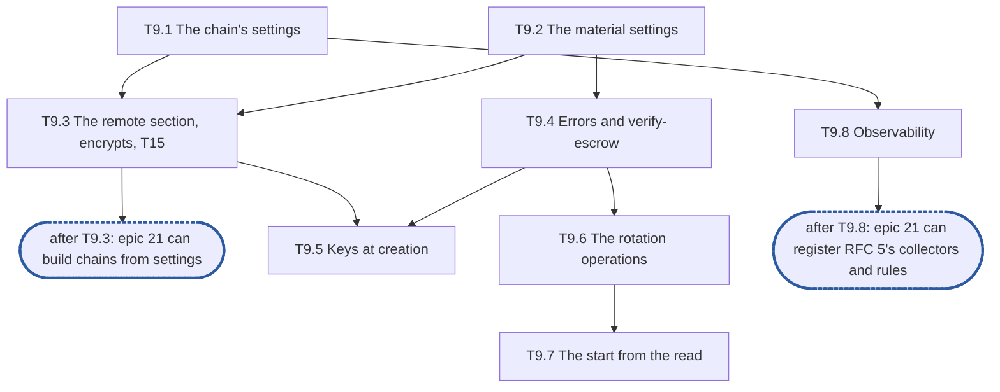

# Epic 9: transforms v2, integration

**Sources:** [RFC 5](../docs/internals/rfcs/rfc-5-transforms.md) §3.2 (the store configuration's
`transforms`, `materials` and `require`; whether a namespace encrypts, fixed at its creation; the
refusal to add or remove the encrypt stage; compression beside encryption only with
`with_encryption: accept`; the default chain of an encrypting namespace); §5.1's exception; §6's
series table and its alerts; Appendix B.2's escrow rule as namespace creation applies it, and "every
namespace has a chunk-ID key and an export key from its creation"; Appendix B.3's data-key and
master-key rotations as operations an operator or the primary-version read starts; Appendix B.4's
three conditions; Appendix B.6's three series; §8.2's T15 and T16 rows, T18's `ErrNotEscrowed`
clause through the API, and the Appendix B.1 row of a key service rotating in place while nothing
is written, its start. [RFC 13](../docs/internals/rfcs/rfc-13-configuration.md) §4.2 (the material
provider and the master key required, a key file's verified escrow), §5.1 (a bound setting refuses
change), §6 (refused, never replaced; one validator), §7 (references only), §9's "§5.1 encryption
bound" row, and Appendix B's rows for `encrypts`, the master keys, the transform chain, the
material provider and `with_encryption`. [RFC 23](../docs/internals/rfcs/rfc-23-control-plane.md)
§4.1's actions `rotate-data-key`, `rotate-master-key` and `verify-escrow`, §4.6 (operations,
scheduled work), §4.7 (errors), §5.2 (their role), §7 (the CLI).
[RFC 25](../docs/internals/rfcs/rfc-25-observability.md) §2.1 (prefixes), §2.4 and §2.5 (labels and
the series budget), §2.9 (recording), §3.9's `material_unavailable`, `material_unknown` and
`material_destroyed` rows, §7 (alerting), §8 (injection from the root). Every citation is the RFCs'
text on `develop`; the code lands on `feat/storage-v2`, and the paths below are paths there.
**Track:** the team.
**Epic 9 estimate: 8 subtasks, 15.25 man-days.**
**Depends on:**
- **E3**: `chain.Register` and its registry (T3.1); `NewChain` with its refusals, the
  `with_encryption: accept` check among them (T3.2); the census view's check of `require` and of
  the implicit encrypt stage through `Deps.Encrypts` (T3.5); the recorder calls (T3.6).
- **E4** and **E5**: `zstd` (`0x0001`), `lz4` (`0x0002`) and `aes-gcm` (`0x0010`) registered at
  init, with strict settings.
- **E6**: `provider.New`, `Config`, `Escrow`, `(*Provider).CreateKeys`, `VerifyEscrow`, `Status`,
  `keys.ErrNotEscrowed`, and its D6: a passed escrow check is recorded in the store configuration and
  handed back in `Config.Escrowed`. **E7**: `KMIPConfig`, the type of `Config.KMIP`.
- **E8**: the data-key and master-key rotation calls, and the report of a master key's new primary
  version (§9, "Needs on E8").
- Outside RFC 5's epics, on `feat/storage-v2`: `pkg/settings` (`Of`, the `bound` class, `CheckTx`,
  `HoldsContent`, `ErrBound`, `SelfKey`); the management API's problem table, its action routes and
  operation runner (`internal/node/api`, `internal/node/runner.go`); `internal/node/content`, the
  content wiring. The RFC 4 plan's epic 7 declares the remote store's section (`remote`), which this
  epic's fields join (D3).

**Blocks:**
- E10, whose census per material joins the namespace read this epic extends (T9.5).
- E11, whose codec and engine rows run through the settings and the chain this epic validates.
- Outside RFC 5's plan, the RFC 8 offload plan's epic 21, which registers in the node the
  collectors, the health source and the alert rules this epic builds (T9.8), and builds each store
  configuration's chain from the settings declared here (T9.1, T9.3).

---

## 1. Goal

Epic 9 makes RFC 5's component something an operator configures, runs and watches through the node:
the store configuration's chain and material provider as settings checked by the component's own
rules, the one fact about a namespace that never changes (whether it encrypts), the namespace's keys
made at its creation, the three key actions of RFC 23, and the series, conditions and alert rules
RFC 5 and RFC 25 name.

**At the end of the epic:**

- a store configuration's `remote.transforms` and `remote.require` are validated by building the
  chain, so a misspelt setting, an out-of-order list or compression beside encryption without
  `with_encryption: accept` is refused at the write, naming the field (T9.1);
- `remote.materials` names a key file or a KMIP key service, by reference only, and is required on
  every store configuration (T9.2);
- adding or removing the encrypt stage is refused while any namespace of the configuration holds
  content, replacing one encryption transform by another is not, and a namespace states `encrypts`
  at its creation, which must match the configuration's chain then and never changes (T9.3);
- `POST /stores/{id}:verify-escrow` records a passed escrow check, and creating an encrypting
  namespace on a key-file master key without one is `409` `not_escrowed`, naming the key, with
  nothing written (T9.4, T9.5);
- a namespace's creation makes its keys, and its read shows its current data key's ID (T9.5);
- `rotate-data-key` and `rotate-master-key` run as operations, and a key service's new primary
  version starts `rotate-master-key` with no administrator (T9.6, T9.7);
- RFC 5 §6's and Appendix B.6's series, the three material conditions and four alert rules exist as
  plain values, built by the content wiring into a recorder, gauges, a health source and rules (T9.8).

### 1.1 In scope

`pkg/transform/chain`'s settings and observability values; `pkg/transform/keys/provider`'s
material settings; the content wiring's remote-store fields, namespace `encrypts`, the `Encrypts`
lookup, the recorder, the gauges and the health source; the management API's problem rows, the
three actions, key creation at namespace creation and the data key's ID on the namespace read; the
two operation kinds and their steps; the start of `rotate-master-key` from the primary-version read;
the `dfsctl` commands, `docs/guide/cli.md` and `docs/guide/configuration.md`'s entries.

### 1.2 Out of scope

- The chain's refusals at build, the census view's `require` and implicit encrypt-stage checks, and
  the recording around each call: E3. The transforms' strict settings: E4, E5.
- Key records, key creation, the escrow check, `Status` and the provider's failures: E6. KMIP custody:
  E7. Rotation itself (the new key, the re-wrap, the bucket's `keys` object), the primary-version
  read and its ticker, the destroyed marking and the notice: E8. This epic calls them.
- `transform_census_blocks` and the census per material through the management API: E10.
- A store that does not open, T5's "nothing is written", T7 and T20 through the engine: E11.
- Registering the collectors, the health source and the rules in the node, and evaluating
  `material_destroyed` with `data_loss` from the census and the journal: the RFC 8 offload plan
  (its epics 20 and 21). This epic gives that condition its name and its alert rule only.
- The block format version's setting, default 1: the RFC 4 plan's epic 7.
- The operator's destroy operation and its `dfsctl` command: the RFC 5 plan's deferral ledger, its
  row on the operator's destroy, unowned. `Provider.Remove`, so `rotate-data-key` revokes nothing:
  its `Provider.Remove` row, owned by RFC 9.
- The escrow refusal at backup-policy creation and every export-key rotation: its row on the export
  key's next generation, owned by RFC 26.
- A cloud key service taking associated data as a string map: its row on a cloud key service,
  unowned.

### 1.3 Names used here

- **E1**, epic 1, interfaces: `chain.Deps` (`Logger`, `Recorder`, `Require`, `Encrypts`),
  `chain.Recorder`, `keys.Provider`, `keys.MaterialID`, the material errors and the import test.
- **E2**, epic 2, test foundations: the in-memory `keys.Provider` (`keystest`).
- **E3**, epic 3, the chain: the registry, `NewChain`, the census view, the recorder calls.
- **E4**, epic 4, compression: `zstd` and `lz4`. **E5**, epic 5, encryption: `aes-gcm`.
- **E6**, epic 6, namespace keys and the provider. **E7**, epic 7, key-service custody.
- **E8**, epic 8, rotation and the destroyed-material notice.
- **E9**, this epic.
- **E10**, epic 10, the census gauge and the census per material.
- **E11**, epic 11, E2E green: RFC 5's rows through the codec and the engine.
- **The content wiring**: `internal/node/content`, the composer that builds the chain and the
  provider (RFC 0 §1.2 as amended).
- **The RFC 8 offload plan's epic 21**: the node composing offload, which registers every
  component's collectors, health sources and alert rules.
- **S3**, not a synchronisation point here: the S3-compatible storage service.

## 2. How the general rules apply

The rules are those of
[RFC 5's plan, §1.5](rfc-5-transforms-plan.md#15-general-rules-for-each-epic), cited by number and
title and not copied.

| Rule | Subtasks | How |
| --- | --- | --- |
| rule 1, **independent unit tests** ([`CLAUDE.md`, "Writing tests"](../CLAUDE.md#writing-tests)) | all | real chains from E3's `NewChain` over E4's and E5's registered transforms; the real provider over `kvstore` and Badger under `t.TempDir()`, or E2's in-memory `keys.Provider` (kind 2) where the provider is not the subject; the real API over an in-memory control-plane store, called through `pkg/node/apiv1/client`; the operation runner on an injected clock (kind 1). The settings sections run through the real `settings.Table`. No double answers in a dependency's place |
| rule 2, **fuzz every decoder of bytes this component did not just write** | none | no new decoder: settings are decoded by `pkg/settings`' strict decode, transform settings by E4's and E5's factories, the API body by its strict JSON decode |
| rule 3, **observability follows RFC 25** | T9.8, T9.4 | the series, conditions and rules as plain values in `chain` (D8), built by the content wiring over the root's registry and health evaluator (R31); the planted-key check on `verify-escrow`'s body (R34) |
| rule 4, **profiling** | T9.8 | the recorder is on the encode and decode path: a `TestAllocs…` test holds it at zero allocations per call after the first call for a transform, in `transform-allocs` |
| rule 5, **public interface and internals** ([`CLAUDE.md`, "Verifying a change"](../CLAUDE.md#verifying-a-change)) | all | each rule is asserted where its consumer meets it: a refusal through the API's write and the generic setting route, not only through `Validate`; T15's plant through a chain built with the content wiring's `Encrypts`; a series read back from a scrape of the registry, not from the recorder's state |
| rule 6, **known failures shrink** | none | every test here lands green in `unit` or `integration`, neither of which keeps a `known.yaml` |
| rule 7, **v2 ignores v1, and imports only what RFC 0 §1.2 allows** | T9.1, T9.2, T9.8 | `chain` and `provider` gain plain values only and import nothing new; `pkg/settings`, `pkg/metrics` and `pkg/health` are imported by the content wiring and the node alone. E1's import test holds it. The API imports `pkg/transform/keys`, a contract, for its error values |
| rule 8, **real dependencies for properties of those dependencies** ([`CLAUDE.md`, "Writing tests"](../CLAUDE.md#writing-tests)) | T9.5, T9.7 | key creation through the API runs the real provider over `kvstore` on Badger; the in-place rotation row runs against the harness's `service:kmip` in `integration` (§9, O9) |
| rule 9, **code comment conventions** ([`CLAUDE.md`, "Code comments"](../CLAUDE.md#code-comments)) | T9.2, T9.3, T9.5, T9.8 | `decision:` markers for D2, D4, D5, D9 and D10; `ponytail:` for D6. RFC 5 §3.2's own note is E3's, at its `with_encryption` check |
| rule 10, **a test must be able to fail** ([`CLAUDE.md`, "Writing tests"](../CLAUDE.md#writing-tests)) | all | each test names the change that turns it red; the rule test of T9.8 is run once against a planted rule naming no series and must fail |
| rule 11, **a symbol is exported only if RFC 5's interface or a consumer outside the package uses it** | T9.1, T9.2, T9.8 | each export names its consumer in §6: the content wiring, the API and the node. This epic is where E6's `CreateKeys`, `VerifyEscrow` and `Status` and E8's rotation calls are first called, so they freeze here |
| rule 12, **each subtask creates only what it declares** | all | no new package: the values join `chain` and `provider`, and the wiring joins `internal/node/content`, `internal/node/api` and `internal/node`. The destroy operation is not built |

## 3. Requirements and invariants

Every obligation RFC 5, RFC 13, RFC 23 and RFC 25 place on this epic, numbered so that subtasks and
tests can cite them. Where another epic does the rest, the row says so.

**The store configuration**

| # | Requirement | Kind | Source | Subtasks |
| --- | --- | --- | --- | --- |
| R1 | A store configuration's `transforms` lists registered transforms, each a name and its settings, at most one per stage and in stage order; a list breaking that is refused at the write, and nothing is written | MUST | RFC 5 §3.2, §8.2 T11; RFC 13 §6 | T9.1 |
| R2 | `materials` names the material provider and how to reach it, as a reference to secret material and never the material itself, and is required on every store configuration, whether or not its chain encrypts | MUST | RFC 5 §3.2; RFC 13 §4.2, §7, Appendix B (material provider, master keys) | T9.2 |
| R3 | `require` lists transforms every body must carry, is optional, and an unregistered name in it is refused | MUST | RFC 5 §3.2, §2.5 | T9.1 |
| R4 | A change to the chain governs the next write only, the encrypt stage excepted (R8); the material provider is live | invariant | RFC 5 §3.2, §5.1; RFC 13 §5, Appendix B (transform chain, material provider) | T9.1, T9.2 |
| R5 | A value out of range, of the wrong type or naming nothing registered is refused with an error naming the field and the rule, never clamped or replaced by a default; the control plane runs the component's own validator, the same one the component runs when the chain is built; an unknown field is refused | MUST | RFC 13 §6, §9 ("§6 refused", "§6 unknown field") | T9.1, T9.2 |
| R6 | A chain with an encrypt stage and a compress stage whose settings lack `with_encryption: accept` is refused at the write (E3 refuses it at build) | MUST | RFC 5 §3.2, §8.2 T16; RFC 13 Appendix B (`with_encryption`) | T9.1 |
| R7 | The default chain compresses nothing: `transforms` defaults to empty, so an encrypting configuration that names only its encryption transform has no compress stage | MUST | RFC 5 §3.2, §8.2 T16; RFC 13 Appendix B (transform chain) | T9.1 |

**Whether a namespace encrypts**

| # | Requirement | Kind | Source | Subtasks |
| --- | --- | --- | --- | --- |
| R8 | A change that adds the encrypt stage to a store configuration, or removes it, is refused while any namespace of the configuration holds content, and nothing is written; a change replacing the encryption transform by another of the encrypt stage is allowed, and every older body still decodes | MUST | RFC 5 §3.2, §5.1, §8.2 T15; RFC 13 §5, §5.1 | T9.3 |
| R9 | Whether a namespace encrypts is stated at its creation, required with no default, recorded, and never changes: a change is refused while the namespace holds content. It is whether its store configuration's chain had an encrypt stage at that moment | MUST | RFC 5 §3.2; RFC 13 §4.2, §5.1, Appendix B (`encrypts`) | T9.3 |
| R10 | In an encrypting namespace the encrypt stage is implicitly required, so a body without it is `ErrMalformed`; the chain checks it (E3), from whether the namespace encrypts as its bound setting says, which this epic supplies | MUST | RFC 5 §3.2, §8.2 T15; E3 R30 | T9.3 |
| R11 | Turning encryption on for a namespace that holds content is refused; turning compression on is accepted, and what was written before still reads | test row | RFC 13 §9 ("§5.1 encryption bound") | T9.3 |
| R12 | T15's row: with a namespace holding content, removing the encryption transform from its configuration and adding one to a non-encrypting configuration are both refused, nothing written; replacing it by a second encryption transform is allowed and every older body decodes; a body without the encrypt stage planted in an encrypting namespace is `ErrMalformed` | test row | RFC 5 §8.2 T15 | T9.3 |

**Keys at a namespace's creation**

| # | Requirement | Kind | Source | Subtasks |
| --- | --- | --- | --- | --- |
| R13 | Every namespace has a chunk-ID key and an export key from its creation, and an encrypting one its first data key and chunking key too: creating a namespace creates its keys (E6 makes them) | MUST | RFC 5 Appendix B.2 | T9.5 |
| R14 | Where a namespace encrypts, a key-file master key must have passed its escrow check: until it has, creating an encrypting namespace is refused with `ErrNotEscrowed`, naming the key, and nothing is created; a configuration none of whose namespaces encrypts needs no escrow | MUST | RFC 5 Appendix B.2, §8.2 T18; RFC 13 §4.2, §9 ("§7 key table") | T9.5 |
| R15 | The escrow check is a setup step: the operator hands the off-host copy back once, the provider checks it (E6), and the pass is kept so that it holds across restarts | MUST | RFC 5 Appendix B.2; RFC 13 §4.2 | T9.4 |
| R16 | T18's API clause: on a key-file provider without a verified escrow, creating an encrypting namespace through the API is refused with `ErrNotEscrowed`; after the escrow check passes, it succeeds | test row | RFC 5 §8.2 T18 | T9.5 |

**The key operations**

| # | Requirement | Kind | Source | Subtasks |
| --- | --- | --- | --- | --- |
| R17 | `rotate-data-key` is a `POST` on a namespace, `admin`'s, and an operation | MUST | RFC 23 §4.1, §4.6, §5.2; RFC 5 Appendix B.3 | T9.6 |
| R18 | `rotate-master-key` is a `POST` on a remote store, `admin`'s, and an operation; a new key-file master key becomes current only after its escrow check (E8 checks it) | MUST | RFC 23 §4.1, §4.6, §5.2; RFC 5 Appendix B.3 | T9.6 |
| R19 | `verify-escrow` is a `POST` on a remote store, `admin`'s, and not an operation | MUST | RFC 23 §4.1, §5.2; RFC 5 Appendix B.2 | T9.4 |
| R20 | A data-key or master-key rotation is driven by the operation runner, its steps recorded durably and each idempotent; a second request for the same kind on the same target while one runs is refused `409` `operation_running`, naming it | MUST | RFC 23 §4.6 | T9.6 |
| R21 | An operation no call started carries no account, read as the schedule, and the write that creates it carries its audit record with the schedule as actor | MUST | RFC 23 §4.6, §6 | T9.7 |
| R22 | A key service that rotates a master key in place, while the namespace writes nothing, has a `rotate-master-key` operation started at the next period by the primary-version read (E8 reads it and re-wraps), with no administrator, unless one runs for that store | test row | RFC 5 §8.2 (Appendix B.1, in-place rotation), Appendix B.1; RFC 5 plan D15 | T9.7 |
| R23 | `rotate-data-key` revokes nothing while removal has not landed: its help says the old key stays held, so it does not answer a leaked data key | MUST | RFC 5 Appendix B.3; RFC 5 plan §6.1 (`Provider.Remove`) | T9.6 |
| R24 | Each action has a `dfsctl` command, and the CLI reference is regenerated from the command tree | MUST | RFC 23 §7; `CLAUDE.md` ("Frequent commands") | T9.4, T9.6 |

**Errors**

| # | Requirement | Kind | Source | Subtasks |
| --- | --- | --- | --- | --- |
| R25 | An error the API returns is a problem body whose `code` is the component's error value by its name; one table maps every error to a status, a test proves it total, and an error it does not name is a `500` that is counted | MUST | RFC 23 §4.7 | T9.4 |
| R26 | A material that cannot be reached now is retryable, never a client's mistake | invariant | RFC 5 §2.7, Appendix B.4; RFC 23 §4.7 (`retryable`) | T9.4 |

**Observability**

| # | Requirement | Kind | Source | Subtasks |
| --- | --- | --- | --- | --- |
| R27 | Each transform is labelled by its name, so a custom transform gets RFC 5 §6's series without writing any | MUST | RFC 5 §6 | T9.8 |
| R28 | `transform_chunks_total` (counter, `applied`), `transform_bytes_total` (counter, `direction`), `transform_seconds` (histogram, by direction) and `transform_decode_failures_total` (counter, `error` = `malformed`, `material_unavailable`, `material_unknown`, `material_destroyed` or `too_large`) exist as RFC 5 §6 states them; `transform_census_blocks` is E10's | MUST | RFC 5 §6 | T9.8 |
| R29 | `encryption_chunks_total` (counter) counts chunks encrypted; `encryption_current_key_age_seconds` (gauge, labelled `namespace`) is how long the namespace's current data key has been current, its ID read through the management API; `encryption_keys_unavailable` (gauge) counts configured keys the provider cannot return with a matching fingerprint | MUST | RFC 5 Appendix B.6 | T9.8, T9.5 |
| R30 | No single metric exceeds 10,000 series at the reference profile | bound | RFC 25 §2.5 | T9.8 |
| R31 | Names carry the `transform_` or `encryption_` prefix, shown without the deployment's; each series is resolved once and recorded with an atomic add or an observe; the registry and logger come from the root, never a global | MUST | RFC 25 §2.1, §2.9, §8; RFC 5 §6 | T9.8 |
| R32 | `material_unavailable` and `material_unknown` are namespace conditions naming the material, raised from what the provider reports; `material_destroyed` names the material too, and the engine evaluates it (the RFC 8 offload plan) | MUST | RFC 5 Appendix B.4; RFC 25 §3.9 | T9.8 |
| R33 | Alerts are on conditions wherever one exists: `material_unavailable` and `material_unknown` page at 5 min, `material_destroyed` pages at once; `transform_decode_failures_total{error="malformed"}`, net of the syncer's recovered re-gets, is a ticket | MUST | RFC 25 §3.9, §7; RFC 5 §6 | T9.8 |
| R34 | No key byte, unwrapped material, derived key or passphrase reaches a log line, an error string, an audit record, a label or a condition: IDs and fingerprints only | MUST NOT | RFC 5 plan §1.5 rule 3; RFC 13 §7, §9 ("§7 no secret out") | T9.4, T9.8 |

## 4. Decisions this epic takes

- **D1, the chain's settings are validated by building the chain with no material.** RFC 13 §6 has
  the control plane run the component's validator, and RFC 5's plan validates `transforms` by
  building the chain. A store being created has no provider yet, and E5's factory refuses a nil
  one, so `Settings.Validate` passes `NewChain` an unexported provider that holds no material and
  answers every call `keys.ErrUnknownMaterial`, which no factory reaches (E5's D2), a discarding
  logger and a recorder that keeps nothing. The same `NewChain` builds the serving chain, so the
  write and the build share one validator (R5). Prior art: `database/sql`'s `Open`, which checks a
  DSN without connecting (from memory). No marker: the doc comment says it.

- **D2, a change of the master key goes through `rotate-master-key` only.** RFC 13 makes the
  material provider live and the master keys rotate by re-wrapping. A write of `remote.materials`
  that changes the master key's identity (a key file's path, a KMIP key's name) through the generic
  setting route or the store's `PATCH` would make the provider unwrap old records under a key that
  did not wrap them, so the API refuses it, naming the route, as it already refuses
  `remote.credential` there. Its endpoint, certificates and timeout stay live. The
  `rotate-master-key` operation writes the new key in the transaction that ends it. A `decision:`
  marker at the refusal names the route. Prior art: the store's own `remote.credential` route
  (checked, `res_stores.go`).

- **D3, the remote store's section carries `transforms`, `require`, `materials` and `escrowed`.**
  RFC 5's plan joins these rows into the remote store's section, which the RFC 4 plan's epic 7
  declares under the prefix `remote`; `Of` takes one typed struct per prefix, so the content wiring
  declares the section over a struct embedding RFC 4's settings, `chain.Settings` and
  `provider.Settings`, with one `Validate` calling the three. Whichever epic lands first declares the
  struct, and the other adds its embed. The keys are `remote.transforms`, `remote.require`,
  `remote.materials` and `remote.escrowed`. RFC 5 §3.2 names the first three; nothing names the
  fourth (§9). Prior art: RFC 13 Appendix B's dotted keys (checked).

- **D4, a passed escrow check is a field of the store configuration that only `verify-escrow`
  writes.** E6's D6 records the pass in the configuration and reads it back through
  `Config.Escrowed`. `remote.escrowed` holds the list of `Escrow` values (master key ID and
  fingerprint), class live; the generic route and `PATCH` refuse it, naming
  `:verify-escrow`, so no operator can type a pass the provider never made. The rotation that makes a
  key-file master key current appends its own pass in its ending transaction (T9.6). A `decision:`
  marker at the refusal says why, to be withdrawn if RFC 16 gains a row for the pass. Prior art: RFC
  13 §2.5's system fields of a backup location, which the record holds and the operator never writes
  (checked).

- **D5, `encrypts` is stated by the operator and checked against the chain.** RFC 13 makes it
  required with no default, and RFC 5 records it from the configuration's chain at creation. Both
  hold if the namespace's create must state it and is refused unless it equals whether the store's
  `transforms` hold an encrypt-stage transform then: an operator who meant an encrypted namespace
  on a configuration that does not encrypt finds out at creation, not after writing plaintext. It
  is a namespace section with `SelfKey`, so its key is `encrypts` as RFC 13 Appendix B spells it,
  class `bound`. The check is the section's `CheckTx`, reading the store's `remote.transforms` in the
  write's transaction. A `decision:` marker at the check says so. Prior art: none found.

- **D6, keys are created before the namespace record commits.** The escrow refusal must leave
  nothing, and the provider writes key records in its own transaction, not the control plane's, so
  the create's pre-write step draws the namespace's ID and calls `CreateKeys`, and the transaction
  then writes the record under that ID. `CreateKeys` checks the escrow gate before any wrap or write
  and is idempotent per namespace (E6's D7), so a retried create reuses the keys. A transaction that
  fails after it leaves key records under an ID no namespace holds. `ponytail:` those records stay
  until a namespace's removal erases its keys, which lands with `Provider.Remove` (RFC 9): each
  failed create costs four small rows and up to three wraps of the master key's count; sweep records
  whose namespace has no record if a store shows them accumulating. Prior art: two-phase creation
  with an idempotent first phase, as Kubernetes' finalizers (from memory).

- **D7, an operation's ID is its rotation's idempotency token.** RFC 23 §4.6 makes each step
  idempotent, and a rotation that is retried after a crash must finish the same rotation, not start a
  second. The step passes the operation's ID to E8's rotation call, which completes a rotation already
  begun under it and returns its result; the step's cursor (`StepResult.Next`) holds only the phase.
  E8 decides how it records the token (§9). Prior art: the idempotency keys of RFC 23 §4.5 (checked).

- **D8, the component's observability values are one table in `chain`.** RFC 25 §2.1 gives the
  prefixes per RFC, and the content wiring builds every collector from one place, so
  `chain/observe.go` holds the series of RFC 5 §6 and Appendix B.6, the three condition names and the
  four alert rules as plain values, with two small types, `Spec` and `Rule`. The provider's
  gauges are read from `Status` at scrape (E6's D8), and the chain's series through the recorder
  E1 declared; neither package records anything new. `encryption_chunks_total` is the chain's
  `Encoded` call with `applied` for a transform of the encrypt stage (E5's D6), which the recorder
  tells by `chain.StageOf`. No condition type: a condition is its name, as `pkg/health` takes it.
  Prior art: RFC 4's plan, whose metric definitions and alert rule are plain values in its packages
  (checked).

- **D9, a namespace the lookup does not know encrypts.** `Deps.Encrypts` answers from the bound
  `encrypts` of each namespace the content wiring has opened. A namespace it has not seen is answered
  `true`, so its plaintext bodies are refused rather than trusted: failing closed costs a read that
  should not happen, failing open admits a planted body. A `decision:` marker at the lookup says so.
  Prior art: none found.

- **D10, `transform_bytes_total` carries `side` (`in`, `out`) beside `direction`.** RFC 5 §6 counts
  "bytes in and out, labelled `direction`", whose ratio is what the transform costs or saves, and
  a ratio needs both sides of one direction. RFC 25 §2.4 wants a label's values named in the owning
  RFC's table, so the label is proposed to RFC 5's author (§9); the `decision:` marker at the spec
  names it until the RFC does. Prior art: none found.

## 5. Target tree

```text
pkg/transform/chain/
  settings.go         T9.1  Settings, Stage, Validate, Config; StageOf
  settings_test.go    T9.1
  observe.go          T9.8  Spec, Rule; Series(), Conditions(), Rules()
  observe_test.go     T9.8  every rule names a series or condition of the table
pkg/transform/keys/provider/
  settings.go         T9.2  Settings, Materials, Validate, Config
  settings_test.go    T9.2
internal/node/content/
  transforms.go       T9.3  the remote section's fields, its CheckTx; the encrypts section;
                            the Encrypts lookup
  keys.go             T9.4  Keys: per store, VerifyEscrow; T9.5 CreateKeys, CurrentDataKey;
                      T9.6  RotateDataKey, RotateMasterKey
  observe.go          T9.8  the recorder, the gauges and the health source
  transforms_test.go, keys_test.go, observe_test.go
internal/node/api/
  problems.go         T9.4  rows for pkg/transform/keys' errors
  res_stores.go       T9.2  refusals of a master key change and of remote.escrowed;
                      T9.4  verify-escrow
  res_namespaces.go   T9.5  key creation before the write; the current data key on the read
  res_domain.go       T9.6  action and noneRunning over any target
  routes.go           T9.4, T9.6  the three action rows
pkg/node/apiv1/
  opkind.go           T9.6  OpRotateDataKey, OpRotateMasterKey
  namespace.go        T9.5  the current data key in the namespace's status
internal/node/
  keyops.go           T9.6  the two step rows; T9.7 the start from the primary-version report
cmd/dfsctl/commands/
  store/              T9.4  verify-escrow; T9.6 rotate-master-key
  namespace/          T9.6  rotate-data-key
docs/guide/cli.md     T9.4, T9.6  regenerated
docs/guide/configuration.md  T9.3  the remote store's transform and material keys, encrypts
```

## 6. Subtasks

### T9.1 The chain's settings and their validation

**Subtask T9.1 estimate: 1.25 man-days.**

- **Track:** the team. **Depends on:** E3's T3.1 and T3.2; E4's and E5's registrations.
- **Covers:** R1, R3, R4, R5, R6, R7.
- **Deliverables:** `pkg/transform/chain/settings.go`:

  ```go
  // Settings is a store configuration's chain, RFC 5 §3.2: its transforms and require.
  type Settings struct {
  	Transforms []Stage   `json:"transforms" class:"next write"`
  	Require    []string  `json:"require" class:"next write"`
  }

  // Stage is one configured transform: a registered name and its settings.
  type Stage struct {
  	Name     string         `json:"name"`
  	Settings map[string]any `json:"settings"`
  }

  func (s Settings) Validate() error             // builds the chain with no material (D1)
  func (s Settings) Config() []transform.Config  // what NewChain takes
  func StageOf(name string) (transform.Stage, bool) // a registered transform's stage
  ```

  `Validate` wraps each refusal of `NewChain` naming the field, `transforms[i]` or `require`, and
  the rule. Consumers: the content wiring's remote section (T9.3), its chain build (the RFC 8 offload
  plan's epic 21), and `StageOf` the encrypt-stage check (T9.3) and the recorder (T9.8).
- **Acceptance criteria:**
  - The zero `Settings` validates, and its chain has no stage (R7).
  - `[{name: aes-gcm}]` validates, and its chain has no compress stage (R7).
  - Out of stage order, two of one stage, an unregistered name, a misspelt `levle`, and `zstd`
    without `with_encryption: accept` beside `aes-gcm` are each refused naming the field; with it,
    the pair validates (R1, R5, R6).
  - An unregistered name in `require` is refused naming `require` (R3).
- **Tests:** a table over `Validate`, the call the control plane makes, with the registered `zstd`,
  `lz4` and `aes-gcm`: each row above (catch a validator looser than the build, R1, R5, R6, R3); the
  same table through `NewChain` with `Config()`, asserting the same outcome (catches two
  validators drifting, R5); `StageOf` for the three names and an unknown one. No double: the
  provider holding no material is production code, and no factory reaches it.
- **Rules:** rule 9: D1 in `Validate`'s doc comment.

### T9.2 The material provider's settings

**Subtask T9.2 estimate: 1.5 man-days.**

- **Track:** the team. **Depends on:** E6's `Config` and `Escrow`; E7's `KMIPConfig`.
- **Covers:** R2, R4, R5.
- **Deliverables:**
  - `pkg/transform/keys/provider/settings.go`:

    ```go
    // Settings is a store configuration's material provider, RFC 5 §3.2's materials, and the
    // escrow checks it has passed (D4).
    type Settings struct {
    	Materials Materials `json:"materials" class:"live"`
    	Escrowed  []Escrow  `json:"escrowed" class:"live"`
    }

    // Materials names one master key: a key file, or a KMIP key service.
    type Materials struct {
    	KeyFile string     `json:"key_file"` // path of the passphrase-protected key file
    	KMIP    KMIPConfig `json:"kmip"`
    }

    func (s Settings) Validate() error
    func (s Settings) Config(passphrase string) Config // the passphrase of RFC 13 Appendix C
    ```

    `Validate` refuses neither or both of `key_file` and `kmip.endpoint`, and a KMIP block missing
    its key or certificates, naming the field; it reads no file and dials nothing. E7's `KMIPConfig`
    and E6's `Escrow` gain `json` tags; the KMIP client key is a secret reference
    (`settings.SecretRef`, declared by the section in T9.3). Consumers: the content wiring, which
    builds each store's provider from `Config`, and T9.3's section.
  - `internal/node/api/res_stores.go`: the generic setting route and the store's `PATCH` refuse a
    change of `remote.materials.key_file` or `remote.materials.kmip.key` once the store exists,
    naming `:rotate-master-key` (D2), and any write of `remote.escrowed`, naming `:verify-escrow`
    (D4).
- **Acceptance criteria:**
  - A store created without `remote.materials` is refused `400` `required` (R2).
  - A KMIP endpoint changed on an existing store is accepted; its key's name changed is refused
    naming the route; `remote.escrowed` set by `PATCH` is refused.
- **Tests:** `Validate`'s table, each refusal naming its field (catches a provider built from half
  a configuration, R5); through the API, the three acceptance rows (catch a master key swapped
  under existing records, and a pass typed by an operator, R2, D2, D4); `Config` keeps the escrow
  passes (catches a pass dropped between the setting and the provider).
- **Rules:** rule 9: D2's and D4's `decision:` markers at the refusals.

### T9.3 The remote section, the bound `encrypts` and T15

**Subtask T9.3 estimate: 2.5 man-days.**

- **Track:** the team. **Depends on:** T9.1, T9.2; E3's T3.5.
- **Covers:** R4, R8, R10, R9, R11, R12.
- **Deliverables:** `internal/node/content/transforms.go`:
  - the remote store's section (D3) over a struct embedding RFC 4's settings, `chain.Settings` and
    `provider.Settings`, `Required("materials")`, the KMIP client key's `SecretRef`, and a `CheckTx`
    that refuses with `settings.ErrBound` a write whose `transforms` gain or lose an encrypt-stage
    transform (`chain.StageOf`) while any namespace of the store holds content, read in the write's
    transaction so a concurrent first write conflicts; replacing one encrypt-stage transform by
    another passes (R8);
  - the namespace section, `encrypts`, `SelfKey`, class `bound`, `Required`, with a `CheckTx` refusing
    a value that differs from whether the store's `remote.transforms` hold an encrypt-stage
    transform (D5);
  - the `Encrypts` lookup the chain's `Deps` take, answered from each opened namespace's bound
    `encrypts`, and `true` for one not seen (D9).
  - The sections join `newTable()` in `internal/node/settings.go`, and `docs/guide/configuration.md`
    gains the four remote keys and `encrypts`, each with an example.
  - Consumed by T9.5 (a namespace's create states `encrypts`), the RFC 8 offload plan's epic 21 (the
    chain's `Deps`), and E11.
- **Acceptance criteria:**
  - With a namespace holding content: adding `aes-gcm` to a non-encrypting store, removing it from
    an encrypting one, and changing `encrypts` are each `409` `bound_setting`, nothing written; with no
    content each is accepted (R8, R9).
  - Replacing `aes-gcm` by a second encrypt-stage transform with content is accepted (R8).
  - A namespace created with `encrypts: true` on a store whose chain does not encrypt is refused
    naming `encrypts`, and created with it omitted is refused `required` (R9).
- **Tests:** through the API over the in-memory control plane and the real settings table: the
  T15 configuration rows and RFC 13 §9's "§5.1 encryption bound" row, with content recorded under
  the namespace (catch a gate on the namespace scope only, or one that compares whole lists and so
  refuses a replacement, R8, R11, R12); a first content write racing the change in two transactions,
  one of which retries (catches an untracked read); the replacement row with a test transform
  registered in the encrypt stage, whose older bodies then decode through a chain built from the new
  settings (catches a decode tied to the configured chain, R12); a body without the encrypt stage,
  planted through a chain built from a non-encrypting configuration, decoded by a chain whose
  `Encrypts` is the content wiring's lookup over the namespace's bound setting, is `ErrMalformed`
  (catches a lookup read from the chain rather than the namespace, R10, R12); an unknown namespace
  answered `true` (catches D9 failing open); compression turned on with content accepted, and bodies
  written before decoding (R11).
- **Rules:** rule 5: each refusal asserted at the API's write and at the decode that consumes the
  lookup. rule 9: D5's and D9's markers.

### T9.4 The error table and `verify-escrow`

**Subtask T9.4 estimate: 1.5 man-days.**

- **Track:** the team. **Depends on:** T9.2; E6's `VerifyEscrow` and `ErrNotEscrowed`.
- **Covers:** R15, R19, R25, R26, R34, R24.
- **Deliverables:**
  - `internal/node/api/problems.go`: `pkg/transform/keys` added to the packages the totality test
    covers, with rows `ErrNotEscrowed` `409` `not_escrowed`, `ErrMaterialUnavailable` `503`
    `material_unavailable` retryable, `ErrUnknownMaterial` `409` `material_unknown`,
    `ErrMaterialDestroyed` `409` `material_destroyed`. The chain's refusals reach the API only as
    `settings.ErrInvalid` from `Validate` (T9.1), so `pkg/transform`'s errors take no row.
  - `internal/node/content/keys.go`: `Keys`, one per node over its stores' providers, consumed by
    the API through an interface the API declares (`Deps.Keys`), first with
    `VerifyEscrow(ctx, store [16]byte, copy []byte) (provider.Escrow, error)`.
  - The route `POST /stores/{id}:verify-escrow`, `admin`'s, body `{"copy": <base64>}`: its pre-write
    step calls `Keys.VerifyEscrow`, and on a pass the transaction appends the `Escrow` to
    `remote.escrowed`, with its audit record naming the master key's ID and fingerprint and never
    the copy.
  - `dfsctl store verify-escrow <store> --copy <file>`, its `clisuite` row, and `go run
    ./cmd/gendocs`.
- **Acceptance criteria:**
  - Each `keys` error reaches the problem body by its name and status; a new error declared in
    `keys` fails the totality test (R25, R26).
  - A pass is recorded once and survives a node restart; a failed check records nothing (R15).
  - `operator` is refused `403` (R19).
- **Tests:** the totality test with `keys` covered (catches an unmapped material error as a `500`,
  R25); a copy of the key file passed, then a fresh node built over the same store opening the
  escrow gate (catches a pass held in memory only, R15); another file's copy refused
  `not_escrowed` and nothing written; the planted key: a known key file, passphrase and copy, then
  the captured log, the audit records, every error and problem body searched for their bytes, raw,
  hex and base64 (catches the copy logged or audited, R34); the role row (R19).
- **Rules:** rule 3: the planted key. rule 7: the API imports `keys`, a contract, and reaches the
  provider only through `Deps.Keys`.

### T9.5 Keys at a namespace's creation, and its current data key

**Subtask T9.5 estimate: 1.75 man-days.**

- **Track:** the team. **Depends on:** T9.3, T9.4; E6's `CreateKeys`.
- **Covers:** R13, R14, R29 (the key ID), R16.
- **Deliverables:**
  - `Keys.CreateKeys(ctx, store [16]byte, ns entity.NamespaceID, encrypts bool) error` and
    `Keys.CurrentDataKey(ctx, ns entity.NamespaceID) (keys.MaterialID, bool, error)`.
  - `res_namespaces.go`: the create's pre-write step draws the ID, reads `encrypts` from the request
    and calls `CreateKeys` before the transaction, which writes the record under that ID (D6); the
    read adds the current data key's ID and fingerprint to the namespace's status, absent for a
    namespace that does not encrypt (Appendix B.6's "the key ID itself is read through the management
    API"). `apiv1.NamespaceStatus` gains the field. Consumed by E10, whose census per material joins
    the same read.
- **Acceptance criteria:**
  - An encrypting namespace on a key-file store without a pass is `409` `not_escrowed`, naming the key;
    no namespace record and no key record exist afterwards (R14, R16).
  - After `verify-escrow` passes, the same create succeeds, and `Current` answers its four kinds
    (R13, R16).
  - A non-encrypting namespace on the same store is created with no pass, with a chunk-ID key and an
    export key only (R13, R14).
  - The namespace read shows the data key's ID and fingerprint, and no key byte.
- **Tests:** through the API, with the real provider over `kvstore` on Badger under `t.TempDir()`
  and a key file: the three rows above, reading the key records back through a fresh provider
  (catch keys made after the record, or the gate checked after a wrap, R13, R14, R16); a transaction
  failed after `CreateKeys` by a fault wrapper around the control-plane store (kind 3), then the
  create retried: one namespace, and the keys it reads are the ones the first attempt made (catches
  a retry drawing a second key set, D6); the read's field compared with `Current`'s answer.
- **Rules:** rule 8: the provider and its records are real. rule 9: D6's `ponytail:` at the
  pre-write step.

### T9.6 The two rotation operations

**Subtask T9.6 estimate: 3 man-days.**

- **Track:** the team. **Depends on:** T9.4; E8's rotation calls.
- **Covers:** R17, R18, R20, R23, R24.
- **Deliverables:**
  - `pkg/node/apiv1/opkind.go`: `OpRotateDataKey OpKind = "namespace.rotate-data-key"` and
    `OpRotateMasterKey OpKind = "store.rotate-master-key"`, in the closed set.
  - `res_domain.go`: `action` and `noneRunning` take the target's kind and reference, so an action
    starts an operation on a namespace or a store as it does on the installation.
  - Routes `POST /namespaces/{id}:rotate-data-key` (no body) and `POST /stores/{id}:rotate-master-key`
    (`{"key_file": <path>, "copy": <base64>}` for a key file, no body for a key service, which re-reads
    its primary version), both `admin`'s, refused `409` `operation_running` while one of the kind runs
    on the target.
  - `Keys.RotateDataKey` and `Keys.RotateMasterKey`, each passing the operation's ID to E8's call
    (D7); `internal/node/keyops.go`: their step rows in the runner, each step's cursor its phase, the
    master-key rotation's ending transaction writing the new `remote.materials` and appending its
    escrow pass to `remote.escrowed` (D2, D4).
  - `dfsctl namespace rotate-data-key <ns>` and `dfsctl store rotate-master-key <store> [--key-file
    <path> --copy <file>]`, each with `--wait`; `rotate-data-key`'s help says the old key stays held
    and readable, and that stopping a leaked key needs the relocation and removal that have not
    landed (R23); `clisuite` rows; `go run ./cmd/gendocs`.
- **Acceptance criteria:**
  - Each route answers `202` with the operation; the operation ends `succeeded`, and the namespace's
    current data key, or the store's master key, is the new one (R17, R18).
  - A second request while one runs is `409` `operation_running` naming it (R20).
  - A key-file rotation whose copy fails the escrow check ends `failed` with `not_escrowed`, and the
    old key stays current (R18).
- **Tests:** through the API and the runner on the injected clock, the real provider over Badger
  and a key file: each rotation to `succeeded`, read back through the namespace read and a fresh
  provider (R17, R18); the runner stopped after the first step's commit and a new runner started over
  the same store: the rotation completes once, one new data key, not two (catches a step that is not
  idempotent, R20, D7); the concurrent request (R20); the failed escrow (R18); the role rows (R17,
  R18); the help text read from the command tree (catches a help that promises revocation, R23).
- **Rules:** rule 11: E8's rotation calls freeze when these steps first call them.

### T9.7 The start of `rotate-master-key` from the primary-version read

**Subtask T9.7 estimate: 1.25 man-days.**

- **Track:** the team. **Depends on:** T9.6; E8's report of a new primary version.
- **Covers:** R21, R22.
- **Deliverables:** in `internal/node/keyops.go`, for each store configuration's provider, the
  reader of E8's report: on a master key's new primary version, one control-plane `Write` creating
  an `OpRotateMasterKey` operation on that store with the zero `Account` and its audit record whose
  actor is the schedule, refused without error while `noneRunning` finds one of that kind on the
  store; the step is T9.6's.
- **Acceptance criteria:**
  - A report starts one operation, with no account, and its audit record names the schedule (R21).
  - A report while one runs starts none (R22).
- **Tests:** with E8's in-memory report source (kind 2; §9), a reported version starts one
  operation that ends `succeeded`, and a second report during it starts none (catch a start per
  report, R22); the operation's `Account` and the audit record's actor (catch an operation that
  looks operator-started, R21); in `integration` against `service:kmip`, if the harness's server can
  rotate a key in place (O9): rotate it while nothing is written, advance the provider's period on
  the injected clock, and every key record is re-wrapped under the new version with no
  administrator's call (the row end to end, R22).
- **Rules:** rule 8: the end-to-end row against the real key service.

### T9.8 The observability values and their builders

**Subtask T9.8 estimate: 2.5 man-days.**

- **Track:** the team. **Depends on:** T9.1; E3's T3.6; E6's `Status`.
- **Covers:** R27, R28, R29, R30, R31, R32, R33, R34.
- **Deliverables:**
  - `pkg/transform/chain/observe.go`:

    ```go
    // Series is one series this component exports, named without the deployment's prefix.
    type Spec struct {
    	Name   string
    	Help   string
    	Type   string   // "counter", "gauge" or "histogram"
    	Labels []string
    }

    // Rule is one alert rule, RFC 25 §7: on a condition, or on a series filtered by labels.
    type Rule struct {
    	Condition string
    	Series    string
    	Match     map[string]string
    	Class     string        // "page" or "ticket"
    	After     time.Duration // how long it lasts before it alerts; 0 is at once
    }

    func Series() []Spec   // RFC 5 §6 but the census gauge, and Appendix B.6
    func Conditions() []string // material_unavailable, material_unknown, material_destroyed
    func Rules() []Rule
    ```

    `transform_bytes_total` labelled `transform`, `direction` and `side` (D10); `encryption_chunks_total`
    with no label. Consumed by the content wiring and its tests.
  - `internal/node/content/observe.go`, over the root's `*metrics.Registry` and logger:
    - the `chain.Recorder` the chain's `Deps` take, resolving a transform's series at its first call
      into a copy-on-write table, so every later call is a load and an atomic add; an encode by an
      encrypt-stage transform (`chain.StageOf`) with `applied` also adds to `encryption_chunks_total`;
    - a collector reading each provider's `Status` at scrape: `encryption_keys_unavailable` as
      `len(Unavailable)`, `encryption_current_key_age_seconds{namespace}` as now minus
      `CurrentSince`;
    - a `health.Source` raising `material_unavailable` and `material_unknown` per material in
      `Status`, on its namespace, the material ID in the detail;
    - the rules, as `Rules()` gives them, for the RFC 8 offload plan's epic 21 to register.
- **Acceptance criteria:**
  - After a scripted run of encodes, declines, decodes and each decode failure, a scrape holds the
    expected count per series and label; an encrypt-stage encode counts once in
    `encryption_chunks_total` and an `lz4` one does not (R27, R28, R29).
  - A replaced key makes the gauge 1 and raises `material_unavailable` naming the namespace and the
    ID; a key never given raises `material_unknown`; both clear at the next good read (R29, R32).
  - Every rule names a series of `Series()` or a name of `Conditions()`, its class and delay as RFC
    25 §3.9 and §7 state them (R33).
- **Tests:** a registry built for the test, the recorder and the collector registered, read from a
  scrape (catches a series under the wrong name, type or label, which the registry's own checks
  refuse, R28, R31); a test transform registered under a custom name gets the four series (R27); the
  gauge and the conditions from the real provider with a replaced key and an unknown one (catch a
  gauge read from a stale copy, R29, R32); the rule test, also run against a planted rule naming no
  series and failing (R33); the series count of `encryption_current_key_age_seconds` at 10⁴
  namespaces is 10⁴ (R30); `TestAllocsRecorder` at zero allocations per call after the first
  (R31); the planted key, searched for in every label, condition and detail (R34).
- **Rules:** rule 3: values in `chain`, builders in the composer. rule 4: the allocation test. rule
  9: D10's marker at the series.

## 7. Order of work



T9.1 and T9.2 go first because every later subtask reads the settings; T9.4 comes before T9.5 and
T9.6 because both answer through its error table and T9.5's test needs a recorded pass. T9.8 needs
only T9.1 and can run beside T9.4 to T9.7.

## 8. Suggested pull requests

| PR | Subtasks | Man-days | After | Why together |
| --- | --- | --- | --- | --- |
| 1 | T9.1, T9.2, T9.3 | 5.25 | — | the settings, their validation and the encrypt stage's bound: a store configuration and a namespace as the operator writes them |
| 2 | T9.4, T9.5 | 3.25 | PR 1 | escrow and key creation through the API, with the errors they return |
| 3 | T9.6, T9.7 | 4.25 | PR 2 | the two rotations, started by an administrator or by the key service |
| 4 | T9.8 | 2.5 | PR 1 | the series, conditions and rules, independent of PRs 2 and 3, which it can run beside |

A suggestion only: one pull request per subtask works as well.

## 9. Open points

- **No RFC names the escrow pass's setting (D3, D4).** RFC 13 §4.2 lists a key file's verified
  escrow among the store configuration's values, and E6's D6 records the pass there, but Appendix B
  has no row and no key. This epic proposes `remote.escrowed`, a field only `verify-escrow` and a
  key-file rotation write; RFC 13 Appendix B should gain the row ("verified escrow passes | RFC 5
  Appendix B.2 | remote store | live, written by `verify-escrow` only | none"). Not edited here;
  for RFC 13's author.
- **`transform_bytes_total`'s `side` label (D10).** RFC 5 §6's row should name it, so RFC 25 §2.4's
  closed set holds. For RFC 5's author.
- **"Net of the syncer's recovered re-gets" has no series to subtract.** RFC 25 §7 and RFC 5 §6 make
  the `malformed` ticket net of them; RFC 3 §2.12 counts verification re-gets
  (`syncer_retries_total{reason="verify"}`), not the ones that recovered. `Rule` carries no
  subtraction until the RFC 3 plan names such a series and the RFC 8 offload plan's epic 21 settles
  a rule's form, which its §6 point 6 leaves open; if that form differs from `Rule`, only the content
  wiring's builder changes.
- **Needs on E8.** Its data-key and master-key rotation calls take the operation's ID as an
  idempotency token and complete a rotation already begun under it (D7); the key-file master-key
  rotation takes the new key file and its escrow copy, refuses `ErrNotEscrowed` before the key becomes
  current, and returns the `Escrow` pass the ending transaction records (D4); the report of a new
  primary version is a call the node can read per provider, preferably by cursor as the
  destroyed-material notice is (the RFC 5 plan's D17), with an in-memory source that a test can drive
  (kind 2) for T9.7's unit row; and, if its rotation keeps retired master-key files, a field of
  `provider.Materials` for them, added by E8.
- **O9 (the RFC 5 plan's): whether the harness's PyKMIP can rotate a key in place.** If it cannot,
  T9.7's end-to-end row moves with E8's in-place rows to the cloud-key-service ledger row, and its
  unit row over E8's in-memory report stays.
- **E6 has no sentinel for a master key's spent wrap count.** Its R22 refuses the 2³²nd wrap with an
  error asking for a rotation; through `rotate-data-key` or a namespace's create, that error is a
  `500` until E6 declares it in `keys` and T9.4's table names it (`409`, `wrap_limit`).
- **`apiv1.NamespaceStatus`.** T9.5 adds the current data key; E10's census per material joins the
  same status. The field's name is T9.5's; E10 should extend rather than add a second read.
- **Refinements of the RFC 5 plan,** which is not edited: it places `settings.go` with all three rows
  in `chain`, and `materials` is the provider's, so it is `provider/settings.go` (T9.2); it lists five
  subtasks and 12 man-days, and this document has eight and 15.25, the difference being the two
  rotation steps' idempotency and recovery (T9.6), the separate start from the primary-version read
  (T9.7) and the builders in the content wiring (T9.8), which the plan left to the RFC 8 offload plan
  and E6's D8 brings here. The least certain estimates are T9.6's, which depends on the shape of E8's
  calls, and T9.3's `CheckTx` across the store's namespaces.
