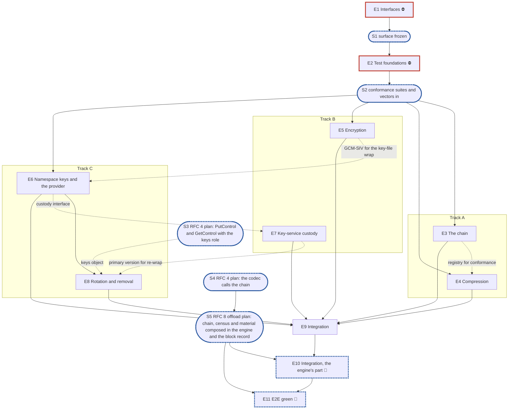

# RFC 5 — transforms v2: implementation plan

**Scope.** [RFC 5, transforms](../docs/internals/rfcs/rfc-5-transforms.md), as it stands on `origin/develop`:
the transform model, the chain and its envelope, the chain ID, material and its provider, the
shipped compression and encryption transforms, namespace keys and their rotation and removal,
and RFC 5 §6's series. The user asked for the whole RFC (status `draft`, not `deferred`). The
parts that need a component no plan of this programme builds are rows of §6.1's ledger, not
epics here; question Q1 (§6) is about the largest of them. Related RFCs, with how far each is in
scope:

- **Constraints only**, as the user decided:
  - [RFC 0](../docs/internals/rfcs/rfc-0-data-lifecycle.md): the failure model and **Lost** (§4.2, §10);
  - [RFC 2](../docs/internals/rfcs/rfc-2-carver.md), [RFC 3](../docs/internals/rfcs/rfc-3-syncer.md) and
    [RFC 4](../docs/internals/rfcs/rfc-4-remote-tier.md): each has its own plan, written beside this one
    under #5488; §3.2 names the seams this plan assumes of each;
  - [RFC 8](../docs/internals/rfcs/rfc-8-engine.md): its offload part composes the chain and the provider
    into the engine and the node (`.planning/rfc-8-offload-engine-plan.md`, being written);
  - [RFC 13](../docs/internals/rfcs/rfc-13-configuration.md): the settings machinery, bound settings
    (§5.1) and secret references (§7), built by its plan (`.planning/rfc-13-config-plan.md`), whose
    §6.1 hands four of RFC 13 §9's rows to this plan (epics 6 and 9).
- **Constraints only**, a default this plan took (O1): [RFC 6](../docs/internals/rfcs/rfc-6-block-metadata.md)
  §2.3's block-record census and its `Census` view, which epic 10 reads once S5 holds.
- **Only the parts RFC 5 cannot work without** (a default this plan took, open point O1):
  [RFC 16](../docs/internals/rfcs/rfc-16-metadata-store.md) §4.2's namespace key records
  (`NS‖ns‖key‖kind‖keyID`) and key lock (`NS‖ns‖keyseq‖target`), as a view of
  `pkg/metadata/kvstore` (epic 6).
- **Constraints only, by the rule of the observability and test RFCs:**
  [RFC 25](../docs/internals/rfcs/rfc-25-observability.md) (§1.5 rule 3) and
  [RFC 29](../docs/internals/rfcs/rfc-29-test-harness.md) (§1.5 rules 6 and 10).
- **Out**, each a §6.1 row: RFC 9 (GC's retirement relocation and the drain), RFC 26 (catalog
  backups and their key machinery, pending Q1), RFC 27 (moves and re-homes), RFC 11 (fencing a
  node that cannot be reached).

**Tracks.** A, B and C, with no owner (§3.4).

**Programme.** [#5488](https://github.com/cubbit/dittofs/issues/5488), "offload: RFC 2–5 and the
engine's offload part", release v1.1; this RFC's roadmap epic is
[#5486](https://github.com/cubbit/dittofs/issues/5486). It builds on the journal-only engine, stage 3
of #3119 (`.planning/rfc-8-journal-only-engine-plan.md`), whose §6.1 leaves offload to "RFC 8's
second-part plan". Composition into the engine and the node is that plan's; this plan keeps what
is the component's own and waits for the rest at S4 and S5 (§3.2). No epic issue exists yet: the
plan is not merged.

**Naming.** v1 is `pkg/block/middleware`, `middleware/compression` and `middleware/encryption`
(with `encryption/keyprovider`, which RFC 13's plan moved to `pkg/keyprovider`), with the rest of
the v1 block tier. Stage 4 of #3119 deletes the v1 block tier (that plan's D8,
[#5484](https://github.com/cubbit/dittofs/issues/5484), `.planning/rfc-16-store-cutover-stage4-plan.md`)
and with it `github.com/pierrec/lz4/v4`. v2 is RFC 5's chain, built in `pkg/block/transform`. No
user-visible name carries a version.

**Transition policy.** New installations only, as #3119 decided. v2 ignores v1, and the
integration epics touch no v1 code (§1.5 rule 7).

**Where the code lands.** The plan lands on `develop`. The code lands on `feat/storage-v2`, where
the engine v2, `pkg/keyprovider`, `pkg/secrets`, `pkg/settings` and `entity.NamespaceID` live
(`develop` has none of them).

**Defaults used from the skill's inputs:** dashboards none; output path
`.planning/rfc-5-transforms-plan.md`; v2's package path proposed in §4.1 (D1, open point O2).

**Pending the user's answer.** Four design questions (§6, Q1 to Q4) are written in place with the
recommended option and marked "pending the user's answer"; three RFC amendments are proposed
(§6, A1 to A3) and the plan follows the RFC as written until they are agreed. The pull request
stays a draft until both are settled.

## 1. Introduction

### 1.1 What we are building

RFC 5's "Start here" and "In short" describe the result: a per-chunk chain in a fixed stage
order, a self-describing envelope, reading by registry and material rather than by
configuration, a plaintext hash that decides, and a key table whose every key is wrapped under a
master key held off the host where it must be.

What replaces what:

| v1 | v2 | Fate |
| --- | --- | --- |
| `pkg/block/middleware` (the decorator chain over the v1 remote store) | `pkg/block/transform`'s `Chain`, run inside RFC 4's block codec | v1 deleted by stage 4 (its plan's D8) |
| `pkg/block/middleware/compression` (zstd and LZ4, a marker per layer) | `pkg/block/transform/compress`, IDs `0x0001` and `0x0002` | v1 deleted by stage 4; `pierrec/lz4/v4` kept for epic 4 (D4) |
| `pkg/block/middleware/encryption` (a random data key per chunk under AES-GCM) | `pkg/block/transform/encrypt`, ID `0x0010` | v1 deleted by stage 4 |
| `pkg/keyprovider` (RFC 13's custody of the `storage` wrapping key; its KMIP provider fetches the key out of the server) | `pkg/block/transform/material` and `material/kmip`, master keys that never leave a key service | `pkg/keyprovider` stays RFC 13's; only its key-file format is shared (D5) |
| the per-remote `encryption.key` configuration blob | the store configuration's `transforms`, `materials` and `require` keys (RFC 5 §3.2), in RFC 13's settings | v1 deleted with its store |

**Dependency limits.** The plan keeps `pierrec/lz4/v4` (D4) and adds no dependency, pending
Q2: AES-256-GCM-SIV is in neither the standard library nor `golang.org/x/crypto`.

### 1.2 How the plan is organised

- Epics 1 and 2 are the team's and run first: the frozen surface of RFC 5 §3.1, then the test
  components every transform and the provider are held to.
- Six middle epics, two per track, cut along RFC 5's seams:
  - Track A: the chain (epic 3), then compression (epic 4);
  - Track B: encryption (epic 5), then the key-service custody (epic 7);
  - Track C: namespace keys and the provider (epic 6), then rotation and removal (epic 8).
- Epic 9 wires what is the component's own: its settings, the operator's key operations, the
  observability, the error mapping and the namespace's key creation.
- Epic 10 is the rest of the integration, the parts that wait on RFC 8's offload composition (S5).
- Epic 11, E2E green, runs RFC 5's rows that need the codec and the engine, and the put and get
  benchmark.

RFC 5's suites paragraph (§8.3) puts §8.1 and §8.2 in `unit` and §8.1's key-management row in
`integration`. Neither keeps a `known.yaml`, so no test lands red: each lands green with the
epic that makes it pass, and epic 2 registers no suite.

### 1.3 What epic 1 must deliver

The exported surface of `pkg/block/transform`, frozen at S1:

- RFC 5 §3.1's symbols: the ID and stage types and constants, `Transform`, `Encoded`,
  `MaterialID`, `Materials`, `Factory`, `Register`, `Chain` with its methods, `NewChain`,
  `MaxDecodeLen`, `Config` and the error values, with stub bodies.
- `NamespaceID` as an alias of `entity.NamespaceID`.
- The injection point RFC 25 §8 asks for: `NewChain` takes the root's metrics registry and
  logger (D2).
- The put attempt's pin, if A2 is agreed: what RFC 4's codec and RFC 8's engine call to fix a
  chain and its material for one attempt and to release it (D10). Until A2 is agreed, epic 1
  declares §3.1 as written and the pin stays an open point.

It declares no internal interface: the provider's custody seam has one consumer and lands with
it (D6).

### 1.4 What epic 2 must deliver

**The catalogue.** Each row lands green with the epic named under its **Done when:** line (§5).

- **From RFC 5:** every row of §8.1 and §8.2, mapped in §7; §8.3's benchmarks, in epics 3, 4, 5
  and 11.
- **From other sources**, each placed in the epic that owns the code:
  - v1's bug history, RFC 5 Appendix D's rows: an incompressible chunk that begins with the zstd
    frame magic round-trips (its D1, epic 4); a body declaring 64 MiB, and a zstd frame with a
    window above the chunk maximum, fail before allocating (its D2, epic 4); turning compression
    off between a write and a read (its D4, epic 3; turning encryption on is T15's refusal, epic
    9); a store whose encryption cannot load writes nothing (its D9, epic 11); a provider failure
    at start leaves the journal serving (its D10, epic 11, with RFC 8's offload plan);
  - RFC 8452's Appendix C vectors for AES-256-GCM-SIV (epic 5);
  - decompression bombs for zstd and LZ4 as fuzz seeds (epic 4);
  - KMIP: a server with an expired certificate, a revoked key, a key in another state than
    active (epic 7).

**Known failures.** None: no suite RFC 5's paragraph names keeps a `known.yaml`, so nothing is
registered (§1.2).

**The test components.**
- `transformtest`, the transform conformance suite of RFC 5 §8.1's generic rows, run by every
  registered transform from its own epic.
- `materialtest`, a conformance suite for `Materials`, and an in-memory `Materials` that passes
  it: a verified in-memory implementation (kind 2 of `CLAUDE.md`'s "Writing tests"). It exports
  a count of provider calls, which the suite covers, so RFC 5 §8.2's "the provider records no
  call" (T12, T14) is asserted on it rather than on a counting fake. Epic 6's provider passes the
  same suite and exports the same count.
- The golden vectors, computed by an independent implementation from RFC 5's byte tables alone
  (§2.8's chain ID, §2.4's envelope, Appendix B.1's derivations, fingerprint, chunk AAD and key
  wrap AAD), checked in with the script that computed them (D11). The keyed gear table's vector is
  RFC 2's plan's (§3.2), not computed twice.
- The leak check is `internal/prof`, which exists.

### 1.5 General rules for each epic

> **Instruction for whoever expands an epic into its detailed description and subtasks,
> human or AI:**
>
> - **Creating an epic from this plan: use the `epic-breakdown` skill.** Whenever the user
>   asks to create an epic from this plan, or to expand, detail or break one down, run the
>   `epic-breakdown` skill (`.claude/skills/epic-breakdown/SKILL.md`) on this plan and that
>   epic, rather than writing the epic document freehand. It extracts the RFC's MUST and
>   MUST NOT into numbered requirements, estimates each subtask in man-days and suggests
>   the pull requests. A human doing it by hand follows the same skill.
> - **Epic and subtask, nothing else.** The units of work are the epic and its subtasks,
>   with subtask ids `<e>.<n>` (`subtask 4.3`, or `T4.3` for short), assigned by the epic
>   document. No other word names
>   them: not task, ticket, story, step or phase, in headings, tables, ids or prose.
> - **The epic stands alone for what to build.** Its requirements, subtasks and decisions
>   are in the epic document itself, which never refers to this plan for them or says "see
>   the plan": the RFC sections it implements, the interfaces it builds on, the
>   subtasks, and a short legend of the names it borrows from this plan (E1, E2, S1, the
>   integration epic, …). It cites the numbered rules below, without copying them, in a
>   table of how each applies: each row names its rule by number and bold title, which
>   says what the rule requires, and the table links this §1.5 with a full link (the
>   plan's path and the section's anchor) and the `CLAUDE.md` sections that hold a rule,
>   so the epic reads alone and its reader can still open each rule's text in one click.
> - **The epic document records decisions, not progress, like this plan.** It has no
>   status fields, no checkboxes to tick and no sections to keep up to date as the work
>   goes on. It is revised through a pull request only when a decision changes.
> - **Subtasks are not pull requests.** A subtask is ideally up to 5 man-days. The owner
>   ships subtasks as they see fit, one pull request each or several together; the epic
>   document only suggests a grouping, each suggested pull request ideally up to 15
>   man-days. Cut and group by logic, readability, dependencies and a deliverable that can
>   be named, not to hit a number.
> - **Every subtask states how it meets each rule that applies to it.** A rule that does
>   not apply is named, with the reason.
> - **In the issue tracker, once each document merges,** following `epic-breakdown`
>   Step 6, their one description. Issues point at the documents and copy nothing; once
>   created, their `Estimate` and blocked-by links are the current estimate and
>   dependencies, and the documents are not revised to follow them. The
>   epic issues exist before E2's pull request lands, because each red test's
>   `known.yaml` entry names one; subtask issues come once their epic document has
>   merged. The release an epic ships in is set by the RFC's roadmap epic that its epic
>   issue sits under, never in a document and never on the epic issue on its own: the epic
>   issue and its subtask issues copy that roadmap epic's milestone, and an epic changes
>   release only by moving under the roadmap epic of the other release.

1. **Independent unit tests.** Each epic carries its own unit tests, built on epic 2's
   `transformtest`, `materialtest` and golden vectors, the implementation of an epic it depends
   on once that has landed, and only the doubles `CLAUDE.md`'s "Writing tests" allows. Epic 1
   declares no internal interface for them to stand in for (rule 12).
2. **Fuzz every decoder of bytes this component did not just write** (`CLAUDE.md`, "Writing
   tests", "By kind", which names the invariant a target asserts): the envelope and
   `Chain.Decode` (epic 3), the zstd and LZ4 headers and frames (epic 4), the encryption header
   (epic 5), the stored wrap and the key record (epic 6), the `keys` object (epic 8). Each
   transform's `Decode` is also fuzzed by `transformtest` (RFC 5 §8.1, T4). Seeds are the
   fixtures and the golden vectors; crashers go to `testdata/fuzz/<FuzzName>/`.
3. **Observability follows RFC 25.** The prefixes are `transform_` and `encryption_` (RFC 25
   §2.1). Epic 3 owns RFC 5 §6's series around each call; epic 5 owns `encryption_chunks_total`;
   epic 6 owns `encryption_keys_unavailable` and `encryption_current_key_age_seconds`; epic 10
   owns `transform_census_blocks`, which reads block metadata. The provider is a `health.Source`
   for RFC 25 §3.9's `material_unavailable` (epic 6, wired in epic 9). No span per chunk: a
   transform logs nothing per chunk (RFC 5 §6), and the spans are the engine's and the syncer's.
   A chain that fails to build logs once at `Error` (epic 3).
4. **Profiling.** Tests and benchmarks run under `internal/prof`'s leak check. The hot paths
   carrying allocations-per-op assertions: `Chain.Encode` and `Chain.Decode` with a caller's
   `dst`, each transform's `Encode` and `Decode`, the envelope parse, and `Materials.Get` on a
   cached key.
5. **Public interface and internals.** Tests cover each package's internals and the behaviour
   the epic enables, concurrency under `-race` included (RFC 5 §8.1's 64-goroutine row). Test at
   the layer that **consumes** a value (`CLAUDE.md`, "Verifying a change"): a census reaches
   `Decode`'s view, not only the codec that collects it; a destroyed key is asserted where a
   decode reports it.
6. **Known failures shrink.** No suite of this RFC keeps a `known.yaml` (§1.2), so no test lands
   red here. A test this plan adds to a suite that keeps one, such as an engine suite of RFC 8's
   offload plan, follows `CLAUDE.md`, "Writing tests", "By kind".
7. **v2 ignores v1.** This rule needs no import test here: stage 4 deletes the whole v1 block
   tier (§1.1), after which an import of it fails to compile, and until then no v2 package
   imports `pkg/block/middleware/...` or `pkg/keyprovider`'s KMIP provider, by review. v1 is
   not touched at all: its deletion is stage 4's.
8. **Real dependencies for properties of those dependencies** (`CLAUDE.md`, "Writing tests").
   Here: a real KMIP server, the harness's `service:kmip`, for the key service (RFC 5 §8.1's
   key-management row, in `integration`); the real metadata store, Badger under `t.TempDir()`
   or the memory KV, for key records, the key lock and the removal fence; RFC 4's verified
   in-memory remote store for the `keys` object, and a real S3-compatible endpoint where one is
   wired into CI (none is yet, so such a test skips and is not counted).
9. **Code comment conventions** (`CLAUDE.md`, "Code comments"). RFC 5 carries `decision:`
   notes whose markers go at the code sites that implement them: compression off by default
   where a namespace encrypts (§3.2), the fixed 1/16 threshold and the double compression of a
   measuring pass (Appendix A), the clear chunk-ID key of a non-encrypting namespace (B.2), the
   per-location export-key retirement (B.3), no header key and determinism per namespace (B.5).
10. **A test must be able to fail** (`CLAUDE.md`, "Writing tests"), and nothing else would
    catch the change it guards. The golden vectors are its sharpest case: each vector is
    computed by epic 2's independent implementation, never by the code it checks (D11).
11. **A symbol is exported only if RFC 5's interface or a consumer outside the package uses
    it.** Everything epic 1 exports is frozen at S1. The provider's operations are exported by
    the epic that builds them and frozen when epic 9 first calls them.
12. **Each subtask creates only what it declares.** No empty package and no stub without a
    caller; a package, an option or a test helper lands with its first consumer. The export
    cryptography of Appendix B.1 is not built ahead of RFC 26 (Q1).

## 2. Epics at a glance

| # | Epic | Content | Subtasks | Man-days | Track | Blocks |
| --- | --- | --- | --- | --- | --- | --- |
| E1 ⛔ | Interfaces | `pkg/block/transform`'s RFC 5 §3.1 surface, stub bodies, `NamespaceID`, the chain's `Deps`, the attempt pin if A2 | 3 | 3 | team | every epic |
| E2 ⛔ | Test foundations | `transformtest`, `materialtest` with the in-memory `Materials`, the independent golden vectors, the catalogue | 4 | 9.5 | team | E3 to E8 |
| E3 | The chain | registry, envelope, chain build and refusals, composed encode and decode with bounds, the census view, `require`, the chain ID, §6's series | 7 | 15 | A | E9; partly E4 |
| E4 | Compression | zstd and LZ4, their header, decline, window cap, fixtures, ratio benchmarks | 4 | 8.5 | A | E9 |
| E5 | Encryption | AES-256-GCM-SIV, the chunk derivations and AAD, the header, kind refusal, fixtures and vectors | 5 | 11 | B | E9; partly E6 |
| E6 | Namespace keys and the provider | key-record view, stored wrap, key-file custody, escrow, `Materials` with fingerprints and its three failures, namespace key creation, B.6's gauges, the custody suite | 7 | 15.5 | C | E8, E9; partly E7 |
| E7 | Key-service custody | KMIP wrap and unwrap through the server with AAD, version-qualified IDs, the primary version, the real-server row's provider half | 4 | 6 | B | E9; partly E8 |
| E8 | Rotation and removal | master, data and export key rotation in the bucket, the `keys` object, `Remove` under its fence, erasure | 6 | 15 | C | E9 |
| E9 | Integration | settings keys and the bound `encrypts`, the key operations, observability wiring, error mapping, namespace key creation | 6 | 15 | team | E10 |
| E10 🔀 | Integration, the engine's part | census-reading removal, destroyed-material notice, salvage key, keys-object repair on recheck, census gauge | | | team | E11 |
| E11 🔀 | E2E green | RFC 5's codec and engine rows, the put and get benchmark | | | team | — |
| | **Total** | | **46** | **98.5** | | |

**Plan estimate: 46 subtasks, 98.5 man-days, not counting epics 10 and 11.**

The skill's estimate for RFC 5's 1,999 lines is 5 middle epics (`round(1999 / 400)`); this plan
has 6. Master-key custody through a key service shares no state with the namespace key records
beyond the custody seam (D6), and splitting it off keeps Track B busy after encryption.

**Legend.** ⛔ is a blocker; 🔀 waits on a synchronisation point. "team" is an epic that belongs
to no track. "Partly" means the dependent epic starts before the blocker lands (§3.3).

## 3. Synchronisation points, blockers and the split

### 3.1 Dependency graph



### 3.2 Synchronisation points

- **S1, the surface frozen.** Epic 1's symbols are final (§1.5 rule 11). S1 is not reached
  before A2 is answered, since the pin is in the frozen surface or is not. Unblocks epic 2, and
  lets RFC 4's and RFC 2's plans code against `transform` while this plan builds it.
- **S2, the conformance suites and vectors in.** `transformtest`, `materialtest` with its
  in-memory `Materials`, and the golden vectors exist. Unblocks epics 3, 5 and 6.
- **🔀 S3, "RFC 4 plan: `PutControl` and `GetControl` with the `keys` role, and RFC 4's
  in-memory remote store".** RFC 4 §4.13's control objects, frozen in RFC 4's plan's first epic.
  Unblocks epic 8's `keys` object; the rest of epic 8 does not wait.
- **🔀 S4, "RFC 4 plan: the block codec calls `Chain.Encode` and `Chain.Decode` with the block
  record's census, and sizes reads with `MaxDecodeLen`".** RFC 4 §3.2 to §3.4's use of the
  chain. Unblocks the codec half of epic 11's rows.
- **🔀 S5, "RFC 8 offload plan: the engine's `Store` pins a chain per put attempt and releases
  it at commit or abandonment, builds each namespace's chain when it opens the store and refuses
  the store when it cannot, passes the census through the put to the block commit, maps the
  transform errors onto the syncer's, clears the offloaded bit of chunks whose material is
  destroyed, seals the salvage export under a salvage key the provider wraps, and records the
  census in the block record with RFC 6's `Census` view over it".** RFC 8 §2.4 (the refusal),
  §2.5 (the salvage export), §2.6 (the remote store with its chain), §6.3, §6.6 and §10.4, RFC 6
  §2.3, and RFC 5 Appendix B.2's salvage key. Unblocks
  epics 10 and 11, which are planned after it.

Seams this plan assumes of the sibling plans, to be checked against them when they land (O3):

| Plan | It builds | It calls of this plan |
| --- | --- | --- |
| RFC 2 | the keyed BLAKE3 chunk ID (RFC 2 §4.1) and the keyed gear table (RFC 2 §3.2, §6) with their golden vectors, RFC 5 §8.2 T17, and its last Appendix B.2 row (a plan keyed under another namespace); the chain ID as an input of the block name (RFC 2 §4.2) | `Materials.Current` and `Get` for kinds `chunk-id-key` and `chunking-key`; the pinned attempt's chain ID |
| RFC 3 | its `Descriptor` and `MaterialRef`, the census entry opaque to the syncer, and its own `ErrMaterialUnavailable` and `ErrMaterialDestroyed` (RFC 3 §1.3); its memory bound (RFC 3 §2.2) | `transform.MaxDecodeLen` |
| RFC 4 | the block codec and its header census (RFC 4 §3.2 to §3.4), `PutControl` and `GetControl` (RFC 4 §4.13), the store's `Recheck` (RFC 4 §4.11) | `Chain.Encode`, `Chain.Decode`, `MaxDecodeLen`, the stage count and the 255-byte material ID that bound the header census; epic 8's `keys` object read-back on each `Recheck` |
| RFC 6, through the RFC 8 offload plan | the block record's census (RFC 6 §2.3) and `Census` | nothing; epic 10 reads the view |
| RFC 8 offload | the composition of S5 | the chain, the provider, the pin and its release, `Materials.Remove`'s notice of destroyed material |

### 3.3 Blockers

| Epic | Blocks | Why |
| --- | --- | --- |
| E1 ⛔ | every epic | the surface every test and implementation codes against |
| E2 ⛔ | E3 to E8 | every transform passes `transformtest`; the provider and every transform's tests use `materialtest`'s in-memory `Materials`; the vectors are the oracle |
| E3 | E4, partly; E9 | `Register` and the registry's `MaxDecodeLen` hold a compressor's registration; epic 9 validates settings with `NewChain` |
| E4 | E9 | epic 9 validates the compress stage's settings with the registered compressors |
| E5 | E6, partly; E9 | the key-file wrap uses the same AES-256-GCM-SIV (D3) |
| E6 | E7, partly; E8; E9 | epic 7 implements the custody interface epic 6 declares (D6); epic 8 rotates and removes epic 6's records |
| E7 | E8, partly; E9 | a key service's new primary version starts epic 8's master-key re-wrap |
| E8 | E9 | the operator's operations call rotation and removal |
| S3 🔀 | E8, partly | the `keys` object is put and read through RFC 4's control objects |
| S4 🔀, S5 🔀 | E10, E11 | the codec and the engine compose this component; both epics are planned after S5 |
| E9 | E10 | epic 10 completes what epic 9 wires |
| E10 | E11 | epic 11 runs the rows epic 10 makes reachable |

### 3.4 Splitting the work

- **Track A: the chain, then compression.** Epic 3 from S2, then epic 4, which can start on its
  headers against epic 1's surface while epic 3 lands the registry. Busy to epic 9.
- **Track B: encryption, then the key service.** Epic 5 from S2, then epic 7 once epic 6's
  custody interface lands; epic 7 does not wait on epic 5. The shortest track: after epic 7 it takes epic 9's key operations
  (the API and CLI surface), which call into Track C's code.
- **Track C: namespace keys, then rotation and removal.** Epic 6 from S2, then epic 8, whose
  `keys` object waits on S3 and whose key-service re-wrap waits on epic 7. The longest track
  and the critical path.
- **The team converges** on epic 9 once every middle epic has landed, and on epics 10 and 11
  after S5.

## 4. Implementation decisions

### 4.1 Directory layout

On `feat/storage-v2`:

```text
pkg/block/transform/                 E1 the RFC 5 §3.1 surface; E3 registry, envelope, Chain,
                                     chain ID, census view, the series of RFC 5 §6; E9
                                     settings.go, the store configuration's keys
pkg/block/transform/transformtest/   E2 the transform conformance suite, the vector loader
pkg/block/transform/materialtest/    E2 the Materials conformance suite, the in-memory Materials
pkg/block/transform/testdata/        E2 the golden vectors and the script that computed them
pkg/block/transform/compress/        E4 zstd and LZ4
pkg/block/transform/encrypt/         E5 the AES-256-GCM-SIV transform and its derivations
pkg/block/transform/internal/siv/    E5 AES-256-GCM-SIV as a cipher.AEAD (Q2)
pkg/block/transform/material/        E6 the provider, the stored wrap, key-file custody,
                                     escrow, namespace key creation; E8 rotation, the keys
                                     object, Remove and its fence
pkg/block/transform/material/kmip/   E7 key-service custody over KMIP
internal/kmipwire/                   E7 the KMIP transport moved out of pkg/keyprovider (D14)
pkg/metadata/kvstore/                E6 the key-record view (RFC 16 §4.2's NS‖ns‖key and
                                     NS‖ns‖keyseq rows)
pkg/metadata/kv/keys/                E6 the keyseq subtag beside NSKey
```

### 4.2 Decisions

**D1. `pkg/block/transform`, one package for the model, subpackages per transform.** It sits
with `engine` and `journal`, the other block-tier components of `feat/storage-v2`. The shipped
transforms register from their own packages, so a custom transform is one more such package
(RFC 5 §4). Prior art: Go's `image` and `database/sql` registries, a package per format that
registers at init. Applies in epic 1. Open point O2 (the skill's default #5).

**D2. `NewChain` takes the root's metrics registry and logger.** RFC 5 §3.1's signatures are
indicative, and RFC 25 §8 says every component receives them from the root in its `Deps`, never
from a global. The chain records RFC 5 §6's series around each transform's call, so a custom
transform gets them without writing any. Prior art: RFC 25 §8.1 itself; the Prometheus client's
practice of registering collectors on an injected registry (from memory). Applies in epic 1,
filled in epic 3.

**D3. AES-256-GCM-SIV is an internal `cipher.AEAD` of this repository, `internal/siv`, built
on `crypto/aes` and ported, with attribution, from an Apache-2 implementation rather than written
from scratch, pending the user's answer (Q2).** The standard library and `x/crypto` have none.
Its POLYVAL multiply is constant time, as the standard library's generic GHASH is, never a
table lookup indexed by key bits. It is pinned by RFC 8452's Appendix C vectors and by epic 2's golden vectors, which a
second implementation computed (D11), and RFC 5 §5.4's fixtures decide any later swap of
implementation. Both the chunk seal (epic 5) and the key-file wrap (epic 6) use it. Prior art:
BoringSSL and Tink implement it themselves; the Go implementations found are third-party
(from memory, not checked). Applies in epic 5.

**D4. zstd from `klauspost/compress`, LZ4 from `pierrec/lz4/v4`, kept.** Both are direct
dependencies on `feat/storage-v2` today. Stage 4's `go mod tidy` drops `pierrec/lz4/v4` only if
v1 is still its sole importer; if epic 4 lands first the dependency stays, and if stage 4 lands
first epic 4 adds it back (O8). RFC 5 Appendix A ships LZ4. zstd decodes with its window and memory capped at the
chunk maximum (RFC 5 Appendix A, "Its header"). Prior art: v1's own `middleware/compression`
used both libraries. Applies in epic 4.

**D5. The material provider is new; it shares only the key-file format with `pkg/keyprovider`.**
`pkg/keyprovider` is RFC 13's custody of the `storage` wrapping key, which must never wrap a
namespace key (RFC 5 Appendix B.2, "No storage-key fallback"), and its KMIP provider fetches the
key out of the server, which Appendix B.1 forbids for a master key. A key-file master key is read
in `pkg/keyprovider`'s passphrase-protected format, under RFC 13 Appendix C's passphrase, through
one exported loader epic 6 adds to `pkg/keyprovider`; the wrap itself is RFC 5 Appendix B.1's.
Prior art: HashiCorp Vault's seal wrappers and the AWS Encryption SDK's keyrings separate key
custody from the data format (from memory). Applies in epics 6 and 7.

**D6. Master-key custody is a small interface the provider declares**, with two
implementations: the key file (epic 6) and the key service (epic 7). Its calls are what
Appendix B.1 asks of a provider: wrap and unwrap with associated data, the version-qualified
ID of each wrap, and the current primary version. It is not epic 1's: it has one consumer, the
provider, and lands with it (§1.5 rule 12). Each implementation passes `materialtest`'s
custody suite, which lands with the interface in epic 6, the key service running it at the
integration tier. Prior art: as D5. Applies in epic 6.

**D7. Key records are a view of `pkg/metadata/kvstore`**, written in the store's own
transactions, as the other RFC 16 records are; the provider holds unwrapped namespace keys in
process memory, per namespace, cleared by `Remove`. Prior art: the other `kvstore` views on
`feat/storage-v2`. Applies in epic 6.

**D8. The `keys` object is a versioned binary record**: a format version, the namespace ID, the
sequence, the export key ID, the key records as `kvstore` encodes them, and the keys MAC of
Appendix B.1. RFC 5 fixes what the MAC covers and RFC 4 §4.13 the object's role, but neither its
bytes. Settled now because a recovery import (RFC 26 §2.3) reads it from every bucket written
from the first namespace on: a change later is a second version every reader keeps. Prior art:
none found for this record; RFC 4 §3.5's versioned block format is the house pattern. Applies in
epic 8.

**D9. Rotating a data key makes a new key current and schedules nothing.** Appendix B.3 makes
relocating the old key's blocks a separate act, and RFC 9 §4.4 defers to RFC 5 §5.3 for where the
retiring set is recorded, which §5.3 does not say. A key merely not current is not being retired,
so the set is not "every non-current data key". The record is GC's, settled with its walk in
RFC 9's plan (§6.1). Prior art: none found. Applies in epic 8.

**D10. A put attempt pins its chain and material, and the pin is the removal fence, pending A2.**
RFC 5 §2.8 says an attempt fixes its chain when it starts, and §5.3 that removal waits for every
encode in flight that took the material; §3.1's `Chain` has neither. Epic 1 adds the pin (a
`Chain` call returning the attempt's chain ID, bounds and encoder, and a release); the provider
counts pins per material. As §3.1 says, `Remove` refuses material still current in an open chain
(a rotation makes it not current first), then, under its fence, waits for the count to reach zero
and checks the census (epic 8 for the fence, epic 10 for the census). On one node the count is in process; across nodes it is RFC 11's (§6.1).
Prior art: a reader-count drain under a fence, as Linux's RCU grace periods and the journal
plan's own drains (from memory). Applies in epics 1, 3 and 8.

**D11. The golden vectors come from a second implementation**, a short script using Python's
`cryptography` (AES-GCM-SIV, HKDF, HMAC) and `blake3`, working from RFC 5's tables alone, checked
in under `testdata/` with its output. CI does not run it; the Go tests read its output. The
keyed gear table's vector is RFC 2's plan's, read from there. Prior
art: Wycheproof and RFC 8452's own vectors (from memory). Applies in epic 2.

**D12. Fixtures are per transform and per format version**, under the transform's own
`testdata/fixtures/v<n>/`, holding RFC 5 §4 item 7's inputs, settings, material and bodies;
`transformtest` reads them. Applies in epics 2, 4 and 5.

**D13. `MaxDecodeLen` takes each registered transform's bound at its default settings.** RFC 5
§2.5 has the registry build each transform once for decoding with its defaults, and both shipped
transforms' bounds are independent of their settings. A transform whose bound grows with a
setting (Appendix C's parity) declares its largest at registration; that is epic 3's open point
for the first such transform. Prior art: none found. Applies in epic 3.

**D14. The key service speaks KMIP only, with associated data as bytes, pending the user's answer
(Q3), over the transport `pkg/keyprovider` already has.** Its round trip, TLS setup, message
read and key-state mapping move to `internal/kmipwire`, which both providers import; epic 7 adds
only the encrypt and decrypt payloads with associated data and the primary-version read. RFC 5 §8.1's row names a key-management server and the harness runs one
(`service:kmip`). A cloud key service taking associated data as a string map is a §6.1 row.
Prior art: KMIP 1.4's authenticated encryption parameters; AWS KMS's encryption context is the
string-map case (from memory). Applies in epic 7.

**D15. The operator's key operations are RFC 23 operations on the store configuration and the
namespace, pending the user's answer (Q4) and A3.** RFC 5 names the acts (rotate a master, data
or export key; destroy a key; verify a key file's escrow) and RFC 23 §4.1's actions table names
none of them. Epic 9
adds them with their `dfsctl` commands and regenerates `docs/guide/cli.md`. Prior art: RFC 23's
own `rotate-signing-key`. Applies in epic 9.

### 4.3 Knowingly simple implementations

- **The unwrapped-key cache never evicts.** `ponytail:` every namespace key the provider has
  unwrapped stays in memory until `Remove` or stop, about 32 bytes and an ID per key; at 10⁴
  namespaces and a few keys each that is under a megabyte. Upgrade to a bounded cache that
  re-unwraps on a miss when the namespaces of one node reach about 10⁶. Epic 6.
- **zstd levels collapse onto the library's encoder speeds.** `ponytail:` `klauspost/compress`
  maps RFC 5's level range onto four encoder speeds, so two levels may write equal bodies under
  two chain IDs, which costs nothing but a missed dedup across a level change. Upgrade if the
  ratio benchmark (RFC 5 §8.3) shows a level the operator asks for compressing no better than
  its neighbour; a new encoder is a new format version (RFC 5 §5.4). Epic 4.
- **The removal fence counts pins in process.** `ponytail:` it holds on one node only; a second
  node's encodes are fenced by RFC 11 (§6.1). Upgrade when cluster ownership is built. Epic 8.

## 5. The epics in detail

### Epic 1 — Interfaces ⛔

**Epic 1 estimate: 3 subtasks, 3 man-days.**

The frozen surface of `pkg/block/transform`, with stub bodies.

**Owns:** RFC 5 §3.1 (the symbols); §2.3's stage constants; §2.7's error values.
**Done when:** S1; RFC 4's and RFC 2's plans compile against it.

**Expected content:**
- §3.1's types, interfaces, `Register`, `Chain` and its methods, `NewChain`, `MaxDecodeLen`,
  `Config` and the errors, with doc comments citing the RFC.
- `NamespaceID` aliased to `entity.NamespaceID`, and the chain's `Deps` (D2).
- The attempt pin and its release, if A2 is agreed (D10).

### Epic 2 — Test foundations ⛔

**Epic 2 estimate: 4 subtasks, 9.5 man-days.**

The components every transform and the provider are held to, and the oracle the format checks
compare against.

**Owns:** RFC 5 §8.1's generic rows as a suite; RFC 5 §4 item 7's fixture mechanism.
**Done when:** S2: `transformtest` runs against a test transform; the in-memory `Materials` passes
`materialtest`; the vectors are checked in with their script.

**Expected content:**
- `transformtest`: RFC 5 §8.1's rows T2 (round trip, fixtures), T4 (with a fuzz helper), §2.1's
  bound, concurrency, §2.7's byte flips, T9 (twice, two chains, fixtures), as one function a
  transform's package calls.
- `materialtest`: the `Materials` suite (current per namespace and kind, the three failures,
  fingerprint refusal, the exported call count) and the in-memory `Materials` passing it.
- The golden vectors of D11, with the script.
- The catalogue of §1.4, written into the epic document with each row's epic.

### Epic 3 — The chain

**Epic 3 estimate: 7 subtasks, 15 man-days.**

The chain over any registered transforms: the envelope, the refusals, the bounds, the census
view and the chain ID.

**Owns:** RFC 5 §2.1 to §2.4, §2.6 to §2.8 (the chain's part), §3.1's behaviour, §3.2's refusals
at build (stage rules and `with_encryption: accept`), §4 items 1 and 2 as the registry checks
them, §6 but the census gauge and encryption's series.
**Done when:** RFC 5 §8.2 T11, both T3 rows, §2.4's envelope row but its ranged get, §2.5's
`require` row, T12, T10, §2.8's vectors, T5's chain half (a failing factory fails `NewChain`),
T16's refusal half, T14's census-view half; RFC 5 §8.1 §3.1's enlarging row; RFC 5 §8.2 §3.1's
removed-parity row, with a test transform in the redundancy stage; RFC 5
§8.2 T7's chain half (`ErrUnknownMaterial` from the provider reported as
`ErrMaterialUnavailable`); RFC 5 §8.3's chain overhead and envelope size.

**Expected content:**
- The registry: `Register`, duplicate refusal, the ID ranges of RFC 5 §4, `MaxDecodeLen` (D13).
- Envelope version 1: encode, and a parse that refuses as RFC 5 §2.4 says before any decode;
  fuzzed.
- `NewChain`: stage order, duplicates, `with_encryption: accept`, a factory's failure, logged
  once.
- `Encode` and `Decode` composed with each step's bound, `dst` handling and error discipline
  (RFC 5 §3.1); the census view that answers only listed IDs; `require`.
- The chain ID per namespace (RFC 5 §2.8), checked against epic 2's vectors.
- The attempt pin (D10), if A2 is agreed.
- RFC 5 §6's series around each call; test transforms: one enlarging by half, one in the
  redundancy stage.

### Epic 4 — Compression

**Epic 4 estimate: 4 subtasks, 8.5 man-days.**

The two shipped compressors.

**Owns:** RFC 5 Appendix A.
**Done when:** `transformtest` passes for zstd and LZ4 with their fixtures; Appendix A's level
range refused at build; the Appendix D rows of §1.4 placed here; RFC 5 §8.3's per-transform,
compression-ratio and `Chain.MaxEncodedLen`-against-the-largest-body benchmarks over its three
corpora.

**Expected content:**
- zstd: header, decline below the threshold, the capped decoder (D4), `LengthKey`.
- LZ4, on `pierrec/lz4/v4` (D4).
- Fixtures for both (D12), fuzz targets seeded with decompression bombs.
- The benchmarks and their corpora.

### Epic 5 — Encryption

**Epic 5 estimate: 5 subtasks, 11 man-days.**

The shipped encryption transform, which needs a namespace's data key.

**Owns:** RFC 5 Appendix B.1's chunk part (its derivations, chunk AAD, header and bounds), §2.5's
"material says what it is for" for `data-key`, Appendix B.6's `encryption_chunks_total`.
**Done when:** `transformtest` passes for encryption with its fixture; RFC 5 §8.1's authenticating
rows of §2.7 (every flip `ErrMalformed`, a body under another chunk's hash, destroyed material),
Appendix B.1's salt and keystream row, its distinct-labels row and the chunk part of its
golden-vector row; RFC 8452 Appendix C's vectors; RFC 5 §8.3's per-transform benchmark.

**Expected content:**
- `internal/siv` (D3, Q2), ported with a constant-time POLYVAL, with RFC 8452's vectors and a
  fuzz against the golden vectors.
- The salt key, salt and chunk key derivations, and the chunk AAD, against epic 2's vectors.
- `Encode` and `Decode` asking `Materials` for the current and the named data key; kind refusal
  at construction.
- The fixture (D12) and the series.

### Epic 6 — Namespace keys and the provider

**Epic 6 estimate: 7 subtasks, 15.5 man-days.**

The provider that implements `Materials` for a store configuration, over key records in the
metadata store and master keys in a key file.

**Owns:** RFC 5 §2.5 (the provider's obligations), Appendix B.1's key wrap and stored wrap,
Appendix B.2's key table as namespace creation applies it, its escrow rule and its
"no storage-key fallback", Appendix B.4's distinctions at the provider, Appendix B.6's two
gauges; RFC 16 §4.2's key-record and key-lock rows.
**Done when:** the provider passes `materialtest`; RFC 5 §8.1's §2.5 row (a replaced key refused,
the gauge at 0); RFC 5 §8.1's T18 rows (altered AAD, a record copied to another namespace); RFC 5
§8.1 T22's stored wrap for the key file; the fingerprint part of RFC 5 §8.1's Appendix B.1
golden-vector row; RFC 5 §8.2's T14 provider half; the provider half of RFC 5 §8.2 T7
(`ErrUnknownMaterial` for a key never given, with a condition naming the ID); RFC 5 §8.2 T18's
key creation, escrow and `storage`-key rows; RFC 13 §9's "§7 namespace keys", "§7 chunk-ID key"
and "§7 key table" rows, which RFC 13's plan hands to this one.

**Expected content:**
- The `kvstore` key-record view (D7), fuzzed decode, and the `keyseq` subtag with its row in
  `pkg/metadata/kv/keys`' table.
- The stored wrap and the key-file custody (D5, D6), with the custody interface and its suite.
- The escrow check and `ErrNotEscrowed`.
- `Current` and `Get`: fingerprints, the three failure classes, namespace scoping, the cache.
- Namespace key creation per Appendix B.2's table, the clear chunk-ID key included.
- The two gauges, and the provider as a `health.Source` for `material_unavailable`.

### Epic 7 — Key-service custody

**Epic 7 estimate: 4 subtasks, 6 man-days.**

Master keys that never leave a KMIP server.

**Owns:** RFC 5 Appendix B.1's key-service wrap (version-qualified IDs, associated data as
bytes, the primary version read), Appendix B.2's `master-key` row as a key service holds it, §9
item 2.
**Done when:** the custody suite passes against the harness's KMIP server; RFC 5 §8.1's
key-management row, its provider half (the store half is epic 11's); RFC 5 §8.1 T22's stored wrap for a key service, as bytes (the string-map half
is §6.1's, Q3).

**Expected content:**
- `internal/kmipwire`, moved out of `pkg/keyprovider` (D14).
- KMIP encrypt and decrypt with associated data through `kmip-go` (D5, D14).
- The version-qualified ID of each wrap, and the read of the current primary version.
- The failures of RFC 5 §8.1's row (missing key, unreachable server, invalid certificate)
  mapped to the provider's errors, none falling back.
- The integration tests, under `-tags=integration`.

### Epic 8 — Rotation and removal

**Epic 8 estimate: 6 subtasks, 15 man-days.**

Keys changing over time, as far as the bucket: rotation, the `keys` object, and removal.

**Owns:** RFC 5 §5.1, §5.3's removal (fence and erasure; the census check is epic 10's), §5.4's post-quantum note as
it bears on custody; Appendix B.2's `keys` object in the bucket (sequence, MAC, key lock,
read-back); Appendix B.3's master-key and data-key rotation, and the export key's new generation
in the bucket.
**Done when:** RFC 5 §8.2 T13's single-node row up to its census (a held put, removal waits
for it; an encode after the fence takes the new key; the refusal on the census is epic 10's);
RFC 5 §8.2's Appendix B.2 rows, the bucket's half only (a failed bucket put keeps the old key
current; a late put of sequence 7 is repaired at 9; a key-file master-key rotation without
escrow refused); RFC 5 §8.2's Appendix B.1 key-service rows, but their destroy-check clauses (an
in-place rotation re-wraps; a retargeted alias the same; a rotation while nothing is written, at
the next period), if the harness's server can rotate in place (O9).

**Expected content:**
- Data-key rotation: a new current key, so a new chain ID.
- Master-key rotation: re-wrap every record, each current only after the bucket's put.
- The `keys` object (D8): writer under the key lock, MAC, read-back and repair; fuzzed decode.
- The primary-version recheck that starts a master-key rotation.
- `Remove`: refused while current, the pin count to zero (D10), erasure of every copy.
- The export key's next generation, in the bucket only (the locations are Q1's).

### Epic 9 — Integration

**Epic 9 estimate: 6 subtasks, 15 man-days.**

What is this component's own and waits on nothing in the engine.

**Owns:** RFC 5 §3.2 (the store configuration's keys, the bound `encrypts`, the default chain),
§5.1's exception, Appendix B.2's refusal at namespace creation (at backup-policy creation it is
RFC 26's, §6.1), the observability
wiring of §1.5 rule 3, the operator's key operations (D15).
**Done when:** RFC 5 §8.2 T15; T16's default-chain half; RFC 13 §9's "§5.1 encryption bound"
row, which RFC 13's plan hands to this one; RFC 5 §8.2 T18's `ErrNotEscrowed` at
namespace creation through the API; the RFC 25 §3.9 row and alert rules wired; each operation's
API and CLI test.

**Expected content:**
- `transform`'s `settings.go`: `transforms`, `materials`, `require`, validated by building the
  chain (RFC 13 §4), joined into the remote store's section as RFC 4's plan declares it.
- The namespace's bound `encrypts` (RFC 13 §5.1) and the refusals of RFC 5 §3.2.
- Namespace key creation called from namespace creation, with the escrow refusal.
- The key operations, their `dfsctl` commands and `go run ./cmd/gendocs`.
- The provider's `Deps` from the root, its `health.Source` added, RFC 25 §3.9's rows and RFC 25
  §7's alert rules, the conditions A1 adds once agreed.
- Error mapping: the provider's and the chain's errors onto the API's problem types.

### Epic 10 — Integration, the engine's part 🔀

**Epic 10 estimate: planned after S5.**

What this component owes once the engine composes it (S4, S5).

**Owns:** RFC 5 §5.3's census check against block metadata, Appendix B.2's salvage key, the
`transform_census_blocks` gauge of §6, Appendix B.4's local-copy rule as this component signals
it.
**Done when:** planned after S5; the epic document names its rows.

**Expected content:**
- `Remove`'s census check reading RFC 6's `Census` view, and T13's refusal on it.
- The notice of destroyed material that the engine turns into cleared offloaded bits.
- The salvage key, wrapped under the current master key, for RFC 8's salvage export.
- The `keys` object's read-back on each `Recheck` pass of the namespace's store.
- `transform_census_blocks`, and the census per material through the management API.

### Epic 11 — E2E green 🔀

**Epic 11 estimate: planned after S5.**

RFC 5's rows that need the codec and the engine, and its last benchmark.

**Owns:** nothing new.
**Done when:** RFC 5 §8.2 T5 (the store does not open, nothing is written), T6, T7 through the
engine (retried, never zeros; destroyed is Lost), T8, T20, T21, Appendix B.5's row, §2.4's
ranged get, §5.3's census row up to its retirement half, the store half of RFC 5 §8.1's
key-management row; RFC 5 §8.3's put and whole-block get benchmark; §1.4's Appendix D D9 and D10
rows.

**Expected content:**
- The codec rows over RFC 4's codec and its in-memory store.
- The engine rows, in the suite RFC 8's offload plan registers.
- The put and get benchmark on the reference link.

## 6. Risks and open points

**Design questions, pending the user's answer.** Each is written in place with its recommended
option; the pull request lists them under "Decision needed".

- **Q1. How much of the backup-facing key machinery this plan builds.** RFC 5 Appendix B.1's
  export cryptography, the backup locations' `keys` objects, the export key's retirement per
  location with its re-seal and pending sets, the master-key destroy check over every location,
  move pins and the recovery import's ordering all serve RFC 26, which has no plan.
  - (a) **Recommended, written in place.** Build here what the bucket needs (the export key's
    creation and generation, the bucket's `keys` object and its MAC) and defer the rest to
    RFC 26's plan as §6.1 rows. Example: epic 8 writes `keys` objects through
    `PutControl(ctx, RoleKeys, b)` only; no `material` symbol names a location.
  - (b) Build the export cryptography here as a library with its vectors, and defer only the
    location machinery. Example: `material/export.FrameKey(exportKey, salt [32]byte) [32]byte`
    and its siblings, with no caller until RFC 26.
  - (c) Build all of it here, against an in-memory backup location.
  Why (a): rule 12 forbids a package without a consumer, and RFC 26 §3.1's layout, which the
  primitives serve, may still move. Checked: RFC 26 has no plan in `.planning/`; #5488 does not
  list it.
- **Q2. Where AES-256-GCM-SIV comes from.**
  - (a) **Recommended, written in place.** An internal `cipher.AEAD` built on `crypto/aes`, ported
    with attribution from an Apache-2 implementation, with a constant-time POLYVAL, about 300 lines, gated by RFC 8452's vectors and the independent golden
    vectors (D3). Example: `siv.New(key []byte) (cipher.AEAD, error)`.
  - (b) A third-party module exposing `cipher.AEAD` (candidates from memory, not checked:
    `github.com/ericlagergren/siv`, `github.com/secure-io/siv-go`).
  - (c) Tink (`tink-go`), whose AEAD API draws its own random nonce (from memory), so it cannot
    give RFC 5's fixed nonce, and is rejected.
  Why (a): no maintained Go module was confirmed, the construction is standardised with full
  vectors, and BoringSSL and Tink each carry their own. Cost: about 3 man-days in epic 5, and a
  pure-Go POLYVAL slower than assembly (the §8.3 benchmark says whether it matters).
- **Q3. Which key services ship.**
  - (a) **Recommended, written in place.** KMIP only, associated data as bytes (D14); a cloud
    key service is a §6.1 row. Example: `materials: {provider: kmip, endpoint: …, key: …}`.
  - (b) KMIP and one cloud key service, taking associated data as a string map, in epic 7
    (about 5 more man-days and an integration tier the harness does not run).
  Why (a): the harness runs a KMIP server and RFC 5 §8.1's row names one; nothing in #5488 asks
  for a cloud service.
- **Q4. Where the operator's key operations live.**
  - (a) **Recommended, written in place.** RFC 23 operations, added by amendment A3 and built
    in epic 9 with their `dfsctl` commands (D15). Example:
    `POST /namespaces/{ns}:rotate-data-key`, `POST /stores/{store}:rotate-master-key`,
    `POST /stores/{store}:verify-escrow`, `POST /namespaces/{ns}/keys/{id}:destroy`.
  - (b) A library only in this plan; the routes are RFC 23's plan's, later. Then no encrypting
    namespace can be created on a key file, since its escrow check has no caller.
  Why (a): RFC 23 already runs `rotate-signing-key` as an operation; the escrow check is a
  prerequisite of every encrypting namespace on a key file (RFC 5 Appendix B.2).

**RFC amendments proposed.** The plan follows the RFCs as written until the user agrees.

- **A1. RFC 25 §3.9 and §7: the conditions RFC 5 names but the registry lacks.** RFC 5 §2.7 and
  Appendix B.4 name a configuration condition for unknown material and a condition for destroyed
  material; §3.9 has only `material_unavailable`. Proposed rows: `material_unknown` (namespace,
  unhealthy: behaves as an unavailable remote, page at 5 min) and `material_destroyed`
  (namespace, `data_loss`, page). RFC 5 §6 calls `malformed` decode failures alerts; RFC 25 §7's
  ticket list gains `transform_decode_failures_total{error="malformed"}`.
- **A2. RFC 5 §3.1: a put attempt pins its chain.** §2.8 and §5.3 need it and §3.1 lacks it.
  Proposed: `func (c *Chain) Pin(ctx context.Context, ns NamespaceID) (*Attempt, error)`, with
  the attempt's `ID() [32]byte`, `MaxEncodedLen`, `LengthOf`, `Encode` and `Release()`, and
  `Chain.ID` and `Chain.Encode` reached through it (D10). RFC 4's and RFC 8's plans call it.
- **A3. RFC 23 §4.1's actions table, and §4.6's operation kinds for the long-running ones: the
  key operations** of Q4 (a), with their roles: `admin` for each.

**Open points.**

- **O1.** RFC 16 §4.2's key records and key lock are built here (epic 6), and RFC 6 §2.3's census
  is read as a constraint (epic 10): defaults this plan took, since the user named neither RFC and
  nothing else builds the key records.
- **O2.** The package path, `pkg/block/transform` (D1), is the skill's default #5.
- **O3.** The sibling plans' seams (§3.2) are assumed, written beside this plan; they are checked
  when those plans land, and a difference revises §3.2 here or there.
- **O4.** RFC 5 §8.1's key-management row says "the daily tier"; its suites paragraph says
  `integration`, which runs on pull requests. The plan follows the paragraph.
- **O5.** RFC 5 §8.1 T22's key-service row asks for "a fake service that records the
  authenticated data it is sent". Epic 7 builds it as a recording wrapper that passes each call
  through to the real KMIP server, the form `CLAUDE.md`'s "Writing tests" allows. A real server
  draws its own IV, so the vector pins the stored-wrap layout around the server's bytes and the
  associated data the wrapper captured, not the wrap bytes; and the row runs in `integration`,
  not `unit`. Whether that meets the row is for the RFC's author.
- **O6.** Least certain estimates: epic 8 (the fence and the `keys` object's repair under
  concurrency), epic 5 (Q2's answer moves it by about 3 man-days), epic 9 (Q4's answer).
- **O7.** RFC 5 §3.1's `Chain.ID(ns) [32]byte` cannot report the provider's error when it reads
  the current material; A2's pin is where that error surfaces.
- **O8.** `pierrec/lz4/v4` and stage 4 (D4): stage 4's plan is told that epic 4 imports it, so its
  `go mod tidy` step expects to keep it when epic 4 has landed.
- **O9.** The harness's KMIP server is PyKMIP; whether it can rotate a key in place and report a
  primary version is not checked. If it cannot, epic 8's in-place-rotation rows and epic 7's
  primary-version read move to the cloud-key-service ledger row (§6.1).

### 6.1 Deferral ledger

| Deferred | Why | Owner | Trigger |
| --- | --- | --- | --- |
| Appendix B.1's export cryptography (frames, header, MACs, state and progress keys) and RFC 5 §8.1 T22's export vectors (§6 Q1, §1.5 rule 12) | no consumer before catalog backups exist | unowned: RFC 26 has no plan | RFC 26's plan is written |
| The backup locations' `keys` objects, RFC 5 §8.2's Appendix B.2 rows' location halves (two rotations at once at a location, a destroy with every location unreachable), the destroy-check clauses of its Appendix B.1 key-service rows, the escrow refusal at backup-policy creation, the export key's retirement per location with its re-seal and pending sets, the master-key destroy check over locations, move pins, `ErrMaterialInUse`; RFC 5 §8.2's T19 and Appendix B.3 rows and its Appendix B.2 rows that involve a location (§6 Q1) | they write and read backup locations | unowned: RFC 26 has no plan | RFC 26's plan is written |
| The recovery import of key records from `keys` objects, and RFC 5 §8.2 T18's "every chunk verifies from the bucket alone" (epic 6, §6 Q1) | RFC 26 §2.3's import reads them | unowned: RFC 26 has no plan | RFC 26's plan is written |
| Retirement relocation, its walk and where the retiring set is recorded; RFC 5 §8.2's §5.2 row and §5.3's retirement half (epic 8, D9) | GC is planned later (#5488) | RFC 9 (roadmap #3620) | RFC 9's plan is written |
| A drained namespace's key removal under the check token (RFC 5 §5.3) | RFC 9 §7.6's drain runs it | RFC 9 (roadmap #3620) | RFC 9's plan is written |
| Removal with two nodes holding the key, and fencing a node that cannot be reached (RFC 5 §5.3, T13's two-node row; §4.3's fence) | single node first | unowned: RFC 11 has no plan | RFC 11's plan is written |
| Re-home and move key handling (RFC 5 Appendix B.2's last paragraphs, RFC 27 §2.4, §2.7) | moves are not in this programme | unowned: RFC 27 has no plan | RFC 27's plan is written |
| A cloud key service taking associated data as a string map, and RFC 5 §8.1 T22's string-map half (D14, §6 Q3) | the harness runs KMIP only | unowned | an operator asks for a cloud key service |
| Fuzzing past the seed corpus (RFC 5 §8.3's suites paragraph) | no suite runs it | unowned: RFC 29's harness | a fuzz suite is registered |
| A transform whose bound grows with its settings (D13) | none ships | unowned | such a transform is proposed |

## 7. RFC coverage

| RFC section | Epic(s) |
| --- | --- |
| RFC 5 Start here, In short, §1, §1.1 | — (explanatory, scope) |
| RFC 5 §2.1, §2.2, §2.3 | E1 (constants), E3 |
| RFC 5 §2.4 | E3; E11 (ranged get) |
| RFC 5 §2.5 | E3 (registry, census view, `require`), E5 (kind refusal), E6 (provider) |
| RFC 5 §2.6 | E3; E11 (through the codec) |
| RFC 5 §2.7 | E1 (errors), E3, E6; E11 (through the engine) |
| RFC 5 §2.8 | E3 |
| RFC 5 §3.1 | E1, E3 |
| RFC 5 §3.2 | E3 (refusals at build), E9 (record, bound `encrypts`, default chain) |
| RFC 5 §4 | E2 (fixtures, conformance), E3 (ID ranges) |
| RFC 5 §5.1 | E8, E9 |
| RFC 5 §5.2 | §6.1 (RFC 9) |
| RFC 5 §5.3 | E8 (removal), E10 (census check); §6.1 (retirement, drain, two nodes, locations) |
| RFC 5 §5.4 | E4, E5 (fixtures decide a library swap), E7 (custody) |
| RFC 5 §6 | E3, E5, E6, E10 (census gauge), E9 (wiring) |
| RFC 5 §7 | each T through its §8 row |
| RFC 5 §8.1 | E2 (suite), E4, E5, E6, E7; §6.1 (export vectors, string map) |
| RFC 5 §8.2 | E3, E6, E8, E9, E11; §6.1 (RFC 9, RFC 11, RFC 26 rows) |
| RFC 5 §8.3 | E3, E4, E5, E11 |
| RFC 5 §9 | — (closed questions; item 3 a non-goal) |
| RFC 5 Appendix A | E4 |
| RFC 5 Appendix B.1 | E5 (chunk), E6 (key-file wrap), E7 (key-service wrap), E8 (keys MAC); §6.1 (export cryptography) |
| RFC 5 Appendix B.2 | E6 (table, escrow, records), E8 (bucket `keys` object), E9 (refusals), E10 (salvage key); §6.1 (locations, import, moves) |
| RFC 5 Appendix B.3 | E8 (master, data, export generation); §6.1 (per-location retirement) |
| RFC 5 Appendix B.4 | E6, E10, E11 |
| RFC 5 Appendix B.5 | E11 |
| RFC 5 Appendix B.6 | E5, E6 |
| RFC 5 Appendix C | E3 (a test transform in its stage); not shipped |
| RFC 5 Appendix D | — (v1, deleted by stage 4); its bug rows in §1.4 |
| RFC 16 §4.2, `NS‖ns‖key‖kind‖keyID` and `NS‖ns‖keyseq‖target` | E6, E8 |
| RFC 16 §4.2, `NS‖ns‖drain` | §6.1 (RFC 9) |
| RFC 25 §2.1, §3.9, §7, §8 | E3, E6, E9 |
| RFC 2 §4.1, §4.2, §6 (keyed IDs, gear table, chain ID in the name), with RFC 5 §8.2 T17 and its last Appendix B.2 row | RFC 2's plan (§3.2) |
| RFC 3 §1.3, §2.2 (census entry, errors, memory bound) | RFC 3's plan (§3.2) |
| RFC 4 §3.2 to §3.4, §4.11, §4.13 | RFC 4's plan (S3, S4) |
| RFC 8 §2.4, §2.5, §2.6, §6.3, §6.6, §10.4 | RFC 8's offload plan (S5) |
| RFC 13 §4, §5.1, §7, §9's four handed-over rows | E9 (keys, bound `encrypts`), E6 (namespace keys) |
| RFC 13 Appendix C (the key file's passphrase) | E6 |
| RFC 6 §2.3 (block-record census) | E10, through S5 |
| RFC 23 §4.1, §4.6 (actions, operations) | E9 (A3) |
