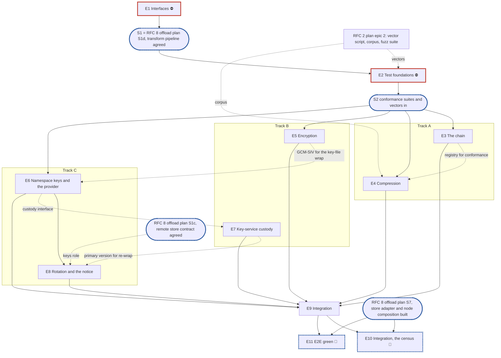

# RFC 5 — transforms v2: implementation plan

**Scope.** [RFC 5, transforms](../docs/internals/rfcs/rfc-5-transforms.md), as it stands on `origin/develop`
with this pull request's amendments: the transform model, the chain and its envelope, the chain
ID, the pin of a chain for one block, material and its provider, the shipped compression and
encryption transforms, namespace keys and their rotation in the bucket, and RFC 5 §6's series.
The user asked for the whole RFC (status `draft`, not `deferred`), and decided that a piece with
no caller in v1.1 is deferred and lands with its first caller: §6.1's ledger holds those pieces,
and RFC 5 now says so where each is specified. Related RFCs, with how far each is in scope:

- **Constraints only**, as the user decided:
  - [RFC 0](../docs/internals/rfcs/rfc-0-data-lifecycle.md): the failure model and **Lost** (§4.2, §10), and
    §1.2's component imports as the RFC 8 offload plan's pull request amends them (§1.5 rule 7);
  - [RFC 2](../docs/internals/rfcs/rfc-2-carver.md), [RFC 3](../docs/internals/rfcs/rfc-3-syncer.md) and
    [RFC 4](../docs/internals/rfcs/rfc-4-remote-tier.md): each has its own plan under #5488; §3.2 names
    the seams the offload contract fixes between them and this plan;
  - [RFC 8](../docs/internals/rfcs/rfc-8-engine.md): its offload part composes the chain and the provider
    into the engine and the node (`.planning/rfc-8-offload-engine-plan.md`), and owns the
    synchronisation points this plan cites as "RFC 8 offload plan S…";
  - [RFC 13](../docs/internals/rfcs/rfc-13-configuration.md): the settings machinery, bound settings
    (§5.1) and secret references (§7), built by its plan (`.planning/rfc-13-config-plan.md`), whose
    §6.1 hands four of RFC 13 §9's rows to this plan (epics 6 and 9).
- **Constraints only**, a default this plan took (O1): [RFC 6](../docs/internals/rfcs/rfc-6-block-metadata.md)
  §2.3's block-record census and its `Census` view, which the RFC 8 offload plan's epics 15 and 19
  build and epic 10 here reads.
- **Only the parts RFC 5 cannot work without**, a default this plan took (O1):
  [RFC 16](../docs/internals/rfcs/rfc-16-metadata-store.md) §4.2's namespace key records
  (`NS‖ns‖key‖kind‖keyID`) and key lock (`NS‖ns‖keyseq‖target`), as a view `material`
  declares and `pkg/metadata/kvstore` implements (epic 6, D7).
- **Constraints only, by the rule of the observability and test RFCs:**
  [RFC 25](../docs/internals/rfcs/rfc-25-observability.md) (§1.5 rule 3) and
  [RFC 29](../docs/internals/rfcs/rfc-29-test-harness.md) (§1.5 rules 6 and 10).
- **Out**, each a §6.1 row: RFC 9 (GC's retirement relocation, the drain, `Recheck`), RFC 26
  (catalog backups and their key machinery), RFC 27 (moves and re-homes), RFC 11 (fencing a node
  that cannot be reached), an operator's destroy, which RFC 23 does not yet specify.

**Tracks.** A, B and C, with no owner (§3.4).

**Programme.** [#5488](https://github.com/cubbit/dittofs/issues/5488), "offload: RFC 2–5 and the
engine's offload part", release v1.1; this RFC's roadmap epic is
[#5486](https://github.com/cubbit/dittofs/issues/5486). It builds on the journal-only engine, stage 3
of #3119 (`.planning/rfc-8-journal-only-engine-plan.md`). The five offload plans follow one
contract, agreed after a joint review: package paths, the synchronisation points the RFC 8
offload plan owns, and who builds what across the plans (§3.2). Composition into the engine and
the node is the RFC 8 offload plan's; this plan keeps what is the component's own. No epic issue
exists yet: the plan is not merged.

**Naming.** v1 is `pkg/block/middleware`, `middleware/compression` and `middleware/encryption`,
with the rest of the v1 block tier. Stage 4 of #3119 deletes it (that plan's D8,
[#5484](https://github.com/cubbit/dittofs/issues/5484), `.planning/rfc-16-store-cutover-stage4-plan.md`).
v2 is RFC 5's chain, built in `pkg/transform`, a new top-level path that waits on nothing of
#5484. No user-visible name carries a version.

**Transition policy.** New installations only, as #3119 decided. v2 ignores v1, and the
integration epics touch no v1 code (§1.5 rule 7).

**Where the code lands.** The plan and its RFC amendments land on `develop`. The code lands on
`feat/storage-v2`, where the engine v2, `pkg/keyprovider`, `pkg/secrets`, `pkg/settings` and
`pkg/metadata/kvstore` live (`develop` has none of them).

**Defaults used from the skill's inputs:** dashboards none; output path
`.planning/rfc-5-transforms-plan.md`.

**RFC amendments in this pull request** (RFC 5 is `draft`, so no other RFC follows them):
- **§3.1, the pin.** `Chain.Pin` returns an `Attempt` that fixes the chain and the current
  material from a block name's mint to its commit or abandonment; the attempt carries the chain
  ID, the bounds and `Encode`, and `Release`. The RFC 8 offload plan's epic 15 holds it (D10).
- **§3.1 and §5.3, removal lands with its first caller**, GC's retirement or an operator's
  destroy, an operation RFC 23 does not yet specify; its fence waits for open pins, not
  encodes (§5.3, T13).
- **Appendix B.3, the export key's next generation lands with catalog backups**; every `keys`
  object names the first export key from the start, so nothing migrates.
- **Appendix B.2, the `keys` object's read-back on `Recheck` lands with `Recheck`'s first
  caller**, GC.
- **Appendix B.1, the periodic primary-version read lands with GC's recheck period**; until
  then the provider reads it when the configuration opens.
- **§2.8, a block's chain ID is its pin's.**

**Pending the user's answer.** Three design questions (§6, Q2 to Q4) are written in place with
the recommended option and marked "pending the user's answer", and two amendments to other RFCs
(A1, A3) are proposed; the plan follows those RFCs as written until they are agreed. The pull
request stays a draft until they are settled.

## 1. Introduction

### 1.1 What we are building

RFC 5's "Start here" and "In short" describe the result: a per-chunk chain in a fixed stage
order, a self-describing envelope, reading by registry and material rather than by
configuration, a plaintext hash that decides, and a key table whose every key is wrapped under a
master key held off the host where it must be.

What replaces what:

| v1 | v2 | Fate |
| --- | --- | --- |
| `pkg/block/middleware` (the decorator chain over the v1 remote store) | `pkg/transform`'s `Chain`, run inside RFC 4's block codec | v1 deleted by stage 4 (its plan's D8) |
| `pkg/block/middleware/compression` (zstd and LZ4, a marker per layer) | `pkg/transform/compress`, the two compressors of RFC 5 Appendix A | v1 deleted by stage 4; `pierrec/lz4/v4` kept for epic 4 (D4) |
| `pkg/block/middleware/encryption` (a random data key per chunk under AES-GCM) | `pkg/transform/encrypt`, the transform of RFC 5 Appendix B | v1 deleted by stage 4 |
| `pkg/keyprovider` (RFC 13's custody of the `storage` wrapping key; its KMIP provider fetches the key out of the server) | `pkg/transform/material` and `material/kmip`, master keys that never leave a key service | `pkg/keyprovider` stays RFC 13's, its exported surface unchanged; its key-file format and KMIP transport move to `internal/keyfile` and `internal/kmipwire`, which both import (D5, D14) |
| the per-remote `encryption.key` configuration blob | the store configuration's `transforms`, `materials` and `require` keys (RFC 5 §3.2), in RFC 13's settings | v1 deleted with its store |

**Dependency limits.** The plan keeps `pierrec/lz4/v4` (D4) and adds no dependency, pending
Q2: AES-256-GCM-SIV is in neither the standard library nor `golang.org/x/crypto`.

### 1.2 How the plan is organised

- Epics 1 and 2 are the team's and run first: the frozen surface of RFC 5 §3.1 with the pin,
  then the test components every transform and the provider are held to.
- Six middle epics, two per track, cut along RFC 5's seams:
  - Track A: the chain (epic 3), then compression (epic 4);
  - Track B: encryption (epic 5), then the key-service custody (epic 7);
  - Track C: namespace keys and the provider (epic 6), then rotation and the destroyed-material
    notice (epic 8).
- Epic 9 wires what is the component's own: its settings, the operator's key operations, its
  collectors, conditions and alert rules (registered in the node by the RFC 8 offload plan), the
  error mapping and the namespace's key creation.
- Epic 10 is the rest of the integration, the census gauge that reads the RFC 8 offload plan's
  `Census` view; it is planned after that plan's S7.
- Epic 11, E2E green, runs RFC 5's rows that need the codec and the engine, and the put and get
  benchmark, once the engine composes the component.

RFC 5's suites paragraph (§8.3) puts §8.1 and §8.2 in `unit` and §8.1's key-management row in
`integration`. Neither keeps a `known.yaml`, so no test lands red: each lands green with the
epic that makes it pass, and epic 2 registers no suite. This plan adds no suite and no group of
its own: its allocation gates are one `unit` option, `transform-allocs` (`tier: pr`), registered
by epic 3, and its fuzz targets join the nightly `fuzz` suite the RFC 2 plan's epic 2 registers
(§1.5 rules 2 and 4).

### 1.3 What epic 1 must deliver

The exported surface of `pkg/transform`, frozen at S1, which is the RFC 8 offload plan's S1d,
"transform pipeline agreed":

- RFC 5 §3.1's symbols as amended here: the ID and stage types and constants, `Transform`,
  `Encoded`, `MaterialID`, `Materials`, `Factory`, `Register`, `Chain` with `Pin` and its
  `Attempt`, `NewChain`, `MaxDecodeLen`, `Config` and the error values, with stub bodies.
  `Materials.Remove` is declared and documented as landing with its first caller (§6.1).
- `NamespaceID`, a `[16]byte` of its own as `entity.NamespaceID` is, which the engine's wiring
  converts: the transforms import no metadata package (§1.5 rule 7).
- The injection point RFC 25 §8 asks for: `NewChain` takes the root's metrics registry and
  logger (D2).
- The two calls the RFC 8 offload plan makes besides the chain: the salvage-key wrap (D16) and
  the destroyed-material notice (D17), declared in `pkg/transform` next to `Materials`, each a
  one-method interface the engine holds; `material`'s provider (epics 6 and 8) and the
  in-memory `Materials` (epics 2 and 8) implement them.
- The component's import test (§1.5 rule 7).

It declares no internal interface: the provider's custody seam has one consumer and lands with
it (D6).

### 1.4 What epic 2 must deliver

**The catalogue.** Each row lands green with the epic named under its **Done when:** line (§5).

- **From RFC 5:** every row of §8.1 and §8.2, mapped in §7; §8.3's benchmarks, in epics 3, 4, 5
  and 11.
- **From other sources**, each placed in the epic that owns the code:
  - v1's bug history, RFC 5 Appendix D's rows: an incompressible chunk that begins with the zstd
    frame magic round-trips (its D1, epic 4); a body declaring 64 MiB, and a zstd frame with a
    window above the chunk maximum, fail before allocating (its D2, epic 4); turning compression
    off between a write and a read (its D4, epic 3; turning encryption on is T15's refusal, epic
    9); a store whose encryption cannot load writes nothing (its D9, epic 11); a provider failure
    at start leaves the journal serving (its D10, epic 11, with the RFC 8 offload plan);
  - RFC 8452's Appendix C vectors for AES-256-GCM-SIV (epic 5);
  - decompression bombs for zstd and LZ4 as fuzz seeds (epic 4);
  - KMIP: a server with an expired certificate, a revoked key, a key in another state than
    active (epic 7).

**Known failures.** None: no suite RFC 5's paragraph names keeps a `known.yaml`, so nothing is
registered (§1.2).

**The test components.**
- `transformtest`, the transform conformance suite of RFC 5 §8.1's generic rows, run by every
  registered transform from its own epic. It is run once against a deliberately broken test
  transform (one that exceeds its bound, one that encodes nondeterministically, one that
  returns a foreign error), and must fail on each.
- `materialtest`, a conformance suite for `Materials`, and an in-memory `Materials` that passes
  it: a verified in-memory implementation (kind 2 of `CLAUDE.md`'s "Writing tests"). It exports
  a count of provider calls, which the suite covers, so RFC 5 §8.2's "the provider records no
  call" (T12, T14) is asserted on it rather than on a counting fake. Epic 6's provider passes the
  same suite and exports the same count; epic 8 adds the destroyed-material notice to both.
- The golden vectors (D11): RFC 5's vectors (§2.8's chain ID, §2.4's envelope, Appendix B.1's
  derivations, fingerprint, chunk AAD and key wrap AAD) added to the one vector script the RFC 2
  plan's epic 2 owns, computed from RFC 5's byte tables alone.
- The leak check is `internal/prof`, which exists.

### 1.5 General rules for each epic

> **Instruction for whoever expands an epic into its detailed description and subtasks,
> human or AI:**
>
> - **Creating an epic from this plan: use the `epic-breakdown` skill.** Whenever the user
>   asks to create an epic from this plan, or to expand, detail or break one down, run the
>   `epic-breakdown` skill (`.claude/skills/epic-breakdown/SKILL.md`) on this plan and that
>   epic, rather than writing the epic document freehand. It extracts the RFC's MUST and
>   MUST NOT into numbered requirements, estimates each subtask in man-days and suggests
>   the pull requests. A human doing it by hand follows the same skill.
> - **Epic and subtask, nothing else.** The units of work are the epic and its subtasks,
>   with subtask ids `<e>.<n>` (`subtask 4.3`, or `T4.3` for short), assigned by the epic
>   document. No other word names
>   them: not task, ticket, story, step or phase, in headings, tables, ids or prose.
> - **The epic stands alone for what to build.** Its requirements, subtasks and decisions
>   are in the epic document itself, which never refers to this plan for them or says "see
>   the plan": the RFC sections it implements, the interfaces it builds on, the
>   subtasks, and a short legend of the names it borrows from this plan (E1, E2, S1, the
>   integration epic, …). It cites the numbered rules below, without copying them, in a
>   table of how each applies: each row names its rule by number and bold title, which
>   says what the rule requires, and the table links this §1.5 with a full link (the
>   plan's path and the section's anchor) and the `CLAUDE.md` sections that hold a rule,
>   so the epic reads alone and its reader can still open each rule's text in one click.
> - **The epic document records decisions, not progress, like this plan.** It has no
>   status fields, no checkboxes to tick and no sections to keep up to date as the work
>   goes on. It is revised through a pull request only when a decision changes.
> - **Subtasks are not pull requests.** A subtask is ideally up to 5 man-days. The owner
>   ships subtasks as they see fit, one pull request each or several together; the epic
>   document only suggests a grouping, each suggested pull request ideally up to 15
>   man-days. Cut and group by logic, readability, dependencies and a deliverable that can
>   be named, not to hit a number.
> - **Every subtask states how it meets each rule that applies to it.** A rule that does
>   not apply is named, with the reason.
> - **In the issue tracker, once each document merges,** following `epic-breakdown`
>   Step 6, their one description. Issues point at the documents and copy nothing; once
>   created, their `Estimate` and blocked-by links are the current estimate and
>   dependencies, and the documents are not revised to follow them. The
>   epic issues exist before E2's pull request lands, because each red test's
>   `known.yaml` entry names one; subtask issues come once their epic document has
>   merged. The release an epic ships in is set by the RFC's roadmap epic that its epic
>   issue sits under, never in a document and never on the epic issue on its own: the epic
>   issue and its subtask issues copy that roadmap epic's milestone, and an epic changes
>   release only by moving under the roadmap epic of the other release.

1. **Independent unit tests.** Each epic carries its own unit tests, built on epic 2's
   `transformtest`, `materialtest` and golden vectors, the implementation of an epic it depends
   on once that has landed, and only the doubles `CLAUDE.md`'s "Writing tests" allows. Epic 1
   declares no internal interface for them to stand in for (rule 12).
2. **Fuzz every decoder of bytes this component did not just write** (`CLAUDE.md`, "Writing
   tests", "By kind", which names the invariant a target asserts): the envelope and
   `Chain.Decode` (epic 3), the zstd and LZ4 headers and frames (epic 4), the encryption header
   (epic 5), the stored wrap and the key record (epic 6), the `keys` object (epic 8). Each
   transform's `Decode` is also fuzzed by `transformtest` (RFC 5 §8.1, T4). Seeds are the
   fixtures and the golden vectors; crashers go to `testdata/fuzz/<FuzzName>/`, which plain
   `go test` runs in `unit`. Every target also joins the nightly `fuzz` suite the RFC 2 plan's
   epic 2 registers; the epic that adds the first target adds RFC 5's suites-paragraph line
   naming it.
3. **Observability follows RFC 25.** The prefixes are `transform_` and `encryption_` (RFC 25
   §2.1). Epic 3 owns RFC 5 §6's series around each call; epic 5 owns `encryption_chunks_total`;
   epic 6 owns `encryption_keys_unavailable` and `encryption_current_key_age_seconds`; epic 10
   owns `transform_census_blocks`. The provider is a `health.Source` for RFC 25 §3.9's
   `material_unavailable` (epic 6). The collectors, the health source and the alert rules live
   in this component's packages (epic 9); the RFC 8 offload plan's epic 21 registers them in the
   node. No span per chunk: a transform logs nothing per chunk (RFC 5 §6), and the spans are the
   engine's and the syncer's. A chain that fails to build logs once at `Error` (epic 3).
4. **Profiling.** Tests and benchmarks run under `internal/prof`'s leak check. The hot paths
   carrying allocations-per-op assertions: `Attempt.Encode` and `Chain.Decode` with a caller's
   `dst`, each transform's `Encode` and `Decode`, the envelope parse, and `Materials.Get` on a
   cached key. They run in `unit`'s `transform-allocs` option (`tier: pr`), which epic 3
   registers.
5. **Public interface and internals.** Tests cover each package's internals and the behaviour
   the epic enables, concurrency under `-race` included (RFC 5 §8.1's 64-goroutine row). Test at
   the layer that **consumes** a value (`CLAUDE.md`, "Verifying a change"): a census reaches
   `Decode`'s view, not only the codec that collects it; a destroyed key is asserted where a
   decode reports it and where the notice delivers it.
6. **Known failures shrink.** No suite of this RFC keeps a `known.yaml` (§1.2), so no test lands
   red here. A test this plan adds to a suite that keeps one, such as an engine suite of the
   RFC 8 offload plan, follows `CLAUDE.md`, "Writing tests", "By kind".
7. **v2 ignores v1, and imports only what RFC 0 §1.2 allows.** RFC 0 §1.2, as the RFC 8 offload
   plan's pull request amends it, names the component imports allowed: the remote codec and the
   engine's wiring import `pkg/transform`, and "the transforms import no other component". The
   metadata store (RFC 16) and configuration (RFC 13) are components of the RFC index, so
   `pkg/transform` imports neither `pkg/metadata/...` nor `pkg/keyprovider`: it declares what it
   needs as interfaces of its own, which the wiring supplies — the key-record view (D7) and the
   `keys`-object store (D8) — and shares code with `pkg/keyprovider` only through `internal/`
   packages (D5, D14). Epic 1 adds `pkg/transform`'s import test, which checks every package of
   the tree on its own, test packages included, against an allowlist: the standard library,
   `x/crypto`, the compression, BLAKE3 and KMIP modules, `internal/keyfile`, `internal/kmipwire`,
   and the machinery RFC 13 §4 and RFC 25 §8 have every component declare against
   (`pkg/settings`, `pkg/metrics`, `pkg/health`), as the RFC 3 and RFC 4 plans allow it. It
   fails on any v1 path or other component. v1 is not touched: stage 4 deleted it.
8. **Real dependencies for properties of those dependencies** (`CLAUDE.md`, "Writing tests").
   Here: a real KMIP server, the harness's `service:kmip`, for the key service (RFC 5 §8.1's
   key-management row, in `integration`); the real metadata store for key records and the key
   lock, through kvstore's conformance run of the key-record suite (D7) over Badger under
   `t.TempDir()`, the memory KV and, where that suite runs, FoundationDB. Key creation, escrow
   and rotation are ordering claims (a key record committed before the wrap or key is used, a
   key current only after the bucket's put): each has a crash-seam row in that suite, with
   `pkg/metadata/kv/kvtest`'s fault wrapper tearing or crashing the commit beneath it (epics 6
   and 8). The bucket's `keys`
   object is tested against `materialtest`'s verified in-memory store of it; the RFC 8 offload
   plan's epic 21 runs the same suite against RFC 4's store in `integration`, with LocalStack
   over HTTPS from the RFC 4 plan's epic 3.
9. **Code comment conventions** (`CLAUDE.md`, "Code comments"). RFC 5 carries `decision:`
   notes whose markers go at the code sites that implement them: compression off by default
   where a namespace encrypts (§3.2), the fixed 1/16 threshold and the double compression of a
   measuring pass (Appendix A), the clear chunk-ID key of a non-encrypting namespace (B.2), no
   header key and determinism per namespace (B.5). A piece deferred to its first caller (§6.1)
   leaves a `decision:` marker where the caller will plug in, naming that caller.
10. **A test must be able to fail** (`CLAUDE.md`, "Writing tests"), and nothing else would
    catch the change it guards. The golden vectors are its sharpest case: each is computed by
    an independent implementation, never by the code it checks (D11), and `transformtest` is
    proved against a broken transform (§1.4).
11. **A symbol is exported only if RFC 5's interface or a consumer outside the package uses
    it.** Everything epic 1 exports is frozen at S1. The provider's operations are exported by
    the epic that builds them and frozen when epic 9 first calls them.
12. **Each subtask creates only what it declares.** No empty package and no stub without a
    caller; a package, an option or a test helper lands with its first consumer. A piece with no
    caller in v1.1 is not built (§6.1).

## 2. Epics at a glance

| # | Epic | Content | Subtasks | Man-days | Track | Blocks |
| --- | --- | --- | --- | --- | --- | --- |
| E1 ⛔ | Interfaces | `pkg/transform`'s RFC 5 §3.1 surface with the pin, stub bodies, `NamespaceID`, the chain's `Deps`, the salvage-key wrap and destroyed-material notice signatures, the import test | 3 | 3.5 | team | every epic |
| E2 ⛔ | Test foundations | `transformtest` with its broken-transform check, `materialtest` with the in-memory `Materials`, RFC 5's golden vectors, the catalogue | 4 | 9.5 | team | E3 to E8 |
| E3 | The chain | registry, envelope, chain build and refusals, the pin, composed encode and decode with bounds, the census view, `require`, the chain ID, §6's series, the allocation option | 7 | 15 | A | E9 |
| E4 | Compression | zstd and LZ4, their header, decline, window cap, fixtures, ratio benchmarks | 4 | 8.5 | A | E9 |
| E5 | Encryption | AES-256-GCM-SIV, the chunk derivations and AAD, the header, kind refusal, fixtures and vectors | 5 | 11 | B | E9; partly E6 |
| E6 | Namespace keys and the provider | key-record view, stored wrap, key-file custody, escrow, `Materials` with fingerprints and its three failures, namespace key creation, the salvage-key wrap, B.6's gauges, the custody suite | 8 | 17.5 | C | E8, E9; partly E7 |
| E7 | Key-service custody | KMIP wrap and unwrap through the server with AAD, version-qualified IDs, the primary version, the real-server row's provider half | 4 | 6 | B | E9; partly E8 |
| E8 | Rotation and the destroyed-material notice | master and data key rotation in the bucket, the `keys` object, the notice | 5 | 10 | C | E9 |
| E9 | Integration | settings keys and the bound `encrypts`, the key operations, collectors and alert rules, error mapping, namespace key creation | 5 | 12 | team | E10, E11 |
| E10 🔀 | Integration, the census | `transform_census_blocks` and the census per material | planned after S7 | planned after S7 | team | — |
| E11 🔀 | E2E green | RFC 5's codec and engine rows, the put and get benchmark | 6 | 10 | team | — |
| | **Total** | | **51** | **103** | | |

**Plan estimate: 51 subtasks, 103 man-days, not counting epic 10.**

The skill's estimate for RFC 5's 1,999 lines is 5 middle epics (`round(1999 / 400)`); this plan
has 6. Master-key custody through a key service shares no state with the namespace key records
beyond the custody seam (D6), and splitting it off keeps Track B busy after encryption.

**Legend.** ⛔ is a blocker; 🔀 waits on a synchronisation point. "team" is an epic that belongs
to no track. "Partly" means the dependent epic starts before the blocker lands (§3.3). Epic 11
is estimated: it waits on S7 to start, but its rows are this RFC's and known now; epic 10 waits
on an interface another plan builds and is planned after it.

## 3. Synchronisation points, blockers and the split

### 3.1 Dependency graph



### 3.2 Synchronisation points

The offload plans share one table of synchronisation points, owned by the RFC 8 offload plan;
this plan cites them by its names.

- **S1, the surface frozen**, which is **RFC 8 offload plan S1d, transform pipeline agreed**:
  epic 1's symbols, the pin and release, the salvage-key wrap and the destroyed-material
  notice, reviewed with the RFC 8 and RFC 4 plans' authors (§1.5 rule 11). Unblocks epic 2 here,
  and the codec (RFC 4) and the engine (RFC 8) coding against `pkg/transform`.
- **S2, the conformance suites and vectors in.** `transformtest`, `materialtest` with its
  in-memory `Materials`, and RFC 5's vectors in the shared script exist. Unblocks epics 3, 4, 5
  and 6.
- **🔀 RFC 8 offload plan S1c, remote store contract agreed**: RFC 4's contract, its control
  objects and the codec's encode and decode calls included. Unblocks epic 8's `keys` object (its
  bytes go through `PutControl` with the `keys` role); the rest of epic 8 does not wait.
- **🔀 S7, which is RFC 8 offload plan S7, store adapter and node composition built**: the
  engine holds the pin from mint to commit or abandonment and writes the census at commit (its
  epic 15), the `Census` view exists (its epic 19), the engine calls the salvage-key wrap (its
  epic 20) and the destroyed-material notice (its epic 18), and the node registers this
  component's collectors, alert rules and the provider's `health.Source` for
  `material_unavailable`, and runs `materialtest`'s `keys`-object suite against RFC 4's store in
  `integration` (its epic 21). Unblocks epic 10, which is planned after it, and epic 11.

Seams between this plan and the others, the offload contract's and RFC 13's:

| Plan | It builds | It calls of this plan |
| --- | --- | --- |
| RFC 2 | the keyed BLAKE3 chunk ID (RFC 2 §4.1), the keyed gear table (RFC 2 §3.2, §6), RFC 5 §8.2 T17's half that the same file in two namespaces gives disjoint chunk IDs (its epic 4); the one vector script and test corpus (its epic 2), which this plan's vectors join; the nightly `fuzz` suite (its epic 2) | nothing: the engine passes it the keys (below) |
| RFC 3 | its `Descriptor` and `MaterialRef`, the census entry opaque to the syncer, and its own `ErrMaterialUnavailable` and `ErrMaterialDestroyed` (RFC 3 §1.3) | nothing: its memory bound is sized by the engine and the codec (below) |
| RFC 4 | the block codec, which writes the census into the header (RFC 4 §3.2 to §3.4) and owns RFC 3 §2.2's memory-bound row on the codec's part; `PutControl` and `GetControl` (RFC 4 §4.13); LocalStack over HTTPS in `integration` (its epic 3) | `Attempt.Encode`, `Chain.Decode`, `MaxDecodeLen`, the stage count and the 255-byte material ID that bound the header census |
| RFC 13 | `pkg/keyprovider`, whose exported surface does not change: epic 6 moves its key-file format to `internal/keyfile` and epic 7 its KMIP transport to `internal/kmipwire` (D5, D14); its importers (`pkg/secrets`, `internal/install`, `cmd/dfs`) are not touched, and its `kmip_integration_test.go` still runs over the moved transport | nothing: `pkg/transform` does not import it |
| RFC 8 offload | the pin's holder and the census at commit (epic 15), and there the refusal of a plan keyed under another namespace's key (RFC 5 §8.2 T17's other half, its last Appendix B.2 row: epic 15's Intent step), the `Census` view (epic 19), the destroyed-material handling (epic 18), the salvage export (epic 20), the store adapter, its error mapping and the node's registration of collectors and alert rules (epic 21) | `NewChain`, `Chain.Pin` and `Attempt.Release`, `MaxDecodeLen` for the syncer's memory bound, `Materials.Current` and `Get` for the chunk-ID and chunking keys it hands the carver, the salvage-key wrap, the destroyed-material notice; its wiring supplies the `keys`-object store (D8) and the key-record view (D7) |

### 3.3 Blockers

| Epic | Blocks | Why |
| --- | --- | --- |
| E1 ⛔ | every epic | the surface every test and implementation codes against |
| E2 ⛔ | E3 to E8 | every transform passes `transformtest`; the provider and every transform's tests use `materialtest`'s in-memory `Materials`; the vectors are the oracle |
| RFC 2 plan epic 2 | E2, partly; E4, partly | RFC 5's vectors join its script; the ratio benchmarks use its corpus |
| E3 | E4, partly; E9 | `Register` and the registry's `MaxDecodeLen` hold a compressor's registration; epic 9 validates settings with `NewChain` |
| E4 | E9 | epic 9 validates the compress stage's settings with the registered compressors |
| E5 | E6, partly; E9 | the key-file wrap uses the same AES-256-GCM-SIV (D3) |
| E6 | E7, partly; E8; E9 | epic 7 implements the custody interface epic 6 declares (D6); epic 8 rotates epic 6's records |
| E7 | E8, partly; E9 | a key service's new primary version starts epic 8's master-key re-wrap |
| E8 | E9 | the operator's operations call rotation |
| S1c 🔀 | E8, partly | the `keys` object goes through RFC 4's control objects |
| S7 🔀 | E10, E11 | the engine and the node compose this component; epic 10 is planned after it |
| E9 | E10, E11 | epic 10 completes what epic 9 wires; epic 11 runs through epic 9's settings |

### 3.4 Splitting the work

- **Track A: the chain, then compression.** Epic 3 from S2, then epic 4, which can start on its
  headers at S2 while epic 3 lands the registry. Busy to epic 9.
- **Track B: encryption, then the key service.** Epic 5 from S2, then epic 7 once epic 6's
  custody interface lands; epic 7 does not wait on epic 5. The shortest track: after epic 7 it
  takes epic 9's key operations (the API and CLI surface), which call into Track C's code.
- **Track C: namespace keys, then rotation.** Epic 6 from S2, then epic 8, whose `keys` object
  waits on RFC 8 offload plan S1c and whose key-service re-wrap waits on epic 7. The longest
  track and the critical path.
- **The team converges** on epic 9 once every middle epic has landed, and on epics 10 and 11
  after S7.

## 4. Implementation decisions

### 4.1 Directory layout

On `feat/storage-v2`:

```text
pkg/transform/                 E1 the RFC 5 §3.1 surface, the salvage-key wrap and notice
                               interfaces, the import test; E3 registry,
                               envelope, Chain, Pin, chain ID, census view, the series of
                               RFC 5 §6; E9 settings.go, the store configuration's keys
pkg/transform/transformtest/   E2 the transform conformance suite, the vector loader
pkg/transform/materialtest/    E2 the Materials conformance suite, the in-memory Materials;
                               E6 the custody suite, the key-record suite and its in-memory
                               view; E8 the keys-object suite and store
pkg/transform/compress/        E4 zstd and LZ4
pkg/transform/encrypt/         E5 the AES-256-GCM-SIV transform and its derivations
pkg/transform/internal/siv/    E5 AES-256-GCM-SIV as a cipher.AEAD (Q2)
pkg/transform/material/        E6 the provider, the key-record view it declares (D7), the
                               stored wrap, key-file custody, escrow,
                               namespace key creation, the salvage-key wrap; E8 rotation,
                               the keys object, the destroyed-material notice
pkg/transform/material/kmip/   E7 key-service custody over KMIP
internal/keyfile/              E6 the key-file format moved out of pkg/keyprovider (D5)
internal/kmipwire/             E7 the KMIP transport moved out of pkg/keyprovider (D14)
pkg/metadata/kvstore/          E6 material's key-record view over RFC 16 §4.2's NS‖ns‖key
                               and NS‖ns‖keyseq rows, run under the key-record suite
pkg/metadata/kv/keys/          E6 the keyseq subtag beside NSKey
```

### 4.2 Decisions

**D1. `pkg/transform`, one package for the model, subpackages per transform.** The offload
plans take new top-level paths (`pkg/carver`, `pkg/syncer`, `pkg/remote`, `pkg/transform`) and
wait on nothing of #5484. The shipped transforms register from their own packages, so a custom
transform is one more such package (RFC 5 §4). Prior art: Go's `image` and `database/sql`
registries, a package per format that registers at init. Applies in epic 1.

**D2. `NewChain` takes the root's metrics registry and logger.** RFC 5 §3.1's signatures are
indicative, and RFC 25 §8 says every component receives them from the root in its `Deps`, never
from a global. The chain records RFC 5 §6's series around each transform's call, so a custom
transform gets them without writing any. Prior art: RFC 25 §8.1 itself; the Prometheus client's
practice of registering collectors on an injected registry (from memory). Applies in epic 1,
filled in epic 3.

**D3. AES-256-GCM-SIV is an internal `cipher.AEAD` of this repository, `internal/siv`, built
on `crypto/aes` and ported, with attribution, from an Apache-2 implementation rather than written
from scratch, pending the user's answer (Q2).** The standard library and `x/crypto` have none.
Its POLYVAL multiply is constant time: carry-less multiplication by masking, BearSSL's
`ghash_ctmul64` technique, with no table lookup indexed by key or data bits. The standard
library is not the model: Go 1.26's generic GHASH, the toolchain `feat/storage-v2` pins, is
table-driven and documented variable-time (`crypto/internal/fips140/aes/gcm/ghash.go`); Go 1.27
switched it to BearSSL's masking. Epic 5's document names the ported source, and its review
checks the multiply. It is pinned by RFC 8452's Appendix C vectors and by the
independent golden vectors (D11), and RFC 5 §5.4's fixtures decide any later swap of
implementation. Both the chunk seal (epic 5) and the key-file wrap (epic 6) use it. Prior art:
BoringSSL and Tink implement it themselves; the Go implementations found are third-party
(from memory, not checked). Applies in epic 5.

**D4. zstd from `klauspost/compress`, LZ4 from `pierrec/lz4/v4`, kept.** Both are direct
dependencies on `feat/storage-v2` today. Stage 4's `go mod tidy` drops `pierrec/lz4/v4` only if
v1 is still its sole importer; if epic 4 lands first the dependency stays, and if stage 4 lands
first epic 4 adds it back (O8). zstd decodes with its window and memory capped at the chunk
maximum (RFC 5 Appendix A, "Its header"). Prior art: v1's own `middleware/compression` used both
libraries. Applies in epic 4.

**D5. The material provider is new; it shares only the key-file format with `pkg/keyprovider`.**
`pkg/keyprovider` is RFC 13's custody of the `storage` wrapping key, which must never wrap a
namespace key (RFC 5 Appendix B.2, "No storage-key fallback"), and its KMIP provider fetches the
key out of the server, which Appendix B.1 forbids for a master key. A key-file master key is read
in `pkg/keyprovider`'s passphrase-protected format, under RFC 13 Appendix C's passphrase. Epic 6
moves that format's reader to `internal/keyfile`, which both packages import, since
`material` may not import RFC 13's package (§1.5 rule 7); `pkg/keyprovider`'s exported surface
and its tests do not change. The wrap itself is RFC 5 Appendix B.1's.
Prior art: HashiCorp Vault's seal wrappers and the AWS Encryption SDK's keyrings separate key
custody from the data format (from memory). Applies in epics 6 and 7.

**D6. Master-key custody is a small interface the provider declares**, with two
implementations: the key file (epic 6) and the key service (epic 7). Its calls are what
Appendix B.1 asks of a provider: wrap and unwrap with associated data, the version-qualified
ID of each wrap, and the current primary version. It is not epic 1's: it has one consumer, the
provider, and lands with it (§1.5 rule 12). Each implementation passes `materialtest`'s
custody suite, which lands with the interface in epic 6, the key service running it at the
integration tier. Prior art: as D5. Applies in epic 6.

**D7. Key records are a view `material` declares and the metadata store implements.** The
transforms import no other component (§1.5 rule 7), so `material` declares the calls it needs,
named for the need: read a namespace's key records, create its keys in one transaction, and
rewrite them under the `keyseq` key lock. `pkg/metadata/kvstore` implements it in the store's
own transactions, and the engine's wiring passes it in, as RFC 14 §11.1 defines `OpenRecords`
for the store to implement (RFC 16 §3). Its suite is in `materialtest` with a verified
in-memory view; kvstore's conformance run calls the same suite, so Badger, the memory KV and
FoundationDB all run the key-record and key-lock rows, the lock's conflict under FoundationDB
included. Stage 7's rename of `kvstore` to `pkg/metadata` moves only the implementation. The
provider holds unwrapped namespace keys in process memory, per namespace. Prior art: RFC 14's
`OpenRecords`, the other consumer-declared view. Applies in epic 6.
Applies in epic 6.

**D8. The `keys` object is a versioned binary record, stored through an interface `material`
declares.** Its bytes: a format version, the namespace ID, the sequence, the export key ID, the
key records in RFC 16 §4.3's codec, as the key-record view (D7) reads them, and the keys MAC of Appendix B.1. RFC 5 fixes what the
MAC covers and RFC 4 §4.13 the object's role, but neither its bytes. Settled now, the export key
ID included though only the first export key exists in v1.1, because a recovery import
(RFC 26 §2.3) reads it from every bucket written from the first namespace on: a change later is
a second version every reader keeps. `pkg/transform` may not import RFC 4 (§1.5 rule 7), so
`material` declares the put and get of the object as a two-call interface; the engine's wiring
passes RFC 4's store, and `materialtest` holds a verified in-memory store to the same suite.
Prior art: none found for this record; RFC 4 §3.5's versioned block format is the house pattern.
Applies in epic 8.

**D9. Rotating a data key makes a new key current and schedules nothing.** Appendix B.3 makes
relocating the old key's blocks a separate act, and RFC 9 §4.4 defers to RFC 5 §5.3 for where the
retiring set is recorded, which §5.3 does not say. A key merely not current is not being retired,
so the set is not "every non-current data key". The record is GC's, settled with its walk in
RFC 9's plan (§6.1). Prior art: none found. Applies in epic 8.

**D10. A block's chain is pinned from its name's mint to its commit or abandonment**, as RFC 5
§3.1 now says. `Chain.Pin` reads the namespace's current material once and returns the
`Attempt` whose chain ID, bounds and encodes use it; the RFC 8 offload plan's epic 15 holds the
attempt across the measuring pass, the put, its retries and RFC 3's per-upload measurement, and
releases it at commit or abandonment. In v1.1 the pin counts nothing: the count of open pins
is `Remove`'s fence (RFC 5 §5.3 as amended), which lands with `Remove` (§6.1). Prior art: a snapshot of
configuration taken per request, as a database transaction pins its schema version (from
memory). Applies in epics 1 and 3.

**D11. The golden vectors come from a second implementation**, RFC 5's part of the one vector
script the RFC 2 plan's epic 2 owns (Python's `cryptography` for AES-GCM-SIV, HKDF and HMAC, and
`blake3`), computed from RFC 5's tables alone and checked in with its output. CI does not run
it; the Go tests read its output. Prior art: Wycheproof and RFC 8452's own vectors (from memory).
Applies in epic 2.

**D12. Fixtures are per transform and per format version**, under the transform's own
`testdata/fixtures/v<n>/`, holding RFC 5 §4 item 7's inputs, settings, material and bodies;
`transformtest` reads them. Applies in epics 2, 4 and 5.

**D13. `MaxDecodeLen` takes each registered transform's bound at its default settings.** RFC 5
§2.5 has the registry build each transform once for decoding with its defaults, and both shipped
transforms' bounds are independent of their settings. A transform whose bound grows with a
setting (Appendix C's parity) declares its largest at registration; that is epic 3's open point
for the first such transform. Prior art: none found. Applies in epic 3.

**D14. The key service speaks KMIP only, with associated data as bytes, pending the user's answer
(Q3), over the transport `pkg/keyprovider` already has.** Its round trip, TLS setup, message
read and key-state mapping move to `internal/kmipwire`, which both providers import; epic 7 adds
only the encrypt and decrypt payloads with associated data and the primary-version read. RFC 5
§8.1's row names a key-management server and the harness runs one (`service:kmip`). A cloud key
service taking associated data as a string map is a §6.1 row. Prior art: KMIP 1.4's
authenticated encryption parameters; AWS KMS's encryption context is the string-map case (from
memory). Applies in epic 7.

**D15. The operator's key operations are RFC 23 operations on the store configuration and the
namespace, pending the user's answer (Q4) and A3.** RFC 5 names the acts (rotate a master or
data key; verify a key file's escrow; the destroy lands with its first caller, §6.1) and RFC 23
§4.1's actions table names none of them. Epic 9 adds them with their `dfsctl` commands and
regenerates `docs/guide/cli.md`. Prior art: RFC 23's own `rotate-signing-key`. Applies in epic 9.

**D16. The salvage-key wrap is one call, declared in `pkg/transform` and implemented by the
provider**: it draws a fresh data key, wraps it under
the installation's current master key with associated data naming the salvage export, and
returns the key and its stored wrap (RFC 5 Appendix B.2, "A salvage key seals one salvage
export"). It belongs to no namespace, so it writes no key record; the RFC 8 offload plan's epic
20 writes the wrap beside the export. Prior art: none found. Applies in epic 6.

**D17. The destroyed-material notice is a call the engine polls**, declared in `pkg/transform`
and implemented by the provider, returning the material IDs the provider has found destroyed
since a cursor: a key record in state `destroyed`, or a master key the key service reports
destroyed, which destroys every key it wraps. A key the service reports compromised still
decrypts, so it is not destroyed: RFC 5 Appendix B.4 gives `ErrMaterialDestroyed` only for
material lost for good. A poll, not a callback, so the engine's own loop decides when to clear offloaded bits
(RFC 8 §10.4) and nothing runs inside the provider's lock. The in-memory `Materials` implements it
under `materialtest`. Prior art: a change feed read by cursor, as the metadata store's own
generation counters (from memory). Applies in epic 8.

### 4.3 Knowingly simple implementations

- **The unwrapped-key cache never evicts.** `ponytail:` every namespace key the provider has
  unwrapped stays in memory until stop, about 32 bytes and an ID per key; at 10⁴ namespaces and
  a few keys each that is under a megabyte. Upgrade to a bounded cache that re-unwraps on a miss
  when the namespaces of one node reach about 10⁶. Epic 6.
- **zstd levels collapse onto the library's encoder speeds.** `ponytail:` `klauspost/compress`
  maps RFC 5's level range onto four encoder speeds, so two levels may write equal bodies under
  two chain IDs, which costs nothing but a missed dedup across a level change. Upgrade if the
  ratio benchmark (RFC 5 §8.3) shows a level the operator asks for compressing no better than
  its neighbour; a new encoder is a new format version (RFC 5 §5.4). Epic 4.

## 5. The epics in detail

### Epic 1 — Interfaces ⛔

**Epic 1 estimate: 3 subtasks, 3.5 man-days.**

The frozen surface of `pkg/transform`, with stub bodies, and the import test.

**Owns:** RFC 5 §3.1 (the symbols, the pin included); §2.3's stage constants; §2.7's error
values.
**Done when:** S1, the RFC 8 offload plan's S1d, agreed with the RFC 4 and RFC 8 plans' authors;
the import test passes on the empty tree and fails on a planted v1 import.

**Expected content:**
- §3.1's types, interfaces, `Register`, `Chain` with `Pin` and `Attempt`, `NewChain`,
  `MaxDecodeLen`, `Config` and the errors, with doc comments citing the RFC.
- `NamespaceID` as its own `[16]byte`, and the chain's `Deps` (D2).
- The salvage-key wrap (D16) and the destroyed-material notice (D17), declared in
  `pkg/transform` next to `Materials`.
- `pkg/transform`'s import test (§1.5 rule 7).

### Epic 2 — Test foundations ⛔

**Epic 2 estimate: 4 subtasks, 9.5 man-days.**

The components every transform and the provider are held to, and the oracle the format checks
compare against.

**Owns:** RFC 5 §8.1's generic rows as a suite; RFC 5 §4 item 7's fixture mechanism.
**Done when:** S2: `transformtest` passes a test transform and fails each broken one; the
in-memory `Materials` passes `materialtest`; RFC 5's vectors are in the shared script with their
output.

**Expected content:**
- `transformtest`: RFC 5 §8.1's rows T2 (round trip, fixtures), T4 (with a fuzz helper), §2.1's
  bound, concurrency, §2.7's byte flips, T9 (twice, two chains, fixtures), as one function a
  transform's package calls; run against the broken transforms of §1.4.
- `materialtest`: the `Materials` suite (current per namespace and kind, the three failures,
  fingerprint refusal, the exported call count) and the in-memory `Materials` passing it.
- RFC 5's golden vectors in the RFC 2 plan's script (D11).
- The catalogue of §1.4, written into the epic document with each row's epic.

### Epic 3 — The chain

**Epic 3 estimate: 7 subtasks, 15 man-days.**

The chain over any registered transforms: the envelope, the refusals, the bounds, the pin, the
census view and the chain ID.

**Owns:** RFC 5 §2.1 to §2.4, §2.6 to §2.8 (the chain's part), §3.1's behaviour, §3.2's refusals
at build (stage rules and `with_encryption: accept`), §4 items 1 and 2 as the registry checks
them, §6 but the census gauge and encryption's series.
**Done when:** RFC 5 §8.2 T11, both T3 rows, §2.4's envelope row but its ranged get, §2.5's
`require` row, T12, T10, §2.8's vectors, T5's chain half (a failing factory fails `NewChain`),
T16's refusal half, T14's census-view half; RFC 5 §8.1 §3.1's enlarging row; RFC 5 §8.2 §3.1's
removed-parity row, with a test transform in the redundancy stage; RFC 5 §8.2 T7's chain half
(`ErrUnknownMaterial` from the provider reported as `ErrMaterialUnavailable`); a pinned attempt
keeps its chain ID and bodies across a configuration change and a key rotation; RFC 5 §8.3's
chain overhead and envelope size.

**Expected content:**
- The registry: `Register`, duplicate refusal, the ID ranges of RFC 5 §4, `MaxDecodeLen` (D13).
- Envelope version 1: encode, and a parse that refuses as RFC 5 §2.4 says before any decode;
  fuzzed.
- `NewChain`: stage order, duplicates, `with_encryption: accept`, a factory's failure, logged
  once.
- `Pin` and `Attempt` (D10); `Attempt.Encode` and `Chain.Decode` composed with each step's
  bound, `dst` handling and error discipline (RFC 5 §3.1); the census view that answers only
  listed IDs; `require`.
- The chain ID per namespace (RFC 5 §2.8), checked against the vectors.
- RFC 5 §6's series around each call; test transforms: one enlarging by half, one in the
  redundancy stage.
- `unit`'s `transform-allocs` option (§1.5 rule 4).

### Epic 4 — Compression

**Epic 4 estimate: 4 subtasks, 8.5 man-days.**

The two shipped compressors.

**Owns:** RFC 5 Appendix A.
**Done when:** `transformtest` passes for zstd and LZ4 with their fixtures; Appendix A's level
range refused at build; the Appendix D rows of §1.4 placed here; RFC 5 §8.3's per-transform,
compression-ratio and `Chain.MaxEncodedLen`-against-the-largest-body benchmarks over the RFC 2
plan's corpus.

**Expected content:**
- zstd: header, decline below the threshold, the capped decoder (D4), `LengthKey`.
- LZ4, on `pierrec/lz4/v4` (D4).
- Fixtures for both (D12), fuzz targets seeded with decompression bombs, joined to `fuzz`.
- The benchmarks.

### Epic 5 — Encryption

**Epic 5 estimate: 5 subtasks, 11 man-days.**

The shipped encryption transform, which needs a namespace's data key.

**Owns:** RFC 5 Appendix B.1's chunk part (its derivations, chunk AAD, header and bounds), §2.5's
"material says what it is for" for `data-key`, Appendix B.6's `encryption_chunks_total`.
**Done when:** `transformtest` passes for encryption with its fixture; RFC 5 §8.1's authenticating
rows of §2.7 (every flip `ErrMalformed`, a body under another chunk's hash, destroyed material),
Appendix B.1's salt and keystream row, its distinct-labels row and the chunk part of its
golden-vector row; RFC 8452 Appendix C's vectors; RFC 5 §8.3's per-transform benchmark.

**Expected content:**
- `internal/siv` (D3, Q2), ported with a constant-time POLYVAL, with RFC 8452's vectors and a
  fuzz against the golden vectors.
- The salt key, salt and chunk key derivations, and the chunk AAD, against the vectors.
- `Encode` and `Decode` asking `Materials` for the current and the named data key; kind refusal
  at construction.
- The fixture (D12) and the series.

### Epic 6 — Namespace keys and the provider

**Epic 6 estimate: 8 subtasks, 17.5 man-days.**

The provider that implements `Materials` for a store configuration, over key records in the
metadata store and master keys in a key file.

**Owns:** RFC 5 §2.5 (the provider's obligations), Appendix B.1's key wrap and stored wrap,
Appendix B.2's key table as namespace creation applies it, its escrow rule, its "no storage-key
fallback" and its salvage key, Appendix B.4's distinctions at the provider, Appendix B.6's two
gauges; RFC 16 §4.2's key-record and key-lock rows.
**Done when:** the provider passes `materialtest`; RFC 5 §8.1's §2.5 row (a replaced key refused,
the gauge at 0); RFC 5 §8.1's T18 rows (altered AAD, a record copied to another namespace); RFC 5
§8.1 T22's stored wrap for the key file; the fingerprint part of RFC 5 §8.1's Appendix B.1
golden-vector row; RFC 5 §8.2's T14 provider half; the provider half of RFC 5 §8.2 T7
(`ErrUnknownMaterial` for a key never given, with a condition naming the ID); RFC 5 §8.2 T18's
key creation, escrow and `storage`-key rows; RFC 13 §9's "§7 namespace keys" and "§7 chunk-ID
key" rows, and the "§7 key table" row's non-encrypting-namespace and escrow clauses, which RFC
13's plan hands to this one (its data-key rotation clause is epic 8's, its catalog-backup restore,
export-key rotation and master-key destroy clauses are RFC 26's, §6.1); a crash torn beneath key creation
leaves no wrap in use without its committed record (§1.5 rule 8); a salvage key unwraps only
under its master key and associated data.

**Expected content:**
- The key-record view `material` declares, its suite and in-memory view in `materialtest`, and
  its `kvstore` implementation under kvstore's conformance run (D7), fuzzed decode, and the
  `keyseq` subtag with its row in `pkg/metadata/kv/keys`' table.
- The key-file format's reader moved to `internal/keyfile` (D5).
- The stored wrap and the key-file custody (D5, D6), with the custody interface and its suite.
- The escrow check and `ErrNotEscrowed`.
- `Current` and `Get`: fingerprints, the three failure classes, namespace scoping, the cache.
- Namespace key creation per Appendix B.2's table, the clear chunk-ID key included, with its
  crash-seam test.
- The salvage-key wrap (D16).
- The two gauges, and the provider as a `health.Source` for `material_unavailable`.

### Epic 7 — Key-service custody

**Epic 7 estimate: 4 subtasks, 6 man-days.**

Master keys that never leave a KMIP server.

**Owns:** RFC 5 Appendix B.1's key-service wrap (version-qualified IDs, associated data as
bytes, the primary version read), Appendix B.2's `master-key` row as a key service holds it, §9
item 2.
**Done when:** the custody suite passes against the harness's KMIP server; RFC 5 §8.1's
key-management row, its provider half (the store half is epic 11's); RFC 5 §8.1 T22's stored
wrap for a key service, as bytes (the string-map half is §6.1's, Q3).

**Expected content:**
- `internal/kmipwire`, moved out of `pkg/keyprovider` (D14).
- KMIP encrypt and decrypt with associated data through `kmip-go` (D5, D14).
- The version-qualified ID of each wrap, and the read of the current primary version.
- The failures of RFC 5 §8.1's row (missing key, unreachable server, invalid certificate)
  mapped to the provider's errors, none falling back.
- The integration tests, under `-tags=integration`.

### Epic 8 — Rotation and the destroyed-material notice

**Epic 8 estimate: 5 subtasks, 10 man-days.**

Keys changing over time in the bucket, and the notice the engine reads when material is gone
for good.

**Owns:** RFC 5 §5.1; Appendix B.2's `keys` object in the bucket (sequence, MAC, key lock,
read-back before and after a writer's own put); Appendix B.3's master-key and data-key rotation;
Appendix B.4's destroyed material as the provider reports it (D17).
**Done when:** RFC 5 §8.2's Appendix B.2 rows, the bucket's half only (a failed bucket put keeps
the old key current; a late put of sequence 7 is repaired at 9 by the next writer; a key-file
master-key rotation without escrow refused); RFC 5 §8.2's Appendix B.1 key-service rows, but their
destroy-check clauses and the periodic read (an in-place rotation re-wraps; a retargeted alias
the same; a rotation while nothing is written, at the next open), if the harness's server can
rotate in place (O9); RFC 13 §9's "§7 key table" row's data-key rotation clause; a crash torn
beneath a rotation leaves the old key current; the notice reports a destroyed key
record and a master key the key service reports destroyed, on the in-memory `Materials` and on
the provider, under `materialtest`.

**Expected content:**
- Data-key rotation: a new current key, so a new chain ID (D9).
- Master-key rotation: re-wrap every record, each current only after the bucket's put, with its
  crash-seam test.
- The `keys` object (D8): its store interface and `materialtest`'s suite and in-memory store,
  the writer under the key lock, MAC, read-back and repair; fuzzed decode.
- The primary-version read at open that starts a master-key rotation; its periodic read is
  GC's (§6.1).
- The destroyed-material notice (D17).

### Epic 9 — Integration

**Epic 9 estimate: 5 subtasks, 12 man-days.**

What is this component's own and waits on nothing in the engine.

**Owns:** RFC 5 §3.2 (the store configuration's keys, the bound `encrypts`, the default chain),
§5.1's exception, Appendix B.2's refusal at namespace creation (at backup-policy creation it is
RFC 26's, §6.1), the observability of §1.5 rule 3 as this component's packages hold it, the
operator's key operations (D15).
**Done when:** RFC 5 §8.2 T15; T16's default-chain half; RFC 13 §9's "§5.1 encryption bound"
row, which RFC 13's plan hands to this one; RFC 5 §8.2 T18's `ErrNotEscrowed` at namespace
creation through the API; RFC 25 §3.9's rows and RFC 25 §7's alert rules defined in this
component's packages, with a test that each rule names a condition or a series that exists; each
operation's API and CLI test.

**Expected content:**
- `pkg/transform`'s `settings.go`: `transforms`, `materials`, `require`, validated by building
  the chain (RFC 13 §4), joined into the remote store's section as RFC 4's plan declares it.
- The namespace's bound `encrypts` (RFC 13 §5.1) and the refusals of RFC 5 §3.2.
- Namespace key creation called from namespace creation, with the escrow refusal.
- The key operations (rotate the master key, rotate the data key, verify escrow), their
  `dfsctl` commands and `go run ./cmd/gendocs`.
- The collectors, the health source and the alert rules, exported for the RFC 8 offload plan's
  epic 21 to register; the conditions A1 adds once agreed.
- Error mapping: the provider's and the chain's errors onto the API's problem types.

### Epic 10 — Integration, the census 🔀

**Epic 10 estimate: planned after S7.**

The census as the operator sees it, once the engine records it.

**Owns:** the `transform_census_blocks` gauge of RFC 5 §6, and the census per material through
the management API.
**Done when:** planned after S7; the epic document names its rows.

**Expected content:**
- `transform_census_blocks`, read from the RFC 8 offload plan's `Census` view.
- The census per material in the management API.

### Epic 11 — E2E green 🔀

**Epic 11 estimate: 6 subtasks, 10 man-days.**

RFC 5's rows that need the codec and the engine, and its last benchmark.

**Owns:** nothing new.
**Done when:** RFC 5 §8.2 T5 (the store does not open, nothing is written), T6, T7 through the
engine (retried, never zeros; destroyed is Lost), T8, T20 (with the in-memory `Materials`
marking the key destroyed, since `Remove` lands later), T21, Appendix B.5's row, §2.4's ranged
get, §5.3's census row up to its retirement half, the store half of RFC 5 §8.1's key-management
row; RFC 5 §8.3's put and whole-block get benchmark; §1.4's Appendix D D9 and D10 rows.

**Expected content:**
- The codec rows over RFC 4's codec and its in-memory store.
- The engine rows, in the suite the RFC 8 offload plan registers.
- The key-management row's store half against the harness's KMIP server.
- The put and get benchmark on the reference link.

## 6. Risks and open points

**Answered by the user.** Q1, how much of the backup-facing key machinery this plan builds: none
that has no caller in v1.1. The export cryptography, the backup locations' `keys` objects, the
export key's next generation and its per-location retirement, the master-key destroy check, move
pins, `Remove` with its fence and the destroy operation are deferred to their first callers
(§6.1), and RFC 5 says so in this pull request.

**Design questions, pending the user's answer.** Each is written in place with its recommended
option; the pull request lists them under "Decision needed".

- **Q2. Where AES-256-GCM-SIV comes from.**
  - (a) **Recommended, written in place.** An internal `cipher.AEAD` built on `crypto/aes`, ported
    with attribution from an Apache-2 implementation, with a constant-time POLYVAL by masking
    (D3; not the variable-time table of Go 1.26's generic GHASH), about 300 lines,
    gated by RFC 8452's vectors and the independent golden vectors (D3). Example:
    `siv.New(key []byte) (cipher.AEAD, error)`.
  - (b) A third-party module exposing `cipher.AEAD` (candidates from memory, not checked:
    `github.com/ericlagergren/siv`, `github.com/secure-io/siv-go`).
  - (c) Tink (`tink-go`), whose AEAD API draws its own random nonce (from memory), so it cannot
    give RFC 5's fixed nonce, and is rejected.
  Why (a): no maintained Go module was confirmed, the construction is standardised with full
  vectors, and BoringSSL and Tink each carry their own. Cost: about 3 man-days in epic 5, and a
  pure-Go POLYVAL slower than assembly (the §8.3 benchmark says whether it matters).
- **Q3. Which key services ship.**
  - (a) **Recommended, written in place.** KMIP only, associated data as bytes (D14); a cloud
    key service is a §6.1 row. Example: `materials: {provider: kmip, endpoint: …, key: …}`.
  - (b) KMIP and one cloud key service, taking associated data as a string map, in epic 7
    (about 5 more man-days and an integration tier the harness does not run).
  Why (a): the harness runs a KMIP server and RFC 5 §8.1's row names one; nothing in #5488 asks
  for a cloud service.
- **Q4. Where the operator's key operations live.**
  - (a) **Recommended, written in place.** RFC 23 operations, added by amendment A3 and built
    in epic 9 with their `dfsctl` commands (D15). Example:
    `POST /namespaces/{ns}:rotate-data-key`, `POST /stores/{store}:rotate-master-key`,
    `POST /stores/{store}:verify-escrow`.
  - (b) A library only in this plan; the routes are RFC 23's plan's, later. Then no encrypting
    namespace can be created on a key file, since its escrow check has no caller.
  Why (a): RFC 23 already runs `rotate-signing-key` as an operation; the escrow check is a
  prerequisite of every encrypting namespace on a key file (RFC 5 Appendix B.2).

**Amendments to other RFCs, proposed.** The plan follows those RFCs as written until the user
agrees.

- **A1. RFC 25 §3.9 and §7: the conditions RFC 5 names but the registry lacks.** RFC 5 §2.7 and
  Appendix B.4 name a configuration condition for unknown material and a condition for destroyed
  material; §3.9 has only `material_unavailable`. Proposed rows: `material_unknown` (namespace,
  unhealthy: behaves as an unavailable remote, page at 5 min) and `material_destroyed`
  (namespace, `data_loss`, page). RFC 5 §6 calls `malformed` decode failures alerts; RFC 25 §7's
  ticket list gains `transform_decode_failures_total{error="malformed"}`.
- **A3. RFC 23 §4.1's actions table, and §4.6's operation kinds for the long-running ones: the
  key operations** of Q4 (a), with their roles: `admin` for each.

(A2, the pin, is RFC 5's own and is in this pull request.)

**Open points.**

- **O1.** RFC 16 §4.2's key records and key lock are built here (epic 6), and RFC 6 §2.3's census
  is read as a constraint (epic 10): defaults this plan took, since the user named neither RFC and
  nothing else builds the key records.
- **O4.** RFC 5 §8.1's key-management row says "the daily tier"; its suites paragraph says
  `integration`, which runs on pull requests. The plan follows the paragraph.
- **O5.** RFC 5 §8.1 T22's key-service row asks for "a fake service that records the
  authenticated data it is sent". Epic 7 builds it as a recording wrapper that passes each call
  through to the real KMIP server, the form `CLAUDE.md`'s "Writing tests" allows. A real server
  draws its own IV, so the vector pins the stored-wrap layout around the server's bytes and the
  associated data the wrapper captured, not the wrap bytes; and the row runs in `integration`,
  not `unit`. Whether that meets the row is for the RFC's author.
- **O6.** Least certain estimates: epic 8 (the `keys` object's repair under concurrency), epic 5
  (Q2's answer moves it by about 3 man-days), epic 9 (Q4's answer).
- **O8.** `pierrec/lz4/v4` and stage 4 (D4): stage 4's plan is told that epic 4 imports it, so its
  `go mod tidy` step expects to keep it when epic 4 has landed.
- **O9.** The harness's KMIP server is PyKMIP; whether it can rotate a key in place and report a
  primary version is not checked. If it cannot, epic 8's in-place-rotation rows and epic 7's
  primary-version read move to the cloud-key-service ledger row (§6.1).
- **O10.** Bucket-setting drift and a `keys` object a late put left behind are not repaired in
  v1.1 between writers: `Recheck` has no caller until GC (§6.1). The next writer of the object
  still reads it back and repairs it (epic 8).

### 6.1 Deferral ledger

| Deferred | Why | Owner | Trigger |
| --- | --- | --- | --- |
| `Materials.Remove`, its fence and its count of open pins; RFC 5 §8.2's T13 rows; the census check before removal; erasure of every copy (§6 Q1, D10, RFC 5 §5.3 as amended) | no caller in v1.1: GC's retirement or an operator's destroy is the first | RFC 9 | RFC 9's plan starts, or an operator's destroy is specified first |
| The operator's destroy operation and its `dfsctl` command (D15) | RFC 23 does not specify it; `Remove` lands with it or before it | unowned | RFC 9's plan starts or an operator needs to destroy a key |
| The periodic primary-version read of RFC 5 Appendix B.1 (as amended), and the "at the next period" clause of its key-service row | RFC 5 ties it to GC's recheck period (RFC 9 §7.5); in v1.1 the provider reads it at open only | RFC 9 | RFC 9's plan starts |
| Retirement relocation, its walk and where the retiring set is recorded; RFC 5 §8.2's §5.2 row and §5.3's retirement half (D9) | GC is planned later (#5488) | RFC 9 (roadmap #3620) | RFC 9's plan starts |
| A drained namespace's key removal under the check token (RFC 5 §5.3) | RFC 9 §7.6's drain runs it | RFC 9 (roadmap #3620) | RFC 9's plan starts |
| The `keys` object's read-back on each `Recheck` pass (RFC 5 Appendix B.2 as amended; O10) | `Recheck` has no caller in v1.1 (RFC 4 §4.11: only GC runs it) | RFC 9 | RFC 9's plan starts |
| Appendix B.1's export cryptography (frames, header, MACs, state and progress keys) and RFC 5 §8.1 T22's export vectors (§6 Q1, §1.5 rule 12) | no consumer before catalog backups exist | RFC 26 | RFC 26's plan starts |
| The export key's next generation and its per-location retirement, re-seal and pending sets; the backup locations' `keys` objects; the master-key destroy check over locations; `ErrMaterialInUse`; RFC 5 §8.2's T19 and Appendix B.3 rows, its Appendix B.2 rows' location halves, the destroy-check clauses of its Appendix B.1 key-service rows; the escrow refusal at backup-policy creation; RFC 13 §9's "§7 key table" row's export-key rotation and master-key destroy clauses (§6 Q1, RFC 5 Appendix B.3 as amended) | they write and read backup locations | RFC 26 | RFC 26's plan starts |
| The recovery import of key records from `keys` objects, RFC 5 §8.2 T18's "every chunk verifies from the bucket alone", and RFC 13 §9's "§7 key table" row's catalog-backup restore on a fresh host (§6 Q1) | RFC 26 §2.3's import reads them | RFC 26 | RFC 26's plan starts |
| Re-home and move key handling and move pins (RFC 5 Appendix B.2's last paragraphs, RFC 27 §2.4, §2.7) | moves are not in this programme | RFC 27 | RFC 27's plan starts |
| Removal with two nodes holding the key, and fencing a node that cannot be reached (RFC 5 §5.3, T13's two-node row) | single node first | unowned: RFC 11 has no plan | RFC 11's plan starts |
| A cloud key service taking associated data as a string map, and RFC 5 §8.1 T22's string-map half (D14, §6 Q3) | the harness runs KMIP only | unowned | an operator asks for a cloud key service |
| A transform whose bound grows with its settings (D13) | none ships | unowned | such a transform is proposed |

## 7. RFC coverage

| RFC section | Epic(s) |
| --- | --- |
| RFC 5 Start here, In short, §1, §1.1 | — (explanatory, scope) |
| RFC 5 §2.1, §2.2, §2.3 | E1 (constants), E3 |
| RFC 5 §2.4 | E3; E11 (ranged get) |
| RFC 5 §2.5 | E3 (registry, census view, `require`), E5 (kind refusal), E6 (provider) |
| RFC 5 §2.6 | E3; E11 (through the codec) |
| RFC 5 §2.7 | E1 (errors), E3, E6; E11 (through the engine) |
| RFC 5 §2.8 | E3 (with the pin) |
| RFC 5 §3.1 | E1, E3 (`Remove`: §6.1) |
| RFC 5 §3.2 | E3 (refusals at build), E9 (record, bound `encrypts`, default chain) |
| RFC 5 §4 | E2 (fixtures, conformance), E3 (ID ranges) |
| RFC 5 §5.1 | E8, E9 |
| RFC 5 §5.2 | §6.1 (RFC 9) |
| RFC 5 §5.3 | E10 (census as the operator sees it); §6.1 (removal, retirement, drain, two nodes, locations); the census itself is the RFC 8 offload plan's (S7) |
| RFC 5 §5.4 | E4, E5 (fixtures decide a library swap), E7 (custody) |
| RFC 5 §6 | E3, E5, E6, E10 (census gauge), E9 (packaging for registration) |
| RFC 5 §7 | each T through its §8 row |
| RFC 5 §8.1 | E2 (suite), E4, E5, E6, E7, E11; §6.1 (export vectors, string map) |
| RFC 5 §8.2 | E3, E6, E8, E9, E11; §6.1 (RFC 9, RFC 11, RFC 26 rows, T13) |
| RFC 5 §8.3 | E3, E4, E5, E11; the suites paragraph's fuzz line with the first target (§1.5 rule 2) |
| RFC 5 §9 | — (closed questions; item 3 a non-goal) |
| RFC 5 Appendix A | E4 |
| RFC 5 Appendix B.1 | E5 (chunk), E6 (key-file wrap, fingerprint), E7 (key-service wrap), E8 (keys MAC); §6.1 (export cryptography) |
| RFC 5 Appendix B.2 | E6 (table, escrow, records, salvage key), E8 (bucket `keys` object), E9 (refusal at namespace creation); §6.1 (locations, import, moves, `Recheck`) |
| RFC 5 Appendix B.3 | E8 (master, data); §6.1 (export key's next generation, per-location retirement) |
| RFC 5 Appendix B.4 | E6, E8 (the notice), E11 |
| RFC 5 Appendix B.5 | E11 |
| RFC 5 Appendix B.6 | E5, E6 |
| RFC 5 Appendix C | E3 (a test transform in its stage); not shipped |
| RFC 5 Appendix D | — (v1, deleted by stage 4); its bug rows in §1.4 |
| RFC 0 §1.2 (as the RFC 8 offload plan amends it) | E1 (import test) |
| RFC 16 §4.2, `NS‖ns‖key‖kind‖keyID` and `NS‖ns‖keyseq‖target` | E6, E8 |
| RFC 16 §4.2, `NS‖ns‖drain` | §6.1 (RFC 9) |
| RFC 6 §2.3 (block-record census) | the RFC 8 offload plan's epics 15 and 19; E10 reads it |
| RFC 25 §2.1, §3.9, §7, §8 | E3, E6, E9 |
| RFC 2 §4.1, §4.2, §6 (keyed IDs, gear table, chain ID in the name), with RFC 5 §8.2 T17's disjoint-IDs half | RFC 2's plan, epic 4 (§3.2) |
| RFC 5 §8.2 T17's other half and its last Appendix B.2 row (a plan refused under another namespace's key) | the RFC 8 offload plan, epic 15 (§3.2) |
| RFC 3 §1.3, §2.2 (census entry, errors, memory bound) | RFC 3's and RFC 4's plans (§3.2) |
| RFC 4 §3.2 to §3.4, §4.11, §4.13 | RFC 4's plan (S1c); `Recheck` §6.1 |
| RFC 8 §2.4, §2.5, §2.6, §6.3, §6.6, §10.4 | the RFC 8 offload plan (S7) |
| RFC 13 §4, §5.1, §7, §9's four handed-over rows | E9 (keys, bound `encrypts`), E6 (namespace keys) |
| RFC 13 Appendix C (the key file's passphrase) | E6 |
| RFC 23 §4.1, §4.6 (actions, operations) | E9 (A3) |
