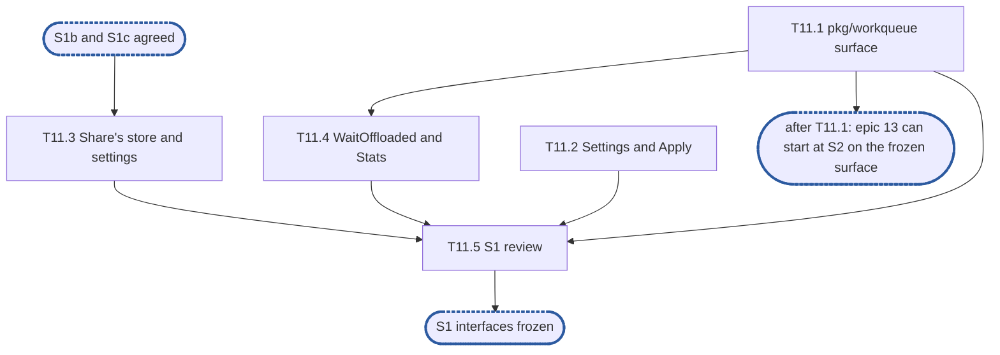

# Epic 11: engine offload interfaces

**Sources:** [RFC 8](../docs/internals/rfcs/rfc-8-engine.md) §2.1 (the declared interfaces, the
contract imports), §2.3 and §2.4 (a share's settings, validated and refused), §2.6 (`Deps`, which
grows only with callers), §6.1.1 (the work scheduler's surface), §11.4 and §12.1 (`WaitOffloaded`,
`Share`, `Stats`), §14 (the series this part fills, as `Stats` fields) and §15.3's "§2.1 declared
interfaces" and "§2.2 no assertions" rows; [RFC 13](../docs/internals/rfcs/rfc-13-configuration.md)
Appendix B, the rows RFC 8 §6.1, §6.2, §6.3, §7.3, §7.4, §8.1, §10.1 and §10.3 define;
[RFC 0](../docs/internals/rfcs/rfc-0-data-lifecycle.md) §1.2, the import rule and the refusal of an
invalid setting; [RFC 3](../docs/internals/rfcs/rfc-3-syncer.md) §1.3 (`StoreID`, `Syncer`, `Flow`)
for the type `Share` carries and the declarations recorded here, and
[RFC 2](../docs/internals/rfcs/rfc-2-carver.md) §1.2, §4.2 and §5.1 (`Cut`, the block name, the fold), for the carver's; [RFC 25](../docs/internals/rfcs/rfc-25-observability.md)
§3.5, the watchdog loop the scheduler turns.
**Track:** the team.
**Epic 11 estimate: 5 subtasks, 9.5 man-days.**
**Depends on:** sync points **S1a to S1d**, the RFC 2 to RFC 5 plans' S1: their epic 1 surfaces
agreed, the RFC 3 plan's epic 1 merged on `feat/storage-v2`, since T11.3 types `Share.Store`
with the `pkg/syncer` root's `StoreID`, and the RFC 4 plan's epic 1 T1.1, which lands `pkg/remote`
as a pure contract, since that root comes with it; #5775, which makes the engine's import walk
transitive and moves `pkg/engine/enginewire` to `internal/node/content` (T11.3 edits whichever of the
two holds the share build when it starts).
**Blocks:** every later epic through S1: epic 12, whose fixture builds `Share` and `Settings` with
the fields frozen here; epic 13, which fills `pkg/workqueue`'s stubs (T11.1); epics 14 to 20, which
fill the `Settings`, `Share` and `Stats` fields and add each recorded declaration with its first
caller (T11.5); the integration epic, which loads the keys and builds `Share.Store`.

---

## 1. Goal

Epic 11 freezes what the offload part adds to the engine's exported surface, with stub bodies
behind final signatures, and settles with the four component plans the interfaces the engine will
declare over their contracts. Apart from the refusal of invalid settings, which the RFC asks of the
surface itself, nothing it declares runs yet.

**At the end of the epic:**

- `pkg/workqueue` exists with RFC 8 §6.1.1's exported surface, every body a stub, and imports nothing
  outside the standard library, which its own import walk enforces;
- `engine.Settings` carries the node-scope keys this part reads, and `Apply` refuses an invalid one
  and keeps the settings it had;
- `engine.Share` names its remote block store and carries the share-scope keys, and `Start` and
  `Bind` refuse invalid share settings;
- `(*Engine).WaitOffloaded` and every `Stats` field of RFC 8 §11.4 and §14 this part fills exist,
  answering a stub and zeros;
- this document records, as the S1 review agreed them, the declarations the engine adds to `Deps`
  for the carver, the syncer, `Refs` and the journal's offload calls, each with the epic that adds
  it; `Deps` itself gains nothing, and §15.3's "§2.1 declared interfaces" row stays green.

### 1.1 In scope

`pkg/workqueue`'s exported types, functions and methods; the engine's `Settings`, `ShareSettings`,
`Share`, `Stats`, `ShareStats`, `JournalStats` additions and `WaitOffloaded`; `Apply`'s and
`validShare`'s refusals; the defaults the node and the fixture pass until the integration epic loads
the keys; the engine's import allowlist for the `pkg/syncer` root and `pkg/workqueue`; the S1
review.

### 1.2 Out of scope

- The scheduler's behaviour, every rule of RFC 8 §6.1.1 (states, batches, backoff, reservations,
  fairness, the watchdog turns, `work_queue_stalled`): epic 13.
- `Deps.Watchdog` and the loop each journal's instance takes: epic 14.
- Reading each key: the retry backoff and `removal.rescan` (epic 14), `offload.max_age` (epic 15),
  read-ahead, the speculation budget and the fill low-water mark (epic 17), the eviction target and
  `eviction.repack_threshold` (epic 18).
- Recording which chunking settings produced a namespace's content and reporting a change as a
  migration (RFC 8 §2.4, RFC 2 §3.6), and §15.3's "§2.4 settings" row: epic 16.
- Opening a share's flow at `Bind` from `Share.Store`, and a backend change replacing the binding:
  epic 16.
- Filling `WaitOffloaded` and the §11.4 figures: epic 20. Filling each §14 field: the epic that owns
  the series (T11.4 names it).
- Each declaration of T11.5 joining `Deps`: epics 15, 16, 17, 18 and 19, with its first caller,
  including how a namespace's chunking parameters reach the pipeline (T11.5, D5).
- Loading the keys from the node's settings table and building `Share.Store` from the syncer's
  registration: epic 21. Key names for the three rows RFC 13 Appendix B leaves unnamed (§9).
- `PreWarm` and the speculator's pre-warm: deferred, unowned until an operator's pre-warm action is
  specified (RFC 8 §12.1 as amended).
- Positive-rate pacing in `pkg/workqueue`, and the pace a `Throttled` result lowers: deferred to
  RFC 9, with GC's sources (RFC 8 §6.1.1).
- `Share.State`'s `Closing` and `Fenced`: deferred to RFC 27, with the re-home.

### 1.3 Names used here

- **S1**, interfaces frozen: the end of this epic, after S1a to S1d.
- **S1a**, carver interface agreed: the RFC 2 plan's S1, the end of its epic 1.
- **S1b**, syncer interface agreed: the RFC 3 plan's S1, the end of its epic 1.
- **S1c**, remote store contract agreed: the RFC 4 plan's S1.
- **S1d**, transform pipeline agreed: the RFC 5 plan's S1.
- **S2**, red rows in CI: the end of epic 12; epics 13, 15 and 17 start there.
- **The integration epic**, epic 21: the node's content wiring composes offload.
- **The first part**: the journal-only engine, epics 1 to 10 of RFC 8's first plan, whose code this
  epic extends.

## 2. How the general rules apply

The rules are those of [the offload plan's §1.5](rfc-8-offload-engine-plan.md#15-general-rules-for-each-epic),
cited by number and title and not copied.

| Rule | Subtasks | How |
| --- | --- | --- |
| rule 1, independent unit tests ([`CLAUDE.md`, "Writing tests"](../CLAUDE.md#writing-tests)) | T11.1 to T11.4 | the refusal tests call `Apply`, `Start` and `Bind` on an engine the first part's unit fixture builds over its in-memory journal; the import walks read the source tree. No test double, and no internal interface for one |
| rule 2, fuzz the key and ref decoders the queue's rebuild reads | none | no decoder: the settings arrive as typed values |
| rule 3, observability follows RFC 25 | T11.4 | the §14 series this part fills become `Stats` fields named for their metric, no per-operation share label, per-share figures in `ShareStats`; no series is recorded yet |
| rule 4, profiling | none | nothing here starts a goroutine or holds a resource |
| rule 5, public interface and internals ([`CLAUDE.md`, "Verifying a change"](../CLAUDE.md#verifying-a-change)) | T11.2, T11.3 | the refusals are asserted where the node and the fixture meet them: `Apply`'s error and the stored settings, read through an `export_test.go` accessor, `Bind`'s error and the binding left as it was |
| rule 6, known failures shrink | none | no row turns green or red here |
| rule 7, v2 ignores v1, and the engine imports only what RFC 0 §1.2 allows | T11.1, T11.3, T11.4 | `pkg/workqueue`'s own walk allows the standard library only (T11.1); the engine's walk gains the `pkg/syncer` root, for `Share.Store`, with the `pkg/remote` root it brings, earlier than the epic that first calls it (D5), and `pkg/workqueue`, a library of this RFC, for `Stats`, and refuses `pkg/syncer/pool` (T11.3, T11.4) |
| rule 8, real dependencies for properties of those dependencies | none | no property of a journal, a store or a remote store is tested here |
| rule 9, code comment conventions ([`CLAUDE.md`, "Code comments"](../CLAUDE.md#code-comments)) | T11.1, T11.2 | RFC 8 §6.1.1's no-borrowing `decision:` is epic 13's, at the reservation code; this epic leaves D3's `decision:` at `Register` and D4's at `Apply` |
| rule 10, a test must be able to fail | T11.1 to T11.4 | each test fails on a planted break: an import the walk must refuse, a setting `Apply` must refuse, a share `Bind` must refuse, a component-typed field in `Stats` or `Share` |
| rule 11, a symbol is exported only if the RFC's interface uses it | all | every symbol is RFC 8 §6.1.1's or §12.1's, or a field §11.4, §14 or RFC 13 Appendix B names; `Loop` and `TenantID`'s shape are D1's and D2's; frozen at S1 |
| rule 12, each subtask creates only what it declares | all | `pkg/workqueue` lands with its stubs and its import walk; no `Deps` member or declared method is added (T11.5 records them); the defaults the node and the fixture pass land with the fields they fill |

## 3. Requirements and invariants

Every obligation RFC 8, RFC 13, RFC 0 and RFC 25 place on this epic, numbered so subtasks and tests
can cite them. Behaviour behind the stubs is listed in §1.2 with its epic.

**The scheduler's surface**

| # | Requirement | Kind | Source | Subtasks |
| --- | --- | --- | --- | --- |
| R1 | The scheduler is a package of its own, `pkg/workqueue`, which each component instantiates; it imports no component, contract or implementation, so no component reaches another through it | MUST NOT | RFC 8 §6.1.1, §2.8; RFC 0 §1.2 | T11.1 |
| R2 | Its exported surface is §6.1.1's, a key's `ID` holding a 16-byte file ID: `Key`, `Item`, `Outcome` with `Done`, `Retry`, `Throttled` and `StopTenant`, `Result`, `Source` with `Rebuild` and `Run`, `Limits` with `Rate`, `Tenant`, `Stats`, `New`, and `Register`, `Start`, `SetTenant`, `Post`, `CancelTenant`, `WaitTenant`, `Stats` and `Stop` on `*Scheduler` | invariant | RFC 8 §6.1.1 (as amended here) | T11.1 |
| R3 | `New` takes the clock as the subset of RFC 8 §2.1's `Clock` the scheduler reads, and its watchdog turn as `Loop`, both in standard-library types, so the node's clock and RFC 25's `*health.Loop` satisfy them as they are | MUST | RFC 8 §2.1, §6.1.1 (as amended here); RFC 25 §3.5, §8.2; RFC 0 §1.2 | T11.1 |
| R4 | A tenant is a shard for the engine and a namespace for GC, so one `TenantID` type holds either | invariant | RFC 8 §6.1.1 | T11.1 |

**Settings**

| # | Requirement | Kind | Source | Subtasks |
| --- | --- | --- | --- | --- |
| R5 | `Settings` carries the node-scope keys this part reads: `offload.retry_min`, `offload.retry_max`, `offload.retry_max_pressure`, `removal.rescan`, `eviction.repack_threshold`, the eviction occupancy target and the fill low-water mark | invariant | RFC 13 Appendix B; RFC 8 §6.1, §6.3, §7.3, §8.1, §10.1, §10.3, §12.1 | T11.2 |
| R6 | `Apply` refuses an invalid setting, NaN included, with an error naming it, and keeps the settings it already had; it never substitutes a default | MUST | RFC 8 §2.4, §12.1; RFC 0 §1.2 | T11.2 |
| R7 | withdrawn: a fixed RFC 13 row never becoming a field is a review rule no test can check; D4 states it | — | RFC 13 Appendix B; RFC 8 §12.1 | — |
| R8 | A share's settings travel on its `Share` and are validated at `Bind`: `offload.max_age`, `readahead.max_blocks`, `readahead.max_bytes` and the speculation budget, the share-scope keys | MUST | RFC 8 §2.3, §2.4, §12.1; RFC 13 Appendix B | T11.3 |
| R9 | A `Start` or `Bind` handed invalid share settings is refused with an error naming the share and the setting; a refused `Bind` leaves a served binding's settings as they were | MUST | RFC 8 §2.3, §2.4, §12.1; RFC 0 §1.2 | T11.3 |

**The share's backends**

| # | Requirement | Kind | Source | Subtasks |
| --- | --- | --- | --- | --- |
| R10 | `Share` names its remote block store by RFC 3's `StoreID`, as the syncer registered it | MUST | RFC 8 §12.1, §2.3, §2.6; RFC 3 §1.3 | T11.3 |
| R11 | The engine's production code imports RFC 3's contract for that type, never its implementation | MUST NOT | RFC 0 §1.2; RFC 8 §2.1, §12.1 | T11.3 |
| R12 | A capability is never wired onto a serving engine by a setter: a share's store reaches the engine only through `Start` and `Bind` | MUST NOT | RFC 8 §2.1, §2.3, §12.1; §15.3 "§2.2 no assertions" | T11.3 |
| R13 | The engine never returns a component to its caller: `Share`, `Stats` and their parts hold values and identifiers, never a flow, a store, a scheduler or a journal | MUST NOT | RFC 8 §12.1 | T11.3, T11.4 |

**Offload's observable surface**

| # | Requirement | Kind | Source | Subtasks |
| --- | --- | --- | --- | --- |
| R14 | `*Engine` offers `WaitOffloaded(ctx) error` | MUST | RFC 8 §11.4, §12.1 | T11.4 |
| R15 | `Stats` has, per share and summed, dirty bytes, the drain rate, the time to drain and the age of the oldest unoffloaded extent | MUST | RFC 8 §11.4, §12.1, §14 | T11.4 |
| R16 | `Stats` has a field for every other RFC 8 §14 series this part fills, named for its metric, with no per-operation share label; the queue and work series come from `pkg/workqueue`'s own `Stats`, per journal and source | MUST | RFC 8 §14, §6.1.1 | T11.4 |

**Declared interfaces**

| # | Requirement | Kind | Source | Subtasks |
| --- | --- | --- | --- | --- |
| R17 | No `Deps` member or declared method is added before the epic that first calls it, so the architecture test that fails on a declared method the engine never calls stays green | test row | RFC 8 §15.3 "§2.1 declared interfaces"; §2.1 | T11.5 |
| R18 | withdrawn: that each declaration matches what the S1 review agreed is a review gate no test can check, T11.5's acceptance; R17's architecture test checks the half a test can | — | RFC 8 §2.1, §2.6; RFC 0 §1.2 | — |

## 4. Decisions this epic takes

- **D1, the scheduler declares its watchdog loop and clock.** RFC 0 §1.2 counts `pkg/health`, which
  holds contract and implementation together, as an implementation, and its walk is transitive, so
  a `pkg/workqueue` importing `*health.Loop` would carry it into GC and, once #5775 cuts the engine's
  own `pkg/health` import, back into the engine. `pkg/workqueue` declares `Loop` (`Turn`, `Idle`) and `Clock` (`Now`, `Elapsed`, `After`, RFC 8
  §2.1's signatures) itself; RFC 25's `*health.Loop` and the node's clock satisfy them unchanged.
  `Loop` has no `Close`: whoever took the loop from the watchdog closes it after `Stop`, as RFC 25
  §3.5 asks, the node for GC's instance and the engine for each journal's (epic 14).
  RFC 8 §6.1.1's sketch read `*health.Loop`, and **this pull request amends it** to the declared
  `Loop`; RFC 23 §2.1's `workqueue.New(cfg.Clock, n.wd.Loop("gc.sched"))` still compiles against it.
  Changing it after S1 would rewrite every instance's construction, the engine's and GC's. No
  marker: the doc comment names RFC 25's loop. Prior art: RFC 20's adapters take a `Loop` of the same shape, plus `Close`,
  through `Deps.Watch`; client-go's workqueue takes a `clock.WithTicker` interface rather than a
  concrete clock (from memory).
- **D2, `TenantID` is `[16]byte`.** RFC 8 §6.1.1 names the type and not its shape. A namespace
  (`entity.NamespaceID`, 16 bytes) fits as it is, and the engine puts a shard (`entity.ShardID`, a
  `uint32`) big-endian in the last four bytes, through an unexported conversion in `queue.go`
  (epic 14) that never leaves the engine: `Stats` reports tenants as shards (D6). The options were a generic `Scheduler[T comparable]`, which changes every signature
  §6.1.1 writes and GC's, and a `string`, which allocates per key on `Post`'s path. Changing it after
  S1 would touch every source and every `Stats` reader. No marker. Prior art: client-go's workqueue
  went from `interface{}` keys to a type parameter in 0.31 (from memory); `[16]byte` avoids both the
  allocation and the parameter.
- **D3, `Register` panics on limits it cannot honour.** §6.1.1 gives `Register` no error, and every
  caller passes constants of its own code: a `Batch`, `Concurrency`, `Weight` or `Total` below 1, a
  `RunTimeout` not positive (it is every run's deadline, and 0 names none), a negative `Deadline`, or a `Rate` other than 0 while positive-rate pacing is
  deferred is a programming error, refused with a panic naming the field, never replaced by a
  default (RFC 0 §1.2). `SourceID` is the registration's index. A `decision:` marker at `Register`
  says so, and is withdrawn if a `Limits` value ever comes from a setting. Prior art:
  `regexp.MustCompile`, Prometheus's `MustRegister` (from memory).
- **D4, node-scope keys on `Settings`, share-scope keys on `Share.Settings`, and the rules
  `Apply` and `Bind` check.** RFC 13 Appendix B gives each key its scope: the three
  `offload.retry_*` keys, `removal.rescan`, `eviction.repack_threshold`, the eviction occupancy
  target and the fill low-water mark are node-scope ("node" or "node, per journal": one value for
  every journal, as `group_commit.max_files` already is); `offload.max_age`, the read-ahead caps and
  the speculation budget are share-scope, so they ride `Share` (RFC 8 §12.1's `Settings
  ShareSettings`). Refused: a duration or size not positive; `retry_min` above `retry_max_pressure`
  or `retry_max_pressure` above `retry_max`, since pressure lowers the cap; a fraction outside
  (0, 1), NaN included. A value RFC 13 classes as fixed (the age tick, the five failed passes, the
  cold-read threshold, the pacing constants, the entries per scheduler instance) is a constant of
  its epic's code, never a field. Every field is required, as the first part's three are, so the node and the fixture pass
  RFC 13's proposed defaults (T11.2, T11.3) until the integration epic loads the table. A
  `decision:` marker at `Apply` names the two orderings as the only relations checked, withdrawn if
  a reader needs another. Prior art: the first part's `Apply`, which refuses a non-positive value
  for each of its keys.
- **D5, `Share` carries `Store syncer.StoreID`, and no chunking parameters.** RFC 8 §12.1 types
  `Share.Store` as RFC 3's `StoreID`, so the `pkg/syncer` root enters the engine's allowlist with the
  field, earlier than epic 16, which first calls the syncer: the field is frozen at S1, so its type
  must exist then. `Store` is not validated here, and a zero one is allowed, as the first part's rows
  bind shares with none: the engine opens no flow until epic 16, whose `Bind` refuses a store the
  syncer does not know when it opens the share's flow. The chunking parameters are not a `Share`
  field: RFC 2 §3.2 makes `Target` a namespace's setting, its `carver.Settings` carries the namespace's keys,
  and RFC 8 §12.1's `Share` names none. They reach the pipeline through the carver's declaration,
  which T11.5 records for S1a to settle (a per-namespace lookup the wiring implements, so the engine
  never holds key material), and which epics 15 and 16 add with their callers. The option of a
  `Chunking carver.Settings` field on `Share` was rejected: it puts keys in a value the node copies and
  logs, and it freezes a choice S1a has not made. Prior art: none found.
- **D6, the `Stats` fields carry each series as the first part's do.** A counter is an `int64`, a
  labelled counter a `map[string]int64` keyed by the label's value, a histogram a `Series`, a gauge
  its plain value; per-share gauges go in `ShareStats` and their sums in `Stats`; the queue and work
  series are `JournalStats.Work`, `map[string]map[entity.ShardID]workqueue.Stats` keyed by source
  (`offload`, `removal`), the engine converting each tenant back to its shard, so no reader decodes
  a `TenantID` (RFC 8 §14). No marker. Prior art: the
  first part's `Stats`, which the node adapts (its D6).
- **D7, the engine's flow is RFC 3's `syncer.Flow`.** Go has no covariant return types, so an
  engine-declared `Syncer` whose `OpenFlow` returned an engine-declared `Flow` would not be satisfied
  by `pkg/syncer/pool`'s syncer. The engine declares `Syncer` with `OpenFlow` alone, returning RFC 3's
  contract `syncer.Flow`, and holds that interface, which RFC 0 §1.2 allows ("the provider's contract
  interface"). §15.3's check then covers `OpenFlow`, a `Deps` interface method, and not the flow's
  `FetchRaw`, `UploadRaw`, `Small` and `FetchVersion`, which the engine does not call and does not
  declare. `Deps.Syncer` is this one-method interface, not RFC 3's whole `syncer.Syncer`, whose
  `Register`, `Unregister`, `SetDrift`, `Close` and `Stats` the engine never calls and §15.3 would
  report. Recorded in T11.5. Prior art: the Go FAQ on covariant result types (from memory).
- **D8, a work-queue key's `ID` is 16 bytes.** RFC 8 §6.1.1 wrote `ID uint64` for "a file", but
  a file is RFC 16's `FileID`, 16 random bytes, which a `uint64` cannot hold without a hash that
  would merge two files' entries. **This pull request amends §6.1.1** to `ID [16]byte`, the file ID
  as it is. GC, the second consumer, keys work per (namespace, source, prefix) (RFC 9 §7.1), so its
  `ID` names a prefix in at most 16 bytes, which the amended comment states; a wider ID would cost
  every entry of every instance memory for a need no RFC states. Changing it after S1 would touch
  every source's posts. Prior art: none found.

## 5. Target tree

On `feat/storage-v2`.

```text
pkg/workqueue/
  workqueue.go            T11.1  the exported surface, stub bodies; Loop, Clock, TenantID, SourceID
  imports_test.go         T11.1  the walk: standard library only
pkg/engine/
  types.go                T11.2  Settings keys; T11.3 ShareSettings, Share.Store, Share.Settings; T11.4 Stats fields
  engine.go               T11.2  Apply's refusals
  share.go                T11.3  validShare's refusal of invalid ShareSettings, called by Start too
  health.go               T11.4  WaitOffloaded (stub); ShareStats, JournalStats fields
  imports_test.go         T11.3  the pkg/syncer root allowed, pool refused; T11.4 pkg/workqueue
  apply_test.go           T11.2  the Settings refusals
  share_test.go           T11.3  the share-settings refusals (the first part's file)
  stats_test.go           T11.4  no component-typed field in Stats or Share (the first part's file)
  conformance/rfc8_cover_test.go  T11.2  TestRFC8C_Settings's refusal table gains the new rules
  *_test.go, internal/vfs/integration  T11.2, T11.3  every engine.Settings and engine.Share literal
  enginetest/fixture.go   T11.2  Settings defaults; T11.3 ShareSettings defaults on every fixture share
  enginetest/unit.go      T11.2  the unit fixture's Settings
internal/node/
  lifecycle.go            T11.2  engineDefaults gains the new keys' proposed values
  content/                T11.3  (or pkg/engine/enginewire before #5775) the share build fills ShareSettings
```

## 6. Subtasks

### T11.1 `pkg/workqueue`'s surface, stubbed

**Subtask T11.1 estimate: 2 man-days.**

- **Track:** the team. **Depends on:** none.
- **Covers:** R1, R2, R3, R4.
- **Deliverables:** `pkg/workqueue/workqueue.go` with RFC 8 §6.1.1's types and calls as written there
  (as amended, D1 and D8: `Key.ID` is `[16]byte`), each doc comment carrying the obligation §6.1.1 states for it (a post never
  blocks; `Limits` fixed per source; `Tenant` live; `Throttled` backing off as `Retry` until `Rate`
  pacing lands), and:
  ```go
  type TenantID [16]byte // a namespace as it is, or a shard big-endian in the last four bytes (D2)
  type SourceID int      // the index of a source's registration
  type Clock interface {
  	Now() time.Time
  	Elapsed() time.Duration
  	After(d time.Duration) <-chan struct{}
  }
  type Loop interface {
  	Turn()
  	Idle()
  }
  type Scheduler struct{ /* unexported */ }
  func New(clk Clock, loop Loop) *Scheduler
  func (s *Scheduler) Register(src Source, l Limits) SourceID // panics on limits it cannot honour (D3)
  ```
  Every body is a stub: `New` returns an empty scheduler, `Register` a counter, `Post` false,
  `SetTenant`, `WaitTenant` and `Stop` `errors.ErrUnsupported`, `Stats` nil. Consumed by epic 13,
  which fills them, epic 14, which registers the engine's two sources, and T11.4. The import walk
  `imports_test.go`, after the journal's `TestImportRule` on `feat/storage-v2`: the package's
  production files import the standard library only; its test files may also import `pkg/health`
  and `pkg/sim`, for the assertions below, since RFC 0 §1.2's rule binds production code only.
- **Acceptance criteria:**
  - The package exports exactly R2's symbols plus `TenantID`, `SourceID`, `Clock`, `Loop` and
    `Scheduler`, with R4's `TenantID` a 16-byte array.
  - `*health.Loop` and `sim`'s test clock satisfy `Loop` and `Clock` (a compile-time assertion in a
    test file, which imports them as tests may).
  - The walk passes on the package.
- **Tests:** the import walk, which fails when a planted `pkg/health` or `pkg/metadata/entity`
  import is added to `workqueue.go` (catches R1); the compile-time assertions `var _ workqueue.Loop
  = (*health.Loop)(nil)` and `var _ workqueue.Clock = (*sim.TestClock)(nil)`, which fail to build if a method's
  signature drifts from RFC 25's or RFC 8 §2.1's (catches R3); an export pin that reads the
  package's scope with `go/types` and compares it, name and kind, with the frozen list, and asserts
  `TenantID`'s underlying type is `[16]byte` and `Key.ID`'s too (catches a symbol added, dropped or
  reshaped, R2, R4). No test double.
- **Rules:** rule 7: the walk is the package's own, refusing every component and every v1 path by
  allowing only the standard library.

### T11.2 Node-scope keys and `Apply`'s refusals

**Subtask T11.2 estimate: 2 man-days.**

- **Track:** the team. **Depends on:** none.
- **Covers:** R5, R6.
- **Deliverables:** `engine.Settings` gains, each commented with its key as the first part's are:
  `OffloadRetryMin`, `OffloadRetryMax`, `OffloadRetryMaxPressure`, `RemovalRescan` (`time.Duration`);
  `RepackThreshold` (`float64`, the unreclaimed fraction of the journal's capacity), `EvictionTarget`
  and `FillLowWater` (`float64`, fractions of the journal's maximum footprint). `Apply` refuses each as D4 says, with an error naming the key, wrapping nothing, as
  the first part's refusals do, and stores nothing; D4's `decision:` marker at `Apply`. `enginetest.Settings`, the unit
  fixture's literal in `enginetest/unit.go` and `internal/node/lifecycle.go`'s `engineDefaults` gain
  RFC 13's proposed values (1 s, 60 s, 5 s, 60 s, 10 %, 85 %, 10 %). Every other `engine.Settings`
  literal on `feat/storage-v2` (35 in 21 files today, mostly `pkg/engine` tests and
  `internal/vfs/integration`) starts from `enginetest.Settings` and overrides only the field it
  tests, except in `package engine`'s own tests, which cannot import `enginetest` (a cycle) and keep
  one unexported copy in `export_test.go`, so the next key added touches one place; `TestRFC8C_Settings`'s refusal table gains a row
  per new rule. Consumed by epics 14, 17 and 18, which read the fields, and the integration epic,
  which loads them.
- **Acceptance criteria:**
  - An `Apply` with any one new key zero, negative, NaN, out of (0, 1), or breaking D4's two orderings is
    refused, and the stored settings, read through an `export_test.go` accessor, are the earlier ones.
- **Tests:** at `Apply`, which the node calls: a table, one row per refusal (each catches a missing
  check, R6), each asserting the error names the key and that the settings an engine read
  afterwards are the earlier ones, read through an `export_test.go` accessor of the stored settings
  (catches a refused `Apply` that stored its value anyway). The first part's `Apply` tests keep
  passing with the fixture's new defaults. No test double.
- **Rules:** rule 9: D4's `decision:` at `Apply`.

### T11.3 `Share`'s store and settings

**Subtask T11.3 estimate: 2 man-days.**

- **Track:** the team. **Depends on:** S1b, S1c.
- **Covers:** R8, R9, R10, R11, R12, R13.
- **Deliverables:** in `types.go`:
  ```go
  type ShareSettings struct {
  	MaxAge            time.Duration // offload.max_age
  	ReadaheadBlocks   int           // readahead.max_blocks
  	ReadaheadBytes    int64         // readahead.max_bytes
  	SpeculationBudget int64         // the speculation budget, bytes in flight
  }
  // Share gains, beside the first part's fields:
  	Store    syncer.StoreID // its remote block store, as the syncer registered it (RFC 8 §12.1); zero until epic 16 opens flows (D5)
  	Settings ShareSettings  // validated by Start and Bind (RFC 8 §2.4)
  ```
  `validShare` refuses a non-positive `ShareSettings` field, naming the share and the key; `Bind`
  already calls it, and `Start` now calls it over every share before step 1 and is refused whole,
  attaching nothing, since RFC 8 §12.1 makes `Start` all or nothing; a `Bind` changing a served share's `Settings` passes the
  same check before `change` applies anything, and `change` keeps the new settings on the binding.
  The engine's `imports_test.go` allows the `pkg/syncer` root to `"*"` and nothing under it, and
  the `pkg/remote` root it imports (RFC 3 §1.3 uses RFC 4's contract as it is), since the walk is
  transitive once #5775 lands; T11.3 waits for the RFC 4 plan's epic 1 T1.1, which lands
  `pkg/remote` as a pure contract and holds it there with an arch test (D5, rule 7). Every `engine.Share` literal the repository builds gains `Settings` from one
  `enginetest.ShareSettings` value (RFC 13's proposed defaults: 5 s, 8 blocks, 64 MiB, 256 MiB), and
  the share build in the node's content wiring (`enginewire.Binding`, or its successor in
  `internal/node/content` after #5775) passes the same defaults until the integration epic loads
  them. Consumed by epic 12's fixture, epic 15 (`MaxAge`), epic 16 (`Store`), epic 17 (read-ahead,
  speculation) and the integration epic.
- **Acceptance criteria:**
  - A `Start` or `Bind` with any `ShareSettings` field zero or negative is refused with the share and
    the key named; a refused `Bind` of a served share leaves its earlier settings in force.
  - A share with a zero `Store` binds, as the first part's rows need.
  - The engine's walk refuses a planted import of `pkg/syncer/pool`, and passes with `Share.Store`
    in place, `pkg/remote` reached through the `pkg/syncer` root.
  - No exported method sets `Store` or `Settings` on a binding: `Bind` is the one way (the first
    part's architecture test, which seeds a setter, stays green).
- **Tests:** at `Bind` and `Start`, which the node calls: a table of invalid settings, each refused
  by name at both calls (catches a missing check, R9); a refused change of a served share whose
  earlier settings are read back through an `export_test.go` accessor of the binding (catches a
  partial apply); the import walk with a planted `pkg/syncer/pool` import (catches R11). No test
  double.
- **Rules:** rule 7, the allowlist change; rule 12: `Store` is declared with no reader yet, the stub
  exception for frozen signatures, and its reader, epic 16, is named above.

### T11.4 `WaitOffloaded` and the `Stats` fields

**Subtask T11.4 estimate: 1.5 man-days.**

- **Track:** the team. **Depends on:** T11.1.
- **Covers:** R13, R14, R15, R16.
- **Deliverables:** in `health.go`, `func (e *Engine) WaitOffloaded(ctx context.Context) error`,
  answering the first part's `errUnbuilt` (epic 20 fills it). `Stats` and its parts gain, each
  commented with its metric as the first part's are (D6):
  - `ShareStats`: `DirtyBytes`, `DrainBytesPerSecond`, `DrainTime`, `OldestUnoffloaded`,
    `RemovalsPending`, `OldestRemoval` (epics 14 and 20);
  - `Stats`, the sums and node-wide series: `DirtyBytes`, `DrainBytesPerSecond`, `DrainTime`,
    `OldestUnoffloaded` (the largest); `OffloadPasses`, `PipelineStateSeconds`, `PipelineRetries`,
    `AttemptsAbandoned`, `IntentsAbandoned`, `FailingFiles`, `PassesAborted`, `IntentMissing`,
    `StageBusy` (epics 15 and 16); `Fetches`, `FetchBytes`, `Fills`, `SpeculationBytes`,
    `SpeculationUsedBytes`, `Reresolves` (epic 17); `EvictedBytes`, `PacingSeconds` (epic 18);
    `LedgerMismatches` (epic 19); `ShareTableLockWaits`, `WorkQueueLockWaits` beside the first part's
    `FileStateLockWaits` (epics 14 and 16);
  - `JournalStats`: `Work`, the scheduler's `Stats` per source and tenant, and `WorkLimits`, the
    `Limits` each source registered, whose `Total` and `Concurrency` are
    `engine_queue_entries_limit` and `engine_work_runs_inflight_limit`; `QueueEvents` by event;
    `ReseedFilesRemaining` (epics 14 and 19). The per-share `engine_queue_entries` is the node
    adapter's sum of `Work`'s tenants by the share each shard belongs to.
  `Stats` is in `types.go`, its parts in `health.go`.
  The engine's walk allows `pkg/workqueue`. Consumed by the epics named, which fill each field, and
  the integration epic, which adapts them.
- **Acceptance criteria:**
  - Every field is frozen now, though epics 14 to 20 fill it, because epic 12's red rows read them
    (the reseed's mismatches, eviction's freed bytes, the drain figures) and must compile at S2.
  - No field of `Share`, `Stats`, `ShareStats` or `JournalStats` has an interface (other than
    `error`), func or channel type (R13).
- **Tests:** at `Stats()`, which the node's adapter reads: a reflection walk over the four types,
  recursive through struct, pointer, map, slice and array elements, that fails on an interface
  (but `error`), func or channel kind, and on a named type of a component's or library's package
  other than an allowlisted value type (`journal.Stats`, `workqueue.Stats`, `workqueue.Limits`,
  `entity`'s), with a planted `*workqueue.Scheduler` field as the case it must refuse (catches a component
  returned to the caller, R13). The copy test of a map lands with the epic that first fills it, since
  an always-empty map cannot be shared wrongly. An external test (`package engine_test`) names every
  new field and calls `WaitOffloaded`, so a field renamed or dropped, or the method's signature
  changed, fails to compile (R14 to R16); it asserts nothing of the stub's answer. No test double.
- **Rules:** rule 3: the fields mirror RFC 8 §14's series; no series is recorded here.

### T11.5 The S1 review and the recorded declarations

**Subtask T11.5 estimate: 2 man-days.**

- **Track:** the team. **Depends on:** T11.1, T11.2, T11.3, T11.4.
- **Covers:** R17.
- **Deliverables:** the review, with the RFC 2 to RFC 5 plans' authors, of every signature this
  epic freezes and of the declarations below; their result folded into this section through a pull
  request against this document, so later epics read them here. As proposed for the review, in the
  components' contract types, each with the epic that adds it to `deps.go` with its first caller:
  ```go
  // RFC 2 §1.2, §4.2, §5.1, in the carver root's types as the RFC 2 plan's epic 1 declares them
  // (pkg/carver: Settings, an alias of the sealed pkg/carver/internal/params.Settings, Chunk,
  // ChunkInfo, AssemblerConfig, BlockPlan, Disposition). The implementations are package functions
  // of pkg/carver/carve and the concrete *assembler.Fold, which the engine may not import, so the
  // wiring hands them in as this one interface (epic 15, with its first caller, Carve). Every call
  // the engine makes is here, beyond RFC 8 §2.1's "Cut and the fold": a namespace's settings,
  // BlockName and the fold's construction; Max is a method of the Settings value and needs no
  // declaration. Proposed (D5): the wiring calls carve.NewSettings with the namespace's Target and
  // keys and answers Settings(ns), so the engine never holds key material; the RFC 2 plan's epic 1
  // breakdown has the engine call NewSettings itself, which S1a reconciles.
  type Carver interface {
  	Settings(ns entity.NamespaceID) (carver.Settings, error) // the namespace's, built by carve.NewSettings in the wiring
  	Cut(r io.Reader, base int64, s carver.Settings, buf []byte, realEnd bool,
  		emit func(carver.Chunk, []byte) error) (consumed int64, err error) // carve.Cut
  	BlockName(scope entity.NamespaceID, nonce [16]byte, chain [32]byte, ids []entity.ChunkHash) entity.BlockName // carve.BlockName, at Intent
  	NewFold(c carver.AssemblerConfig) (Fold, error) // assembler.New, wrapped by the wiring (D7: no covariant return)
  }
  // Fold is the assembler's per-pass fold as the engine calls it; *assembler.Fold satisfies it.
  // Finish's held plan is short and held back: the pass keeps its extents dirty and reports none.
  // A plan carries no namespace or key ID: the pass records both at offer time (Capture).
  type Fold interface {
  	Add(c carver.ChunkInfo) ([]carver.BlockPlan, carver.Disposition)
  	Finish(now time.Time) (last *carver.BlockPlan, held bool)
  }
  // The engine's import walk admits pkg/carver/internal/params beside the pkg/carver root, since
  // the root's alias brings it in, in the change that admits the root (epic 15).
  // RFC 3 §1.3: one flow per share at attach (epic 16). The flow is RFC 3's syncer.Flow (D7):
  // the engine calls Upload (15), Fetch, Prefetch (17), Healthy, Health (16, 18, 20), Close (16).
  type Syncer interface {
  	OpenFlow(store syncer.StoreID, background bool) (syncer.Flow, error)
  }
  // RFC 16 §3.1: the reseed's read (epic 19).
  type Refs interface {
  	Refs(ctx context.Context, file entity.FileID, from int64) iter.Seq2[entity.ChunkRef, error]
  }
  // Handle gains, in the journal's types as feat/storage-v2 has them (RFC 1 §3.3), each only
  // once called (R17), so Offload joins only if epic 15's Capture calls it beside OffloadMany:
  //   OffloadMany (epic 15), MarkOffloaded (epic 15), DirtyFiles (epic 14),
  //   Fill (epic 17), Release, Unmark (epic 18), DropOlder (epic 19, once the journal's epic 7b adds it).
  // Journal gains Reconciled, and Deps AcknowledgeUnreadable (epic 19), as RFC 1 §3 writes them.
  // Not added by this part: Hold and Stamp (RFC 12's, with snapshots); Acknowledge and
  // DropSuperseded, an operator's acknowledgement of an unread range (RFC 28 §3.3), whose action
  // RFC 28's plan adds; each joins with that caller.

  // RFC 4 §4.3, S1c: the put attempt of a block on the share's store. Puts reach the store only as
  // the attempt closure Upload runs, so the wiring hands the pipeline a builder keyed by the
  // binding's store (epic 15), over codec.Store.NewPut and *Put's Attempt and Stored (RFC 4 §4.3,
  // with the RFC 4 plan's epic 1 D9 as settled).
  // Proposed: Deps.Puts func(store syncer.StoreID, name remote.Name, nonce [16]byte, pin transform.Attempt,
  //   src iter.Seq2[remote.Chunk, error]) (Put, error), with Put declaring Attempt(ctx, remote.Meter) error
  //   and Stored() in RFC 4's value types.

  // RFC 5 §2.8, S1d: the chain pin, held from Mint to Commit or Abandon (epic 15).
  type Chain interface {
  	Pin(ctx context.Context, ns entity.NamespaceID) (transform.Attempt, error) // Attempt.Release ends it
  }
  // S1d also names the destroyed-material notice (epic 18, polled), the key-record view the
  // offload commit and the reseed read (epics 18, 19) and the salvage-key wrap (epic 20); each is
  // declared by its epic in RFC 5's contract types as S1d agrees them.

  // Block metadata's views gain, as kvstore has them on feat/storage-v2: Intend, Commit with the
  // block's encodings, Abandon (epic 15); AbandonShardIntents, Existence.Versions and the Census
  // view (epic 19), RFC 6 §10.
  ```
  `Deps` gains nothing here.
- **Acceptance criteria:**
  - The review has agreed each signature above and in T11.1 to T11.4, or this document is revised
    to what it agreed before any later epic starts (S1).
  - §15.3's "§2.1 declared interfaces" and "§2.2 no assertions" rows pass on the epic's last
    change.
- **Tests:** no new test: the first part's architecture test (`arch_test.go`), which seeds an unused
  method and a setter, already enforces R17 and fails, in `engine-conformance`, for the epic that
  adds a declaration without its caller. Each declaration's own test is its adding epic's.
- **Rules:** rule 11: the review is S1's freeze.

## 7. Order of work



T11.1 and T11.2 start at once; T11.3 waits on the RFC 3 plan's epic 1 code (`syncer.StoreID`) and on the RFC 4 plan's epic 1 T1.1, which lands `pkg/remote` as a pure contract.

## 8. Suggested pull requests

| PR | Subtasks | Man-days | After | Why together |
| --- | --- | --- | --- | --- |
| 1 | T11.1, T11.4 | 3.5 | — | the scheduler's surface and the `Stats` fields that expose it |
| 2 | T11.2, T11.3 | 4 | — | the settings, node and share, and the defaults their callers pass; T11.3's half waits on S1b; PR 2 can be open beside PR 1 |
| 3 | T11.5 | 2 | PR 1, PR 2 | the review's result, as a revision of this document |

A suggestion only: one pull request per subtask works as well.

## 9. Open points

- **How a namespace's chunking parameters reach the pipeline (D5)** is S1a's to settle in T11.5;
  epic 15 adds the declaration it agrees.
- **RFC 8 §15.3's "§2.4 settings" row configures `Min ≥ Target`**, which RFC 2 §3.2 makes
  unconfigurable (`Min` is `Target / 4`, and `Target` is a namespace's setting the carver's
  constructor checks, RFC 2 §3.7). The row's first half needs rewording to a `Target` the carver
  refuses, reaching the engine at `Bind`; epic 16 owns the row and proposes the amendment.
- **Three RFC 13 Appendix B rows name no key**: the eviction occupancy target, the fill low-water
  mark and the speculation budget. The fields exist here; the integration epic loads them once RFC
  13 names their keys, as it waits for `Target`'s.
- **RFC 8 §2.6's `Deps.Watchdog *health.Watchdog` and `Metrics *metrics.Registry`** import
  implementations RFC 0 §1.2 now forbids the engine. `Metrics` is already left out; epic 14, which
  adds the watchdog member, declares what it calls instead (a function from a loop's name to a
  `workqueue.Loop` the node fills, plus a way to close the loop when a journal's scheduler stops,
  since the scheduler's `Loop` has no `Close`) and amends §2.6 with it.
- **RFC 8 §2.1's carver row names only `Cut` and the fold**, while the engine also calls
  `NewSettings`, `BlockName` and the fold's constructor (T11.5, from the RFC 2 plan's epic 1
  breakdown). Epic 15, which adds the declaration, amends the row in its pull request.
- **RFC 8 §2.1 lists `Offload` beside `OffloadMany`** in the handle row; if epic 15's Capture calls
  only `OffloadMany`, epic 15 amends the row so §15.3's declared-interfaces check stays honest.
- **The oldest-unoffloaded alert bound** (RFC 13 Appendix B, share scope, RFC 8 §11.4) is an alert
  rule's threshold, which epic 21 writes with the rule; it is not a `ShareSettings` field. Epic 20's
  `offload_age_exceeded` condition reads it from there if RFC 25 §7's rules turn out not to carry
  it.
