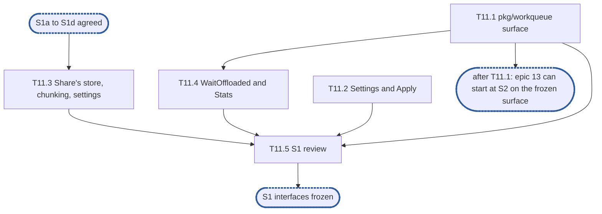

# Epic 11: engine offload interfaces

**Sources:** [RFC 8](../docs/internals/rfcs/rfc-8-engine.md) §2.1 (the declared interfaces, the
contract imports), §2.3 and §2.4 (a share's settings, validated and refused), §2.6 (`Deps`, which
grows only with callers), §6.1.1 (the work scheduler's surface), §11.4 and §12.1 (`WaitOffloaded`,
`Share`, `Stats`), §14 (the series this part fills, as `Stats` fields) and §15.3's "§2.1 declared
interfaces" and "§2.2 no assertions" rows; [RFC 13](../docs/internals/rfcs/rfc-13-configuration.md)
Appendix B, the rows RFC 8 §6.1, §6.2, §6.3, §7.3, §7.4, §8.1, §10.1 and §10.3 define;
[RFC 0](../docs/internals/rfcs/rfc-0-data-lifecycle.md) §1.2, the import rule and the refusal of an
invalid setting; [RFC 3](../docs/internals/rfcs/rfc-3-syncer.md) §1.3 (`StoreID`, `Syncer`, `Flow`)
and [RFC 2](../docs/internals/rfcs/rfc-2-carver.md) §1.2 (`Cut`, `Params`), for the types `Share`
carries and the declarations recorded here; [RFC 25](../docs/internals/rfcs/rfc-25-observability.md)
§3.5, the watchdog loop the scheduler turns.
**Track:** the team.
**Epic 11 estimate: 5 subtasks, 9.5 man-days.**
**Depends on:** sync points **S1a to S1d**, the RFC 2 to RFC 5 plans' S1: their epic 1 surfaces
agreed and merged on `feat/storage-v2`, since T11.3 types `Share` with the `pkg/syncer` root's
`StoreID` and the `pkg/carver` root's `Params`; #5775, which makes the engine's import walk
transitive and moves `pkg/engine/enginewire` to `internal/node/content` (T11.3 edits whichever of the
two holds the share build when it starts).
**Blocks:** every later epic through S1: epic 12, whose fixture builds `Share` and `Settings` with
the fields frozen here; epic 13, which fills `pkg/workqueue`'s stubs (T11.1); epics 14 to 20, which
fill the `Settings`, `Share` and `Stats` fields and add each recorded declaration with its first
caller (T11.5); the integration epic, which loads the keys and builds `Share.Store`.

---

## 1. Goal

Epic 11 freezes what the offload part adds to the engine's exported surface, with stub bodies
behind final signatures, and settles with the four component plans the interfaces the engine will
declare over their contracts. Apart from the refusal of invalid settings, which the RFC asks of the
surface itself, nothing it declares runs yet.

**At the end of the epic:**

- `pkg/workqueue` exists with RFC 8 §6.1.1's exported surface, every body a stub, and imports nothing
  outside the standard library, which its own import walk enforces;
- `engine.Settings` carries the node-scope keys this part reads, and `Apply` refuses an invalid one
  and keeps the settings it had;
- `engine.Share` names its remote block store and carries the share-scope keys and its namespace's
  chunking parameters, and `Start` and `Bind` refuse invalid share settings;
- `(*Engine).WaitOffloaded` and every `Stats` field of RFC 8 §11.4 and §14 this part fills exist,
  answering a stub and zeros;
- this document records, as the S1 review agreed them, the declarations the engine adds to `Deps`
  for the carver, the syncer, `Refs` and the journal's offload calls, each with the epic that adds
  it; `Deps` itself gains nothing, and §15.3's "§2.1 declared interfaces" row stays green.

### 1.1 In scope

`pkg/workqueue`'s exported types, functions and methods; the engine's `Settings`, `ShareSettings`,
`Share`, `Stats`, `ShareStats`, `JournalStats` additions and `WaitOffloaded`; `Apply`'s and
`validShare`'s refusals; the defaults the node and the fixture pass until the integration epic loads
the keys; the engine's import allowlist for the two contract roots `Share` uses; the S1 review.

### 1.2 Out of scope

- The scheduler's behaviour, every rule of RFC 8 §6.1.1 (states, batches, backoff, reservations,
  fairness, the watchdog turns, `work_queue_stalled`): epic 13.
- `Deps.Watchdog` and the loop each journal's instance takes (D6 of the offload plan): epic 14.
- Reading each key: the retry backoff and `removal.rescan` (epic 14), `offload.max_age` (epic 15),
  read-ahead, the speculation budget and the fill low-water mark (epic 17), the eviction target and
  `eviction.repack_threshold` (epic 18).
- Recording which chunking settings produced a namespace's content and reporting a change as a
  migration (RFC 8 §2.4, RFC 2 §3.6), and §15.3's "§2.4 settings" row: epic 16.
- Opening a share's flow at `Bind` from `Share.Store`, and a backend change replacing the binding:
  epic 16.
- Filling `WaitOffloaded` and the §11.4 figures: epic 20. Filling each §14 field: the epic that owns
  the series (T11.4 names it).
- Each declaration of T11.5 joining `Deps`: epics 15, 16, 17, 18 and 19, with its first caller.
- Loading the keys from the node's settings table and building `Share.Store` from the syncer's
  registration: epic 21. Key names for the three rows RFC 13 Appendix B leaves unnamed (§9).
- `PreWarm` and positive-rate pacing: deferred, rows of the [offload plan's deferral
  ledger](rfc-8-offload-engine-plan.md#61-deferral-ledger) ("`PreWarm` and the speculator's
  pre-warm…", "Positive-rate pacing in `pkg/workqueue`…").
- `Share.State`'s `Closing` and `Fenced`: deferred with the re-home, the ledger's RFC 27 row.

### 1.3 Names used here

- **E1, E2**: the roles epic 11 and epic 12 play in this part, interfaces and red rows.
- **S1**, interfaces frozen: the end of this epic, after S1a to S1d.
- **S1a**, carver interface agreed: the RFC 2 plan's S1, the end of its epic 1.
- **S1b**, syncer interface agreed: the RFC 3 plan's S1, the end of its epic 1.
- **S1c**, remote store contract agreed: the RFC 4 plan's S1.
- **S1d**, transform pipeline agreed: the RFC 5 plan's S1.
- **S2**, red rows in CI: the end of epic 12; epics 13, 15 and 17 start there.
- **S5**, offload components built: the four components' implementation epics.
- **S6**, journal offload half built: the journal plan's epics 9b and 7b.
- **The integration epic**, epic 21: the node's content wiring composes offload.
- **The first part**: the journal-only engine, epics 1 to 10 of RFC 8's first plan, whose code this
  epic extends.

## 2. How the general rules apply

The rules are those of [the offload plan's §1.5](rfc-8-offload-engine-plan.md#15-general-rules-for-each-epic),
cited by number and title and not copied.

| Rule | Subtasks | How |
| --- | --- | --- |
| rule 1, independent unit tests ([`CLAUDE.md`, "Writing tests"](../CLAUDE.md#writing-tests)) | T11.1 to T11.4 | the refusal tests call `Apply`, `Start` and `Bind` on an engine the first part's unit fixture builds over its in-memory journal; the import walks read the source tree. No test double, and no internal interface for one |
| rule 2, fuzz the key and ref decoders the queue's rebuild reads | none | no decoder: the settings arrive as typed values |
| rule 3, observability follows RFC 25 | T11.4 | the §14 series this part fills become `Stats` fields named for their metric, no per-operation share label, per-share figures in `ShareStats`; no series is recorded yet |
| rule 4, profiling | none | nothing here starts a goroutine or holds a resource |
| rule 5, public interface and internals ([`CLAUDE.md`, "Verifying a change"](../CLAUDE.md#verifying-a-change)) | T11.2, T11.3 | the refusals are asserted where the node and the fixture meet them: `Apply`'s error and the settings a later `Stats`-visible read keeps, `Bind`'s error and the binding left as it was |
| rule 6, known failures shrink | none | no row turns green or red here |
| rule 7, v2 ignores v1, and the engine imports only what RFC 0 §1.2 allows | T11.1, T11.3, T11.4 | `pkg/workqueue`'s own walk allows the standard library only (T11.1); the engine's walk gains the `pkg/syncer` and `pkg/carver` roots, for `Share`'s fields, and `pkg/workqueue`, a library of this RFC, for `Stats`, and refuses `pkg/syncer/pool`, `pkg/carver/carve` and `pkg/carver/assembler` (T11.3, T11.4; D5) |
| rule 8, real dependencies for properties of those dependencies | none | no property of a journal, a store or a remote store is tested here |
| rule 9, code comment conventions ([`CLAUDE.md`, "Code comments"](../CLAUDE.md#code-comments)) | T11.1, T11.2 | RFC 8 §6.1.1's no-borrowing `decision:` is epic 13's, at the reservation code; this epic leaves D3's `decision:` at `Register` and D4's at `Apply` |
| rule 10, a test must be able to fail | T11.1 to T11.4 | each test fails on a planted break: an import the walk must refuse, a setting `Apply` must refuse, a share `Bind` must refuse, a component-typed field in `Stats` or `Share` |
| rule 11, a symbol is exported only if the RFC's interface uses it | all | every symbol is RFC 8 §6.1.1's or §12.1's, or a field §11.4, §14 or RFC 13 Appendix B names; `Loop` and `TenantID`'s shape are D1's and D2's; frozen at S1 |
| rule 12, each subtask creates only what it declares | all | `pkg/workqueue` lands with its stubs and its import walk; no `Deps` member or declared method is added (T11.5 records them); the defaults the node and the fixture pass land with the fields they fill |

## 3. Requirements and invariants

Every obligation RFC 8, RFC 13, RFC 0 and RFC 25 place on this epic, numbered so subtasks and tests
can cite them. Behaviour behind the stubs is listed in §1.2 with its epic.

**The scheduler's surface**

| # | Requirement | Kind | Source | Subtasks |
| --- | --- | --- | --- | --- |
| R1 | The scheduler is a package of its own, `pkg/workqueue`, which each component instantiates; it imports no component, contract or implementation, so no component reaches another through it | MUST NOT | RFC 8 §6.1.1, §2.8; RFC 0 §1.2 | T11.1 |
| R2 | Its exported surface is §6.1.1's: `Key`, `Item`, `Outcome` with `Done`, `Retry`, `Throttled` and `StopTenant`, `Result`, `Source` with `Rebuild` and `Run`, `Limits` with `Rate`, `Tenant`, `Stats`, `New`, and `Register`, `Start`, `SetTenant`, `Post`, `CancelTenant`, `WaitTenant`, `Stats` and `Stop` on `*Scheduler` | invariant | RFC 8 §6.1.1 | T11.1 |
| R3 | `New` takes the clock as the subset of RFC 8 §2.1's `Clock` the scheduler reads, and its watchdog turn as `Loop`, both in standard-library types, so the node's clock and RFC 25's `*health.Loop` satisfy them as they are | MUST | RFC 8 §2.1, §6.1.1 (as amended here); RFC 25 §3.5; RFC 0 §1.2 | T11.1 |
| R4 | A tenant is a shard for the engine and a namespace for GC, so one `TenantID` type holds either | invariant | RFC 8 §6.1.1 | T11.1 |

**Settings**

| # | Requirement | Kind | Source | Subtasks |
| --- | --- | --- | --- | --- |
| R5 | `Settings` carries the node-scope keys this part reads: `offload.retry_min`, `offload.retry_max`, `offload.retry_max_pressure`, `removal.rescan`, `eviction.repack_threshold`, the eviction occupancy target and the fill low-water mark | invariant | RFC 13 Appendix B; RFC 8 §6.1, §6.3, §7.3, §8.1, §10.1, §10.3 | T11.2 |
| R6 | `Apply` refuses an invalid setting with an error naming it, and keeps the settings it already had; it never substitutes a default | MUST | RFC 8 §2.4; RFC 0 §1.2 | T11.2 |
| R7 | A setting RFC 13 classes as fixed (the age tick, five failed passes, the cold-read threshold, the pacing constants, the entries per scheduler instance) is a constant of its epic's code, never a `Settings` or `ShareSettings` field | invariant | RFC 13 Appendix B | T11.2, T11.3 |
| R8 | A share's settings travel on its `Share` and are validated at `Bind`: `offload.max_age`, `readahead.max_blocks`, `readahead.max_bytes` and the speculation budget, the share-scope keys | MUST | RFC 8 §2.3, §2.4, §12.1; RFC 13 Appendix B | T11.3 |
| R9 | A `Start` or `Bind` handed invalid share settings is refused with an error naming the share and the setting; a refused `Bind` leaves a served binding's settings as they were | MUST | RFC 8 §2.4; RFC 0 §1.2 | T11.3 |

**The share's backends**

| # | Requirement | Kind | Source | Subtasks |
| --- | --- | --- | --- | --- |
| R10 | `Share` names its remote block store by RFC 3's `StoreID`, as the syncer registered it, and carries its namespace's chunking parameters as RFC 2's `Params` | MUST | RFC 8 §12.1, §2.3, §2.6; RFC 3 §1.3; RFC 2 §1.2 | T11.3 |
| R11 | The engine's production code imports only the contract roots `pkg/syncer` and `pkg/carver` for these types, never `pkg/syncer/pool`, `pkg/carver/carve` or `pkg/carver/assembler` | MUST NOT | RFC 0 §1.2; RFC 8 §2.1, §12.1 | T11.3 |
| R12 | A capability is never wired onto a serving engine by a setter: a share's store reaches the engine only through `Start` and `Bind` | MUST NOT | RFC 8 §2.1; §15.3 "§2.2 no assertions" | T11.3 |
| R13 | The engine never returns a component to its caller: `Share`, `Stats` and their parts hold values and identifiers, never a flow, a store, a scheduler or a journal | MUST NOT | RFC 8 §12.1 | T11.3, T11.4 |

**Offload's observable surface**

| # | Requirement | Kind | Source | Subtasks |
| --- | --- | --- | --- | --- |
| R14 | `*Engine` offers `WaitOffloaded(ctx) error` | MUST | RFC 8 §11.4, §12.1 | T11.4 |
| R15 | `Stats` has, per share and summed, dirty bytes, the drain rate, the time to drain and the age of the oldest unoffloaded extent | MUST | RFC 8 §11.4, §14 | T11.4 |
| R16 | `Stats` has a field for every other RFC 8 §14 series this part fills, named for its metric, with no per-operation share label; the queue and work series come from `pkg/workqueue`'s own `Stats`, per journal and source | MUST | RFC 8 §14, §6.1.1 | T11.4 |

**Declared interfaces**

| # | Requirement | Kind | Source | Subtasks |
| --- | --- | --- | --- | --- |
| R17 | No `Deps` member or declared method is added before the epic that first calls it, so the architecture test that fails on a declared method the engine never calls stays green | test row | RFC 8 §15.3 "§2.1 declared interfaces"; §2.1 | T11.5 |
| R18 | The interfaces the engine will declare for the carver and its assembler, the syncer and its flow, `Refs` and the journal's offload calls each hold exactly the methods RFC 8 §2.1's table names, over the components' contract types, as the S1 review agreed them | MUST | RFC 8 §2.1, §2.6; RFC 0 §1.2 | T11.5 |

## 4. Decisions this epic takes

- **D1, the scheduler declares its watchdog loop and clock.** RFC 0 §1.2 counts `pkg/health`, which
  holds contract and implementation together, as an implementation, and the engine's walk is
  transitive, so a `pkg/workqueue` importing `*health.Loop` would carry it into the engine and into
  GC. `pkg/workqueue` declares `Loop` (`Turn`, `Idle`) and `Clock` (`Now`, `Elapsed`, `After`, RFC 8
  §2.1's signatures) itself; RFC 25's `*health.Loop` and the node's clock satisfy them unchanged.
  RFC 8 §6.1.1's sketch read `*health.Loop`, and **this pull request amends it** to the declared
  `Loop`; RFC 23 §2.1's `workqueue.New(cfg.Clock, n.wd.Loop("gc.sched"))` still compiles against it.
  Changing it after S1 would rewrite every instance's construction, the engine's and GC's. No
  marker: the doc comment names RFC 25's loop. Prior art: RFC 20's adapters take the same `Loop`
  through `Deps.Watch`; client-go's workqueue takes a `clock.WithTicker` interface rather than a
  concrete clock (from memory).
- **D2, `TenantID` is `[16]byte`.** RFC 8 §6.1.1 names the type and not its shape. A namespace
  (`entity.NamespaceID`, 16 bytes) fits as it is, and the engine puts a shard (`entity.ShardID`, a
  `uint32`) big-endian in the last four bytes, through an unexported conversion in `queue.go`
  (epic 14). The options were a generic `Scheduler[T comparable]`, which changes every signature
  §6.1.1 writes and GC's, and a `string`, which allocates per key on `Post`'s path. Changing it after
  S1 would touch every source and every `Stats` reader. No marker. Prior art: client-go's workqueue
  went from `interface{}` keys to a type parameter in 0.31 (from memory); `[16]byte` avoids both the
  allocation and the parameter.
- **D3, `Register` panics on limits it cannot honour.** §6.1.1 gives `Register` no error, and every
  caller passes constants of its own code: a `Batch`, `Concurrency`, `Weight` or `Total` below 1, a
  negative `RunTimeout` or `Deadline`, or a `Rate` other than 0 while positive-rate pacing is
  deferred is a programming error, refused with a panic naming the field, never replaced by a
  default (RFC 0 §1.2). `SourceID` is the registration's index. A `decision:` marker at `Register`
  says so, and is withdrawn if a `Limits` value ever comes from a setting. Prior art:
  `regexp.MustCompile`, Prometheus's `MustRegister` (from memory).
- **D4, node-scope keys on `Settings`, share-scope keys on `Share.Settings`, and the rules
  `Apply` and `Bind` check.** RFC 13 Appendix B gives each key its scope: the three
  `offload.retry_*` keys, `removal.rescan`, `eviction.repack_threshold`, the eviction occupancy
  target and the fill low-water mark are node-scope ("node" or "node, per journal": one value for
  every journal, as `group_commit.max_files` already is); `offload.max_age`, the read-ahead caps and
  the speculation budget are share-scope, so they ride `Share` (RFC 8 §12.1's `Settings
  ShareSettings`). Refused: a duration or size not positive; `retry_min` above `retry_max_pressure`
  or `retry_max_pressure` above `retry_max`, since pressure lowers the cap; a fraction outside
  (0, 1). Every field is required, as the first part's three are, so the node and the fixture pass
  RFC 13's proposed defaults (T11.2, T11.3) until the integration epic loads the table. A
  `decision:` marker at `Apply` names the two orderings as the only relations checked, withdrawn if
  a reader needs another. Prior art: the first part's `Apply`, which refuses a non-positive value
  for each of its keys.
- **D5, `Share` carries `Store syncer.StoreID` and `Chunking carver.Params`, and the contract roots
  enter the engine here.** RFC 8 §12.1 types `Share.Store` as RFC 3's `StoreID`; RFC 2's `Cut` takes
  a `Params` built per namespace from its `Target` and keys (RFC 2 §1.2, §3.2, §3.7), and RFC 8
  §2.3 has a binding copy its settings at `Bind`. A per-namespace `Params` on `Share` keeps the
  key material out of `Settings` and `Deps` and lets epic 16 compare it with the recorded settings
  at `Bind` (D11 of the offload plan). The two roots enter the engine's allowlist with these fields,
  earlier than the epics that first call into them (15 and 16): the fields are frozen at S1, so
  their types must exist then. `Store` is not validated here: the engine opens no flow until epic
  16, whose `OpenFlow` refuses an unregistered store; `Chunking` is valid by construction, since
  only `carve`'s constructor builds a `Params` and it refuses invalid settings. `Share` holds key
  material from then on: nothing logs or prints a `Share` whole, a rule this subtask's doc comment
  states. The S1a review may move `Params` elsewhere (T11.5); that moves one field before any epic
  reads it. Prior art: none found.
- **D6, the `Stats` fields carry each series as the first part's do.** A counter is an `int64`, a
  labelled counter a `map[string]int64` keyed by the label's value, a histogram a `Series`, a gauge
  its plain value; per-share gauges go in `ShareStats` and their sums in `Stats`; the queue and work
  series are `JournalStats.Work`, `map[string]map[workqueue.TenantID]workqueue.Stats` keyed by
  source (`offload`, `removal`), since the library owns them (RFC 8 §14). No marker. Prior art: the
  first part's `Stats`, which the node adapts (its D6).
- **D7, the engine's flow is RFC 3's `syncer.Flow`.** Go has no covariant return types, so an
  engine-declared `Syncer` whose `OpenFlow` returned an engine-declared `Flow` would not be satisfied
  by `pkg/syncer/pool`'s syncer. The engine declares `Syncer` with `OpenFlow` alone, returning RFC 3's
  contract `syncer.Flow`, and holds that interface, which RFC 0 §1.2 allows ("the provider's contract
  interface"). §15.3's check then covers `OpenFlow`, a `Deps` interface method, and not the flow's
  `FetchRaw`, `UploadRaw`, `Small` and `FetchVersion`, which the engine does not call and does not
  declare. `Deps.Syncer` is this one-method interface, not RFC 3's whole `syncer.Syncer`, whose
  `Register`, `Unregister`, `SetDrift`, `Close` and `Stats` the engine never calls and §15.3 would
  report. Recorded in T11.5. Prior art: the Go FAQ on covariant result types (from memory).

## 5. Target tree

On `feat/storage-v2`.

```text
pkg/workqueue/
  workqueue.go            T11.1  the exported surface, stub bodies; Loop, Clock, TenantID, SourceID
  imports_test.go         T11.1  the walk: standard library only
pkg/engine/
  types.go                T11.2  Settings keys; T11.3 ShareSettings, Share.Store, Share.Chunking, Share.Settings
  engine.go               T11.2  Apply's refusals
  share.go                T11.3  validShare's refusal of invalid ShareSettings
  health.go               T11.4  WaitOffloaded (stub); Stats, ShareStats, JournalStats fields
  imports_test.go         T11.3  pkg/syncer, pkg/carver roots allowed; pool, carve, assembler refused; T11.4 pkg/workqueue
  apply_test.go           T11.2  the Settings refusals
  share_test.go           T11.3  the share-settings refusals (the first part's file)
  stats_test.go           T11.4  no component-typed field in Stats or Share
  enginetest/fixture.go   T11.2  Settings defaults; T11.3 ShareSettings defaults on every fixture share
  enginetest/unit.go      T11.2  the unit fixture's Settings
internal/node/
  lifecycle.go            T11.2  engineDefaults gains the new keys' proposed values
  content/                T11.3  (or pkg/engine/enginewire before #5775) the share build fills ShareSettings
```

## 6. Subtasks

### T11.1 `pkg/workqueue`'s surface, stubbed

**Subtask T11.1 estimate: 2.5 man-days.**

- **Track:** the team. **Depends on:** none.
- **Covers:** R1, R2, R3, R4.
- **Deliverables:** `pkg/workqueue/workqueue.go` with RFC 8 §6.1.1's types and calls as written there
  (as amended, D1), each doc comment carrying the obligation §6.1.1 states for it (a post never
  blocks; `Limits` fixed per source; `Tenant` live; `Throttled` backing off as `Retry` until `Rate`
  pacing lands), and:
  ```go
  type TenantID [16]byte // a namespace as it is, or a shard big-endian in the last four bytes (D2)
  type SourceID int      // the index of a source's registration
  type Clock interface {
  	Now() time.Time
  	Elapsed() time.Duration
  	After(d time.Duration) <-chan struct{}
  }
  type Loop interface {
  	Turn()
  	Idle()
  }
  type Scheduler struct{ /* unexported */ }
  func New(clk Clock, loop Loop) *Scheduler
  func (s *Scheduler) Register(src Source, l Limits) SourceID // panics on limits it cannot honour (D3)
  ```
  Every body is a stub: `New` returns an empty scheduler, `Register` a counter, `Post` false,
  `SetTenant`, `WaitTenant` and `Stop` `errors.ErrUnsupported`, `Stats` nil. Consumed by epic 13,
  which fills them, epic 14, which registers the engine's two sources, and T11.4. The import walk
  `imports_test.go`, after the journal's `TestImportRule` on `feat/storage-v2`: every package under
  `pkg/workqueue` imports the standard library only, test packages included.
- **Acceptance criteria:**
  - `go doc ./pkg/workqueue` lists exactly R2's symbols plus `TenantID`, `SourceID`, `Clock`, `Loop`
    and `Scheduler`.
  - `*health.Loop` and `sim`'s test clock satisfy `Loop` and `Clock` (a compile-time assertion in a
    test file, which imports them as tests may).
  - The walk passes on the package.
- **Tests:** the import walk, which fails when a planted `pkg/health` or `pkg/metadata/entity`
  import is added to `workqueue.go` (catches R1); the compile-time assertions `var _ workqueue.Loop
  = (*health.Loop)(nil)` and the same for the test clock, which fail to build if a method's
  signature drifts from RFC 25's or RFC 8 §2.1's (catches R3). No test double.
- **Rules:** rule 7: the walk is the package's own, refusing every component and every v1 path by
  allowing only the standard library.

### T11.2 Node-scope keys and `Apply`'s refusals

**Subtask T11.2 estimate: 1.5 man-days.**

- **Track:** the team. **Depends on:** none.
- **Covers:** R5, R6, R7.
- **Deliverables:** `engine.Settings` gains, each commented with its key as the first part's are:
  `OffloadRetryMin`, `OffloadRetryMax`, `OffloadRetryMaxPressure`, `RemovalRescan` (`time.Duration`);
  `RepackThreshold`, `EvictionTarget`, `FillLowWater` (`float64`, fractions of the journal's maximum
  footprint). `Apply` refuses each as D4 says, with an error naming the key, `vfserr.ErrInvalid`
  wrapped, and stores nothing; D4's `decision:` marker at `Apply`. `enginetest.Settings`, the unit
  fixture's literal in `enginetest/unit.go` and `internal/node/lifecycle.go`'s `engineDefaults` gain
  RFC 13's proposed values (1 s, 60 s, 5 s, 60 s, 10 %, 85 %, 10 %). Consumed by epics 14, 17 and 18,
  which read the fields, and the integration epic, which loads them.
- **Acceptance criteria:**
  - An `Apply` with any one new key zero, negative, out of (0, 1), or breaking D4's two orderings is
    refused, and a later valid `Apply` sees the earlier valid settings were kept.
  - No field names a value RFC 13 classes as fixed (R7): the review checks the struct against
    Appendix B's "fixed" rows.
- **Tests:** at `Apply`, which the node calls: a table, one row per refusal (each catches a missing
  check, R6), each asserting the error names the key and that the settings an engine read
  afterwards are the earlier ones, read through an `export_test.go` accessor of the stored settings
  (catches a refused `Apply` that stored its value anyway). The first part's `Apply` tests keep
  passing with the fixture's new defaults. No test double.
- **Rules:** rule 9: D4's `decision:` at `Apply`.

### T11.3 `Share`'s store, chunking parameters and settings

**Subtask T11.3 estimate: 2.5 man-days.**

- **Track:** the team. **Depends on:** S1a, S1b.
- **Covers:** R7, R8, R9, R10, R11, R12, R13.
- **Deliverables:** in `types.go`:
  ```go
  type ShareSettings struct {
  	MaxAge            time.Duration // offload.max_age
  	ReadaheadBlocks   int           // readahead.max_blocks
  	ReadaheadBytes    int64         // readahead.max_bytes
  	SpeculationBudget int64         // the speculation budget, bytes in flight
  }
  // Share gains, beside the first part's fields:
  	Store    syncer.StoreID // its remote block store, as the syncer registered it (RFC 8 §12.1)
  	Chunking carver.Params  // its namespace's chunking parameters, keys included: never log a Share whole (D5)
  	Settings ShareSettings  // validated by Start and Bind (RFC 8 §2.4)
  ```
  `validShare` refuses a non-positive `ShareSettings` field, naming the share and the key, so `Start`
  and `Bind` refuse it; a `Bind` changing a served share's `Settings` passes them through the same
  check before `change` applies anything. The engine's `imports_test.go` allows `pkg/syncer` and
  `pkg/carver` to `"*"` and nothing under them (D5, rule 7). Every `engine.Share` literal the
  repository builds gains `Settings` from one `enginetest.ShareSettings` value (RFC 13's proposed
  defaults: 5 s, 8 blocks, 64 MiB, 256 MiB), and the share build in the node's content wiring
  (`enginewire.go`, or `internal/node/content` after #5775) passes the same defaults until the
  integration epic loads them. Consumed by epic 12's fixture, epic 15 (`Chunking`, `MaxAge`), epic
  16 (`Store`, the chunking migration), epic 17 (read-ahead, speculation) and the integration epic.
- **Acceptance criteria:**
  - A `Start` or `Bind` with any `ShareSettings` field zero or negative is refused with the share and
    the key named; a refused `Bind` of a served share leaves its earlier settings in force.
  - The engine's walk refuses a planted import of `pkg/syncer/pool` or `pkg/carver/carve`.
  - No exported method sets `Store`, `Chunking` or `Settings` on a binding: `Bind` is the one way
    (the first part's architecture test, which seeds a setter, stays green).
- **Tests:** at `Bind` and `Start`, which the node calls: a table of invalid settings, each refused
  by name (catches a missing check, R9), and a refused change of a served share whose earlier
  settings are read back through an `export_test.go` accessor of the binding (catches a partial
  apply); the import walk with a planted `pkg/syncer/pool` import (catches R11). No test double.
- **Rules:** rule 7, the allowlist change; rule 12: `Store` and `Chunking` are declared with no
  reader yet, the stub exception for frozen signatures, and their readers are named above.

### T11.4 `WaitOffloaded` and the `Stats` fields

**Subtask T11.4 estimate: 1.5 man-days.**

- **Track:** the team. **Depends on:** T11.1.
- **Covers:** R13, R14, R15, R16.
- **Deliverables:** in `health.go`, `func (e *Engine) WaitOffloaded(ctx context.Context) error`,
  answering the first part's `errUnbuilt` (epic 20 fills it). `Stats` and its parts gain, each
  commented with its metric as the first part's are (D6):
  - `ShareStats`: `DirtyBytes`, `DrainBytesPerSecond`, `DrainTime`, `OldestUnoffloaded`,
    `RemovalsPending`, `OldestRemoval` (epics 14 and 20);
  - `Stats`, the sums and node-wide series: `DirtyBytes`, `DrainBytesPerSecond`, `DrainTime`,
    `OldestUnoffloaded` (the largest); `OffloadPasses`, `PipelineStateSeconds`, `PipelineRetries`,
    `AttemptsAbandoned`, `IntentsAbandoned`, `FailingFiles`, `PassesAborted`, `IntentMissing`,
    `StageBusy` (epics 15 and 16); `Fetches`, `FetchBytes`, `Fills`, `SpeculationBytes`,
    `SpeculationUsedBytes`, `Reresolves` (epic 17); `EvictedBytes`, `PacingSeconds` (epic 18);
    `LedgerMismatches` (epic 19); `ShareTableLockWaits`, `WorkQueueLockWaits` beside the first part's
    `FileStateLockWaits` (epics 14 and 16);
  - `JournalStats`: `Work`, the scheduler's `Stats` per source and tenant, `QueueEvents` by event,
    `ReseedFilesRemaining` (epics 14 and 19).
  The engine's walk allows `pkg/workqueue`. Consumed by the epics named, which fill each field, and
  the integration epic, which adapts them.
- **Acceptance criteria:**
  - `Stats()` returns every new map made and empty, so the node's adapter ranges over it safely.
  - No field of `Share`, `Stats`, `ShareStats` or `JournalStats` has an interface (other than
    `error`), func or channel type (R13).
- **Tests:** at `Stats()`, which the node's adapter reads: a reflection walk over the four types
  that fails on a field of interface (but `error`), func or channel kind (catches a component
  returned to the caller, R13); an assertion that each new map in `Stats()`'s answer is non-nil and
  that mutating it leaves the next answer unchanged (catches a shared map, as the first part's
  `clone` guards). No test of `WaitOffloaded`'s stub answer. No test double.
- **Rules:** rule 3: the fields mirror RFC 8 §14's series; no series is recorded here.

### T11.5 The S1 review and the recorded declarations

**Subtask T11.5 estimate: 1.5 man-days.**

- **Track:** the team. **Depends on:** T11.1, T11.2, T11.3, T11.4.
- **Covers:** R17, R18.
- **Deliverables:** the review, with the RFC 2 to RFC 5 plans' authors, of every signature this
  epic freezes and of the declarations below; their result folded into this section through a pull
  request against this document, so later epics read them here. As proposed for the review, in the
  components' contract types, each with the epic that adds it to `deps.go` with its first caller:
  ```go
  // RFC 2 §1.2, §5.1: Cut and the block assembler's fold, over the carver root's types (epic 15).
  // The review fixes how the fold is built per pass; RFC 2 §5.1's Add and Finish are its calls.
  type Carver interface {
  	Cut(r io.Reader, base int64, p carver.Params, buf []byte, realEnd bool,
  		emit func(carver.Chunk, []byte) error) (consumed int64, err error)
  }
  // RFC 3 §1.3: one flow per share at attach (epic 16). The flow is RFC 3's syncer.Flow (D7):
  // the engine calls Upload (15), Fetch, Prefetch (17), Healthy, Health (16, 18, 20), Close (16).
  type Syncer interface {
  	OpenFlow(store syncer.StoreID, background bool) (syncer.Flow, error)
  }
  // RFC 16 §3.1: the reseed's read (epic 19).
  type Refs interface {
  	Refs(ctx context.Context, file entity.FileID, from int64) iter.Seq2[entity.ChunkRef, error]
  }
  // Handle gains, in the journal's types as feat/storage-v2 has them (RFC 1 §3.3):
  //   Offload, OffloadMany (epic 15), MarkOffloaded (epic 15), DirtyFiles (epic 14),
  //   Fill (epic 17), Release, Unmark (epic 18), DropOlder (epic 19, once the journal's epic 7b adds it).
  // Journal gains Reconciled, and Deps AcknowledgeUnreadable (epic 19), as RFC 1 §3 writes them.
  ```
  `Deps` gains nothing here.
- **Acceptance criteria:**
  - The review has agreed each signature above and in T11.1 to T11.4, or this document is revised
    to what it agreed before any later epic starts (S1).
  - §15.3's "§2.1 declared interfaces" and "§2.2 no assertions" rows pass on the epic's last
    change.
- **Tests:** no new test: the first part's architecture test (`arch_test.go`), which seeds an unused
  method and a setter, already enforces R17 and fails the build of the epic that adds a declaration
  without its caller. Each declaration's own test is its adding epic's.
- **Rules:** rule 11: the review is S1's freeze.

## 7. Order of work



T11.1 and T11.2 start at once; T11.3 waits on the RFC 2 and RFC 3 plans' epic 1 code.

## 8. Suggested pull requests

| PR | Subtasks | Man-days | After | Why together |
| --- | --- | --- | --- | --- |
| 1 | T11.1, T11.4 | 4 | — | the scheduler's surface and the `Stats` fields that expose it |
| 2 | T11.2, T11.3 | 4 | — | the settings, node and share, and the defaults their callers pass; T11.3's half waits on S1a and S1b, so PR 2 can open in parallel with PR 1 |
| 3 | T11.5 | 1.5 | PR 1, PR 2 | the review's result, as a revision of this document |

A suggestion only: one pull request per subtask works as well.

## 9. Open points

- **The S1 review may move `Chunking` off `Share` (D5)**, for example into a per-namespace call the
  wiring hands `Deps`. T11.5 folds its answer; until then D5 stands.
- **Three RFC 13 Appendix B rows name no key**: the eviction occupancy target, the fill low-water
  mark and the speculation budget. The fields exist here; the integration epic loads them once RFC
  13 names their keys, as it waits for `Target`'s.
- **RFC 8 §2.6's `Deps.Watchdog *health.Watchdog`** has the same import problem D1 solves for the
  scheduler; epic 14, which adds the member (the offload plan's D6), declares what it calls instead.
- **The oldest-unoffloaded alert bound** (RFC 13 Appendix B, share scope, RFC 8 §11.4) is an alert
  rule's threshold, which epic 21 writes with the rule; it is not a `ShareSettings` field. Epic 20's
  `offload_age_exceeded` condition reads it from there if RFC 25 §7's rules turn out not to carry
  it.
