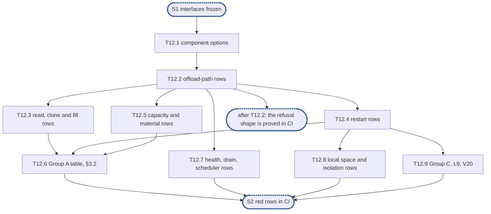

# Epic 12: engine offload red rows and test foundations

**Sources:** [RFC 8](../docs/internals/rfcs/rfc-8-engine.md) §15's composition rule (its opening
paragraph and the two MUST NOTs under §15.3) and these rows: §15.1's "§3.2 no gate is safety",
"§6.8 per-block reporting", "§4.1 verifier inputs" (the offloaded loss), "§6.4 guard across a
removal", "§8.3 transfer survives a removal", "§2.5 restart re-offer", "§2.5 journal gone" and "§2.5
attach after a device loss" (the acknowledgement), "§2.5 metadata reconcile", "§2.5 `Bind` takes over
the reconcile's handle", "§2.5 unsuitable journal at start", "§2.5 unread range at start", "§2.5
reseed gates offer and eviction", "§6.6 minted names and intents", "§6.7 widening", "§6.7 stretch
ends", "§9.1 clone keeps writes outside its extent" (offload half), "§9.1 no pre-clone fill" (a
demand read's leg), "§6.4 guard is not a fence", "§7.1 stale ref", "§7.1 the order", "§7.2
streaming, verified", "§7.2 fill cannot fail a read", "§7.2 fill loses to a write", "§7.7
re-resolution", "§5.1 durable commits", "§5.1 overwrite waits for existence" (offload half), "§7.6
zero ref under an overwrite", "§9.1 Lost source run carried", "§9.1 one source state", "§2.5 clone
resumed at a full limit" (remote half), "§10.2 retry later", "§10.4 destroyed material"; §15.2's
"§11.1 health per direction", "§11.1 offload health", "§11.1 `stranded_export_failed`", "§10
occupancy triggers eviction", "§10.2 refusal loop", "§10.3 repack reserve", "§10.2.1 pacing law",
"§2.3 removal during a reconcile", "§2.5 join", "§8.1 removal wedge" (the undecodable ref), "§11.4
drain names its blocker", "§1.1 no cross-share slowdown" (cold reads), "§6.1.1 a stuck run"; §15.3's
"§2.5 reseed" and "§2.4 settings" (`Min`, `Target` and the migration report);
[RFC 14](../docs/internals/rfcs/rfc-14-open-state.md) §9.3's L9;
[RFC 17](../docs/internals/rfcs/rfc-17-vfs.md) §6's V20 (its offload half);
[RFC 29](../docs/internals/rfcs/rfc-29-test-harness.md) §4.7, the known-failure entry and its
grading.
**Track:** the team.
**Epic 12 estimate: 9 subtasks, 27.5 man-days.**
**Depends on:** **S1**, interfaces frozen (epic 11): the rows build `Settings` and `Share` with the
fields T11.2 and T11.3 freeze, read the `Stats` fields and `WaitOffloaded` T11.4 freezes, and key a
journal's scheduler figures by shard (`JournalStats.Work`, `entity.ShardID`, never a `TenantID`).
The **epic issues** of epics 14 to 20, which every `known.yaml` entry names, created through
`epic-breakdown` Step 6.3 under roadmap epic #5487 before this epic's first pull request lands.
**Blocks:** every later epic through **S2**: epics 13, 15 and 17 start there; epics 14 to 20 each
turn their rows green, remove their entries and make a fixture refusal real (§1.2 names which).

---

## 1. Goal

Epic 12 writes every conformance row this part of the engine must pass, red, over the first part's
fixture, and gives that fixture the options a row asks for the components that do not exist yet.
Each red row fails at one named check and is one entry of `test/engine/known.yaml`, so CI grades it
from the first pull request and the epic that turns it green removes the entry.

**At the end of the epic:**

- `engine-conformance` runs 46 new rows and the red halves of four existing tests, 51 entries in
  all, each graded known at its named check;
- `enginetest` takes `WithCarver`, `WithChain`, `WithSyncer` and `WithRefs`, each refusing by name
  while its component cannot be composed, and the fixture controls the rows call, each refusing
  by name the same way until the epic that needs it builds it;
- every Group A row of the package, the first part's included, runs from one table, which the
  §3.2 row runs again with every gate off;
- #5757's four entries and the two #5261 entries are as they were.

### 1.1 In scope

The rows and the halves of rows listed in **Sources**, written whole as their RFC rows read, less
the legs §1.2 names; their `known.yaml` entries; the fixture's component options and the
refusing controls they call; the Group A table and the §3.2 row over it.

### 1.2 Out of scope

- Making a refusal real, and turning a row green: the epic named in each row's entry (the
  catalogue in §6). The carver and chain options are made real by epic 15, the syncer option and
  the gates-off option by epic 16, `WithRefs` and two journal devices by epic 19, and each control
  by the epic named where it is listed.
- The in-memory journal's offload calls (`Offload`, `OffloadMany`, `Release`, `MarkOffloaded`,
  `Unmark`) and the three 7b calls (`DropOlder`, `Reconciled`, `AcknowledgeUnreadable`): each joins
  the in-memory journal with the epic that first calls it, after its journal suite row.
- §15.2's "§2.3 unbind and drop" leg with a pass in flight: epic 16, inside
  `TestRFC8A_UnbindThenDropLeavesNoEntryForTheTag`, green, in the change that runs passes.
- The module checks of RFC 8 §6.1.1, §6.3 and §7.4 (`unit` tests of `pkg/workqueue`, `offload/` and
  the speculator), RFC 6 §11.2's "K floor" row and O1's crash leg: epics 13, 15 and 17.
- "§2.1 remote required": the RFC 23 plan's epic 3, through the node.
- The journal plan's system scenarios and the RFC 21 and RFC 22 remote-outage rows: `e2e`, which
  keeps no known list, so the integration epic writes them green.
- Legs deferred in the [plan's deferral ledger](rfc-8-offload-engine-plan.md#61-deferral-ledger):
  the "shard handed away and back" leg of "§4.1 verifier inputs", the replica and promotion legs of
  "§2.5 metadata reconcile" and the replicated rejoin of "§2.5 journal gone" (the cluster stage);
  the snapshot-capture visit of "§2.5 metadata reconcile" (RFC 12); the pre-warm leg of "§9.1 no
  pre-clone fill" (unowned, with `PreWarm`); the store's `Recheck` (RFC 9), for which "§11.1 health
  per direction" raises the store's drift as `Recheck` would.

### 1.3 Names used here

- **S1**, interfaces frozen: the end of epic 11, the offload part's surface with stub bodies.
- **S2**, red rows in CI: the end of this epic; epics 13, 15 and 17 start there.
- **S3**, a pass runs end to end: the end of epic 16, over S5's carver and syncer and S6's
  `Offload`.
- **S5**, offload components built: the RFC 2 to RFC 5 plans' implementation epics.
- **S6**, journal offload half built: the journal plan's epics 9b and 7b.
- **E1** and **E2**, the roles of epics 11 and 12 in this part's plan (the plan's §1.5).
- **The first part**: the journal-only engine, epics 1 to 10 of RFC 8's first plan, whose fixture
  and rows this epic extends.
- **The integration epic**, epic 21: the node composes offload.
- **#5757**: the issue the first part's four share-limit and clone entries name; epic 18 closes it.
- **#5261**: the issue the first part's two lost-tail entries name.

## 2. How the general rules apply

The rules are those of [the offload plan's §1.5](rfc-8-offload-engine-plan.md#15-general-rules-for-each-epic),
cited by number and title and not copied.

| Rule | Subtasks | How |
| --- | --- | --- |
| rule 1, independent unit tests ([`CLAUDE.md`, "Writing tests"](../CLAUDE.md#writing-tests)) | T12.1 | the rows run over the first part's fixture and its real journal, `kvstore` and open state; a component reaches a row only through the fixture's composition (D1), never a double |
| rule 2, fuzz the key and ref decoders the queue's rebuild reads | T12.7 | no decoder is written here; "§8.1 removal wedge" plants the undecodable ref the fuzz target of epic 14 also feeds |
| rule 3, observability follows RFC 25 | T12.4, T12.7, T12.8 | rows read conditions and counters only through `Stats`, as the first part's rows do, by the names RFC 8 §11.1 and §14 give them |
| rule 4, profiling | all | every row runs under the fixture's `prof.Watch`; no allocation assertion is written here |
| rule 5, public interface and internals ([`CLAUDE.md`, "Verifying a change"](../CLAUDE.md#verifying-a-change)) | all | each row asserts where a caller meets the value: a read's bytes or error, a write's answer, a condition in `Stats`, the store's covering lookup |
| rule 6, known failures shrink | all | each row lands with its entry; §4 D3 says how a later epic rewrites `message:` when a refusal becomes real |
| rule 7, v2 ignores v1, and the engine imports only what RFC 0 §1.2 allows | all | rows and controls import only the engine, `enginetest`, `entity`, `openstate`, `vfs`, `pkg/workqueue` and the standard library (D2); no production import changes |
| rule 8, real dependencies for properties of those dependencies | T12.2, T12.4 | durability and restart rows run over the real journal with its crash seam; the remote store a row asks for is RFC 4's in-memory store under its fault wrapper, which RFC 4's suite holds (R3) |
| rule 9, code comment conventions ([`CLAUDE.md`, "Code comments"](../CLAUDE.md#code-comments)) | T12.1, T12.6 | D1's `decision:` at the refusal, D4's at the Group A table; no RFC 8 marker belongs to a test |
| rule 10, a test must be able to fail | all | every row is red when it lands and graded known on its message; a row whose message no later check could reach is not written |
| rule 11, a symbol is exported only if the RFC's interface uses it | none | no production symbol is added; the fixture's options and controls are test API in `enginetest` |
| rule 12, each subtask creates only what it declares | all | each option and control lands with the first row that calls it, its body refusing by name (D1) |

## 3. Requirements and invariants

Every obligation the RFCs place on this epic. The rows' requirements are RFC test rows: the epic
writes each as its row reads, less the legs §1.2 sends elsewhere, and the epic named in §6's
catalogue makes it pass. The behaviour each row checks is that epic's to build.

**The composition**

| # | Requirement | Kind | Source | Subtasks |
| --- | --- | --- | --- | --- |
| R1 | Every row runs against the engine as production composes it: the real journal, the real metadata store and open-state table, and each component as the node's content wiring builds it | MUST | RFC 8 §15; plan §1.4 | T12.1 |
| R2 | A sink that always succeeds never stands in for the remote store of a Group A row | MUST NOT | RFC 8 §15 (under §15.3) | T12.1, T12.2 |
| R3 | "§8.3 transfer survives a removal" runs two passes in flight at once, never a single-file rig | MUST NOT | RFC 8 §15 (under §15.3) | T12.2 |
| R4 | Until its components exist, a row that needs one fails at one named check, the fixture's refusal of the missing component | MUST | plan §1.4 | T12.1 |

**The entries**

| # | Requirement | Kind | Source | Subtasks |
| --- | --- | --- | --- | --- |
| R5 | Each red row is one entry naming the test exactly, never a pattern, with `status: fail`, `fix: planned`, `category: feature`, a `reason`, and `issue:` quoted, naming the epic issue of the epic that turns it green | MUST | RFC 29 §4.7; `CLAUDE.md` "By kind" | T12.2 to T12.9 |
| R6 | Each entry's `message:` is the text of the check that fails, specific enough that no other failure contains it | MUST | RFC 29 §4.7; `CLAUDE.md` "By kind" | T12.1 to T12.9 |
| R7 | A red half added to a test that passes is a subtest with its own entry, so the test's green half stays graded | MUST | RFC 29 §4.7 (a parent failing only through known subtests is known) | T12.5, T12.9 |
| R8 | #5757's four entries and the two #5261 entries stay as they are, not re-pointed | MUST | plan §1.4 | T12.5 |

**Group A rows, the offload path**

| # | Requirement | Kind | Source | Subtasks |
| --- | --- | --- | --- | --- |
| R9 | §6.8 per-block reporting: the second of three block commits fails, and the journal marks exactly the first and third blocks' extents | test row | RFC 8 §15.1 | T12.2 |
| R10 | §6.4 guard across a removal: an offer waits for a truncate stalled between its journal step and its transaction, and no ref lies past `size` after both | test row | RFC 8 §15.1 | T12.2 |
| R11 | §6.4 guard is not a fence: two engines each believing it is primary for one file, with separate guards; the store refuses the stale primary's commits on both paths | test row | RFC 8 §15.1 | T12.2 |
| R12 | §6.6 minted names and intents: a retried put keeps its name and bytes, a new pass mints a new name, a removed intent fails the commit and the content is re-offered, a delayed delete touches no committed block | test row | RFC 8 §15.1 | T12.2 |
| R13 | §6.7 widening: a release of an offloaded neighbour waits for the pass widened over it, and the new refs read correctly | test row | RFC 8 §15.1 | T12.2 |
| R14 | §6.7 stretch ends: passes cut by `limit` report no byte past `consumed`, restart at a content boundary, chunk as one pass over the file would, and the tail is offloaded within the age ceiling | test row | RFC 8 §15.1 | T12.2 |
| R15 | §8.3 transfer survives a removal: a stalled upload, a truncate below its extent, both commit orders, and again with deallocate, release and a clone onto the file | test row | RFC 8 §15.1 | T12.2 |
| R16 | §5.1 overwrite waits for existence, the offload half: an overwrite inside an offloaded extent answers only after an existence commit wrote its overwrite record, and once the journal's record is dropped the range fails as **Lost**, never the offloaded bytes | test row | RFC 8 §15.1 | T12.2 |
| R17 | §5.1 durable commits: a crash of the metadata store's host after an offload commit is reported and marked leaves every marked extent covered by a committed ref | test row | RFC 8 §15.1 | T12.2 |
| R18 | §2.5 restart re-offer: a crash between put and commit re-offers under a new name and reads correctly; a crash between commit and `report` re-offers, commits no ref twice and leaves the block born dead | test row | RFC 8 §15.1 | T12.2 |

**Group A rows, reads, clones and fills**

| # | Requirement | Kind | Source | Subtasks |
| --- | --- | --- | --- | --- |
| R19 | §7.1 stale ref: an overwrite committed and then lost before its offload reads **Lost**, with no get issued, and the rest reads the first write | test row | RFC 8 §15.1 | T12.3 |
| R20 | §7.1 the order: a commit, report and release between a read's journal step and its metadata step leaves the read returning the bytes, not **Lost** | test row | RFC 8 §15.1 | T12.3 |
| R21 | §7.2 streaming, verified: with the fifth chunk of a cold read corrupt, the first four reach the writer, no byte of the fifth does, and the read fails as corrupt | test row | RFC 8 §15.1 | T12.3 |
| R22 | §7.2 fill cannot fail a read: a failing `Fill` leaves the read returning the fetched bytes | test row | RFC 8 §15.1 | T12.3 |
| R23 | §7.2 fill loses to a write: a write landing while a fetch is stalled survives the fill | test row | RFC 8 §15.1 | T12.3 |
| R24 | §7.7 re-resolution: a chunk relocated twice reads; a truncate between resolution and get reads past end of file; a ranged read failing verification is corrupt, not re-resolved | test row | RFC 8 §15.1 | T12.3 |
| R25 | §7.6 zero ref under an overwrite: data written over an offloaded extent of zeros answers data to `SEEK_HOLE` and to an allocated-range query | test row | RFC 8 §15.1 | T12.3 |
| R26 | §9.1 clone keeps writes outside its extent, the offload half: every acknowledged write outside the cloned extent still reads back after it is offloaded and evicted | test row | RFC 8 §15.1 | T12.3 |
| R27 | §9.1 no pre-clone fill, a demand read's leg: a fill stalled across a clone onto the file installs nothing, and the extent reads the source's bytes | test row | RFC 8 §15.1; plan §1.4 | T12.3 |
| R28 | §9.1 Lost source run carried: a clone of a source whose overwrite was lost reads **Lost** there and the source elsewhere, never zeros or the stale ref | test row | RFC 8 §15.1 | T12.3 |
| R29 | §9.1 one source state: with `K` forced small, source writes between batches answer `ErrDelay` and the destination equals the source at the clone's start while an offload of the source commits; the self-clone, unlink and stalled-`Release` legs as the row writes them | test row | RFC 8 §15.1 | T12.3 |

**Group A rows, restart**

| # | Requirement | Kind | Source | Subtasks |
| --- | --- | --- | --- | --- |
| R30 | §4.1 verifier inputs, the offloaded loss: losing an extent already offloaded leaves the verifier unchanged | test row | RFC 8 §15.1 | T12.4 |
| R31 | §2.5 journal gone, the acknowledgement: once the loss is acknowledged both shares serve, `journal_lost` clears and the unoffloaded extent reads **Lost**, never zeros; a loss acknowledged, reattached and lost again raises `journal_lost` | test row | RFC 8 §15.1 | T12.4 |
| R32 | §2.5 attach after a device loss, the acknowledgement: the new journal's counter is raised above the share's version limit `S‖id‖vl` and its floor, the limit written as a tracked max-write, the incarnation and verifier changed, and a share whose `rm` row reads offloaded not attached | test row | RFC 8 §15.1 | T12.4 |
| R33 | §2.5 metadata reconcile, single node: each piece strictly below its version dropped and resolved as §2.5 says, each operation on an unvisited file visiting it first, the group commit, gating, `DropOlder` refusal, crash and read-only legs as the row writes them | test row | RFC 8 §15.1 | T12.4 |
| R34 | §2.5 `Bind` takes over the reconcile's handle: one handle of the tag, the counter above the imported ref before the share serves, and every held-lock ordering of the row, including the failed `Bind` and `Drop` legs | test row | RFC 8 §15.1 | T12.4 |
| R35 | §2.5 unsuitable journal at start, two devices: `Start` succeeds and the other device's share serves, and the `Close`, failed-start, emptied-directory, `Unbind` and failed-recovery legs | test row | RFC 8 §15.1 | T12.4 |
| R36 | §2.5 unread range at start: the other journal's share serves, the first's are unattached with `journal_range_unreadable`, retried at 60 s, attach once the range reads or is acknowledged, and switch to unsuitable on `ErrUnsuitableStorage` | test row | RFC 8 §15.1 | T12.4 |
| R37 | §2.5 reseed gates offer and eviction: a crash after an offload commit with its record unsynced puts nothing again and evicts no extent before the reseed visits its file; a bit whose ref was deleted is reported, cleared with `Unmark` and re-offered before any eviction | test row | RFC 8 §15.1 | T12.4 |

**Group A rows, capacity and material**

| # | Requirement | Kind | Source | Subtasks |
| --- | --- | --- | --- | --- |
| R38 | §2.5 clone resumed at a full limit, the remote half: with the remote down the destination answers `ErrDelay` with `DelayCapacity`, and once it returns the clone finishes and both files serve | test row | RFC 8 §15.1 | T12.5 |
| R39 | §10.2 retry later, the store legs: dirty bytes with the remote reachable or unreachable answer `ErrDelay`, never `ErrNoSpace`; a quota refusal, a `413` and a `403` answer `ErrNoSpace` at once, the store error reaching the engine as `ErrDenied` | test row | RFC 8 §15.1 | T12.5 |
| R40 | §10.4 destroyed material: covered extents lose their bit, are not evicted and are offloaded again; a remote-only chunk reads **Lost**; a destroyed master key or a key record marked destroyed between pin and Commit refuses the commit; a destroy between Commit and Mark leaves the extents unmarked; a crash before `Unmark` is cleared by the reseed; no replacement material refuses the pass at Intent | test row | RFC 8 §15.1 | T12.5 |
| R41 | §3.2 no gate is safety: with suspension, pins and health gating off and eviction as eager as possible, every other Group A check passes | test row | RFC 8 §15.1 | T12.6 |

**Group B rows**

| # | Requirement | Kind | Source | Subtasks |
| --- | --- | --- | --- | --- |
| R42 | §11.1 health per direction: failing puts stop passes while **Remote** reads succeed and only a put condition is reported; drift stops puts, not reads | test row | RFC 8 §15.2 | T12.7 |
| R43 | §11.1 offload health: offload commits that all conflict raise an offload condition, distinct from remote-unreachable, before the journal fills | test row | RFC 8 §15.2 | T12.7 |
| R44 | §11.1 `stranded_export_failed`: an export refused by the directory names the tag while service continues, and clears once a retry succeeds | test row | RFC 8 §15.2 | T12.7 |
| R45 | §11.4 drain names its blocker: `WaitOffloaded` returns at its deadline naming the failing file and `file_offload_failing`, never the truncated one | test row | RFC 8 §15.2 | T12.7 |
| R46 | §6.1.1 a stuck run, over the engine's instances: `work_queue_stalled` names the source and tenant within twice `RunTimeout`, `engine_work_runs_overdue_total` rises, the other tenant's work runs, and liveness fails within 60 s | test row | RFC 8 §15.2 | T12.7 |
| R47 | §2.5 join: `Close` with an offload parked in a stalled put closes no component while the pass runs | test row | RFC 8 §15.2 | T12.7 |
| R48 | §8.1 removal wedge, the undecodable ref: a truncate over an undecodable ref record and a clone from an undecodable source record retry at the backoff cap, `removal_stalled` names each, and both finish once repaired | test row | RFC 8 §15.2 | T12.7 |
| R49 | §10 occupancy triggers eviction: a journal at its maximum with filled, offloaded content evicts and accepts a write | test row | RFC 8 §15.2 | T12.8 |
| R50 | §10.2 refusal loop: a write at capacity succeeds after eviction and repack, and with dirty content after offload, eviction and repack | test row | RFC 8 §15.2 | T12.8 |
| R51 | §10.3 repack reserve: repack of another share's released segments proceeds and frees space for a third share | test row | RFC 8 §15.2 | T12.8 |
| R52 | §10.2.1 pacing law: with *M* half-way between *S* and *L* at drain rate *r*, a write of *n* bytes is delayed *n* / 2*r* within 10 %, and not below *S* | test row | RFC 8 §15.2 | T12.8 |
| R53 | §2.3 removal during a reconcile: `Unbind` cancels and waits for the share's visit, `Drop` closes the handle after it, no `DropOlder` runs on a closed handle, the other share's files finish, `Reconciled` is called and `journal_unreconciled` clears | test row | RFC 8 §15.2 | T12.8 |
| R54 | §1.1 no cross-share slowdown, cold reads: one share saturated with writes and cold reads leaves every other share's p99 within its unloaded bound | test row | RFC 8 §15.2 | T12.8 |

**Group C and other plans' rows**

| # | Requirement | Kind | Source | Subtasks |
| --- | --- | --- | --- | --- |
| R55 | §2.5 reseed: a ledger bit no ref justifies is reported and cleared, its extent re-offered rather than released, and other files' extents evicted as soon as their visit ends | test row | RFC 8 §15.3 | T12.9 |
| R56 | §2.4 settings, the pool half: an invalid chunking setting is refused and the earlier settings kept, and a changed profile is reported as a migration | test row | RFC 8 §15.3; RFC 2 §3.6, §3.7 | T12.9 |
| R57 | L9: an open and a lock on a file never stop its extent's eviction or reclamation | test row | RFC 14 §9.3 | T12.9 |
| R58 | V20, the offload half: a full journal of dirty bytes answers `ErrDelay(DelayCapacity)` and succeeds once offload frees space; still `ErrDelay` with the store unreachable past the deadline; `ErrNoSpace` at once with the store denying puts | test row | RFC 17 §6 | T12.9 |

## 4. Decisions this epic takes

- **D1, a component option takes no argument, and refuses by name until the fixture can build it.**
  The fixture composes the engine as production does (R1), through the node's content wiring, so an
  option says which component a row needs, never hands one in: `WithCarver()`, `WithChain()`,
  `WithSyncer()`, `WithRefs()`. `New` checks them in that fixed order and fails the row at the
  first it cannot build, with `fixture: the <component> is not composed`; a row asking for several
  therefore meets one stable check, the first missing in that order (R4, R6). Every control a row
  calls that depends on something not built yet refuses the same way, `fixture: <what> is not
  built`, at its call, so a row taking no option fails at its first such control. The epic that can
  build the component replaces the refusal with the composition, in one place (`components.go`).
  The options stay after that, defaulting off, because the first part's rows assume no offload (the
  integration epic decides whether the default flips, §9). A `decision:` marker at the refusal
  names it the stand-in until S5 and S6, withdrawn when the last refusal goes. The other way,
  writing each row only up to the component it needs, would leave its check unwritten and its
  requirement untested until the green epic. Prior art: the first part's rows, which all failed at
  the journal's `Init` until the journal had one, and `journalOnly`, which fails a control by name
  under the fake journal.
- **D2, rows and controls speak the engine's and the store's types only.** At S2 the component
  packages may not exist, and a test imports only packages that do (a test lands with the epic that
  creates its imports). So a control takes and returns `entity`, `engine`, `vfs` and standard-library
  values: a file, an offset and length, a chunk index, a store direction as a string the fixture
  maps, an error to inject. When a component lands, its epic adds fields to what the control
  returns, never changes a parameter a row already passes. Changing this later would rewrite every
  row's calls. Prior art: none found.
- **D3, a message is the first check a row meets now, and the epic that moves it rewrites it.**
  A row's `message:` at S2 is its first refusal (D1), or, for a row that reaches its own check, that
  check's failure text. When an epic makes a refusal real, every row still red that met it now
  fails further on, and that epic's change rewrites each such `message:` to its new text (plan rule
  6). `reason:` names the RFC row and what the row waits for in plain words, no epic numbers in the
  test's source. Prior art: the first part's entries.
- **D4, every Group A row of the package runs from one table, and the §3.2 row runs the table
  again.** "§3.2 no gate is safety" reruns every other Group A check with the gates off, so each
  `TestRFC8A_*` row, the first part's included, becomes a function `func(t *testing.T, opts
  ...enginetest.Option)` registered in `groupA`, its `TestRFC8A_*` a one-line wrapper, and each
  `enginetest.New` inside it takes the passed options too. `TestRFC8A_NoGateIsSafety` first
  composes a fixture with `WithoutGates()`, which refuses until epic 16 builds the gates' switch,
  then runs each table row as a subtest under it. So at S2 it is one entry; once the switch is
  real, a subtest that fails gets its own entry naming its row's own epic, and the row turns green
  with the last of them. A `decision:` marker at the table says a Group A row joins it or the §3.2
  row skips it. Prior art: `overBoth` in `internal/vfs/integration`, which reruns each row over two
  compositions.
- **D5, a row that already has a first-part test gets its own test, except four
  that extend one.** "§2.5 journal gone", "§2.5 attach after a device loss", "§2.5 unsuitable journal at
  start", "§5.1 overwrite waits for existence", "§8.1 removal wedge" and "§1.1 no cross-share
  slowdown" have green first-part tests holding their other halves, so each red half is a new test
  beside it (`TestRFC8A_JournalGoneAcknowledged`, …): a red leg inside the green test would hide it.
  The four extensions (`TestRFC8A_CloneResumedAtAFullLimit`, `TestRFC8A_RetryLaterAtTheShareLimit`,
  `TestRFC8C_Settings`, `TestV20`) gain one subtest each, named for the half it adds, with its own
  entry (R7). Two of the four, the #5757 ones, already stop at a `t.Fatalf`, so their subtest runs
  before the old body, which stays as it is; `TestV20`'s runs in `TestV20` itself, not through
  `overBoth`, since the offload half has nothing to check over the fake journal and would double
  its entries. Prior art: none found.
- **D6, "§10.4 destroyed material" is two tests.** Its crash leg (a crash before `Unmark`, cleared
  by the reseed) turns green with the reseed, the rest with eviction, so the leg is its own test,
  `TestRFC8A_DestroyedMaterialCrashBeforeUnmark`, with its own entry. Prior art: none found.
- **D7, "§2.4 settings" refuses an invalid `Target`, not `Min ≥ Target`.** RFC 2 §3.2 makes `Min`
  `Target / 4`, so no setting configures `Min ≥ Target`; the leg configures a `Target` the carver's
  validation refuses (RFC 2 §3.7) and asserts `Bind` refuses it and keeps the earlier settings. The
  RFC row's wording is epic 16's to amend (§9). Prior art: none found.

## 5. Target tree

On `feat/storage-v2`.

```text
pkg/engine/enginetest/
  components.go           T12.1  WithCarver, WithChain, WithSyncer, WithRefs; the ordered refusal; D1's decision:
  remote.go               T12.2  the remote controls: stall, fail, corrupt, deny a store's puts and gets
  offload.go              T12.2  the pass and commit controls; T12.3 the read and fill controls
  restart.go              T12.4  WithDevices, the acknowledgements, a journal owing a reconcile
  material.go             T12.5  the material controls
  gates.go                T12.6  WithoutGates
  work.go                 T12.7  the work-queue, salvage and ref-record controls
pkg/engine/conformance/
  rfc8_offload_test.go    T12.2  the offload-path rows
  rfc8_remote_test.go     T12.3  the read, clone and fill rows
  rfc8_restart_test.go    T12.4  the restart rows
  rfc8_material_test.go   T12.5  §10.4's two tests
  rfc8_a_test.go, rfc8_cover_test.go  T12.5 the two extensions; T12.6 their rows in the table
  rfc8_nogates_test.go    T12.6  groupA and TestRFC8A_NoGateIsSafety; every other Group A file's rows join groupA
  rfc8_health_test.go     T12.7  the health, drain and scheduler rows
  rfc8_space_test.go      T12.8  the local-space and isolation rows
  rfc8_reseed_test.go     T12.9  §15.3's reseed row
  rfc14_test.go           T12.9  L9
internal/vfs/integration/rows_test.go  T12.9  TestV20's offload subtest
test/engine/known.yaml    T12.2 to T12.9  one entry per red test or subtest
```

## 6. Subtasks

Each row subtask lists its rows as a catalogue: the test, what it asks of the fixture, its message
at S2 (D3) and the epic whose issue its entry names. "c, ch, s" stands for `WithCarver()`,
`WithChain()`, `WithSyncer()`, so those rows' message is `fixture: the carver is not composed`.

### T12.1 The component options and their refusal

**Subtask T12.1 estimate: 2 man-days.**

- **Track:** the team. **Depends on:** S1.
- **Covers:** R1, R2, R4, R6.
- **Deliverables:** in `enginetest/components.go`:
  ```go
  func WithCarver() Option // RFC 2's carver and assembler, as the content wiring builds them
  func WithChain() Option  // RFC 5's chain over keystest's in-memory keys.Provider
  func WithSyncer() Option // RFC 3's syncer over RFC 4's in-memory store, through codec.Store, under RFC 4's fault wrapper
  func WithRefs() Option   // RFC 16 §3.1's Refs over kvstore
  ```
  `New` checks the four in that order as soon as the options are applied, before the journal's
  `Init`, so a refused row opens nothing the profiler could count as leaked, and fails the row with
  `fixture: the carver is not composed`, `… the chain …`, `… the syncer …`, `… Refs …` at the first
  it cannot build; `(*Fixture).refuse(what string)`, unexported, is the one place the text is
  formed, which every later control calls (D1). D1's `decision:` marker at `refuse`. Consumed by
  T12.2 to T12.9's rows; made real by epics 15 (carver, chain), 16 (syncer) and 19 (`Refs`).
- **Acceptance criteria:**
  - A fixture built with no new option composes as today: every first-part row and entry grades as
    it did.
  - A row asking for any of the four fails at `New` with exactly the text above for the first one
    missing in order, whatever else it asks for.
  - Nothing in `enginetest` imports a component package.
- **Tests:** no test of its own: a refusal is a `t.Fatalf` a test can only watch from outside, and
  T12.2's first rows are that watch. `dt run engine-conformance` grades them known only while each
  meets the text its entry names, so a reworded or reordered refusal grades them new (catches R4,
  R6). The first part's run, unchanged, catches a composition this subtask disturbed (R1).
- **Rules:** rule 9, D1's marker; rule 12, the options' first callers are T12.2's rows.

### T12.2 Group A rows of the offload path

**Subtask T12.2 estimate: 4.5 man-days.**

- **Track:** the team. **Depends on:** T12.1.
- **Covers:** R2, R3, R5, R6, R9 to R18.
- **Deliverables:** ten rows in `rfc8_offload_test.go`, each a `groupA` row function (D4) with its
  `TestRFC8A_*` wrapper, and their entries. Controls, each refusing until built (D1):
  `(*Fixture).HoldNextPut() (entered <-chan struct{}, release func())` and `FailNextPut(err
  error)` on the syncer's store, `HoldNextOffloadCommit()` and `FailOffloadCommit(n int)` at the
  store, `RunPass(ctx, share entity.ShareID) error`, `OffloadedRanges(id entity.FileID)
  []engine.Range` read from the journal's bits, `CoveringRefs(id entity.FileID) []entity.ChunkRef`
  from the store, `PrimaryPair() (*Fixture, *Fixture)` (two engines over one store with separate
  guards) and `CrashStore()` (the metadata store's host crash, beneath the journal's). Each made
  real by epic 16, `CrashStore` by epic 19.

  | Row | Test | Asks | Message at S2 | Green |
  | --- | --- | --- | --- | --- |
  | §6.8 per-block reporting | `TestRFC8A_PerBlockReporting` | c, ch, s | carver | 16 |
  | §6.4 guard across a removal | `TestRFC8A_GuardAcrossARemoval` | c, ch, s | carver | 16 |
  | §6.4 guard is not a fence | `TestRFC8A_GuardIsNotAFence` | c, ch, s; `PrimaryPair` | carver | 16 |
  | §6.6 minted names and intents | `TestRFC8A_MintedNamesAndIntents` | c, ch, s | carver | 16 |
  | §6.7 widening | `TestRFC8A_Widening` | c, ch, s | carver | 16 |
  | §6.7 stretch ends | `TestRFC8A_StretchEnds` | c, ch, s | carver | 16 |
  | §8.3 transfer survives a removal | `TestRFC8A_TransferSurvivesARemoval` | c, ch, s; two files, two passes held | carver | 16 |
  | §5.1 overwrite waits for existence, offload half | `TestRFC8A_OverwriteOfAnOffloadedExtentWaitsForExistence` | c, ch, s | carver | 16 |
  | §5.1 durable commits | `TestRFC8A_DurableCommits` | c, ch, s; `CrashStore` | carver | 19 |
  | §2.5 restart re-offer | `TestRFC8A_RestartReoffer` | c, ch, s | carver | 19 |
- **Acceptance criteria:**
  - Each row is written whole as R9 to R18 state it, and graded known at its message.
  - `TestRFC8A_TransferSurvivesARemoval` holds two passes in flight at once, over two files (R3).
  - No row's remote store answers every put as stored (R2): the syncer option's store is RFC 4's
    in-memory one under its fault wrapper.
- **Tests:** the ten rows, red. Each catches, once its components land, the bug its RFC row
  names (a commit reported for a block that failed, a ref past `size`, a stale primary's commit, a
  reused name, a release racing a pass, a pass reporting past `consumed`, a straddler kept, an
  overwrite answered before its record, a marked extent with no ref, a re-offer under the old name).
  Doubles: RFC 4's in-memory store, kind 2 (RFC 4's suite), under its fault wrapper, kind 3; the
  fixture's fault `kv.KV`, kind 3.
- **Rules:** rule 8, `DurableCommits` and `RestartReoffer` crash the real journal through its seam.

### T12.3 Group A rows of reads, clones and fills

**Subtask T12.3 estimate: 4.5 man-days.**

- **Track:** the team. **Depends on:** T12.2.
- **Covers:** R5, R6, R19 to R29.
- **Deliverables:** eleven rows in `rfc8_remote_test.go`, `groupA` functions with wrappers, and
  their entries. Controls, refusing until built: `HoldNextFetch()` and `CorruptChunk(id
  entity.FileID, chunk int)` on the store's gets, `FailNextFill(err error)` at the journal's
  `Fill`, `HoldBetweenReadSteps() (entered <-chan struct{}, release func())`, `Relocate(id
  entity.FileID, chunk int)` (a chunk moved to a new block and the old one swept), `Evict(id
  entity.FileID)`; made real by epic 17.

  | Row | Test | Asks | Message at S2 | Green |
  | --- | --- | --- | --- | --- |
  | §7.1 stale ref | `TestRFC8A_StaleRef` | c, ch, s | carver | 17 |
  | §7.1 the order | `TestRFC8A_TheOrderOfAReadsSteps` | c, ch, s | carver | 17 |
  | §7.2 streaming, verified | `TestRFC8A_StreamingVerified` | c, ch, s | carver | 17 |
  | §7.2 fill cannot fail a read | `TestRFC8A_FillCannotFailARead` | c, ch, s | carver | 17 |
  | §7.2 fill loses to a write | `TestRFC8A_FillLosesToAWrite` | c, ch, s | carver | 17 |
  | §7.7 re-resolution | `TestRFC8A_Reresolution` | c, ch, s | carver | 17 |
  | §7.6 zero ref under an overwrite | `TestRFC8A_ZeroRefUnderAnOverwrite` | c, ch, s | carver | 17 |
  | §9.1 clone keeps writes outside its extent, offload half | `TestRFC8A_CloneKeepsWritesOutsideItsExtentOffloaded` | c, ch, s | carver | 17 |
  | §9.1 no pre-clone fill, demand read | `TestRFC8A_NoPreCloneFill` | c, ch, s | carver | 17 |
  | §9.1 Lost source run carried | `TestRFC8A_LostSourceRunCarried` | c, ch, s | carver | 17 |
  | §9.1 one source state | `TestRFC8A_OneSourceState` | c, ch, s | carver | 17 |
- **Acceptance criteria:**
  - Each row is written whole as R19 to R29 state it, and graded known at its message.
  - "§7.1 the order"'s "swap the two steps in a test build" is the row's own verification, done by
    epic 17 when it turns the row green, not a second test.
- **Tests:** the eleven rows, red. Each catches its RFC row's named bug once epic 17 lands (an
  old chunk served as **Remote**, **Lost** for a released extent, a corrupt chunk's bytes
  delivered, a fill failing or overwriting a read or write, a re-resolution after a verification
  failure, a hole answered for data, a clone dropping refs by file, a pre-clone fill installed, a
  zeroed or stale run). Doubles as T12.2.
- **Rules:** none beyond §2.

### T12.4 Group A rows of restart

**Subtask T12.4 estimate: 5 man-days.**

- **Track:** the team. **Depends on:** T12.2.
- **Covers:** R5, R6, R30 to R37.
- **Deliverables:** eight rows in `rfc8_restart_test.go`, `groupA` functions with wrappers, and
  their entries. In `restart.go`: `WithDevices(n int) Option`, refusing `n` above 1 with `fixture:
  a second journal device is not built`; controls `AcknowledgeLoss(dir string) error` (the store
  record bound to the lost `JournalID`), `AcknowledgeRange(dir string, seg int, off, n int64)
  error`, `ReopenOwingReconcile()`, `HoldNextVisit(id entity.FileID)`, `ImportRef(share
  entity.ShareID, id entity.FileID, version uint64)`, `MakeUnreadable(dir string, seg int, off, n
  int64)` at the seam; all made real by epic 19.

  | Row | Test | Asks | Message at S2 | Green |
  | --- | --- | --- | --- | --- |
  | §4.1 verifier inputs, offloaded loss | `TestRFC8A_VerifierUnchangedByAnOffloadedLoss` | c, ch, s | carver | 19 |
  | §2.5 journal gone, acknowledgement | `TestRFC8A_JournalGoneAcknowledged` | `AcknowledgeLoss` | `fixture: the lost-journal acknowledgement is not built` | 19 |
  | §2.5 attach after a device loss, acknowledgement | `TestRFC8A_AttachAfterDeviceLossAcknowledged` | `AcknowledgeLoss` | as above | 19 |
  | §2.5 metadata reconcile | `TestRFC8A_MetadataReconcile` | c, ch, s, `WithRefs` | carver | 19 |
  | §2.5 `Bind` takes over the reconcile's handle | `TestRFC8A_BindTakesOverTheReconcilesHandle` | `ReopenOwingReconcile`, `ImportRef` | `fixture: a journal owing a reconcile is not built` | 19 |
  | §2.5 unsuitable journal at start, two devices | `TestRFC8A_UnsuitableJournalAtStartBesideAServedDevice` | `WithDevices(2)` | `fixture: a second journal device is not built` | 19 |
  | §2.5 unread range at start | `TestRFC8A_UnreadRangeAtStart` | `WithDevices(2)` | as above | 19 |
  | §2.5 reseed gates offer and eviction | `TestRFC8A_ReseedGatesOfferAndEviction` | c, ch, s, `WithRefs` | carver | 19 |
- **Acceptance criteria:**
  - Each row is written whole as R30 to R37 state it, less §1.2's cluster and RFC 12 legs, and
    graded known at its message.
  - The first part's `TestRFC8A_JournalGone`, `TestRFC8A_AttachAfterDeviceLoss` and
    `TestRFC8A_UnsuitableJournalAtStart` are untouched and green (D5).
- **Tests:** the eight rows, red. Each catches its RFC row's named bug once epic 19 lands (a
  verifier changed by an offloaded loss, zeros for a lost extent, an acknowledgement reused for a
  later loss, versions reissued after a device loss, a stale piece served after the reconcile, the
  imported content served over a new write, a refused device stopping the node, a range read stale,
  an extent evicted before its file's visit). Doubles: the fixture's fault `kv.KV` and the
  journal's crash seam, kind 3.
- **Rules:** rule 8, every leg runs over the real journal on a real directory.

### T12.5 Group A rows of capacity and material

**Subtask T12.5 estimate: 2 man-days.**

- **Track:** the team. **Depends on:** T12.2.
- **Covers:** R5 to R8, R38 to R40.
- **Deliverables:** a subtest `the remote tier's half` in each of `TestRFC8A_CloneResumedAtAFullLimit`
  and `TestRFC8A_RetryLaterAtTheShareLimit`, with an entry each (D5), the parents' #5757 entries
  untouched (R8); `TestRFC8A_DestroyedMaterial` and `TestRFC8A_DestroyedMaterialCrashBeforeUnmark`
  in `rfc8_material_test.go` (D6). In `material.go`, refusing with `fixture: destroyed material is
  not built` until epic 18: `DestroyDataKey(ns entity.NamespaceID)`, `DestroyMasterKey()`,
  `MarkRecordDestroyed(ns entity.NamespaceID)`, `DestroyCurrent(ns entity.NamespaceID)`, and
  `HoldBetweenPinAndCommit()`, `HoldBetweenCommitAndMark()`; in `remote.go`, `DenyPuts(err
  string)` (`quota`, `413`, `403`) and `Unreachable(on bool)`, made real by epic 16.

  | Row | Test | Asks | Message at S2 | Green |
  | --- | --- | --- | --- | --- |
  | §2.5 clone resumed at a full limit, remote half | `TestRFC8A_CloneResumedAtAFullLimit/the_remote_tier's_half` | c, ch, s | carver | 18 |
  | §10.2 retry later, store legs | `TestRFC8A_RetryLaterAtTheShareLimit/the_remote_tier's_half` | c, ch, s | carver | 18 |
  | §10.4 destroyed material | `TestRFC8A_DestroyedMaterial` | c, ch, s | carver | 18 |
  | §10.4 destroyed material, crash before `Unmark` | `TestRFC8A_DestroyedMaterialCrashBeforeUnmark` | c, ch, s, `WithRefs` | carver | 19 |
- **Acceptance criteria:**
  - Each row is written whole as R38 to R40 state it and graded known at its message.
  - Each new subtest runs before its parent's old body, which stops at a `t.Fatalf` and would
    otherwise never reach it; the parents' `go-json` failure text is still their own, so their
    #5757 entries still match (checked in the run's report).
- **Tests:** the four, red. They catch, once epics 18 and 19 land, a bare healthy flag answering
  the outage and the full store alike, a quota error read as `ErrInvalid`, an extent evicted or a
  block committed under destroyed material, and a bit left set across a crash before `Unmark`.
  Doubles as T12.2, and `keystest`'s in-memory `keys.Provider`, kind 2 (RFC 5's suite).
- **Rules:** rule 6, the #5757 entries stay for epic 18, whose pull request closes #5757.

### T12.6 The Group A table and "§3.2 no gate is safety"

**Subtask T12.6 estimate: 2.5 man-days.**

- **Track:** the team. **Depends on:** T12.3, T12.4, T12.5.
- **Covers:** R5, R6, R41.
- **Deliverables:** `groupA`, a table of name and row function in `rfc8_nogates_test.go`, holding
  every `TestRFC8A_*` row of the package but itself: this epic's, and the first part's, each
  turned into a row function taking `opts ...enginetest.Option` that every `enginetest.New` in it
  appends, its `TestRFC8A_*` a one-line wrapper (D4); D4's `decision:` at the table.
  `enginetest.WithoutGates() Option` in `gates.go`, refusing with `fixture: the gates' switch is not
  built` until epic 16; `TestRFC8A_NoGateIsSafety` composes one fixture with it, then runs each
  table row as a subtest with it, and its entry.
- **Acceptance criteria:**
  - Every first-part row and entry grades exactly as before the conversion.
  - `TestRFC8A_NoGateIsSafety` is graded known at the gates' refusal.
  - A `TestRFC8A_*` row left out of the table fails the completeness check below.
- **Tests:** `TestGroupAIsComplete`, in the same tagged package, which parses
  the package's files with `go/parser` and fails naming any `TestRFC8A_*` but the §3.2 row whose
  row is not in `groupA` (catches a row added later and left out of the §3.2 run); the §3.2 row,
  red. No double.
- **Rules:** rule 9, D4's marker.

### T12.7 Group B rows of health, drain and the scheduler

**Subtask T12.7 estimate: 3 man-days.**

- **Track:** the team. **Depends on:** T12.2.
- **Covers:** R5, R6, R42 to R48.
- **Deliverables:** seven rows in `rfc8_health_test.go`, and their entries. In `work.go`:
  `BlockNextRun(source string, shard entity.ShardID) (release func())`, refusing with `fixture: the
  engine's work queue is not built` until epic 14; `SalvageTo(dir string)`, refusing with `fixture:
  the salvage export is not built` until epic 20; `ReportDrift(on bool)` on the syncer's store,
  made real by epic 16; `CorruptRefRecord(id entity.FileID)` and `RepairRefRecord(id
  entity.FileID)`, which write and restore an undecodable value at the file's ref key through the
  fixture's `kv.KV` and are real now. Rows read conditions from `Stats().Journals[dir].Conditions`
  and the scheduler's figures from `JournalStats.Work` by source and shard.

  | Row | Test | Asks | Message at S2 | Green |
  | --- | --- | --- | --- | --- |
  | §11.1 health per direction | `TestRFC8B_HealthPerDirection` | c, ch, s | carver | 20 |
  | §11.1 offload health | `TestRFC8B_OffloadHealth` | c, ch, s | carver | 20 |
  | §11.1 `stranded_export_failed` | `TestRFC8B_StrandedExportFailed` | `SalvageTo` | `fixture: the salvage export is not built` | 20 |
  | §11.4 drain names its blocker | `TestRFC8B_DrainNamesItsBlocker` | c, ch, s | carver | 20 |
  | §6.1.1 a stuck run | `TestRFC8B_AStuckRun` | `BlockNextRun` | `fixture: the engine's work queue is not built` | 14 |
  | §2.5 join | `TestRFC8B_JoinWaitsForAPassInAStalledPut` | c, ch, s | carver | 16 |
  | §8.1 removal wedge, undecodable ref | `TestRFC8B_RemovalWedgeUndecodableRef` | `CorruptRefRecord` | the row's first failing check, recorded when it lands | 14 |
- **Acceptance criteria:**
  - Each row is written whole as R42 to R48 state it and graded known at its message.
  - `CorruptRefRecord` leaves every other key of the store as it was (asserted by the row before it
    truncates).
- **Tests:** the seven rows, red. They catch, once epics 14, 16 and 20 land, a share reporting the
  wrong direction, an offload outage reported as remote-unreachable, a failed export stopping
  service, a drain naming the truncated file, a stuck run blocking another tenant or escaping the
  watchdog, a component closed under a running pass, and an undecodable ref wedging other
  removals. Doubles: kind 3 around the fixture's `kv.KV` (`CorruptRefRecord`) and the store.
- **Rules:** rule 2, `CorruptRefRecord` plants the input epic 14's fuzz target also feeds; rule 3,
  rows read conditions and counters through `Stats`.

### T12.8 Group B rows of local space and isolation

**Subtask T12.8 estimate: 2.5 man-days.**

- **Track:** the team. **Depends on:** T12.4.
- **Covers:** R5, R6, R49 to R54.
- **Deliverables:** six rows in `rfc8_space_test.go`, and their entries; `HoldPacedWrite()` and
  `MeasuredDrain() float64`, the delay and *r* as the engine reads them, refusing until epic 18.

  | Row | Test | Asks | Message at S2 | Green |
  | --- | --- | --- | --- | --- |
  | §10 occupancy triggers eviction | `TestRFC8B_OccupancyTriggersEviction` | c, ch, s | carver | 18 |
  | §10.2 refusal loop | `TestRFC8B_RefusalLoop` | c, ch, s | carver | 18 |
  | §10.3 repack reserve | `TestRFC8B_RepackReserveOverReleasedSegments` | c, ch, s | carver | 18 |
  | §10.2.1 pacing law | `TestRFC8B_PacingLaw` | c, ch, s | carver | 18 |
  | §2.3 removal during a reconcile | `TestRFC8B_RemovalDuringAReconcile` | `ReopenOwingReconcile` | `fixture: a journal owing a reconcile is not built` | 19 |
  | §1.1 no cross-share slowdown, cold reads | `TestRFC8B_NoCrossShareSlowdownColdReads` | c, ch, s | carver | 17 |
- **Acceptance criteria:**
  - Each row is written whole as R49 to R54 state it and graded known at its message.
  - The pacing law's delay is read on the fixture's test clock, never slept (`CLAUDE.md`,
    "Synchronise on events").
- **Tests:** the six rows, red. They catch, once epics 17 to 19 land, eviction triggered on dirty
  plus unreclaimed bytes, eviction without repack, a repack reserved against its share's limit, a
  delay off the law or paced below *S*, a `DropOlder` on a closed handle, and a cold-read share
  slowing others. Doubles as T12.2.
- **Rules:** none beyond §2.

### T12.9 Group C rows and the other plans' rows

**Subtask T12.9 estimate: 1.5 man-days.**

- **Track:** the team. **Depends on:** T12.4.
- **Covers:** R5 to R7, R55 to R58.
- **Deliverables:** `TestRFC8C_Reseed` in `rfc8_reseed_test.go`; a subtest `the pool half` of
  `TestRFC8C_Settings` (D7); `TestRFC14_L9` in `rfc14_test.go`, through the fixture's open-state
  table; a subtest `the offload half` of `TestV20`, run in `TestV20` itself rather than through
  `overBoth`, with `compose` passing the options to `enginetest.New`; their entries.

  | Row | Test | Asks | Message at S2 | Green |
  | --- | --- | --- | --- | --- |
  | §2.5 reseed | `TestRFC8C_Reseed` | c, ch, s, `WithRefs` | carver | 19 |
  | §2.4 settings, pool half | `TestRFC8C_Settings/the_pool_half` | c | carver | 16 |
  | L9 | `TestRFC14_L9` | c, ch, s | carver | 18 |
  | V20, offload half | `TestV20/the_offload_half` | c, ch, s | carver | 18 |
- **Acceptance criteria:**
  - Each row is written whole as R55 to R58 state it and graded known at its message;
    `TestRFC8C_Settings` and `TestV20`'s other subtests stay green.
- **Tests:** the four, red. They catch, once epics 16, 18 and 19 land, a bit released rather than
  re-offered, an evicting file held behind the whole reseed, a refused `Target` applied, a profile
  change applied silently, an extent pinned by a lock, and `ErrNoSpace` for dirty bytes that
  offload could free.
- **Rules:** none beyond §2.

## 7. Order of work



T12.1 is the blocker; T12.2 proves the refusal and the entry shape in CI before the other row
subtasks copy it. T12.3, T12.4, T12.5 and T12.7 can then run side by side.

## 8. Suggested pull requests

| PR | Subtasks | Man-days | After | Why together |
| --- | --- | --- | --- | --- |
| 1 | T12.1, T12.2 | 6.5 | — | the options and their first rows, which prove the refusal in CI |
| 2 | T12.3, T12.5 | 6.5 | PR 1 | reads, clones, capacity and material: the rows over the remote store's controls |
| 3 | T12.4, T12.8, T12.9 | 9 | PR 1 | restart, reconcile and local space, sharing `restart.go`'s controls |
| 4 | T12.7 | 3 | PR 1 | health, drain and the scheduler; can be open beside PRs 2 and 3 |
| 5 | T12.6 | 2.5 | PRs 2, 3 | the table, once every Group A row exists |

A suggestion only: one pull request per subtask works as well.

## 9. Open points

- **The plan's four #5757 test names are not the suite's.** The plan names
  `TestRFC8A_Clone` and `TestRFC8B_SharedJournal` among #5757's entries; `known.yaml` lists
  `TestRFC8A_CloneRetryLaterAtTheDestinationLimit` and `TestRFC8B_SharedJournalRetryLaterAtTheLimit`,
  beside `TestRFC8A_RetryLaterAtTheShareLimit` and `TestRFC8A_CloneResumedAtAFullLimit`. This epic
  leaves the four as `known.yaml` has them (R8); epic 18 closes #5757 against those names.
- **"§3.2 no gate is safety" turns green with the last Group A row, not with epic 16.** Epic 16
  builds the gates' switch and splits the row's entry into its subtasks' (D4); the row's parent
  passes only once every row it reruns does, at epic 22 at the latest. The plan's epic 16 "Done
  when" lists it; epic 16's document says the narrower thing.
- **RFC 8 §15.3's "§2.4 settings" configures `Min ≥ Target`**, which RFC 2 §3.2 makes
  unconfigurable. D7 tests a refused `Target`; epic 16, which turns the row green, proposes the
  RFC row's rewording in its pull request.
- **Whether the component options' default flips** once offload is composed (the first part's
  rows assume none): the integration epic decides, with the composition it builds (D1).
- **A row is written before it can run past its refusal**, so its own assertions have never
  failed when it lands, and `CLAUDE.md`'s "break the code and watch it fail on the assertion"
  cannot be done here. The epic that makes a row's refusal real does it as it rewrites the
  message, and the epic that turns it green again before removing the entry. A leg may also meet
  a detail its RFC row did not foresee. The epic that turns a row green corrects such a leg in its pull request and says
  so; a correction that weakens what the RFC row asserts is an RFC amendment, not a test edit.
- **The salvage leg of "§2.5 metadata reconcile"** (a stranded tag's export runs during the
  reconcile) needs epic 20's export, so the row may stay red after epic 19 until epic 20 lands;
  whichever lands second removes the entry.
