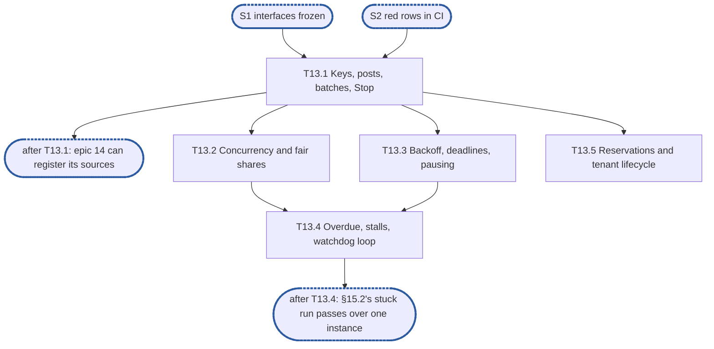

# Epic 13: engine offload shared work scheduler

**Sources:** [RFC 8](../docs/internals/rfcs/rfc-8-engine.md) §6.1.1 (the scheduler, whole, as
#5877 amended it with `Key.ID`, `TenantID`, `Clock` and `Loop`, and as this pull request amends
its `Stats` and its idle sentence), the rules of §6.1 it carries out (posting never blocks, a key in at most one run),
§6.3's paused tenant and O2, §2.3's `CancelTenant` and `WaitTenant` at `Drop` and `Unbind`, §2.5's
stop step 2 (`Stop`), §13's E41 and the scheduler's half of E23, §14's `engine_queue_*` and
`engine_work_*` series, §15.2's "§6.1.1 a stuck run" over one instance, and §15.3's `ponytail:` on
table checks; [RFC 25](../docs/internals/rfcs/rfc-25-observability.md) §3.5, the watchdog loop
it turns; [RFC 24](../docs/internals/rfcs/rfc-24-resources.md) §5.1's row for background work
items; [RFC 0](../docs/internals/rfcs/rfc-0-data-lifecycle.md) §9.2, retries bounded by time;
[epic 11's document](rfc-8-offload-engine-epic11.md) D3, `Register`'s refusals.
**Track:** A.
**Epic 13 estimate: 5 subtasks, 20.5 man-days.**
**Depends on:** **S1**, interfaces frozen: epic 11's T11.1 lands `pkg/workqueue`'s surface with
stub bodies and its import walk; #5877, merged, amended RFC 8 §6.1.1 with `Loop`, `Clock`,
`TenantID` and `Key.ID [16]byte`. **S2**, where track A starts. No component, journal or store:
the package is a library over the standard library.
**Blocks:** epic 14, which registers the engine's offload and removal sources on one instance per
journal, hands it a watchdog loop, fills `JournalStats.Work` from `Stats` and turns §15.2's "§6.1.1
a stuck run" and "§8.1 removal wedge" rows green over the engine's instances; epics 16 and 18
through epic 14 (`Paused`, `CancelTenant`, `WaitTenant`, a lowered `BackoffMax`); epic 20, whose
`work_queue_stalled` condition reads `Stats.Stalled`; GC (RFC 9), which instantiates the package
unchanged.

---

## 1. Goal

Epic 13 fills the bodies epic 11 stubbed: `pkg/workqueue` dispatches background work as RFC 8
§6.1.1 specifies (§3 numbers every rule), for any component that instantiates it, holding no
durable state. At the end of the epic, §15.2's "§6.1.1 a stuck run" passes over one instance, and
epic 14 can put the engine's sources on it.

### 1.1 In scope

Every behaviour behind `pkg/workqueue`'s exported surface; the `Stats` fields this pull request
adds to §6.1.1 (D8); the package's tests, its test workload and its
fault-injecting clock; the markers of §6.1.1 and §15.3 at their code sites.

### 1.2 Out of scope

- The engine's two sources, their `Rebuild`s from `DirtyFiles` and the unfinished-removal index,
  the events that post (`Dirty`, the age tick, `Pressure`, `RemovalPending`), the rescan that
  re-derives dropped work, the limits and tenant weights the engine registers (`Deadline` 0 for
  O2, equal share budgets, a `Total` per source that holds the journal's shards and sums to RFC 13's
  fixed 262,144 entries per instance), one instance per journal, `Deps.Watchdog` and closing the
  loop after `Stop`: epic 14.
- Turning `Stats` into `JournalStats.Work` and the §14 series' labels: epic 14 fills the field, and
  the integration epic adapts it into the node's series, including keeping a cancelled tenant's
  counters (§9).
- Raising `work_queue_stalled` as an engine condition from `Stats.Stalled`: epic 20, with the
  engine's other conditions; epic 14's "§6.1.1 a stuck run" row asserts it.
- The engine's use of `Paused` for a put-unhealthy store, and of `CancelTenant` and `WaitTenant` at
  `Unbind` and `Drop`: epic 16.
- Positive-rate pacing and the pace a `Throttled` result lowers: deferred to RFC 9 with GC's sources,
  the offload plan's §6.1 ledger row "Positive-rate pacing in `pkg/workqueue`".
- Fuzz or model targets for the state table: unowned, the ledger row "Fuzz or model targets for the
  queue's keys and the pacing law"; the state table is checked by its table (rule 2).
- GC's instance, its sources and their limits: RFC 9.

### 1.3 Names used here

- **S1**, interfaces frozen: the end of epic 11, whose T11.1 lands the surface this epic fills.
- **S2**, red rows in CI: the end of epic 12; track A starts here. No red row is this epic's.
- **RFC 8 E23** and **RFC 8 E41**: invariants of RFC 8 §13 (the rebuild, and one run per key), not
  epics.
- **The integration epic**, epic 21: the node composes offload and adapts each component's
  `Stats` into its series.
- **The first part**: the journal-only engine, epics 1 to 10 of RFC 8's first plan; its profiling
  harness (`internal/prof`) and test clock (`pkg/sim`) are used here.

## 2. How the general rules apply

The rules are those of [the offload plan's §1.5](rfc-8-offload-engine-plan.md#15-general-rules-for-each-epic),
cited by number and title and not copied.

| Rule | Subtasks | How |
| --- | --- | --- |
| rule 1, independent unit tests ([`CLAUDE.md`, "Writing tests"](../CLAUDE.md#writing-tests)) | all | `unit` tests of `pkg/workqueue` under `-race`, over `sim.TestClock` (kind 1), RFC 25's real `*health.Watchdog`, the package's test workload (D9) and a fault-injecting clock around `sim.TestClock` (kind 3). No engine, journal or store, and no internal interface for a test to stand in for |
| rule 2, fuzz the key and ref decoders the queue's rebuild reads | T13.1 | no decoder here: keys arrive as typed values. The state table is checked by its table, and RFC 8 §15.3's `ponytail:` goes at its code site |
| rule 3, observability follows RFC 25 | T13.1, T13.3, T13.4, T13.5 | the library owns the `engine_queue_*` and `engine_work_*` series as `Stats` fields per source and tenant (epic 11's D6); it registers no series and opens no span; epic 14 fills `JournalStats.Work` from them |
| rule 4, profiling | all | each test's parent runs under `prof.Watch` (never its subtests), which fails on a dispatcher goroutine or a run `Stop` left behind |
| rule 5, public interface and internals ([`CLAUDE.md`, "Verifying a change"](../CLAUDE.md#verifying-a-change)) | all | each rule is asserted where a source meets it: the batches its `Run` receives, the `Stats` its owner reads, the liveness the watchdog answers. Concurrency under `-race` in T13.1, T13.2 and T13.5 |
| rule 6, known failures shrink | none | no row of `known.yaml` is this epic's: §15.2's "§6.1.1 a stuck run" over the engine's instances is epic 14's, and the instance half here lands green in `unit`, which keeps no known list |
| rule 7, v2 ignores v1, and the engine imports only what RFC 0 §1.2 allows | T13.1 | production files import the standard library only, as T11.1's walk holds; T13.1 also refuses `os`, `io/fs`, `net` and `database/sql` there (R2). Tests import `pkg/health`, `pkg/sim` and `internal/prof` |
| rule 8, real dependencies for properties of those dependencies | none | the package has no dependency: its clock and loop are inputs, and the watchdog in its tests is RFC 25's real one |
| rule 9, code comment conventions ([`CLAUDE.md`, "Code comments"](../CLAUDE.md#code-comments)) | T13.1 to T13.5 | §6.1.1's no-borrowing `decision:` at the reservation (T13.5); §15.3's `ponytail:` at the state table (T13.1); epic 11's D3 `decision:` at `Register` kept (T13.1); this document's markers as §4 names them |
| rule 10, a test must be able to fail | all | each test names the break it catches; none asserts a stub's answer |
| rule 11, a symbol is exported only if the RFC's interface uses it | T13.1, T13.4 | nothing is exported but §6.1.1's surface and D8's three `Stats` fields; the run context, the heaps and the stride passes are unexported |
| rule 12, each subtask creates only what it declares | all | each `Stats` field lands with the subtask that fills it; the test workload and the fault-injecting clock land with their first tests |

## 3. Requirements and invariants

Every obligation RFC 8, RFC 25, RFC 24 and RFC 0 place on the scheduler, numbered so subtasks and
tests can cite them. "§6.1.1" is RFC 8's unless another RFC is named; "(as amended)" means as
#5877 and this pull request (D8, D14) amend it.

**The library**

| # | Requirement | Kind | Source | Subtasks |
| --- | --- | --- | --- | --- |
| R1 | Each component runs its own instance and the package keeps no state outside one, so one instance's stalled runs never hold up another's dispatch | invariant | §6.1.1 | T13.1 |
| R2 | The scheduler holds no state a restart needs: every item is a hint about durable state its source holds, and it writes nothing durable | MUST NOT | §6.1.1 | T13.1 |

**Keys and their states**

| # | Requirement | Kind | Source | Subtasks |
| --- | --- | --- | --- | --- |
| R3 | Posts for one key merge: the scheduler holds at most one entry per key, and a post for a pending key keeps the earlier not-before | MUST | §6.1.1, §6.1 | T13.1 |
| R4 | A post for a running key sets its redo mark and nothing else; its `Done` then moves it to pending at once if the mark is set, and to absent otherwise | MUST | §6.1.1, §13 E41 | T13.1 |
| R5 | A key is in at most one run at once | invariant | §13 E41, §6.1 | T13.1 |
| R6 | A post for a key in backoff sets its redo mark and never moves its time earlier, so a re-derived post never resets the backoff to `BackoffMin` | MUST NOT | §6.1.1, §13 E41 | T13.3 |
| R7 | `Post` never blocks and never grows with the bytes behind a key; it answers false when refused (D10 names the causes) or when dropped and counted | MUST | §6.1.1, §6.1; RFC 24 §5.1 | T13.1, T13.5 |
| R8 | An item whose `NotBefore` is zero is due now; none is dispatched before its not-before | MUST | §6.1.1 | T13.1 |

**Batches and completion**

| # | Requirement | Kind | Source | Subtasks |
| --- | --- | --- | --- | --- |
| R9 | A `Run` receives up to `Batch` pending items of one source, never two of one key and never one whose key is running | MUST | §6.1.1 | T13.1 |
| R10 | `done` moves its item's key at once, so one slow item holds back no other in its batch | MUST | §6.1.1 | T13.1 |
| R11 | An item its `Run` returns without `done` is a `Retry` | MUST | §6.1.1 | T13.3 |
| R12 | The outcome alone decides what follows an item; its `Err` changes nothing | MUST | §6.1.1 | T13.1 |
| R13 | A batch's successes are never retried with its failures | MUST NOT | §6.1.1 | T13.3 |

**Retries**

| # | Requirement | Kind | Source | Subtasks |
| --- | --- | --- | --- | --- |
| R14 | `Retry` and `Throttled` back the key off with jitter, doubling from its tenant's `BackoffMin` to `BackoffMax`, and `Done` resets it; this is the only backoff a source's work has | MUST | §6.1.1, §6.3 O2 | T13.3 |
| R15 | Lowering a tenant's `BackoffMax` pulls each of its keys in backoff in to at most now plus the new cap; nothing else shortens a backoff | MUST | §6.1.1 | T13.3 |
| R16 | `Deadline` bounds an item's retries by time, never by an attempt count; 0 retries it for as long as its source asks | MUST | §6.1.1, §6.3 O2; RFC 0 §9.2 | T13.3 |
| R17 | At its `Deadline` an item is counted in `Expired` and dispatched once more with `Expired` set, never dropped silently | MUST | §6.1.1 | T13.3 |
| R18 | Every source registers `Rate` 0 while positive-rate pacing is deferred, and until then `Throttled` backs its key off as `Retry` does; `Register` refuses a `Rate` other than 0 with a panic naming the field | MUST | §6.1.1 (as amended); epic 11's D3 | T13.1, T13.3 |

**Runs that do not return**

| # | Requirement | Kind | Source | Subtasks |
| --- | --- | --- | --- | --- |
| R19 | Every `Run`'s ctx carries `RunTimeout` | MUST | §6.1.1 | T13.4 |
| R20 | A `Run` still running at twice `RunTimeout` is overdue: counted once in `OverdueRuns` (`engine_work_runs_overdue_total`), held in `Overdue` while it runs, its tenant `Stalled`, naming the source and the tenant; it keeps its slot | MUST | §6.1.1 (as amended), §14 | T13.4 |
| R21 | A source whose entries have been due with none of them dispatched for 5 minutes is stalled too: `Stalled` is set on the tenant holding its oldest due entry | MUST | §6.1.1 (as amended) | T13.4 |

**The watchdog loop**

| # | Requirement | Kind | Source | Subtasks |
| --- | --- | --- | --- | --- |
| R22 | The scheduler turns its loop (`Turn`) after each dispatch and each run's return, from the dispatcher, so a dispatcher that stops turns no loop however many runs return | MUST | §6.1.1 (as amended); RFC 25 §3.5 | T13.4 |
| R23 | It withholds `Idle` only while an entry is dispatchable now (due, and its tenant and source under their bounds), or while a source with entries due has every slot held by an overdue run (D14: the slots of the entry's source); otherwise it reports `Idle`, and while it waits it repeats `Idle` at least every 30 s; so a lost wakeup with entries due and a slot free, or a source whose slots all hold overdue runs, fails liveness within the watchdog's 60 s | MUST | §6.1.1 (as amended); RFC 25 §3.5 | T13.4 |
| R24 | §15.2's "§6.1.1 a stuck run", over one instance: with two tenants holding work, a `Run` of one that ignores its ctx in every slot that tenant may hold makes `work_queue_stalled` (`Stalled`) name its source and tenant within twice `RunTimeout`, `engine_work_runs_overdue_total` (`OverdueRuns`) rise, and the other tenant's work still run; every slot of a source held by overdue runs, and separately one dispatch wakeup lost with entries due and a slot free, each fail liveness within 60 s | test row | §15.2; §6.1.1 (as amended) | T13.4 |

**Concurrency and fairness**

| # | Requirement | Kind | Source | Subtasks |
| --- | --- | --- | --- | --- |
| R25 | At most `Concurrency` runs per source, and per tenant at most max(1, ⌈`Concurrency` × its weight ÷ the weights of the source's tenants with work⌉), so a slow or throttled tenant holds only its own slots | MUST | §6.1.1 | T13.2 |
| R26 | Under contention, sources receive dispatch in proportion to their `Weight`, and a source's tenants in proportion to theirs | MUST | §6.1.1 | T13.2 |

**Reservations**

| # | Requirement | Kind | Source | Subtasks |
| --- | --- | --- | --- | --- |
| R27 | An instance holds a fixed total of entries, all of it reserved: each source its `Total`, and within it each tenant max(1, ⌊`Total` × its weight ÷ the source's weights⌋) | MUST | §6.1.1; RFC 24 §5.1 | T13.5 |
| R28 | A post for an absent key whose tenant holds its reservation is dropped and counted in `Dropped`; it never takes another tenant's entry, and no tenant borrows another's reservation | MUST NOT | §6.1.1 | T13.5 |
| R29 | The total also bounds the tenants a source serves: a `SetTenant` that would take its source's reservations past `Total` is refused with a named cause; a `SetTenant` that shrinks a tenant's reservation below the entries it holds drops the excess not in a run (D13), so the source's entries stay within `Total` plus its runs in flight | MUST | RFC 24 §5.1; §6.1.1 | T13.5 |
| R30 | A `Paused` tenant has none of its entries dispatched, keeps them, so pausing loses no work, and grows no backoff | MUST | §6.1.1, §6.3 | T13.3 |

**Sources and tenants**

| # | Requirement | Kind | Source | Subtasks |
| --- | --- | --- | --- | --- |
| R31 | A source is registered before `Start`, its `Limits` fixed for its life, and dispatch begins at `Start` | MUST | §6.1.1 | T13.1 |
| R32 | `SetTenant` adds a tenant, running its source's `Rebuild` for it, whose posts take the tenant's reservation, so a tenant the node gains has its work rebuilt; or changes a tenant live, its weight, backoff and pause applying without a restart; it refuses a `Weight` below 1, a `BackoffMin` not positive and a `BackoffMax` below `BackoffMin` with an error naming the field (D10) | MUST | §6.1.1, §13 E23 | T13.1, T13.3 |
| R33 | `CancelTenant` drops the tenant's entries and cancels its runs, so no entry of the tenant is dispatched once it returns, and refuses the tenant's posts until `SetTenant`; a cancel during the tenant's `Rebuild` wins | MUST | §6.1.1, §2.3 | T13.5 |
| R34 | A `StopTenant` result acts as `CancelTenant` for its item's tenant | MUST | §6.1.1 | T13.5 |
| R35 | `WaitTenant` returns once every run of the tenant in flight at the call has returned | MUST | §6.1.1, §2.3 | T13.5 |
| R36 | `Stop` refuses dispatch, cancels every run and joins them | MUST | §6.1.1, §2.5 | T13.1 |
| R37 | `Stop` is bounded by its ctx: a run that ignores its cancel leaves `Stop` returning the ctx's error at its end, with nothing dispatched after the call | MUST | §6.1.1, §2.5 | T13.1 |
| R38 | `Stats` reports, per source and tenant, the entries pending, in backoff and running, the runs in flight, the overdue runs, the age of the oldest entry due and not dispatched, the items dropped and expired, and the time the last run returned: the `engine_queue_*` and `engine_work_*` series the library owns | MUST | §6.1.1 (as amended), §14 | T13.1, T13.3, T13.4, T13.5 |

## 4. Decisions this epic takes

- **D1, a batch holds one tenant's items, oldest due first.** §6.1.1 says "one source" and leaves
  the tenant open. One tenant per batch is what lets per-tenant concurrency count runs (R25), lets
  `CancelTenant` cancel a tenant's runs without touching another's, and matches the engine's pass,
  which serves one shard. Changing it after epic 14 would rewrite the engine's `Run`, which assumes
  one shard. No marker: the doc comment of `Run` says it. Prior art: client-go's workqueue hands
  out one key at a time, oldest first (from memory); none found for batches.
- **D2, fairness is two-level stride scheduling, counted in items.** Each source with dispatchable
  work holds a pass advanced by the items it was given ÷ its `Weight`, and each of its tenants a
  pass advanced the same way by the tenant's weight; the dispatcher serves the lowest pass at each
  level, among those with a free slot (R25). A source or tenant that becomes active joins at the
  current lowest pass, so idle time earns no credit. `ponytail:` at the pick: it scans a source's
  tenants, O(tenants) per dispatch, and counts items, not `Cost`, so a source whose items are
  heavier gets more work per share; upgrade to a heap of passes when a profile at the engine's
  10⁴ shares shows the scan, and to `Cost` with positive-rate pacing (RFC 9), which gives `Cost`
  its first reader. Prior art: Waldspurger and Weihl's stride scheduling (1995) and Linux CFS's
  placement of a waking thread at the minimum virtual runtime (from memory).
- **D3, jitter is a hash, not a random source.** `New` takes no random source and §6.1.1 freezes
  it, so the delay of a key's n-th consecutive failure is drawn in [d/2, d], d = `BackoffMin`
  doubled n − 1 times and stopped at `BackoffMax` (doubling stops at the cap, so no failure count
  overflows it), from an FNV-1a hash of the key and n. Two keys failing together spread apart, a
  test knows every delay exactly, and no global state is read. RFC 3's epic 4 breakdown (#5998, its
  D3) takes the same kind of rule for the syncer's retries, as the user decided: an FNV-1a hash of
  the store, the block name, the retry's kind and its attempt. `decision:` at the delay
  function, withdrawn if a measurement shows keys of one tenant retrying in lockstep. Prior art:
  "equal jitter" in AWS's "Exponential Backoff And Jitter" (from memory).
- **D4, a `Deadline` counts from the key's first failure since it last left.** The clock starts at
  the first `Retry` or `Throttled` after the key entered or after its last `Done`; a failure whose
  next delay would end past the deadline is dispatched at the deadline instead, with `Expired` set,
  and counted. Whatever that run reports, the key leaves, unless its redo mark is set, in which
  case it is pending at once as new work with no deadline running. `decision:` at the expiry,
  withdrawn if GC, its first source with a deadline, needs an expired item kept. Prior art: none
  found. The engine registers 0, so only GC's sources meet it.
- **D5, one wait on the clock per instance, and a run's deadline on it.** `Clock.After` has no
  stop, and `context.WithTimeout` runs on real time, which a test clock cannot advance. So the
  dispatcher holds one wait, re-armed after each pass for the earliest of: the next not-before,
  the next backoff end, the earliest run deadline or overdue point, the 5-minute stall point and
  the 30-second heartbeat. Each run gets an unexported context, wrapping a `context.WithCancel`,
  whose `Deadline` is the clock's start of the run plus `RunTimeout` and whose `Err` the
  dispatcher sets to `context.DeadlineExceeded` when its wait passes that point, so a source that
  reads `ctx.Err()` sees what it would under `WithTimeout`. Due times are kept on the clock's
  `Elapsed`, a `NotBefore` converted once at `Post`, so a step of the wall clock moves no entry.
  `ponytail:` at the wait: a superseded `After` stays armed until its time passes, one per pass at
  most; upgrade to a clock with a stoppable timer if a profile shows them. Prior art:
  benbjohnson/clock's mock `WithTimeout` (from memory).
- **D6, the idle heartbeat never dispatches.** The scheduler wakes at least every 30 s to repeat
  `Idle`, and that wakeup only reports: it dispatches nothing. A heartbeat that dispatched would turn
  a lost wakeup into a hidden 30-second delay, which RFC 25 §3.5's decision says the work scheduler
  must not do: it is the one loop whose lost wakeup fails liveness. `decision:` at the heartbeat,
  overturned with RFC 25's decision. Prior art: none found.
- **D7, a paused tenant's entries are not due.** They are kept (R30), but excluded from
  `OldestPending`, from the idle rule (R23) and from the 5-minute stall (R21): pausing is the
  consumer's answer to an outage that its own condition reports, and a deliberate pause must not
  fail liveness or raise `work_queue_stalled`. `decision:` at the due test, withdrawn if a pause ever
  outlives the outage that caused it unnoticed. Prior art: none found.
- **D8, `Stats` gains `Runs`, `OverdueRuns` and `Stalled` (the user's decision, 2026-11-26).** The
  frozen `Stats` cannot feed three of the things §14 and §6.1.1 ask of it. `Running` is one count,
  but §14 reports both the entries in the running state (`engine_queue_entries{state}`) and the runs
  in flight (`engine_work_runs_inflight`), which differ once a run holds a batch. `Overdue` is a
  gauge of runs overdue now, but `engine_work_runs_overdue_total` is a counter, and a gauge misses a
  run that returns between two reads. And no `Stats` field tells when a source last dispatched, so
  a reader cannot raise `work_queue_stalled`'s 5-minute half at all: `OldestPending` reaching 5
  minutes does not mean nothing was dispatched for 5 minutes. This pull request amends §6.1.1:
  ```go
  type Stats struct { // per source and tenant
      Pending, Backoff, Running, Runs, Overdue int // entries by state; Runs: runs in flight; Overdue: runs overdue now
      OldestPending                            time.Duration
      Dropped, Expired, OverdueRuns            uint64 // OverdueRuns: runs that passed twice RunTimeout, each counted once
      Stalled                                  bool   // work_queue_stalled: a run of the tenant overdue, or the source's due entries undispatched for 5 minutes, the oldest the tenant's
      LastDone                                 time.Time
  }
  ```
  The scheduler decides the stall, the engine's epic 20 and GC turning `Stalled` into their
  `work_queue_stalled`, and the rule stays in one place. Rejected: a per-source `LastDispatch` that
  each consumer turns into the condition, which copies the 5 minutes and the rule into the engine
  and GC; and turning `Overdue` into the counter with `Running` counting runs, one field smaller but
  losing §14's running entries and a reader's way to tell one stuck run from five. Changing it after
  epic 14 fills `JournalStats.Work` would touch each reader. No marker.
- **D9, the tests drive the scheduler with a workload, not a double.** The scheduler calls a
  `Source`; it relies on it for nothing but the work. The package's one test workload,
  `source_test.go`, delivers each batch it is handed on a channel (the scheduler's output) and
  answers each item with the outcome, the block or the late `done` the test hands it (the test's
  input, as RFC 8 §15.2's row asks of a run that ignores its ctx). It stands in for no dependency, so
  it has no conformance suite. Tests synchronise on those channels and on a per-instance hook, set
  from `export_test.go`, that delivers the end of each dispatcher pass, since D5's single wait has
  no duration a test could name to `sim.TestClock.Armed`; a test that shows nothing was dispatched
  advances the clock past the deadline and waits for that pass rather than for time. A lost wakeup
  is a kind-3 wrapper around `sim.TestClock` that forwards one `After` to the inner clock, so the
  test's view of armed waits stays true, and returns a channel that never closes. Liveness is RFC
  25's real `*health.Watchdog`, which fails strictly past 60 s, so the liveness legs advance past
  it. Prior art: none found.
- **D10, what `SetTenant` and `Post` refuse, and when a `Rebuild` runs.** `Post` answers false for
  an unknown source or tenant, a cancelled tenant and a stopped scheduler, and for a drop; nothing
  else refuses. `SetTenant` adding a tenant runs `Rebuild` without the scheduler's lock, so posts to
  other tenants never wait on it; the tenant's own posts during it, its `Rebuild`'s and any other,
  are staged as entries are held: a post for a staged key merges into it, and a post for a new key
  past the tenant's reservation is dropped and counted, so staging holds at most the reservation; the
  staged entries take effect when `Rebuild` returns nil. A `Rebuild` error leaves the tenant absent, its staged entries dropped, so
  the caller sees one state for one answer and retries the whole call; a `CancelTenant` during the
  `Rebuild` marks it cancelled, and `SetTenant` then returns `context.Canceled` and adds nothing.
  `SetTenant` refuses, before any change, a `Weight` below 1 (a reservation and a stride pass divide
  by it), a `BackoffMin` not positive (a delay doubling from 0 stays 0 and retries a failing key in a
  hot loop) and a `BackoffMax` below `BackoffMin`, with an error naming the field rather than a
  panic, since the backoff comes from settings (`offload.retry_*`). No marker. Prior art: none found.
- **D11, `Result.Err` is the source's to report.** `New` takes a clock and a loop, no logger or
  sink, so the scheduler reads only the outcome (R12) and drops `Err`; the source that set it holds
  its own logs and conditions, as the engine's do. `decision:` at `done`, withdrawn if a consumer
  needs the scheduler to keep the last error per tenant. Prior art: none found.
- **D12, misuse panics, as epic 11's D3 decides for `Register`.** `Register` after `Start`, a `done`
  for an index outside its batch, a second `done` for one item, or one after its `Run` returned is
  a programming error of the source and panics naming it (a `done` from a run of a cancelled
  tenant is not: T13.5 ignores it); nothing a setting or a peer controls reaches one. Kept under
  D3's `decision:` at `Register`. Prior art: `sync.WaitGroup`'s negative counter panic (from memory).
- **D13, the reservations never exceed the total.** A tenant "with work" (R25) has an entry due or
  a run in flight; a reservation (R27) divides by the weights of all the source's tenants, since it
  must not move with load. R27's floor of one entry per tenant can take the sum of a source's
  reservations past its `Total` when weights are uneven, which RFC 24 §5.1's "all of it reserved"
  forbids, so `SetTenant` refuses an addition or a reweighting that would, naming the source and its
  total (R29): the strict total holds, and with equal weights any number of tenants up to `Total`
  fits. An addition or a reweighting that shrinks a tenant's reservation below the entries it holds
  drops the excess at once, counted in `Dropped` as a post past the reservation is: pending entries
  first, then entries in backoff, latest due first, never an entry in a run; an entry in a run whose
  tenant is still above its reservation leaves when its run returns, its redo mark dropped and
  counted. Evicting nothing would let the entries grow past `Total`: with equal weights, each tenant
  added after the others filled their reservations keeps them full, so `Total` × (1 + ½ + … + 1/N)
  entries for N tenants, about 25 for a `Total` of 12 and four tenants, against RFC 24 §5.1's fixed
  total. The sources re-derive what is dropped (§6.1.1); an evicted key in backoff loses its backoff,
  so its re-derived post is due at once, the one case where a post brings a retry earlier. Ceiling:
  the source holds at most `Total` plus its runs in flight, at most `Concurrency`, the excess only
  until those runs return. `decision:` at the reservation, beside §6.1.1's no-borrowing one,
  withdrawn if a consumer needs more tenants than the formula fits. Prior art: none found.
- **D14, an entry waits for its source's slots (the user's decision, 2026-11-26).** R23 lets the
  scheduler report idle "while every slot it waits for holds a run that is not overdue". Read as
  the entry's tenant's slots, one tenant whose runs all hang withholds `Idle` for the whole
  instance, and once the other tenants drain, liveness fails and the node restarts for one stuck
  shard, against §6.1.1's "a slow or throttled tenant holds only its own slots" and RFC 25 §3.5's
  "no dependency fails liveness". Read as the source's slots, the idle rule withholds `Idle` only
  for a lost wakeup or a source whose every slot is overdue, which is exactly §15.2's row; one
  tenant's stuck runs raise `Stalled` (R20) and stay visible. Ceiling, named in the `decision:`:
  R25's bound divides by the tenants with work, so once the others drain the hung tenant's bound
  grows to the whole `Concurrency`, its next due keys take the free slots and hang too, and the
  source reaches every slot overdue, which fails liveness under either reading. One hung tenant is
  spared only while another tenant holds work. The ceiling is recorded and R25's bound is not
  changed to lift it. Rejected: the tenant's slots, under which a single shard whose store hangs
  every run restarts the node once the other shards drain. RFC 8 §6.1.1's idle sentence, and RFC
  25 §3.5's restatement of it, say R23's rule: idle unless an entry is due that its tenant's and its
  source's bounds let it dispatch, or every slot of a source with entries due is overdue; the
  earlier wording, "every slot of the entry's source", withheld `Idle` for a tenant at its own bound
  while its source had a slot free. `decision:` at the idle rule. Prior
  art: none found.

## 5. Target tree

On `feat/storage-v2`.

```text
pkg/workqueue/
  workqueue.go        T11.1  the surface; T13.1 New, Register, Start, Post, Stop, Stats filled, Stats gains Runs; T13.4 OverdueRuns, Stalled
  entry.go            T13.1  a key's states and the merge of posts (§15.3's ponytail: here); T13.3 backoff and expiry
  dispatch.go         T13.1  the dispatcher, its one wait, batches and done; T13.2 concurrency and stride passes; T13.4 Turn, Idle, the heartbeat
  backoff.go          T13.3  the jittered delay (D3)
  run.go              T13.1  a run's goroutine and context; T13.4 the deadline on the clock (D5), overdue and stall
  tenant.go           T13.1  SetTenant's add and change; T13.5 reservations, CancelTenant, StopTenant, WaitTenant
  imports_test.go     T11.1  the walk; T13.1 refuses os, io/fs, net and database/sql in production files
  export_test.go      T13.1  the per-instance dispatch-pass hook (D9)
  source_test.go      T13.1  the test workload (D9)
  clock_test.go       T13.4  the clock that loses one After (kind 3)
  state_test.go       T13.1  the state table, merges, batches, done, Stop
  fair_test.go        T13.2  concurrency bounds and shares
  backoff_test.go     T13.3  backoff, deadlines, pausing
  liveness_test.go    T13.4  run deadlines, overdue, stall, the watchdog rules and §15.2's stuck run
  tenant_test.go      T13.5  totals, drops, the tenant bound, cancel, StopTenant, wait
docs/internals/rfcs/rfc-8-engine.md   this pull request: §6.1.1's Stats gains Runs, OverdueRuns and Stalled (D8);
                                      its idle sentence states R23's rule (D14)
```

## 6. Subtasks

### T13.1 Keys, posts, batches and `Stop`

**Subtask T13.1 estimate: 5 man-days.**

- **Track:** A. **Depends on:** S1, S2.
- **Covers:** R1, R2, R3, R4, R5, R7, R8, R9, R10, R12, R18, R31, R32, R36, R37, R38.
- **Deliverables:** the bodies of `New`, `Register` (epic 11's D3 refusals, `Register` after
  `Start` added, D12), `Start`, `Post`, `SetTenant` for a new tenant (its `Rebuild` outside the
  lock, D10) and for a changed one (stored, read by T13.2 and T13.3), `Stop` and `Stats`; one
  dispatcher goroutine per instance, woken by a one-slot channel and by D5's one wait; entries per
  tenant in a map with a heap by due time (D1); the state table of §6.1.1 for absent, pending and
  running, `Done` moving a key to absent or, with its redo mark, to pending; one goroutine per run,
  whose context `Stop` cancels; `done` applied at once under the scheduler's lock, `Err` dropped
  (D11). `Retry`, `Throttled` and an item returned without `done` move to backoff with T13.3, so
  T13.1's tests answer `Done`. `Stats` fills `Pending`, `Running` (entries in a run),
  `OldestPending` and `LastDone`, and `Runs`, which `workqueue.go`'s `Stats` gains here (D8), with
  epic 11's export pin updated to match. The test workload, the dispatch-pass hook and the import
  walk's refusals (D9). Consumed by every later subtask and by epic 14, which registers its sources.
- **Acceptance criteria:**
  - Each row of §6.1.1's state table for absent, pending and running moves a key as the table says,
    and a post never makes two entries of one key.
  - A batch has at most `Batch` items, of one tenant, oldest due first, none of a running key, none
    before its not-before.
  - A slow item in a batch holds back no other: the others' keys move when their `done` arrives.
  - `Post` called from many goroutines while runs complete returns without waiting on a run or on
    another tenant's `Rebuild`.
  - `Stop` returns once every run has returned, its context cancelled; with a run that ignores its
    cancel, it returns its ctx's error at the ctx's end and dispatches nothing more.
  - Two instances are independent: one whose runs block dispatches nothing of the other's.
- **Tests:** at the batches the test workload receives and at `Stats`, over `sim.TestClock`
  (kind 1), each test's parent under `prof.Watch`: a table of the state table's rows, each a post or
  an outcome and the state the key reaches, read back from `Stats` and the next batch (catches a
  merge that makes a second entry, R3, or a redo lost, R4); `TestOneRunPerKey`, a `-race` test where many
  goroutines post the same keys while the workload records each key's concurrent runs, failing on
  two at once (catches R5's violation, RFC 8 E41; epic 14 relies on it and does not repeat it); a batch with one item blocked and the rest done, whose keys
  are posted again and dispatched while it blocks (catches done applied at the run's return, R10);
  a tenant's `Rebuild` held while its source posts the same key twice and then twice its
  reservation in new keys: once released, one entry for the repeated key and the tenant at its
  reservation, the rest counted in `Dropped` (catches staging that neither merges nor holds the
  reservation, D10);
  a batch of 3 items counted in `Runs` as 1 and in `Running` as 3 (catches the two counts merged,
  R38); a post with a future `NotBefore`, dispatched only once the clock passes it (R8); `Post` from
  64 goroutines while every run is blocked and another tenant's `Rebuild` is held, each call
  returning (catches a post that waits on the dispatcher or a `Rebuild`, R7); two instances, one
  with a run blocked, the other dispatching (R1); `Stop` with runs in flight, `prof.Watch` failing if
  one is left (R36), and `Stop` with a run ignoring its cancel, returning `context.DeadlineExceeded`
  from a ctx the test ends (catches a `Stop` that hangs, R37); an `Err` with `Done`, the key leaving
  as for a `Done` without one (R12); `Register` with each refused limit, and after `Start`,
  panicking with the field named (R18, R31); the import walk with a planted `os` import (R2). No
  test double.
- **Rules:** rule 2 and rule 9: §15.3's `ponytail:` at the state table, naming "one entry per key"
  as the property a model target would check; D5's `ponytail:` at the wait.

### T13.2 Concurrency and fair shares

**Subtask T13.2 estimate: 3 man-days.**

- **Track:** A. **Depends on:** T13.1.
- **Covers:** R25, R26.
- **Deliverables:** in `dispatch.go`, the per-source and per-tenant run bounds of R25, the tenants
  with work counted as D13 says, and D2's two-level stride passes with its `ponytail:`. Consumed by
  T13.4, whose stuck-run row needs a tenant's slots bounded, and by epic 14's tenant weights.
- **Acceptance criteria:**
  - A source never has more than `Concurrency` runs, nor a tenant more than R25's bound, while
    tenants gain and lose work.
  - With two sources of weights 1 and 3 and work queued for both, dispatch over 400 items splits
    within one batch of 1 : 3; tenants of one source split by their weights the same way.
  - A tenant that was idle does not take more than its share when it gains work.
- **Tests:** at the batches the workload receives: a table of weights and tenant counts, each
  asserting the in-flight maximum per source and per tenant (catches a missing or rounded-down
  bound, R25); a contended run of two sources and three tenants, counting the items each received
  against its weight within one batch (catches a dispatcher that serves in arrival order, R26); a
  tenant idle for 100 dispatches, then posting, whose next 20 dispatches stay within its share
  (catches credit for idle time). No test double.
- **Rules:** rule 9: D2's `ponytail:`.

### T13.3 Backoff, deadlines and pausing

**Subtask T13.3 estimate: 3 man-days.**

- **Track:** A. **Depends on:** T13.1.
- **Covers:** R6, R11, R13, R14, R15, R16, R17, R18, R30, R32, R38.
- **Deliverables:** the backoff state of §6.1.1's table, a post there setting redo and never moving
  its time; `Retry`, `Throttled` and an item returned without `done` backing off by D3's delay, with
  its `decision:`; `Done` resetting the key's attempt count; a lowered `BackoffMax` in `SetTenant`
  pulling the tenant's backed-off keys in; `Deadline` and `Expired` as D4 says, with its
  `decision:`; `Paused` holding entries undispatched and, by D7, not due, with its `decision:`.
  `Stats` fills `Backoff` and `Expired`. Consumed by T13.4 (the stall skips paused tenants), epic 14
  (`offload.retry_*`, the pressure cap) and epic 16 (the pause).
- **Acceptance criteria:**
  - A key failing n times waits D3's delay before each retry, never above `BackoffMax`, and its
    first wait after a `Done` is the first again.
  - A post to a key in backoff, from the key's source or a rebuild, never brings its retry earlier;
    lowering `BackoffMax` brings every backed-off key of the tenant to at most now plus the new cap,
    and raising it moves none.
  - A batch with one `Retry` and two `Done`s retries only the first.
  - With a `Deadline`, the item's last dispatch carries `Expired`, `Expired` counts it once, and the
    key leaves whatever that run reports; with `Deadline` 0 a key failing 10⁵ times is still
    retried at `BackoffMax`.
  - A paused tenant's entries stay through any number of ticks, none dispatched, its keys in
    backoff keep their delays, and dispatch resumes with every one when the pause lifts.
- **Tests:** at the batches and `Stats`, on `sim.TestClock`, advancing it to each expected retry
  and to one tick before it: `TestBackoffDoublesToItsCap`, the delays of ten consecutive failures
  against D3's formula (catches a delay that does not double, is not capped, or ignores the key,
  R14); the delay at the 10⁵-th
  failure, at most `BackoffMax` and positive (catches an overflowing doubling, R16); `TestPostNeverShortensBackoff`, a post
  during backoff, the key not dispatched before its time (catches a post that resets the backoff,
  R6; with the test above, the backoff epic 14 relies on); a
  lowered and a raised cap (R15); a batch of mixed outcomes and one item left without `done` (R11,
  R13); a `Deadline` of 10 min with every run failing, the `Expired` item seen once and counted
  (R17); a `Throttled` key backing off exactly as a `Retry` one (R18); a paused tenant with 100
  entries across ten heartbeat periods, then unpaused (catches an entry dropped or dispatched while
  paused, R30), and a key in backoff paused across its retry time whose next delay after the pause
  is the one before it (catches backoff grown while paused, R30); `SetTenant` changing `BackoffMin`
  live, the next failure using it (R32); a table of `SetTenant` calls with `Weight` 0 and −1,
  `BackoffMin` 0 and a `BackoffMax` below `BackoffMin`, each refused naming its field and the
  tenant unchanged (catches a division by zero or a hot-loop retry, R32, D10). No test double.
- **Rules:** rule 9: D3's, D4's and D7's `decision:` markers.

### T13.4 Overdue runs, stalls and the watchdog loop

**Subtask T13.4 estimate: 5 man-days.**

- **Track:** A. **Depends on:** T13.2, T13.3.
- **Covers:** R19, R20, R21, R22, R23, R24, R38.
- **Deliverables:** in `run.go`, D5's run context on the clock; the overdue check at twice
  `RunTimeout`, the run keeping its slot; the 5-minute stall per source over due entries, from the
  source's last dispatch, paused ones excluded (D7), set on the tenant with the oldest due entry.
  In `dispatch.go`, `Turn` from the dispatcher after each dispatch and each run's return it
  handles, `Idle` by R23's rule as D14 reads it, with its `decision:`, and the 30-second heartbeat
  that reports only (D6), with its `decision:`; `workqueue.go`'s `Loop.Idle` comment, now "waiting,
  with no entry due", says R23's rule. `workqueue.go`'s `Stats` gains `OverdueRuns` and
  `Stalled` with their comments (D8); `Stats` fills `Overdue`, `OverdueRuns` and `Stalled`. The
  fault-injecting clock of D9 in `clock_test.go`. Consumed by epic 14, which hands each journal's
  instance its loop and runs the row over the engine's instances, and epic 20.
- **Acceptance criteria:**
  - Every run's `ctx.Deadline()` is the clock's start of the run plus `RunTimeout`, and `ctx.Err()`
    is `context.DeadlineExceeded` once the clock passes it.
  - A run that ignores its ctx is overdue at twice `RunTimeout`, not before: `OverdueRuns` rises by
    one, `Overdue` is 1 until it returns, `Stalled` holds for its tenant only, and its slot is not
    reused.
  - A source whose due entries wait 5 minutes with none dispatched is `Stalled` on the tenant with
    the oldest; a paused tenant's entries raise nothing; `Stalled` clears at the next dispatch.
  - An idle instance, and a busy one whose slots hold runs that are not overdue, keep the watchdog
    live; §15.2's "§6.1.1 a stuck run" passes over one instance, each assertion of R24.
- **Tests:** at `Stats`, the workload's runs and RFC 25's real `*health.Watchdog` on the same
  `sim.TestClock`, each advance waited out with the dispatch-pass hook, and no test duration equal
  to the 30-second heartbeat:
  - a run blocked on a channel, the clock advanced to twice `RunTimeout` less a nanosecond and then
    past it (catches an overdue reported early or not at all, or counted twice, R20); its slot
    still held, the tenant's next entry waiting (catches a reclaimed slot);
  - a run that reads `ctx.Err()` at the deadline (catches a real-time deadline, R19);
  - with `RunTimeout` 10 min, so no run is overdue, a source held at its concurrency by long runs:
    `Stalled` false at 5 minutes less a nanosecond, true past 5 minutes on the tenant with the
    oldest due entry, and false with that tenant paused (catches the 5-minute half missing, measured
    per tenant, or counted while paused, R21, D7); a thousand tenants dispatched in turn faster than
    every 5 minutes, none `Stalled` (catches a stall raised under fair contention);
  - an idle instance, `Live` true after 10 minutes (catches a heartbeat that never repeats, R23);
    continuous short runs with a backlog always due for 10 minutes, `Live` true (catches a missing
    `Turn`, R22); every slot held by runs that are not overdue with entries due, `Live` true past
    60 s (catches an `Idle` rule that is too strict, R23);
  - §15.2's "§6.1.1 a stuck run" over one instance, one named test per leg, which epic 14 cites
    rather than repeats over the engine's instances (R24):

    | Leg | Test | Asserts | Catches |
    | --- | --- | --- | --- |
    | a stuck tenant | `TestStuckRunStallsItsTenant` | two tenants with work, every slot of one held by runs ignoring their ctx: `Stalled` for that source and tenant only within twice `RunTimeout`, `OverdueRuns` risen, the other tenant's items still dispatched | a stall reported late, for the wrong tenant, or a stuck tenant holding the other's slots |
    | every slot overdue | `TestEverySlotOverdueFailsLiveness` | every slot of the source held by overdue runs: `Live` false past 60 s | an `Idle` reported while every slot is overdue |
    | a lost wakeup | `TestLostWakeupFailsLiveness` | the clock wrapper loses the `After` of the dispatcher's wait for a due entry with a slot free: nothing dispatched, `Live` false past 60 s | a heartbeat that reports idle with work due, or that dispatches it (D6) |

  - two tenants holding work, `Concurrency` 4 and `RunTimeout` 10 min so no run is overdue: one
    whose two runs ignore their ctx, holding due entries at its R25 bound of 2; the other with one
    run in flight blocked on a channel and no entry due, so it still counts as a tenant with work
    (D13) and the first's bound stays 2; one slot free and no entry dispatchable: `Live` true past
    60 s (catches D14's reading
    reversed, which withholds `Idle` for the stuck tenant's due entries).

  The wrapper is kind 3, around the real test clock.
- **Rules:** rule 9: D6's and D14's `decision:` markers; rule 11: `OverdueRuns` and `Stalled` are
  D8's; rule 3: `OverdueRuns` is
  `engine_work_runs_overdue_total`.

### T13.5 Reservations and the tenant lifecycle

**Subtask T13.5 estimate: 4.5 man-days.**

- **Track:** A. **Depends on:** T13.1.
- **Covers:** R7, R27, R28, R29, R33, R34, R35, R38.
- **Deliverables:** in `tenant.go`, each tenant's reservation by R27, recomputed when a tenant is
  added, changed or cancelled; a post for an absent key past it dropped and counted in `Dropped`;
  `SetTenant` refusing what D13 refuses and evicting what it shrinks; §6.1.1's no-borrowing
  `decision:` and D13's beside it.
  `CancelTenant` dropping the tenant's entries, cancelling its runs' contexts and refusing its posts
  until `SetTenant`, winning over a `Rebuild` in progress (D10); the `StopTenant` outcome taking the
  same path; `WaitTenant` joining the runs in flight at the call; a tenant generation, so a `done`
  from a run of a cancelled tenant changes nothing of the tenant added back. `Stats` fills
  `Dropped`. Consumed by epic 14, whose age tick and rescan stop posting at a refused post, and epic
  16's `Unbind` and `Drop`.
- **Acceptance criteria:**
  - A tenant at its reservation drops a post for a new key, answers false and counts it, and still
    merges posts for keys it holds; a full tenant never takes an entry of another, even while the
    other's reservation is empty.
  - The sum of a source's reservations never exceeds its `Total`; a `SetTenant` that would is
    refused naming the source; a tenant whose reservation shrinks below its entries drops the excess
    not in a run, and with no run in flight the source never holds more than `Total`.
  - After `CancelTenant` returns, no item of the tenant is dispatched, its posts answer false, and
    each of its runs sees its ctx cancelled; `SetTenant` adds it back, rebuilt, with a fresh
    reservation; a cancel during its `Rebuild` leaves it absent.
  - A `StopTenant` from one item cancels the tenant's other runs and entries as `CancelTenant` does.
  - `WaitTenant` returns only after every run in flight at the call has returned, ignores runs
    dispatched after it, and returns `ctx.Err()` if its ctx ends first.
- **Tests:** at `Post`'s answer, `SetTenant`'s error, `Stats` and the workload's runs, under
  `-race`: a table of totals and weights, each asserting every tenant's reservation and the
  entries it can hold (catches a formula off by its rounding, R27); one tenant posting 10× its
  reservation while another is empty, `Dropped` counting the excess and the other's room unchanged
  (catches borrowing, R28); a post for a held key at a full tenant, merged and answered true (R7);
  `Total` + 1 tenants of equal weight, and a reweighting whose floors would pass `Total`, each
  refused (catches reservations past the total, R29); `Total` 12 and four tenants of equal weight
  added one at a time, each filled before the next is added, no run in flight: the source's entries
  never above 12 and the dropped excess counted (catches an eviction left out, R29, D13); a tenant with entries and runs in flight,
  cancelled, then posted to and advanced past every not-before (catches an entry dispatched after
  the cancel, R33); a `CancelTenant` while the tenant's `Rebuild` blocks, then the `Rebuild`
  released, the tenant absent (catches a cancel lost to a rebuild, R33); a late `done` from a
  cancelled run after `SetTenant` added the tenant back, its new entry unchanged (catches a
  generation mix-up); a `StopTenant` in a batch (R34); `WaitTenant` with two runs blocked, released
  one at a time, returning only after the second (catches a join that returns early, R35). No test
  double.
- **Rules:** rule 9: the two `decision:` markers; rule 4: `prof.Watch` catches a cancelled run
  whose goroutine `Stop` does not join.

## 7. Order of work



T13.2, T13.3 and T13.5 each need only T13.1; the order above finishes the liveness path first,
since epic 14's stuck-run row needs all of it.

## 8. Suggested pull requests

| PR | Subtasks | Man-days | After | Why together |
| --- | --- | --- | --- | --- |
| 1 | T13.1, T13.2 | 8 | — | a scheduler that dispatches, bounded and fair, which epic 14 can build on |
| 2 | T13.3, T13.4 | 8 | PR 1 | failures: backoff, deadlines, overdue runs and liveness, ending at §15.2's row |
| 3 | T13.5 | 4.5 | PR 1 | reservations and the tenant lifecycle; can be open beside PR 2 |

A suggestion only: one pull request per subtask works as well.

## 9. Open points

- **A cancelled tenant's counters leave `Stats` with it**, so a reader summing a source's tenants
  sees `Dropped`, `Expired` and `OverdueRuns` fall when a share is dropped. The integration epic,
  which adapts `Stats` into `engine_work_items_dropped_total` and its siblings labelled by source,
  keeps each source's departed tenants' last counts so the series stay monotonic.
- **For epic 14:** each source's `Total` must hold a reservation for every shard the journal
  serves, or `SetTenant` refuses a shard (D13), and the two sources' `Total`s sum to RFC 13's fixed
  262,144 entries per instance. `engine_lock_wait_seconds{area="work queue"}` has no scheduler
  figure: epic 14 times its `Post` calls, or asks for a `Stats` field in its own pull request. A lost
  wakeup over the engine's instances needs no scheduler hook:
  the engine fixture's clock wrapped as T13.4's is loses the dispatcher's wait. Epic 14 (#5992)
  takes the lost-wakeup leg as T13.4's `TestLostWakeupFailsLiveness` over one instance, and one run
  per key and the backoff as T13.1's and T13.3's named tests.
- **Estimate.** 20.5 man-days in 5 subtasks against the plan's 20 in 7: the plan's bullets merge
  where they share state (the overdue run feeds both the stall and the idle rule; the reservation
  is recomputed by cancelling), and the liveness tests grew by the busy-but-healthy cases. T13.2's
  fairness and T13.4's single wait are the least certain figures: a stride scheduler under
  per-tenant slot bounds may need a second pass at its tie-breaking.
